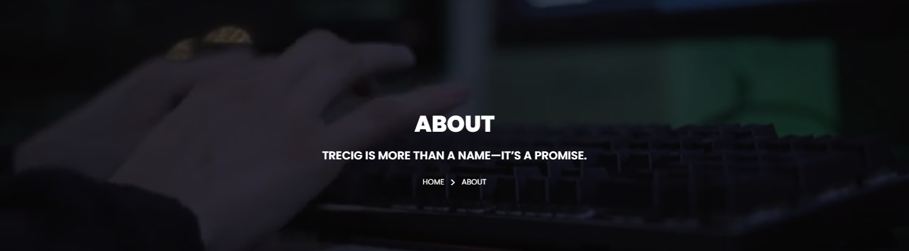
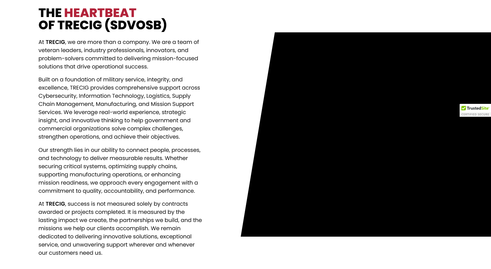
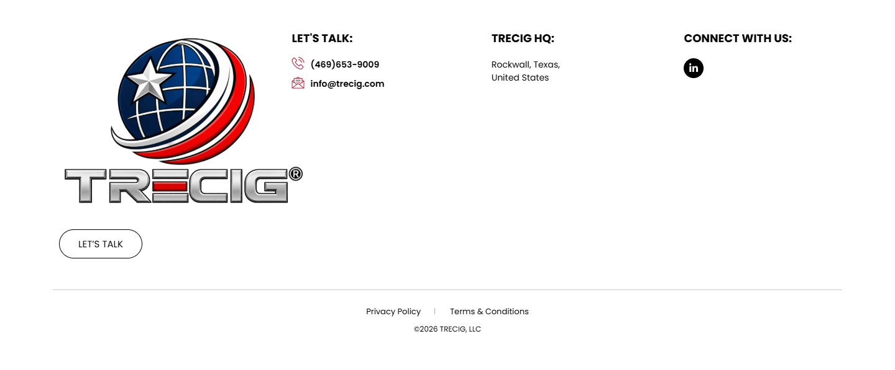

# About – TRECIG

*TRECIG (design reference site)* · URL: https://trecig.com/about/ · captured 2026-11-08 00:30:53 · HTTP 200

- **Meta description:** —
- **Page size (desktop 1440px):** 1440×1957 px · tablet (820px): 2209 px · mobile (390px): 2146 px
- **Screenshots:** [desktop](screenshots/desktop-full.png) · [tablet](screenshots/tablet-full.png) · [mobile](screenshots/mobile-full.png) · [desktop top](screenshots/desktop-viewport-top.png) · [desktop scrolled](screenshots/desktop-viewport-scrolled.png)
- **Files:** [raw.html](raw.html) (server HTML) · [rendered.html](rendered.html) (DOM after JS) · [content.txt](content.txt) (all visible text) · layout-*.json (full element tree with computed styles) · page.json (everything)

## 1. Section map (top → bottom, desktop 1440px)

| # | Role | Y from top | Height | Heading / first text | Mobile height | Screenshot |
|---|---|---|---|---|---|---|
| 0 | header | 0 | 170 | HOME ABOUT AWARDS & RECOGNITION EXPERTISE PRESS & MEDIA CONTACT | 170 | [img](screenshots/desktop-sec00-header.png) |
| 1 | section | 170 | 400 | ABOUT | 220 | [img](screenshots/desktop-sec01-section.png) |
| 2 | section | 570 | 790 | THE HEARTBEAT OF TRECIG (SDVOSB) | 1066 | [img](screenshots/desktop-sec02-section.png) |
| 3 | footer | 1360 | 598 | LET'S TALK: | 690 | [img](screenshots/desktop-sec03-footer.png) |
| 4 | floating (fixed, z 1000003) | 875 | 38 |  |  |  |

## 2. Section-by-section layout (desktop)

Legend: each line is an element in DOM order. `@x,y w×h` = position/size in px on the 1440px-wide page. Text lines show *font size/weight, line-height, colour*. Boxes show layout (flex/grid), background, padding, radius, shadow, etc. Pass-through wrappers are collapsed.

### 2.0 HEADER — HOME ABOUT AWARDS & RECOGNITION EXPERTISE PRESS & MEDIA CONTACT

Element: `<header class="elementor elementor-13 elementor-location-header">` at y=0, 1440×170px · 

- section.elementor-section [bg:#FFFFFF · shadow:#000000 @10% 0px 0px 12px 0px · z:9999 · transition:background, border, border-radius, box-shadow 0.3s, 0.3s, 0.3s, 0.3s ease, ease, ease, ease] `@0,0 1440×170`
  - div.elementor-container [flex row · margin:0px 85px 0px 85px · max-w:1270px] `@85,0 1270×170`
    - div.elementor-column [flex row · min-h:1px] `@85,0 1270×170`
      - div.elementor-widget-wrap [flex row wrap] `@85,0 1270×170`
        - div.elementor-container [flex row · max-w:1270px] `@85,0 1270×170`
          - div.elementor-column [flex row · min-h:1px] `@85,0 127×170`
            - div.elementor-widget-wrap [flex row wrap · align:center · pad:10px 10px 10px 10px] `@85,0 127×170`
              - a (link→/) [inline-block · align-text:center] `@95,10 200×150`
                - **IMG** `TRECIG_Logo_Registered.png` alt="" natural 1440×1080 · inline-block · max-w:200px · overflow:clip · align-text:center `@95,10 200×150`
          - div.elementor-column [flex row · min-h:1px] `@212,0 1143×170`
            - div.elementor-widget-wrap [flex row wrap · align:center · pad:10px 10px 10px 10px] `@212,0 1143×170`
              - div.elementor-widget-container [flex column · transition:background, border, border-radius, box-shadow, transform 0.3s, 0.3s, 0.3s, 0.3s, 0.4s ease, ease, ease, ease, ease] `@222,75 1123×20`
                - ul.elementor-nav-menu [flex row wrap · justify:flex-end · margin:0px 0px 0px 411.234px · z:2] · pseudo:::after{{"content": "\" \"", "w": "0px", "h": "0px"}} `@633,75 712×20`
                  - **A→/** "HOME" — Poppins 14px/400 lh 20px · #000000 · textTransform:uppercase ‖ flex row · margin:0px 15px 0px 0px · transition:all 0.4s ease `@633,75 40×20`
                  - **A→/about/** "ABOUT" — Poppins 14px/400 lh 20px · #B22239 · textTransform:uppercase ‖ flex row · margin:0px 15px 0px 15px · transition:all 0.4s ease `@703,75 70×20`
                  - **A→/awards-recognition/** "AWARDS & RECOGNITION" — Poppins 14px/400 lh 20px · #000000 · textTransform:uppercase ‖ flex row · margin:0px 15px 0px 15px · transition:all 0.4s ease `@803,75 195×20`
                  - **A→/expertise/** "EXPERTISE" — Poppins 14px/400 lh 20px · #000000 · textTransform:uppercase ‖ flex row · margin:0px 15px 0px 15px · transition:all 0.4s ease `@1028,75 90×20`
                  - **A→/press-media/** "PRESS & MEDIA" — Poppins 14px/400 lh 20px · #000000 · textTransform:uppercase ‖ flex row · margin:0px 15px 0px 15px · transition:all 0.4s ease `@1148,75 100×20`
                  - **A→/contact/** "CONTACT" — Poppins 14px/400 lh 20px · #000000 · textTransform:uppercase ‖ flex row · margin:0px 0px 0px 15px · transition:all 0.4s ease `@1278,75 67×20`

### 2.1 SECTION — ABOUT

Element: `<section class="elementor-section elementor-top-section elementor-element elementor-element-3e738ef elementor-section-height-min-height elementor-section-bo">` at y=170, 1440×400px · 

- section.elementor-section [transition:background, border, border-radius, box-shadow 0.3s, 0.3s, 0.3s, 0.3s ease, ease, ease, ease] `@0,170 1440×400`
  - div.elementor-background-video-container [pos:absolute · z:0 · overflow:hidden · transition:opacity 1s ease] `@0,170 1440×400`
    - **IFRAME** https://www.youtube.com/embed/LB5WOQuQilI?controls=0&rel=0&playsinline=1&cc_load_policy=0&enablejsapi=1&origin=https%3A%2F%2Ftrecig.com&widgetid=3&forigin=https%3A%2F%2Ftrecig.com%2Fabout%2F&aoriginsup=1&vf=6 Trecig   About Top `@0,-35 1440×810`
  - div.elementor-background-overlay [bg:#000000 · pos:absolute · opacity:0.5 · transition:background, border-radius, opacity 0.3s, 0.3s, 0.3s ease, ease, ease] `@0,170 1440×400` (empty/decorative)
  - div.elementor-container [flex row · align:center · margin:0px 345px 0px 345px · max-w:750px · min-h:400px] `@345,170 750×400`
    - div.elementor-column [flex row · min-h:1px] `@345,260 750×221`
      - div.elementor-widget-wrap [flex row wrap · pad:10px 10px 10px 10px · margin:80px 0px 0px 0px] `@345,340 750×141`
        - div.elementor-widget-heading [margin:0px 0px 20px 0px · align-text:center] `@355,350 730×36`
          - **H2** "ABOUT" — Poppins 36px/800 lh 36px · #FFFFFF · textTransform:uppercase · textAlign:center ‖ inline-block `@656,350 127×36`
        - div.elementor-widget-heading [margin:0px 0px 20px 0px · align-text:center] `@355,406 730×24`
          - **H2** "TRECIG IS MORE THAN A NAME—IT’S A PROMISE." — Poppins 18px/600 lh 18px · #FFFFFF · textTransform:uppercase · textAlign:center ‖ inline-block `@510,409 420×18`
        - ul.elementor-icon-list-items [flex row wrap · justify:center · margin:0px -2.5px 0px -2.5px · align-text:center] `@353,450 735×21`
          - li.elementor-icon-list-item [flex row · justify:center · align:center · margin:0px 2.5px 0px 2.5px · align-text:center] `@669,450 34×21`
            - **A→/** "HOME" — Poppins 12px/400 lh 18px · #CC3366 · textTransform:uppercase · textAlign:center ‖ flex row · highlights: "HOME" #FFFFFF `@669,451 34×18`
          - li.elementor-icon-list-item [flex row · justify:center · align:center · margin:0px 2.5px 0px 2.5px · align-text:center] `@709,450 62×21`
            - **SPAN** "ABOUT" — Poppins 12px/400 lh 18px · #FFFFFF · textTransform:uppercase · textAlign:center ‖ pad:0px 0px 0px 5px · transition:color 0.3s ease `@726,451 44×18`

### 2.2 SECTION — THE HEARTBEAT OF TRECIG (SDVOSB)

Element: `<section class="elementor-section elementor-top-section elementor-element elementor-element-94488e6 elementor-section-full_width tilt-sec2 elementor-section">` at y=570, 1440×790px · 

- section.elementor-section [bg:transparent · transition:background, border, border-radius, box-shadow 0.3s, 0.3s, 0.3s, 0.3s ease, ease, ease, ease] `@0,570 1440×790`
  - div.elementor-container [flex row] `@0,570 1440×790`
    - div.elementor-column [flex row · min-h:1px] `@0,570 706×790`
      - div.elementor-widget-wrap [flex row wrap · align:center · pad:10px 10px 10px 10px] `@0,570 706×790`
        - div.elementor-container [flex row · margin:0px 92.7969px 0px 92.7969px · max-w:500px] `@103,580 500×770`
          - div.elementor-column [flex row · min-h:1px] `@103,580 500×770`
            - div.elementor-widget-wrap [flex row wrap · pad:10px 10px 10px 10px] `@103,580 500×770`
              - div.elementor-widget-heading [margin:0px 0px 20px 0px] `@113,590 480×72`
                - **H2** "THE HEARTBEAT OF TRECIG (SDVOSB)" — Poppins 36px/800 lh 36px · #000000 · textTransform:uppercase ‖ inline-block · highlights: "HEARTBEAT" #B22239 `@113,590 378×72`
              - div.elementor-widget-container [transition:background, border, border-radius, box-shadow, transform 0.3s, 0.3s, 0.3s, 0.3s, 0.4s ease, ease, ease, ease, ease] `@113,682 480×643`
                - **P** "At TRECIG, we are more than a company. We are a team of veteran leaders, industry professionals, innovators, and problem-solvers committed to delivering miss…" — Poppins 16px/400 lh 24px · #000000 ‖ margin:0px 0px 14.4px 0px · highlights: "TRECIG"  600 `@113,682 480×96`
                - **P** "Built on a foundation of military service, integrity, and excellence, TRECIG provides comprehensive support across Cybersecurity, Information Technology, Log…" — Poppins 16px/400 lh 24px · #000000 ‖ margin:0px 0px 14.4px 0px `@113,792 480×192`
                - **P** "Our strength lies in our ability to connect people, processes, and technology to deliver measurable results. Whether securing critical systems, optimizing su…" — Poppins 16px/400 lh 24px · #000000 ‖ margin:0px 0px 14.4px 0px `@113,999 480×144`
                - **P** "At TRECIG, success is not measured solely by contracts awarded or projects completed. It is measured by the lasting impact we create, the partnerships we bui…" — Poppins 16px/400 lh 24px · #000000 ‖ margin:0px 0px 14.4px 0px · highlights: "TRECIG"  600 `@113,1157 480×168`
    - div.elementor-column [flex row · min-h:1px] `@706,570 734×790`
      - div.elementor-widget-wrap [flex row wrap · align:center · transition:background, border, border-radius, box-shadow 0.3s, 0.3s, 0.3s, 0.3s ease, ease, ease, ease] `@706,570 734×790`
        - div.elementor-widget-container [overflow:hidden · transform:matrix(1, 0, 0, 1, 0, 0) · transition:background, border, border-radius, box-shadow, transform 0.3s, 0.3s, 0.3s, 0.3s, 0.4s ease, ease, ease, ease, ease] `@706,665 734×600`
          - **IFRAME** https://www.youtube.com/embed/-8tjhYtJq_w?controls=0&rel=0&playsinline=1&cc_load_policy=0&autoplay=1&enablejsapi=1&origin=https%3A%2F%2Ftrecig.com&widgetid=1&forigin=https%3A%2F%2Ftrecig.com%2Fabout%2F&aoriginsup=1&vf=1 Trecig   About Main `@706,665 1080×600`

### 2.3 FOOTER — LET'S TALK:

Element: `<footer class="elementor elementor-15 elementor-location-footer">` at y=1360, 1440×598px · 

- section.elementor-section [transition:background, border, border-radius, box-shadow 0.3s, 0.3s, 0.3s, 0.3s ease, ease, ease, ease] `@0,1360 1440×598`
  - div.elementor-background-video-container [pos:absolute · z:0 · overflow:hidden · transition:opacity 1s ease] `@0,1360 1440×598`
    - **IFRAME** https://www.youtube.com/embed/OzwCnEEadts?controls=0&rel=0&playsinline=1&cc_load_policy=0&enablejsapi=1&origin=https%3A%2F%2Ftrecig.com&widgetid=5&forigin=https%3A%2F%2Ftrecig.com%2Fabout%2F&aoriginsup=1&vf=1 Triceg   Expertise Slider 1 `@0,1254 1440×810`
  - div.elementor-background-overlay [bg:#FFFFFF · pos:absolute · opacity:0.7 · transition:background, border-radius, opacity 0.3s, 0.3s, 0.3s ease, ease, ease] `@0,1360 1440×598` (empty/decorative)
  - div.elementor-container [flex row · margin:0px 85px 0px 85px · max-w:1270px] `@85,1360 1270×598`
    - div.elementor-column [flex row · min-h:1px] `@85,1360 1270×598`
      - div.elementor-widget-wrap [flex row wrap] `@85,1360 1270×598`
        - section.elementor-section [pad:40px 0px 40px 0px] `@85,1360 1270×467`
          - div.elementor-container [flex row · max-w:1270px] `@85,1400 1270×387`
            - div.elementor-column [flex row · min-h:1px] `@85,1400 324×387`
              - div.elementor-widget-wrap [flex row wrap · pad:10px 10px 10px 10px] `@85,1400 324×387`
                - div.elementor-widget-theme-site-logo [margin:0px 0px 20px 0px] `@95,1410 304×300`
                  - a (link→/) [inline-block] `@95,1410 400×300`
                    - **IMG** `TRECIG_Logo_Registered.png` alt="" natural 1440×1080 · inline-block · max-w:400px · overflow:clip `@95,1410 400×300`
                - div.elementor-button-wrapper [grid cols[134.078px]] `@95,1730 134×47`
                  - **A→/contact/** "LET’S TALK" — Poppins 15px/400 lh 15px · #000000 · textTransform:uppercase · textAlign:center ‖ pad:15px 30px 15px 30px · radius:30px · border:1px 1px 1px 1px solid #000000 · transition:all 0.3s ease `@95,1730 134×47`
            - div.elementor-column [flex row · min-h:1px] `@409,1400 371×387`
              - div.elementor-widget-wrap [flex row wrap · pad:10px 10px 10px 10px · margin:0px 0px 0px 50px] `@459,1400 321×387`
                - div.elementor-widget-heading [margin:0px 0px 20px 0px] `@469,1410 301×24`
                  - **H2** "LET'S TALK:" — Poppins 18px/700 lh 18px · #000000 · textTransform:uppercase ‖ inline-block `@469,1413 98×18`
                - ul.elementor-icon-list-items `@469,1454 301×52`
                  - li.elementor-icon-list-item [flex row · align:center · pad:0px 0px 5px 0px] `@469,1454 301×26`
                    - **A→tel:(254)%20338-6131** "(469)653-9009" — Poppins 14px/600 lh 21px · #CC3366 ‖ flex row · highlights: "(469)653-9009" #000000 `@469,1454 301×21`
                  - li.elementor-icon-list-item [flex row · align:center · margin:5px 0px 0px 0px] `@469,1485 301×21`
                    - **A→mailto:info@trecig.com** "info@trecig.com" — Poppins 14px/600 lh 21px · #CC3366 ‖ flex row · highlights: "info@trecig.com" #000000 `@469,1485 301×21`
            - div.elementor-column [flex row · min-h:1px] `@781,1400 310×387`
              - div.elementor-widget-wrap [flex row wrap · pad:10px 10px 10px 10px · margin:0px 50px 0px 0px] `@781,1400 260×387`
                - div.elementor-widget-heading [margin:0px 0px 20px 0px] `@791,1410 240×24`
                  - **H2** "TRECIG HQ:" — Poppins 18px/700 lh 18px · #000000 · textTransform:uppercase ‖ inline-block `@791,1413 101×18`
                - ul.elementor-icon-list-items `@791,1454 240×42`
                  - li.elementor-icon-list-item [flex row · align:center] `@791,1454 240×42`
                    - **SPAN** "Rockwall, Texas, United States" — Poppins 14px/400 lh 21px · #000000 ‖ transition:color 0.3s ease `@791,1454 110×42`
            - div.elementor-column [flex row · min-h:1px] `@1090,1400 264×387`
              - div.elementor-widget-wrap [flex row wrap · pad:10px 10px 10px 10px] `@1090,1400 264×387`
                - div.elementor-widget-heading [margin:0px 0px 20px 0px] `@1100,1410 244×24`
                  - **H2** "CONNECT WITH US:" — Poppins 18px/700 lh 18px · #000000 · textTransform:uppercase ‖ inline-block `@1100,1413 174×18`
                - **A→/about/** "Linkedin-in" +icon[e-font-icon-svg e-fab-linkedin-in] — -apple-system 16px/400 lh 16px · #69727D · textAlign:center ‖ flex row · bg:#000000 · radius:100% · transition:all 0.3s ease `@1100,1454 32×32`
        - section.elementor-section [pad:15px 0px 15px 0px · border:1px 0px 0px 0px solid #000000 @20%] `@85,1827 1270×131`
          - div.elementor-container [flex row · max-w:1270px] `@85,1843 1270×100`
            - div.elementor-column [flex row · min-h:1px] `@85,1843 1270×100`
              - div.elementor-widget-wrap [flex row wrap · align:center · pad:10px 10px 10px 10px] `@85,1843 1270×100`
                - div.elementor-element [margin:0px 0px 20px 0px · align-text:center] `@95,1853 1250×10`
                  - div.elementor-widget-container [margin:0px 0px -10px 0px · overflow:hidden · align-text:center · transition:background, border, border-radius, box-shadow, transform 0.3s, 0.3s, 0.3s, 0.3s, 0.4s ease, ease, ease, ease, ease] `@95,1853 1250×20`
                    - ul.elementor-icon-list-items [flex row wrap · justify:center · gap:30px · margin:0px -8px 0px -8px · align-text:center] `@87,1853 1266×20`
                      - li.elementor-icon-list-item [flex row · justify:center · align:center · margin:0px 8px 0px 8px · align-text:center] `@589,1853 89×20`
                        - **A→/privacy-policy/** "Privacy Policy" — Poppins 13px/400 lh 19.5px · #CC3366 · textAlign:center ‖ flex row · highlights: "Privacy Policy" #000000 `@589,1853 88×20`
                      - li.elementor-icon-list-item [flex row · justify:center · align:center · margin:0px 8px 0px 8px · align-text:center] `@724,1853 127×20`
                        - **A→/terms-conditions/** "Terms & Conditions" — Poppins 13px/400 lh 19.5px · #CC3366 · textAlign:center ‖ flex row · highlights: "Terms & Conditions" #000000 `@724,1853 127×20`
                - **P** "©2026 TRECIG, LLC" — Poppins 12px/400 lh 18px · #000000 · textTransform:uppercase · textAlign:center ‖ margin:0px 0px 14.4px 0px `@95,1882 1250×36`

### Floating / fixed elements
- `div.` fixed at [1348, 875, 92, 38] z-index 1000003 — ""

## 3. Header, navigation & interaction behaviour

- **atTop** `header.elementor.elementor-13.elementor-location-header` position:static top:0 height:170 bg:transparent shadow:none backdrop:none z:auto
- **afterScroll1400** `header.elementor.elementor-13.elementor-location-header` position:static top:-887 height:0 bg:transparent shadow:none backdrop:none z:auto
- **afterScroll1400** `section.elementor-section.elementor-top-section.elementor-element.elementor-elem` position:fixed top:0 height:170 bg:#FFFFFF @90% shadow:#000000 @10% 0px 0px 12px 0px backdrop:none z:9999

| Menu item | Link | Dropdown | Style | Hover change |
|---|---|---|---|---|
| HOME | / | — | Poppins 14px/400 #000000 uppercase ls normal | color: #000000 → #B22239 |
| ABOUT (current) | /about/ | The Mission (/the-mission/); The Values (/the-values/); The Legacy (/the-legacy/); The Trecig Team (/the-trecig-team/); Careers (/careers/) | Poppins 14px/400 #B22239 uppercase ls normal | none |
| AWARDS & RECOGNITION | /awards-recognition/ | Partnerships (/partnerships/) | Poppins 14px/400 #000000 uppercase ls normal | color: #000000 → #B22239 |
| EXPERTISE | /expertise/ | Industries We Serve (/industries-we-serve/) | Poppins 14px/400 #000000 uppercase ls normal | color: #000000 → #B22239 |
| PRESS & MEDIA | /press-media/ | — | Poppins 14px/400 #000000 uppercase ls normal | color: #000000 → #B22239 |
| CONTACT | /contact/ | — | Poppins 14px/400 #000000 uppercase ls normal | color: #000000 → #B22239 |

- **Mobile menu:** toggle `.elementor-menu-toggle` → [screenshot](screenshots/mobile-menu-open.png) · items: HOME, ABOUT, AWARDS & RECOGNITION, EXPERTISE, PRESS & MEDIA, CONTACT

### Hover states (measured by hovering in Chrome)

| Element | Text | Normal | On hover |
|---|---|---|---|
| `a.elementor-item` | HOME | color #000000 · bg transparent · radius 0px · pad 0px · border 0px #000000 · transition 0.4s | color: #000000 → #B22239; borderTopColor: #000000 → #B22239 |
| `a.elementor-item` | ABOUT | color #B22239 · bg transparent · radius 0px · pad 0px · border 0px #B22239 · transition 0.4s | no change |
| `a.elementor-item` | AWARDS & RECOGNITION | color #000000 · bg transparent · radius 0px · pad 0px · border 0px #000000 · transition 0.4s | color: #000000 → #B22239; borderTopColor: #000000 → #B22239 |
| `a.elementor-item` | CONTACT | color #000000 · bg transparent · radius 0px · pad 0px · border 0px #000000 · transition 0.4s | color: #000000 → #B22239; borderTopColor: #000000 → #B22239 |
| `a.` |  | color #CC3366 · bg transparent · radius 0px · pad 0px · border 0px #CC3366 · transition all | color: #CC3366 → #B22239; borderTopColor: #CC3366 → #B22239; childColor: #CC3366 → #B22239 |
| `a.elementor-button` | LET’S TALK | color #000000 · bg transparent · radius 30px · pad 15px 30px · border 1px #000000 · transition 0.3s | color: #000000 → #FFFFFF; borderTopColor: #000000 → #B22239 |
| `a.` | (469)653-9009 | color #CC3366 · bg transparent · radius 0px · pad 0px · border 0px #CC3366 · transition all | color: #CC3366 → #B22239; borderTopColor: #CC3366 → #B22239 |
| `a.elementor-icon` | Linkedin-in | color #69727D · bg #000000 · radius 100% · pad 0px · border 0px #69727D · transition 0.3s | color: #69727D → #B22239; backgroundColor: #000000 → #B22239; borderTopColor: #69727D → #B22239; opacity: 1 → 0.9; childColor: #69727D → #B22239 |
| `a.` | Privacy Policy | color #CC3366 · bg transparent · radius 0px · pad 0px · border 0px #CC3366 · transition all | color: #CC3366 → #B22239; borderTopColor: #CC3366 → #B22239 |

## 4. Typography & colour used on this page (weighted by amount of text / area)

| Font · weight · size / line-height | chars |
|---|---|
| Poppins | 400 | 16px / 24px | 1319 |
| Poppins | 400 | 14px / 20px | 58 |
| Poppins | 600 | 18px / 18px | 42 |
| Poppins | 700 | 18px / 18px | 37 |
| Poppins | 800 | 36px / 36px | 35 |
| Poppins | 400 | 13px / 19.5px | 32 |
| Poppins | 400 | 14px / 21px | 29 |
| Poppins | 600 | 14px / 21px | 28 |
| Poppins | 400 | 12px / 18px | 26 |
| -apple-system | 400 | 16px / 24px | 15 |
| Poppins | 600 | 16px / 24px | 12 |
| -apple-system | 400 | 16px / 16px | 11 |
| Poppins | 400 | 15px / 15px | 10 |

- **Text colours:** #000000 (1558), #FFFFFF (56), #CC3366 (15), #B22239 (14), #69727D (11)
- **Background colours (by area):** #000000 (1225), transparent (1137), #FFFFFF (1109)
- **Border radii:** 30px (1), 100% (1), 2px 0px 0px (1)
- **Shadows:** #000000 @10% 0px 0px 12px 0px (1) | #000000 @20% 0px 0px 5px 0px (1)
- **Mobile text styles:** Poppins | 400 | 14px / 21px (1348); Poppins | 600 | 16px / 16px (42); Poppins | 400 | 12px / 18px (41); Poppins | 600 | 14px / 21px (40); Poppins | 700 | 16px / 16px (37); Poppins | 800 | 28px / 28px (35); Poppins | 400 | 10px / 15px (17); -apple-system | 400 | 16px / 24px (15); -apple-system | 400 | 16px / 16px (11); Poppins | 400 | 14px / 14px (10)

## 6. Images on the page

- `TRECIG_Logo_Registered.png` natural 1440×1080 → shown 200×150 · alt="" · https://trecig.com/wp-content/uploads/2026/10/TRECIG_Logo_Registered.png
- background on `div.`: https://cdn.ywxi.net/meter/trecig.com/205.svg?ts=1784975038086&l=en

## 7. Links on the page

- [body] "Skip to content" → /about/#content
- [header] "(icon/image)" → /
- [header] "HOME" → /
- [header] "ABOUT" → /about/
- [header] "The Mission" → /the-mission/
- [header] "The Values" → /the-values/
- [header] "The Legacy" → /the-legacy/
- [header] "The Trecig Team" → /the-trecig-team/
- [header] "Careers" → /careers/
- [header] "AWARDS & RECOGNITION" → /awards-recognition/
- [header] "Partnerships" → /partnerships/
- [header] "EXPERTISE" → /expertise/
- [header] "Industries We Serve" → /industries-we-serve/
- [header] "PRESS & MEDIA" → /press-media/
- [header] "CONTACT" → /contact/
- [header] "Home" → /
- [header] "About" → /about/
- [header] "Awards & Recognition" → /awards-recognition/
- [header] "Expertise" → /expertise/
- [header] "Press & Media" → /press-media/
- [header] "Contact" → /contact/
- [footer] "LET’S TALK" → /contact/
- [footer] "(469)653-9009" → tel:(254)%20338-6131
- [footer] "info@trecig.com" → mailto:info@trecig.com
- [footer] "Linkedin-in" → /about/ (target _blank)
- [footer] "Privacy Policy" → /privacy-policy/
- [footer] "Terms & Conditions" → /terms-conditions/

## 8. Mobile layout (390px) — condensed outline

### 8.0 header — HOME ABOUT AWARDS & RECOGNITION EXPERTISE PRESS & MEDIA CONTACT (y 0, h 170)
- section.elementor-section [bg:#FFFFFF · shadow:#000000 @10% 0px 0px 12px 0px · z:9999 · transition:background, border, border-radius, box-shadow 0.3s, 0.3s, 0.3s, 0.3s ease, ease, ease, ease] `@0,0 390×170`
  - div.elementor-container [flex row wrap · max-w:767px] `@0,0 390×170`
    - div.elementor-column [flex row · min-h:1px] `@0,0 390×170`
      - div.elementor-widget-wrap [flex row wrap] `@0,0 390×170`
        - div.elementor-container [flex row wrap · max-w:767px] `@0,0 390×170`
          - div.elementor-column [flex row · min-h:1px] `@0,0 234×170`
            - div.elementor-widget-wrap [flex row wrap · align:center · pad:10px 10px 10px 10px] `@0,0 234×170`
              - a (link→/) [inline-block · align-text:center] `@17,10 200×150`
                - **IMG** `TRECIG_Logo_Registered-1024x768.png` alt="" natural 390×292 · inline-block · max-w:200px · overflow:clip · align-text:center `@17,10 200×150`
          - div.elementor-column [flex row · min-h:1px] `@234,0 156×170`
            - div.elementor-widget-wrap [flex row wrap · align:center · pad:10px 10px 10px 10px] `@234,0 156×170`
              - div.elementor-widget-container [flex column · transition:background, border, border-radius, box-shadow, transform 0.3s, 0.3s, 0.3s, 0.3s, 0.4s ease, ease, ease, ease, ease] `@244,70 136×30`
                - nav.elementor-nav-menu--dropdown [bg:#FFFFFF · margin:16px 0px 0px 0px · pos:absolute · z:9997 · overflow:hidden · transform:matrix(1, 0, 0, 0, 0, 0) · transition:max-height, transform 0.3s, 0.3s ease, ease] `@0,116 390×0`
                  - ul.elementor-nav-menu [z:2] · pseudo:::after{{"content": "\" \"", "w": "390px", "h": "0px"}} `@0,116 390×0`
                    - **A→/** "HOME" — Poppins 14px/400 lh 20px · #000000 · textTransform:uppercase ‖ flex row · pad:10px 20px 10px 20px `@0,116 390×0`
                    - **A→/about/** "ABOUT" — Poppins 14px/400 lh 20px · #FFFFFF · textTransform:uppercase ‖ flex row · bg:#B22239 · pad:10px 20px 10px 20px `@0,116 390×0`
                    - **A→/awards-recognition/** "AWARDS & RECOGNITION" — Poppins 14px/400 lh 20px · #000000 · textTransform:uppercase ‖ flex row · pad:10px 20px 10px 20px `@0,116 390×0`
                    - **A→/expertise/** "EXPERTISE" — Poppins 14px/400 lh 20px · #000000 · textTransform:uppercase ‖ flex row · pad:10px 20px 10px 20px `@0,116 390×0`
                    - **A→/press-media/** "PRESS & MEDIA" — Poppins 14px/400 lh 20px · #000000 · textTransform:uppercase ‖ flex row · pad:10px 20px 10px 20px `@0,116 390×0`
                    - **A→/contact/** "CONTACT" — Poppins 14px/400 lh 20px · #000000 · textTransform:uppercase ‖ flex row · pad:10px 20px 10px 20px `@0,116 390×0`

### 8.1 section — ABOUT (y 170, h 220)
- section.elementor-section [transition:background, border, border-radius, box-shadow 0.3s, 0.3s, 0.3s, 0.3s ease, ease, ease, ease] `@0,170 390×220`
  - div.elementor-background-overlay [bg:#000000 · pos:absolute · opacity:0.5 · transition:background, border-radius, opacity 0.3s, 0.3s, 0.3s ease, ease, ease] `@0,170 390×220` (empty/decorative)
  - div.elementor-container [flex row wrap · align:center · max-w:750px · min-h:220px] `@0,170 390×220`
    - div.elementor-column [flex row · min-h:1px] `@0,185 390×190`
      - div.elementor-widget-wrap [flex row wrap · pad:10px 10px 10px 10px · margin:65px 0px 0px 0px] `@0,250 390×125`
        - div.elementor-widget-heading [margin:0px 0px 20px 0px · align-text:center] `@10,260 370×29`
          - **H2** "ABOUT" — Poppins 28px/800 lh 28px · #FFFFFF · textTransform:uppercase · textAlign:center ‖ inline-block `@146,260 99×28`
        - div.elementor-widget-heading [margin:0px 0px 20px 0px · align-text:center] `@10,309 370×15`
          - div.elementor-widget-container [margin:-10px 0px -10px 0px · align-text:center · transition:background, border, border-radius, box-shadow, transform 0.3s, 0.3s, 0.3s, 0.3s, 0.4s ease, ease, ease, ease, ease] `@10,299 370×35`
            - **H2** "TRECIG IS MORE THAN A NAME—IT’S A PROMISE." — Poppins 16px/600 lh 16px · #FFFFFF · textTransform:uppercase · textAlign:center ‖ inline-block `@10,299 370×32`
        - ul.elementor-icon-list-items [flex row wrap · justify:center · margin:0px -2.5px 0px -2.5px · align-text:center] `@8,344 375×21`
          - li.elementor-icon-list-item [flex row · justify:center · align:center · margin:0px 2.5px 0px 2.5px · align-text:center] `@144,344 34×21`
            - **A→/** "HOME" — Poppins 12px/400 lh 18px · #CC3366 · textTransform:uppercase · textAlign:center ‖ flex row · highlights: "HOME" #FFFFFF `@144,346 34×18`
          - li.elementor-icon-list-item [flex row · justify:center · align:center · margin:0px 2.5px 0px 2.5px · align-text:center] `@184,344 62×21`
            - **SPAN** "ABOUT" — Poppins 12px/400 lh 18px · #FFFFFF · textTransform:uppercase · textAlign:center ‖ pad:0px 0px 0px 5px · transition:color 0.3s ease `@201,346 44×18`

### 8.2 section — THE HEARTBEAT OF TRECIG (SDVOSB) (y 390, h 1066)
- section.elementor-section [bg:transparent · transition:background, border, border-radius, box-shadow 0.3s, 0.3s, 0.3s, 0.3s ease, ease, ease, ease] `@0,390 390×1066`
  - div.elementor-container [flex row wrap] `@0,390 390×1066`
    - div.elementor-column [flex row · min-h:1px] `@0,390 390×826`
      - div.elementor-widget-wrap [flex row wrap · align:center · pad:10px 10px 10px 10px] `@0,390 390×826`
        - div.elementor-container [flex row wrap · max-w:500px] `@10,400 370×806`
          - div.elementor-column [flex row · min-h:1px] `@10,400 370×806`
            - div.elementor-widget-wrap [flex row wrap · pad:10px 10px 10px 10px] `@10,400 370×806`
              - div.elementor-widget-heading [margin:0px 0px 20px 0px] `@20,410 350×57`
                - **H2** "THE HEARTBEAT OF TRECIG (SDVOSB)" — Poppins 28px/800 lh 28px · #000000 · textTransform:uppercase ‖ inline-block · highlights: "HEARTBEAT" #B22239 `@20,410 350×56`
              - div.elementor-widget-container [transition:background, border, border-radius, box-shadow, transform 0.3s, 0.3s, 0.3s, 0.3s, 0.4s ease, ease, ease, ease, ease] `@20,487 350×694`
                - **P** "At TRECIG, we are more than a company. We are a team of veteran leaders, industry professionals, innovators, and problem-solvers committed to delivering miss…" — Poppins 14px/400 lh 21px · #000000 ‖ margin:0px 0px 14.4px 0px · highlights: "TRECIG"  600 `@20,487 350×105`
                - **P** "Built on a foundation of military service, integrity, and excellence, TRECIG provides comprehensive support across Cybersecurity, Information Technology, Log…" — Poppins 14px/400 lh 21px · #000000 ‖ margin:0px 0px 14.4px 0px `@20,606 350×210`
                - **P** "Our strength lies in our ability to connect people, processes, and technology to deliver measurable results. Whether securing critical systems, optimizing su…" — Poppins 14px/400 lh 21px · #000000 ‖ margin:0px 0px 14.4px 0px `@20,831 350×168`
                - **P** "At TRECIG, success is not measured solely by contracts awarded or projects completed. It is measured by the lasting impact we create, the partnerships we bui…" — Poppins 14px/400 lh 21px · #000000 ‖ margin:0px 0px 14.4px 0px · highlights: "TRECIG"  600 `@20,1013 350×168`
    - div.elementor-column [flex row · min-h:1px] `@0,1216 390×240`
      - div.elementor-widget-wrap [flex row wrap · align:center · transition:background, border, border-radius, box-shadow 0.3s, 0.3s, 0.3s, 0.3s ease, ease, ease, ease] `@0,1216 390×240`
        - div.elementor-widget-container [overflow:hidden · transform:matrix(1, 0, 0, 1, 0, 0) · transition:background, border, border-radius, box-shadow, transform 0.3s, 0.3s, 0.3s, 0.3s, 0.4s ease, ease, ease, ease, ease] `@0,1216 390×240`
          - **IFRAME** https://www.youtube.com/embed/-8tjhYtJq_w?controls=0&rel=0&playsinline=1&cc_load_policy=0&autoplay=1&enablejsapi=1&origin=https%3A%2F%2Ftrecig.com&widgetid=1&forigin=https%3A%2F%2Ftrecig.com%2Fabout%2F&aoriginsup=1&vf=1 Trecig   About Main `@0,1216 390×240`

### 8.3 footer — LET'S TALK: (y 1456, h 690)
- section.elementor-section [transition:background, border, border-radius, box-shadow 0.3s, 0.3s, 0.3s, 0.3s ease, ease, ease, ease] `@0,1456 390×690`
  - div.elementor-background-overlay [bg:#FFFFFF · pos:absolute · opacity:0.7 · transition:background, border-radius, opacity 0.3s, 0.3s, 0.3s ease, ease, ease] `@0,1456 390×690` (empty/decorative)
  - div.elementor-container [flex row wrap · max-w:767px] `@0,1456 390×690`
    - div.elementor-column [flex row · min-h:1px] `@0,1456 390×690`
      - div.elementor-widget-wrap [flex row wrap] `@0,1456 390×690`
        - section.elementor-section [pad:20px 0px 0px 0px] `@0,1456 390×612`
          - div.elementor-container [flex row wrap · max-w:767px] `@0,1476 390×592`
            - div.elementor-column [flex row · min-h:1px] `@0,1476 390×380`
              - div.elementor-widget-wrap [flex row wrap · pad:10px 10px 10px 10px] `@0,1476 390×380`
                - div.elementor-widget-theme-site-logo [margin:0px 0px 20px 0px · align-text:center] `@10,1486 370×300`
                  - a (link→/) [inline-block · align-text:center] `@10,1486 400×300`
                    - **IMG** `TRECIG_Logo_Registered-1024x768.png` alt="" natural 390×292 · inline-block · max-w:400px · overflow:clip · align-text:center `@10,1486 400×300`
                - div.elementor-button-wrapper [grid cols[119.281px] · align-text:center] `@135,1806 119×40`
                  - **A→/contact/** "LET’S TALK" — Poppins 14px/400 lh 14px · #000000 · textTransform:uppercase · textAlign:center ‖ pad:12px 25px 12px 25px · radius:30px · border:1px 1px 1px 1px solid #000000 · transition:all 0.3s ease `@135,1806 119×40`
            - div.elementor-column [flex row · min-h:1px] `@0,1856 195×116`
              - div.elementor-widget-wrap [flex row wrap · pad:10px 10px 10px 10px] `@0,1856 195×116`
                - div.elementor-widget-heading [margin:0px 0px 20px 0px] `@10,1866 175×24`
                  - **H2** "LET'S TALK:" — Poppins 16px/700 lh 16px · #000000 · textTransform:uppercase ‖ inline-block `@10,1871 87×16`
                - ul.elementor-icon-list-items `@10,1910 175×52`
                  - li.elementor-icon-list-item [flex row · align:center · pad:0px 0px 5px 0px] `@10,1910 175×26`
                    - **A→tel:(254)%20338-6131** "(469)653-9009" — Poppins 14px/600 lh 21px · #CC3366 ‖ flex row · highlights: "(469)653-9009" #000000 `@10,1910 175×21`
                  - li.elementor-icon-list-item [flex row · align:center · margin:5px 0px 0px 0px] `@10,1941 175×21`
                    - **A→mailto:info@trecig.com** "info@trecig.com" — Poppins 14px/600 lh 21px · #CC3366 ‖ flex row · highlights: "info@trecig.com" #000000 `@10,1941 175×21`
            - div.elementor-column [flex row · min-h:1px] `@195,1856 195×116`
              - div.elementor-widget-wrap [flex row wrap · pad:10px 10px 10px 10px] `@195,1856 195×116`
                - div.elementor-widget-heading [margin:0px 0px 20px 0px] `@205,1866 175×24`
                  - **H2** "TRECIG HQ:" — Poppins 16px/700 lh 16px · #000000 · textTransform:uppercase ‖ inline-block `@205,1871 90×16`
                - ul.elementor-icon-list-items `@205,1910 175×42`
                  - li.elementor-icon-list-item [flex row · align:center] `@205,1910 175×42`
                    - **SPAN** "Rockwall, Texas, United States" — Poppins 14px/400 lh 21px · #000000 ‖ transition:color 0.3s ease `@205,1910 175×42`
            - div.elementor-column [flex row · min-h:1px] `@0,1972 390×96`
              - div.elementor-widget-wrap [flex row wrap · pad:10px 10px 10px 10px] `@0,1972 390×96`
                - div.elementor-widget-heading [margin:0px 0px 20px 0px] `@10,1982 370×24`
                  - **H2** "CONNECT WITH US:" — Poppins 16px/700 lh 16px · #000000 · textTransform:uppercase ‖ inline-block `@10,1987 154×16`
                - **A→/about/** "Linkedin-in" +icon[e-font-icon-svg e-fab-linkedin-in] — -apple-system 16px/400 lh 16px · #69727D · textAlign:center ‖ flex row · bg:#000000 · radius:100% · transition:all 0.3s ease `@10,2026 32×32`
        - section.elementor-section [border:1px 0px 0px 0px solid #000000 @20%] `@0,2068 390×78`
          - div.elementor-container [flex row wrap · max-w:767px] `@0,2069 390×77`
            - div.elementor-column [flex row · min-h:1px] `@0,2069 390×77`
              - div.elementor-widget-wrap [flex row wrap · align:center · pad:10px 10px 10px 10px] `@0,2069 390×77`
                - div.elementor-element [margin:0px 0px 20px 0px · align-text:center] `@10,2079 370×8`
                  - div.elementor-widget-container [margin:0px 0px -10px 0px · overflow:hidden · align-text:center · transition:background, border, border-radius, box-shadow, transform 0.3s, 0.3s, 0.3s, 0.3s, 0.4s ease, ease, ease, ease, ease] `@10,2079 370×18`
                    - ul.elementor-icon-list-items [flex row wrap · justify:center · gap:30px · margin:0px -7.5px 0px -7.5px · align-text:center] `@3,2079 385×18`
                      - li.elementor-icon-list-item [flex row · justify:center · align:center · margin:0px 7.5px 0px 7.5px · align-text:center] `@73,2079 82×18`
                        - **A→/privacy-policy/** "Privacy Policy" — Poppins 12px/400 lh 18px · #CC3366 · textAlign:center ‖ flex row · highlights: "Privacy Policy" #000000 `@73,2079 81×18`
                      - li.elementor-icon-list-item [flex row · justify:center · align:center · margin:0px 7.5px 0px 7.5px · align-text:center] `@200,2079 117×18`
                        - **A→/terms-conditions/** "Terms & Conditions" — Poppins 12px/400 lh 18px · #CC3366 · textAlign:center ‖ flex row · highlights: "Terms & Conditions" #000000 `@200,2079 117×18`
                - **P** "©2026 TRECIG, LLC" — Poppins 10px/400 lh 15px · #000000 · textTransform:uppercase · textAlign:center ‖ margin:0px 0px 14.4px 0px `@10,2107 370×15`
