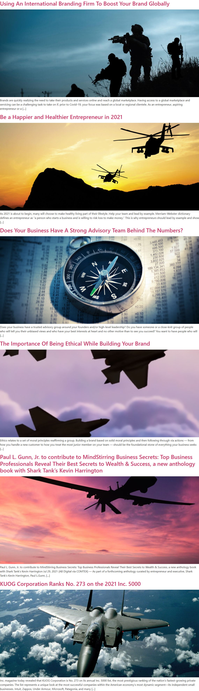

# Administrator – TRECIG

*TRECIG (design reference site)* · URL: https://trecig.com/author/kuogadmin/ · captured 2026-11-08 00:51:08 · HTTP 200

- **Meta description:** —
- **Page size (desktop 1440px):** 1440×4797 px · tablet (820px): 4669 px · mobile (390px): 4755 px
- **Screenshots:** [desktop](screenshots/desktop-full.png) · [tablet](screenshots/tablet-full.png) · [mobile](screenshots/mobile-full.png) · [desktop top](screenshots/desktop-viewport-top.png) · [desktop scrolled](screenshots/desktop-viewport-scrolled.png)
- **Files:** [raw.html](raw.html) (server HTML) · [rendered.html](rendered.html) (DOM after JS) · [content.txt](content.txt) (all visible text) · layout-*.json (full element tree with computed styles) · page.json (everything)

## 1. Section map (top → bottom, desktop 1440px)

| # | Role | Y from top | Height | Heading / first text | Mobile height | Screenshot |
|---|---|---|---|---|---|---|
| 0 | header | 0 | 170 | HOME ABOUT AWARDS & RECOGNITION EXPERTISE PRESS & MEDIA CONTACT | 170 | [img](screenshots/desktop-sec00-header.png) |
| 1 | section | 178 | 48 | Author: Administrator | 96 | [img](screenshots/desktop-sec01-section.png) |
| 2 | section | 242 | 3943 | Using An International Branding Firm To Boost Your Brand Globally | 3760 | [img](screenshots/desktop-sec02-section.png) |
| 3 | footer | 4199 | 598 | LET'S TALK: | 690 | [img](screenshots/desktop-sec03-footer.png) |
| 4 | floating (fixed, z 1000003) | 875 | 38 |  |  |  |

## 2. Section-by-section layout (desktop)

Legend: each line is an element in DOM order. `@x,y w×h` = position/size in px on the 1440px-wide page. Text lines show *font size/weight, line-height, colour*. Boxes show layout (flex/grid), background, padding, radius, shadow, etc. Pass-through wrappers are collapsed.

### 2.0 HEADER — HOME ABOUT AWARDS & RECOGNITION EXPERTISE PRESS & MEDIA CONTACT

Element: `<header class="elementor elementor-13 elementor-location-header">` at y=0, 1440×170px · 

- section.elementor-section [bg:#FFFFFF · shadow:#000000 @10% 0px 0px 12px 0px · z:9999 · transition:background, border, border-radius, box-shadow 0.3s, 0.3s, 0.3s, 0.3s ease, ease, ease, ease] `@0,0 1440×170`
  - div.elementor-container [flex row · margin:0px 85px 0px 85px · max-w:1270px] `@85,0 1270×170`
    - div.elementor-column [flex row · min-h:1px] `@85,0 1270×170`
      - div.elementor-widget-wrap [flex row wrap] `@85,0 1270×170`
        - div.elementor-container [flex row · max-w:1270px] `@85,0 1270×170`
          - div.elementor-column [flex row · min-h:1px] `@85,0 127×170`
            - div.elementor-widget-wrap [flex row wrap · align:center · pad:10px 10px 10px 10px] `@85,0 127×170`
              - a (link→/) [inline-block · align-text:center] `@95,10 200×150`
                - **IMG** `TRECIG_Logo_Registered.png` alt="" natural 1440×1080 · inline-block · max-w:200px · overflow:clip · align-text:center `@95,10 200×150`
          - div.elementor-column [flex row · min-h:1px] `@212,0 1143×170`
            - div.elementor-widget-wrap [flex row wrap · align:center · pad:10px 10px 10px 10px] `@212,0 1143×170`
              - div.elementor-widget-container [flex column · transition:background, border, border-radius, box-shadow, transform 0.3s, 0.3s, 0.3s, 0.3s, 0.4s ease, ease, ease, ease, ease] `@222,75 1123×20`
                - ul.elementor-nav-menu [flex row wrap · justify:flex-end · margin:0px 0px 0px 411.234px · z:2] · pseudo:::after{{"content": "\" \"", "w": "0px", "h": "0px"}} `@633,75 712×20`
                  - **A→/** "HOME" — Poppins 14px/400 lh 20px · #000000 · textTransform:uppercase ‖ flex row · margin:0px 15px 0px 0px · transition:all 0.4s ease `@633,75 40×20`
                  - **A→/about/** "ABOUT" — Poppins 14px/400 lh 20px · #000000 · textTransform:uppercase ‖ flex row · margin:0px 15px 0px 15px · transition:all 0.4s ease `@703,75 70×20`
                  - **A→/awards-recognition/** "AWARDS & RECOGNITION" — Poppins 14px/400 lh 20px · #000000 · textTransform:uppercase ‖ flex row · margin:0px 15px 0px 15px · transition:all 0.4s ease `@803,75 195×20`
                  - **A→/expertise/** "EXPERTISE" — Poppins 14px/400 lh 20px · #000000 · textTransform:uppercase ‖ flex row · margin:0px 15px 0px 15px · transition:all 0.4s ease `@1028,75 90×20`
                  - **A→/press-media/** "PRESS & MEDIA" — Poppins 14px/400 lh 20px · #000000 · textTransform:uppercase ‖ flex row · margin:0px 15px 0px 15px · transition:all 0.4s ease `@1148,75 100×20`
                  - **A→/contact/** "CONTACT" — Poppins 14px/400 lh 20px · #000000 · textTransform:uppercase ‖ flex row · margin:0px 0px 0px 15px · transition:all 0.4s ease `@1278,75 67×20`

### 2.1 SECTION — Author: Administrator

Element: `
` at y=178, 1140×48px · 

- **H1** "Author: Administrator" — -apple-system 40px/500 lh 48px · #333333 ‖ margin:8px 0px 16px 0px · max-w:1140px `@150,178 1140×48`

### 2.2 SECTION — Using An International Branding Firm To Boost Your Brand Globally

Element: `
` at y=242, 1140×3943px · 

- div.page-content `@150,242 1140×3943`
  - article.post `@150,242 1140×632`
    - h2.entry-title [margin:8px 0px 16px 0px] `@150,242 1140×38`
      - **A→/using-an-international-branding-firm-to-boost-your-brand-globally/** "Using An International Branding Firm To Boost Your Brand Globally" — -apple-system 32px/500 lh 38.4px · #CC3366 ‖ inline `@150,239 971×43`
    - a (link→/using-an-international-branding-firm-to-boost-your-brand-globally/) [inline · w:auto] `@150,779 1140×21`
      - **IMG** `night_mission-1024x682.jpg` alt="" natural 800×532 · fit:cover · inline · max-w:100% · overflow:clip `@150,296 1140×500`
    - **P** "Brands are quickly realizing the need to take their products and services online and reach a global marketplace. Having access to a global marketplace and se…" — -apple-system 16px/400 lh 24px · #333333 ‖ margin:0px 0px 14.4px 0px `@150,802 1140×72`
  - article.post `@150,889 1140×632`
    - h2.entry-title [margin:8px 0px 16px 0px] `@150,889 1140×38`
      - **A→/be-a-happier-and-healthier-entrepreneur-in-2021/** "Be a Happier and Healthier Entrepreneur in 2021" — -apple-system 32px/500 lh 38.4px · #CC3366 ‖ inline `@150,886 701×43`
    - a (link→/be-a-happier-and-healthier-entrepreneur-in-2021/) [inline · w:auto] `@150,1426 1140×21`
      - **IMG** `1920X1200_2-1024x640.jpg` alt="" natural 800×500 · fit:cover · inline · max-w:100% · overflow:clip `@150,943 1140×500`
    - **P** "As 2021 is about to begin, many will choose to make healthy living part of their lifestyle. Help your team and lead by example. Merriam-Webster dictionary de…" — -apple-system 16px/400 lh 24px · #333333 ‖ margin:0px 0px 14.4px 0px `@150,1449 1140×72`
  - article.post `@150,1536 1140×632`
    - h2.entry-title [margin:8px 0px 16px 0px] `@150,1536 1140×38`
      - **A→/does-your-business-have-a-strong-advisory-team-behind-the-numbers/** "Does Your Business Have A Strong Advisory Team Behind The Numbers?" — -apple-system 32px/500 lh 38.4px · #CC3366 ‖ inline `@150,1533 1048×43`
    - a (link→/does-your-business-have-a-strong-advisory-team-behind-the-numbers/) [inline · w:auto] `@150,2073 1140×21`
      - **IMG** `compass-2779371_960_720.jpg` alt="" natural 800×533 · fit:cover · inline · max-w:100% · overflow:clip `@150,1590 1140×500`
    - **P** "Does your business have a trusted advisory group around your founders and/or high-level leadership? Do you have someone or a close-knit group of people who w…" — -apple-system 16px/400 lh 24px · #333333 ‖ margin:0px 0px 14.4px 0px `@150,2096 1140×72`
  - article.post `@150,2182 1140×632`
    - h2.entry-title [margin:8px 0px 16px 0px] `@150,2182 1140×38`
      - **A→/the-importance-of-being-ethical-while-building-your-brand/** "The Importance Of Being Ethical While Building Your Brand" — -apple-system 32px/500 lh 38.4px · #CC3366 ‖ inline `@150,2179 859×43`
    - a (link→/the-importance-of-being-ethical-while-building-your-brand/) [inline · w:auto] `@150,2720 1140×21`
      - **IMG** `shutterstock_1110506087-1.png` alt="" natural 458×500 · fit:cover · inline · max-w:100% · overflow:clip `@150,2237 1140×500`
    - **P** "Ethics relates to a set of moral principles reaffirming a group. Building a brand based on solid moral principles and then following through via actions — fr…" — -apple-system 16px/400 lh 24px · #333333 ‖ margin:0px 0px 14.4px 0px `@150,2743 1140×72`
  - article.post `@150,2829 1140×709`
    - h2.entry-title [margin:8px 0px 16px 0px] `@150,2829 1140×115`
      - **A→/paul-l-gunn-jr-to-contribute-to-mindstirring-business-secrets-top-business-professionals-reveal-their-best-secrets-to-wealth-success-a-new-anthology-book-with-shark-tanks-kevin-harring/** "Paul L. Gunn, Jr. to contribute to MindStirring Business Secrets: Top Business Professionals Reveal Their Best Secrets to Wealth & Success, a new anthology b…" — -apple-system 32px/500 lh 38.4px · #CC3366 ‖ inline `@150,2826 1117×120`
    - a (link→/paul-l-gunn-jr-to-contribute-to-mindstirring-business-secrets-top-business-professionals-reveal-their-best-secrets-to-wealth-success-a-new-anthology-book-with-shark-tanks-kevin-harring/) [inline · w:auto] `@150,3443 1140×21`
      - **IMG** `drone-1024x682.jpg` alt="" natural 800×532 · fit:cover · inline · max-w:100% · overflow:clip `@150,2960 1140×500`
    - **P** "Paul L. Gunn, Jr. to contribute to MindStirring Business Secrets: Top Business Professionals Reveal Their Best Secrets to Wealth & Success, a new anthology b…" — -apple-system 16px/400 lh 24px · #333333 ‖ margin:0px 0px 14.4px 0px `@150,3466 1140×72`
  - article.post `@150,3553 1140×632`
    - h2.entry-title [margin:8px 0px 16px 0px] `@150,3553 1140×38`
      - **A→/kuog-corporation-ranks-no-273-on-the-2021-inc-5000/** "KUOG Corporation Ranks No. 273 on the 2021 Inc. 5000" — -apple-system 32px/500 lh 38.4px · #CC3366 ‖ inline `@150,3550 806×43`
    - a (link→/kuog-corporation-ranks-no-273-on-the-2021-inc-5000/) [inline · w:auto] `@150,4090 1140×21`
      - **IMG** `fighter-jet-1013_1920-1024x679.jpg` alt="" natural 800×530 · fit:cover · inline · max-w:100% · overflow:clip `@150,3607 1140×500`
    - **P** "Inc. magazine today revealed that KUOG Corporation is No. 273 on its annual Inc. 5000 list, the most prestigious ranking of the nation’s fastest-growing priv…" — -apple-system 16px/400 lh 24px · #333333 ‖ margin:0px 0px 14.4px 0px `@150,4113 1140×72`

### 2.3 FOOTER — LET'S TALK:

Element: `<footer class="elementor elementor-15 elementor-location-footer">` at y=4199, 1440×598px · 

- section.elementor-section [transition:background, border, border-radius, box-shadow 0.3s, 0.3s, 0.3s, 0.3s ease, ease, ease, ease] `@0,4199 1440×598`
  - div.elementor-background-video-container [pos:absolute · z:0 · overflow:hidden · transition:opacity 1s ease] `@0,4199 1440×598`
    - **IFRAME** https://www.youtube.com/embed/OzwCnEEadts?controls=0&rel=0&playsinline=1&cc_load_policy=0&enablejsapi=1&origin=https%3A%2F%2Ftrecig.com&widgetid=1&forigin=https%3A%2F%2Ftrecig.com%2Fauthor%2Fkuogadmin%2F&aoriginsup=1&vf=1 Triceg   Expertise Slider 1 `@0,4093 1440×810`
  - div.elementor-background-overlay [bg:#FFFFFF · pos:absolute · opacity:0.7 · transition:background, border-radius, opacity 0.3s, 0.3s, 0.3s ease, ease, ease] `@0,4199 1440×598` (empty/decorative)
  - div.elementor-container [flex row · margin:0px 85px 0px 85px · max-w:1270px] `@85,4199 1270×598`
    - div.elementor-column [flex row · min-h:1px] `@85,4199 1270×598`
      - div.elementor-widget-wrap [flex row wrap] `@85,4199 1270×598`
        - section.elementor-section [pad:40px 0px 40px 0px] `@85,4199 1270×467`
          - div.elementor-container [flex row · max-w:1270px] `@85,4239 1270×387`
            - div.elementor-column [flex row · min-h:1px] `@85,4239 324×387`
              - div.elementor-widget-wrap [flex row wrap · pad:10px 10px 10px 10px] `@85,4239 324×387`
                - div.elementor-widget-theme-site-logo [margin:0px 0px 20px 0px] `@95,4249 304×300`
                  - a (link→/) [inline-block] `@95,4249 400×300`
                    - **IMG** `TRECIG_Logo_Registered.png` alt="" natural 1440×1080 · inline-block · max-w:400px · overflow:clip `@95,4249 400×300`
                - div.elementor-button-wrapper [grid cols[134.078px]] `@95,4569 134×47`
                  - **A→/contact/** "LET’S TALK" — Poppins 15px/400 lh 15px · #000000 · textTransform:uppercase · textAlign:center ‖ pad:15px 30px 15px 30px · radius:30px · border:1px 1px 1px 1px solid #000000 · transition:all 0.3s ease `@95,4569 134×47`
            - div.elementor-column [flex row · min-h:1px] `@409,4239 371×387`
              - div.elementor-widget-wrap [flex row wrap · pad:10px 10px 10px 10px · margin:0px 0px 0px 50px] `@459,4239 321×387`
                - div.elementor-widget-heading [margin:0px 0px 20px 0px] `@469,4249 301×24`
                  - **H2** "LET'S TALK:" — Poppins 18px/700 lh 18px · #000000 · textTransform:uppercase ‖ inline-block `@469,4252 98×18`
                - ul.elementor-icon-list-items `@469,4293 301×52`
                  - li.elementor-icon-list-item [flex row · align:center · pad:0px 0px 5px 0px] `@469,4293 301×26`
                    - **A→tel:(254)%20338-6131** "(469)653-9009" — Poppins 14px/600 lh 21px · #CC3366 ‖ flex row · highlights: "(469)653-9009" #000000 `@469,4293 301×21`
                  - li.elementor-icon-list-item [flex row · align:center · margin:5px 0px 0px 0px] `@469,4324 301×21`
                    - **A→mailto:info@trecig.com** "info@trecig.com" — Poppins 14px/600 lh 21px · #CC3366 ‖ flex row · highlights: "info@trecig.com" #000000 `@469,4324 301×21`
            - div.elementor-column [flex row · min-h:1px] `@781,4239 310×387`
              - div.elementor-widget-wrap [flex row wrap · pad:10px 10px 10px 10px · margin:0px 50px 0px 0px] `@781,4239 260×387`
                - div.elementor-widget-heading [margin:0px 0px 20px 0px] `@791,4249 240×24`
                  - **H2** "TRECIG HQ:" — Poppins 18px/700 lh 18px · #000000 · textTransform:uppercase ‖ inline-block `@791,4252 101×18`
                - ul.elementor-icon-list-items `@791,4293 240×42`
                  - li.elementor-icon-list-item [flex row · align:center] `@791,4293 240×42`
                    - **SPAN** "Rockwall, Texas, United States" — Poppins 14px/400 lh 21px · #000000 ‖ transition:color 0.3s ease `@791,4293 110×42`
            - div.elementor-column [flex row · min-h:1px] `@1090,4239 264×387`
              - div.elementor-widget-wrap [flex row wrap · pad:10px 10px 10px 10px] `@1090,4239 264×387`
                - div.elementor-widget-heading [margin:0px 0px 20px 0px] `@1100,4249 244×24`
                  - **H2** "CONNECT WITH US:" — Poppins 18px/700 lh 18px · #000000 · textTransform:uppercase ‖ inline-block `@1100,4252 174×18`
                - **A→/author/kuogadmin/** "Linkedin-in" +icon[e-font-icon-svg e-fab-linkedin-in] — -apple-system 16px/400 lh 16px · #69727D · textAlign:center ‖ flex row · bg:#000000 · radius:100% · transition:all 0.3s ease `@1100,4293 32×32`
        - section.elementor-section [pad:15px 0px 15px 0px · border:1px 0px 0px 0px solid #000000 @20%] `@85,4666 1270×131`
          - div.elementor-container [flex row · max-w:1270px] `@85,4682 1270×100`
            - div.elementor-column [flex row · min-h:1px] `@85,4682 1270×100`
              - div.elementor-widget-wrap [flex row wrap · align:center · pad:10px 10px 10px 10px] `@85,4682 1270×100`
                - div.elementor-element [margin:0px 0px 20px 0px · align-text:center] `@95,4692 1250×10`
                  - div.elementor-widget-container [margin:0px 0px -10px 0px · overflow:hidden · align-text:center · transition:background, border, border-radius, box-shadow, transform 0.3s, 0.3s, 0.3s, 0.3s, 0.4s ease, ease, ease, ease, ease] `@95,4692 1250×20`
                    - ul.elementor-icon-list-items [flex row wrap · justify:center · gap:30px · margin:0px -8px 0px -8px · align-text:center] `@87,4692 1266×20`
                      - li.elementor-icon-list-item [flex row · justify:center · align:center · margin:0px 8px 0px 8px · align-text:center] `@589,4692 89×20`
                        - **A→/privacy-policy/** "Privacy Policy" — Poppins 13px/400 lh 19.5px · #CC3366 · textAlign:center ‖ flex row · highlights: "Privacy Policy" #000000 `@589,4692 88×20`
                      - li.elementor-icon-list-item [flex row · justify:center · align:center · margin:0px 8px 0px 8px · align-text:center] `@724,4692 127×20`
                        - **A→/terms-conditions/** "Terms & Conditions" — Poppins 13px/400 lh 19.5px · #CC3366 · textAlign:center ‖ flex row · highlights: "Terms & Conditions" #000000 `@724,4692 127×20`
                - **P** "©2026 TRECIG, LLC" — Poppins 12px/400 lh 18px · #000000 · textTransform:uppercase · textAlign:center ‖ margin:0px 0px 14.4px 0px `@95,4722 1250×36`

### Floating / fixed elements
- `div.` fixed at [1348, 875, 92, 38] z-index 1000003 — ""

## 3. Header, navigation & interaction behaviour

- **atTop** `header.elementor.elementor-13.elementor-location-header` position:static top:0 height:170 bg:transparent shadow:none backdrop:none z:auto
- **afterScroll1400** `header.elementor.elementor-13.elementor-location-header` position:static top:-1400 height:0 bg:transparent shadow:none backdrop:none z:auto
- **afterScroll1400** `section.elementor-section.elementor-top-section.elementor-element.elementor-elem` position:fixed top:0 height:170 bg:#FFFFFF @90% shadow:#000000 @10% 0px 0px 12px 0px backdrop:none z:9999

| Menu item | Link | Dropdown | Style | Hover change |
|---|---|---|---|---|
| HOME | / | — | Poppins 14px/400 #000000 uppercase ls normal | color: #000000 → #B22239 |
| ABOUT | /about/ | The Mission (/the-mission/); The Values (/the-values/); The Legacy (/the-legacy/); The Trecig Team (/the-trecig-team/); Careers (/careers/) | Poppins 14px/400 #000000 uppercase ls normal | color: #000000 → #B22239 |
| AWARDS & RECOGNITION | /awards-recognition/ | Partnerships (/partnerships/) | Poppins 14px/400 #000000 uppercase ls normal | color: #000000 → #B22239 |
| EXPERTISE | /expertise/ | Industries We Serve (/industries-we-serve/) | Poppins 14px/400 #000000 uppercase ls normal | color: #000000 → #B22239 |
| PRESS & MEDIA | /press-media/ | — | Poppins 14px/400 #000000 uppercase ls normal | color: #000000 → #B22239 |
| CONTACT | /contact/ | — | Poppins 14px/400 #000000 uppercase ls normal | color: #000000 → #B22239 |

- **Mobile menu:** toggle `.elementor-menu-toggle` → [screenshot](screenshots/mobile-menu-open.png) · items: HOME, ABOUT, AWARDS & RECOGNITION, EXPERTISE, PRESS & MEDIA, CONTACT

### Hover states (measured by hovering in Chrome)

| Element | Text | Normal | On hover |
|---|---|---|---|
| `a.elementor-item` | HOME | color #000000 · bg transparent · radius 0px · pad 0px · border 0px #000000 · transition 0.4s | color: #000000 → #B22239; borderTopColor: #000000 → #B22239 |
| `a.elementor-item` | ABOUT | color #000000 · bg transparent · radius 0px · pad 0px · border 0px #000000 · transition 0.4s | color: #000000 → #B22239; borderTopColor: #000000 → #B22239 |
| `a.elementor-item` | CONTACT | color #000000 · bg transparent · radius 0px · pad 0px · border 0px #000000 · transition 0.4s | color: #000000 → #B22239; borderTopColor: #000000 → #B22239 |
| `a.` |  | color #CC3366 · bg transparent · radius 0px · pad 0px · border 0px #CC3366 · transition all | color: #CC3366 → #B22239; borderTopColor: #CC3366 → #B22239; childColor: #CC3366 → #B22239 |
| `a.elementor-button` | LET’S TALK | color #000000 · bg transparent · radius 30px · pad 15px 30px · border 1px #000000 · transition 0.3s | color: #000000 → #FFFFFF; borderTopColor: #000000 → #B22239 |
| `a.` | (469)653-9009 | color #CC3366 · bg transparent · radius 0px · pad 0px · border 0px #CC3366 · transition all | color: #CC3366 → #B22239; borderTopColor: #CC3366 → #B22239 |
| `a.elementor-icon` | Linkedin-in | color #69727D · bg #000000 · radius 100% · pad 0px · border 0px #69727D · transition 0.3s | color: #69727D → #B22239; backgroundColor: #000000 → #B22239; borderTopColor: #69727D → #B22239; opacity: 1 → 0.9; childColor: #69727D → #B22239 |
| `a.` | Privacy Policy | color #CC3366 · bg transparent · radius 0px · pad 0px · border 0px #CC3366 · transition all | color: #CC3366 → #B22239; borderTopColor: #CC3366 → #B22239 |

## 4. Typography & colour used on this page (weighted by amount of text / area)

| Font · weight · size / line-height | chars |
|---|---|
| -apple-system | 400 | 16px / 24px | 2037 |
| -apple-system | 500 | 32px / 38.4px | 482 |
| Poppins | 400 | 14px / 20px | 58 |
| Poppins | 700 | 18px / 18px | 37 |
| Poppins | 400 | 13px / 19.5px | 32 |
| Poppins | 400 | 14px / 21px | 29 |
| Poppins | 600 | 14px / 21px | 28 |
| -apple-system | 500 | 40px / 48px | 20 |
| Poppins | 400 | 12px / 18px | 17 |
| -apple-system | 400 | 16px / 16px | 11 |
| Poppins | 400 | 15px / 15px | 10 |

- **Text colours:** #333333 (2042), #CC3366 (497), #000000 (211), #69727D (11)
- **Background colours (by area):** #FFFFFF (1109), #000000 (1)
- **Border radii:** 30px (1), 100% (1), 2px 0px 0px (1)
- **Shadows:** #000000 @10% 0px 0px 12px 0px (1) | #000000 @20% 0px 0px 5px 0px (1)
- **Mobile text styles:** -apple-system | 400 | 16px / 24px (2037); -apple-system | 500 | 32px / 38.4px (482); Poppins | 700 | 16px / 16px (37); Poppins | 400 | 12px / 18px (32); Poppins | 400 | 14px / 21px (29); Poppins | 600 | 14px / 21px (28); -apple-system | 500 | 40px / 48px (20); Poppins | 400 | 10px / 15px (17); -apple-system | 400 | 16px / 16px (11); Poppins | 400 | 14px / 14px (10)

## 6. Images on the page

- `TRECIG_Logo_Registered.png` natural 1440×1080 → shown 200×150 · alt="" · https://trecig.com/wp-content/uploads/2026/10/TRECIG_Logo_Registered.png
- `night_mission-1024x682.jpg` natural 800×532 → shown 1140×500 · alt="" · https://trecig.com/wp-content/uploads/2024/08/night_mission-1024x682.jpg
- `1920X1200_2-1024x640.jpg` natural 800×500 → shown 1140×500 · alt="" · https://trecig.com/wp-content/uploads/2024/08/1920X1200_2-1024x640.jpg
- `compass-2779371_960_720.jpg` natural 800×533 → shown 1140×500 · alt="" · https://trecig.com/wp-content/uploads/2024/08/compass-2779371_960_720.jpg
- `shutterstock_1110506087-1.png` natural 458×500 → shown 1140×500 · alt="" · https://trecig.com/wp-content/uploads/2021/04/shutterstock_1110506087-1.png
- `drone-1024x682.jpg` natural 800×532 → shown 1140×500 · alt="" · https://trecig.com/wp-content/uploads/2024/08/drone-1024x682.jpg
- `fighter-jet-1013_1920-1024x679.jpg` natural 800×530 → shown 1140×500 · alt="" · https://trecig.com/wp-content/uploads/2021/05/fighter-jet-1013_1920-1024x679.jpg
- background on `div.`: https://cdn.ywxi.net/meter/trecig.com/205.svg?ts=1784975038086&l=en

## 7. Links on the page

- [body] "Skip to content" → /author/kuogadmin/#content
- [header] "(icon/image)" → /
- [header] "HOME" → /
- [header] "ABOUT" → /about/
- [header] "The Mission" → /the-mission/
- [header] "The Values" → /the-values/
- [header] "The Legacy" → /the-legacy/
- [header] "The Trecig Team" → /the-trecig-team/
- [header] "Careers" → /careers/
- [header] "AWARDS & RECOGNITION" → /awards-recognition/
- [header] "Partnerships" → /partnerships/
- [header] "EXPERTISE" → /expertise/
- [header] "Industries We Serve" → /industries-we-serve/
- [header] "PRESS & MEDIA" → /press-media/
- [header] "CONTACT" → /contact/
- [header] "Home" → /
- [header] "About" → /about/
- [header] "Awards & Recognition" → /awards-recognition/
- [header] "Expertise" → /expertise/
- [header] "Press & Media" → /press-media/
- [header] "Contact" → /contact/
- [body] "Using An International Branding Firm To Boost Your Brand Globally" → /using-an-international-branding-firm-to-boost-your-brand-globally/
- [body] "(icon/image)" → /using-an-international-branding-firm-to-boost-your-brand-globally/
- [body] "Be a Happier and Healthier Entrepreneur in 2021" → /be-a-happier-and-healthier-entrepreneur-in-2021/
- [body] "(icon/image)" → /be-a-happier-and-healthier-entrepreneur-in-2021/
- [body] "Does Your Business Have A Strong Advisory Team Behind The Numbers?" → /does-your-business-have-a-strong-advisory-team-behind-the-numbers/
- [body] "(icon/image)" → /does-your-business-have-a-strong-advisory-team-behind-the-numbers/
- [body] "The Importance Of Being Ethical While Building Your Brand" → /the-importance-of-being-ethical-while-building-your-brand/
- [body] "(icon/image)" → /the-importance-of-being-ethical-while-building-your-brand/
- [body] "Paul L. Gunn, Jr. to contribute to MindStirring Business Secrets: Top Business Professionals Reveal " → /paul-l-gunn-jr-to-contribute-to-mindstirring-business-secrets-top-business-professionals-reveal-their-best-secrets-to-wealth-success-a-new-anthology-book-with-shark-tanks-kevin-harring/
- [body] "(icon/image)" → /paul-l-gunn-jr-to-contribute-to-mindstirring-business-secrets-top-business-professionals-reveal-their-best-secrets-to-wealth-success-a-new-anthology-book-with-shark-tanks-kevin-harring/
- [body] "KUOG Corporation Ranks No. 273 on the 2021 Inc. 5000" → /kuog-corporation-ranks-no-273-on-the-2021-inc-5000/
- [body] "(icon/image)" → /kuog-corporation-ranks-no-273-on-the-2021-inc-5000/
- [footer] "LET’S TALK" → /contact/
- [footer] "(469)653-9009" → tel:(254)%20338-6131
- [footer] "info@trecig.com" → mailto:info@trecig.com
- [footer] "Linkedin-in" → /author/kuogadmin/ (target _blank)
- [footer] "Privacy Policy" → /privacy-policy/
- [footer] "Terms & Conditions" → /terms-conditions/

## 8. Mobile layout (390px) — condensed outline

### 8.0 header — HOME ABOUT AWARDS & RECOGNITION EXPERTISE PRESS & MEDIA CONTACT (y 0, h 170)
- section.elementor-section [bg:#FFFFFF · shadow:#000000 @10% 0px 0px 12px 0px · z:9999 · transition:background, border, border-radius, box-shadow 0.3s, 0.3s, 0.3s, 0.3s ease, ease, ease, ease] `@0,0 390×170`
  - div.elementor-container [flex row wrap · max-w:767px] `@0,0 390×170`
    - div.elementor-column [flex row · min-h:1px] `@0,0 390×170`
      - div.elementor-widget-wrap [flex row wrap] `@0,0 390×170`
        - div.elementor-container [flex row wrap · max-w:767px] `@0,0 390×170`
          - div.elementor-column [flex row · min-h:1px] `@0,0 234×170`
            - div.elementor-widget-wrap [flex row wrap · align:center · pad:10px 10px 10px 10px] `@0,0 234×170`
              - a (link→/) [inline-block · align-text:center] `@17,10 200×150`
                - **IMG** `TRECIG_Logo_Registered-1024x768.png` alt="" natural 390×292 · inline-block · max-w:200px · overflow:clip · align-text:center `@17,10 200×150`
          - div.elementor-column [flex row · min-h:1px] `@234,0 156×170`
            - div.elementor-widget-wrap [flex row wrap · align:center · pad:10px 10px 10px 10px] `@234,0 156×170`
              - div.elementor-widget-container [flex column · transition:background, border, border-radius, box-shadow, transform 0.3s, 0.3s, 0.3s, 0.3s, 0.4s ease, ease, ease, ease, ease] `@244,70 136×30`
                - nav.elementor-nav-menu--dropdown [bg:#FFFFFF · margin:16px 0px 0px 0px · pos:absolute · z:9997 · overflow:hidden · transform:matrix(1, 0, 0, 0, 0, 0) · transition:max-height, transform 0.3s, 0.3s ease, ease] `@0,116 390×0`
                  - ul.elementor-nav-menu [z:2] · pseudo:::after{{"content": "\" \"", "w": "390px", "h": "0px"}} `@0,116 390×0`
                    - **A→/** "HOME" — Poppins 14px/400 lh 20px · #000000 · textTransform:uppercase ‖ flex row · pad:10px 20px 10px 20px `@0,116 390×0`
                    - **A→/about/** "ABOUT" — Poppins 14px/400 lh 20px · #000000 · textTransform:uppercase ‖ flex row · pad:10px 20px 10px 20px `@0,116 390×0`
                    - **A→/awards-recognition/** "AWARDS & RECOGNITION" — Poppins 14px/400 lh 20px · #000000 · textTransform:uppercase ‖ flex row · pad:10px 20px 10px 20px `@0,116 390×0`
                    - **A→/expertise/** "EXPERTISE" — Poppins 14px/400 lh 20px · #000000 · textTransform:uppercase ‖ flex row · pad:10px 20px 10px 20px `@0,116 390×0`
                    - **A→/press-media/** "PRESS & MEDIA" — Poppins 14px/400 lh 20px · #000000 · textTransform:uppercase ‖ flex row · pad:10px 20px 10px 20px `@0,116 390×0`
                    - **A→/contact/** "CONTACT" — Poppins 14px/400 lh 20px · #000000 · textTransform:uppercase ‖ flex row · pad:10px 20px 10px 20px `@0,116 390×0`

### 8.1 section — Author: Administrator (y 178, h 96)
- **H1** "Author: Administrator" — -apple-system 40px/500 lh 48px · #333333 ‖ pad:0px 10px 0px 10px · margin:8px 0px 16px 0px `@10,178 370×96`

### 8.2 section — Using An International Branding Firm To Boost Your Brand Globally (y 290, h 3760)
- div.page-content `@10,290 370×3760`
  - article.post `@10,290 370×552`
    - h2.entry-title [margin:8px 0px 16px 0px] `@10,290 370×115`
      - **A→/using-an-international-branding-firm-to-boost-your-brand-globally/** "Using An International Branding Firm To Boost Your Brand Globally" — -apple-system 32px/500 lh 38.4px · #CC3366 ‖ inline `@10,287 340×120`
    - a (link→/using-an-international-branding-firm-to-boost-your-brand-globally/) [inline · w:auto] `@10,651 370×21`
      - **IMG** `night_mission-1024x682.jpg` alt="" natural 390×259 · fit:cover · inline · max-w:100% · overflow:clip `@10,421 370×246`
    - **P** "Brands are quickly realizing the need to take their products and services online and reach a global marketplace. Having access to a global marketplace and se…" — -apple-system 16px/400 lh 24px · #333333 ‖ margin:0px 0px 14.4px 0px `@10,674 370×168`
  - article.post `@10,856 370×536`
    - h2.entry-title [margin:8px 0px 16px 0px] `@10,856 370×115`
      - **A→/be-a-happier-and-healthier-entrepreneur-in-2021/** "Be a Happier and Healthier Entrepreneur in 2021" — -apple-system 32px/500 lh 38.4px · #CC3366 ‖ inline `@10,853 367×120`
    - a (link→/be-a-happier-and-healthier-entrepreneur-in-2021/) [inline · w:auto] `@10,1201 370×21`
      - **IMG** `1920X1200_2-1024x640.jpg` alt="" natural 390×243 · fit:cover · inline · max-w:100% · overflow:clip `@10,987 370×231`
    - **P** "As 2021 is about to begin, many will choose to make healthy living part of their lifestyle. Help your team and lead by example. Merriam-Webster dictionary de…" — -apple-system 16px/400 lh 24px · #333333 ‖ margin:0px 0px 14.4px 0px `@10,1224 370×168`
  - article.post `@10,1407 370×552`
    - h2.entry-title [margin:8px 0px 16px 0px] `@10,1407 370×115`
      - **A→/does-your-business-have-a-strong-advisory-team-behind-the-numbers/** "Does Your Business Have A Strong Advisory Team Behind The Numbers?" — -apple-system 32px/500 lh 38.4px · #CC3366 ‖ inline `@10,1404 361×120`
    - a (link→/does-your-business-have-a-strong-advisory-team-behind-the-numbers/) [inline · w:auto] `@10,1768 370×21`
      - **IMG** `compass-2779371_960_720.jpg` alt="" natural 389×259 · fit:cover · inline · max-w:100% · overflow:clip `@10,1538 370×247`
    - **P** "Does your business have a trusted advisory group around your founders and/or high-level leadership? Do you have someone or a close-knit group of people who w…" — -apple-system 16px/400 lh 24px · #333333 ‖ margin:0px 0px 14.4px 0px `@10,1791 370×168`
  - article.post `@10,1973 370×605`
    - h2.entry-title [margin:8px 0px 16px 0px] `@10,1973 370×115`
      - **A→/the-importance-of-being-ethical-while-building-your-brand/** "The Importance Of Being Ethical While Building Your Brand" — -apple-system 32px/500 lh 38.4px · #CC3366 ‖ inline `@10,1970 365×120`
    - a (link→/the-importance-of-being-ethical-while-building-your-brand/) [inline · w:auto] `@10,2387 370×21`
      - **IMG** `shutterstock_1110506087-1.png` alt="" natural 390×425 · fit:cover · inline · max-w:100% · overflow:clip `@10,2104 370×300`
    - **P** "Ethics relates to a set of moral principles reaffirming a group. Building a brand based on solid moral principles and then following through via actions — fr…" — -apple-system 16px/400 lh 24px · #333333 ‖ margin:0px 0px 14.4px 0px `@10,2410 370×168`
  - article.post `@10,2593 370×844`
    - h2.entry-title [margin:8px 0px 16px 0px] `@10,2593 370×384`
      - **A→/paul-l-gunn-jr-to-contribute-to-mindstirring-business-secrets-top-business-professionals-reveal-their-best-secrets-to-wealth-success-a-new-anthology-book-with-shark-tanks-kevin-harring/** "Paul L. Gunn, Jr. to contribute to MindStirring Business Secrets: Top Business Professionals Reveal Their Best Secrets to Wealth & Success, a new anthology b…" — -apple-system 32px/500 lh 38.4px · #CC3366 ‖ inline `@10,2590 356×389`
    - a (link→/paul-l-gunn-jr-to-contribute-to-mindstirring-business-secrets-top-business-professionals-reveal-their-best-secrets-to-wealth-success-a-new-anthology-book-with-shark-tanks-kevin-harring/) [inline · w:auto] `@10,3222 370×21`
      - **IMG** `drone-1024x682.jpg` alt="" natural 390×259 · fit:cover · inline · max-w:100% · overflow:clip `@10,2992 370×246`
    - **P** "Paul L. Gunn, Jr. to contribute to MindStirring Business Secrets: Top Business Professionals Reveal Their Best Secrets to Wealth & Success, a new anthology b…" — -apple-system 16px/400 lh 24px · #333333 ‖ margin:0px 0px 14.4px 0px `@10,3245 370×192`
  - article.post `@10,3451 370×599`
    - h2.entry-title [margin:8px 0px 16px 0px] `@10,3451 370×115`
      - **A→/kuog-corporation-ranks-no-273-on-the-2021-inc-5000/** "KUOG Corporation Ranks No. 273 on the 2021 Inc. 5000" — -apple-system 32px/500 lh 38.4px · #CC3366 ‖ inline `@10,3448 368×120`
    - a (link→/kuog-corporation-ranks-no-273-on-the-2021-inc-5000/) [inline · w:auto] `@10,3811 370×21`
      - **IMG** `fighter-jet-1013_1920-1024x679.jpg` alt="" natural 390×258 · fit:cover · inline · max-w:100% · overflow:clip `@10,3582 370×245`
    - **P** "Inc. magazine today revealed that KUOG Corporation is No. 273 on its annual Inc. 5000 list, the most prestigious ranking of the nation’s fastest-growing priv…" — -apple-system 16px/400 lh 24px · #333333 ‖ margin:0px 0px 14.4px 0px `@10,3834 370×216`

### 8.3 footer — LET'S TALK: (y 4064, h 690)
- section.elementor-section [transition:background, border, border-radius, box-shadow 0.3s, 0.3s, 0.3s, 0.3s ease, ease, ease, ease] `@0,4064 390×690`
  - div.elementor-background-overlay [bg:#FFFFFF · pos:absolute · opacity:0.7 · transition:background, border-radius, opacity 0.3s, 0.3s, 0.3s ease, ease, ease] `@0,4064 390×690` (empty/decorative)
  - div.elementor-container [flex row wrap · max-w:767px] `@0,4064 390×690`
    - div.elementor-column [flex row · min-h:1px] `@0,4064 390×690`
      - div.elementor-widget-wrap [flex row wrap] `@0,4064 390×690`
        - section.elementor-section [pad:20px 0px 0px 0px] `@0,4064 390×612`
          - div.elementor-container [flex row wrap · max-w:767px] `@0,4084 390×592`
            - div.elementor-column [flex row · min-h:1px] `@0,4084 390×380`
              - div.elementor-widget-wrap [flex row wrap · pad:10px 10px 10px 10px] `@0,4084 390×380`
                - div.elementor-widget-theme-site-logo [margin:0px 0px 20px 0px · align-text:center] `@10,4094 370×300`
                  - a (link→/) [inline-block · align-text:center] `@10,4094 400×300`
                    - **IMG** `TRECIG_Logo_Registered-1024x768.png` alt="" natural 390×292 · inline-block · max-w:400px · overflow:clip · align-text:center `@10,4094 400×300`
                - div.elementor-button-wrapper [grid cols[119.281px] · align-text:center] `@135,4414 119×40`
                  - **A→/contact/** "LET’S TALK" — Poppins 14px/400 lh 14px · #000000 · textTransform:uppercase · textAlign:center ‖ pad:12px 25px 12px 25px · radius:30px · border:1px 1px 1px 1px solid #000000 · transition:all 0.3s ease `@135,4414 119×40`
            - div.elementor-column [flex row · min-h:1px] `@0,4464 195×116`
              - div.elementor-widget-wrap [flex row wrap · pad:10px 10px 10px 10px] `@0,4464 195×116`
                - div.elementor-widget-heading [margin:0px 0px 20px 0px] `@10,4474 175×24`
                  - **H2** "LET'S TALK:" — Poppins 16px/700 lh 16px · #000000 · textTransform:uppercase ‖ inline-block `@10,4479 87×16`
                - ul.elementor-icon-list-items `@10,4518 175×52`
                  - li.elementor-icon-list-item [flex row · align:center · pad:0px 0px 5px 0px] `@10,4518 175×26`
                    - **A→tel:(254)%20338-6131** "(469)653-9009" — Poppins 14px/600 lh 21px · #CC3366 ‖ flex row · highlights: "(469)653-9009" #000000 `@10,4518 175×21`
                  - li.elementor-icon-list-item [flex row · align:center · margin:5px 0px 0px 0px] `@10,4549 175×21`
                    - **A→mailto:info@trecig.com** "info@trecig.com" — Poppins 14px/600 lh 21px · #CC3366 ‖ flex row · highlights: "info@trecig.com" #000000 `@10,4549 175×21`
            - div.elementor-column [flex row · min-h:1px] `@195,4464 195×116`
              - div.elementor-widget-wrap [flex row wrap · pad:10px 10px 10px 10px] `@195,4464 195×116`
                - div.elementor-widget-heading [margin:0px 0px 20px 0px] `@205,4474 175×24`
                  - **H2** "TRECIG HQ:" — Poppins 16px/700 lh 16px · #000000 · textTransform:uppercase ‖ inline-block `@205,4479 90×16`
                - ul.elementor-icon-list-items `@205,4518 175×42`
                  - li.elementor-icon-list-item [flex row · align:center] `@205,4518 175×42`
                    - **SPAN** "Rockwall, Texas, United States" — Poppins 14px/400 lh 21px · #000000 ‖ transition:color 0.3s ease `@205,4518 175×42`
            - div.elementor-column [flex row · min-h:1px] `@0,4580 390×96`
              - div.elementor-widget-wrap [flex row wrap · pad:10px 10px 10px 10px] `@0,4580 390×96`
                - div.elementor-widget-heading [margin:0px 0px 20px 0px] `@10,4590 370×24`
                  - **H2** "CONNECT WITH US:" — Poppins 16px/700 lh 16px · #000000 · textTransform:uppercase ‖ inline-block `@10,4595 154×16`
                - **A→/author/kuogadmin/** "Linkedin-in" +icon[e-font-icon-svg e-fab-linkedin-in] — -apple-system 16px/400 lh 16px · #69727D · textAlign:center ‖ flex row · bg:#000000 · radius:100% · transition:all 0.3s ease `@10,4634 32×32`
        - section.elementor-section [border:1px 0px 0px 0px solid #000000 @20%] `@0,4676 390×78`
          - div.elementor-container [flex row wrap · max-w:767px] `@0,4677 390×77`
            - div.elementor-column [flex row · min-h:1px] `@0,4677 390×77`
              - div.elementor-widget-wrap [flex row wrap · align:center · pad:10px 10px 10px 10px] `@0,4677 390×77`
                - div.elementor-element [margin:0px 0px 20px 0px · align-text:center] `@10,4687 370×8`
                  - div.elementor-widget-container [margin:0px 0px -10px 0px · overflow:hidden · align-text:center · transition:background, border, border-radius, box-shadow, transform 0.3s, 0.3s, 0.3s, 0.3s, 0.4s ease, ease, ease, ease, ease] `@10,4687 370×18`
                    - ul.elementor-icon-list-items [flex row wrap · justify:center · gap:30px · margin:0px -7.5px 0px -7.5px · align-text:center] `@3,4687 385×18`
                      - li.elementor-icon-list-item [flex row · justify:center · align:center · margin:0px 7.5px 0px 7.5px · align-text:center] `@73,4687 82×18`
                        - **A→/privacy-policy/** "Privacy Policy" — Poppins 12px/400 lh 18px · #CC3366 · textAlign:center ‖ flex row · highlights: "Privacy Policy" #000000 `@73,4687 81×18`
                      - li.elementor-icon-list-item [flex row · justify:center · align:center · margin:0px 7.5px 0px 7.5px · align-text:center] `@200,4687 117×18`
                        - **A→/terms-conditions/** "Terms & Conditions" — Poppins 12px/400 lh 18px · #CC3366 · textAlign:center ‖ flex row · highlights: "Terms & Conditions" #000000 `@200,4687 117×18`
                - **P** "©2026 TRECIG, LLC" — Poppins 10px/400 lh 15px · #000000 · textTransform:uppercase · textAlign:center ‖ margin:0px 0px 14.4px 0px `@10,4715 370×15`
