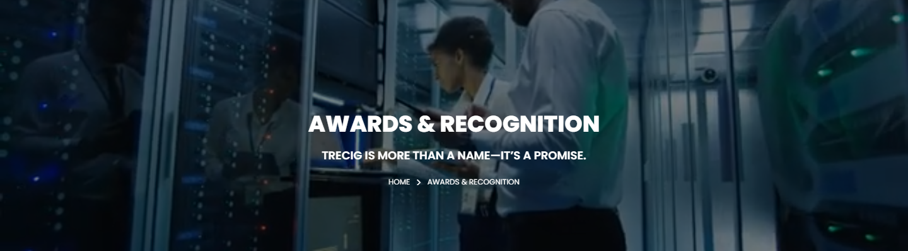
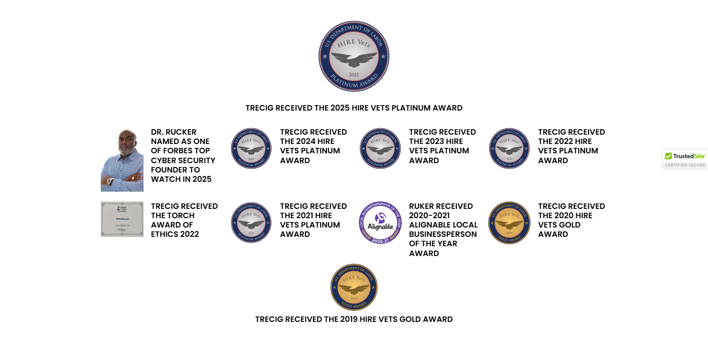
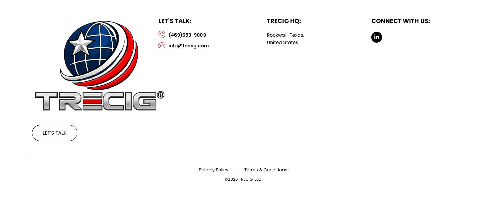

# Awards & Recognition – TRECIG

*TRECIG (design reference site)* · URL: https://trecig.com/awards-recognition/ · captured 2026-11-08 00:34:33 · HTTP 200

- **Meta description:** —
- **Page size (desktop 1440px):** 1440×1868 px · tablet (820px): 1948 px · mobile (390px): 2648 px
- **Screenshots:** [desktop](screenshots/desktop-full.png) · [tablet](screenshots/tablet-full.png) · [mobile](screenshots/mobile-full.png) · [desktop top](screenshots/desktop-viewport-top.png) · [desktop scrolled](screenshots/desktop-viewport-scrolled.png)
- **Files:** [raw.html](raw.html) (server HTML) · [rendered.html](rendered.html) (DOM after JS) · [content.txt](content.txt) (all visible text) · layout-*.json (full element tree with computed styles) · page.json (everything)

## 1. Section map (top → bottom, desktop 1440px)

| # | Role | Y from top | Height | Heading / first text | Mobile height | Screenshot |
|---|---|---|---|---|---|---|
| 0 | header | 0 | 170 | HOME ABOUT AWARDS & RECOGNITION EXPERTISE PRESS & MEDIA CONTACT | 170 | [img](screenshots/desktop-sec00-header.png) |
| 1 | section | 170 | 400 | AWARDS & RECOGNITION | 220 | [img](screenshots/desktop-sec01-section.png) |
| 2 | section | 570 | 700 | TRECIG RECEIVED THE 2025 HIRE VETS PLATINUM AWARD | 1568 | [img](screenshots/desktop-sec02-section.png) |
| 3 | footer | 1270 | 598 | LET'S TALK: | 690 | [img](screenshots/desktop-sec03-footer.png) |
| 4 | floating (fixed, z 1000003) | 875 | 38 |  |  |  |

## 2. Section-by-section layout (desktop)

Legend: each line is an element in DOM order. `@x,y w×h` = position/size in px on the 1440px-wide page. Text lines show *font size/weight, line-height, colour*. Boxes show layout (flex/grid), background, padding, radius, shadow, etc. Pass-through wrappers are collapsed.

### 2.0 HEADER — HOME ABOUT AWARDS & RECOGNITION EXPERTISE PRESS & MEDIA CONTACT

Element: `<header class="elementor elementor-13 elementor-location-header">` at y=0, 1440×170px · 

- section.elementor-section [bg:#FFFFFF · shadow:#000000 @10% 0px 0px 12px 0px · z:9999 · transition:background, border, border-radius, box-shadow 0.3s, 0.3s, 0.3s, 0.3s ease, ease, ease, ease] `@0,0 1440×170`
  - div.elementor-container [flex row · margin:0px 85px 0px 85px · max-w:1270px] `@85,0 1270×170`
    - div.elementor-column [flex row · min-h:1px] `@85,0 1270×170`
      - div.elementor-widget-wrap [flex row wrap] `@85,0 1270×170`
        - div.elementor-container [flex row · max-w:1270px] `@85,0 1270×170`
          - div.elementor-column [flex row · min-h:1px] `@85,0 127×170`
            - div.elementor-widget-wrap [flex row wrap · align:center · pad:10px 10px 10px 10px] `@85,0 127×170`
              - a (link→/) [inline-block · align-text:center] `@95,10 200×150`
                - **IMG** `TRECIG_Logo_Registered.png` alt="" natural 1440×1080 · inline-block · max-w:200px · overflow:clip · align-text:center `@95,10 200×150`
          - div.elementor-column [flex row · min-h:1px] `@212,0 1143×170`
            - div.elementor-widget-wrap [flex row wrap · align:center · pad:10px 10px 10px 10px] `@212,0 1143×170`
              - div.elementor-widget-container [flex column · transition:background, border, border-radius, box-shadow, transform 0.3s, 0.3s, 0.3s, 0.3s, 0.4s ease, ease, ease, ease, ease] `@222,75 1123×20`
                - ul.elementor-nav-menu [flex row wrap · justify:flex-end · margin:0px 0px 0px 411.234px · z:2] · pseudo:::after{{"content": "\" \"", "w": "0px", "h": "0px"}} `@633,75 712×20`
                  - **A→/** "HOME" — Poppins 14px/400 lh 20px · #000000 · textTransform:uppercase ‖ flex row · margin:0px 15px 0px 0px · transition:all 0.4s ease `@633,75 40×20`
                  - **A→/about/** "ABOUT" — Poppins 14px/400 lh 20px · #000000 · textTransform:uppercase ‖ flex row · margin:0px 15px 0px 15px · transition:all 0.4s ease `@703,75 70×20`
                  - **A→/awards-recognition/** "AWARDS & RECOGNITION" — Poppins 14px/400 lh 20px · #B22239 · textTransform:uppercase ‖ flex row · margin:0px 15px 0px 15px · transition:all 0.4s ease `@803,75 195×20`
                  - **A→/expertise/** "EXPERTISE" — Poppins 14px/400 lh 20px · #000000 · textTransform:uppercase ‖ flex row · margin:0px 15px 0px 15px · transition:all 0.4s ease `@1028,75 90×20`
                  - **A→/press-media/** "PRESS & MEDIA" — Poppins 14px/400 lh 20px · #000000 · textTransform:uppercase ‖ flex row · margin:0px 15px 0px 15px · transition:all 0.4s ease `@1148,75 100×20`
                  - **A→/contact/** "CONTACT" — Poppins 14px/400 lh 20px · #000000 · textTransform:uppercase ‖ flex row · margin:0px 0px 0px 15px · transition:all 0.4s ease `@1278,75 67×20`

### 2.1 SECTION — AWARDS & RECOGNITION

Element: `<section class="elementor-section elementor-top-section elementor-element elementor-element-ad74426 elementor-section-height-min-height elementor-section-bo">` at y=170, 1440×400px · 

- section.elementor-section [transition:background, border, border-radius, box-shadow 0.3s, 0.3s, 0.3s, 0.3s ease, ease, ease, ease] `@0,170 1440×400`
  - div.elementor-background-video-container [pos:absolute · z:0 · overflow:hidden · transition:opacity 1s ease] `@0,170 1440×400`
    - **IFRAME** https://www.youtube.com/embed/Tdd8Eo4tEK4?controls=0&rel=0&playsinline=1&cc_load_policy=0&enablejsapi=1&origin=https%3A%2F%2Ftrecig.com&widgetid=1&forigin=https%3A%2F%2Ftrecig.com%2Fawards-recognition%2F&aoriginsup=1&vf=6 Trecig   Awards And Recognition `@0,-35 1440×810`
  - div.elementor-background-overlay [bg:#000000 · pos:absolute · opacity:0.5 · transition:background, border-radius, opacity 0.3s, 0.3s, 0.3s ease, ease, ease] `@0,170 1440×400` (empty/decorative)
  - div.elementor-container [flex row · align:center · margin:0px 370px 0px 370px · max-w:700px · min-h:400px] `@370,170 700×400`
    - div.elementor-column [flex row · min-h:1px] `@370,260 700×221`
      - div.elementor-widget-wrap [flex row wrap · pad:10px 10px 10px 10px · margin:80px 0px 0px 0px] `@370,340 700×141`
        - div.elementor-widget-heading [margin:0px 0px 20px 0px · align-text:center] `@380,350 680×36`
          - **H2** "AWARDS & RECOGNITION" — Poppins 36px/800 lh 36px · #FFFFFF · textTransform:uppercase · textAlign:center ‖ inline-block `@489,350 462×36`
        - div.elementor-widget-heading [margin:0px 0px 20px 0px · align-text:center] `@380,406 680×24`
          - **H2** "TRECIG IS MORE THAN A NAME—IT’S A PROMISE." — Poppins 18px/600 lh 18px · #FFFFFF · textTransform:uppercase · textAlign:center ‖ inline-block `@510,409 420×18`
        - ul.elementor-icon-list-items [flex row wrap · justify:center · margin:0px -2.5px 0px -2.5px · align-text:center] `@378,450 685×21`
          - li.elementor-icon-list-item [flex row · justify:center · align:center · margin:0px 2.5px 0px 2.5px · align-text:center] `@616,450 34×21`
            - **A→/** "HOME" — Poppins 12px/400 lh 18px · #CC3366 · textTransform:uppercase · textAlign:center ‖ flex row · highlights: "HOME" #FFFFFF `@616,451 34×18`
          - li.elementor-icon-list-item [flex row · justify:center · align:center · margin:0px 2.5px 0px 2.5px · align-text:center] `@655,450 169×21`
            - **SPAN** "AWARDS & RECOGNITION" — Poppins 12px/400 lh 18px · #FFFFFF · textTransform:uppercase · textAlign:center ‖ pad:0px 0px 0px 5px · transition:color 0.3s ease `@673,451 151×18`

### 2.2 SECTION — TRECIG RECEIVED THE 2025 HIRE VETS PLATINUM AWARD

Element: `<section class="elementor-section elementor-top-section elementor-element elementor-element-2a3082f awardslink elementor-section-boxed elementor-section-hei">` at y=570, 1440×700px · 

- section.elementor-section [pad:30px 0px 30px 0px] `@0,570 1440×700`
  - div.elementor-container [flex row · margin:0px 85px 0px 85px · max-w:1270px] `@85,600 1270×640`
    - div.elementor-column [flex row · min-h:1px] `@85,600 1270×640`
      - div.elementor-widget-wrap [flex row wrap · pad:10px 10px 10px 10px] `@85,600 1270×640`
        - div.elementor-widget-image-box [margin:0px 0px 20px 0px] `@95,610 1250×189`
          - div.elementor-image-box-wrapper [align-text:center] `@95,610 1250×189`
            - figure.elementor-image-box-img [inline-block · margin:0px 0px 15px 0px · align-text:center] `@645,610 150×149`
              - **IMG** `HVMPD-plat.png` alt="" natural 541×537 · max-w:100% · overflow:clip · align-text:center · transition:all 0.3s ease `@645,610 150×149`
            - **H3** "TRECIG RECEIVED THE 2025 HIRE VETS PLATINUM AWARD" — Poppins 16px/600 lh 19.2px · #000000 · textTransform:uppercase · textAlign:center `@95,780 1250×19`
        - div.elementor-container [flex row · margin:0px 100px 0px 100px · max-w:1050px] `@195,819 1050×151`
          - div.elementor-column [flex row · min-h:1px] `@195,819 263×151`
            - div.elementor-widget-wrap [flex row wrap · pad:10px 10px 10px 10px] `@195,819 263×151`
              - div.elementor-image-box-wrapper [flex row · align:flex-start] `@205,829 243×131`
                - figure.elementor-image-box-img [margin:0px 15px 0px 0px] `@205,829 87×131`
                  - a (link→https://seniorexecutive.com/cybersecurity-founders-to-watch-2025/#list) [inline · w:auto] `@205,829 87×131`
                    - **IMG** `Dr.-Rucker-Headshot-in-Blue-scaled.jpg` alt="" natural 1440×2163 · max-w:100% · overflow:clip · transition:all 3s ease `@205,829 87×131`
                - **A→https://seniorexecutive.com/cybersecurity-founders-to-watch-2025/#list** "DR. RUCKER NAMED AS ONE OF FORBES TOP CYBER SECURITY FOUNDER TO WATCH IN 2025" — Poppins 16px/600 lh 19.2px · #000000 · textTransform:uppercase ‖ inline `@307,827 131×119`
          - div.elementor-column [flex row · min-h:1px] `@458,819 263×151`
            - div.elementor-widget-wrap [flex row wrap · pad:10px 10px 10px 10px] `@458,819 263×151`
              - div.elementor-image-box-wrapper [flex row · align:flex-start] `@468,829 243×86`
                - figure.elementor-image-box-img [margin:0px 15px 0px 0px] `@468,829 87×86`
                  - **IMG** `hgd.png` alt="" natural 300×297 · max-w:100% · overflow:clip · transition:all 3s ease `@468,829 87×86`
                - **H3** "TRECIG RECEIVED THE 2024 HIRE VETS PLATINUM AWARD" — Poppins 16px/600 lh 19.2px · #000000 · textTransform:uppercase ‖ transition:all 3s ease `@569,829 141×77`
          - div.elementor-column [flex row · min-h:1px] `@720,819 263×151`
            - div.elementor-widget-wrap [flex row wrap · pad:10px 10px 10px 10px] `@720,819 263×151`
              - div.elementor-image-box-wrapper [flex row · align:flex-start] `@730,829 243×86`
                - figure.elementor-image-box-img [margin:0px 15px 0px 0px] `@730,829 87×86`
                  - **IMG** `ghfgjhsf.png` alt="" natural 300×297 · max-w:100% · overflow:clip · transition:all 3s ease `@730,829 87×86`
                - **H3** "TRECIG RECEIVED THE 2023 HIRE VETS PLATINUM AWARD" — Poppins 16px/600 lh 19.2px · #000000 · textTransform:uppercase `@832,829 141×77`
          - div.elementor-column [flex row · min-h:1px] `@983,819 263×151`
            - div.elementor-widget-wrap [flex row wrap · pad:10px 10px 10px 10px] `@983,819 263×151`
              - div.elementor-image-box-wrapper [flex row · align:flex-start] `@993,829 243×86`
                - figure.elementor-image-box-img [margin:0px 15px 0px 0px] `@993,829 87×86`
                  - **IMG** `gfhsdh.png` alt="" natural 300×297 · max-w:100% · overflow:clip · transition:all 3s ease `@993,829 87×86`
                - **H3** "TRECIG RECEIVED THE 2022 HIRE VETS PLATINUM AWARD" — Poppins 16px/600 lh 19.2px · #000000 · textTransform:uppercase `@1094,829 141×77`
        - div.elementor-container [flex row · margin:0px 100px 0px 100px · max-w:1050px] `@195,970 1050×135`
          - div.elementor-column [flex row · min-h:1px] `@195,970 263×135`
            - div.elementor-widget-wrap [flex row wrap · pad:10px 10px 10px 10px] `@195,970 263×135`
              - div.elementor-image-box-wrapper [flex row · align:flex-start] `@205,980 243×77`
                - figure.elementor-image-box-img [margin:0px 15px 0px 0px] `@205,980 87×72`
                  - **IMG** `TORCH-AWARD-1.jpg` alt="" natural 500×414 · max-w:100% · overflow:clip · transition:all 3s ease `@205,980 87×72`
                - **H3** "TRECIG RECEIVED THE TORCH AWARD OF ETHICS 2022" — Poppins 16px/600 lh 19.2px · #000000 · textTransform:uppercase `@307,980 141×77`
          - div.elementor-column [flex row · min-h:1px] `@458,970 263×135`
            - div.elementor-widget-wrap [flex row wrap · pad:10px 10px 10px 10px] `@458,970 263×135`
              - div.elementor-image-box-wrapper [flex row · align:flex-start] `@468,980 243×86`
                - figure.elementor-image-box-img [margin:0px 15px 0px 0px] `@468,980 87×86`
                  - **IMG** `ghdsgdh.png` alt="" natural 300×298 · max-w:100% · overflow:clip · transition:all 3s ease `@468,980 87×86`
                - **H3** "TRECIG RECEIVED THE 2021 HIRE VETS PLATINUM AWARD" — Poppins 16px/600 lh 19.2px · #000000 · textTransform:uppercase `@569,980 141×77`
          - div.elementor-column [flex row · min-h:1px] `@720,970 263×135`
            - div.elementor-widget-wrap [flex row wrap · pad:10px 10px 10px 10px] `@720,970 263×135`
              - div.elementor-image-box-wrapper [flex row · align:flex-start] `@730,980 243×115`
                - figure.elementor-image-box-img [margin:0px 15px 0px 0px] `@730,980 87×87`
                  - **IMG** `ryury.png` alt="" natural 300×299 · max-w:100% · overflow:clip · transition:all 3s ease `@730,980 87×87`
                - **H3** "RUKER RECEIVED 2020-2021 ALIGNABLE LOCAL BUSINESSPERSON OF THE YEAR AWARD" — Poppins 16px/600 lh 19.2px · #000000 · textTransform:uppercase `@832,980 141×115`
          - div.elementor-column [flex row · min-h:1px] `@983,970 263×135`
            - div.elementor-widget-wrap [flex row wrap · pad:10px 10px 10px 10px] `@983,970 263×135`
              - div.elementor-image-box-wrapper [flex row · align:flex-start] `@993,980 243×87`
                - figure.elementor-image-box-img [margin:0px 15px 0px 0px] `@993,980 87×87`
                  - **IMG** `fn.png` alt="" natural 300×300 · max-w:100% · overflow:clip · transition:all 3s ease `@993,980 87×87`
                - **H3** "TRECIG RECEIVED THE 2020 HIRE VETS GOLD AWARD" — Poppins 16px/600 lh 19.2px · #000000 · textTransform:uppercase `@1094,980 141×77`
        - div.elementor-image-box-wrapper [align-text:center] `@95,1105 1250×125`
          - **IMG** `fgjh.png` alt="" natural 300×299 · max-w:100% · overflow:clip · align-text:center · transition:all 3s ease `@670,1105 100×100`
          - **H3** "TRECIG RECEIVED THE 2019 HIRE VETS GOLD AWARD" — Poppins 16px/600 lh 19.2px · #000000 · textTransform:uppercase · textAlign:center `@95,1210 1250×19`

### 2.3 FOOTER — LET'S TALK:

Element: `<footer class="elementor elementor-15 elementor-location-footer">` at y=1270, 1440×598px · 

- section.elementor-section [transition:background, border, border-radius, box-shadow 0.3s, 0.3s, 0.3s, 0.3s ease, ease, ease, ease] `@0,1270 1440×598`
  - div.elementor-background-video-container [pos:absolute · z:0 · overflow:hidden · transition:opacity 1s ease] `@0,1270 1440×598`
    - **IFRAME** https://www.youtube.com/embed/OzwCnEEadts?controls=0&rel=0&playsinline=1&cc_load_policy=0&enablejsapi=1&origin=https%3A%2F%2Ftrecig.com&widgetid=3&forigin=https%3A%2F%2Ftrecig.com%2Fawards-recognition%2F&aoriginsup=1&vf=1 Triceg   Expertise Slider 1 `@0,1164 1440×810`
  - div.elementor-background-overlay [bg:#FFFFFF · pos:absolute · opacity:0.7 · transition:background, border-radius, opacity 0.3s, 0.3s, 0.3s ease, ease, ease] `@0,1270 1440×598` (empty/decorative)
  - div.elementor-container [flex row · margin:0px 85px 0px 85px · max-w:1270px] `@85,1270 1270×598`
    - div.elementor-column [flex row · min-h:1px] `@85,1270 1270×598`
      - div.elementor-widget-wrap [flex row wrap] `@85,1270 1270×598`
        - section.elementor-section [pad:40px 0px 40px 0px] `@85,1270 1270×467`
          - div.elementor-container [flex row · max-w:1270px] `@85,1310 1270×387`
            - div.elementor-column [flex row · min-h:1px] `@85,1310 324×387`
              - div.elementor-widget-wrap [flex row wrap · pad:10px 10px 10px 10px] `@85,1310 324×387`
                - div.elementor-widget-theme-site-logo [margin:0px 0px 20px 0px] `@95,1320 304×300`
                  - a (link→/) [inline-block] `@95,1320 400×300`
                    - **IMG** `TRECIG_Logo_Registered.png` alt="" natural 1440×1080 · inline-block · max-w:400px · overflow:clip `@95,1320 400×300`
                - div.elementor-button-wrapper [grid cols[134.078px]] `@95,1640 134×47`
                  - **A→/contact/** "LET’S TALK" — Poppins 15px/400 lh 15px · #000000 · textTransform:uppercase · textAlign:center ‖ pad:15px 30px 15px 30px · radius:30px · border:1px 1px 1px 1px solid #000000 · transition:all 0.3s ease `@95,1640 134×47`
            - div.elementor-column [flex row · min-h:1px] `@409,1310 371×387`
              - div.elementor-widget-wrap [flex row wrap · pad:10px 10px 10px 10px · margin:0px 0px 0px 50px] `@459,1310 321×387`
                - div.elementor-widget-heading [margin:0px 0px 20px 0px] `@469,1320 301×24`
                  - **H2** "LET'S TALK:" — Poppins 18px/700 lh 18px · #000000 · textTransform:uppercase ‖ inline-block `@469,1323 98×18`
                - ul.elementor-icon-list-items `@469,1364 301×52`
                  - li.elementor-icon-list-item [flex row · align:center · pad:0px 0px 5px 0px] `@469,1364 301×26`
                    - **A→tel:(254)%20338-6131** "(469)653-9009" — Poppins 14px/600 lh 21px · #CC3366 ‖ flex row · highlights: "(469)653-9009" #000000 `@469,1364 301×21`
                  - li.elementor-icon-list-item [flex row · align:center · margin:5px 0px 0px 0px] `@469,1395 301×21`
                    - **A→mailto:info@trecig.com** "info@trecig.com" — Poppins 14px/600 lh 21px · #CC3366 ‖ flex row · highlights: "info@trecig.com" #000000 `@469,1395 301×21`
            - div.elementor-column [flex row · min-h:1px] `@781,1310 310×387`
              - div.elementor-widget-wrap [flex row wrap · pad:10px 10px 10px 10px · margin:0px 50px 0px 0px] `@781,1310 260×387`
                - div.elementor-widget-heading [margin:0px 0px 20px 0px] `@791,1320 240×24`
                  - **H2** "TRECIG HQ:" — Poppins 18px/700 lh 18px · #000000 · textTransform:uppercase ‖ inline-block `@791,1323 101×18`
                - ul.elementor-icon-list-items `@791,1364 240×42`
                  - li.elementor-icon-list-item [flex row · align:center] `@791,1364 240×42`
                    - **SPAN** "Rockwall, Texas, United States" — Poppins 14px/400 lh 21px · #000000 ‖ transition:color 0.3s ease `@791,1364 110×42`
            - div.elementor-column [flex row · min-h:1px] `@1090,1310 264×387`
              - div.elementor-widget-wrap [flex row wrap · pad:10px 10px 10px 10px] `@1090,1310 264×387`
                - div.elementor-widget-heading [margin:0px 0px 20px 0px] `@1100,1320 244×24`
                  - **H2** "CONNECT WITH US:" — Poppins 18px/700 lh 18px · #000000 · textTransform:uppercase ‖ inline-block `@1100,1323 174×18`
                - **A→/awards-recognition/** "Linkedin-in" +icon[e-font-icon-svg e-fab-linkedin-in] — -apple-system 16px/400 lh 16px · #69727D · textAlign:center ‖ flex row · bg:#000000 · radius:100% · transition:all 0.3s ease `@1100,1364 32×32`
        - section.elementor-section [pad:15px 0px 15px 0px · border:1px 0px 0px 0px solid #000000 @20%] `@85,1737 1270×131`
          - div.elementor-container [flex row · max-w:1270px] `@85,1753 1270×100`
            - div.elementor-column [flex row · min-h:1px] `@85,1753 1270×100`
              - div.elementor-widget-wrap [flex row wrap · align:center · pad:10px 10px 10px 10px] `@85,1753 1270×100`
                - div.elementor-element [margin:0px 0px 20px 0px · align-text:center] `@95,1763 1250×10`
                  - div.elementor-widget-container [margin:0px 0px -10px 0px · overflow:hidden · align-text:center · transition:background, border, border-radius, box-shadow, transform 0.3s, 0.3s, 0.3s, 0.3s, 0.4s ease, ease, ease, ease, ease] `@95,1763 1250×20`
                    - ul.elementor-icon-list-items [flex row wrap · justify:center · gap:30px · margin:0px -8px 0px -8px · align-text:center] `@87,1763 1266×20`
                      - li.elementor-icon-list-item [flex row · justify:center · align:center · margin:0px 8px 0px 8px · align-text:center] `@589,1763 89×20`
                        - **A→/privacy-policy/** "Privacy Policy" — Poppins 13px/400 lh 19.5px · #CC3366 · textAlign:center ‖ flex row · highlights: "Privacy Policy" #000000 `@589,1763 88×20`
                      - li.elementor-icon-list-item [flex row · justify:center · align:center · margin:0px 8px 0px 8px · align-text:center] `@724,1763 127×20`
                        - **A→/terms-conditions/** "Terms & Conditions" — Poppins 13px/400 lh 19.5px · #CC3366 · textAlign:center ‖ flex row · highlights: "Terms & Conditions" #000000 `@724,1763 127×20`
                - **P** "©2026 TRECIG, LLC" — Poppins 12px/400 lh 18px · #000000 · textTransform:uppercase · textAlign:center ‖ margin:0px 0px 14.4px 0px `@95,1792 1250×36`

### Floating / fixed elements
- `div.` fixed at [1348, 875, 92, 38] z-index 1000003 — ""

## 3. Header, navigation & interaction behaviour

- **atTop** `header.elementor.elementor-13.elementor-location-header` position:static top:0 height:170 bg:transparent shadow:none backdrop:none z:auto
- **afterScroll1400** `header.elementor.elementor-13.elementor-location-header` position:static top:-798 height:0 bg:transparent shadow:none backdrop:none z:auto
- **afterScroll1400** `section.elementor-section.elementor-top-section.elementor-element.elementor-elem` position:fixed top:0 height:170 bg:#FFFFFF @90% shadow:#000000 @10% 0px 0px 12px 0px backdrop:none z:9999

| Menu item | Link | Dropdown | Style | Hover change |
|---|---|---|---|---|
| HOME | / | — | Poppins 14px/400 #000000 uppercase ls normal | color: #000000 → #B22239 |
| ABOUT | /about/ | The Mission (/the-mission/); The Values (/the-values/); The Legacy (/the-legacy/); The Trecig Team (/the-trecig-team/); Careers (/careers/) | Poppins 14px/400 #000000 uppercase ls normal | color: #000000 → #B22239 |
| AWARDS & RECOGNITION (current) | /awards-recognition/ | Partnerships (/partnerships/) | Poppins 14px/400 #B22239 uppercase ls normal | none |
| EXPERTISE | /expertise/ | Industries We Serve (/industries-we-serve/) | Poppins 14px/400 #000000 uppercase ls normal | color: #000000 → #B22239 |
| PRESS & MEDIA | /press-media/ | — | Poppins 14px/400 #000000 uppercase ls normal | color: #000000 → #B22239 |
| CONTACT | /contact/ | — | Poppins 14px/400 #000000 uppercase ls normal | color: #000000 → #B22239 |

- **Mobile menu:** toggle `.elementor-menu-toggle` → [screenshot](screenshots/mobile-menu-open.png) · items: HOME, ABOUT, AWARDS & RECOGNITION, EXPERTISE, PRESS & MEDIA, CONTACT

### Hover states (measured by hovering in Chrome)

| Element | Text | Normal | On hover |
|---|---|---|---|
| `a.elementor-item` | HOME | color #000000 · bg transparent · radius 0px · pad 0px · border 0px #000000 · transition 0.4s | color: #000000 → #B22239; borderTopColor: #000000 → #B22239 |
| `a.elementor-item` | ABOUT | color #000000 · bg transparent · radius 0px · pad 0px · border 0px #000000 · transition 0.4s | color: #000000 → #B22239; borderTopColor: #000000 → #B22239 |
| `a.elementor-item` | AWARDS & RECOGNITION | color #B22239 · bg transparent · radius 0px · pad 0px · border 0px #B22239 · transition 0.4s | no change |
| `a.elementor-item` | CONTACT | color #000000 · bg transparent · radius 0px · pad 0px · border 0px #000000 · transition 0.4s | color: #000000 → #B22239; borderTopColor: #000000 → #B22239 |
| `div.elementor-image-box-wrapper` | TRECIG RECEIVED THE 2025 HIRE VETS PLATI | color #333333 · bg transparent · radius 0px · pad 0px · border 0px #333333 · transition all | no change |
| `a.` |  | color #CC3366 · bg transparent · radius 0px · pad 0px · border 0px #CC3366 · transition all | color: #CC3366 → #B22239; borderTopColor: #CC3366 → #B22239; childColor: #CC3366 → #B22239 |
| `a.elementor-button` | LET’S TALK | color #000000 · bg transparent · radius 30px · pad 15px 30px · border 1px #000000 · transition 0.3s | color: #000000 → #FFFFFF; borderTopColor: #000000 → #B22239 |
| `a.` | (469)653-9009 | color #CC3366 · bg transparent · radius 0px · pad 0px · border 0px #CC3366 · transition all | color: #CC3366 → #B22239; borderTopColor: #CC3366 → #B22239 |
| `a.elementor-icon` | Linkedin-in | color #69727D · bg #000000 · radius 100% · pad 0px · border 0px #69727D · transition 0.3s | color: #69727D → #B22239; backgroundColor: #000000 → #B22239; borderTopColor: #69727D → #B22239; opacity: 1 → 0.9; childColor: #69727D → #B22239 |
| `a.` | Privacy Policy | color #CC3366 · bg transparent · radius 0px · pad 0px · border 0px #CC3366 · transition all | color: #CC3366 → #B22239; borderTopColor: #CC3366 → #B22239 |

## 4. Typography & colour used on this page (weighted by amount of text / area)

| Font · weight · size / line-height | chars |
|---|---|
| Poppins | 600 | 16px / 19.2px | 531 |
| Poppins | 400 | 14px / 20px | 58 |
| Poppins | 600 | 18px / 18px | 42 |
| Poppins | 400 | 12px / 18px | 41 |
| Poppins | 700 | 18px / 18px | 37 |
| Poppins | 400 | 13px / 19.5px | 32 |
| Poppins | 400 | 14px / 21px | 29 |
| Poppins | 600 | 14px / 21px | 28 |
| Poppins | 800 | 36px / 36px | 20 |
| -apple-system | 400 | 16px / 24px | 15 |
| -apple-system | 400 | 16px / 16px | 11 |
| Poppins | 400 | 15px / 15px | 10 |

- **Text colours:** #000000 (722), #FFFFFF (86), #B22239 (20), #CC3366 (15), #69727D (11)
- **Background colours (by area):** #FFFFFF (1109), #000000 (577)
- **Border radii:** 30px (1), 100% (1), 2px 0px 0px (1)
- **Shadows:** #000000 @10% 0px 0px 12px 0px (1) | #000000 @20% 0px 0px 5px 0px (1)
- **Mobile text styles:** Poppins | 600 | 14px / 16.8px (531); Poppins | 400 | 12px / 18px (56); Poppins | 600 | 16px / 16px (42); Poppins | 700 | 16px / 16px (37); Poppins | 400 | 14px / 21px (29); Poppins | 600 | 14px / 21px (28); Poppins | 800 | 28px / 28px (20); Poppins | 400 | 10px / 15px (17); -apple-system | 400 | 16px / 24px (15); -apple-system | 400 | 16px / 16px (11)

## 6. Images on the page

- `TRECIG_Logo_Registered.png` natural 1440×1080 → shown 200×150 · alt="" · https://trecig.com/wp-content/uploads/2026/10/TRECIG_Logo_Registered.png
- `HVMPD-plat.png` natural 541×537 → shown 150×149 · alt="" · https://trecig.com/wp-content/uploads/2025/11/HVMPD-plat.png
- `Dr.-Rucker-Headshot-in-Blue-scaled.jpg` natural 1440×2163 → shown 87×131 · alt="" · https://trecig.com/wp-content/uploads/2025/06/Dr.-Rucker-Headshot-in-Blue-scaled.jpg
- `hgd.png` natural 300×297 → shown 87×86 · alt="" · https://trecig.com/wp-content/uploads/2025/02/hgd.png
- `ghfgjhsf.png` natural 300×297 → shown 87×86 · alt="" · https://trecig.com/wp-content/uploads/2025/02/ghfgjhsf.png
- `gfhsdh.png` natural 300×297 → shown 87×86 · alt="" · https://trecig.com/wp-content/uploads/2025/02/gfhsdh.png
- `TORCH-AWARD-1.jpg` natural 500×414 → shown 87×72 · alt="" · https://trecig.com/wp-content/uploads/2025/02/TORCH-AWARD-1.jpg
- `ghdsgdh.png` natural 300×298 → shown 87×86 · alt="" · https://trecig.com/wp-content/uploads/2025/02/ghdsgdh.png
- `ryury.png` natural 300×299 → shown 87×87 · alt="" · https://trecig.com/wp-content/uploads/2025/02/ryury.png
- `fn.png` natural 300×300 → shown 87×87 · alt="" · https://trecig.com/wp-content/uploads/2025/02/fn.png
- `fgjh.png` natural 300×299 → shown 100×100 · alt="" · https://trecig.com/wp-content/uploads/2025/02/fgjh.png
- background on `div.`: https://cdn.ywxi.net/meter/trecig.com/205.svg?ts=1784975038086&l=en

## 7. Links on the page

- [body] "Skip to content" → /awards-recognition/#content
- [header] "(icon/image)" → /
- [header] "HOME" → /
- [header] "ABOUT" → /about/
- [header] "The Mission" → /the-mission/
- [header] "The Values" → /the-values/
- [header] "The Legacy" → /the-legacy/
- [header] "The Trecig Team" → /the-trecig-team/
- [header] "Careers" → /careers/
- [header] "AWARDS & RECOGNITION" → /awards-recognition/
- [header] "Partnerships" → /partnerships/
- [header] "EXPERTISE" → /expertise/
- [header] "Industries We Serve" → /industries-we-serve/
- [header] "PRESS & MEDIA" → /press-media/
- [header] "CONTACT" → /contact/
- [header] "Home" → /
- [header] "About" → /about/
- [header] "Awards & Recognition" → /awards-recognition/
- [header] "Expertise" → /expertise/
- [header] "Press & Media" → /press-media/
- [header] "Contact" → /contact/
- [body] "(icon/image)" → https://seniorexecutive.com/cybersecurity-founders-to-watch-2025/#list
- [body] "DR. RUCKER NAMED AS ONE OF FORBES TOP CYBER SECURITY FOUNDER TO WATCH IN 2025" → https://seniorexecutive.com/cybersecurity-founders-to-watch-2025/#list
- [footer] "LET’S TALK" → /contact/
- [footer] "(469)653-9009" → tel:(254)%20338-6131
- [footer] "info@trecig.com" → mailto:info@trecig.com
- [footer] "Linkedin-in" → /awards-recognition/ (target _blank)
- [footer] "Privacy Policy" → /privacy-policy/
- [footer] "Terms & Conditions" → /terms-conditions/

## 8. Mobile layout (390px) — condensed outline

### 8.0 header — HOME ABOUT AWARDS & RECOGNITION EXPERTISE PRESS & MEDIA CONTACT (y 0, h 170)
- section.elementor-section [bg:#FFFFFF · shadow:#000000 @10% 0px 0px 12px 0px · z:9999 · transition:background, border, border-radius, box-shadow 0.3s, 0.3s, 0.3s, 0.3s ease, ease, ease, ease] `@0,0 390×170`
  - div.elementor-container [flex row wrap · max-w:767px] `@0,0 390×170`
    - div.elementor-column [flex row · min-h:1px] `@0,0 390×170`
      - div.elementor-widget-wrap [flex row wrap] `@0,0 390×170`
        - div.elementor-container [flex row wrap · max-w:767px] `@0,0 390×170`
          - div.elementor-column [flex row · min-h:1px] `@0,0 234×170`
            - div.elementor-widget-wrap [flex row wrap · align:center · pad:10px 10px 10px 10px] `@0,0 234×170`
              - a (link→/) [inline-block · align-text:center] `@17,10 200×150`
                - **IMG** `TRECIG_Logo_Registered-1024x768.png` alt="" natural 390×292 · inline-block · max-w:200px · overflow:clip · align-text:center `@17,10 200×150`
          - div.elementor-column [flex row · min-h:1px] `@234,0 156×170`
            - div.elementor-widget-wrap [flex row wrap · align:center · pad:10px 10px 10px 10px] `@234,0 156×170`
              - div.elementor-widget-container [flex column · transition:background, border, border-radius, box-shadow, transform 0.3s, 0.3s, 0.3s, 0.3s, 0.4s ease, ease, ease, ease, ease] `@244,70 136×30`
                - nav.elementor-nav-menu--dropdown [bg:#FFFFFF · margin:16px 0px 0px 0px · pos:absolute · z:9997 · overflow:hidden · transform:matrix(1, 0, 0, 0, 0, 0) · transition:max-height, transform 0.3s, 0.3s ease, ease] `@0,116 390×0`
                  - ul.elementor-nav-menu [z:2] · pseudo:::after{{"content": "\" \"", "w": "390px", "h": "0px"}} `@0,116 390×0`
                    - **A→/** "HOME" — Poppins 14px/400 lh 20px · #000000 · textTransform:uppercase ‖ flex row · pad:10px 20px 10px 20px `@0,116 390×0`
                    - **A→/about/** "ABOUT" — Poppins 14px/400 lh 20px · #000000 · textTransform:uppercase ‖ flex row · pad:10px 20px 10px 20px `@0,116 390×0`
                    - **A→/awards-recognition/** "AWARDS & RECOGNITION" — Poppins 14px/400 lh 20px · #FFFFFF · textTransform:uppercase ‖ flex row · bg:#B22239 · pad:10px 20px 10px 20px `@0,116 390×0`
                    - **A→/expertise/** "EXPERTISE" — Poppins 14px/400 lh 20px · #000000 · textTransform:uppercase ‖ flex row · pad:10px 20px 10px 20px `@0,116 390×0`
                    - **A→/press-media/** "PRESS & MEDIA" — Poppins 14px/400 lh 20px · #000000 · textTransform:uppercase ‖ flex row · pad:10px 20px 10px 20px `@0,116 390×0`
                    - **A→/contact/** "CONTACT" — Poppins 14px/400 lh 20px · #000000 · textTransform:uppercase ‖ flex row · pad:10px 20px 10px 20px `@0,116 390×0`

### 8.1 section — AWARDS & RECOGNITION (y 170, h 220)
- section.elementor-section [transition:background, border, border-radius, box-shadow 0.3s, 0.3s, 0.3s, 0.3s ease, ease, ease, ease] `@0,170 390×220`
  - div.elementor-background-overlay [bg:#000000 · pos:absolute · opacity:0.5 · transition:background, border-radius, opacity 0.3s, 0.3s, 0.3s ease, ease, ease] `@0,170 390×220` (empty/decorative)
  - div.elementor-container [flex row wrap · align:center · max-w:700px · min-h:220px] `@0,170 390×220`
    - div.elementor-column [flex row · min-h:1px] `@0,185 390×190`
      - div.elementor-widget-wrap [flex row wrap · pad:10px 10px 10px 10px · margin:65px 0px 0px 0px] `@0,250 390×125`
        - div.elementor-widget-heading [margin:0px 0px 20px 0px · align-text:center] `@10,260 370×29`
          - **H2** "AWARDS & RECOGNITION" — Poppins 28px/800 lh 28px · #FFFFFF · textTransform:uppercase · textAlign:center ‖ inline-block `@15,260 360×28`
        - div.elementor-widget-heading [margin:0px 0px 20px 0px · align-text:center] `@10,309 370×15`
          - div.elementor-widget-container [margin:-10px 0px -10px 0px · align-text:center · transition:background, border, border-radius, box-shadow, transform 0.3s, 0.3s, 0.3s, 0.3s, 0.4s ease, ease, ease, ease, ease] `@10,299 370×35`
            - **H2** "TRECIG IS MORE THAN A NAME—IT’S A PROMISE." — Poppins 16px/600 lh 16px · #FFFFFF · textTransform:uppercase · textAlign:center ‖ inline-block `@10,299 370×32`
        - ul.elementor-icon-list-items [flex row wrap · justify:center · margin:0px -2.5px 0px -2.5px · align-text:center] `@8,344 375×21`
          - li.elementor-icon-list-item [flex row · justify:center · align:center · margin:0px 2.5px 0px 2.5px · align-text:center] `@91,344 34×21`
            - **A→/** "HOME" — Poppins 12px/400 lh 18px · #CC3366 · textTransform:uppercase · textAlign:center ‖ flex row · highlights: "HOME" #FFFFFF `@91,346 34×18`
          - li.elementor-icon-list-item [flex row · justify:center · align:center · margin:0px 2.5px 0px 2.5px · align-text:center] `@130,344 169×21`
            - **SPAN** "AWARDS & RECOGNITION" — Poppins 12px/400 lh 18px · #FFFFFF · textTransform:uppercase · textAlign:center ‖ pad:0px 0px 0px 5px · transition:color 0.3s ease `@148,346 151×18`

### 8.2 section — TRECIG RECEIVED THE 2025 HIRE VETS PLATINUM AWARD (y 390, h 1568)
- section.elementor-section [pad:30px 0px 30px 0px] `@0,390 390×1568`
  - div.elementor-container [flex row wrap · max-w:767px] `@0,420 390×1508`
    - div.elementor-column [flex row · min-h:1px] `@0,420 390×1508`
      - div.elementor-widget-wrap [flex row wrap · pad:10px 10px 10px 10px] `@0,420 390×1508`
        - div.elementor-widget-image-box [margin:0px 0px 20px 0px] `@10,430 370×312`
          - div.elementor-image-box-wrapper [align-text:center] `@10,430 370×312`
            - figure.elementor-image-box-img [inline-block · margin:0px 0px 15px 0px · align-text:center] `@66,430 259×257`
              - **IMG** `HVMPD-plat.png` alt="" natural 390×387 · max-w:100% · overflow:clip · align-text:center · transition:all 0.3s ease `@66,430 259×257`
            - **H3** "TRECIG RECEIVED THE 2025 HIRE VETS PLATINUM AWARD" — Poppins 14px/600 lh 16.8px · #000000 · textTransform:uppercase · textAlign:center `@10,708 370×34`
        - div.elementor-container [flex row wrap · max-w:1050px] `@10,762 370×474`
          - div.elementor-column [flex row · min-h:1px] `@10,762 185×284`
            - div.elementor-widget-wrap [flex row wrap · pad:10px 10px 10px 10px] `@10,762 185×284`
              - div.elementor-image-box-wrapper [align-text:center] `@20,772 165×264`
                - a (link→https://seniorexecutive.com/cybersecurity-founders-to-watch-2025/#list) [inline · w:auto · align-text:center] `@45,772 116×174`
                  - **IMG** `Dr.-Rucker-Headshot-in-Blue-1022x1536.jpg` alt="" natural 390×586 · max-w:100% · overflow:clip · align-text:center · transition:all 3s ease `@45,772 116×174`
                - **A→https://seniorexecutive.com/cybersecurity-founders-to-watch-2025/#list** "DR. RUCKER NAMED AS ONE OF FORBES TOP CYBER SECURITY FOUNDER TO WATCH IN 2025" — Poppins 14px/600 lh 16.8px · #000000 · textTransform:uppercase · textAlign:center ‖ inline `@22,949 161×87`
          - div.elementor-column [flex row · min-h:1px] `@195,762 185×284`
            - div.elementor-widget-wrap [flex row wrap · pad:10px 10px 10px 10px] `@195,762 185×284`
              - div.elementor-image-box-wrapper [align-text:center] `@205,772 165×171`
                - **IMG** `hgd.png` alt="" natural 300×297 · max-w:100% · overflow:clip · align-text:center · transition:all 3s ease `@230,772 116×114`
                - **H3** "TRECIG RECEIVED THE 2024 HIRE VETS PLATINUM AWARD" — Poppins 14px/600 lh 16.8px · #000000 · textTransform:uppercase · textAlign:center ‖ transition:all 3s ease `@205,892 165×50`
          - div.elementor-column [flex row · min-h:1px] `@10,1045 185×191`
            - div.elementor-widget-wrap [flex row wrap · pad:10px 10px 10px 10px] `@10,1045 185×191`
              - div.elementor-image-box-wrapper [align-text:center] `@20,1055 165×171`
                - **IMG** `ghfgjhsf.png` alt="" natural 300×297 · max-w:100% · overflow:clip · align-text:center · transition:all 3s ease `@45,1055 116×114`
                - **H3** "TRECIG RECEIVED THE 2023 HIRE VETS PLATINUM AWARD" — Poppins 14px/600 lh 16.8px · #000000 · textTransform:uppercase · textAlign:center `@20,1176 165×50`
          - div.elementor-column [flex row · min-h:1px] `@195,1045 185×191`
            - div.elementor-widget-wrap [flex row wrap · pad:10px 10px 10px 10px] `@195,1045 185×191`
              - div.elementor-image-box-wrapper [align-text:center] `@205,1055 165×171`
                - **IMG** `gfhsdh.png` alt="" natural 300×297 · max-w:100% · overflow:clip · align-text:center · transition:all 3s ease `@230,1055 116×114`
                - **H3** "TRECIG RECEIVED THE 2022 HIRE VETS PLATINUM AWARD" — Poppins 14px/600 lh 16.8px · #000000 · textTransform:uppercase · textAlign:center `@205,1176 165×50`
        - div.elementor-container [flex row wrap · max-w:1050px] `@10,1236 370×401`
          - div.elementor-column [flex row · min-h:1px] `@10,1236 185×193`
            - div.elementor-widget-wrap [flex row wrap · pad:10px 10px 10px 10px] `@10,1236 185×193`
              - div.elementor-image-box-wrapper [align-text:center] `@20,1246 165×173`
                - **IMG** `TORCH-AWARD-1.jpg` alt="" natural 390×322 · max-w:100% · overflow:clip · align-text:center · transition:all 3s ease `@32,1246 140×116`
                - **H3** "TRECIG RECEIVED THE TORCH AWARD OF ETHICS 2022" — Poppins 14px/600 lh 16.8px · #000000 · textTransform:uppercase · textAlign:center `@20,1368 165×50`
          - div.elementor-column [flex row · min-h:1px] `@195,1236 185×193`
            - div.elementor-widget-wrap [flex row wrap · pad:10px 10px 10px 10px] `@195,1236 185×193`
              - div.elementor-image-box-wrapper [align-text:center] `@205,1246 165×171`
                - **IMG** `ghdsgdh.png` alt="" natural 300×298 · max-w:100% · overflow:clip · align-text:center · transition:all 3s ease `@230,1246 116×115`
                - **H3** "TRECIG RECEIVED THE 2021 HIRE VETS PLATINUM AWARD" — Poppins 14px/600 lh 16.8px · #000000 · textTransform:uppercase · textAlign:center `@205,1367 165×50`
          - div.elementor-column [flex row · min-h:1px] `@10,1428 185×208`
            - div.elementor-widget-wrap [flex row wrap · pad:10px 10px 10px 10px] `@10,1428 185×208`
              - div.elementor-image-box-wrapper [align-text:center] `@20,1438 165×188`
                - **IMG** `ryury.png` alt="" natural 300×299 · max-w:100% · overflow:clip · align-text:center · transition:all 3s ease `@45,1438 116×115`
                - **H3** "RUKER RECEIVED 2020-2021 ALIGNABLE LOCAL BUSINESSPERSON OF THE YEAR AWARD" — Poppins 14px/600 lh 16.8px · #000000 · textTransform:uppercase · textAlign:center `@20,1560 165×67`
          - div.elementor-column [flex row · min-h:1px] `@195,1428 185×208`
            - div.elementor-widget-wrap [flex row wrap · pad:10px 10px 10px 10px] `@195,1428 185×208`
              - div.elementor-image-box-wrapper [align-text:center] `@205,1438 165×172`
                - **IMG** `fn.png` alt="" natural 300×300 · max-w:100% · overflow:clip · align-text:center · transition:all 3s ease `@230,1438 116×116`
                - **H3** "TRECIG RECEIVED THE 2020 HIRE VETS GOLD AWARD" — Poppins 14px/600 lh 16.8px · #000000 · textTransform:uppercase · textAlign:center `@205,1560 165×50`
        - div.elementor-image-box-wrapper [align-text:center] `@10,1637 370×281`
          - **IMG** `fgjh.png` alt="" natural 300×299 · max-w:100% · overflow:clip · align-text:center · transition:all 3s ease `@66,1637 259×258`
          - **H3** "TRECIG RECEIVED THE 2019 HIRE VETS GOLD AWARD" — Poppins 14px/600 lh 16.8px · #000000 · textTransform:uppercase · textAlign:center `@10,1901 370×17`

### 8.3 footer — LET'S TALK: (y 1958, h 690)
- section.elementor-section [transition:background, border, border-radius, box-shadow 0.3s, 0.3s, 0.3s, 0.3s ease, ease, ease, ease] `@0,1958 390×690`
  - div.elementor-background-overlay [bg:#FFFFFF · pos:absolute · opacity:0.7 · transition:background, border-radius, opacity 0.3s, 0.3s, 0.3s ease, ease, ease] `@0,1958 390×690` (empty/decorative)
  - div.elementor-container [flex row wrap · max-w:767px] `@0,1958 390×690`
    - div.elementor-column [flex row · min-h:1px] `@0,1958 390×690`
      - div.elementor-widget-wrap [flex row wrap] `@0,1958 390×690`
        - section.elementor-section [pad:20px 0px 0px 0px] `@0,1958 390×612`
          - div.elementor-container [flex row wrap · max-w:767px] `@0,1978 390×592`
            - div.elementor-column [flex row · min-h:1px] `@0,1978 390×380`
              - div.elementor-widget-wrap [flex row wrap · pad:10px 10px 10px 10px] `@0,1978 390×380`
                - div.elementor-widget-theme-site-logo [margin:0px 0px 20px 0px · align-text:center] `@10,1988 370×300`
                  - a (link→/) [inline-block · align-text:center] `@10,1988 400×300`
                    - **IMG** `TRECIG_Logo_Registered-1024x768.png` alt="" natural 390×292 · inline-block · max-w:400px · overflow:clip · align-text:center `@10,1988 400×300`
                - div.elementor-button-wrapper [grid cols[119.281px] · align-text:center] `@135,2308 119×40`
                  - **A→/contact/** "LET’S TALK" — Poppins 14px/400 lh 14px · #000000 · textTransform:uppercase · textAlign:center ‖ pad:12px 25px 12px 25px · radius:30px · border:1px 1px 1px 1px solid #000000 · transition:all 0.3s ease `@135,2308 119×40`
            - div.elementor-column [flex row · min-h:1px] `@0,2358 195×116`
              - div.elementor-widget-wrap [flex row wrap · pad:10px 10px 10px 10px] `@0,2358 195×116`
                - div.elementor-widget-heading [margin:0px 0px 20px 0px] `@10,2368 175×24`
                  - **H2** "LET'S TALK:" — Poppins 16px/700 lh 16px · #000000 · textTransform:uppercase ‖ inline-block `@10,2373 87×16`
                - ul.elementor-icon-list-items `@10,2412 175×52`
                  - li.elementor-icon-list-item [flex row · align:center · pad:0px 0px 5px 0px] `@10,2412 175×26`
                    - **A→tel:(254)%20338-6131** "(469)653-9009" — Poppins 14px/600 lh 21px · #CC3366 ‖ flex row · highlights: "(469)653-9009" #000000 `@10,2412 175×21`
                  - li.elementor-icon-list-item [flex row · align:center · margin:5px 0px 0px 0px] `@10,2443 175×21`
                    - **A→mailto:info@trecig.com** "info@trecig.com" — Poppins 14px/600 lh 21px · #CC3366 ‖ flex row · highlights: "info@trecig.com" #000000 `@10,2443 175×21`
            - div.elementor-column [flex row · min-h:1px] `@195,2358 195×116`
              - div.elementor-widget-wrap [flex row wrap · pad:10px 10px 10px 10px] `@195,2358 195×116`
                - div.elementor-widget-heading [margin:0px 0px 20px 0px] `@205,2368 175×24`
                  - **H2** "TRECIG HQ:" — Poppins 16px/700 lh 16px · #000000 · textTransform:uppercase ‖ inline-block `@205,2373 90×16`
                - ul.elementor-icon-list-items `@205,2412 175×42`
                  - li.elementor-icon-list-item [flex row · align:center] `@205,2412 175×42`
                    - **SPAN** "Rockwall, Texas, United States" — Poppins 14px/400 lh 21px · #000000 ‖ transition:color 0.3s ease `@205,2412 175×42`
            - div.elementor-column [flex row · min-h:1px] `@0,2474 390×96`
              - div.elementor-widget-wrap [flex row wrap · pad:10px 10px 10px 10px] `@0,2474 390×96`
                - div.elementor-widget-heading [margin:0px 0px 20px 0px] `@10,2484 370×24`
                  - **H2** "CONNECT WITH US:" — Poppins 16px/700 lh 16px · #000000 · textTransform:uppercase ‖ inline-block `@10,2489 154×16`
                - **A→/awards-recognition/** "Linkedin-in" +icon[e-font-icon-svg e-fab-linkedin-in] — -apple-system 16px/400 lh 16px · #69727D · textAlign:center ‖ flex row · bg:#000000 · radius:100% · transition:all 0.3s ease `@10,2528 32×32`
        - section.elementor-section [border:1px 0px 0px 0px solid #000000 @20%] `@0,2570 390×78`
          - div.elementor-container [flex row wrap · max-w:767px] `@0,2571 390×77`
            - div.elementor-column [flex row · min-h:1px] `@0,2571 390×77`
              - div.elementor-widget-wrap [flex row wrap · align:center · pad:10px 10px 10px 10px] `@0,2571 390×77`
                - div.elementor-element [margin:0px 0px 20px 0px · align-text:center] `@10,2581 370×8`
                  - div.elementor-widget-container [margin:0px 0px -10px 0px · overflow:hidden · align-text:center · transition:background, border, border-radius, box-shadow, transform 0.3s, 0.3s, 0.3s, 0.3s, 0.4s ease, ease, ease, ease, ease] `@10,2581 370×18`
                    - ul.elementor-icon-list-items [flex row wrap · justify:center · gap:30px · margin:0px -7.5px 0px -7.5px · align-text:center] `@3,2581 385×18`
                      - li.elementor-icon-list-item [flex row · justify:center · align:center · margin:0px 7.5px 0px 7.5px · align-text:center] `@73,2581 82×18`
                        - **A→/privacy-policy/** "Privacy Policy" — Poppins 12px/400 lh 18px · #CC3366 · textAlign:center ‖ flex row · highlights: "Privacy Policy" #000000 `@73,2581 81×18`
                      - li.elementor-icon-list-item [flex row · justify:center · align:center · margin:0px 7.5px 0px 7.5px · align-text:center] `@200,2581 117×18`
                        - **A→/terms-conditions/** "Terms & Conditions" — Poppins 12px/400 lh 18px · #CC3366 · textAlign:center ‖ flex row · highlights: "Terms & Conditions" #000000 `@200,2581 117×18`
                - **P** "©2026 TRECIG, LLC" — Poppins 10px/400 lh 15px · #000000 · textTransform:uppercase · textAlign:center ‖ margin:0px 0px 14.4px 0px `@10,2609 370×15`
