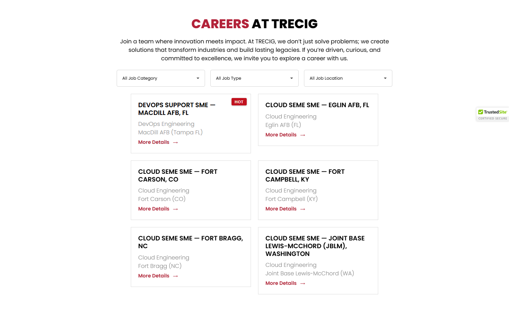
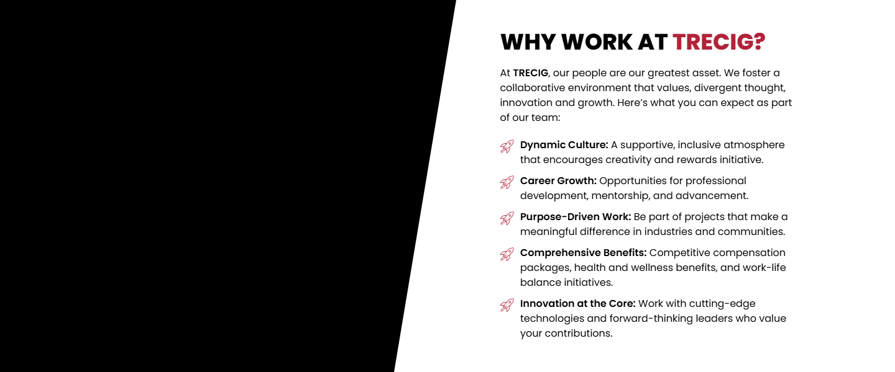
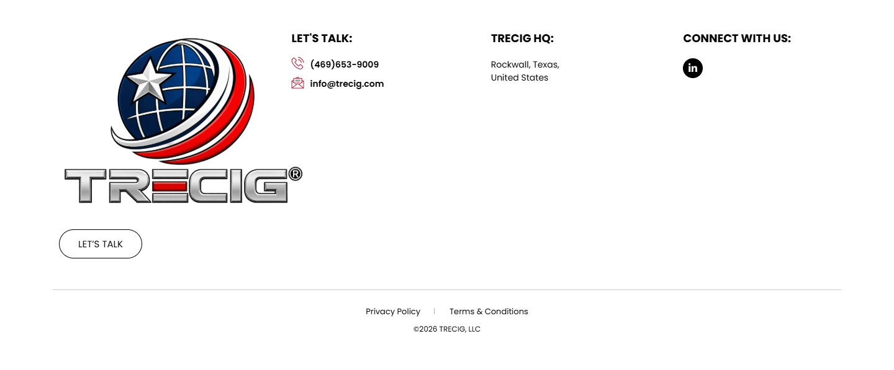

# Careers – TRECIG

*TRECIG (design reference site)* · URL: https://trecig.com/careers/ · captured 2026-11-08 00:36:29 · HTTP 200

- **Meta description:** —
- **Page size (desktop 1440px):** 1440×2955 px · tablet (820px): 3171 px · mobile (390px): 3242 px
- **Screenshots:** [desktop](screenshots/desktop-full.png) · [tablet](screenshots/tablet-full.png) · [mobile](screenshots/mobile-full.png) · [desktop top](screenshots/desktop-viewport-top.png) · [desktop scrolled](screenshots/desktop-viewport-scrolled.png)
- **Files:** [raw.html](raw.html) (server HTML) · [rendered.html](rendered.html) (DOM after JS) · [content.txt](content.txt) (all visible text) · layout-*.json (full element tree with computed styles) · page.json (everything)

## 1. Section map (top → bottom, desktop 1440px)

| # | Role | Y from top | Height | Heading / first text | Mobile height | Screenshot |
|---|---|---|---|---|---|---|
| 0 | header | 0 | 170 | HOME ABOUT AWARDS & RECOGNITION EXPERTISE PRESS & MEDIA CONTACT | 170 | [img](screenshots/desktop-sec00-header.png) |
| 1 | section | 170 | 400 | CAREERS | 220 | [img](screenshots/desktop-sec01-section.png) |
| 2 | section | 570 | 885 | CAREERS AT TRECIG | 1026 | [img](screenshots/desktop-sec02-section.png) |
| 3 | section | 1455 | 600 | WHY WORK AT TRECIG? | 784 | [img](screenshots/desktop-sec03-section.png) |
| 4 | section | 2055 | 302 | YOUR FUTURE STARTS HERE | 352 | [img](screenshots/desktop-sec04-section.png) |
| 5 | footer | 2358 | 598 | LET'S TALK: | 690 | [img](screenshots/desktop-sec05-footer.png) |
| 6 | floating (fixed, z 1000003) | 875 | 38 |  |  |  |

## 2. Section-by-section layout (desktop)

Legend: each line is an element in DOM order. `@x,y w×h` = position/size in px on the 1440px-wide page. Text lines show *font size/weight, line-height, colour*. Boxes show layout (flex/grid), background, padding, radius, shadow, etc. Pass-through wrappers are collapsed.

### 2.0 HEADER — HOME ABOUT AWARDS & RECOGNITION EXPERTISE PRESS & MEDIA CONTACT

Element: `<header class="elementor elementor-13 elementor-location-header">` at y=0, 1440×170px · 

- section.elementor-section [bg:#FFFFFF · shadow:#000000 @10% 0px 0px 12px 0px · z:9999 · transition:background, border, border-radius, box-shadow 0.3s, 0.3s, 0.3s, 0.3s ease, ease, ease, ease] `@0,0 1440×170`
  - div.elementor-container [flex row · margin:0px 85px 0px 85px · max-w:1270px] `@85,0 1270×170`
    - div.elementor-column [flex row · min-h:1px] `@85,0 1270×170`
      - div.elementor-widget-wrap [flex row wrap] `@85,0 1270×170`
        - div.elementor-container [flex row · max-w:1270px] `@85,0 1270×170`
          - div.elementor-column [flex row · min-h:1px] `@85,0 127×170`
            - div.elementor-widget-wrap [flex row wrap · align:center · pad:10px 10px 10px 10px] `@85,0 127×170`
              - a (link→/) [inline-block · align-text:center] `@95,10 200×150`
                - **IMG** `TRECIG_Logo_Registered.png` alt="" natural 1440×1080 · inline-block · max-w:200px · overflow:clip · align-text:center `@95,10 200×150`
          - div.elementor-column [flex row · min-h:1px] `@212,0 1143×170`
            - div.elementor-widget-wrap [flex row wrap · align:center · pad:10px 10px 10px 10px] `@212,0 1143×170`
              - div.elementor-widget-container [flex column · transition:background, border, border-radius, box-shadow, transform 0.3s, 0.3s, 0.3s, 0.3s, 0.4s ease, ease, ease, ease, ease] `@222,75 1123×20`
                - ul.elementor-nav-menu [flex row wrap · justify:flex-end · margin:0px 0px 0px 411.234px · z:2] · pseudo:::after{{"content": "\" \"", "w": "0px", "h": "0px"}} `@633,75 712×20`
                  - **A→/** "HOME" — Poppins 14px/400 lh 20px · #000000 · textTransform:uppercase ‖ flex row · margin:0px 15px 0px 0px · transition:all 0.4s ease `@633,75 40×20`
                  - **A→/about/** "ABOUT" — Poppins 14px/400 lh 20px · #000000 · textTransform:uppercase ‖ flex row · margin:0px 15px 0px 15px · transition:all 0.4s ease `@703,75 70×20`
                  - **A→/awards-recognition/** "AWARDS & RECOGNITION" — Poppins 14px/400 lh 20px · #000000 · textTransform:uppercase ‖ flex row · margin:0px 15px 0px 15px · transition:all 0.4s ease `@803,75 195×20`
                  - **A→/expertise/** "EXPERTISE" — Poppins 14px/400 lh 20px · #000000 · textTransform:uppercase ‖ flex row · margin:0px 15px 0px 15px · transition:all 0.4s ease `@1028,75 90×20`
                  - **A→/press-media/** "PRESS & MEDIA" — Poppins 14px/400 lh 20px · #000000 · textTransform:uppercase ‖ flex row · margin:0px 15px 0px 15px · transition:all 0.4s ease `@1148,75 100×20`
                  - **A→/contact/** "CONTACT" — Poppins 14px/400 lh 20px · #000000 · textTransform:uppercase ‖ flex row · margin:0px 0px 0px 15px · transition:all 0.4s ease `@1278,75 67×20`

### 2.1 SECTION — CAREERS

Element: `<section class="elementor-section elementor-top-section elementor-element elementor-element-e4a6172 elementor-section-height-min-height elementor-section-bo">` at y=170, 1440×400px · 

- section.elementor-section [transition:background, border, border-radius, box-shadow 0.3s, 0.3s, 0.3s, 0.3s ease, ease, ease, ease] `@0,170 1440×400`
  - div.elementor-background-video-container [pos:absolute · z:0 · overflow:hidden · transition:opacity 1s ease] `@0,170 1440×400`
    - **IFRAME** https://www.youtube.com/embed/s7ZE0bQzkeE?controls=0&rel=0&playsinline=1&cc_load_policy=0&enablejsapi=1&origin=https%3A%2F%2Ftrecig.com&widgetid=1&forigin=https%3A%2F%2Ftrecig.com%2Fcareers%2F&aoriginsup=1&vf=6 Career Top Banner Video `@0,-35 1440×810`
  - div.elementor-background-overlay [bg:#000000 · pos:absolute · opacity:0.5 · transition:background, border-radius, opacity 0.3s, 0.3s, 0.3s ease, ease, ease] `@0,170 1440×400` (empty/decorative)
  - div.elementor-container [flex row · align:center · margin:0px 370px 0px 370px · max-w:700px · min-h:400px] `@370,170 700×400`
    - div.elementor-column [flex row · min-h:1px] `@370,260 700×221`
      - div.elementor-widget-wrap [flex row wrap · pad:10px 10px 10px 10px · margin:80px 0px 0px 0px] `@370,340 700×141`
        - div.elementor-widget-heading [margin:0px 0px 20px 0px · align-text:center] `@380,350 680×36`
          - **H2** "CAREERS" — Poppins 36px/800 lh 36px · #FFFFFF · textTransform:uppercase · textAlign:center ‖ inline-block `@638,350 164×36`
        - div.elementor-widget-heading [margin:0px 0px 20px 0px · align-text:center] `@380,406 680×24`
          - **H2** "TRECIG IS MORE THAN A NAME—IT’S A PROMISE." — Poppins 18px/600 lh 18px · #FFFFFF · textTransform:uppercase · textAlign:center ‖ inline-block `@510,409 420×18`
        - ul.elementor-icon-list-items [flex row wrap · justify:center · margin:0px -2.5px 0px -2.5px · align-text:center] `@378,450 685×21`
          - li.elementor-icon-list-item [flex row · justify:center · align:center · margin:0px 2.5px 0px 2.5px · align-text:center] `@630,450 34×21`
            - **A→/** "HOME" — Poppins 12px/400 lh 18px · #CC3366 · textTransform:uppercase · textAlign:center ‖ flex row · highlights: "HOME" #FFFFFF `@630,451 34×18`
          - li.elementor-icon-list-item [flex row · justify:center · align:center · margin:0px 2.5px 0px 2.5px · align-text:center] `@669,450 62×21`
            - **A→/about/** "ABOUT" — Poppins 12px/400 lh 18px · #CC3366 · textTransform:uppercase · textAlign:center ‖ flex row · highlights: "ABOUT" #FFFFFF `@669,450 62×21`
          - li.elementor-icon-list-item [flex row · justify:center · align:center · margin:0px 2.5px 0px 2.5px · align-text:center] `@736,450 74×21`
            - **SPAN** "CAREERS" — Poppins 12px/400 lh 18px · #FFFFFF · textTransform:uppercase · textAlign:center ‖ pad:0px 0px 0px 5px · transition:color 0.3s ease `@754,451 56×18`

### 2.2 SECTION — CAREERS AT TRECIG

Element: `<section class="elementor-section elementor-top-section elementor-element elementor-element-788a981 elementor-section-boxed elementor-section-height-default">` at y=570, 1440×885px · 

- section.elementor-section [pad:30px 0px 30px 0px] `@0,570 1440×885`
  - div.elementor-container [flex row · margin:0px 85px 0px 85px · max-w:1270px] `@85,600 1270×825`
    - div.elementor-column [flex row · min-h:1px] `@85,600 1270×825`
      - div.elementor-widget-wrap [flex row wrap · pad:10px 10px 10px 10px] `@85,600 1270×825`
        - div.elementor-container [flex row · margin:0px 225px 0px 225px · max-w:800px] `@320,610 800×148`
          - div.elementor-column [flex row · min-h:1px] `@320,610 800×148`
            - div.elementor-widget-wrap [flex row wrap · align:center · pad:10px 10px 10px 10px] `@320,610 800×148`
              - div.elementor-widget-heading [margin:0px 0px 20px 0px · align-text:center] `@330,620 780×36`
                - **H2** "CAREERS AT TRECIG" — Poppins 36px/800 lh 36px · #000000 · textTransform:uppercase · textAlign:center ‖ inline-block · highlights: "CAREERS" #B22239 `@541,620 357×36`
              - **text** "Join a team where innovation meets impact. At TRECIG, we don’t just solve problems; we create solutions that transform industries and build lasting legacies.…" — Poppins 16px/400 lh 24px · #000000 · textAlign:center `@330,676 780×72`
        - div.elementor-container [flex row · margin:0px 125px 0px 125px · max-w:1000px] `@220,758 1000×657`
          - div.elementor-column [flex row · min-h:1px] `@220,758 1000×657`
            - div.elementor-widget-wrap [flex row wrap · align:center · pad:10px 10px 10px 10px] `@220,758 1000×657`
              - div.awsm-job-wrap `@230,768 980×637`
                - div.awsm-filter-wrap [margin:0px 0px 20px 0px] `@230,768 980×48`
                  - FORM form [flex row wrap] `@230,768 980×48`
                    - div.awsm-filter-items [flex row wrap · justify:center · gap:15px] `@230,768 980×48`
                      - div.awsm-filter-item `@330,768 250×48`
                        - **LABEL** "All Job Category" — poppins 16px/400 lh 16px · #333333 ‖ margin:-1px -1px -1px -1px `@329,767 1×1`
                        - div.awsm-selectric-wrapper `@330,768 250×48`
                          - div.awsm-selectric [bg:#FFFFFF · radius:5px · border:1px 1px 1px 1px solid #D5D5D5 · shadow:#FFFFFF 0px 0px 0px 0px · overflow:hidden] `@330,768 250×48`
                            - **SPAN** "All Job Category" — poppins 12px/400 lh 46px · #000000 ‖ pad:0px 15px 0px 15px `@331,769 248×46`
                            - **SPAN** "▾" — poppins 16px/400 lh 24px · #333333 · textAlign:center `@541,769 38×46`
                          - **FIELD** <input type=text name=> placeholder="" — poppins 16px/400 lh 24px · #000000 `@330,768 1×1`
                      - div.awsm-filter-item `@595,768 250×48`
                        - **LABEL** "All Job Type" — poppins 16px/400 lh 16px · #333333 ‖ margin:-1px -1px -1px -1px `@594,767 1×1`
                        - div.awsm-selectric-wrapper `@595,768 250×48`
                          - div.awsm-selectric [bg:#FFFFFF · radius:5px · border:1px 1px 1px 1px solid #D5D5D5 · shadow:#FFFFFF 0px 0px 0px 0px · overflow:hidden] `@595,768 250×48`
                            - **SPAN** "All Job Type" — poppins 12px/400 lh 46px · #000000 ‖ pad:0px 15px 0px 15px `@596,769 248×46`
                            - **SPAN** "▾" — poppins 16px/400 lh 24px · #333333 · textAlign:center `@806,769 38×46`
                          - **FIELD** <input type=text name=> placeholder="" — poppins 16px/400 lh 24px · #000000 `@595,768 1×1`
                      - div.awsm-filter-item `@860,768 250×48`
                        - **LABEL** "All Job Location" — poppins 16px/400 lh 16px · #333333 ‖ margin:-1px -1px -1px -1px `@859,767 1×1`
                        - div.awsm-selectric-wrapper `@860,768 250×48`
                          - div.awsm-selectric [bg:#FFFFFF · radius:5px · border:1px 1px 1px 1px solid #D5D5D5 · shadow:#FFFFFF 0px 0px 0px 0px · overflow:hidden] `@860,768 250×48`
                            - **SPAN** "All Job Location" — poppins 12px/400 lh 46px · #000000 ‖ pad:0px 15px 0px 15px `@861,769 248×46`
                            - **SPAN** "▾" — poppins 16px/400 lh 24px · #333333 · textAlign:center `@1071,769 38×46`
                          - **FIELD** <input type=text name=> placeholder="" — poppins 16px/400 lh 24px · #000000 `@860,768 1×1`
                - div.awsm-job-listings [grid cols[340px 340px] · gap:20px · margin:0px -15px 0px -15px] · pseudo:::after{{"content": "\"\"", "w": "980px", "h": "637.156px", "bg": "#FFFFFF @50%", "bgImage": "url(\"https://trecig.com/wp-content/plugins/wp-job-openings/assets/img/loading.svg\")", "position": "absolute", "opacity": "0"}} `@215,836 1010×569`
                  - div.awsm-job-listing-item · pseudo:::before{{"content": "\"HOT\"", "w": "43.1875px", "h": "21px", "bg": "#C1121F", "position": "absolute"}} `@370,836 340×169`
                    - a.awsm-job-item (link→/jobs/devops-support-sme/) [inline-block · bg:#FFFFFF · pad:20px 20px 20px 20px · border:1px 1px 1px 1px solid #DDDDDD · shadow:#FFFFFF 0px 0px 0px 0px · transition:all 0.3s ease] `@370,836 340×169`
                      - **H2** "DEVOPS SUPPORT SME — MACDILL AFB, FL" — poppins 18px/600 lh 21.6px · #000000 · textTransform:uppercase ‖ margin:0px 0px 10px 0px `@391,857 298×43`
                      - div.awsm-grid-right-col `@391,910 298×74`
                        - div.awsm-job-specification-wrapper [margin:0px 0px 5px 0px] `@391,910 298×48`
                          - **SPAN** "DevOps Engineering" — poppins 16px/300 lh 24px · #888888 ‖ inline `@391,910 159×23`
                          - **SPAN** "MacDill AFB (Tampa FL)" — poppins 16px/300 lh 24px · #888888 ‖ inline `@391,934 183×23`
                        - span.awsm-job-more [flex row · gap:10px] `@391,963 298×21`
                          - **text** "More Details" — poppins 14px/600 lh 21px · #AF2336 `@391,963 298×21`
                  - a.awsm-job-item (link→/jobs/cloud-seme-sme-eglin-afb-fl/) [inline-block · bg:#FFFFFF · pad:20px 20px 20px 20px · border:1px 1px 1px 1px solid #DDDDDD · shadow:#FFFFFF 0px 0px 0px 0px · transition:all 0.3s ease] `@730,836 340×148`
                    - **H2** "CLOUD SEME SME — EGLIN AFB, FL" — poppins 18px/600 lh 21.6px · #000000 · textTransform:uppercase ‖ margin:0px 0px 10px 0px `@751,857 298×22`
                    - div.awsm-grid-right-col `@751,889 298×74`
                      - div.awsm-job-specification-wrapper [margin:0px 0px 5px 0px] `@751,889 298×48`
                        - **SPAN** "Cloud Engineering" — poppins 16px/300 lh 24px · #888888 ‖ inline `@751,889 145×23`
                        - **SPAN** "Eglin AFB (FL)" — poppins 16px/300 lh 24px · #888888 ‖ inline `@751,913 101×23`
                      - span.awsm-job-more [flex row · gap:10px] `@751,942 298×21`
                        - **text** "More Details" — poppins 14px/600 lh 21px · #AF2336 `@751,942 298×21`
                  - a.awsm-job-item (link→/jobs/cloud-seme-sme-fort-carson-co/) [inline-block · bg:#FFFFFF · pad:20px 20px 20px 20px · border:1px 1px 1px 1px solid #DDDDDD · shadow:#FFFFFF 0px 0px 0px 0px · transition:all 0.3s ease] `@370,1025 340×169`
                    - **H2** "CLOUD SEME SME — FORT CARSON, CO" — poppins 18px/600 lh 21.6px · #000000 · textTransform:uppercase ‖ margin:0px 0px 10px 0px `@391,1046 298×43`
                    - div.awsm-grid-right-col `@391,1099 298×74`
                      - div.awsm-job-specification-wrapper [margin:0px 0px 5px 0px] `@391,1099 298×48`
                        - **SPAN** "Cloud Engineering" — poppins 16px/300 lh 24px · #888888 ‖ inline `@391,1099 145×23`
                        - **SPAN** "Fort Carson (CO)" — poppins 16px/300 lh 24px · #888888 ‖ inline `@391,1123 134×23`
                      - span.awsm-job-more [flex row · gap:10px] `@391,1152 298×21`
                        - **text** "More Details" — poppins 14px/600 lh 21px · #AF2336 `@391,1152 298×21`
                  - a.awsm-job-item (link→/jobs/cloud-seme-sme-fort-campbell-ky/) [inline-block · bg:#FFFFFF · pad:20px 20px 20px 20px · border:1px 1px 1px 1px solid #DDDDDD · shadow:#FFFFFF 0px 0px 0px 0px · transition:all 0.3s ease] `@730,1025 340×169`
                    - **H2** "CLOUD SEME SME — FORT CAMPBELL, KY" — poppins 18px/600 lh 21.6px · #000000 · textTransform:uppercase ‖ margin:0px 0px 10px 0px `@751,1046 298×43`
                    - div.awsm-grid-right-col `@751,1099 298×74`
                      - div.awsm-job-specification-wrapper [margin:0px 0px 5px 0px] `@751,1099 298×48`
                        - **SPAN** "Cloud Engineering" — poppins 16px/300 lh 24px · #888888 ‖ inline `@751,1099 145×23`
                        - **SPAN** "Fort Campbell (KY)" — poppins 16px/300 lh 24px · #888888 ‖ inline `@751,1123 148×23`
                      - span.awsm-job-more [flex row · gap:10px] `@751,1152 298×21`
                        - **text** "More Details" — poppins 14px/600 lh 21px · #AF2336 `@751,1152 298×21`
                  - a.awsm-job-item (link→/jobs/cloud-seme-sme-fort-bragg-nc/) [inline-block · bg:#FFFFFF · pad:20px 20px 20px 20px · border:1px 1px 1px 1px solid #DDDDDD · shadow:#FFFFFF 0px 0px 0px 0px · transition:all 0.3s ease] `@370,1214 340×169`
                    - **H2** "CLOUD SEME SME — FORT BRAGG, NC" — poppins 18px/600 lh 21.6px · #000000 · textTransform:uppercase ‖ margin:0px 0px 10px 0px `@391,1235 298×43`
                    - div.awsm-grid-right-col `@391,1289 298×74`
                      - div.awsm-job-specification-wrapper [margin:0px 0px 5px 0px] `@391,1289 298×48`
                        - **SPAN** "Cloud Engineering" — poppins 16px/300 lh 24px · #888888 ‖ inline `@391,1289 145×23`
                        - **SPAN** "Fort Bragg (NC)" — poppins 16px/300 lh 24px · #888888 ‖ inline `@391,1313 123×23`
                      - span.awsm-job-more [flex row · gap:10px] `@391,1342 298×21`
                        - **text** "More Details" — poppins 14px/600 lh 21px · #AF2336 `@391,1342 298×21`
                  - a.awsm-job-item (link→/jobs/cloud-seme-sme-joint-base-lewis-mcchord-jblm-washington/) [inline-block · bg:#FFFFFF · pad:20px 20px 20px 20px · border:1px 1px 1px 1px solid #DDDDDD · shadow:#FFFFFF 0px 0px 0px 0px · transition:all 0.3s ease] `@730,1214 340×191`
                    - **H2** "CLOUD SEME SME — JOINT BASE LEWIS-MCCHORD (JBLM), WASHINGTON" — poppins 18px/600 lh 21.6px · #000000 · textTransform:uppercase ‖ margin:0px 0px 10px 0px `@751,1235 298×65`
                    - div.awsm-grid-right-col `@751,1310 298×74`
                      - div.awsm-job-specification-wrapper [margin:0px 0px 5px 0px] `@751,1310 298×48`
                        - **SPAN** "Cloud Engineering" — poppins 16px/300 lh 24px · #888888 ‖ inline `@751,1310 145×23`
                        - **SPAN** "Joint Base Lewis-McChord (WA)" — poppins 16px/300 lh 24px · #888888 ‖ inline `@751,1334 251×23`
                      - span.awsm-job-more [flex row · gap:10px] `@751,1363 298×21`
                        - **text** "More Details" — poppins 14px/600 lh 21px · #AF2336 `@751,1363 298×21`

### 2.3 SECTION — WHY WORK AT TRECIG?

Element: `<section class="elementor-section elementor-top-section elementor-element elementor-element-eea9750 elementor-section-full_width tilt-image elementor-sectio">` at y=1455, 1440×600px · 

- section.elementor-section [bg:transparent · overflow:hidden · transition:background, border, border-radius, box-shadow 0.3s, 0.3s, 0.3s, 0.3s ease, ease, ease, ease] `@0,1455 1440×600`
  - div.elementor-container [flex row] `@0,1455 1440×600`
    - div.elementor-column [flex row · min-h:1px] `@0,1455 734×600`
      - div.elementor-widget-wrap [flex row wrap · align:center · transition:background, border, border-radius, box-shadow 0.3s, 0.3s, 0.3s, 0.3s ease, ease, ease, ease] `@0,1455 734×600`
        - div.elementor-widget-video · pseudo:::after{{"content": "\"\"", "w": "100px", "h": "600px", "position": "absolute"}} `@0,1455 734×600`
          - div.elementor-widget-container [overflow:hidden · transform:matrix(1, 0, 0, 1, 0, 0) · transition:background, border, border-radius, box-shadow, transform 0.3s, 0.3s, 0.3s, 0.3s, 0.4s ease, ease, ease, ease, ease] `@0,1455 734×600`
            - **IFRAME** https://www.youtube.com/embed/iMGsXh86dXo?controls=0&rel=0&playsinline=1&cc_load_policy=0&autoplay=1&enablejsapi=1&origin=https%3A%2F%2Ftrecig.com&widgetid=5&forigin=https%3A%2F%2Ftrecig.com%2Fcareers%2F&aoriginsup=1&vf=1 Trecig   Careers `@0,1455 1080×600`
    - div.elementor-column [flex row · min-h:1px] `@734,1455 706×600`
      - div.elementor-widget-wrap [flex row wrap · align:center · pad:10px 10px 10px 10px · margin:0px 0px 0px 50px] `@784,1455 656×600`
        - div.elementor-container [flex row · margin:0px 135.594px 0px 0px · max-w:500px] `@794,1495 500×520`
          - div.elementor-column [flex row · min-h:1px] `@794,1495 500×520`
            - div.elementor-widget-wrap [flex row wrap · pad:10px 10px 10px 10px] `@794,1495 500×520`
              - div.elementor-widget-heading [margin:0px 0px 20px 0px] `@804,1505 480×36`
                - **H2** "WHY WORK AT TRECIG?" — Poppins 36px/800 lh 36px · #000000 · textTransform:uppercase ‖ inline-block · highlights: "TRECIG?" #B22239 `@804,1505 428×36`
              - div.elementor-widget-text-editor [margin:0px 0px 20px 0px] `@804,1561 480×96`
                - div.elementor-widget-container [transition:background, border, border-radius, box-shadow, transform 0.3s, 0.3s, 0.3s, 0.3s, 0.4s ease, ease, ease, ease, ease] `@804,1561 480×96`
                  - **text** "At , our people are our greatest asset. We foster a collaborative environment that values, divergent thought, innovation and growth. Here’s what you can expe…" — Poppins 16px/400 lh 24px · #000000 `@804,1561 480×96`
                  - **STRONG** "TRECIG" — Poppins 16px/600 lh 24px · #000000 ‖ inline `@825,1561 57×23`
              - ul.elementor-icon-list-items `@804,1677 480×328`
                - li.elementor-icon-list-item [flex row · justify:start · align:flex-start · pad:0px 0px 5px 0px] `@804,1677 480×53`
                  - **SPAN** "Dynamic Culture: A supportive, inclusive atmosphere that encourages creativity and rewards initiative." — Poppins 16px/400 lh 24px · #000000 ‖ pad:0px 0px 0px 5px · transition:color 0.3s ease · highlights: "Dynamic Culture:"  600 `@832,1677 453×48`
                - li.elementor-icon-list-item [flex row · justify:start · align:flex-start · pad:0px 0px 5px 0px · margin:5px 0px 0px 0px] `@804,1735 480×53`
                  - **SPAN** "Career Growth: Opportunities for professional development, mentorship, and advancement." — Poppins 16px/400 lh 24px · #000000 ‖ pad:0px 0px 0px 5px · transition:color 0.3s ease · highlights: "Career Growth:"  600 `@832,1735 453×48`
                - li.elementor-icon-list-item [flex row · justify:start · align:flex-start · pad:0px 0px 5px 0px · margin:5px 0px 0px 0px] `@804,1793 480×53`
                  - **SPAN** "Purpose-Driven Work: Be part of projects that make a meaningful difference in industries and communities." — Poppins 16px/400 lh 24px · #000000 ‖ pad:0px 0px 0px 5px · transition:color 0.3s ease · highlights: "Purpose-Driven Work:"  600 `@832,1793 453×48`
                - li.elementor-icon-list-item [flex row · justify:start · align:flex-start · pad:0px 0px 5px 0px · margin:5px 0px 0px 0px] `@804,1851 480×77`
                  - **SPAN** "Comprehensive Benefits: Competitive compensation packages, health and wellness benefits, and work-life balance initiatives." — Poppins 16px/400 lh 24px · #000000 ‖ pad:0px 0px 0px 5px · transition:color 0.3s ease · highlights: "Comprehensive Benefits:"  600 `@832,1851 453×72`
                - li.elementor-icon-list-item [flex row · justify:start · align:flex-start · margin:5px 0px 0px 0px] `@804,1933 480×72`
                  - **SPAN** "Innovation at the Core: Work with cutting-edge technologies and forward-thinking leaders who value your contributions." — Poppins 16px/400 lh 24px · #000000 ‖ pad:0px 0px 0px 5px · transition:color 0.3s ease · highlights: "Innovation at the Core:"  600 `@832,1933 453×72`

### 2.4 SECTION — YOUR FUTURE STARTS HERE

Element: `<section class="elementor-section elementor-top-section elementor-element elementor-element-ce23c60 elementor-section-boxed elementor-section-height-default">` at y=2055, 1440×302px · 

- section.elementor-section [bg:#000000 · pad:50px 0px 50px 0px · transition:background, border, border-radius, box-shadow 0.3s, 0.3s, 0.3s, 0.3s ease, ease, ease, ease] `@0,2055 1440×302`
  - div.elementor-container [flex row · margin:0px 85px 0px 85px · max-w:1270px] `@85,2105 1270×202`
    - div.elementor-column [flex row · min-h:1px] `@85,2105 1270×202`
      - div.elementor-widget-wrap [flex row wrap · pad:10px 10px 10px 10px] `@85,2105 1270×202`
        - div.elementor-container [flex row · margin:0px 225px 0px 225px · max-w:800px] `@320,2115 800×182`
          - div.elementor-column [flex row · min-h:1px] `@320,2115 800×182`
            - div.elementor-widget-wrap [flex row wrap · align:center · pad:10px 10px 10px 10px] `@320,2115 800×182`
              - div.elementor-widget-heading [margin:0px 0px 20px 0px · align-text:center] `@330,2125 780×36`
                - **H2** "YOUR FUTURE STARTS HERE" — Poppins 36px/800 lh 36px · #FFFFFF · textTransform:uppercase · textAlign:center ‖ inline-block · highlights: "FUTURE" #B22239 `@475,2125 489×36`
              - div.elementor-widget-text-editor [margin:0px 0px 20px 0px · align-text:center] `@330,2181 780×62`
                - **P** "At TRECIG, we don’t just hire employees—we welcome innovators, leaders, and collaborators who are ready to shape the future. Join us in building something ex…" — Poppins 16px/400 lh 24px · #FFFFFF · textAlign:center ‖ margin:0px 0px 14.4px 0px `@330,2181 780×48`
              - div.elementor-widget-container [align-text:center · transition:background, border, border-radius, box-shadow, transform 0.3s, 0.3s, 0.3s, 0.3s, 0.4s ease, ease, ease, ease, ease] `@330,2264 780×24`
                - **text** "Reach out to our team at ." — Poppins 16px/400 lh 24px · #FFFFFF · textAlign:center `@330,2264 780×24`
                - **STRONG** "Have questions?" — Poppins 16px/600 lh 24px · #FFFFFF · textAlign:center ‖ inline `@458,2264 134×23`
                - **A→mailto:careers@TRECIG.com** "careers@TRECIG.com" — Poppins 16px/400 lh 24px · #CC3366 · textAlign:center ‖ inline · highlights: "careers@TRECIG.com"  600 `@802,2264 176×23`

### 2.5 FOOTER — LET'S TALK:

Element: `<footer class="elementor elementor-15 elementor-location-footer">` at y=2358, 1440×598px · 

- section.elementor-section [transition:background, border, border-radius, box-shadow 0.3s, 0.3s, 0.3s, 0.3s ease, ease, ease, ease] `@0,2358 1440×598`
  - div.elementor-background-video-container [pos:absolute · z:0 · overflow:hidden · transition:opacity 1s ease] `@0,2358 1440×598`
    - **IFRAME** https://www.youtube.com/embed/OzwCnEEadts?controls=0&rel=0&playsinline=1&cc_load_policy=0&enablejsapi=1&origin=https%3A%2F%2Ftrecig.com&widgetid=3&forigin=https%3A%2F%2Ftrecig.com%2Fcareers%2F&aoriginsup=1&vf=1 Triceg   Expertise Slider 1 `@0,2251 1440×810`
  - div.elementor-background-overlay [bg:#FFFFFF · pos:absolute · opacity:0.7 · transition:background, border-radius, opacity 0.3s, 0.3s, 0.3s ease, ease, ease] `@0,2358 1440×598` (empty/decorative)
  - div.elementor-container [flex row · margin:0px 85px 0px 85px · max-w:1270px] `@85,2358 1270×598`
    - div.elementor-column [flex row · min-h:1px] `@85,2358 1270×598`
      - div.elementor-widget-wrap [flex row wrap] `@85,2358 1270×598`
        - section.elementor-section [pad:40px 0px 40px 0px] `@85,2358 1270×467`
          - div.elementor-container [flex row · max-w:1270px] `@85,2398 1270×387`
            - div.elementor-column [flex row · min-h:1px] `@85,2398 324×387`
              - div.elementor-widget-wrap [flex row wrap · pad:10px 10px 10px 10px] `@85,2398 324×387`
                - div.elementor-widget-theme-site-logo [margin:0px 0px 20px 0px] `@95,2408 304×300`
                  - a (link→/) [inline-block] `@95,2408 400×300`
                    - **IMG** `TRECIG_Logo_Registered.png` alt="" natural 1440×1080 · inline-block · max-w:400px · overflow:clip `@95,2408 400×300`
                - div.elementor-button-wrapper [grid cols[134.078px]] `@95,2728 134×47`
                  - **A→/contact/** "LET’S TALK" — Poppins 15px/400 lh 15px · #000000 · textTransform:uppercase · textAlign:center ‖ pad:15px 30px 15px 30px · radius:30px · border:1px 1px 1px 1px solid #000000 · transition:all 0.3s ease `@95,2728 134×47`
            - div.elementor-column [flex row · min-h:1px] `@409,2398 371×387`
              - div.elementor-widget-wrap [flex row wrap · pad:10px 10px 10px 10px · margin:0px 0px 0px 50px] `@459,2398 321×387`
                - div.elementor-widget-heading [margin:0px 0px 20px 0px] `@469,2408 301×24`
                  - **H2** "LET'S TALK:" — Poppins 18px/700 lh 18px · #000000 · textTransform:uppercase ‖ inline-block `@469,2411 98×18`
                - ul.elementor-icon-list-items `@469,2452 301×52`
                  - li.elementor-icon-list-item [flex row · align:center · pad:0px 0px 5px 0px] `@469,2452 301×26`
                    - **A→tel:(254)%20338-6131** "(469)653-9009" — Poppins 14px/600 lh 21px · #CC3366 ‖ flex row · highlights: "(469)653-9009" #000000 `@469,2452 301×21`
                  - li.elementor-icon-list-item [flex row · align:center · margin:5px 0px 0px 0px] `@469,2483 301×21`
                    - **A→mailto:info@trecig.com** "info@trecig.com" — Poppins 14px/600 lh 21px · #CC3366 ‖ flex row · highlights: "info@trecig.com" #000000 `@469,2483 301×21`
            - div.elementor-column [flex row · min-h:1px] `@781,2398 310×387`
              - div.elementor-widget-wrap [flex row wrap · pad:10px 10px 10px 10px · margin:0px 50px 0px 0px] `@781,2398 260×387`
                - div.elementor-widget-heading [margin:0px 0px 20px 0px] `@791,2408 240×24`
                  - **H2** "TRECIG HQ:" — Poppins 18px/700 lh 18px · #000000 · textTransform:uppercase ‖ inline-block `@791,2411 101×18`
                - ul.elementor-icon-list-items `@791,2452 240×42`
                  - li.elementor-icon-list-item [flex row · align:center] `@791,2452 240×42`
                    - **SPAN** "Rockwall, Texas, United States" — Poppins 14px/400 lh 21px · #000000 ‖ transition:color 0.3s ease `@791,2452 110×42`
            - div.elementor-column [flex row · min-h:1px] `@1090,2398 264×387`
              - div.elementor-widget-wrap [flex row wrap · pad:10px 10px 10px 10px] `@1090,2398 264×387`
                - div.elementor-widget-heading [margin:0px 0px 20px 0px] `@1100,2408 244×24`
                  - **H2** "CONNECT WITH US:" — Poppins 18px/700 lh 18px · #000000 · textTransform:uppercase ‖ inline-block `@1100,2411 174×18`
                - **A→/careers/** "Linkedin-in" +icon[e-font-icon-svg e-fab-linkedin-in] — -apple-system 16px/400 lh 16px · #69727D · textAlign:center ‖ flex row · bg:#000000 · radius:100% · transition:all 0.3s ease `@1100,2452 32×32`
        - section.elementor-section [pad:15px 0px 15px 0px · border:1px 0px 0px 0px solid #000000 @20%] `@85,2825 1270×131`
          - div.elementor-container [flex row · max-w:1270px] `@85,2841 1270×100`
            - div.elementor-column [flex row · min-h:1px] `@85,2841 1270×100`
              - div.elementor-widget-wrap [flex row wrap · align:center · pad:10px 10px 10px 10px] `@85,2841 1270×100`
                - div.elementor-element [margin:0px 0px 20px 0px · align-text:center] `@95,2851 1250×10`
                  - div.elementor-widget-container [margin:0px 0px -10px 0px · overflow:hidden · align-text:center · transition:background, border, border-radius, box-shadow, transform 0.3s, 0.3s, 0.3s, 0.3s, 0.4s ease, ease, ease, ease, ease] `@95,2851 1250×20`
                    - ul.elementor-icon-list-items [flex row wrap · justify:center · gap:30px · margin:0px -8px 0px -8px · align-text:center] `@87,2851 1266×20`
                      - li.elementor-icon-list-item [flex row · justify:center · align:center · margin:0px 8px 0px 8px · align-text:center] `@589,2851 89×20`
                        - **A→/privacy-policy/** "Privacy Policy" — Poppins 13px/400 lh 19.5px · #CC3366 · textAlign:center ‖ flex row · highlights: "Privacy Policy" #000000 `@589,2851 88×20`
                      - li.elementor-icon-list-item [flex row · justify:center · align:center · margin:0px 8px 0px 8px · align-text:center] `@724,2851 127×20`
                        - **A→/terms-conditions/** "Terms & Conditions" — Poppins 13px/400 lh 19.5px · #CC3366 · textAlign:center ‖ flex row · highlights: "Terms & Conditions" #000000 `@724,2851 127×20`
                - **P** "©2026 TRECIG, LLC" — Poppins 12px/400 lh 18px · #000000 · textTransform:uppercase · textAlign:center ‖ margin:0px 0px 14.4px 0px `@95,2880 1250×36`

### Floating / fixed elements
- `div.` fixed at [1348, 875, 92, 38] z-index 1000003 — ""

## 3. Header, navigation & interaction behaviour

- **atTop** `header.elementor.elementor-13.elementor-location-header` position:static top:0 height:170 bg:transparent shadow:none backdrop:none z:auto
- **afterScroll1400** `header.elementor.elementor-13.elementor-location-header` position:static top:-1400 height:0 bg:transparent shadow:none backdrop:none z:auto
- **afterScroll1400** `section.elementor-section.elementor-top-section.elementor-element.elementor-elem` position:fixed top:0 height:170 bg:#FFFFFF @90% shadow:#000000 @10% 0px 0px 12px 0px backdrop:none z:9999

| Menu item | Link | Dropdown | Style | Hover change |
|---|---|---|---|---|
| HOME | / | — | Poppins 14px/400 #000000 uppercase ls normal | color: #000000 → #B22239 |
| ABOUT (current) | /about/ | The Mission (/the-mission/); The Values (/the-values/); The Legacy (/the-legacy/); The Trecig Team (/the-trecig-team/); Careers (/careers/) | Poppins 14px/400 #000000 uppercase ls normal | color: #000000 → #B22239 |
| AWARDS & RECOGNITION | /awards-recognition/ | Partnerships (/partnerships/) | Poppins 14px/400 #000000 uppercase ls normal | color: #000000 → #B22239 |
| EXPERTISE | /expertise/ | Industries We Serve (/industries-we-serve/) | Poppins 14px/400 #000000 uppercase ls normal | color: #000000 → #B22239 |
| PRESS & MEDIA | /press-media/ | — | Poppins 14px/400 #000000 uppercase ls normal | color: #000000 → #B22239 |
| CONTACT | /contact/ | — | Poppins 14px/400 #000000 uppercase ls normal | color: #000000 → #B22239 |

- **Mobile menu:** toggle `.elementor-menu-toggle` → [screenshot](screenshots/mobile-menu-open.png) · items: HOME, ABOUT, AWARDS & RECOGNITION, EXPERTISE, PRESS & MEDIA, CONTACT

### Hover states (measured by hovering in Chrome)

| Element | Text | Normal | On hover |
|---|---|---|---|
| `a.elementor-item` | HOME | color #000000 · bg transparent · radius 0px · pad 0px · border 0px #000000 · transition 0.4s | color: #000000 → #B22239; borderTopColor: #000000 → #B22239 |
| `a.elementor-item` | ABOUT | color #000000 · bg transparent · radius 0px · pad 0px · border 0px #000000 · transition 0.4s | color: #000000 → #B22239; borderTopColor: #000000 → #B22239 |
| `a.elementor-item` | CONTACT | color #000000 · bg transparent · radius 0px · pad 0px · border 0px #000000 · transition 0.4s | color: #000000 → #B22239; borderTopColor: #000000 → #B22239 |
| `div.awsm-job-listing-item` | DEVOPS SUPPORT SME — MACDILL AFB, FL Dev | color #333333 · bg transparent · radius 0px · pad 0px · border 0px #333333 · transition all | no change |
| `a.` |  | color #CC3366 · bg transparent · radius 0px · pad 0px · border 0px #CC3366 · transition all | color: #CC3366 → #B22239; borderTopColor: #CC3366 → #B22239; childColor: #CC3366 → #B22239 |
| `a.elementor-button` | LET’S TALK | color #000000 · bg transparent · radius 30px · pad 15px 30px · border 1px #000000 · transition 0.3s | color: #000000 → #FFFFFF; borderTopColor: #000000 → #B22239 |
| `a.` | (469)653-9009 | color #CC3366 · bg transparent · radius 0px · pad 0px · border 0px #CC3366 · transition all | color: #CC3366 → #B22239; borderTopColor: #CC3366 → #B22239 |
| `a.elementor-icon` | Linkedin-in | color #69727D · bg #000000 · radius 100% · pad 0px · border 0px #69727D · transition 0.3s | color: #69727D → #B22239; backgroundColor: #000000 → #B22239; borderTopColor: #69727D → #B22239; opacity: 1 → 0.9; childColor: #69727D → #B22239 |
| `a.` | Privacy Policy | color #CC3366 · bg transparent · radius 0px · pad 0px · border 0px #CC3366 · transition all | color: #CC3366 → #B22239; borderTopColor: #CC3366 → #B22239 |

## 4. Typography & colour used on this page (weighted by amount of text / area)

| Font · weight · size / line-height | chars |
|---|---|
| Poppins | 400 | 16px / 24px | 1063 |
| poppins | 600 | 18px / 21.6px | 223 |
| poppins | 300 | 16px / 24px | 217 |
| Poppins | 600 | 16px / 24px | 135 |
| Poppins | 400 | 14px / 21px | 73 |
| poppins | 600 | 14px / 21px | 72 |
| Poppins | 800 | 36px / 36px | 62 |
| Poppins | 400 | 14px / 20px | 58 |
| poppins | 400 | 16px / 16px | 44 |
| poppins | 400 | 12px / 46px | 44 |
| Poppins | 600 | 18px / 18px | 42 |
| Poppins | 700 | 18px / 18px | 37 |
| Poppins | 400 | 12px / 18px | 33 |
| Poppins | 400 | 13px / 19.5px | 32 |
| Poppins | 600 | 14px / 21px | 28 |
| -apple-system | 400 | 16px / 24px | 15 |
| -apple-system | 400 | 16px / 16px | 11 |
| Poppins | 400 | 15px / 15px | 10 |
| poppins | 400 | 16px / 24px | 3 |

- **Text colours:** #000000 (1469), #FFFFFF (289), #888888 (217), #AF2336 (72), #333333 (47), #666666 (44), #CC3366 (33), #B22239 (20), #69727D (11)
- **Background colours (by area):** #000000 (1660), #FFFFFF (1492), transparent (864)
- **Border radii:** 5px (3), 30px (1), 100% (1), 2px 0px 0px (1)
- **Shadows:** #FFFFFF 0px 0px 0px 0px (9) | #000000 @10% 0px 0px 12px 0px (1) | #000000 @20% 0px 0px 5px 0px (1)
- **Mobile text styles:** Poppins | 400 | 14px / 21px (1092); poppins | 600 | 18px / 21.6px (223); poppins | 300 | 16px / 24px (217); Poppins | 600 | 14px / 21px (163); poppins | 600 | 14px / 21px (72); Poppins | 800 | 28px / 28px (62); Poppins | 400 | 12px / 18px (48); Poppins | 600 | 16px / 16px (42); Poppins | 700 | 16px / 16px (37); -apple-system | 400 | 16px / 24px (24)

## 5. Forms
- **Form** `` → ref: <Node> (post)
  - select[select-one] name=`awsm_job_spec[job-category]` label="All Job Category" placeholder="" options: ['All Job Category', 'Cloud Engineering', 'DevOps Engineering']
  - input[text] name=`` label="" placeholder=""
  - select[select-one] name=`awsm_job_spec[job-type]` label="All Job Type" placeholder="" options: ['All Job Type', 'Full Time']
  - input[text] name=`` label="" placeholder=""
  - select[select-one] name=`awsm_job_spec[job-location]` label="All Job Location" placeholder="" options: ['All Job Location', 'MacDill AFB (Tampa FL)', 'Fort Bragg (NC)', 'Fort Campbell (KY)', 'Fort Carson (CO)', 'Eglin AFB (FL)', 'Joint Base Lewis-McChord (WA)']
  - input[text] name=`` label="" placeholder=""

## 6. Images on the page

- `TRECIG_Logo_Registered.png` natural 1440×1080 → shown 200×150 · alt="" · https://trecig.com/wp-content/uploads/2026/10/TRECIG_Logo_Registered.png
- background on `div.`: https://cdn.ywxi.net/meter/trecig.com/205.svg?ts=1784975038086&l=en

## 7. Links on the page

- [body] "Skip to content" → /careers/#content
- [header] "(icon/image)" → /
- [header] "HOME" → /
- [header] "ABOUT" → /about/
- [header] "The Mission" → /the-mission/
- [header] "The Values" → /the-values/
- [header] "The Legacy" → /the-legacy/
- [header] "The Trecig Team" → /the-trecig-team/
- [header] "Careers" → /careers/
- [header] "AWARDS & RECOGNITION" → /awards-recognition/
- [header] "Partnerships" → /partnerships/
- [header] "EXPERTISE" → /expertise/
- [header] "Industries We Serve" → /industries-we-serve/
- [header] "PRESS & MEDIA" → /press-media/
- [header] "CONTACT" → /contact/
- [header] "Home" → /
- [header] "About" → /about/
- [header] "Awards & Recognition" → /awards-recognition/
- [header] "Expertise" → /expertise/
- [header] "Press & Media" → /press-media/
- [header] "Contact" → /contact/
- [body] "Filter by" → /careers/
- [body] "DEVOPS SUPPORT SME — MACDILL AFB, FL DevOps Engineering MacDill AFB (Tampa FL) More Details" → /jobs/devops-support-sme/
- [body] "CLOUD SEME SME — EGLIN AFB, FL Cloud Engineering Eglin AFB (FL) More Details" → /jobs/cloud-seme-sme-eglin-afb-fl/
- [body] "CLOUD SEME SME — FORT CARSON, CO Cloud Engineering Fort Carson (CO) More Details" → /jobs/cloud-seme-sme-fort-carson-co/
- [body] "CLOUD SEME SME — FORT CAMPBELL, KY Cloud Engineering Fort Campbell (KY) More Details" → /jobs/cloud-seme-sme-fort-campbell-ky/
- [body] "CLOUD SEME SME — FORT BRAGG, NC Cloud Engineering Fort Bragg (NC) More Details" → /jobs/cloud-seme-sme-fort-bragg-nc/
- [body] "CLOUD SEME SME — JOINT BASE LEWIS-MCCHORD (JBLM), WASHINGTON Cloud Engineering Joint Base Lewis-McCh" → /jobs/cloud-seme-sme-joint-base-lewis-mcchord-jblm-washington/
- [body] "careers@TRECIG.com" → mailto:careers@TRECIG.com
- [footer] "LET’S TALK" → /contact/
- [footer] "(469)653-9009" → tel:(254)%20338-6131
- [footer] "info@trecig.com" → mailto:info@trecig.com
- [footer] "Linkedin-in" → /careers/ (target _blank)
- [footer] "Privacy Policy" → /privacy-policy/
- [footer] "Terms & Conditions" → /terms-conditions/

## 8. Mobile layout (390px) — condensed outline

### 8.0 header — HOME ABOUT AWARDS & RECOGNITION EXPERTISE PRESS & MEDIA CONTACT (y 0, h 170)
- section.elementor-section [bg:#FFFFFF · shadow:#000000 @10% 0px 0px 12px 0px · z:9999 · transition:background, border, border-radius, box-shadow 0.3s, 0.3s, 0.3s, 0.3s ease, ease, ease, ease] `@0,0 390×170`
  - div.elementor-container [flex row wrap · max-w:767px] `@0,0 390×170`
    - div.elementor-column [flex row · min-h:1px] `@0,0 390×170`
      - div.elementor-widget-wrap [flex row wrap] `@0,0 390×170`
        - div.elementor-container [flex row wrap · max-w:767px] `@0,0 390×170`
          - div.elementor-column [flex row · min-h:1px] `@0,0 234×170`
            - div.elementor-widget-wrap [flex row wrap · align:center · pad:10px 10px 10px 10px] `@0,0 234×170`
              - a (link→/) [inline-block · align-text:center] `@17,10 200×150`
                - **IMG** `TRECIG_Logo_Registered-1024x768.png` alt="" natural 390×292 · inline-block · max-w:200px · overflow:clip · align-text:center `@17,10 200×150`
          - div.elementor-column [flex row · min-h:1px] `@234,0 156×170`
            - div.elementor-widget-wrap [flex row wrap · align:center · pad:10px 10px 10px 10px] `@234,0 156×170`
              - div.elementor-widget-container [flex column · transition:background, border, border-radius, box-shadow, transform 0.3s, 0.3s, 0.3s, 0.3s, 0.4s ease, ease, ease, ease, ease] `@244,70 136×30`
                - nav.elementor-nav-menu--dropdown [bg:#FFFFFF · margin:16px 0px 0px 0px · pos:absolute · z:9997 · overflow:hidden · transform:matrix(1, 0, 0, 0, 0, 0) · transition:max-height, transform 0.3s, 0.3s ease, ease] `@0,116 390×0`
                  - ul.elementor-nav-menu [z:2] · pseudo:::after{{"content": "\" \"", "w": "390px", "h": "0px"}} `@0,116 390×0`
                    - **A→/** "HOME" — Poppins 14px/400 lh 20px · #000000 · textTransform:uppercase ‖ flex row · pad:10px 20px 10px 20px `@0,116 390×0`
                    - **A→/about/** "ABOUT" — Poppins 14px/400 lh 20px · #000000 · textTransform:uppercase ‖ flex row · pad:10px 20px 10px 20px `@0,116 390×0`
                    - **A→/awards-recognition/** "AWARDS & RECOGNITION" — Poppins 14px/400 lh 20px · #000000 · textTransform:uppercase ‖ flex row · pad:10px 20px 10px 20px `@0,116 390×0`
                    - **A→/expertise/** "EXPERTISE" — Poppins 14px/400 lh 20px · #000000 · textTransform:uppercase ‖ flex row · pad:10px 20px 10px 20px `@0,116 390×0`
                    - **A→/press-media/** "PRESS & MEDIA" — Poppins 14px/400 lh 20px · #000000 · textTransform:uppercase ‖ flex row · pad:10px 20px 10px 20px `@0,116 390×0`
                    - **A→/contact/** "CONTACT" — Poppins 14px/400 lh 20px · #000000 · textTransform:uppercase ‖ flex row · pad:10px 20px 10px 20px `@0,116 390×0`

### 8.1 section — CAREERS (y 170, h 220)
- section.elementor-section [transition:background, border, border-radius, box-shadow 0.3s, 0.3s, 0.3s, 0.3s ease, ease, ease, ease] `@0,170 390×220`
  - div.elementor-background-overlay [bg:#000000 · pos:absolute · opacity:0.5 · transition:background, border-radius, opacity 0.3s, 0.3s, 0.3s ease, ease, ease] `@0,170 390×220` (empty/decorative)
  - div.elementor-container [flex row wrap · align:center · max-w:700px · min-h:220px] `@0,170 390×220`
    - div.elementor-column [flex row · min-h:1px] `@0,185 390×190`
      - div.elementor-widget-wrap [flex row wrap · pad:10px 10px 10px 10px · margin:65px 0px 0px 0px] `@0,250 390×125`
        - div.elementor-widget-heading [margin:0px 0px 20px 0px · align-text:center] `@10,260 370×29`
          - **H2** "CAREERS" — Poppins 28px/800 lh 28px · #FFFFFF · textTransform:uppercase · textAlign:center ‖ inline-block `@131,260 127×28`
        - div.elementor-widget-heading [margin:0px 0px 20px 0px · align-text:center] `@10,309 370×15`
          - div.elementor-widget-container [margin:-10px 0px -10px 0px · align-text:center · transition:background, border, border-radius, box-shadow, transform 0.3s, 0.3s, 0.3s, 0.3s, 0.4s ease, ease, ease, ease, ease] `@10,299 370×35`
            - **H2** "TRECIG IS MORE THAN A NAME—IT’S A PROMISE." — Poppins 16px/600 lh 16px · #FFFFFF · textTransform:uppercase · textAlign:center ‖ inline-block `@10,299 370×32`
        - ul.elementor-icon-list-items [flex row wrap · justify:center · margin:0px -2.5px 0px -2.5px · align-text:center] `@8,344 375×21`
          - li.elementor-icon-list-item [flex row · justify:center · align:center · margin:0px 2.5px 0px 2.5px · align-text:center] `@105,344 34×21`
            - **A→/** "HOME" — Poppins 12px/400 lh 18px · #CC3366 · textTransform:uppercase · textAlign:center ‖ flex row · highlights: "HOME" #FFFFFF `@105,346 34×18`
          - li.elementor-icon-list-item [flex row · justify:center · align:center · margin:0px 2.5px 0px 2.5px · align-text:center] `@144,344 62×21`
            - **A→/about/** "ABOUT" — Poppins 12px/400 lh 18px · #CC3366 · textTransform:uppercase · textAlign:center ‖ flex row · highlights: "ABOUT" #FFFFFF `@144,344 62×21`
          - li.elementor-icon-list-item [flex row · justify:center · align:center · margin:0px 2.5px 0px 2.5px · align-text:center] `@211,344 74×21`
            - **SPAN** "CAREERS" — Poppins 12px/400 lh 18px · #FFFFFF · textTransform:uppercase · textAlign:center ‖ pad:0px 0px 0px 5px · transition:color 0.3s ease `@229,346 56×18`

### 8.2 section — CAREERS AT TRECIG (y 390, h 1026)
- section.elementor-section [pad:30px 0px 30px 0px] `@0,390 390×1026`
  - div.elementor-container [flex row wrap · max-w:767px] `@0,420 390×966`
    - div.elementor-column [flex row · min-h:1px] `@0,420 390×966`
      - div.elementor-widget-wrap [flex row wrap · pad:10px 10px 10px 10px] `@0,420 390×966`
        - div.elementor-container [flex row wrap · max-w:800px] `@10,430 370×195`
          - div.elementor-column [flex row · min-h:1px] `@10,430 370×195`
            - div.elementor-widget-wrap [flex row wrap · align:center · pad:10px 10px 10px 10px] `@10,430 370×195`
              - div.elementor-widget-heading [margin:0px 0px 20px 0px · align-text:center] `@20,440 350×29`
                - **H2** "CAREERS AT TRECIG" — Poppins 28px/800 lh 28px · #000000 · textTransform:uppercase · textAlign:center ‖ inline-block · highlights: "CAREERS" #B22239 `@56,440 278×28`
              - **text** "Join a team where innovation meets impact. At TRECIG, we don’t just solve problems; we create solutions that transform industries and build lasting legacies.…" — Poppins 14px/400 lh 21px · #000000 · textAlign:center `@20,489 350×126`
        - div.elementor-container [flex row wrap · max-w:1000px] `@10,625 370×751`
          - div.elementor-column [flex row · min-h:1px] `@10,625 370×751`
            - div.elementor-widget-wrap [flex row wrap · align:center · pad:10px 10px 10px 10px] `@10,625 370×751`
              - div.awsm-job-wrap `@20,635 350×731`
                - div.awsm-filter-wrap [margin:0px 0px 20px 0px] `@20,635 350×60`
                  - FORM form [flex row wrap] `@20,635 350×60`
                    - **A→/careers/** "Filter by" +icon[svg] — -apple-system 16px/400 lh 24px · #111111 ‖ flex row · pad:12px 12px 12px 12px · margin:0px 10px 10px 10px · radius:4px · border:1px 1px 1px 1px solid #CCCCCC `@30,635 330×50`
                - div.awsm-job-listings [grid cols[138.078px 135.047px 166.984px] · gap:20px · margin:0px -15px 0px -15px] · pseudo:::after{{"content": "\"\"", "w": "350px", "h": "730.531px", "bg": "#FFFFFF @50%", "bgImage": "url(\"https://trecig.com/wp-content/plugins/wp-job-openings/assets/img/loading.svg\")", "position": "absolute", "opacity": "0"}} `@5,715 380×651`
                  - div.awsm-job-listing-item · pseudo:::before{{"content": "\"HOT\"", "w": "43.1875px", "h": "21px", "bg": "#C1121F", "position": "absolute"}} `@5,715 138×303`
                    - a.awsm-job-item (link→/jobs/devops-support-sme/) [inline-block · bg:#FFFFFF · pad:20px 20px 20px 20px · border:1px 1px 1px 1px solid #DDDDDD · shadow:#FFFFFF 0px 0px 0px 0px · transition:all 0.3s ease] `@5,715 138×303`
                      - **H2** "DEVOPS SUPPORT SME — MACDILL AFB, FL" — poppins 18px/600 lh 21.6px · #000000 · textTransform:uppercase ‖ margin:0px 0px 10px 0px `@26,736 96×108`
                      - div.awsm-grid-right-col `@26,854 96×143`
                        - div.awsm-job-specification-wrapper [margin:0px 0px 5px 0px] `@26,854 96×96`
                          - **SPAN** "DevOps Engineering" — poppins 16px/300 lh 24px · #888888 ‖ inline `@26,854 93×47`
                          - **SPAN** "MacDill AFB (Tampa FL)" — poppins 16px/300 lh 24px · #888888 ‖ inline `@26,902 90×47`
                        - span.awsm-job-more [flex row · gap:10px] `@26,955 96×42`
                          - **text** "More Details" — poppins 14px/600 lh 21px · #AF2336 `@26,955 96×42`
                  - a.awsm-job-item (link→/jobs/cloud-seme-sme-eglin-afb-fl/) [inline-block · bg:#FFFFFF · pad:20px 20px 20px 20px · border:1px 1px 1px 1px solid #DDDDDD · shadow:#FFFFFF 0px 0px 0px 0px · transition:all 0.3s ease] `@163,715 135×281`
                    - **H2** "CLOUD SEME SME — EGLIN AFB, FL" — poppins 18px/600 lh 21.6px · #000000 · textTransform:uppercase ‖ margin:0px 0px 10px 0px `@184,736 93×86`
                    - div.awsm-grid-right-col `@184,832 93×143`
                      - div.awsm-job-specification-wrapper [margin:0px 0px 5px 0px] `@184,832 93×96`
                        - **SPAN** "Cloud Engineering" — poppins 16px/300 lh 24px · #888888 ‖ inline `@184,832 93×47`
                        - **SPAN** "Eglin AFB (FL)" — poppins 16px/300 lh 24px · #888888 ‖ inline `@184,880 69×47`
                      - span.awsm-job-more [flex row · gap:10px] `@184,933 93×42`
                        - **text** "More Details" — poppins 14px/600 lh 21px · #AF2336 `@184,933 93×42`
                  - a.awsm-job-item (link→/jobs/cloud-seme-sme-fort-carson-co/) [inline-block · bg:#FFFFFF · pad:20px 20px 20px 20px · border:1px 1px 1px 1px solid #DDDDDD · shadow:#FFFFFF 0px 0px 0px 0px · transition:all 0.3s ease] `@318,715 167×239`
                    - **H2** "CLOUD SEME SME — FORT CARSON, CO" — poppins 18px/600 lh 21.6px · #000000 · textTransform:uppercase ‖ margin:0px 0px 10px 0px `@339,736 125×65`
                    - div.awsm-grid-right-col `@339,811 125×122`
                      - div.awsm-job-specification-wrapper [margin:0px 0px 5px 0px] `@339,811 125×96`
                        - **SPAN** "Cloud Engineering" — poppins 16px/300 lh 24px · #888888 ‖ inline `@339,811 93×47`
                        - **SPAN** "Fort Carson (CO)" — poppins 16px/300 lh 24px · #888888 ‖ inline `@339,859 92×47`
                      - span.awsm-job-more [flex row · gap:10px] `@339,912 125×21`
                        - **text** "More Details" — poppins 14px/600 lh 21px · #AF2336 `@339,912 125×21`
                  - a.awsm-job-item (link→/jobs/cloud-seme-sme-fort-campbell-ky/) [inline-block · bg:#FFFFFF · pad:20px 20px 20px 20px · border:1px 1px 1px 1px solid #DDDDDD · shadow:#FFFFFF 0px 0px 0px 0px · transition:all 0.3s ease] `@5,1038 138×327`
                    - **H2** "CLOUD SEME SME — FORT CAMPBELL, KY" — poppins 18px/600 lh 21.6px · #000000 · textTransform:uppercase ‖ margin:0px 0px 10px 0px `@26,1059 96×108`
                    - div.awsm-grid-right-col `@26,1177 96×167`
                      - div.awsm-job-specification-wrapper [margin:0px 0px 5px 0px] `@26,1177 96×120`
                        - **SPAN** "Cloud Engineering" — poppins 16px/300 lh 24px · #888888 ‖ inline `@26,1177 93×47`
                        - **SPAN** "Fort Campbell (KY)" — poppins 16px/300 lh 24px · #888888 ‖ inline `@26,1225 78×71`
                      - span.awsm-job-more [flex row · gap:10px] `@26,1302 96×42`
                        - **text** "More Details" — poppins 14px/600 lh 21px · #AF2336 `@26,1302 96×42`
                  - a.awsm-job-item (link→/jobs/cloud-seme-sme-fort-bragg-nc/) [inline-block · bg:#FFFFFF · pad:20px 20px 20px 20px · border:1px 1px 1px 1px solid #DDDDDD · shadow:#FFFFFF 0px 0px 0px 0px · transition:all 0.3s ease] `@163,1038 135×303`
                    - **H2** "CLOUD SEME SME — FORT BRAGG, NC" — poppins 18px/600 lh 21.6px · #000000 · textTransform:uppercase ‖ margin:0px 0px 10px 0px `@184,1059 93×108`
                    - div.awsm-grid-right-col `@184,1177 93×143`
                      - div.awsm-job-specification-wrapper [margin:0px 0px 5px 0px] `@184,1177 93×96`
                        - **SPAN** "Cloud Engineering" — poppins 16px/300 lh 24px · #888888 ‖ inline `@184,1177 93×47`
                        - **SPAN** "Fort Bragg (NC)" — poppins 16px/300 lh 24px · #888888 ‖ inline `@184,1225 82×47`
                      - span.awsm-job-more [flex row · gap:10px] `@184,1278 93×42`
                        - **text** "More Details" — poppins 14px/600 lh 21px · #AF2336 `@184,1278 93×42`
                  - a.awsm-job-item (link→/jobs/cloud-seme-sme-joint-base-lewis-mcchord-jblm-washington/) [inline-block · bg:#FFFFFF · pad:20px 20px 20px 20px · border:1px 1px 1px 1px solid #DDDDDD · shadow:#FFFFFF 0px 0px 0px 0px · transition:all 0.3s ease] `@318,1038 167×328`
                    - **H2** "CLOUD SEME SME — JOINT BASE LEWIS-MCCHORD (JBLM), WASHINGTON" — poppins 18px/600 lh 21.6px · #000000 · textTransform:uppercase ‖ margin:0px 0px 10px 0px `@339,1059 125×130`
                    - div.awsm-grid-right-col `@339,1199 125×146`
                      - div.awsm-job-specification-wrapper [margin:0px 0px 5px 0px] `@339,1199 125×120`
                        - **SPAN** "Cloud Engineering" — poppins 16px/300 lh 24px · #888888 ‖ inline `@339,1199 93×47`
                        - **SPAN** "Joint Base Lewis-McChord (WA)" — poppins 16px/300 lh 24px · #888888 ‖ inline `@339,1247 122×71`
                      - span.awsm-job-more [flex row · gap:10px] `@339,1324 125×21`
                        - **text** "More Details" — poppins 14px/600 lh 21px · #AF2336 `@339,1324 125×21`

### 8.3 section — WHY WORK AT TRECIG? (y 1416, h 784)
- section.elementor-section [bg:transparent · overflow:hidden · transition:background, border, border-radius, box-shadow 0.3s, 0.3s, 0.3s, 0.3s ease, ease, ease, ease] `@0,1416 390×784`
  - div.elementor-container [flex row wrap] `@0,1416 390×784`
    - div.elementor-column [flex row · min-h:1px] `@0,1416 390×240`
      - div.elementor-widget-wrap [flex row wrap · align:center · transition:background, border, border-radius, box-shadow 0.3s, 0.3s, 0.3s, 0.3s ease, ease, ease, ease] `@0,1416 390×240`
        - div.elementor-widget-container [overflow:hidden · transform:matrix(1, 0, 0, 1, 0, 0) · transition:background, border, border-radius, box-shadow, transform 0.3s, 0.3s, 0.3s, 0.3s, 0.4s ease, ease, ease, ease, ease] `@0,1416 390×240`
          - **IFRAME** https://www.youtube.com/embed/iMGsXh86dXo?controls=0&rel=0&playsinline=1&cc_load_policy=0&autoplay=1&enablejsapi=1&origin=https%3A%2F%2Ftrecig.com&widgetid=1&forigin=https%3A%2F%2Ftrecig.com%2Fcareers%2F&aoriginsup=1&vf=1 Trecig   Careers `@0,1416 390×240`
    - div.elementor-column [flex row · min-h:1px] `@0,1656 390×544`
      - div.elementor-widget-wrap [flex row wrap · align:center · pad:10px 10px 10px 10px] `@0,1656 390×544`
        - div.elementor-container [flex row wrap · max-w:500px] `@10,1666 370×524`
          - div.elementor-column [flex row · min-h:1px] `@10,1666 370×524`
            - div.elementor-widget-wrap [flex row wrap · pad:10px 10px 10px 10px] `@10,1666 370×524`
              - div.elementor-widget-heading [margin:0px 0px 20px 0px] `@20,1676 350×4`
                - div.elementor-widget-container [margin:-10px 0px -15px 0px · transition:background, border, border-radius, box-shadow, transform 0.3s, 0.3s, 0.3s, 0.3s, 0.4s ease, ease, ease, ease, ease] `@20,1666 350×29`
                  - **H2** "WHY WORK AT TRECIG?" — Poppins 28px/800 lh 28px · #000000 · textTransform:uppercase ‖ inline-block · highlights: "TRECIG?" #B22239 `@20,1666 333×28`
              - div.elementor-widget-text-editor [margin:0px 0px 20px 0px] `@20,1700 350×84`
                - div.elementor-widget-container [transition:background, border, border-radius, box-shadow, transform 0.3s, 0.3s, 0.3s, 0.3s, 0.4s ease, ease, ease, ease, ease] `@20,1700 350×84`
                  - **text** "At , our people are our greatest asset. We foster a collaborative environment that values, divergent thought, innovation and growth. Here’s what you can expe…" — Poppins 14px/400 lh 21px · #000000 `@20,1700 350×84`
                  - **STRONG** "TRECIG" — Poppins 14px/600 lh 21px · #000000 ‖ inline `@38,1700 50×20`
              - ul.elementor-icon-list-items `@20,1804 350×376`
                - li.elementor-icon-list-item [flex row · justify:start · align:flex-start · pad:0px 0px 5px 0px] `@20,1804 350×68`
                  - **SPAN** "Dynamic Culture: A supportive, inclusive atmosphere that encourages creativity and rewards initiative." — Poppins 14px/400 lh 21px · #000000 ‖ pad:0px 0px 0px 5px · transition:color 0.3s ease · highlights: "Dynamic Culture:"  600 `@48,1804 323×63`
                - li.elementor-icon-list-item [flex row · justify:start · align:flex-start · pad:0px 0px 5px 0px · margin:5px 0px 0px 0px] `@20,1877 350×68`
                  - **SPAN** "Career Growth: Opportunities for professional development, mentorship, and advancement." — Poppins 14px/400 lh 21px · #000000 ‖ pad:0px 0px 0px 5px · transition:color 0.3s ease · highlights: "Career Growth:"  600 `@48,1877 323×63`
                - li.elementor-icon-list-item [flex row · justify:start · align:flex-start · pad:0px 0px 5px 0px · margin:5px 0px 0px 0px] `@20,1950 350×68`
                  - **SPAN** "Purpose-Driven Work: Be part of projects that make a meaningful difference in industries and communities." — Poppins 14px/400 lh 21px · #000000 ‖ pad:0px 0px 0px 5px · transition:color 0.3s ease · highlights: "Purpose-Driven Work:"  600 `@48,1950 323×63`
                - li.elementor-icon-list-item [flex row · justify:start · align:flex-start · pad:0px 0px 5px 0px · margin:5px 0px 0px 0px] `@20,2023 350×89`
                  - **SPAN** "Comprehensive Benefits: Competitive compensation packages, health and wellness benefits, and work-life balance initiatives." — Poppins 14px/400 lh 21px · #000000 ‖ pad:0px 0px 0px 5px · transition:color 0.3s ease · highlights: "Comprehensive Benefits:"  600 `@48,2023 323×84`
                - li.elementor-icon-list-item [flex row · justify:start · align:flex-start · margin:5px 0px 0px 0px] `@20,2117 350×63`
                  - **SPAN** "Innovation at the Core: Work with cutting-edge technologies and forward-thinking leaders who value your contributions." — Poppins 14px/400 lh 21px · #000000 ‖ pad:0px 0px 0px 5px · transition:color 0.3s ease · highlights: "Innovation at the Core:"  600 `@48,2117 323×63`

### 8.4 section — YOUR FUTURE STARTS HERE (y 2200, h 352)
- section.elementor-section [bg:#000000 · pad:50px 0px 50px 0px · transition:background, border, border-radius, box-shadow 0.3s, 0.3s, 0.3s, 0.3s ease, ease, ease, ease] `@0,2200 390×352`
  - div.elementor-container [flex row wrap · max-w:767px] `@0,2250 390×252`
    - div.elementor-column [flex row · min-h:1px] `@0,2250 390×252`
      - div.elementor-widget-wrap [flex row wrap · pad:10px 10px 10px 10px] `@0,2250 390×252`
        - div.elementor-container [flex row wrap · max-w:800px] `@10,2260 370×232`
          - div.elementor-column [flex row · min-h:1px] `@10,2260 370×232`
            - div.elementor-widget-wrap [flex row wrap · align:center · pad:10px 10px 10px 10px] `@10,2260 370×232`
              - div.elementor-widget-heading [margin:0px 0px 20px 0px · align-text:center] `@20,2270 350×32`
                - div.elementor-widget-container [margin:-10px 0px -15px 0px · align-text:center · transition:background, border, border-radius, box-shadow, transform 0.3s, 0.3s, 0.3s, 0.3s, 0.4s ease, ease, ease, ease, ease] `@20,2260 350×57`
                  - **H2** "YOUR FUTURE STARTS HERE" — Poppins 28px/800 lh 28px · #FFFFFF · textTransform:uppercase · textAlign:center ‖ inline-block · highlights: "FUTURE" #B22239 `@20,2260 350×56`
              - div.elementor-widget-text-editor [margin:0px 0px 20px 0px · align-text:center] `@20,2322 350×98`
                - **P** "At TRECIG, we don’t just hire employees—we welcome innovators, leaders, and collaborators who are ready to shape the future. Join us in building something ex…" — Poppins 14px/400 lh 21px · #FFFFFF · textAlign:center ‖ margin:0px 0px 14.4px 0px `@20,2322 350×84`
              - div.elementor-widget-container [align-text:center · transition:background, border, border-radius, box-shadow, transform 0.3s, 0.3s, 0.3s, 0.3s, 0.4s ease, ease, ease, ease, ease] `@20,2440 350×42`
                - **text** "Reach out to our team at ." — Poppins 14px/400 lh 21px · #FFFFFF · textAlign:center `@20,2440 350×42`
                - **STRONG** "Have questions?" — Poppins 14px/600 lh 21px · #FFFFFF · textAlign:center ‖ inline `@47,2440 118×20`
                - **A→mailto:careers@TRECIG.com** "careers@TRECIG.com" — Poppins 14px/400 lh 21px · #CC3366 · textAlign:center ‖ inline · highlights: "careers@TRECIG.com"  600 `@116,2461 154×20`

### 8.5 footer — LET'S TALK: (y 2552, h 690)
- section.elementor-section [transition:background, border, border-radius, box-shadow 0.3s, 0.3s, 0.3s, 0.3s ease, ease, ease, ease] `@0,2552 390×690`
  - div.elementor-background-overlay [bg:#FFFFFF · pos:absolute · opacity:0.7 · transition:background, border-radius, opacity 0.3s, 0.3s, 0.3s ease, ease, ease] `@0,2552 390×690` (empty/decorative)
  - div.elementor-container [flex row wrap · max-w:767px] `@0,2552 390×690`
    - div.elementor-column [flex row · min-h:1px] `@0,2552 390×690`
      - div.elementor-widget-wrap [flex row wrap] `@0,2552 390×690`
        - section.elementor-section [pad:20px 0px 0px 0px] `@0,2552 390×612`
          - div.elementor-container [flex row wrap · max-w:767px] `@0,2572 390×592`
            - div.elementor-column [flex row · min-h:1px] `@0,2572 390×380`
              - div.elementor-widget-wrap [flex row wrap · pad:10px 10px 10px 10px] `@0,2572 390×380`
                - div.elementor-widget-theme-site-logo [margin:0px 0px 20px 0px · align-text:center] `@10,2582 370×300`
                  - a (link→/) [inline-block · align-text:center] `@10,2582 400×300`
                    - **IMG** `TRECIG_Logo_Registered-1024x768.png` alt="" natural 390×292 · inline-block · max-w:400px · overflow:clip · align-text:center `@10,2582 400×300`
                - div.elementor-button-wrapper [grid cols[119.281px] · align-text:center] `@135,2902 119×40`
                  - **A→/contact/** "LET’S TALK" — Poppins 14px/400 lh 14px · #000000 · textTransform:uppercase · textAlign:center ‖ pad:12px 25px 12px 25px · radius:30px · border:1px 1px 1px 1px solid #000000 · transition:all 0.3s ease `@135,2902 119×40`
            - div.elementor-column [flex row · min-h:1px] `@0,2952 195×116`
              - div.elementor-widget-wrap [flex row wrap · pad:10px 10px 10px 10px] `@0,2952 195×116`
                - div.elementor-widget-heading [margin:0px 0px 20px 0px] `@10,2962 175×24`
                  - **H2** "LET'S TALK:" — Poppins 16px/700 lh 16px · #000000 · textTransform:uppercase ‖ inline-block `@10,2967 87×16`
                - ul.elementor-icon-list-items `@10,3006 175×52`
                  - li.elementor-icon-list-item [flex row · align:center · pad:0px 0px 5px 0px] `@10,3006 175×26`
                    - **A→tel:(254)%20338-6131** "(469)653-9009" — Poppins 14px/600 lh 21px · #CC3366 ‖ flex row · highlights: "(469)653-9009" #000000 `@10,3006 175×21`
                  - li.elementor-icon-list-item [flex row · align:center · margin:5px 0px 0px 0px] `@10,3037 175×21`
                    - **A→mailto:info@trecig.com** "info@trecig.com" — Poppins 14px/600 lh 21px · #CC3366 ‖ flex row · highlights: "info@trecig.com" #000000 `@10,3037 175×21`
            - div.elementor-column [flex row · min-h:1px] `@195,2952 195×116`
              - div.elementor-widget-wrap [flex row wrap · pad:10px 10px 10px 10px] `@195,2952 195×116`
                - div.elementor-widget-heading [margin:0px 0px 20px 0px] `@205,2962 175×24`
                  - **H2** "TRECIG HQ:" — Poppins 16px/700 lh 16px · #000000 · textTransform:uppercase ‖ inline-block `@205,2967 90×16`
                - ul.elementor-icon-list-items `@205,3006 175×42`
                  - li.elementor-icon-list-item [flex row · align:center] `@205,3006 175×42`
                    - **SPAN** "Rockwall, Texas, United States" — Poppins 14px/400 lh 21px · #000000 ‖ transition:color 0.3s ease `@205,3006 175×42`
            - div.elementor-column [flex row · min-h:1px] `@0,3068 390×96`
              - div.elementor-widget-wrap [flex row wrap · pad:10px 10px 10px 10px] `@0,3068 390×96`
                - div.elementor-widget-heading [margin:0px 0px 20px 0px] `@10,3078 370×24`
                  - **H2** "CONNECT WITH US:" — Poppins 16px/700 lh 16px · #000000 · textTransform:uppercase ‖ inline-block `@10,3083 154×16`
                - **A→/careers/** "Linkedin-in" +icon[e-font-icon-svg e-fab-linkedin-in] — -apple-system 16px/400 lh 16px · #69727D · textAlign:center ‖ flex row · bg:#000000 · radius:100% · transition:all 0.3s ease `@10,3122 32×32`
        - section.elementor-section [border:1px 0px 0px 0px solid #000000 @20%] `@0,3164 390×78`
          - div.elementor-container [flex row wrap · max-w:767px] `@0,3165 390×77`
            - div.elementor-column [flex row · min-h:1px] `@0,3165 390×77`
              - div.elementor-widget-wrap [flex row wrap · align:center · pad:10px 10px 10px 10px] `@0,3165 390×77`
                - div.elementor-element [margin:0px 0px 20px 0px · align-text:center] `@10,3175 370×8`
                  - div.elementor-widget-container [margin:0px 0px -10px 0px · overflow:hidden · align-text:center · transition:background, border, border-radius, box-shadow, transform 0.3s, 0.3s, 0.3s, 0.3s, 0.4s ease, ease, ease, ease, ease] `@10,3175 370×18`
                    - ul.elementor-icon-list-items [flex row wrap · justify:center · gap:30px · margin:0px -7.5px 0px -7.5px · align-text:center] `@3,3175 385×18`
                      - li.elementor-icon-list-item [flex row · justify:center · align:center · margin:0px 7.5px 0px 7.5px · align-text:center] `@73,3175 82×18`
                        - **A→/privacy-policy/** "Privacy Policy" — Poppins 12px/400 lh 18px · #CC3366 · textAlign:center ‖ flex row · highlights: "Privacy Policy" #000000 `@73,3175 81×18`
                      - li.elementor-icon-list-item [flex row · justify:center · align:center · margin:0px 7.5px 0px 7.5px · align-text:center] `@200,3175 117×18`
                        - **A→/terms-conditions/** "Terms & Conditions" — Poppins 12px/400 lh 18px · #CC3366 · textAlign:center ‖ flex row · highlights: "Terms & Conditions" #000000 `@200,3175 117×18`
                - **P** "©2026 TRECIG, LLC" — Poppins 10px/400 lh 15px · #000000 · textTransform:uppercase · textAlign:center ‖ margin:0px 0px 14.4px 0px `@10,3203 370×15`
