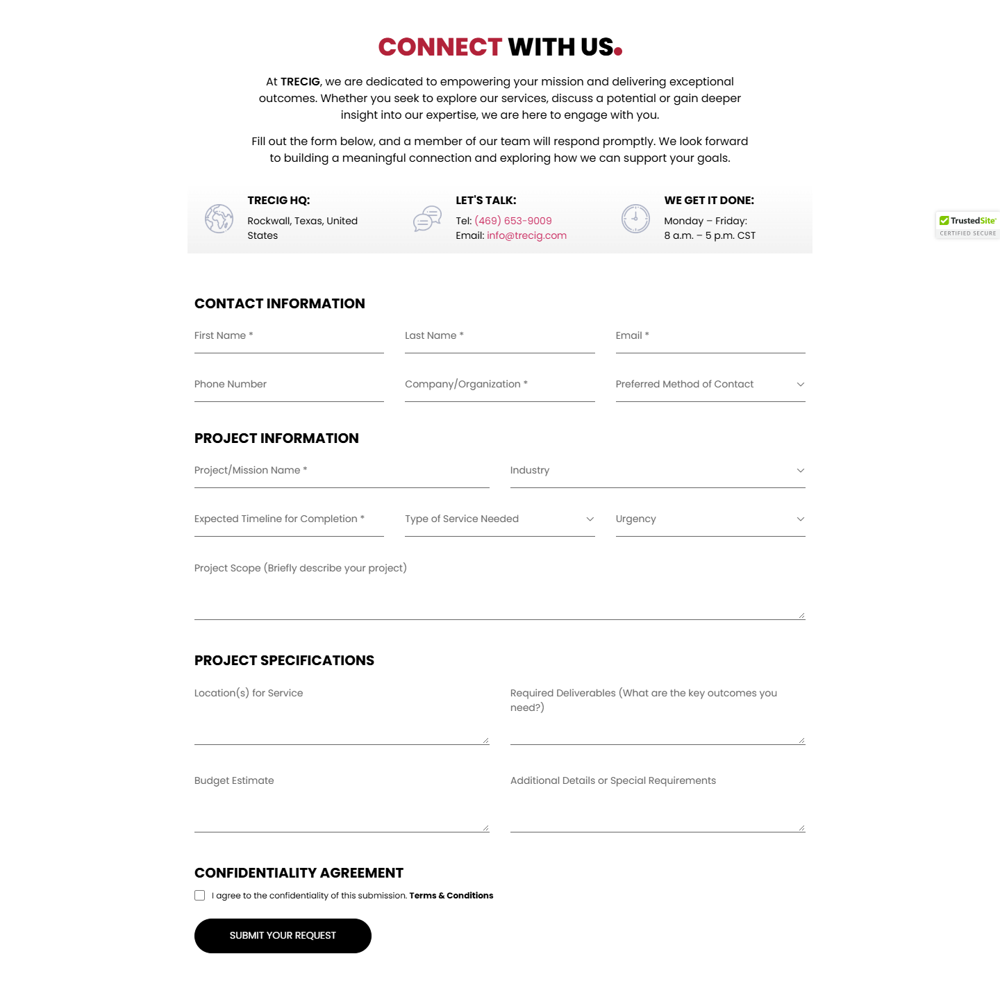
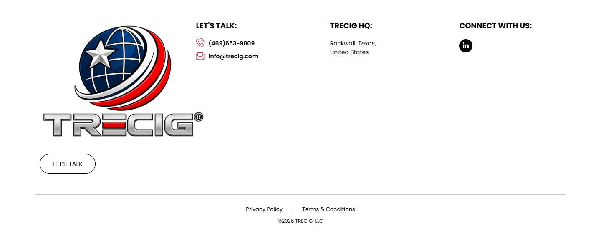

# Contact – TRECIG

*TRECIG (design reference site)* · URL: https://trecig.com/contact/ · captured 2026-11-08 00:33:44 · HTTP 200

- **Meta description:** —
- **Page size (desktop 1440px):** 1440×2591 px · tablet (820px): 2591 px · mobile (390px): 3262 px
- **Screenshots:** [desktop](screenshots/desktop-full.png) · [tablet](screenshots/tablet-full.png) · [mobile](screenshots/mobile-full.png) · [desktop top](screenshots/desktop-viewport-top.png) · [desktop scrolled](screenshots/desktop-viewport-scrolled.png)
- **Files:** [raw.html](raw.html) (server HTML) · [rendered.html](rendered.html) (DOM after JS) · [content.txt](content.txt) (all visible text) · layout-*.json (full element tree with computed styles) · page.json (everything)

## 1. Section map (top → bottom, desktop 1440px)

| # | Role | Y from top | Height | Heading / first text | Mobile height | Screenshot |
|---|---|---|---|---|---|---|
| 0 | header | 0 | 170 | HOME ABOUT AWARDS & RECOGNITION EXPERTISE PRESS & MEDIA CONTACT | 170 | [img](screenshots/desktop-sec00-header.png) |
| 1 | section | 170 | 400 | CONTACT | 220 | [img](screenshots/desktop-sec01-section.png) |
| 2 | section | 570 | 1423 | CONNECT WITH US | 2181 | [img](screenshots/desktop-sec02-section.png) |
| 3 | footer | 1993 | 598 | LET'S TALK: | 690 | [img](screenshots/desktop-sec03-footer.png) |
| 4 | floating (fixed, z 1000003) | 875 | 38 |  |  |  |

## 2. Section-by-section layout (desktop)

Legend: each line is an element in DOM order. `@x,y w×h` = position/size in px on the 1440px-wide page. Text lines show *font size/weight, line-height, colour*. Boxes show layout (flex/grid), background, padding, radius, shadow, etc. Pass-through wrappers are collapsed.

### 2.0 HEADER — HOME ABOUT AWARDS & RECOGNITION EXPERTISE PRESS & MEDIA CONTACT

Element: `<header class="elementor elementor-13 elementor-location-header">` at y=0, 1440×170px · 

- section.elementor-section [bg:#FFFFFF · shadow:#000000 @10% 0px 0px 12px 0px · z:9999 · transition:background, border, border-radius, box-shadow 0.3s, 0.3s, 0.3s, 0.3s ease, ease, ease, ease] `@0,0 1440×170`
  - div.elementor-container [flex row · margin:0px 85px 0px 85px · max-w:1270px] `@85,0 1270×170`
    - div.elementor-column [flex row · min-h:1px] `@85,0 1270×170`
      - div.elementor-widget-wrap [flex row wrap] `@85,0 1270×170`
        - div.elementor-container [flex row · max-w:1270px] `@85,0 1270×170`
          - div.elementor-column [flex row · min-h:1px] `@85,0 127×170`
            - div.elementor-widget-wrap [flex row wrap · align:center · pad:10px 10px 10px 10px] `@85,0 127×170`
              - a (link→/) [inline-block · align-text:center] `@95,10 200×150`
                - **IMG** `TRECIG_Logo_Registered.png` alt="" natural 1440×1080 · inline-block · max-w:200px · overflow:clip · align-text:center `@95,10 200×150`
          - div.elementor-column [flex row · min-h:1px] `@212,0 1143×170`
            - div.elementor-widget-wrap [flex row wrap · align:center · pad:10px 10px 10px 10px] `@212,0 1143×170`
              - div.elementor-widget-container [flex column · transition:background, border, border-radius, box-shadow, transform 0.3s, 0.3s, 0.3s, 0.3s, 0.4s ease, ease, ease, ease, ease] `@222,75 1123×20`
                - ul.elementor-nav-menu [flex row wrap · justify:flex-end · margin:0px 0px 0px 411.234px · z:2] · pseudo:::after{{"content": "\" \"", "w": "0px", "h": "0px"}} `@633,75 712×20`
                  - **A→/** "HOME" — Poppins 14px/400 lh 20px · #000000 · textTransform:uppercase ‖ flex row · margin:0px 15px 0px 0px · transition:all 0.4s ease `@633,75 40×20`
                  - **A→/about/** "ABOUT" — Poppins 14px/400 lh 20px · #000000 · textTransform:uppercase ‖ flex row · margin:0px 15px 0px 15px · transition:all 0.4s ease `@703,75 70×20`
                  - **A→/awards-recognition/** "AWARDS & RECOGNITION" — Poppins 14px/400 lh 20px · #000000 · textTransform:uppercase ‖ flex row · margin:0px 15px 0px 15px · transition:all 0.4s ease `@803,75 195×20`
                  - **A→/expertise/** "EXPERTISE" — Poppins 14px/400 lh 20px · #000000 · textTransform:uppercase ‖ flex row · margin:0px 15px 0px 15px · transition:all 0.4s ease `@1028,75 90×20`
                  - **A→/press-media/** "PRESS & MEDIA" — Poppins 14px/400 lh 20px · #000000 · textTransform:uppercase ‖ flex row · margin:0px 15px 0px 15px · transition:all 0.4s ease `@1148,75 100×20`
                  - **A→/contact/** "CONTACT" — Poppins 14px/400 lh 20px · #B22239 · textTransform:uppercase ‖ flex row · margin:0px 0px 0px 15px · transition:all 0.4s ease `@1278,75 67×20`

### 2.1 SECTION — CONTACT

Element: `<section class="elementor-section elementor-top-section elementor-element elementor-element-1f8fb94 elementor-section-height-min-height elementor-section-bo">` at y=170, 1440×400px · 

- section.elementor-section [transition:background, border, border-radius, box-shadow 0.3s, 0.3s, 0.3s, 0.3s ease, ease, ease, ease] `@0,170 1440×400`
  - div.elementor-background-video-container [pos:absolute · z:0 · overflow:hidden · transition:opacity 1s ease] `@0,170 1440×400`
    - **IFRAME** https://www.youtube.com/embed/PbQINAynsFA?controls=0&rel=0&playsinline=1&cc_load_policy=0&enablejsapi=1&origin=https%3A%2F%2Ftrecig.com&widgetid=1&forigin=https%3A%2F%2Ftrecig.com%2Fcontact%2F&aoriginsup=1&vf=6 Trecig   Contact `@0,-35 1440×810`
  - div.elementor-background-overlay [bg:#000000 · pos:absolute · opacity:0.5 · transition:background, border-radius, opacity 0.3s, 0.3s, 0.3s ease, ease, ease] `@0,170 1440×400` (empty/decorative)
  - div.elementor-container [flex row · align:center · margin:0px 370px 0px 370px · max-w:700px · min-h:400px] `@370,170 700×400`
    - div.elementor-column [flex row · min-h:1px] `@370,260 700×221`
      - div.elementor-widget-wrap [flex row wrap · pad:10px 10px 10px 10px · margin:80px 0px 0px 0px] `@370,340 700×141`
        - div.elementor-widget-heading [margin:0px 0px 20px 0px · align-text:center] `@380,350 680×36`
          - **H2** "CONTACT" — Poppins 36px/800 lh 36px · #FFFFFF · textTransform:uppercase · textAlign:center ‖ inline-block `@629,350 181×36`
        - div.elementor-widget-heading [margin:0px 0px 20px 0px · align-text:center] `@380,406 680×24`
          - **H2** "TRECIG IS MORE THAN A NAME—IT’S A PROMISE." — Poppins 18px/600 lh 18px · #FFFFFF · textTransform:uppercase · textAlign:center ‖ inline-block `@510,409 420×18`
        - ul.elementor-icon-list-items [flex row wrap · justify:center · margin:0px -2.5px 0px -2.5px · align-text:center] `@378,450 685×21`
          - li.elementor-icon-list-item [flex row · justify:center · align:center · margin:0px 2.5px 0px 2.5px · align-text:center] `@660,450 34×21`
            - **A→/** "HOME" — Poppins 12px/400 lh 18px · #CC3366 · textTransform:uppercase · textAlign:center ‖ flex row · highlights: "HOME" #FFFFFF `@660,451 34×18`
          - li.elementor-icon-list-item [flex row · justify:center · align:center · margin:0px 2.5px 0px 2.5px · align-text:center] `@700,450 80×21`
            - **SPAN** "CONTACT" — Poppins 12px/400 lh 18px · #FFFFFF · textTransform:uppercase · textAlign:center ‖ pad:0px 0px 0px 5px · transition:color 0.3s ease `@717,451 62×18`

### 2.2 SECTION — CONNECT WITH US

Element: `<section class="elementor-section elementor-top-section elementor-element elementor-element-bac63c8 elementor-section-boxed elementor-section-height-default">` at y=570, 1440×1423px · 

- section.elementor-section [pad:30px 0px 30px 0px · transition:background, border, border-radius, box-shadow 0.3s, 0.3s, 0.3s, 0.3s ease, ease, ease, ease] `@0,570 1440×1423`
  - div.elementor-container [flex row · margin:0px 85px 0px 85px · max-w:1270px] `@85,600 1270×1363`
    - div.elementor-column [flex row · min-h:1px] `@85,600 1270×1363`
      - div.elementor-widget-wrap [flex row wrap · pad:10px 10px 10px 10px] `@85,600 1270×1363`
        - div.elementor-container [flex row · margin:0px 250px 0px 250px · max-w:750px] `@345,610 750×225`
          - div.elementor-column [flex row · min-h:1px] `@345,610 750×225`
            - div.elementor-widget-wrap [flex row wrap · pad:10px 10px 10px 10px] `@345,610 750×225`
              - div.elementor-widget-heading [margin:0px 0px 20px 0px · align-text:center] `@355,620 730×36`
                - **H2** "CONNECT WITH US" — Poppins 36px/800 lh 36px · #000000 · textTransform:uppercase · textAlign:center ‖ inline-block · highlights: "CONNECT" #B22239 `@544,620 352×36`
              - div.elementor-widget-container [align-text:center · transition:background, border, border-radius, box-shadow, transform 0.3s, 0.3s, 0.3s, 0.3s, 0.4s ease, ease, ease, ease, ease] `@355,676 730×134`
                - **P** "At TRECIG, we are dedicated to empowering your mission and delivering exceptional outcomes. Whether you seek to explore our services, discuss a potential or …" — Poppins 16px/400 lh 24px · #000000 · textAlign:center ‖ margin:0px 0px 14.4px 0px · highlights: "TRECIG"  600 `@355,676 730×72`
                - **P** "Fill out the form below, and a member of our team will respond promptly. We look forward to building a meaningful connection and exploring how we can support…" — Poppins 16px/400 lh 24px · #000000 · textAlign:center ‖ margin:0px 0px 14.4px 0px `@355,762 730×48`
        - div.elementor-container [flex row · margin:0px 175px 0px 175px · max-w:900px] `@270,835 900×100`
          - div.elementor-column [flex row · min-h:1px] `@270,835 300×100`
            - div.elementor-widget-wrap [flex row wrap] `@270,835 300×100`
              - section.elementor-section [bg-image:linear-gradient(0deg, #F2F2F2 0%, transparent 100%) · transition:background, border, border-radius, box-shadow 0.3s, 0.3s, 0.3s, 0.3s ease, ease, ease, ease] `@270,835 300×100`
                - div.elementor-container [flex row · max-w:1270px · min-h:100px] `@270,835 300×100`
                  - div.elementor-column [flex row · min-h:1px] `@270,835 300×100`
                    - div.elementor-widget-wrap [flex row wrap · align:center · pad:0px 25px 0px 25px · transition:background, border, border-radius, box-shadow 0.3s, 0.3s, 0.3s, 0.3s ease, ease, ease, ease] `@270,835 300×100`
                      - div.elementor-image-box-wrapper [flex row · align:center] `@295,849 250×71`
                        - figure.elementor-image-box-img [margin:0px 20px 0px 0px] `@295,864 41×41`
                          - **IMG** `icon-globe.png` alt="" natural 70×70 · max-w:100% · overflow:clip · transition:all 0.3s ease `@295,864 41×41`
                        - div.elementor-image-box-content `@356,849 189×71`
                          - **H3** "TRECIG HQ:" — Poppins 16px/700 lh 19.2px · #000000 · textTransform:uppercase ‖ margin:0px 0px 10px 0px `@356,849 189×19`
                          - **P** "Rockwall, Texas, United States" — Poppins 14px/400 lh 21px · #000000 `@356,878 189×42`
          - div.elementor-column [flex row · min-h:1px] `@570,835 300×100`
            - div.elementor-widget-wrap [flex row wrap · bg-image:linear-gradient(0deg, #F2F2F2 0%, transparent 100%) · transition:background, border, border-radius, box-shadow 0.3s, 0.3s, 0.3s, 0.3s ease, ease, ease, ease] `@570,835 300×100`
              - div.elementor-container [flex row · max-w:1270px · min-h:100px] `@570,835 300×100`
                - div.elementor-column [flex row · min-h:1px] `@570,835 300×100`
                  - div.elementor-widget-wrap [flex row wrap · align:center · pad:0px 25px 0px 25px · transition:background, border, border-radius, box-shadow 0.3s, 0.3s, 0.3s, 0.3s ease, ease, ease, ease] `@570,835 300×100`
                    - div.elementor-image-box-wrapper [flex row · align:center] `@595,849 250×71`
                      - figure.elementor-image-box-img [margin:0px 20px 0px 0px] `@595,864 41×41`
                        - **IMG** `icon-chat.png` alt="" natural 70×70 · max-w:100% · overflow:clip · transition:all 0.3s ease `@595,864 41×41`
                      - div.elementor-image-box-content `@656,849 189×71`
                        - **H3** "LET'S TALK:" — Poppins 16px/700 lh 19.2px · #000000 · textTransform:uppercase ‖ margin:0px 0px 10px 0px `@656,849 189×19`
                        - p.elementor-image-box-description `@656,878 189×42`
                          - **text** "Tel: Email:" — Poppins 14px/400 lh 21px · #000000 `@656,878 189×42`
                          - **A→tel:(469) 653-9009** "(469) 653-9009" — Poppins 14px/400 lh 21px · #CC3366 ‖ inline `@683,878 112×20`
                          - **A→mailto:info@trecig.com** "info@trecig.com" — Poppins 14px/400 lh 21px · #CC3366 ‖ inline `@701,899 115×20`
          - div.elementor-column [flex row · min-h:1px] `@870,835 300×100`
            - div.elementor-widget-wrap [flex row wrap · bg-image:linear-gradient(0deg, #F2F2F2 0%, transparent 100%) · transition:background, border, border-radius, box-shadow 0.3s, 0.3s, 0.3s, 0.3s ease, ease, ease, ease] `@870,835 300×100`
              - div.elementor-container [flex row · max-w:1270px · min-h:100px] `@870,835 300×100`
                - div.elementor-column [flex row · min-h:1px] `@870,835 300×100`
                  - div.elementor-widget-wrap [flex row wrap · align:center · pad:0px 25px 0px 25px · transition:background, border, border-radius, box-shadow 0.3s, 0.3s, 0.3s, 0.3s ease, ease, ease, ease] `@870,835 300×100`
                    - div.elementor-image-box-wrapper [flex row · align:center] `@895,849 250×71`
                      - figure.elementor-image-box-img [margin:0px 20px 0px 0px] `@895,864 41×41`
                        - **IMG** `icon-clock.png` alt="" natural 70×70 · max-w:100% · overflow:clip · transition:all 0.3s ease `@895,864 41×41`
                      - div.elementor-image-box-content `@956,849 189×71`
                        - **H3** "WE GET IT DONE:" — Poppins 16px/700 lh 19.2px · #000000 · textTransform:uppercase ‖ margin:0px 0px 10px 0px `@956,849 189×19`
                        - **P** "Monday – Friday: 8 a.m. – 5 p.m. CST" — Poppins 14px/400 lh 21px · #000000 `@956,878 189×42`
        - section.elementor-section [margin:30px 0px 0px 0px] `@95,965 1250×988`
          - div.elementor-container [flex row · margin:0px 175px 0px 175px · max-w:900px] `@270,965 900×988`
            - div.elementor-column [flex row · min-h:1px] `@270,965 900×988`
              - div.elementor-widget-wrap [flex row wrap · align:center · pad:10px 10px 10px 10px] `@270,965 900×988`
                - FORM form.wpcf7-form `@280,995 880×948`
                  - div.secfr-1 `@280,995 880×174`
                    - **H4** "CONTACT INFORMATION" — Poppins 20px/700 lh 24px · #000000 · textTransform:uppercase ‖ margin:20px 0px 10px 0px `@280,995 880×24`
                    - p [flex row · gap:15px] `@280,1029 880×70`
                      - span.wpcf7-form-control-wrap [margin:0px 0px 20px 0px] `@280,1029 273×50`
                        - **FIELD** <input type=text name=firstname> placeholder="First Name *" — Poppins 14px/400 lh 21px · #000000 ‖ inline-block · border:0px 0px 1px 0px none #000000 · transition:all 0.3s ease `@280,1029 273×50`
                      - span.wpcf7-form-control-wrap [margin:0px 0px 20px 0px] `@583,1029 273×50`
                        - **FIELD** <input type=text name=lastname> placeholder="Last Name *" — Poppins 14px/400 lh 21px · #000000 ‖ inline-block · border:0px 0px 1px 0px none #000000 · transition:all 0.3s ease `@583,1029 273×50`
                      - span.wpcf7-form-control-wrap [margin:0px 0px 20px 0px] `@887,1029 273×50`
                        - **FIELD** <input type=email name=email> placeholder="Email *" — Poppins 14px/400 lh 21px · #000000 ‖ inline-block · border:0px 0px 1px 0px none #000000 · transition:all 0.3s ease `@887,1029 273×50`
                    - p [flex row · gap:15px] `@280,1099 880×70`
                      - span.wpcf7-form-control-wrap [margin:0px 0px 20px 0px] `@280,1099 273×50`
                        - **FIELD** <input type=tel name=phone> placeholder="Phone Number" — Poppins 14px/400 lh 21px · #000000 ‖ inline-block · border:0px 0px 1px 0px none #000000 · transition:all 0.3s ease `@280,1099 273×50`
                      - span.wpcf7-form-control-wrap [margin:0px 0px 20px 0px] `@583,1099 273×50`
                        - **FIELD** <input type=text name=outlet> placeholder="Company/Organization *" — Poppins 14px/400 lh 21px · #000000 ‖ inline-block · border:0px 0px 1px 0px none #000000 · transition:all 0.3s ease `@583,1099 273×50`
                      - span.wpcf7-form-control-wrap [margin:0px 0px 20px 0px] `@887,1099 273×50`
                        - div.select-styled [flex row · align:center · border:0px 0px 1px 0px none #666666] · pseudo:::after{{"content": "\"\"", "w": "14px", "h": "21px", "position": "absolute"}} `@887,1099 273×50`
                          - **text** "Preferred Method of Contact" — Poppins 14px/400 lh 21px · #666666 `@887,1099 273×50`
                  - div.secfr-1 `@280,1189 880×300`
                    - **H4** "PROJECT INFORMATION" — Poppins 20px/700 lh 24px · #000000 · textTransform:uppercase ‖ margin:20px 0px 10px 0px `@280,1189 880×24`
                    - p [flex row · gap:15px] `@280,1223 880×70`
                      - span.wpcf7-form-control-wrap [margin:0px 0px 20px 0px] `@280,1223 425×50`
                        - **FIELD** <input type=text name=missonname> placeholder="Project/Mission Name *" — Poppins 14px/400 lh 21px · #000000 ‖ inline-block · border:0px 0px 1px 0px none #000000 · transition:all 0.3s ease `@280,1223 425×50`
                      - span.wpcf7-form-control-wrap [margin:0px 0px 20px 0px] `@735,1223 425×50`
                        - div.select-styled [flex row · align:center · border:0px 0px 1px 0px none #666666] · pseudo:::after{{"content": "\"\"", "w": "14px", "h": "21px", "position": "absolute"}} `@735,1223 425×50`
                          - **text** "Industry" — Poppins 14px/400 lh 21px · #666666 `@735,1223 425×50`
                    - p [flex row · gap:15px] `@280,1293 880×70`
                      - span.wpcf7-form-control-wrap [margin:0px 0px 20px 0px] `@280,1293 273×50`
                        - **FIELD** <input type=text name=date> placeholder="Expected Timeline for Completion *" — Poppins 14px/400 lh 21px · #000000 ‖ inline-block · border:0px 0px 1px 0px none #000000 · transition:all 0.3s ease `@280,1293 273×50`
                      - span.wpcf7-form-control-wrap [margin:0px 0px 20px 0px] `@583,1293 273×50`
                        - div.select-styled [flex row · align:center · border:0px 0px 1px 0px none #666666] · pseudo:::after{{"content": "\"\"", "w": "14px", "h": "21px", "position": "absolute"}} `@583,1293 273×50`
                          - **text** "Type of Service Needed" — Poppins 14px/400 lh 21px · #666666 `@583,1293 273×50`
                      - span.wpcf7-form-control-wrap [margin:0px 0px 20px 0px] `@887,1293 273×50`
                        - div.select-styled [flex row · align:center · border:0px 0px 1px 0px none #666666] · pseudo:::after{{"content": "\"\"", "w": "14px", "h": "21px", "position": "absolute"}} `@887,1293 273×50`
                          - **text** "Urgency" — Poppins 14px/400 lh 21px · #666666 `@887,1293 273×50`
                  - div.secfr-1 `@280,1509 880×286`
                    - **H4** "PROJECT SPECIFICATIONS" — Poppins 20px/700 lh 24px · #000000 · textTransform:uppercase ‖ margin:20px 0px 10px 0px `@280,1509 880×24`
                    - p [flex row · gap:15px] `@280,1543 880×126`
                      - span.wpcf7-form-control-wrap [margin:0px 0px 20px 0px] `@280,1543 425×106`
                        - **FIELD** <textarea type=textarea name=location> placeholder="Location(s) for Service" — Poppins 14px/400 lh 21px · #000000 ‖ inline-block · pad:15px 0px 0px 0px · border:0px 0px 1px 0px none #000000 · transition:all 0.3s ease `@280,1543 425×100`
                      - span.wpcf7-form-control-wrap [margin:0px 0px 20px 0px] `@735,1543 425×106`
                        - **FIELD** <textarea type=textarea name=requireddeliverables> placeholder="Required Deliverables (What are the key outcomes you need?)" — Poppins 14px/400 lh 21px · #000000 ‖ inline-block · pad:15px 0px 0px 0px · border:0px 0px 1px 0px none #000000 · transition:all 0.3s ease `@735,1543 425×100`
                    - p [flex row · gap:15px] `@280,1669 880×126`
                      - span.wpcf7-form-control-wrap [margin:0px 0px 20px 0px] `@280,1669 425×106`
                        - **FIELD** <textarea type=textarea name=budgetestimate> placeholder="Budget Estimate" — Poppins 14px/400 lh 21px · #000000 ‖ inline-block · pad:15px 0px 0px 0px · border:0px 0px 1px 0px none #000000 · transition:all 0.3s ease `@280,1669 425×100`
                      - span.wpcf7-form-control-wrap [margin:0px 0px 20px 0px] `@735,1669 425×106`
                        - **FIELD** <textarea type=textarea name=additionaldetails> placeholder="Additional Details or Special Requirements" — Poppins 14px/400 lh 21px · #000000 ‖ inline-block · pad:15px 0px 0px 0px · border:0px 0px 1px 0px none #000000 · transition:all 0.3s ease `@735,1669 425×100`
                  - div.secfr-1 `@280,1815 880×78`
                    - **H4** "CONFIDENTIALITY AGREEMENT" — Poppins 20px/700 lh 24px · #000000 · textTransform:uppercase ‖ margin:20px 0px 10px 0px `@280,1815 880×24`
                    - **P** "I agree to the confidentiality of this submission. Terms & Conditions" — -apple-system 16px/400 lh 24px · #333333 · highlights: "I agree to the confidentiality of this submission. Terms & C" #000000  12px  Poppins `@280,1849 880×44`
                  - **FIELD** <input type=submit name=> placeholder="" value='Submit Your Request' — Poppins 14px/400 lh 21px · #FFFFFF · textTransform:uppercase · textAlign:center ‖ inline-block · bg:#000000 · pad:0px 50px 0px 50px · radius:30px · border:1px 1px 1px 1px solid #000000 · transition:all 0.3s ease `@280,1893 255×50`

### 2.3 FOOTER — LET'S TALK:

Element: `<footer class="elementor elementor-15 elementor-location-footer">` at y=1993, 1440×598px · 

- section.elementor-section [transition:background, border, border-radius, box-shadow 0.3s, 0.3s, 0.3s, 0.3s ease, ease, ease, ease] `@0,1993 1440×598`
  - div.elementor-background-video-container [pos:absolute · z:0 · overflow:hidden · transition:opacity 1s ease] `@0,1993 1440×598`
    - **IFRAME** https://www.youtube.com/embed/OzwCnEEadts?controls=0&rel=0&playsinline=1&cc_load_policy=0&enablejsapi=1&origin=https%3A%2F%2Ftrecig.com&widgetid=3&forigin=https%3A%2F%2Ftrecig.com%2Fcontact%2F&aoriginsup=1&vf=1 Triceg   Expertise Slider 1 `@0,1887 1440×810`
  - div.elementor-background-overlay [bg:#FFFFFF · pos:absolute · opacity:0.7 · transition:background, border-radius, opacity 0.3s, 0.3s, 0.3s ease, ease, ease] `@0,1993 1440×598` (empty/decorative)
  - div.elementor-container [flex row · margin:0px 85px 0px 85px · max-w:1270px] `@85,1993 1270×598`
    - div.elementor-column [flex row · min-h:1px] `@85,1993 1270×598`
      - div.elementor-widget-wrap [flex row wrap] `@85,1993 1270×598`
        - section.elementor-section [pad:40px 0px 40px 0px] `@85,1993 1270×467`
          - div.elementor-container [flex row · max-w:1270px] `@85,2033 1270×387`
            - div.elementor-column [flex row · min-h:1px] `@85,2033 324×387`
              - div.elementor-widget-wrap [flex row wrap · pad:10px 10px 10px 10px] `@85,2033 324×387`
                - div.elementor-widget-theme-site-logo [margin:0px 0px 20px 0px] `@95,2043 304×300`
                  - a (link→/) [inline-block] `@95,2043 400×300`
                    - **IMG** `TRECIG_Logo_Registered.png` alt="" natural 1440×1080 · inline-block · max-w:400px · overflow:clip `@95,2043 400×300`
                - div.elementor-button-wrapper [grid cols[134.078px]] `@95,2363 134×47`
                  - **A→/contact/** "LET’S TALK" — Poppins 15px/400 lh 15px · #000000 · textTransform:uppercase · textAlign:center ‖ pad:15px 30px 15px 30px · radius:30px · border:1px 1px 1px 1px solid #000000 · transition:all 0.3s ease `@95,2363 134×47`
            - div.elementor-column [flex row · min-h:1px] `@409,2033 371×387`
              - div.elementor-widget-wrap [flex row wrap · pad:10px 10px 10px 10px · margin:0px 0px 0px 50px] `@459,2033 321×387`
                - div.elementor-widget-heading [margin:0px 0px 20px 0px] `@469,2043 301×24`
                  - **H2** "LET'S TALK:" — Poppins 18px/700 lh 18px · #000000 · textTransform:uppercase ‖ inline-block `@469,2046 98×18`
                - ul.elementor-icon-list-items `@469,2087 301×52`
                  - li.elementor-icon-list-item [flex row · align:center · pad:0px 0px 5px 0px] `@469,2087 301×26`
                    - **A→tel:(254)%20338-6131** "(469)653-9009" — Poppins 14px/600 lh 21px · #CC3366 ‖ flex row · highlights: "(469)653-9009" #000000 `@469,2087 301×21`
                  - li.elementor-icon-list-item [flex row · align:center · margin:5px 0px 0px 0px] `@469,2118 301×21`
                    - **A→mailto:info@trecig.com** "info@trecig.com" — Poppins 14px/600 lh 21px · #CC3366 ‖ flex row · highlights: "info@trecig.com" #000000 `@469,2118 301×21`
            - div.elementor-column [flex row · min-h:1px] `@781,2033 310×387`
              - div.elementor-widget-wrap [flex row wrap · pad:10px 10px 10px 10px · margin:0px 50px 0px 0px] `@781,2033 260×387`
                - div.elementor-widget-heading [margin:0px 0px 20px 0px] `@791,2043 240×24`
                  - **H2** "TRECIG HQ:" — Poppins 18px/700 lh 18px · #000000 · textTransform:uppercase ‖ inline-block `@791,2046 101×18`
                - ul.elementor-icon-list-items `@791,2087 240×42`
                  - li.elementor-icon-list-item [flex row · align:center] `@791,2087 240×42`
                    - **SPAN** "Rockwall, Texas, United States" — Poppins 14px/400 lh 21px · #000000 ‖ transition:color 0.3s ease `@791,2087 110×42`
            - div.elementor-column [flex row · min-h:1px] `@1090,2033 264×387`
              - div.elementor-widget-wrap [flex row wrap · pad:10px 10px 10px 10px] `@1090,2033 264×387`
                - div.elementor-widget-heading [margin:0px 0px 20px 0px] `@1100,2043 244×24`
                  - **H2** "CONNECT WITH US:" — Poppins 18px/700 lh 18px · #000000 · textTransform:uppercase ‖ inline-block `@1100,2046 174×18`
                - **A→/contact/** "Linkedin-in" +icon[e-font-icon-svg e-fab-linkedin-in] — -apple-system 16px/400 lh 16px · #69727D · textAlign:center ‖ flex row · bg:#000000 · radius:100% · transition:all 0.3s ease `@1100,2087 32×32`
        - section.elementor-section [pad:15px 0px 15px 0px · border:1px 0px 0px 0px solid #000000 @20%] `@85,2460 1270×131`
          - div.elementor-container [flex row · max-w:1270px] `@85,2476 1270×100`
            - div.elementor-column [flex row · min-h:1px] `@85,2476 1270×100`
              - div.elementor-widget-wrap [flex row wrap · align:center · pad:10px 10px 10px 10px] `@85,2476 1270×100`
                - div.elementor-element [margin:0px 0px 20px 0px · align-text:center] `@95,2486 1250×10`
                  - div.elementor-widget-container [margin:0px 0px -10px 0px · overflow:hidden · align-text:center · transition:background, border, border-radius, box-shadow, transform 0.3s, 0.3s, 0.3s, 0.3s, 0.4s ease, ease, ease, ease, ease] `@95,2486 1250×20`
                    - ul.elementor-icon-list-items [flex row wrap · justify:center · gap:30px · margin:0px -8px 0px -8px · align-text:center] `@87,2486 1266×20`
                      - li.elementor-icon-list-item [flex row · justify:center · align:center · margin:0px 8px 0px 8px · align-text:center] `@589,2486 89×20`
                        - **A→/privacy-policy/** "Privacy Policy" — Poppins 13px/400 lh 19.5px · #CC3366 · textAlign:center ‖ flex row · highlights: "Privacy Policy" #000000 `@589,2486 88×20`
                      - li.elementor-icon-list-item [flex row · justify:center · align:center · margin:0px 8px 0px 8px · align-text:center] `@724,2486 127×20`
                        - **A→/terms-conditions/** "Terms & Conditions" — Poppins 13px/400 lh 19.5px · #CC3366 · textAlign:center ‖ flex row · highlights: "Terms & Conditions" #000000 `@724,2486 127×20`
                - **P** "©2026 TRECIG, LLC" — Poppins 12px/400 lh 18px · #000000 · textTransform:uppercase · textAlign:center ‖ margin:0px 0px 14.4px 0px `@95,2515 1250×36`

### Floating / fixed elements
- `div.` fixed at [1348, 875, 92, 38] z-index 1000003 — ""

## 3. Header, navigation & interaction behaviour

- **atTop** `header.elementor.elementor-13.elementor-location-header` position:static top:0 height:170 bg:transparent shadow:none backdrop:none z:auto
- **afterScroll1400** `header.elementor.elementor-13.elementor-location-header` position:static top:-1400 height:0 bg:transparent shadow:none backdrop:none z:auto
- **afterScroll1400** `section.elementor-section.elementor-top-section.elementor-element.elementor-elem` position:fixed top:0 height:170 bg:#FFFFFF @90% shadow:#000000 @10% 0px 0px 12px 0px backdrop:none z:9999

| Menu item | Link | Dropdown | Style | Hover change |
|---|---|---|---|---|
| HOME | / | — | Poppins 14px/400 #000000 uppercase ls normal | color: #000000 → #B22239 |
| ABOUT | /about/ | The Mission (/the-mission/); The Values (/the-values/); The Legacy (/the-legacy/); The Trecig Team (/the-trecig-team/); Careers (/careers/) | Poppins 14px/400 #000000 uppercase ls normal | color: #000000 → #B22239 |
| AWARDS & RECOGNITION | /awards-recognition/ | Partnerships (/partnerships/) | Poppins 14px/400 #000000 uppercase ls normal | color: #000000 → #B22239 |
| EXPERTISE | /expertise/ | Industries We Serve (/industries-we-serve/) | Poppins 14px/400 #000000 uppercase ls normal | color: #000000 → #B22239 |
| PRESS & MEDIA | /press-media/ | — | Poppins 14px/400 #000000 uppercase ls normal | color: #000000 → #B22239 |
| CONTACT (current) | /contact/ | — | Poppins 14px/400 #B22239 uppercase ls normal | none |

- **Mobile menu:** toggle `.elementor-menu-toggle` → [screenshot](screenshots/mobile-menu-open.png) · items: HOME, ABOUT, AWARDS & RECOGNITION, EXPERTISE, PRESS & MEDIA, CONTACT

### Hover states (measured by hovering in Chrome)

| Element | Text | Normal | On hover |
|---|---|---|---|
| `a.elementor-item` | HOME | color #000000 · bg transparent · radius 0px · pad 0px · border 0px #000000 · transition 0.4s | color: #000000 → #B22239; borderTopColor: #000000 → #B22239 |
| `a.elementor-item` | ABOUT | color #000000 · bg transparent · radius 0px · pad 0px · border 0px #000000 · transition 0.4s | color: #000000 → #B22239; borderTopColor: #000000 → #B22239 |
| `a.elementor-item` | CONTACT | color #B22239 · bg transparent · radius 0px · pad 0px · border 0px #B22239 · transition 0.4s | no change |
| `div.elementor-image-box-wrapper` | TRECIG HQ: Rockwall, Texas, United State | color #333333 · bg transparent · radius 0px · pad 0px · border 0px #333333 · transition all | no change |
| `input.wpcf7-form-control` | Submit Your Request | color #FFFFFF · bg #000000 · radius 30px · pad 0px 50px · border 1px #000000 · transition 0.3s | backgroundColor: #000000 → #B22239; borderTopColor: #000000 → #B22239 |
| `a.` |  | color #CC3366 · bg transparent · radius 0px · pad 0px · border 0px #CC3366 · transition all | color: #CC3366 → #B22239; borderTopColor: #CC3366 → #B22239; childColor: #CC3366 → #B22239 |
| `a.elementor-button` | LET’S TALK | color #000000 · bg transparent · radius 30px · pad 15px 30px · border 1px #000000 · transition 0.3s | color: #000000 → #FFFFFF; borderTopColor: #000000 → #B22239 |
| `a.` | (469)653-9009 | color #CC3366 · bg transparent · radius 0px · pad 0px · border 0px #CC3366 · transition all | color: #CC3366 → #B22239; borderTopColor: #CC3366 → #B22239 |
| `a.elementor-icon` | Linkedin-in | color #69727D · bg #000000 · radius 100% · pad 0px · border 0px #69727D · transition 0.3s | color: #69727D → #B22239; backgroundColor: #000000 → #B22239; borderTopColor: #69727D → #B22239; opacity: 1 → 0.9; childColor: #69727D → #B22239 |
| `a.` | Privacy Policy | color #CC3366 · bg transparent · radius 0px · pad 0px · border 0px #CC3366 · transition all | color: #CC3366 → #B22239; borderTopColor: #CC3366 → #B22239 |

## 4. Typography & colour used on this page (weighted by amount of text / area)

| Font · weight · size / line-height | chars |
|---|---|
| Poppins | 400 | 16px / 24px | 390 |
| Poppins | 400 | 14px / 21px | 197 |
| Poppins | 700 | 20px / 24px | 85 |
| Poppins | 400 | 14px / 20px | 58 |
| Poppins | 400 | 12px / 16px | 50 |
| Poppins | 600 | 18px / 18px | 42 |
| Poppins | 700 | 18px / 18px | 37 |
| Poppins | 700 | 16px / 19.2px | 36 |
| Poppins | 400 | 13px / 19.5px | 32 |
| Poppins | 400 | 12px / 18px | 28 |
| Poppins | 600 | 14px / 21px | 28 |
| Poppins | 800 | 36px / 36px | 21 |
| Poppins | 700 | 12px / 16px | 18 |
| -apple-system | 400 | 16px / 24px | 15 |
| -apple-system | 400 | 16px / 16px | 11 |
| Poppins | 400 | 15px / 15px | 10 |
| Poppins | 600 | 16px / 24px | 6 |

- **Text colours:** #000000 (871), #666666 (64), #FFFFFF (60), #CC3366 (44), #B22239 (14), #69727D (11)
- **Background colours (by area):** #FFFFFF (1109), #000000 (590), #B22239 (0)
- **Gradients:** linear-gradient(0deg, #F2F2F2 0%, transparent 100%)
- **Border radii:** 30px (2), 50% (1), 100% (1), 2px 0px 0px (1)
- **Shadows:** #000000 @10% 0px 0px 12px 0px (1) | #000000 @20% 0px 0px 5px 0px (1)
- **Mobile text styles:** Poppins | 400 | 14px / 21px (587); Poppins | 700 | 20px / 24px (85); Poppins | 400 | 12px / 16px (50); Poppins | 400 | 12px / 18px (43); Poppins | 600 | 16px / 16px (42); Poppins | 700 | 16px / 16px (37); Poppins | 700 | 16px / 19.2px (36); Poppins | 600 | 14px / 21px (34); Poppins | 800 | 28px / 28px (21); Poppins | 700 | 12px / 16px (18)

## 5. Forms
- **Form** `wpcf7-form init` → https://trecig.com/contact/#wpcf7-f966-p244-o1 (post)
  - fieldset[fieldset] name=`` label="" placeholder=""
  - input[text] name=`firstname` label="" placeholder="First Name *"
  - input[text] name=`lastname` label="" placeholder="Last Name *"
  - input[email] name=`email` label="" placeholder="Email *"
  - input[tel] name=`phone` label="" placeholder="Phone Number"
  - input[text] name=`outlet` label="" placeholder="Company/Organization *"
  - select[select-one] name=`preferredmethod` label="" placeholder="" options: ['Preferred Method of Contact', 'Email', 'Phone']
  - input[text] name=`missonname` label="" placeholder="Project/Mission Name *"
  - select[select-one] name=`industry` label="" placeholder="" options: ['Industry', 'Defense', 'Civilian', 'Space', 'Contracts', 'AI & Machine Learning', 'Other']
  - input[text] name=`date` label="" placeholder="Expected Timeline for Completion *"
  - select[select-one] name=`serviceneeded` label="" placeholder="" options: ['Type of Service Needed', 'Cyber Security', 'IT', 'Software Development', 'Call Center Buildout and Management', 'CSfC Design and Implementation', 'Onsite Personnel', 'Infrastructure Development', 'Cloud Computing', 'Encryption', 'Training (LMS)']
  - select[select-one] name=`urgency` label="" placeholder="" options: ['Urgency', 'Immediate', 'Within 1 Month', '1–3 Months', '3+ Months']
  - textarea[textarea] name=`projectscope` label="" placeholder="Project Scope (Briefly describe your project)"
  - textarea[textarea] name=`location` label="" placeholder="Location(s) for Service"
  - textarea[textarea] name=`requireddeliverables` label="" placeholder="Required Deliverables (What are the key outcomes you need?)"
  - textarea[textarea] name=`budgetestimate` label="" placeholder="Budget Estimate"
  - textarea[textarea] name=`additionaldetails` label="" placeholder="Additional Details or Special Requirements"
  - input[checkbox] name=`acceptance` label="I agree to the confidentiality of this submission. Terms & Conditions" placeholder=""
  - input[submit] name=`` label="" placeholder="" value="Submit Your Request"

## 6. Images on the page

- `TRECIG_Logo_Registered.png` natural 1440×1080 → shown 200×150 · alt="" · https://trecig.com/wp-content/uploads/2026/10/TRECIG_Logo_Registered.png
- `icon-globe.png` natural 70×70 → shown 41×41 · alt="" · https://trecig.com/wp-content/uploads/2024/08/icon-globe.png
- `icon-chat.png` natural 70×70 → shown 41×41 · alt="" · https://trecig.com/wp-content/uploads/2024/08/icon-chat.png
- `icon-clock.png` natural 70×70 → shown 41×41 · alt="" · https://trecig.com/wp-content/uploads/2024/08/icon-clock.png
- background on `button.xdsoft_prev`: data:image/png;base64,iVBORw0KGgoAAAANSUhEUgAAAGQAAAAeCAYAAADaW7vzAAAAGXRFWHRTb2Z0d2FyZQBBZG9iZSBJbWFnZVJlYWR5ccllPAAAAyJpVFh0WE1MOmNvbS5hZG9iZS54bXAAAAAAADw/eHBhY2tldCBiZWdpbj0i77u/IiBpZD0iVzVNME1wQ2VoaUh6cmVTek5UY3prYzlkIj8+IDx4OnhtcG1ldGEgeG1sbnM6eD0iYWRvYmU6bnM6bWV0YS8iIHg6eG1wdGs9IkFkb2JlI
- background on `button.xdsoft_today_button`: data:image/png;base64,iVBORw0KGgoAAAANSUhEUgAAAGQAAAAeCAYAAADaW7vzAAAAGXRFWHRTb2Z0d2FyZQBBZG9iZSBJbWFnZVJlYWR5ccllPAAAAyJpVFh0WE1MOmNvbS5hZG9iZS54bXAAAAAAADw/eHBhY2tldCBiZWdpbj0i77u/IiBpZD0iVzVNME1wQ2VoaUh6cmVTek5UY3prYzlkIj8+IDx4OnhtcG1ldGEgeG1sbnM6eD0iYWRvYmU6bnM6bWV0YS8iIHg6eG1wdGs9IkFkb2JlI
- background on `i.`: data:image/png;base64,iVBORw0KGgoAAAANSUhEUgAAAGQAAAAeCAYAAADaW7vzAAAAGXRFWHRTb2Z0d2FyZQBBZG9iZSBJbWFnZVJlYWR5ccllPAAAAyJpVFh0WE1MOmNvbS5hZG9iZS54bXAAAAAAADw/eHBhY2tldCBiZWdpbj0i77u/IiBpZD0iVzVNME1wQ2VoaUh6cmVTek5UY3prYzlkIj8+IDx4OnhtcG1ldGEgeG1sbnM6eD0iYWRvYmU6bnM6bWV0YS8iIHg6eG1wdGs9IkFkb2JlI
- background on `i.`: data:image/png;base64,iVBORw0KGgoAAAANSUhEUgAAAGQAAAAeCAYAAADaW7vzAAAAGXRFWHRTb2Z0d2FyZQBBZG9iZSBJbWFnZVJlYWR5ccllPAAAAyJpVFh0WE1MOmNvbS5hZG9iZS54bXAAAAAAADw/eHBhY2tldCBiZWdpbj0i77u/IiBpZD0iVzVNME1wQ2VoaUh6cmVTek5UY3prYzlkIj8+IDx4OnhtcG1ldGEgeG1sbnM6eD0iYWRvYmU6bnM6bWV0YS8iIHg6eG1wdGs9IkFkb2JlI
- background on `button.xdsoft_next`: data:image/png;base64,iVBORw0KGgoAAAANSUhEUgAAAGQAAAAeCAYAAADaW7vzAAAAGXRFWHRTb2Z0d2FyZQBBZG9iZSBJbWFnZVJlYWR5ccllPAAAAyJpVFh0WE1MOmNvbS5hZG9iZS54bXAAAAAAADw/eHBhY2tldCBiZWdpbj0i77u/IiBpZD0iVzVNME1wQ2VoaUh6cmVTek5UY3prYzlkIj8+IDx4OnhtcG1ldGEgeG1sbnM6eD0iYWRvYmU6bnM6bWV0YS8iIHg6eG1wdGs9IkFkb2JlI
- background on `button.xdsoft_prev`: data:image/png;base64,iVBORw0KGgoAAAANSUhEUgAAAGQAAAAeCAYAAADaW7vzAAAAGXRFWHRTb2Z0d2FyZQBBZG9iZSBJbWFnZVJlYWR5ccllPAAAAyJpVFh0WE1MOmNvbS5hZG9iZS54bXAAAAAAADw/eHBhY2tldCBiZWdpbj0i77u/IiBpZD0iVzVNME1wQ2VoaUh6cmVTek5UY3prYzlkIj8+IDx4OnhtcG1ldGEgeG1sbnM6eD0iYWRvYmU6bnM6bWV0YS8iIHg6eG1wdGs9IkFkb2JlI
- background on `button.xdsoft_next`: data:image/png;base64,iVBORw0KGgoAAAANSUhEUgAAAGQAAAAeCAYAAADaW7vzAAAAGXRFWHRTb2Z0d2FyZQBBZG9iZSBJbWFnZVJlYWR5ccllPAAAAyJpVFh0WE1MOmNvbS5hZG9iZS54bXAAAAAAADw/eHBhY2tldCBiZWdpbj0i77u/IiBpZD0iVzVNME1wQ2VoaUh6cmVTek5UY3prYzlkIj8+IDx4OnhtcG1ldGEgeG1sbnM6eD0iYWRvYmU6bnM6bWV0YS8iIHg6eG1wdGs9IkFkb2JlI
- background on `div.`: https://cdn.ywxi.net/meter/trecig.com/205.svg?ts=1784975038086&l=en

## 7. Links on the page

- [body] "Skip to content" → /contact/#content
- [header] "(icon/image)" → /
- [header] "HOME" → /
- [header] "ABOUT" → /about/
- [header] "The Mission" → /the-mission/
- [header] "The Values" → /the-values/
- [header] "The Legacy" → /the-legacy/
- [header] "The Trecig Team" → /the-trecig-team/
- [header] "Careers" → /careers/
- [header] "AWARDS & RECOGNITION" → /awards-recognition/
- [header] "Partnerships" → /partnerships/
- [header] "EXPERTISE" → /expertise/
- [header] "Industries We Serve" → /industries-we-serve/
- [header] "PRESS & MEDIA" → /press-media/
- [header] "CONTACT" → /contact/
- [header] "Home" → /
- [header] "About" → /about/
- [header] "Awards & Recognition" → /awards-recognition/
- [header] "Expertise" → /expertise/
- [header] "Press & Media" → /press-media/
- [header] "Contact" → /contact/
- [body] "(469) 653-9009" → tel:(469) 653-9009
- [body] "info@trecig.com" → mailto:info@trecig.com
- [body] "Terms & Conditions" → /contact/
- [footer] "LET’S TALK" → /contact/
- [footer] "(469)653-9009" → tel:(254)%20338-6131
- [footer] "Linkedin-in" → /contact/ (target _blank)
- [footer] "Privacy Policy" → /privacy-policy/
- [footer] "Terms & Conditions" → /terms-conditions/

## 8. Mobile layout (390px) — condensed outline

### 8.0 header — HOME ABOUT AWARDS & RECOGNITION EXPERTISE PRESS & MEDIA CONTACT (y 0, h 170)
- section.elementor-section [bg:#FFFFFF · shadow:#000000 @10% 0px 0px 12px 0px · z:9999 · transition:background, border, border-radius, box-shadow 0.3s, 0.3s, 0.3s, 0.3s ease, ease, ease, ease] `@0,0 390×170`
  - div.elementor-container [flex row wrap · max-w:767px] `@0,0 390×170`
    - div.elementor-column [flex row · min-h:1px] `@0,0 390×170`
      - div.elementor-widget-wrap [flex row wrap] `@0,0 390×170`
        - div.elementor-container [flex row wrap · max-w:767px] `@0,0 390×170`
          - div.elementor-column [flex row · min-h:1px] `@0,0 234×170`
            - div.elementor-widget-wrap [flex row wrap · align:center · pad:10px 10px 10px 10px] `@0,0 234×170`
              - a (link→/) [inline-block · align-text:center] `@17,10 200×150`
                - **IMG** `TRECIG_Logo_Registered-1024x768.png` alt="" natural 390×292 · inline-block · max-w:200px · overflow:clip · align-text:center `@17,10 200×150`
          - div.elementor-column [flex row · min-h:1px] `@234,0 156×170`
            - div.elementor-widget-wrap [flex row wrap · align:center · pad:10px 10px 10px 10px] `@234,0 156×170`
              - div.elementor-widget-container [flex column · transition:background, border, border-radius, box-shadow, transform 0.3s, 0.3s, 0.3s, 0.3s, 0.4s ease, ease, ease, ease, ease] `@244,70 136×30`
                - nav.elementor-nav-menu--dropdown [bg:#FFFFFF · margin:16px 0px 0px 0px · pos:absolute · z:9997 · overflow:hidden · transform:matrix(1, 0, 0, 0, 0, 0) · transition:max-height, transform 0.3s, 0.3s ease, ease] `@0,116 390×0`
                  - ul.elementor-nav-menu [z:2] · pseudo:::after{{"content": "\" \"", "w": "390px", "h": "0px"}} `@0,116 390×0`
                    - **A→/** "HOME" — Poppins 14px/400 lh 20px · #000000 · textTransform:uppercase ‖ flex row · pad:10px 20px 10px 20px `@0,116 390×0`
                    - **A→/about/** "ABOUT" — Poppins 14px/400 lh 20px · #000000 · textTransform:uppercase ‖ flex row · pad:10px 20px 10px 20px `@0,116 390×0`
                    - **A→/awards-recognition/** "AWARDS & RECOGNITION" — Poppins 14px/400 lh 20px · #000000 · textTransform:uppercase ‖ flex row · pad:10px 20px 10px 20px `@0,116 390×0`
                    - **A→/expertise/** "EXPERTISE" — Poppins 14px/400 lh 20px · #000000 · textTransform:uppercase ‖ flex row · pad:10px 20px 10px 20px `@0,116 390×0`
                    - **A→/press-media/** "PRESS & MEDIA" — Poppins 14px/400 lh 20px · #000000 · textTransform:uppercase ‖ flex row · pad:10px 20px 10px 20px `@0,116 390×0`
                    - **A→/contact/** "CONTACT" — Poppins 14px/400 lh 20px · #FFFFFF · textTransform:uppercase ‖ flex row · bg:#B22239 · pad:10px 20px 10px 20px `@0,116 390×0`

### 8.1 section — CONTACT (y 170, h 220)
- section.elementor-section [transition:background, border, border-radius, box-shadow 0.3s, 0.3s, 0.3s, 0.3s ease, ease, ease, ease] `@0,170 390×220`
  - div.elementor-background-overlay [bg:#000000 · pos:absolute · opacity:0.5 · transition:background, border-radius, opacity 0.3s, 0.3s, 0.3s ease, ease, ease] `@0,170 390×220` (empty/decorative)
  - div.elementor-container [flex row wrap · align:center · max-w:700px · min-h:220px] `@0,170 390×220`
    - div.elementor-column [flex row · min-h:1px] `@0,185 390×190`
      - div.elementor-widget-wrap [flex row wrap · pad:10px 10px 10px 10px · margin:65px 0px 0px 0px] `@0,250 390×125`
        - div.elementor-widget-heading [margin:0px 0px 20px 0px · align-text:center] `@10,260 370×29`
          - **H2** "CONTACT" — Poppins 28px/800 lh 28px · #FFFFFF · textTransform:uppercase · textAlign:center ‖ inline-block `@125,260 141×28`
        - div.elementor-widget-heading [margin:0px 0px 20px 0px · align-text:center] `@10,309 370×15`
          - div.elementor-widget-container [margin:-10px 0px -10px 0px · align-text:center · transition:background, border, border-radius, box-shadow, transform 0.3s, 0.3s, 0.3s, 0.3s, 0.4s ease, ease, ease, ease, ease] `@10,299 370×35`
            - **H2** "TRECIG IS MORE THAN A NAME—IT’S A PROMISE." — Poppins 16px/600 lh 16px · #FFFFFF · textTransform:uppercase · textAlign:center ‖ inline-block `@10,299 370×32`
        - ul.elementor-icon-list-items [flex row wrap · justify:center · margin:0px -2.5px 0px -2.5px · align-text:center] `@8,344 375×21`
          - li.elementor-icon-list-item [flex row · justify:center · align:center · margin:0px 2.5px 0px 2.5px · align-text:center] `@135,344 34×21`
            - **A→/** "HOME" — Poppins 12px/400 lh 18px · #CC3366 · textTransform:uppercase · textAlign:center ‖ flex row · highlights: "HOME" #FFFFFF `@135,346 34×18`
          - li.elementor-icon-list-item [flex row · justify:center · align:center · margin:0px 2.5px 0px 2.5px · align-text:center] `@175,344 80×21`
            - **SPAN** "CONTACT" — Poppins 12px/400 lh 18px · #FFFFFF · textTransform:uppercase · textAlign:center ‖ pad:0px 0px 0px 5px · transition:color 0.3s ease `@192,346 62×18`

### 8.2 section — CONNECT WITH US (y 390, h 2181)
- div.elementor-container [flex row wrap · max-w:767px] `@0,390 390×2181`
  - div.elementor-column [flex row · min-h:1px] `@0,390 390×2181`
    - div.elementor-widget-wrap [flex row wrap · pad:10px 10px 10px 10px] `@0,390 390×2181`
      - div.elementor-container [flex row wrap · max-w:750px] `@10,400 370×287`
        - div.elementor-column [flex row · min-h:1px] `@10,400 370×287`
          - div.elementor-widget-wrap [flex row wrap · pad:10px 10px 10px 10px] `@10,400 370×287`
            - div.elementor-widget-heading [margin:0px 0px 20px 0px · align-text:center] `@20,410 350×29`
              - **H2** "CONNECT WITH US" — Poppins 28px/800 lh 28px · #000000 · textTransform:uppercase · textAlign:center ‖ inline-block · highlights: "CONNECT" #B22239 `@60,410 269×28`
            - div.elementor-widget-container [align-text:center · transition:background, border, border-radius, box-shadow, transform 0.3s, 0.3s, 0.3s, 0.3s, 0.4s ease, ease, ease, ease, ease] `@20,459 350×203`
              - **P** "At TRECIG, we are dedicated to empowering your mission and delivering exceptional outcomes. Whether you seek to explore our services, discuss a potential or …" — Poppins 14px/400 lh 21px · #000000 · textAlign:center ‖ margin:0px 0px 14.4px 0px · highlights: "TRECIG"  600 `@20,459 350×105`
              - **P** "Fill out the form below, and a member of our team will respond promptly. We look forward to building a meaningful connection and exploring how we can support…" — Poppins 14px/400 lh 21px · #000000 · textAlign:center ‖ margin:0px 0px 14.4px 0px `@20,578 350×84`
      - div.elementor-container [flex row wrap · max-w:900px] `@10,687 370×359`
        - div.elementor-column [flex row · min-h:1px] `@10,687 370×106`
          - div.elementor-widget-wrap [flex row wrap] `@10,687 370×106`
            - section.elementor-section [bg-image:linear-gradient(0deg, #F2F2F2 0%, transparent 100%) · margin:-10px 0px 0px 0px · transition:background, border, border-radius, box-shadow 0.3s, 0.3s, 0.3s, 0.3s ease, ease, ease, ease] `@10,677 370×116`
              - div.elementor-container [flex row wrap · max-w:767px · min-h:100px] `@10,677 370×116`
                - div.elementor-column [flex row · min-h:1px] `@10,677 370×116`
                  - div.elementor-widget-wrap [flex row wrap · align:center · pad:10px 10px 10px 10px · transition:background, border, border-radius, box-shadow 0.3s, 0.3s, 0.3s, 0.3s ease, ease, ease, ease] `@10,677 370×116`
                    - div.elementor-image-box-wrapper [align-text:center] `@20,687 350×96`
                      - **IMG** `icon-globe.png` alt="" natural 70×70 · max-w:100% · overflow:clip · align-text:center · transition:all 0.3s ease `@173,687 45×45`
                      - div.elementor-image-box-content [align-text:center] `@20,738 350×45`
                        - **H3** "TRECIG HQ:" — Poppins 16px/700 lh 19.2px · #000000 · textTransform:uppercase · textAlign:center ‖ margin:0px 0px 5px 0px `@20,738 350×19`
                        - **P** "Rockwall, Texas, United States" — Poppins 14px/400 lh 21px · #000000 · textAlign:center `@20,762 350×21`
        - div.elementor-column [flex row · min-h:1px] `@10,793 370×126`
          - div.elementor-widget-wrap [flex row wrap · bg-image:linear-gradient(0deg, #F2F2F2 0%, transparent 100%) · pad:10px 10px 10px 10px · transition:background, border, border-radius, box-shadow 0.3s, 0.3s, 0.3s, 0.3s ease, ease, ease, ease] `@10,793 370×126`
            - section.elementor-section [margin:-10px 0px 0px 0px] `@20,793 350×116`
              - div.elementor-container [flex row wrap · max-w:767px · min-h:100px] `@20,793 350×116`
                - div.elementor-column [flex row · min-h:1px] `@20,793 350×116`
                  - div.elementor-widget-wrap [flex row wrap · align:center · pad:10px 10px 10px 10px · transition:background, border, border-radius, box-shadow 0.3s, 0.3s, 0.3s, 0.3s ease, ease, ease, ease] `@20,793 350×116`
                    - div.elementor-image-box-wrapper [align-text:center] `@30,803 330×96`
                      - **IMG** `icon-chat.png` alt="" natural 70×70 · max-w:100% · overflow:clip · align-text:center · transition:all 0.3s ease `@173,803 45×45`
                      - div.elementor-image-box-content [align-text:center] `@30,854 330×45`
                        - **H3** "LET'S TALK:" — Poppins 16px/700 lh 19.2px · #000000 · textTransform:uppercase · textAlign:center ‖ margin:0px 0px 5px 0px `@30,854 330×19`
                        - p.elementor-image-box-description [align-text:center] `@30,878 330×21`
                          - **text** "Tel: Email:" — Poppins 14px/400 lh 21px · #000000 · textAlign:center `@30,878 330×21`
                          - **A→tel:(469) 653-9009** "(469) 653-9009" — Poppins 14px/400 lh 21px · #CC3366 · textAlign:center ‖ inline `@70,878 112×20`
                          - **A→mailto:info@trecig.com** "info@trecig.com" — Poppins 14px/400 lh 21px · #CC3366 · textAlign:center ‖ inline `@231,878 115×20`
        - div.elementor-column [flex row · min-h:1px] `@10,919 370×126`
          - div.elementor-widget-wrap [flex row wrap · bg-image:linear-gradient(0deg, #F2F2F2 0%, transparent 100%) · pad:10px 10px 10px 10px · transition:background, border, border-radius, box-shadow 0.3s, 0.3s, 0.3s, 0.3s ease, ease, ease, ease] `@10,919 370×126`
            - section.elementor-section [margin:-10px 0px 0px 0px] `@20,919 350×116`
              - div.elementor-container [flex row wrap · max-w:767px · min-h:100px] `@20,919 350×116`
                - div.elementor-column [flex row · min-h:1px] `@20,919 350×116`
                  - div.elementor-widget-wrap [flex row wrap · align:center · pad:10px 10px 10px 10px · transition:background, border, border-radius, box-shadow 0.3s, 0.3s, 0.3s, 0.3s ease, ease, ease, ease] `@20,919 350×116`
                    - div.elementor-image-box-wrapper [align-text:center] `@30,929 330×96`
                      - **IMG** `icon-clock.png` alt="" natural 70×70 · max-w:100% · overflow:clip · align-text:center · transition:all 0.3s ease `@173,929 45×45`
                      - div.elementor-image-box-content [align-text:center] `@30,980 330×45`
                        - **H3** "WE GET IT DONE:" — Poppins 16px/700 lh 19.2px · #000000 · textTransform:uppercase · textAlign:center ‖ margin:0px 0px 5px 0px `@30,980 330×19`
                        - **P** "Monday – Friday: 8 a.m. – 5 p.m. CST" — Poppins 14px/400 lh 21px · #000000 · textAlign:center `@30,1004 330×21`
      - div.elementor-container [flex row wrap · max-w:900px] `@10,1045 370×1516`
        - div.elementor-column [flex row · min-h:1px] `@10,1045 370×1516`
          - div.elementor-widget-wrap [flex row wrap · align:center · pad:10px 10px 10px 10px] `@10,1045 370×1516`
            - FORM form.wpcf7-form `@20,1075 350×1476`
              - div.secfr-1 `@20,1075 350×399`
                - **H4** "CONTACT INFORMATION" — Poppins 20px/700 lh 24px · #000000 · textTransform:uppercase ‖ margin:20px 0px 10px 0px `@20,1075 350×24`
                - p [flex row wrap] `@20,1109 350×180`
                  - span.wpcf7-form-control-wrap [margin:0px 0px 15px 0px] `@20,1109 350×45`
                    - **FIELD** <input type=text name=firstname> placeholder="First Name *" — Poppins 14px/400 lh 21px · #000000 ‖ inline-block · border:0px 0px 1px 0px none #000000 · transition:all 0.3s ease `@20,1109 350×45`
                  - span.wpcf7-form-control-wrap [margin:0px 0px 15px 0px] `@20,1169 350×45`
                    - **FIELD** <input type=text name=lastname> placeholder="Last Name *" — Poppins 14px/400 lh 21px · #000000 ‖ inline-block · border:0px 0px 1px 0px none #000000 · transition:all 0.3s ease `@20,1169 350×45`
                  - span.wpcf7-form-control-wrap [margin:0px 0px 15px 0px] `@20,1229 350×45`
                    - **FIELD** <input type=email name=email> placeholder="Email *" — Poppins 14px/400 lh 21px · #000000 ‖ inline-block · border:0px 0px 1px 0px none #000000 · transition:all 0.3s ease `@20,1229 350×45`
                - p [flex row wrap] `@20,1289 350×185`
                  - span.wpcf7-form-control-wrap [margin:0px 0px 15px 0px] `@20,1289 350×45`
                    - **FIELD** <input type=tel name=phone> placeholder="Phone Number" — Poppins 14px/400 lh 21px · #000000 ‖ inline-block · border:0px 0px 1px 0px none #000000 · transition:all 0.3s ease `@20,1289 350×45`
                  - span.wpcf7-form-control-wrap [margin:0px 0px 15px 0px] `@20,1349 350×45`
                    - **FIELD** <input type=text name=outlet> placeholder="Company/Organization *" — Poppins 14px/400 lh 21px · #000000 ‖ inline-block · border:0px 0px 1px 0px none #000000 · transition:all 0.3s ease `@20,1349 350×45`
                  - span.wpcf7-form-control-wrap [margin:0px 0px 15px 0px] `@20,1409 350×50`
                    - div.select-styled [flex row · align:center · border:0px 0px 1px 0px none #666666] · pseudo:::after{{"content": "\"\"", "w": "14px", "h": "21px", "position": "absolute"}} `@20,1409 350×50`
                      - **text** "Preferred Method of Contact" — Poppins 14px/400 lh 21px · #666666 `@20,1409 350×50`
              - div.secfr-1 `@20,1494 350×450`
                - **H4** "PROJECT INFORMATION" — Poppins 20px/700 lh 24px · #000000 · textTransform:uppercase ‖ margin:20px 0px 10px 0px `@20,1494 350×24`
                - p [flex row wrap] `@20,1528 350×125`
                  - span.wpcf7-form-control-wrap [margin:0px 0px 15px 0px] `@20,1528 350×45`
                    - **FIELD** <input type=text name=missonname> placeholder="Project/Mission Name *" — Poppins 14px/400 lh 21px · #000000 ‖ inline-block · border:0px 0px 1px 0px none #000000 · transition:all 0.3s ease `@20,1528 350×45`
                  - span.wpcf7-form-control-wrap [margin:0px 0px 15px 0px] `@20,1588 350×50`
                    - div.select-styled [flex row · align:center · border:0px 0px 1px 0px none #666666] · pseudo:::after{{"content": "\"\"", "w": "14px", "h": "21px", "position": "absolute"}} `@20,1588 350×50`
                      - **text** "Industry" — Poppins 14px/400 lh 21px · #666666 `@20,1588 350×50`
                - p [flex row wrap] `@20,1653 350×190`
                  - span.wpcf7-form-control-wrap [margin:0px 0px 15px 0px] `@20,1653 350×45`
                    - **FIELD** <input type=text name=date> placeholder="Expected Timeline for Completion *" — Poppins 14px/400 lh 21px · #000000 ‖ inline-block · border:0px 0px 1px 0px none #000000 · transition:all 0.3s ease `@20,1653 350×45`

### 8.3 footer — LET'S TALK: (y 2571, h 690)
- section.elementor-section [transition:background, border, border-radius, box-shadow 0.3s, 0.3s, 0.3s, 0.3s ease, ease, ease, ease] `@0,2571 390×690`
  - div.elementor-background-overlay [bg:#FFFFFF · pos:absolute · opacity:0.7 · transition:background, border-radius, opacity 0.3s, 0.3s, 0.3s ease, ease, ease] `@0,2571 390×690` (empty/decorative)
  - div.elementor-container [flex row wrap · max-w:767px] `@0,2571 390×690`
    - div.elementor-column [flex row · min-h:1px] `@0,2571 390×690`
      - div.elementor-widget-wrap [flex row wrap] `@0,2571 390×690`
        - section.elementor-section [pad:20px 0px 0px 0px] `@0,2571 390×612`
          - div.elementor-container [flex row wrap · max-w:767px] `@0,2591 390×592`
            - div.elementor-column [flex row · min-h:1px] `@0,2591 390×380`
              - div.elementor-widget-wrap [flex row wrap · pad:10px 10px 10px 10px] `@0,2591 390×380`
                - div.elementor-widget-theme-site-logo [margin:0px 0px 20px 0px · align-text:center] `@10,2601 370×300`
                  - a (link→/) [inline-block · align-text:center] `@10,2601 400×300`
                    - **IMG** `TRECIG_Logo_Registered-1024x768.png` alt="" natural 390×292 · inline-block · max-w:400px · overflow:clip · align-text:center `@10,2601 400×300`
                - div.elementor-button-wrapper [grid cols[119.281px] · align-text:center] `@135,2921 119×40`
                  - **A→/contact/** "LET’S TALK" — Poppins 14px/400 lh 14px · #000000 · textTransform:uppercase · textAlign:center ‖ pad:12px 25px 12px 25px · radius:30px · border:1px 1px 1px 1px solid #000000 · transition:all 0.3s ease `@135,2921 119×40`
            - div.elementor-column [flex row · min-h:1px] `@0,2971 195×116`
              - div.elementor-widget-wrap [flex row wrap · pad:10px 10px 10px 10px] `@0,2971 195×116`
                - div.elementor-widget-heading [margin:0px 0px 20px 0px] `@10,2981 175×24`
                  - **H2** "LET'S TALK:" — Poppins 16px/700 lh 16px · #000000 · textTransform:uppercase ‖ inline-block `@10,2986 87×16`
                - ul.elementor-icon-list-items `@10,3025 175×52`
                  - li.elementor-icon-list-item [flex row · align:center · pad:0px 0px 5px 0px] `@10,3025 175×26`
                    - **A→tel:(254)%20338-6131** "(469)653-9009" — Poppins 14px/600 lh 21px · #CC3366 ‖ flex row · highlights: "(469)653-9009" #000000 `@10,3025 175×21`
                  - li.elementor-icon-list-item [flex row · align:center · margin:5px 0px 0px 0px] `@10,3056 175×21`
                    - **A→mailto:info@trecig.com** "info@trecig.com" — Poppins 14px/600 lh 21px · #CC3366 ‖ flex row · highlights: "info@trecig.com" #000000 `@10,3056 175×21`
            - div.elementor-column [flex row · min-h:1px] `@195,2971 195×116`
              - div.elementor-widget-wrap [flex row wrap · pad:10px 10px 10px 10px] `@195,2971 195×116`
                - div.elementor-widget-heading [margin:0px 0px 20px 0px] `@205,2981 175×24`
                  - **H2** "TRECIG HQ:" — Poppins 16px/700 lh 16px · #000000 · textTransform:uppercase ‖ inline-block `@205,2986 90×16`
                - ul.elementor-icon-list-items `@205,3025 175×42`
                  - li.elementor-icon-list-item [flex row · align:center] `@205,3025 175×42`
                    - **SPAN** "Rockwall, Texas, United States" — Poppins 14px/400 lh 21px · #000000 ‖ transition:color 0.3s ease `@205,3025 175×42`
            - div.elementor-column [flex row · min-h:1px] `@0,3087 390×96`
              - div.elementor-widget-wrap [flex row wrap · pad:10px 10px 10px 10px] `@0,3087 390×96`
                - div.elementor-widget-heading [margin:0px 0px 20px 0px] `@10,3097 370×24`
                  - **H2** "CONNECT WITH US:" — Poppins 16px/700 lh 16px · #000000 · textTransform:uppercase ‖ inline-block `@10,3102 154×16`
                - **A→/contact/** "Linkedin-in" +icon[e-font-icon-svg e-fab-linkedin-in] — -apple-system 16px/400 lh 16px · #69727D · textAlign:center ‖ flex row · bg:#000000 · radius:100% · transition:all 0.3s ease `@10,3141 32×32`
        - section.elementor-section [border:1px 0px 0px 0px solid #000000 @20%] `@0,3183 390×78`
          - div.elementor-container [flex row wrap · max-w:767px] `@0,3184 390×77`
            - div.elementor-column [flex row · min-h:1px] `@0,3184 390×77`
              - div.elementor-widget-wrap [flex row wrap · align:center · pad:10px 10px 10px 10px] `@0,3184 390×77`
                - div.elementor-element [margin:0px 0px 20px 0px · align-text:center] `@10,3194 370×8`
                  - div.elementor-widget-container [margin:0px 0px -10px 0px · overflow:hidden · align-text:center · transition:background, border, border-radius, box-shadow, transform 0.3s, 0.3s, 0.3s, 0.3s, 0.4s ease, ease, ease, ease, ease] `@10,3194 370×18`
                    - ul.elementor-icon-list-items [flex row wrap · justify:center · gap:30px · margin:0px -7.5px 0px -7.5px · align-text:center] `@3,3194 385×18`
                      - li.elementor-icon-list-item [flex row · justify:center · align:center · margin:0px 7.5px 0px 7.5px · align-text:center] `@73,3194 82×18`
                        - **A→/privacy-policy/** "Privacy Policy" — Poppins 12px/400 lh 18px · #CC3366 · textAlign:center ‖ flex row · highlights: "Privacy Policy" #000000 `@73,3194 81×18`
                      - li.elementor-icon-list-item [flex row · justify:center · align:center · margin:0px 7.5px 0px 7.5px · align-text:center] `@200,3194 117×18`
                        - **A→/terms-conditions/** "Terms & Conditions" — Poppins 12px/400 lh 18px · #CC3366 · textAlign:center ‖ flex row · highlights: "Terms & Conditions" #000000 `@200,3194 117×18`
                - **P** "©2026 TRECIG, LLC" — Poppins 10px/400 lh 15px · #000000 · textTransform:uppercase · textAlign:center ‖ margin:0px 0px 14.4px 0px `@10,3222 370×15`
