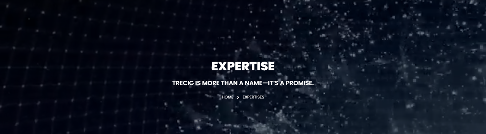
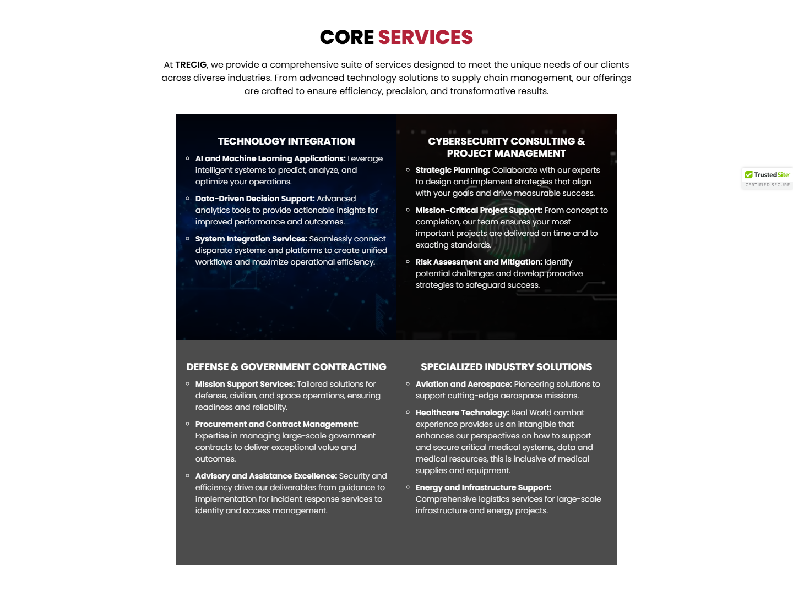
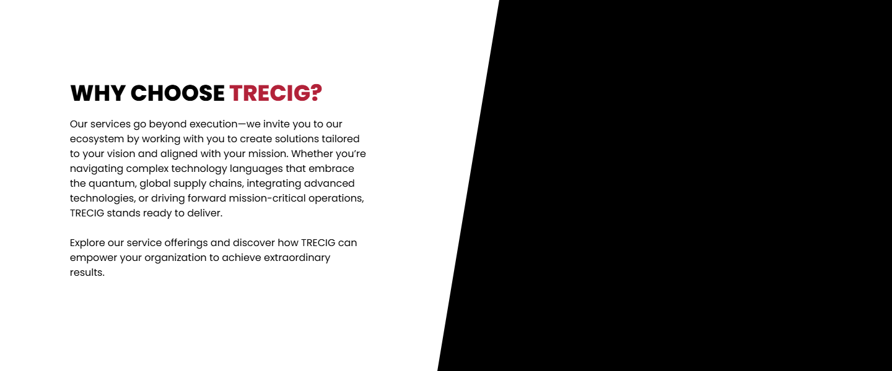

# Expertise – TRECIG

*TRECIG (design reference site)* · URL: https://trecig.com/expertise/ · captured 2026-11-08 00:32:25 · HTTP 200

- **Meta description:** —
- **Page size (desktop 1440px):** 1440×2866 px · tablet (820px): 2866 px · mobile (390px): 3530 px
- **Screenshots:** [desktop](screenshots/desktop-full.png) · [tablet](screenshots/tablet-full.png) · [mobile](screenshots/mobile-full.png) · [desktop top](screenshots/desktop-viewport-top.png) · [desktop scrolled](screenshots/desktop-viewport-scrolled.png)
- **Files:** [raw.html](raw.html) (server HTML) · [rendered.html](rendered.html) (DOM after JS) · [content.txt](content.txt) (all visible text) · layout-*.json (full element tree with computed styles) · page.json (everything)

## 1. Section map (top → bottom, desktop 1440px)

| # | Role | Y from top | Height | Heading / first text | Mobile height | Screenshot |
|---|---|---|---|---|---|---|
| 0 | header | 0 | 170 | HOME ABOUT AWARDS & RECOGNITION EXPERTISE PRESS & MEDIA CONTACT | 170 | [img](screenshots/desktop-sec00-header.png) |
| 1 | section | 170 | 400 | EXPERTISE | 220 | [img](screenshots/desktop-sec01-section.png) |
| 2 | section | 570 | 1098 | CORE SERVICES | 1875 | [img](screenshots/desktop-sec02-section.png) |
| 3 | section | 1668 | 600 | WHY CHOOSE TRECIG? | 574 | [img](screenshots/desktop-sec03-section.png) |
| 4 | footer | 2268 | 598 | LET'S TALK: | 690 | [img](screenshots/desktop-sec04-footer.png) |
| 5 | floating (fixed, z 1000003) | 875 | 38 |  |  |  |

## 2. Section-by-section layout (desktop)

Legend: each line is an element in DOM order. `@x,y w×h` = position/size in px on the 1440px-wide page. Text lines show *font size/weight, line-height, colour*. Boxes show layout (flex/grid), background, padding, radius, shadow, etc. Pass-through wrappers are collapsed.

### 2.0 HEADER — HOME ABOUT AWARDS & RECOGNITION EXPERTISE PRESS & MEDIA CONTACT

Element: `<header class="elementor elementor-13 elementor-location-header">` at y=0, 1440×170px · 

- section.elementor-section [bg:#FFFFFF · shadow:#000000 @10% 0px 0px 12px 0px · z:9999 · transition:background, border, border-radius, box-shadow 0.3s, 0.3s, 0.3s, 0.3s ease, ease, ease, ease] `@0,0 1440×170`
  - div.elementor-container [flex row · margin:0px 85px 0px 85px · max-w:1270px] `@85,0 1270×170`
    - div.elementor-column [flex row · min-h:1px] `@85,0 1270×170`
      - div.elementor-widget-wrap [flex row wrap] `@85,0 1270×170`
        - div.elementor-container [flex row · max-w:1270px] `@85,0 1270×170`
          - div.elementor-column [flex row · min-h:1px] `@85,0 127×170`
            - div.elementor-widget-wrap [flex row wrap · align:center · pad:10px 10px 10px 10px] `@85,0 127×170`
              - a (link→/) [inline-block · align-text:center] `@95,10 200×150`
                - **IMG** `TRECIG_Logo_Registered.png` alt="" natural 1440×1080 · inline-block · max-w:200px · overflow:clip · align-text:center `@95,10 200×150`
          - div.elementor-column [flex row · min-h:1px] `@212,0 1143×170`
            - div.elementor-widget-wrap [flex row wrap · align:center · pad:10px 10px 10px 10px] `@212,0 1143×170`
              - div.elementor-widget-container [flex column · transition:background, border, border-radius, box-shadow, transform 0.3s, 0.3s, 0.3s, 0.3s, 0.4s ease, ease, ease, ease, ease] `@222,75 1123×20`
                - ul.elementor-nav-menu [flex row wrap · justify:flex-end · margin:0px 0px 0px 411.234px · z:2] · pseudo:::after{{"content": "\" \"", "w": "0px", "h": "0px"}} `@633,75 712×20`
                  - **A→/** "HOME" — Poppins 14px/400 lh 20px · #000000 · textTransform:uppercase ‖ flex row · margin:0px 15px 0px 0px · transition:all 0.4s ease `@633,75 40×20`
                  - **A→/about/** "ABOUT" — Poppins 14px/400 lh 20px · #000000 · textTransform:uppercase ‖ flex row · margin:0px 15px 0px 15px · transition:all 0.4s ease `@703,75 70×20`
                  - **A→/awards-recognition/** "AWARDS & RECOGNITION" — Poppins 14px/400 lh 20px · #000000 · textTransform:uppercase ‖ flex row · margin:0px 15px 0px 15px · transition:all 0.4s ease `@803,75 195×20`
                  - **A→/expertise/** "EXPERTISE" — Poppins 14px/400 lh 20px · #B22239 · textTransform:uppercase ‖ flex row · margin:0px 15px 0px 15px · transition:all 0.4s ease `@1028,75 90×20`
                  - **A→/press-media/** "PRESS & MEDIA" — Poppins 14px/400 lh 20px · #000000 · textTransform:uppercase ‖ flex row · margin:0px 15px 0px 15px · transition:all 0.4s ease `@1148,75 100×20`
                  - **A→/contact/** "CONTACT" — Poppins 14px/400 lh 20px · #000000 · textTransform:uppercase ‖ flex row · margin:0px 0px 0px 15px · transition:all 0.4s ease `@1278,75 67×20`

### 2.1 SECTION — EXPERTISE

Element: `<section class="elementor-section elementor-top-section elementor-element elementor-element-83f46d4 elementor-section-height-min-height elementor-section-bo">` at y=170, 1440×400px · 

- section.elementor-section [transition:background, border, border-radius, box-shadow 0.3s, 0.3s, 0.3s, 0.3s ease, ease, ease, ease] `@0,170 1440×400`
  - div.elementor-background-video-container [pos:absolute · z:0 · overflow:hidden · transition:opacity 1s ease] `@0,170 1440×400`
    - **IFRAME** https://www.youtube.com/embed/pFHkhKd_ouk?controls=0&rel=0&playsinline=1&cc_load_policy=0&enablejsapi=1&origin=https%3A%2F%2Ftrecig.com&widgetid=1&forigin=https%3A%2F%2Ftrecig.com%2Fexpertise%2F&aoriginsup=1&vf=6 Expertise Top Banner Video `@0,-35 1440×810`
  - div.elementor-background-overlay [bg:#000000 · pos:absolute · opacity:0.5 · transition:background, border-radius, opacity 0.3s, 0.3s, 0.3s ease, ease, ease] `@0,170 1440×400` (empty/decorative)
  - div.elementor-container [flex row · align:center · margin:0px 370px 0px 370px · max-w:700px · min-h:400px] `@370,170 700×400`
    - div.elementor-column [flex row · min-h:1px] `@370,260 700×221`
      - div.elementor-widget-wrap [flex row wrap · pad:10px 10px 10px 10px · margin:80px 0px 0px 0px] `@370,340 700×141`
        - div.elementor-widget-heading [margin:0px 0px 20px 0px · align-text:center] `@380,350 680×36`
          - **H2** "EXPERTISE" — Poppins 36px/800 lh 36px · #FFFFFF · textTransform:uppercase · textAlign:center ‖ inline-block `@626,350 188×36`
        - div.elementor-widget-heading [margin:0px 0px 20px 0px · align-text:center] `@380,406 680×24`
          - **H2** "TRECIG IS MORE THAN A NAME—IT’S A PROMISE." — Poppins 18px/600 lh 18px · #FFFFFF · textTransform:uppercase · textAlign:center ‖ inline-block `@510,409 420×18`
        - ul.elementor-icon-list-items [flex row wrap · justify:center · margin:0px -2.5px 0px -2.5px · align-text:center] `@378,450 685×21`
          - li.elementor-icon-list-item [flex row · justify:center · align:center · margin:0px 2.5px 0px 2.5px · align-text:center] `@657,450 34×21`
            - **A→/** "HOME" — Poppins 12px/400 lh 18px · #CC3366 · textTransform:uppercase · textAlign:center ‖ flex row · highlights: "HOME" #FFFFFF `@657,451 34×18`
          - li.elementor-icon-list-item [flex row · justify:center · align:center · margin:0px 2.5px 0px 2.5px · align-text:center] `@697,450 86×21`
            - **SPAN** "EXPERTISES" — Poppins 12px/400 lh 18px · #FFFFFF · textTransform:uppercase · textAlign:center ‖ pad:0px 0px 0px 5px · transition:color 0.3s ease `@714,451 69×18`

### 2.2 SECTION — CORE SERVICES

Element: `<section class="elementor-section elementor-top-section elementor-element elementor-element-3efa58e elementor-section-boxed elementor-section-height-default">` at y=570, 1440×1098px · 

- section.elementor-section [pad:30px 0px 60px 0px · transition:background, border, border-radius, box-shadow 0.3s, 0.3s, 0.3s, 0.3s ease, ease, ease, ease] `@0,570 1440×1098`
  - div.elementor-container [flex row · max-w:1270px] `@85,600 1270×1008`
    - div.elementor-column [flex row · min-h:1px] `@85,600 1270×1008`
      - div.elementor-widget-wrap [flex row wrap · pad:10px 10px 10px 10px] `@85,600 1270×1008`
        - section.elementor-section [margin:0px 0px 20px 0px] `@95,610 1250×148`
          - div.elementor-container [flex row · margin:0px 175px 0px 175px · max-w:900px] `@270,610 900×148`
            - div.elementor-column [flex row · min-h:1px] `@270,610 900×148`
              - div.elementor-widget-wrap [flex row wrap · pad:10px 10px 10px 10px] `@270,610 900×148`
                - div.elementor-widget-heading [margin:0px 0px 20px 0px · align-text:center] `@280,620 880×36`
                  - **H2** "CORE SERVICES" — Poppins 36px/800 lh 36px · #000000 · textTransform:uppercase · textAlign:center ‖ inline-block · highlights: "SERVICES" #B22239 `@580,620 279×36`
                - div.elementor-widget-container [align-text:center · transition:background, border, border-radius, box-shadow, transform 0.3s, 0.3s, 0.3s, 0.3s, 0.4s ease, ease, ease, ease, ease] `@280,676 880×72`
                  - **text** "At , we provide a comprehensive suite of services designed to meet the unique needs of our clients across diverse industries. From advanced technology soluti…" — Poppins 16px/400 lh 24px · #000000 · textAlign:center `@280,676 880×72`
                  - **STRONG** "TRECIG" — Poppins 16px/600 lh 24px · #000000 · textAlign:center ‖ inline `@318,676 57×23`
        - div.elementor-container [flex row · max-w:800px] `@320,778 800×410`
          - div.elementor-column [flex row · min-h:1px] `@320,778 400×410`
            - div.elementor-widget-wrap [flex row wrap] `@320,778 400×410`
              - section.elementor-section [pad:30px 15px 30px 15px · transition:background, border, border-radius, box-shadow 0.3s, 0.3s, 0.3s, 0.3s ease, ease, ease, ease] `@320,778 400×410`
                - div.elementor-background-video-container [pos:absolute · z:0 · overflow:hidden · transition:opacity 1s ease] `@320,778 400×410`
                  - **IFRAME** https://www.youtube.com/embed/SfYktxzTzf0?controls=0&rel=0&playsinline=1&cc_load_policy=0&enablejsapi=1&origin=https%3A%2F%2Ftrecig.com&widgetid=3&forigin=https%3A%2F%2Ftrecig.com%2Fexpertise%2F&aoriginsup=1&vf=1 Trecig   Expertise   Technology `@156,778 729×410`
                - div.elementor-background-overlay [bg:#000000 · pos:absolute · opacity:0.7 · transition:background, border-radius, opacity 0.3s, 0.3s, 0.3s ease, ease, ease] `@320,778 400×410` (empty/decorative)
                - div.elementor-container [flex row · max-w:1270px · min-h:350px] `@335,808 370×350`
                  - div.elementor-column [flex row · min-h:1px] `@335,808 370×350`
                    - div.elementor-widget-wrap [flex row wrap] `@335,808 370×350`
                      - div.elementor-image-box-content [align-text:center] `@335,816 370×241`
                        - **H3** "TECHNOLOGY INTEGRATION" — Poppins 18px/700 lh 21.6px · #FFFFFF · textTransform:uppercase · textAlign:center ‖ margin:8px 0px 10px 0px `@335,816 370×22`
                        - ul [pad:0px 0px 0px 20px · align-text:center] `@335,848 370×209`
                          - **LI** "AI and Machine Learning Applications: Leverage intelligent systems to predict, analyze, and optimize your operations." — Poppins 14px/300 lh 21px · #FFFFFF ‖ list-item · margin:0px 0px 10px 0px · highlights: "AI and Machine Learning Applications:"  600 `@355,848 350×63`
                          - **LI** "Data-Driven Decision Support: Advanced analytics tools to provide actionable insights for improved performance and outcomes." — Poppins 14px/300 lh 21px · #FFFFFF ‖ list-item · margin:0px 0px 10px 0px · highlights: "Data-Driven Decision Support:"  600 `@355,921 350×63`
                          - **LI** "System Integration Services: Seamlessly connect disparate systems and platforms to create unified workflows and maximize operational efficiency." — Poppins 14px/300 lh 21px · #FFFFFF ‖ list-item · margin:0px 0px 10px 0px · highlights: "System Integration Services:"  600 `@355,994 350×63`
          - div.elementor-column [flex row · min-h:1px] `@720,778 400×410`
            - div.elementor-widget-wrap [flex row wrap] `@720,778 400×410`
              - section.elementor-section [pad:30px 15px 30px 15px · transition:background, border, border-radius, box-shadow 0.3s, 0.3s, 0.3s, 0.3s ease, ease, ease, ease] `@720,778 400×410`
                - div.elementor-background-video-container [pos:absolute · z:0 · overflow:hidden · transition:opacity 1s ease] `@720,778 400×410`
                  - **IFRAME** https://www.youtube.com/embed/9REilWtpKgE?controls=0&rel=0&playsinline=1&cc_load_policy=0&enablejsapi=1&origin=https%3A%2F%2Ftrecig.com&widgetid=5&forigin=https%3A%2F%2Ftrecig.com%2Fexpertise%2F&aoriginsup=1&vf=1 Trecig   Expertise   Cybersecurity `@556,778 729×410`
                - div.elementor-background-overlay [bg:#000000 · pos:absolute · opacity:0.7 · transition:background, border-radius, opacity 0.3s, 0.3s, 0.3s ease, ease, ease] `@720,778 400×410` (empty/decorative)
                - div.elementor-container [flex row · max-w:1270px · min-h:350px] `@735,808 370×350`
                  - div.elementor-column [flex row · min-h:1px] `@735,808 370×350`
                    - div.elementor-widget-wrap [flex row wrap] `@735,808 370×350`
                      - div.elementor-image-box-content [align-text:center] `@735,816 370×283`
                        - **H3** "CYBERSECURITY CONSULTING & PROJECT MANAGEMENT" — Poppins 18px/700 lh 21.6px · #FFFFFF · textTransform:uppercase · textAlign:center ‖ margin:8px 0px 10px 0px `@735,816 370×43`
                        - ul [pad:0px 0px 0px 20px · align-text:center] `@735,869 370×230`
                          - **LI** "Strategic Planning: Collaborate with our experts to design and implement strategies that align with your goals and drive measurable success." — Poppins 14px/300 lh 21px · #FFFFFF ‖ list-item · margin:0px 0px 10px 0px · highlights: "Strategic Planning:"  600 `@755,869 350×63`
                          - **LI** "Mission-Critical Project Support: From concept to completion, our team ensures your most important projects are delivered on time and to exacting standards." — Poppins 14px/300 lh 21px · #FFFFFF ‖ list-item · margin:0px 0px 10px 0px · highlights: "Mission-Critical Project Support:"  600 `@755,942 350×84`
                          - **LI** "Risk Assessment and Mitigation: Identify potential challenges and develop proactive strategies to safeguard success." — Poppins 14px/300 lh 21px · #FFFFFF ‖ list-item · margin:0px 0px 10px 0px · highlights: "Risk Assessment and Mitigation:"  600 `@755,1036 350×63`
        - div.elementor-container [flex row · max-w:800px] `@320,1188 800×410`
          - div.elementor-column [flex row · min-h:1px] `@320,1188 400×410`
            - div.elementor-widget-wrap [flex row wrap] `@320,1188 400×410`
              - section.elementor-section [pad:30px 15px 30px 15px · transition:background, border, border-radius, box-shadow 0.3s, 0.3s, 0.3s, 0.3s ease, ease, ease, ease] `@320,1188 400×410`
                - div.elementor-background-video-container [pos:absolute · z:0 · overflow:hidden · transition:opacity 1s ease] `@320,1188 400×410`
                  - **IFRAME** https://www.youtube.com/embed/BNIlONHRwbc?controls=0&rel=0&playsinline=1&cc_load_policy=0&enablejsapi=1&origin=https%3A%2F%2Ftrecig.com&widgetid=7&forigin=https%3A%2F%2Ftrecig.com%2Fexpertise%2F&aoriginsup=1&vf=1 Trecig   Expertise   Defense `@156,1188 729×410`
                - div.elementor-background-overlay [bg:#000000 · pos:absolute · opacity:0.7 · transition:background, border-radius, opacity 0.3s, 0.3s, 0.3s ease, ease, ease] `@320,1188 400×410` (empty/decorative)
                - div.elementor-container [flex row · max-w:1270px · min-h:350px] `@335,1218 370×350`
                  - div.elementor-column [flex row · min-h:1px] `@335,1218 370×350`
                    - div.elementor-widget-wrap [flex row wrap] `@335,1218 370×350`
                      - div.elementor-image-box-content [align-text:center] `@335,1226 370×283`
                        - **H3** "DEFENSE & GOVERNMENT CONTRACTING" — Poppins 18px/700 lh 21.6px · #FFFFFF · textTransform:uppercase · textAlign:center ‖ margin:8px 0px 10px 0px `@335,1226 370×22`
                        - ul [pad:0px 0px 0px 20px · align-text:center] `@335,1258 370×251`
                          - **LI** "Mission Support Services: Tailored solutions for defense, civilian, and space operations, ensuring readiness and reliability." — Poppins 14px/300 lh 21px · #FFFFFF ‖ list-item · margin:0px 0px 10px 0px · highlights: "Mission Support Services:"  600 `@355,1258 350×63`
                          - **LI** "Procurement and Contract Management: Expertise in managing large-scale government contracts to deliver exceptional value and outcomes." — Poppins 14px/300 lh 21px · #FFFFFF ‖ list-item · margin:0px 0px 10px 0px · highlights: "Procurement and Contract Management:"  600 `@355,1331 350×84`
                          - **LI** "Advisory and Assistance Excellence: Security and efficiency drive our deliverables from guidance to implementation for incident response services to identity…" — Poppins 14px/300 lh 21px · #FFFFFF ‖ list-item · margin:0px 0px 10px 0px · highlights: "Advisory and Assistance Excellence:"  600 `@355,1425 350×84`
          - div.elementor-column [flex row · min-h:1px] `@720,1188 400×410`
            - div.elementor-widget-wrap [flex row wrap] `@720,1188 400×410`
              - section.elementor-section [pad:30px 15px 30px 15px · transition:background, border, border-radius, box-shadow 0.3s, 0.3s, 0.3s, 0.3s ease, ease, ease, ease] `@720,1188 400×410`
                - div.elementor-background-video-container [pos:absolute · z:0 · overflow:hidden · transition:opacity 1s ease] `@720,1188 400×410`
                  - **IFRAME** https://www.youtube.com/embed/c77moxJf_Ms?controls=0&rel=0&playsinline=1&cc_load_policy=0&enablejsapi=1&origin=https%3A%2F%2Ftrecig.com&widgetid=9&forigin=https%3A%2F%2Ftrecig.com%2Fexpertise%2F&aoriginsup=1&vf=1 Trecig   Expertise   Industry Solutions `@556,1188 729×410`
                - div.elementor-background-overlay [bg:#000000 · pos:absolute · opacity:0.7 · transition:background, border-radius, opacity 0.3s, 0.3s, 0.3s ease, ease, ease] `@720,1188 400×410` (empty/decorative)
                - div.elementor-container [flex row · max-w:1270px · min-h:350px] `@735,1218 370×350`
                  - div.elementor-column [flex row · min-h:1px] `@735,1218 370×350`
                    - div.elementor-widget-wrap [flex row wrap] `@735,1218 370×350`
                      - div.elementor-image-box-content [align-text:center] `@735,1226 370×283`
                        - **H3** "SPECIALIZED INDUSTRY SOLUTIONS" — Poppins 18px/700 lh 21.6px · #FFFFFF · textTransform:uppercase · textAlign:center ‖ margin:8px 0px 10px 0px `@735,1226 370×22`
                        - ul [pad:0px 0px 0px 20px · align-text:center] `@735,1258 370×251`
                          - **LI** "Aviation and Aerospace: Pioneering solutions to support cutting-edge aerospace missions." — Poppins 14px/300 lh 21px · #FFFFFF ‖ list-item · margin:0px 0px 10px 0px · highlights: "Aviation and Aerospace:"  600 `@755,1258 350×42`
                          - **LI** "Healthcare Technology: Real World combat experience provides us an intangible that enhances our perspectives on how to support and secure critical medical sy…" — Poppins 14px/300 lh 21px · #FFFFFF ‖ list-item · margin:0px 0px 10px 0px · highlights: "Healthcare Technology:"  600 `@755,1310 350×126`
                          - **LI** "Energy and Infrastructure Support: Comprehensive logistics services for large-scale infrastructure and energy projects." — Poppins 14px/300 lh 21px · #FFFFFF ‖ list-item · margin:0px 0px 10px 0px · highlights: "Energy and Infrastructure Support:"  600 `@755,1446 350×63`

### 2.3 SECTION — WHY CHOOSE TRECIG?

Element: `<section class="elementor-section elementor-top-section elementor-element elementor-element-1d6d417 elementor-section-full_width tilt-sec2 elementor-section">` at y=1668, 1440×600px · 

- section.elementor-section [bg:transparent · transition:background, border, border-radius, box-shadow 0.3s, 0.3s, 0.3s, 0.3s ease, ease, ease, ease] `@0,1668 1440×600`
  - div.elementor-container [flex row] `@0,1668 1440×600`
    - div.elementor-column [flex row · min-h:1px] `@0,1668 706×600`
      - div.elementor-widget-wrap [flex row wrap · align:center · pad:10px 10px 10px 10px] `@0,1668 706×600`
        - div.elementor-container [flex row · margin:0px 92.7969px 0px 92.7969px · max-w:500px] `@103,1791 500×354`
          - div.elementor-column [flex row · min-h:1px] `@103,1791 500×354`
            - div.elementor-widget-wrap [flex row wrap · pad:10px 10px 10px 10px] `@103,1791 500×354`
              - div.elementor-widget-heading [margin:0px 0px 20px 0px] `@113,1801 480×36`
                - **H2** "WHY CHOOSE TRECIG?" — Poppins 36px/800 lh 36px · #000000 · textTransform:uppercase ‖ inline-block · highlights: "TRECIG?" #B22239 `@113,1801 408×36`
              - **P** "Our services go beyond execution—we invite you to our ecosystem by working with you to create solutions tailored to your vision and aligned with your mission…" — Poppins 16px/400 lh 24px · #000000 ‖ margin:0px 0px 14.4px 0px `@113,1857 480×264`
    - div.elementor-column [flex row · min-h:1px] `@706,1668 734×600`
      - div.elementor-widget-wrap [flex row wrap · align:center · transition:background, border, border-radius, box-shadow 0.3s, 0.3s, 0.3s, 0.3s ease, ease, ease, ease] `@706,1668 734×600`
        - div.elementor-widget-container [overflow:hidden · transform:matrix(1, 0, 0, 1, 0, 0) · transition:background, border, border-radius, box-shadow, transform 0.3s, 0.3s, 0.3s, 0.3s, 0.4s ease, ease, ease, ease, ease] `@706,1668 734×600`
          - **IFRAME** https://www.youtube.com/embed/3nbwvzwKGh0?controls=0&rel=0&playsinline=1&cc_load_policy=0&autoplay=1&enablejsapi=1&origin=https%3A%2F%2Ftrecig.com&widgetid=13&forigin=https%3A%2F%2Ftrecig.com%2Fexpertise%2F&aoriginsup=1&vf=1 Trecig   Expertise `@706,1668 1080×600`

### 2.4 FOOTER — LET'S TALK:

Element: `<footer class="elementor elementor-15 elementor-location-footer">` at y=2268, 1440×598px · 

- section.elementor-section [transition:background, border, border-radius, box-shadow 0.3s, 0.3s, 0.3s, 0.3s ease, ease, ease, ease] `@0,2268 1440×598`
  - div.elementor-background-video-container [pos:absolute · z:0 · overflow:hidden · transition:opacity 1s ease] `@0,2268 1440×598`
    - **IFRAME** https://www.youtube.com/embed/OzwCnEEadts?controls=0&rel=0&playsinline=1&cc_load_policy=0&enablejsapi=1&origin=https%3A%2F%2Ftrecig.com&widgetid=11&forigin=https%3A%2F%2Ftrecig.com%2Fexpertise%2F&aoriginsup=1&vf=1 Triceg   Expertise Slider 1 `@0,2162 1440×810`
  - div.elementor-background-overlay [bg:#FFFFFF · pos:absolute · opacity:0.7 · transition:background, border-radius, opacity 0.3s, 0.3s, 0.3s ease, ease, ease] `@0,2268 1440×598` (empty/decorative)
  - div.elementor-container [flex row · margin:0px 85px 0px 85px · max-w:1270px] `@85,2268 1270×598`
    - div.elementor-column [flex row · min-h:1px] `@85,2268 1270×598`
      - div.elementor-widget-wrap [flex row wrap] `@85,2268 1270×598`
        - section.elementor-section [pad:40px 0px 40px 0px] `@85,2268 1270×467`
          - div.elementor-container [flex row · max-w:1270px] `@85,2308 1270×387`
            - div.elementor-column [flex row · min-h:1px] `@85,2308 324×387`
              - div.elementor-widget-wrap [flex row wrap · pad:10px 10px 10px 10px] `@85,2308 324×387`
                - div.elementor-widget-theme-site-logo [margin:0px 0px 20px 0px] `@95,2318 304×300`
                  - a (link→/) [inline-block] `@95,2318 400×300`
                    - **IMG** `TRECIG_Logo_Registered.png` alt="" natural 1440×1080 · inline-block · max-w:400px · overflow:clip `@95,2318 400×300`
                - div.elementor-button-wrapper [grid cols[134.078px]] `@95,2638 134×47`
                  - **A→/contact/** "LET’S TALK" — Poppins 15px/400 lh 15px · #000000 · textTransform:uppercase · textAlign:center ‖ pad:15px 30px 15px 30px · radius:30px · border:1px 1px 1px 1px solid #000000 · transition:all 0.3s ease `@95,2638 134×47`
            - div.elementor-column [flex row · min-h:1px] `@409,2308 371×387`
              - div.elementor-widget-wrap [flex row wrap · pad:10px 10px 10px 10px · margin:0px 0px 0px 50px] `@459,2308 321×387`
                - div.elementor-widget-heading [margin:0px 0px 20px 0px] `@469,2318 301×24`
                  - **H2** "LET'S TALK:" — Poppins 18px/700 lh 18px · #000000 · textTransform:uppercase ‖ inline-block `@469,2321 98×18`
                - ul.elementor-icon-list-items `@469,2362 301×52`
                  - li.elementor-icon-list-item [flex row · align:center · pad:0px 0px 5px 0px] `@469,2362 301×26`
                    - **A→tel:(254)%20338-6131** "(469)653-9009" — Poppins 14px/600 lh 21px · #CC3366 ‖ flex row · highlights: "(469)653-9009" #000000 `@469,2362 301×21`
                  - li.elementor-icon-list-item [flex row · align:center · margin:5px 0px 0px 0px] `@469,2393 301×21`
                    - **A→mailto:info@trecig.com** "info@trecig.com" — Poppins 14px/600 lh 21px · #CC3366 ‖ flex row · highlights: "info@trecig.com" #000000 `@469,2393 301×21`
            - div.elementor-column [flex row · min-h:1px] `@781,2308 310×387`
              - div.elementor-widget-wrap [flex row wrap · pad:10px 10px 10px 10px · margin:0px 50px 0px 0px] `@781,2308 260×387`
                - div.elementor-widget-heading [margin:0px 0px 20px 0px] `@791,2318 240×24`
                  - **H2** "TRECIG HQ:" — Poppins 18px/700 lh 18px · #000000 · textTransform:uppercase ‖ inline-block `@791,2321 101×18`
                - ul.elementor-icon-list-items `@791,2362 240×42`
                  - li.elementor-icon-list-item [flex row · align:center] `@791,2362 240×42`
                    - **SPAN** "Rockwall, Texas, United States" — Poppins 14px/400 lh 21px · #000000 ‖ transition:color 0.3s ease `@791,2362 110×42`
            - div.elementor-column [flex row · min-h:1px] `@1090,2308 264×387`
              - div.elementor-widget-wrap [flex row wrap · pad:10px 10px 10px 10px] `@1090,2308 264×387`
                - div.elementor-widget-heading [margin:0px 0px 20px 0px] `@1100,2318 244×24`
                  - **H2** "CONNECT WITH US:" — Poppins 18px/700 lh 18px · #000000 · textTransform:uppercase ‖ inline-block `@1100,2321 174×18`
                - **A→/expertise/** "Linkedin-in" +icon[e-font-icon-svg e-fab-linkedin-in] — -apple-system 16px/400 lh 16px · #69727D · textAlign:center ‖ flex row · bg:#000000 · radius:100% · transition:all 0.3s ease `@1100,2362 32×32`
        - section.elementor-section [pad:15px 0px 15px 0px · border:1px 0px 0px 0px solid #000000 @20%] `@85,2735 1270×131`
          - div.elementor-container [flex row · max-w:1270px] `@85,2751 1270×100`
            - div.elementor-column [flex row · min-h:1px] `@85,2751 1270×100`
              - div.elementor-widget-wrap [flex row wrap · align:center · pad:10px 10px 10px 10px] `@85,2751 1270×100`
                - div.elementor-element [margin:0px 0px 20px 0px · align-text:center] `@95,2761 1250×10`
                  - div.elementor-widget-container [margin:0px 0px -10px 0px · overflow:hidden · align-text:center · transition:background, border, border-radius, box-shadow, transform 0.3s, 0.3s, 0.3s, 0.3s, 0.4s ease, ease, ease, ease, ease] `@95,2761 1250×20`
                    - ul.elementor-icon-list-items [flex row wrap · justify:center · gap:30px · margin:0px -8px 0px -8px · align-text:center] `@87,2761 1266×20`
                      - li.elementor-icon-list-item [flex row · justify:center · align:center · margin:0px 8px 0px 8px · align-text:center] `@589,2761 89×20`
                        - **A→/privacy-policy/** "Privacy Policy" — Poppins 13px/400 lh 19.5px · #CC3366 · textAlign:center ‖ flex row · highlights: "Privacy Policy" #000000 `@589,2761 88×20`
                      - li.elementor-icon-list-item [flex row · justify:center · align:center · margin:0px 8px 0px 8px · align-text:center] `@724,2761 127×20`
                        - **A→/terms-conditions/** "Terms & Conditions" — Poppins 13px/400 lh 19.5px · #CC3366 · textAlign:center ‖ flex row · highlights: "Terms & Conditions" #000000 `@724,2761 127×20`
                - **P** "©2026 TRECIG, LLC" — Poppins 12px/400 lh 18px · #000000 · textTransform:uppercase · textAlign:center ‖ margin:0px 0px 14.4px 0px `@95,2791 1250×36`

### Floating / fixed elements
- `div.` fixed at [1348, 875, 92, 38] z-index 1000003 — ""

## 3. Header, navigation & interaction behaviour

- **atTop** `header.elementor.elementor-13.elementor-location-header` position:static top:0 height:170 bg:transparent shadow:none backdrop:none z:auto
- **afterScroll1400** `header.elementor.elementor-13.elementor-location-header` position:static top:-1400 height:0 bg:transparent shadow:none backdrop:none z:auto
- **afterScroll1400** `section.elementor-section.elementor-top-section.elementor-element.elementor-elem` position:fixed top:0 height:170 bg:#FFFFFF @90% shadow:#000000 @10% 0px 0px 12px 0px backdrop:none z:9999

| Menu item | Link | Dropdown | Style | Hover change |
|---|---|---|---|---|
| HOME | / | — | Poppins 14px/400 #000000 uppercase ls normal | color: #000000 → #B22239 |
| ABOUT | /about/ | The Mission (/the-mission/); The Values (/the-values/); The Legacy (/the-legacy/); The Trecig Team (/the-trecig-team/); Careers (/careers/) | Poppins 14px/400 #000000 uppercase ls normal | color: #000000 → #B22239 |
| AWARDS & RECOGNITION | /awards-recognition/ | Partnerships (/partnerships/) | Poppins 14px/400 #000000 uppercase ls normal | color: #000000 → #B22239 |
| EXPERTISE (current) | /expertise/ | Industries We Serve (/industries-we-serve/) | Poppins 14px/400 #B22239 uppercase ls normal | none |
| PRESS & MEDIA | /press-media/ | — | Poppins 14px/400 #000000 uppercase ls normal | color: #000000 → #B22239 |
| CONTACT | /contact/ | — | Poppins 14px/400 #000000 uppercase ls normal | color: #000000 → #B22239 |

- **Mobile menu:** toggle `.elementor-menu-toggle` → [screenshot](screenshots/mobile-menu-open.png) · items: HOME, ABOUT, AWARDS & RECOGNITION, EXPERTISE, PRESS & MEDIA, CONTACT

### Hover states (measured by hovering in Chrome)

| Element | Text | Normal | On hover |
|---|---|---|---|
| `a.elementor-item` | HOME | color #000000 · bg transparent · radius 0px · pad 0px · border 0px #000000 · transition 0.4s | color: #000000 → #B22239; borderTopColor: #000000 → #B22239 |
| `a.elementor-item` | ABOUT | color #000000 · bg transparent · radius 0px · pad 0px · border 0px #000000 · transition 0.4s | color: #000000 → #B22239; borderTopColor: #000000 → #B22239 |
| `a.elementor-item` | EXPERTISE | color #B22239 · bg transparent · radius 0px · pad 0px · border 0px #B22239 · transition 0.4s | no change |
| `a.elementor-item` | CONTACT | color #000000 · bg transparent · radius 0px · pad 0px · border 0px #000000 · transition 0.4s | color: #000000 → #B22239; borderTopColor: #000000 → #B22239 |
| `div.elementor-image-box-wrapper` | TECHNOLOGY INTEGRATION AI and Machine Le | color #333333 · bg transparent · radius 0px · pad 0px · border 0px #333333 · transition all | no change |
| `a.` |  | color #CC3366 · bg transparent · radius 0px · pad 0px · border 0px #CC3366 · transition all | color: #CC3366 → #B22239; borderTopColor: #CC3366 → #B22239; childColor: #CC3366 → #B22239 |
| `a.elementor-button` | LET’S TALK | color #000000 · bg transparent · radius 30px · pad 15px 30px · border 1px #000000 · transition 0.3s | color: #000000 → #FFFFFF; borderTopColor: #000000 → #B22239 |
| `a.` | (469)653-9009 | color #CC3366 · bg transparent · radius 0px · pad 0px · border 0px #CC3366 · transition all | color: #CC3366 → #B22239; borderTopColor: #CC3366 → #B22239 |
| `a.elementor-icon` | Linkedin-in | color #69727D · bg #000000 · radius 100% · pad 0px · border 0px #69727D · transition 0.3s | color: #69727D → #B22239; backgroundColor: #000000 → #B22239; borderTopColor: #69727D → #B22239; opacity: 1 → 0.9; childColor: #69727D → #B22239 |
| `a.` | Privacy Policy | color #CC3366 · bg transparent · radius 0px · pad 0px · border 0px #CC3366 · transition all | color: #CC3366 → #B22239; borderTopColor: #CC3366 → #B22239 |

## 4. Typography & colour used on this page (weighted by amount of text / area)

| Font · weight · size / line-height | chars |
|---|---|
| Poppins | 300 | 14px / 21px | 1323 |
| Poppins | 400 | 16px / 24px | 767 |
| Poppins | 600 | 14px / 21px | 380 |
| Poppins | 700 | 18px / 21.6px | 130 |
| Poppins | 400 | 14px / 20px | 58 |
| Poppins | 600 | 18px / 18px | 42 |
| Poppins | 800 | 36px / 36px | 38 |
| Poppins | 700 | 18px / 18px | 37 |
| Poppins | 400 | 13px / 19.5px | 32 |
| Poppins | 400 | 12px / 18px | 31 |
| Poppins | 400 | 14px / 21px | 29 |
| -apple-system | 400 | 16px / 24px | 15 |
| -apple-system | 400 | 16px / 16px | 11 |
| Poppins | 400 | 15px / 15px | 10 |
| Poppins | 600 | 16px / 24px | 6 |

- **Text colours:** #FFFFFF (1870), #000000 (989), #B22239 (24), #CC3366 (15), #69727D (11)
- **Background colours (by area):** #000000 (1881), #FFFFFF (1109), transparent (864)
- **Border radii:** 30px (1), 100% (1), 2px 0px 0px (1)
- **Shadows:** #000000 @10% 0px 0px 12px 0px (1) | #000000 @20% 0px 0px 5px 0px (1)
- **Mobile text styles:** Poppins | 300 | 14px / 21px (1323); Poppins | 400 | 14px / 21px (796); Poppins | 600 | 14px / 21px (386); Poppins | 700 | 18px / 21.6px (130); Poppins | 400 | 12px / 18px (46); Poppins | 600 | 16px / 16px (42); Poppins | 800 | 28px / 28px (38); Poppins | 700 | 16px / 16px (37); Poppins | 400 | 10px / 15px (17); -apple-system | 400 | 16px / 24px (15)

## 6. Images on the page

- `TRECIG_Logo_Registered.png` natural 1440×1080 → shown 200×150 · alt="" · https://trecig.com/wp-content/uploads/2026/10/TRECIG_Logo_Registered.png
- background on `div.`: https://cdn.ywxi.net/meter/trecig.com/205.svg?ts=1784975038086&l=en

## 7. Links on the page

- [body] "Skip to content" → /expertise/#content
- [header] "(icon/image)" → /
- [header] "HOME" → /
- [header] "ABOUT" → /about/
- [header] "The Mission" → /the-mission/
- [header] "The Values" → /the-values/
- [header] "The Legacy" → /the-legacy/
- [header] "The Trecig Team" → /the-trecig-team/
- [header] "Careers" → /careers/
- [header] "AWARDS & RECOGNITION" → /awards-recognition/
- [header] "Partnerships" → /partnerships/
- [header] "EXPERTISE" → /expertise/
- [header] "Industries We Serve" → /industries-we-serve/
- [header] "PRESS & MEDIA" → /press-media/
- [header] "CONTACT" → /contact/
- [header] "Home" → /
- [header] "About" → /about/
- [header] "Awards & Recognition" → /awards-recognition/
- [header] "Expertise" → /expertise/
- [header] "Press & Media" → /press-media/
- [header] "Contact" → /contact/
- [footer] "LET’S TALK" → /contact/
- [footer] "(469)653-9009" → tel:(254)%20338-6131
- [footer] "info@trecig.com" → mailto:info@trecig.com
- [footer] "Linkedin-in" → /expertise/ (target _blank)
- [footer] "Privacy Policy" → /privacy-policy/
- [footer] "Terms & Conditions" → /terms-conditions/

## 8. Mobile layout (390px) — condensed outline

### 8.0 header — HOME ABOUT AWARDS & RECOGNITION EXPERTISE PRESS & MEDIA CONTACT (y 0, h 170)
- section.elementor-section [bg:#FFFFFF · shadow:#000000 @10% 0px 0px 12px 0px · z:9999 · transition:background, border, border-radius, box-shadow 0.3s, 0.3s, 0.3s, 0.3s ease, ease, ease, ease] `@0,0 390×170`
  - div.elementor-container [flex row wrap · max-w:767px] `@0,0 390×170`
    - div.elementor-column [flex row · min-h:1px] `@0,0 390×170`
      - div.elementor-widget-wrap [flex row wrap] `@0,0 390×170`
        - div.elementor-container [flex row wrap · max-w:767px] `@0,0 390×170`
          - div.elementor-column [flex row · min-h:1px] `@0,0 234×170`
            - div.elementor-widget-wrap [flex row wrap · align:center · pad:10px 10px 10px 10px] `@0,0 234×170`
              - a (link→/) [inline-block · align-text:center] `@17,10 200×150`
                - **IMG** `TRECIG_Logo_Registered-1024x768.png` alt="" natural 390×292 · inline-block · max-w:200px · overflow:clip · align-text:center `@17,10 200×150`
          - div.elementor-column [flex row · min-h:1px] `@234,0 156×170`
            - div.elementor-widget-wrap [flex row wrap · align:center · pad:10px 10px 10px 10px] `@234,0 156×170`
              - div.elementor-widget-container [flex column · transition:background, border, border-radius, box-shadow, transform 0.3s, 0.3s, 0.3s, 0.3s, 0.4s ease, ease, ease, ease, ease] `@244,70 136×30`
                - nav.elementor-nav-menu--dropdown [bg:#FFFFFF · margin:16px 0px 0px 0px · pos:absolute · z:9997 · overflow:hidden · transform:matrix(1, 0, 0, 0, 0, 0) · transition:max-height, transform 0.3s, 0.3s ease, ease] `@0,116 390×0`
                  - ul.elementor-nav-menu [z:2] · pseudo:::after{{"content": "\" \"", "w": "390px", "h": "0px"}} `@0,116 390×0`
                    - **A→/** "HOME" — Poppins 14px/400 lh 20px · #000000 · textTransform:uppercase ‖ flex row · pad:10px 20px 10px 20px `@0,116 390×0`
                    - **A→/about/** "ABOUT" — Poppins 14px/400 lh 20px · #000000 · textTransform:uppercase ‖ flex row · pad:10px 20px 10px 20px `@0,116 390×0`
                    - **A→/awards-recognition/** "AWARDS & RECOGNITION" — Poppins 14px/400 lh 20px · #000000 · textTransform:uppercase ‖ flex row · pad:10px 20px 10px 20px `@0,116 390×0`
                    - **A→/expertise/** "EXPERTISE" — Poppins 14px/400 lh 20px · #FFFFFF · textTransform:uppercase ‖ flex row · bg:#B22239 · pad:10px 20px 10px 20px `@0,116 390×0`
                    - **A→/press-media/** "PRESS & MEDIA" — Poppins 14px/400 lh 20px · #000000 · textTransform:uppercase ‖ flex row · pad:10px 20px 10px 20px `@0,116 390×0`
                    - **A→/contact/** "CONTACT" — Poppins 14px/400 lh 20px · #000000 · textTransform:uppercase ‖ flex row · pad:10px 20px 10px 20px `@0,116 390×0`

### 8.1 section — EXPERTISE (y 170, h 220)
- section.elementor-section [transition:background, border, border-radius, box-shadow 0.3s, 0.3s, 0.3s, 0.3s ease, ease, ease, ease] `@0,170 390×220`
  - div.elementor-background-overlay [bg:#000000 · pos:absolute · opacity:0.5 · transition:background, border-radius, opacity 0.3s, 0.3s, 0.3s ease, ease, ease] `@0,170 390×220` (empty/decorative)
  - div.elementor-container [flex row wrap · align:center · max-w:700px · min-h:220px] `@0,170 390×220`
    - div.elementor-column [flex row · min-h:1px] `@0,185 390×190`
      - div.elementor-widget-wrap [flex row wrap · pad:10px 10px 10px 10px · margin:65px 0px 0px 0px] `@0,250 390×125`
        - div.elementor-widget-heading [margin:0px 0px 20px 0px · align-text:center] `@10,260 370×29`
          - **H2** "EXPERTISE" — Poppins 28px/800 lh 28px · #FFFFFF · textTransform:uppercase · textAlign:center ‖ inline-block `@122,260 146×28`
        - div.elementor-widget-heading [margin:0px 0px 20px 0px · align-text:center] `@10,309 370×15`
          - div.elementor-widget-container [margin:-10px 0px -10px 0px · align-text:center · transition:background, border, border-radius, box-shadow, transform 0.3s, 0.3s, 0.3s, 0.3s, 0.4s ease, ease, ease, ease, ease] `@10,299 370×35`
            - **H2** "TRECIG IS MORE THAN A NAME—IT’S A PROMISE." — Poppins 16px/600 lh 16px · #FFFFFF · textTransform:uppercase · textAlign:center ‖ inline-block `@10,299 370×32`
        - ul.elementor-icon-list-items [flex row wrap · justify:center · margin:0px -2.5px 0px -2.5px · align-text:center] `@8,344 375×21`
          - li.elementor-icon-list-item [flex row · justify:center · align:center · margin:0px 2.5px 0px 2.5px · align-text:center] `@132,344 34×21`
            - **A→/** "HOME" — Poppins 12px/400 lh 18px · #CC3366 · textTransform:uppercase · textAlign:center ‖ flex row · highlights: "HOME" #FFFFFF `@132,346 34×18`
          - li.elementor-icon-list-item [flex row · justify:center · align:center · margin:0px 2.5px 0px 2.5px · align-text:center] `@172,344 86×21`
            - **SPAN** "EXPERTISES" — Poppins 12px/400 lh 18px · #FFFFFF · textTransform:uppercase · textAlign:center ‖ pad:0px 0px 0px 5px · transition:color 0.3s ease `@189,346 69×18`

### 8.2 section — CORE SERVICES (y 390, h 1875)
- div.elementor-container [flex row wrap · max-w:767px] `@0,390 390×1875`
  - div.elementor-column [flex row · min-h:1px] `@0,390 390×1875`
    - div.elementor-widget-wrap [flex row wrap · pad:10px 10px 10px 10px] `@0,390 390×1875`
      - section.elementor-section [margin:0px 0px 20px 0px] `@10,400 370×195`
        - div.elementor-container [flex row wrap · max-w:900px] `@10,400 370×195`
          - div.elementor-column [flex row · min-h:1px] `@10,400 370×195`
            - div.elementor-widget-wrap [flex row wrap · pad:10px 10px 10px 10px] `@10,400 370×195`
              - div.elementor-widget-heading [margin:0px 0px 20px 0px · align-text:center] `@20,410 350×29`
                - **H2** "CORE SERVICES" — Poppins 28px/800 lh 28px · #000000 · textTransform:uppercase · textAlign:center ‖ inline-block · highlights: "SERVICES" #B22239 `@86,410 217×28`
              - div.elementor-widget-container [align-text:center · transition:background, border, border-radius, box-shadow, transform 0.3s, 0.3s, 0.3s, 0.3s, 0.4s ease, ease, ease, ease, ease] `@20,459 350×126`
                - **text** "At , we provide a comprehensive suite of services designed to meet the unique needs of our clients across diverse industries. From advanced technology soluti…" — Poppins 14px/400 lh 21px · #000000 · textAlign:center `@20,459 350×126`
                - **STRONG** "TRECIG" — Poppins 14px/600 lh 21px · #000000 · textAlign:center ‖ inline `@47,459 50×20`
      - div.elementor-container [flex row wrap · max-w:800px] `@10,615 370×820`
        - div.elementor-column [flex row · min-h:1px] `@10,615 370×410`
          - div.elementor-widget-wrap [flex row wrap] `@10,615 370×410`
            - section.elementor-section [pad:30px 15px 30px 15px · transition:background, border, border-radius, box-shadow 0.3s, 0.3s, 0.3s, 0.3s ease, ease, ease, ease] `@10,615 370×410`
              - div.elementor-background-video-container [pos:absolute · z:0 · overflow:hidden · transition:opacity 1s ease] `@10,615 370×410`
                - **IFRAME** https://www.youtube.com/embed/SfYktxzTzf0?controls=0&rel=0&playsinline=1&cc_load_policy=0&enablejsapi=1&origin=https%3A%2F%2Ftrecig.com&widgetid=3&forigin=https%3A%2F%2Ftrecig.com%2Fexpertise%2F&aoriginsup=1&vf=2 Trecig   Expertise   Technology `@-169,615 729×410`
              - div.elementor-background-overlay [bg:#000000 · pos:absolute · opacity:0.7 · transition:background, border-radius, opacity 0.3s, 0.3s, 0.3s ease, ease, ease] `@10,615 370×410` (empty/decorative)
              - div.elementor-container [flex row wrap · max-w:767px · min-h:350px] `@25,645 340×350`
                - div.elementor-column [flex row · min-h:1px] `@25,645 340×350`
                  - div.elementor-widget-wrap [flex row wrap] `@25,645 340×350`
                    - div.elementor-image-box-content [align-text:center] `@25,653 340×262`
                      - **H3** "TECHNOLOGY INTEGRATION" — Poppins 18px/700 lh 21.6px · #FFFFFF · textTransform:uppercase · textAlign:center ‖ margin:8px 0px 10px 0px `@25,653 340×22`
                      - ul [pad:0px 0px 0px 20px · align-text:center] `@25,685 340×230`
                        - **LI** "AI and Machine Learning Applications: Leverage intelligent systems to predict, analyze, and optimize your operations." — Poppins 14px/300 lh 21px · #FFFFFF ‖ list-item · margin:0px 0px 10px 0px · highlights: "AI and Machine Learning Applications:"  600 `@45,685 320×63`
                        - **LI** "Data-Driven Decision Support: Advanced analytics tools to provide actionable insights for improved performance and outcomes." — Poppins 14px/300 lh 21px · #FFFFFF ‖ list-item · margin:0px 0px 10px 0px · highlights: "Data-Driven Decision Support:"  600 `@45,758 320×63`
                        - **LI** "System Integration Services: Seamlessly connect disparate systems and platforms to create unified workflows and maximize operational efficiency." — Poppins 14px/300 lh 21px · #FFFFFF ‖ list-item · margin:0px 0px 10px 0px · highlights: "System Integration Services:"  600 `@45,831 320×84`
        - div.elementor-column [flex row · min-h:1px] `@10,1025 370×410`
          - div.elementor-widget-wrap [flex row wrap] `@10,1025 370×410`
            - section.elementor-section [pad:30px 15px 30px 15px · transition:background, border, border-radius, box-shadow 0.3s, 0.3s, 0.3s, 0.3s ease, ease, ease, ease] `@10,1025 370×410`
              - div.elementor-background-video-container [pos:absolute · z:0 · overflow:hidden · transition:opacity 1s ease] `@10,1025 370×410`
                - **IFRAME** https://www.youtube.com/embed/9REilWtpKgE?controls=0&rel=0&playsinline=1&cc_load_policy=0&enablejsapi=1&origin=https%3A%2F%2Ftrecig.com&widgetid=5&forigin=https%3A%2F%2Ftrecig.com%2Fexpertise%2F&aoriginsup=1&vf=1 Trecig   Expertise   Cybersecurity `@-169,1025 729×410`
              - div.elementor-background-overlay [bg:#000000 · pos:absolute · opacity:0.7 · transition:background, border-radius, opacity 0.3s, 0.3s, 0.3s ease, ease, ease] `@10,1025 370×410` (empty/decorative)
              - div.elementor-container [flex row wrap · max-w:767px · min-h:350px] `@25,1055 340×350`
                - div.elementor-column [flex row · min-h:1px] `@25,1055 340×350`
                  - div.elementor-widget-wrap [flex row wrap] `@25,1055 340×350`
                    - div.elementor-image-box-content [align-text:center] `@25,1063 340×304`
                      - **H3** "CYBERSECURITY CONSULTING & PROJECT MANAGEMENT" — Poppins 18px/700 lh 21.6px · #FFFFFF · textTransform:uppercase · textAlign:center ‖ margin:8px 0px 10px 0px `@25,1063 340×43`
                      - ul [pad:0px 0px 0px 20px · align-text:center] `@25,1116 340×251`
                        - **LI** "Strategic Planning: Collaborate with our experts to design and implement strategies that align with your goals and drive measurable success." — Poppins 14px/300 lh 21px · #FFFFFF ‖ list-item · margin:0px 0px 10px 0px · highlights: "Strategic Planning:"  600 `@45,1116 320×84`
                        - **LI** "Mission-Critical Project Support: From concept to completion, our team ensures your most important projects are delivered on time and to exacting standards." — Poppins 14px/300 lh 21px · #FFFFFF ‖ list-item · margin:0px 0px 10px 0px · highlights: "Mission-Critical Project Support:"  600 `@45,1210 320×84`
                        - **LI** "Risk Assessment and Mitigation: Identify potential challenges and develop proactive strategies to safeguard success." — Poppins 14px/300 lh 21px · #FFFFFF ‖ list-item · margin:0px 0px 10px 0px · highlights: "Risk Assessment and Mitigation:"  600 `@45,1304 320×63`
      - div.elementor-container [flex row wrap · max-w:800px] `@10,1435 370×820`
        - div.elementor-column [flex row · min-h:1px] `@10,1435 370×410`
          - div.elementor-widget-wrap [flex row wrap] `@10,1435 370×410`
            - section.elementor-section [pad:30px 15px 30px 15px · transition:background, border, border-radius, box-shadow 0.3s, 0.3s, 0.3s, 0.3s ease, ease, ease, ease] `@10,1435 370×410`
              - div.elementor-background-video-container [pos:absolute · z:0 · overflow:hidden · transition:opacity 1s ease] `@10,1435 370×410`
                - **IFRAME** https://www.youtube.com/embed/BNIlONHRwbc?controls=0&rel=0&playsinline=1&cc_load_policy=0&enablejsapi=1&origin=https%3A%2F%2Ftrecig.com&widgetid=7&forigin=https%3A%2F%2Ftrecig.com%2Fexpertise%2F&aoriginsup=1&vf=1 Trecig   Expertise   Defense `@-169,1435 729×410`
              - div.elementor-background-overlay [bg:#000000 · pos:absolute · opacity:0.7 · transition:background, border-radius, opacity 0.3s, 0.3s, 0.3s ease, ease, ease] `@10,1435 370×410` (empty/decorative)
              - div.elementor-container [flex row wrap · max-w:767px · min-h:350px] `@25,1465 340×350`
                - div.elementor-column [flex row · min-h:1px] `@25,1465 340×350`
                  - div.elementor-widget-wrap [flex row wrap] `@25,1465 340×350`
                    - div.elementor-image-box-content [align-text:center] `@25,1473 340×325`
                      - **H3** "DEFENSE & GOVERNMENT CONTRACTING" — Poppins 18px/700 lh 21.6px · #FFFFFF · textTransform:uppercase · textAlign:center ‖ margin:8px 0px 10px 0px `@25,1473 340×43`
                      - ul [pad:0px 0px 0px 20px · align-text:center] `@25,1526 340×272`
                        - **LI** "Mission Support Services: Tailored solutions for defense, civilian, and space operations, ensuring readiness and reliability." — Poppins 14px/300 lh 21px · #FFFFFF ‖ list-item · margin:0px 0px 10px 0px · highlights: "Mission Support Services:"  600 `@45,1526 320×63`
                        - **LI** "Procurement and Contract Management: Expertise in managing large-scale government contracts to deliver exceptional value and outcomes." — Poppins 14px/300 lh 21px · #FFFFFF ‖ list-item · margin:0px 0px 10px 0px · highlights: "Procurement and Contract Management:"  600 `@45,1599 320×84`
                        - **LI** "Advisory and Assistance Excellence: Security and efficiency drive our deliverables from guidance to implementation for incident response services to identity…" — Poppins 14px/300 lh 21px · #FFFFFF ‖ list-item · margin:0px 0px 10px 0px · highlights: "Advisory and Assistance Excellence:"  600 `@45,1693 320×105`
        - div.elementor-column [flex row · min-h:1px] `@10,1845 370×410`
          - div.elementor-widget-wrap [flex row wrap] `@10,1845 370×410`
            - section.elementor-section [pad:30px 15px 30px 15px · transition:background, border, border-radius, box-shadow 0.3s, 0.3s, 0.3s, 0.3s ease, ease, ease, ease] `@10,1845 370×410`
              - div.elementor-background-video-container [pos:absolute · z:0 · overflow:hidden · transition:opacity 1s ease] `@10,1845 370×410`
                - **IFRAME** https://www.youtube.com/embed/c77moxJf_Ms?controls=0&rel=0&playsinline=1&cc_load_policy=0&enablejsapi=1&origin=https%3A%2F%2Ftrecig.com&widgetid=9&forigin=https%3A%2F%2Ftrecig.com%2Fexpertise%2F&aoriginsup=1&vf=1 Trecig   Expertise   Industry Solutions `@-169,1845 729×410`
              - div.elementor-background-overlay [bg:#000000 · pos:absolute · opacity:0.7 · transition:background, border-radius, opacity 0.3s, 0.3s, 0.3s ease, ease, ease] `@10,1845 370×410` (empty/decorative)
              - div.elementor-container [flex row wrap · max-w:767px · min-h:350px] `@25,1875 340×350`
                - div.elementor-column [flex row · min-h:1px] `@25,1875 340×350`
                  - div.elementor-widget-wrap [flex row wrap] `@25,1875 340×350`
                    - div.elementor-image-box-content [align-text:center] `@25,1883 340×283`
                      - **H3** "SPECIALIZED INDUSTRY SOLUTIONS" — Poppins 18px/700 lh 21.6px · #FFFFFF · textTransform:uppercase · textAlign:center ‖ margin:8px 0px 10px 0px `@25,1883 340×22`
                      - ul [pad:0px 0px 0px 20px · align-text:center] `@25,1915 340×251`
                        - **LI** "Aviation and Aerospace: Pioneering solutions to support cutting-edge aerospace missions." — Poppins 14px/300 lh 21px · #FFFFFF ‖ list-item · margin:0px 0px 10px 0px · highlights: "Aviation and Aerospace:"  600 `@45,1915 320×42`
                        - **LI** "Healthcare Technology: Real World combat experience provides us an intangible that enhances our perspectives on how to support and secure critical medical sy…" — Poppins 14px/300 lh 21px · #FFFFFF ‖ list-item · margin:0px 0px 10px 0px · highlights: "Healthcare Technology:"  600 `@45,1967 320×126`
                        - **LI** "Energy and Infrastructure Support: Comprehensive logistics services for large-scale infrastructure and energy projects." — Poppins 14px/300 lh 21px · #FFFFFF ‖ list-item · margin:0px 0px 10px 0px · highlights: "Energy and Infrastructure Support:"  600 `@45,2103 320×63`

### 8.3 section — WHY CHOOSE TRECIG? (y 2265, h 574)
- section.elementor-section [bg:transparent · transition:background, border, border-radius, box-shadow 0.3s, 0.3s, 0.3s, 0.3s ease, ease, ease, ease] `@0,2265 390×574`
  - div.elementor-container [flex row wrap] `@0,2265 390×574`
    - div.elementor-column [flex row · min-h:1px] `@0,2265 390×334`
      - div.elementor-widget-wrap [flex row wrap · align:center · pad:10px 10px 10px 10px] `@0,2265 390×334`
        - div.elementor-container [flex row wrap · max-w:500px] `@10,2275 370×314`
          - div.elementor-column [flex row · min-h:1px] `@10,2275 370×314`
            - div.elementor-widget-wrap [flex row wrap · pad:10px 10px 10px 10px] `@10,2275 370×314`
              - div.elementor-widget-heading [margin:0px 0px 20px 0px] `@20,2285 350×29`
                - **H2** "WHY CHOOSE TRECIG?" — Poppins 28px/800 lh 28px · #000000 · textTransform:uppercase ‖ inline-block · highlights: "TRECIG?" #B22239 `@20,2285 317×28`
              - **P** "Our services go beyond execution—we invite you to our ecosystem by working with you to create solutions tailored to your vision and aligned with your mission…" — Poppins 14px/400 lh 21px · #000000 ‖ margin:0px 0px 14.4px 0px `@20,2334 350×231`
    - div.elementor-column [flex row · min-h:1px] `@0,2599 390×240`
      - div.elementor-widget-wrap [flex row wrap · align:center · transition:background, border, border-radius, box-shadow 0.3s, 0.3s, 0.3s, 0.3s ease, ease, ease, ease] `@0,2599 390×240`
        - div.elementor-widget-container [overflow:hidden · transform:matrix(1, 0, 0, 1, 0, 0) · transition:background, border, border-radius, box-shadow, transform 0.3s, 0.3s, 0.3s, 0.3s, 0.4s ease, ease, ease, ease, ease] `@0,2599 390×240`
          - **IFRAME** https://www.youtube.com/embed/3nbwvzwKGh0?controls=0&rel=0&playsinline=1&cc_load_policy=0&autoplay=1&enablejsapi=1&origin=https%3A%2F%2Ftrecig.com&widgetid=1&forigin=https%3A%2F%2Ftrecig.com%2Fexpertise%2F&aoriginsup=1&vf=1 Trecig   Expertise `@0,2599 390×240`

### 8.4 footer — LET'S TALK: (y 2839, h 690)
- section.elementor-section [transition:background, border, border-radius, box-shadow 0.3s, 0.3s, 0.3s, 0.3s ease, ease, ease, ease] `@0,2839 390×690`
  - div.elementor-background-overlay [bg:#FFFFFF · pos:absolute · opacity:0.7 · transition:background, border-radius, opacity 0.3s, 0.3s, 0.3s ease, ease, ease] `@0,2839 390×690` (empty/decorative)
  - div.elementor-container [flex row wrap · max-w:767px] `@0,2839 390×690`
    - div.elementor-column [flex row · min-h:1px] `@0,2839 390×690`
      - div.elementor-widget-wrap [flex row wrap] `@0,2839 390×690`
        - section.elementor-section [pad:20px 0px 0px 0px] `@0,2839 390×612`
          - div.elementor-container [flex row wrap · max-w:767px] `@0,2859 390×592`
            - div.elementor-column [flex row · min-h:1px] `@0,2859 390×380`
              - div.elementor-widget-wrap [flex row wrap · pad:10px 10px 10px 10px] `@0,2859 390×380`
                - div.elementor-widget-theme-site-logo [margin:0px 0px 20px 0px · align-text:center] `@10,2869 370×300`
                  - a (link→/) [inline-block · align-text:center] `@10,2869 400×300`
                    - **IMG** `TRECIG_Logo_Registered-1024x768.png` alt="" natural 390×292 · inline-block · max-w:400px · overflow:clip · align-text:center `@10,2869 400×300`
                - div.elementor-button-wrapper [grid cols[119.281px] · align-text:center] `@135,3189 119×40`
                  - **A→/contact/** "LET’S TALK" — Poppins 14px/400 lh 14px · #000000 · textTransform:uppercase · textAlign:center ‖ pad:12px 25px 12px 25px · radius:30px · border:1px 1px 1px 1px solid #000000 · transition:all 0.3s ease `@135,3189 119×40`
            - div.elementor-column [flex row · min-h:1px] `@0,3239 195×116`
              - div.elementor-widget-wrap [flex row wrap · pad:10px 10px 10px 10px] `@0,3239 195×116`
                - div.elementor-widget-heading [margin:0px 0px 20px 0px] `@10,3249 175×24`
                  - **H2** "LET'S TALK:" — Poppins 16px/700 lh 16px · #000000 · textTransform:uppercase ‖ inline-block `@10,3254 87×16`
                - ul.elementor-icon-list-items `@10,3293 175×52`
                  - li.elementor-icon-list-item [flex row · align:center · pad:0px 0px 5px 0px] `@10,3293 175×26`
                    - **A→tel:(254)%20338-6131** "(469)653-9009" — Poppins 14px/600 lh 21px · #CC3366 ‖ flex row · highlights: "(469)653-9009" #000000 `@10,3293 175×21`
                  - li.elementor-icon-list-item [flex row · align:center · margin:5px 0px 0px 0px] `@10,3324 175×21`
                    - **A→mailto:info@trecig.com** "info@trecig.com" — Poppins 14px/600 lh 21px · #CC3366 ‖ flex row · highlights: "info@trecig.com" #000000 `@10,3324 175×21`
            - div.elementor-column [flex row · min-h:1px] `@195,3239 195×116`
              - div.elementor-widget-wrap [flex row wrap · pad:10px 10px 10px 10px] `@195,3239 195×116`
                - div.elementor-widget-heading [margin:0px 0px 20px 0px] `@205,3249 175×24`
                  - **H2** "TRECIG HQ:" — Poppins 16px/700 lh 16px · #000000 · textTransform:uppercase ‖ inline-block `@205,3254 90×16`
                - ul.elementor-icon-list-items `@205,3293 175×42`
                  - li.elementor-icon-list-item [flex row · align:center] `@205,3293 175×42`
                    - **SPAN** "Rockwall, Texas, United States" — Poppins 14px/400 lh 21px · #000000 ‖ transition:color 0.3s ease `@205,3293 175×42`
            - div.elementor-column [flex row · min-h:1px] `@0,3355 390×96`
              - div.elementor-widget-wrap [flex row wrap · pad:10px 10px 10px 10px] `@0,3355 390×96`
                - div.elementor-widget-heading [margin:0px 0px 20px 0px] `@10,3365 370×24`
                  - **H2** "CONNECT WITH US:" — Poppins 16px/700 lh 16px · #000000 · textTransform:uppercase ‖ inline-block `@10,3370 154×16`
                - **A→/expertise/** "Linkedin-in" +icon[e-font-icon-svg e-fab-linkedin-in] — -apple-system 16px/400 lh 16px · #69727D · textAlign:center ‖ flex row · bg:#000000 · radius:100% · transition:all 0.3s ease `@10,3409 32×32`
        - section.elementor-section [border:1px 0px 0px 0px solid #000000 @20%] `@0,3451 390×78`
          - div.elementor-container [flex row wrap · max-w:767px] `@0,3452 390×77`
            - div.elementor-column [flex row · min-h:1px] `@0,3452 390×77`
              - div.elementor-widget-wrap [flex row wrap · align:center · pad:10px 10px 10px 10px] `@0,3452 390×77`
                - div.elementor-element [margin:0px 0px 20px 0px · align-text:center] `@10,3462 370×8`
                  - div.elementor-widget-container [margin:0px 0px -10px 0px · overflow:hidden · align-text:center · transition:background, border, border-radius, box-shadow, transform 0.3s, 0.3s, 0.3s, 0.3s, 0.4s ease, ease, ease, ease, ease] `@10,3462 370×18`
                    - ul.elementor-icon-list-items [flex row wrap · justify:center · gap:30px · margin:0px -7.5px 0px -7.5px · align-text:center] `@3,3462 385×18`
                      - li.elementor-icon-list-item [flex row · justify:center · align:center · margin:0px 7.5px 0px 7.5px · align-text:center] `@73,3462 82×18`
                        - **A→/privacy-policy/** "Privacy Policy" — Poppins 12px/400 lh 18px · #CC3366 · textAlign:center ‖ flex row · highlights: "Privacy Policy" #000000 `@73,3462 81×18`
                      - li.elementor-icon-list-item [flex row · justify:center · align:center · margin:0px 7.5px 0px 7.5px · align-text:center] `@200,3462 117×18`
                        - **A→/terms-conditions/** "Terms & Conditions" — Poppins 12px/400 lh 18px · #CC3366 · textAlign:center ‖ flex row · highlights: "Terms & Conditions" #000000 `@200,3462 117×18`
                - **P** "©2026 TRECIG, LLC" — Poppins 10px/400 lh 15px · #000000 · textTransform:uppercase · textAlign:center ‖ margin:0px 0px 14.4px 0px `@10,3490 370×15`
