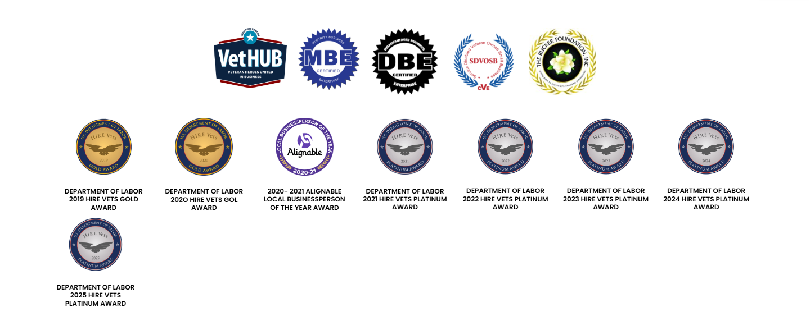
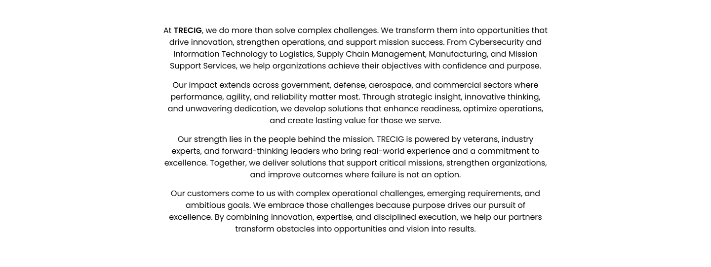
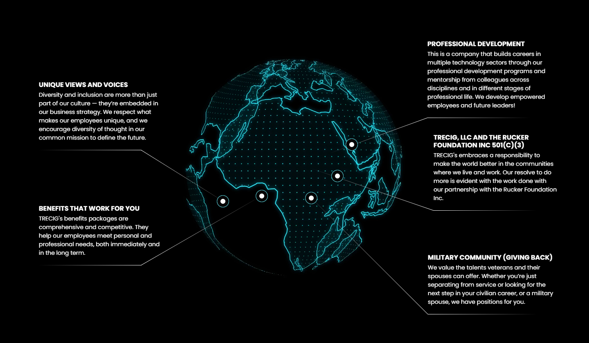
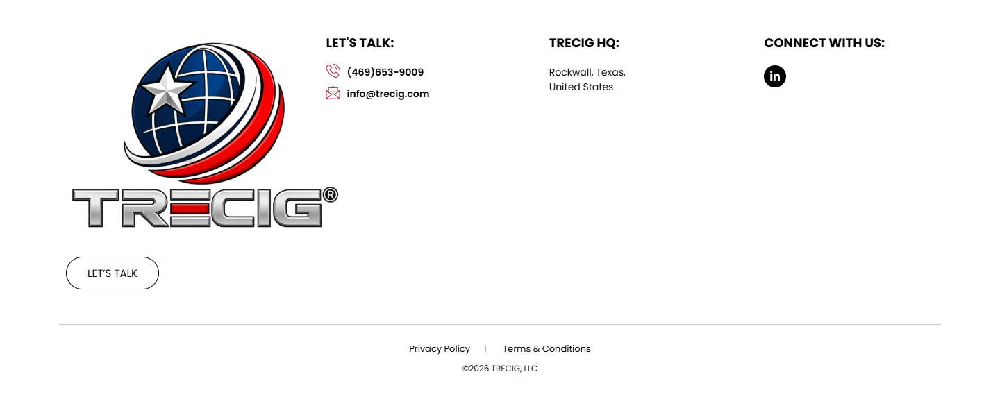

# TRECIG – Revolutionizing innovative technology worldwide!

*TRECIG (design reference site)* · URL: https://trecig.com/ · captured 2026-11-08 00:26:53 · HTTP 200

- **Meta description:** —
- **Page size (desktop 1440px):** 1440×4215 px · tablet (820px): 4120 px · mobile (390px): 5810 px
- **Screenshots:** [desktop](screenshots/desktop-full.png) · [tablet](screenshots/tablet-full.png) · [mobile](screenshots/mobile-full.png) · [desktop top](screenshots/desktop-viewport-top.png) · [desktop scrolled](screenshots/desktop-viewport-scrolled.png)
- **Files:** [raw.html](raw.html) (server HTML) · [rendered.html](rendered.html) (DOM after JS) · [content.txt](content.txt) (all visible text) · layout-*.json (full element tree with computed styles) · page.json (everything)

## 1. Section map (top → bottom, desktop 1440px)

| # | Role | Y from top | Height | Heading / first text | Mobile height | Screenshot |
|---|---|---|---|---|---|---|
| 0 | header | 0 | 170 | HOME ABOUT AWARDS & RECOGNITION EXPERTISE PRESS & MEDIA CONTACT | 170 | [img](screenshots/desktop-sec00-header.png) |
| 1 | section | 170 | 675 |  | 400 | [img](screenshots/desktop-sec01-section.png) |
| 2 | section | 845 | 73 | CMMC Level 2 Certified — UID: L200003036 | 137 | [img](screenshots/desktop-sec02-section.png) |
| 3 | section | 918 | 588 | DEPARTMENT OF LABOR 2019 HIRE VETS GOLD AWARD | 2016 | [img](screenshots/desktop-sec03-section.png) |
| 4 | section | 1506 | 21 |  | 21 | [img](screenshots/desktop-sec04-section.png) |
| 5 | section | 1527 | 542 | At TRECIG, we do more than solve complex challenges. We transform them into opportunities  | 809 | [img](screenshots/desktop-sec05-section.png) |
| 6 | section | 2069 | 312 | “UNIQUELY PURPOSED. TIMELY CONNECTED. DOTS DELIVERED.” | 189 | [img](screenshots/desktop-sec06-section.png) |
| 7 | section | 2381 | 840 | UNIQUE VIEWS AND VOICES | 1028 | [img](screenshots/desktop-sec07-section.png) |
| 8 | section | 3221 | 61 |  | 61 | [img](screenshots/desktop-sec08-section.png) |
| 9 | section | 3282 | 335 | JOIN THE JOURNEY | 289 | [img](screenshots/desktop-sec09-section.png) |
| 10 | footer | 3617 | 598 | LET'S TALK: | 690 | [img](screenshots/desktop-sec10-footer.png) |
| 11 | floating (fixed, z 1000003) | 875 | 38 |  |  |  |

## 2. Section-by-section layout (desktop)

Legend: each line is an element in DOM order. `@x,y w×h` = position/size in px on the 1440px-wide page. Text lines show *font size/weight, line-height, colour*. Boxes show layout (flex/grid), background, padding, radius, shadow, etc. Pass-through wrappers are collapsed.

### 2.0 HEADER — HOME ABOUT AWARDS & RECOGNITION EXPERTISE PRESS & MEDIA CONTACT

Element: `<header class="elementor elementor-13 elementor-location-header">` at y=0, 1440×170px · 

- section.elementor-section [bg:#FFFFFF · shadow:#000000 @10% 0px 0px 12px 0px · z:9999 · transition:background, border, border-radius, box-shadow 0.3s, 0.3s, 0.3s, 0.3s ease, ease, ease, ease] `@0,0 1440×170`
  - div.elementor-container [flex row · margin:0px 85px 0px 85px · max-w:1270px] `@85,0 1270×170`
    - div.elementor-column [flex row · min-h:1px] `@85,0 1270×170`
      - div.elementor-widget-wrap [flex row wrap] `@85,0 1270×170`
        - div.elementor-container [flex row · max-w:1270px] `@85,0 1270×170`
          - div.elementor-column [flex row · min-h:1px] `@85,0 127×170`
            - div.elementor-widget-wrap [flex row wrap · align:center · pad:10px 10px 10px 10px] `@85,0 127×170`
              - a (link→/) [inline-block · align-text:center] `@95,10 200×150`
                - **IMG** `TRECIG_Logo_Registered.png` alt="" natural 1440×1080 · inline-block · max-w:200px · overflow:clip · align-text:center `@95,10 200×150`
          - div.elementor-column [flex row · min-h:1px] `@212,0 1143×170`
            - div.elementor-widget-wrap [flex row wrap · align:center · pad:10px 10px 10px 10px] `@212,0 1143×170`
              - div.elementor-widget-container [flex column · transition:background, border, border-radius, box-shadow, transform 0.3s, 0.3s, 0.3s, 0.3s, 0.4s ease, ease, ease, ease, ease] `@222,75 1123×20`
                - ul.elementor-nav-menu [flex row wrap · justify:flex-end · margin:0px 0px 0px 411.234px · z:2] · pseudo:::after{{"content": "\" \"", "w": "0px", "h": "0px"}} `@633,75 712×20`
                  - **A→/** "HOME" — Poppins 14px/400 lh 20px · #B22239 · textTransform:uppercase ‖ flex row · margin:0px 15px 0px 0px · transition:all 0.4s ease `@633,75 40×20`
                  - **A→/about/** "ABOUT" — Poppins 14px/400 lh 20px · #000000 · textTransform:uppercase ‖ flex row · margin:0px 15px 0px 15px · transition:all 0.4s ease `@703,75 70×20`
                  - **A→/awards-recognition/** "AWARDS & RECOGNITION" — Poppins 14px/400 lh 20px · #000000 · textTransform:uppercase ‖ flex row · margin:0px 15px 0px 15px · transition:all 0.4s ease `@803,75 195×20`
                  - **A→/expertise/** "EXPERTISE" — Poppins 14px/400 lh 20px · #000000 · textTransform:uppercase ‖ flex row · margin:0px 15px 0px 15px · transition:all 0.4s ease `@1028,75 90×20`
                  - **A→/press-media/** "PRESS & MEDIA" — Poppins 14px/400 lh 20px · #000000 · textTransform:uppercase ‖ flex row · margin:0px 15px 0px 15px · transition:all 0.4s ease `@1148,75 100×20`
                  - **A→/contact/** "CONTACT" — Poppins 14px/400 lh 20px · #000000 · textTransform:uppercase ‖ flex row · margin:0px 0px 0px 15px · transition:all 0.4s ease `@1278,75 67×20`

### 2.1 SECTION — 

Element: `<section class="elementor-section elementor-top-section elementor-element elementor-element-95dacbb elementor-section-height-min-height elementor-section-bo">` at y=170, 1440×675px · 

- section.elementor-section [transition:background, border, border-radius, box-shadow 0.3s, 0.3s, 0.3s, 0.3s ease, ease, ease, ease] `@0,170 1440×675`
  - div.elementor-background-video-container [pos:absolute · z:0 · overflow:hidden · transition:opacity 1s ease] `@0,170 1440×675`
    - **IFRAME** https://www.youtube.com/embed/gg193xV0eM8?controls=0&rel=0&playsinline=1&cc_load_policy=0&enablejsapi=1&origin=https%3A%2F%2Ftrecig.com&widgetid=1&forigin=https%3A%2F%2Ftrecig.com%2F&aoriginsup=1&vf=6 Trecig   Homepage Main `@0,103 1440×810`
  - div.elementor-background-overlay [bg:#000000 · pos:absolute · opacity:0.4 · transition:background, border-radius, opacity 0.3s, 0.3s, 0.3s ease, ease, ease] `@0,170 1440×675` (empty/decorative)

### 2.2 SECTION — CMMC Level 2 Certified — UID: L200003036

Element: `<section class="elementor-section elementor-top-section elementor-element elementor-element-88a5438 elementor-section-boxed elementor-section-height-default">` at y=845, 1440×73px · 

- *(empty block — vertical spacer / gap of 73px)*

### 2.3 SECTION — DEPARTMENT OF LABOR 2019 HIRE VETS GOLD AWARD

Element: `<section class="elementor-section elementor-top-section elementor-element elementor-element-233bdb2 awardslink elementor-section-boxed elementor-section-hei">` at y=918, 1440×588px · 

- section.elementor-section [pad:30px 0px 30px 0px] `@0,918 1440×588`
  - div.elementor-container [flex row · margin:0px 85px 0px 85px · max-w:1270px] `@85,948 1270×528`
    - div.elementor-column [flex row · min-h:1px] `@85,948 1270×528`
      - div.elementor-widget-wrap [flex row wrap · pad:10px 10px 10px 10px] `@85,948 1270×528`
        - div.elementor-container [flex row · margin:0px 274.5px 0px 274.5px · max-w:701px] `@370,958 701×140`
          - div.elementor-column [flex row · min-h:1px] `@370,958 150×140`
            - div.elementor-widget-wrap [flex row wrap · pad:10px 10px 10px 10px] `@370,958 150×140`
              - div.elementor-widget-image [max-w:138.262% · align-text:center] `@380,968 130×107`
                - **IMG** `vethub-certified-logo-2025-1536x1262.png` alt="TEXAS VetHUB" natural 1439×1183 · inline-block · max-w:100% · overflow:clip · align-text:center `@380,968 130×107`
          - div.elementor-column [flex row · min-h:1px] `@520,958 130×140`
            - div.elementor-widget-wrap [flex row wrap · pad:10px 10px 10px 10px] `@520,958 130×140`
              - **IMG** `images-1-150x150.png` alt="" natural 150×150 · inline-block · max-w:100% · overflow:clip · align-text:center `@530,968 110×110`
          - div.elementor-column [flex row · min-h:1px] `@650,958 140×140`
            - div.elementor-widget-wrap [flex row wrap · pad:10px 10px 10px 10px] `@650,958 140×140`
              - **IMG** `images-2-150x150.png` alt="" natural 150×150 · inline-block · max-w:100% · overflow:clip · align-text:center `@660,968 120×120`
          - div.elementor-column [flex row · min-h:1px] `@790,958 140×140`
            - div.elementor-widget-wrap [flex row wrap · pad:10px 10px 10px 10px] `@790,958 140×140`
              - **IMG** `sdvosb-logo-png_seeklogo-291325-150x150.png` alt="" natural 150×150 · inline-block · max-w:100% · overflow:clip · align-text:center `@800,968 120×120`
          - div.elementor-column [flex row · min-h:1px] `@930,958 140×140`
            - div.elementor-widget-wrap [flex row wrap · pad:10px 10px 10px 10px] `@930,958 140×140`
              - **IMG** `309654564_167635175927497_6062545949147980604_n-150x150.jpg` alt="" natural 150×150 · inline-block · max-w:100% · overflow:clip · align-text:center `@940,968 120×120`
        - section.elementor-section [margin:20px 0px 0px 0px] `@95,1118 1250×187`
          - div.elementor-container [flex row · max-w:1270px] `@95,1118 1250×187`
            - div.elementor-column [flex row · min-h:1px] `@95,1118 179×187`
              - div.elementor-widget-wrap [flex row wrap · pad:10px 10px 10px 10px] `@95,1118 179×187`
                - div.elementor-image-box-wrapper [align-text:center] `@105,1128 159×167`
                  - figure.elementor-image-box-img [inline-block · margin:0px 0px 15px 0px · align-text:center] `@133,1128 103×103`
                    - **IMG** `fgjh.png` alt="" natural 300×299 · max-w:100% · overflow:clip · align-text:center · transition:all 0.3s ease `@133,1128 103×103`
                  - **H3** "DEPARTMENT OF LABOR 2019 HIRE VETS GOLD AWARD" — Poppins 12px/600 lh 14.4px · #000000 · textTransform:uppercase · textAlign:center `@105,1252 159×43`
            - div.elementor-column [flex row · min-h:1px] `@274,1118 179×187`
              - div.elementor-widget-wrap [flex row wrap · pad:10px 10px 10px 10px] `@274,1118 179×187`
                - div.elementor-image-box-wrapper [align-text:center] `@284,1128 159×167`
                  - figure.elementor-image-box-img [inline-block · margin:0px 0px 15px 0px · align-text:center] `@311,1128 103×103`
                    - **IMG** `fn.png` alt="" natural 300×300 · max-w:100% · overflow:clip · align-text:center · transition:all 0.3s ease `@311,1128 103×103`
                  - **H3** "DEPARTMENT OF LABOR 202O HIRE VETS GOL AWARD" — Poppins 12px/600 lh 14.4px · #000000 · textTransform:uppercase · textAlign:center `@284,1252 159×43`
            - div.elementor-column [flex row · min-h:1px] `@452,1118 179×187`
              - div.elementor-widget-wrap [flex row wrap · pad:10px 10px 10px 10px] `@452,1118 179×187`
                - div.elementor-image-box-wrapper [align-text:center] `@462,1128 159×167`
                  - figure.elementor-image-box-img [inline-block · margin:0px 0px 15px 0px · align-text:center] `@490,1128 103×103`
                    - **IMG** `ryury.png` alt="" natural 300×299 · max-w:100% · overflow:clip · align-text:center · transition:all 0.3s ease `@490,1128 103×103`
                  - **H3** "2020- 2021 ALIGNABLE LOCAL BUSINESSPERSON OF THE YEAR AWARD" — Poppins 12px/600 lh 14.4px · #000000 · textTransform:uppercase · textAlign:center `@462,1252 159×43`
            - div.elementor-column [flex row · min-h:1px] `@631,1118 179×187`
              - div.elementor-widget-wrap [flex row wrap · pad:10px 10px 10px 10px] `@631,1118 179×187`
                - div.elementor-image-box-wrapper [align-text:center] `@641,1128 159×167`
                  - figure.elementor-image-box-img [inline-block · margin:0px 0px 15px 0px · align-text:center] `@668,1128 103×102`
                    - **IMG** `ghdsgdh.png` alt="" natural 300×298 · max-w:100% · overflow:clip · align-text:center · transition:all 0.3s ease `@668,1128 103×102`
                  - **H3** "DEPARTMENT OF LABOR 2021 HIRE VETS PLATINUM AWARD" — Poppins 12px/600 lh 14.4px · #000000 · textTransform:uppercase · textAlign:center `@641,1252 159×43`
            - div.elementor-column [flex row · min-h:1px] `@809,1118 179×187`
              - div.elementor-widget-wrap [flex row wrap · pad:10px 10px 10px 10px] `@809,1118 179×187`
                - div.elementor-image-box-wrapper [align-text:center] `@819,1128 159×166`
                  - figure.elementor-image-box-img [inline-block · margin:0px 0px 15px 0px · align-text:center] `@847,1128 103×102`
                    - **IMG** `gfhsdh.png` alt="" natural 300×297 · max-w:100% · overflow:clip · align-text:center · transition:all 0.3s ease `@847,1128 103×102`
                  - **H3** "DEPARTMENT OF LABOR 2022 HIRE VETS PLATINUM AWARD" — Poppins 12px/600 lh 14.4px · #000000 · textTransform:uppercase · textAlign:center `@819,1251 159×43`
            - div.elementor-column [flex row · min-h:1px] `@988,1118 179×187`
              - div.elementor-widget-wrap [flex row wrap · pad:10px 10px 10px 10px] `@988,1118 179×187`
                - div.elementor-image-box-wrapper [align-text:center] `@998,1128 159×166`
                  - figure.elementor-image-box-img [inline-block · margin:0px 0px 15px 0px · align-text:center] `@1026,1128 103×102`
                    - **IMG** `ghfgjhsf.png` alt="" natural 300×297 · max-w:100% · overflow:clip · align-text:center · transition:all 0.3s ease `@1026,1128 103×102`
                  - **H3** "DEPARTMENT OF LABOR 2023 HIRE VETS PLATINUM AWARD" — Poppins 12px/600 lh 14.4px · #000000 · textTransform:uppercase · textAlign:center `@998,1251 159×43`
            - div.elementor-column [flex row · min-h:1px] `@1166,1118 179×187`
              - div.elementor-widget-wrap [flex row wrap · pad:10px 10px 10px 10px] `@1166,1118 179×187`
                - div.elementor-image-box-wrapper [align-text:center] `@1176,1128 159×166`
                  - figure.elementor-image-box-img [inline-block · margin:0px 0px 15px 0px · align-text:center] `@1204,1128 103×102`
                    - **IMG** `hgd.png` alt="" natural 300×297 · max-w:100% · overflow:clip · align-text:center · transition:all 0.3s ease `@1204,1128 103×102`
                  - **H3** "DEPARTMENT OF LABOR 2024 HIRE VETS PLATINUM AWARD" — Poppins 12px/600 lh 14.4px · #000000 · textTransform:uppercase · textAlign:center `@1176,1251 159×43`
        - div.elementor-widget-image-box [max-w:11.984%] `@95,1305 150×161`
          - div.elementor-image-box-wrapper [align-text:center] `@95,1305 150×161`
            - figure.elementor-image-box-img [inline-block · margin:0px 0px 15px 0px · align-text:center] `@121,1305 97×97`
              - **IMG** `HVMPD-plat-1.png` alt="" natural 541×537 · max-w:100% · overflow:clip · align-text:center · transition:all 0.3s ease `@121,1305 97×97`
            - **H3** "DEPARTMENT OF LABOR 2025 HIRE VETS PLATINUM AWARD" — Poppins 12px/600 lh 14.4px · #000000 · textTransform:uppercase · textAlign:center `@95,1423 150×43`

### 2.4 SECTION — 

Element: `<section class="elementor-section elementor-top-section elementor-element elementor-element-1e73650 elementor-section-boxed elementor-section-height-default">` at y=1506, 1440×21px · 

- *(empty block — vertical spacer / gap of 21px)*

### 2.5 SECTION — At TRECIG, we do more than solve complex challenges. We transform them into oppo

Element: `<section class="elementor-section elementor-top-section elementor-element elementor-element-2d65d5b elementor-section-full_width elementor-section-content-m">` at y=1527, 1440×542px · 

- section.elementor-section [pad:30px 0px 30px 0px] `@0,1527 1440×542`
  - div.elementor-column [flex row · min-h:1px] `@0,1557 1440×482`
    - div.elementor-widget-wrap [flex row wrap · align:center · pad:10px 10px 10px 10px] `@0,1557 1440×482`
      - div.elementor-container [flex row · margin:0px 310px 0px 310px · max-w:800px] `@320,1567 800×462`
        - div.elementor-column [flex row · min-h:1px] `@320,1567 800×462`
          - div.elementor-widget-wrap [flex row wrap · pad:10px 10px 10px 10px] `@320,1567 800×462`
            - div.elementor-widget-container [align-text:center · transition:background, border, border-radius, box-shadow, transform 0.3s, 0.3s, 0.3s, 0.3s, 0.4s ease, ease, ease, ease, ease] `@330,1577 780×427`
              - **P** "At TRECIG, we do more than solve complex challenges. We transform them into opportunities that drive innovation, strengthen operations, and support mission s…" — Poppins 16px/400 lh 24px · #000000 · textAlign:center ‖ margin:0px 0px 14.4px 0px · highlights: "TRECIG"  600 `@330,1577 780×96`
              - **P** "Our impact extends across government, defense, aerospace, and commercial sectors where performance, agility, and reliability matter most. Through strategic i…" — Poppins 16px/400 lh 24px · #000000 · textAlign:center ‖ margin:0px 0px 14.4px 0px `@330,1688 780×96`
              - **P** "Our strength lies in the people behind the mission. TRECIG is powered by veterans, industry experts, and forward-thinking leaders who bring real-world experi…" — Poppins 16px/400 lh 24px · #000000 · textAlign:center ‖ margin:0px 0px 14.4px 0px `@330,1798 780×96`
              - **P** "Our customers come to us with complex operational challenges, emerging requirements, and ambitious goals. We embrace those challenges because purpose drives …" — Poppins 16px/400 lh 24px · #000000 · textAlign:center ‖ margin:0px 0px 14.4px 0px `@330,1908 780×96`

### 2.6 SECTION — “UNIQUELY PURPOSED. TIMELY CONNECTED. DOTS DELIVERED.”

Element: `<section class="elementor-section elementor-top-section elementor-element elementor-element-978b851 elementor-section-boxed elementor-section-height-default">` at y=2069, 1440×312px · 

- section.elementor-section [pad:100px 0px 100px 0px · transition:background, border, border-radius, box-shadow 0.3s, 0.3s, 0.3s, 0.3s ease, ease, ease, ease] `@0,2069 1440×312`
  - div.elementor-background-video-container [pos:absolute · z:0 · overflow:hidden · transition:opacity 1s ease] `@0,2069 1440×312`
    - **IFRAME** https://www.youtube.com/embed/_nNe7OnA1z4?controls=0&rel=0&playsinline=1&cc_load_policy=0&enablejsapi=1&origin=https%3A%2F%2Ftrecig.com&widgetid=3&forigin=https%3A%2F%2Ftrecig.com%2F&aoriginsup=1&vf=1 Trecig   Homepage Bottom `@0,1820 1440×810`
  - div.elementor-background-overlay [bg:#000000 · pos:absolute · opacity:0.5 · transition:background, border-radius, opacity 0.3s, 0.3s, 0.3s ease, ease, ease] `@0,2069 1440×312` (empty/decorative)
  - div.elementor-container [flex row · margin:0px 85px 0px 85px · max-w:1270px] `@85,2169 1270×112`
    - div.elementor-column [flex row · min-h:1px] `@85,2169 1270×112`
      - div.elementor-widget-wrap [flex row wrap · pad:10px 10px 10px 10px] `@85,2169 1270×112`
        - div.elementor-container [flex row · margin:0px 275px 0px 275px · max-w:700px] `@370,2179 700×92`
          - div.elementor-column [flex row · min-h:1px] `@370,2179 700×92`
            - div.elementor-widget-wrap [flex row wrap · justify:center · align:center · pad:10px 10px 10px 10px] `@370,2179 700×92`
              - **H2** "“UNIQUELY PURPOSED. TIMELY CONNECTED. DOTS DELIVERED.”" — Poppins 36px/800 lh 36px · #FFFFFF · textTransform:uppercase · textAlign:center ‖ inline-block · highlights: "TIMELY CONNECTED." #B22239 `@380,2189 680×72`

### 2.7 SECTION — UNIQUE VIEWS AND VOICES

Element: `<section class="elementor-section elementor-top-section elementor-element elementor-element-d6d09f4 elementor-section-boxed elementor-section-height-default">` at y=2381, 1440×840px · 

- section.elementor-section [bg:#000000 · pad:80px 0px 100px 0px · transition:background, border, border-radius, box-shadow 0.3s, 0.3s, 0.3s, 0.3s ease, ease, ease, ease] `@0,2381 1440×840`
  - div.elementor-container [flex row · margin:0px 85px 0px 85px · max-w:1270px] `@85,2461 1270×660`
    - div.elementor-column [flex row · min-h:1px] `@85,2461 1270×660`
      - div.elementor-widget-wrap [flex row wrap · pad:10px 10px 10px 10px] `@85,2461 1270×660`
        - div.elementor-container [flex row · max-w:1270px] `@95,2471 1250×640`
          - div.elementor-column [flex row · min-h:1px] `@95,2471 1250×640`
            - div.elementor-widget-wrap [flex row wrap · pad:10px 10px 10px 10px] `@95,2471 1250×640`
              - div.elementor-widget-image-box [max-w:300px · pos:absolute · z:1] `@95,2571 300×158`
                - div.elementor-image-box-wrapper · pseudo:::after{{"content": "\"\"", "w": "30px", "h": "30px", "bg": "#FFFFFF", "position": "absolute"}} `@95,2579 300×150`
                  - div.elementor-image-box-content · pseudo:::before{{"content": "\"\"", "w": "255px", "h": "1px", "bgImage": "linear-gradient(to left, transparent, #FFFFFF)", "position": "absolute"}}; ::after{{"content": "\"\"", "w": "250.5px", "h": "1px", "bgImage": "linear-gradient(to right, transparent, #FFFFFF)", "position": "absolute"}} `@95,2579 300×150`
                    - **H3** "UNIQUE VIEWS AND VOICES" — Poppins 16px/700 lh 19.2px · #FFFFFF · textTransform:uppercase ‖ margin:8px 0px 5px 0px `@95,2579 300×19`
                    - **P** "Diversity and inclusion are more than just part of our culture — they’re embedded in our business strategy. We respect what makes our employees unique, and w…" — Poppins 14px/400 lh 21px · #FFFFFF `@95,2603 300×126`
              - div.elementor-widget-image-box [max-w:300px · pos:absolute · z:1] `@95,2874 300×137`
                - div.elementor-image-box-wrapper · pseudo:::after{{"content": "\"\"", "w": "30px", "h": "30px", "bg": "#FFFFFF", "position": "absolute"}} `@95,2882 300×129`
                  - div.elementor-image-box-content · pseudo:::before{{"content": "\"\"", "w": "345px", "h": "1px", "bgImage": "linear-gradient(to left, transparent, #FFFFFF)", "position": "absolute"}}; ::after{{"content": "\"\"", "w": "250.5px", "h": "1px", "bgImage": "linear-gradient(to right, transparent, #FFFFFF)", "position": "absolute"}} `@95,2882 300×129`
                    - **H3** "BENEFITS THAT WORK FOR YOU" — Poppins 16px/700 lh 19.2px · #FFFFFF · textTransform:uppercase ‖ margin:8px 0px 5px 0px `@95,2882 300×19`
                    - **P** "TRECIG's benefits packages are comprehensive and competitive. They help our employees meet personal and professional needs, both immediately and in the long …" — Poppins 14px/400 lh 21px · #FFFFFF `@95,2906 300×105`
              - div.elementor-widget-i… [max-w:320px · pos:absolute · z:1] `@1046,2994 320×137`
                - div.elementor-image-box-wrapper · pseudo:::after{{"content": "\"\"", "w": "30px", "h": "30px", "bg": "#FFFFFF", "position": "absolute"}} `@1046,3002 320×129`
                  - div.elementor-image-box-content · pseudo:::before{{"content": "\"\"", "w": "432px", "h": "1px", "bgImage": "linear-gradient(to left, transparent, #FFFFFF)", "position": "absolute"}}; ::after{{"content": "\"\"", "w": "267.188px", "h": "1px", "bgImage": "linear-gradient(to left, transparent, #FFFFFF)", "position": "absolute"}} `@1046,3002 320×129`
                    - **H3** "MILITARY COMMUNITY (GIVING BACK)" — Poppins 16px/700 lh 19.2px · #FFFFFF · textTransform:uppercase ‖ margin:8px 0px 5px 0px `@1046,3002 320×19`
                    - **P** "We value the talents veterans and their spouses can offer. Whether you’re just separating from service or looking for the next step in your civilian career, …" — Poppins 14px/400 lh 21px · #FFFFFF `@1046,3026 320×105`
              - div.elementor-widget-i… [max-w:302px · pos:absolute · z:1] `@1060,2700 302×177`
                - div.elementor-image-box-wrapper · pseudo:::after{{"content": "\"\"", "w": "30px", "h": "30px", "bg": "#FFFFFF", "position": "absolute"}} `@1060,2708 302×169`
                  - div.elementor-image-box-content · pseudo:::before{{"content": "\"\"", "w": "317.094px", "h": "1px", "bgImage": "linear-gradient(to left, transparent, #FFFFFF)", "position": "absolute"}}; ::after{{"content": "\"\"", "w": "252.156px", "h": "1px", "bgImage": "linear-gradient(to left, transparent, #FFFFFF)", "position": "absolute"}} `@1060,2708 302×169`
                    - **H3** "TRECIG, LLC AND THE RUCKER FOUNDATION INC 501(C)(3)" — Poppins 16px/700 lh 19.2px · #FFFFFF · textTransform:uppercase ‖ margin:8px 0px 5px 0px `@1060,2708 302×38`
                    - **P** "TRECIG's embraces a responsibility to make the world better in the communities where we live and work. Our resolve to do more is evident with the work done w…" — Poppins 14px/400 lh 21px · #FFFFFF `@1060,2751 302×126`
              - div.elementor-widget-i… [max-w:300px · pos:absolute · z:1] `@1045,2471 300×179`
                - div.elementor-image-box-wrapper · pseudo:::after{{"content": "\"\"", "w": "30px", "h": "30px", "bg": "#FFFFFF", "position": "absolute"}} `@1045,2479 300×171`
                  - div.elementor-image-box-content · pseudo:::before{{"content": "\"\"", "w": "255px", "h": "1px", "bgImage": "linear-gradient(to left, transparent, #FFFFFF)", "position": "absolute"}}; ::after{{"content": "\"\"", "w": "250.5px", "h": "1px", "bgImage": "linear-gradient(to left, transparent, #FFFFFF)", "position": "absolute"}} `@1045,2479 300×171`
                    - **H3** "PROFESSIONAL DEVELOPMENT" — Poppins 16px/700 lh 19.2px · #FFFFFF · textTransform:uppercase ‖ margin:8px 0px 5px 0px `@1045,2479 300×19`
                    - **P** "This is a company that builds careers in multiple technology sectors through our professional development programs and mentorship from colleagues across disc…" — Poppins 14px/400 lh 21px · #FFFFFF `@1045,2503 300×147`
              - div.elementor-widget-video [max-w:101.55%] `@105,2481 1230×620`
                - div.elementor-widget-container [margin:-100px 0px -100px 0px · overflow:hidden · transform:matrix(1, 0, 0, 1, 0, 0) · transition:background, border, border-radius, box-shadow, transform 0.3s, 0.3s, 0.3s, 0.3s, 0.4s ease, ease, ease, ease, ease] `@105,2381 1230×820`
                  - **VIDEO** https://trecig.com/wp-content/uploads/2025/02/animation-of-the-earth-revolve-around-holographic-2023-11-27-05-35-50-utc-1.mov  autoplay loop `@395,2381 650×820`

### 2.8 SECTION — 

Element: `<section class="elementor-section elementor-top-section elementor-element elementor-element-1a7583b logo-sec elementor-section-boxed elementor-section-heigh">` at y=3221, 1440×61px · 

- *(empty block — vertical spacer / gap of 61px)*

### 2.9 SECTION — JOIN THE JOURNEY

Element: `<section class="elementor-section elementor-top-section elementor-element elementor-element-165f276 elementor-section-boxed elementor-section-height-default">` at y=3282, 1440×335px · 

- section.elementor-section [pad:50px 0px 50px 0px · transition:background, border, border-radius, box-shadow 0.3s, 0.3s, 0.3s, 0.3s ease, ease, ease, ease] `@0,3282 1440×335`
  - div.elementor-background-video-container [pos:absolute · z:0 · overflow:hidden · transition:opacity 1s ease] `@0,3282 1440×335`
    - **IFRAME** https://www.youtube.com/embed/PXAvRUYTov0?controls=0&rel=0&playsinline=1&cc_load_policy=0&enablejsapi=1&origin=https%3A%2F%2Ftrecig.com&widgetid=5&forigin=https%3A%2F%2Ftrecig.com%2F&aoriginsup=1&vf=1 Trecig   Homepage Bottom 2 `@0,3044 1440×810`
  - div.elementor-background-overlay [bg:#000000 · pos:absolute · opacity:0.5 · transition:background, border-radius, opacity 0.3s, 0.3s, 0.3s ease, ease, ease] `@0,3282 1440×335` (empty/decorative)
  - div.elementor-container [flex row · margin:0px 85px 0px 85px · max-w:1270px] `@85,3332 1270×235`
    - div.elementor-column [flex row · min-h:1px] `@85,3332 1270×235`
      - div.elementor-widget-wrap [flex row wrap · pad:10px 10px 10px 10px] `@85,3332 1270×235`
        - div.elementor-container [flex row · margin:0px 275px 0px 275px · max-w:700px] `@370,3342 700×215`
          - div.elementor-column [flex row · min-h:1px] `@370,3342 700×215`
            - div.elementor-widget-wrap [flex row wrap · justify:center · align:center · pad:10px 10px 10px 10px] `@370,3342 700×215`
              - div.elementor-widget-heading [margin:0px 0px 20px 0px · align-text:center] `@380,3352 680×36`
                - **H2** "JOIN THE JOURNEY" — Poppins 36px/800 lh 36px · #FFFFFF · textTransform:uppercase · textAlign:center ‖ inline-block · highlights: "JOURNEY" #B22239 `@549,3352 341×36`
              - div.elementor-widget-text-editor [margin:0px 0px 20px 0px · align-text:center] `@380,3408 680×72`
                - **text** "Welcome to an ecosystem designed and built on trust, a vision fueled by innovation, and a legacy defined by significance. Explore how TRECIG can empower your…" — Poppins 16px/400 lh 24px · #FFFFFF · textAlign:center `@380,3408 680×72`
              - div.elementor-widget-button [max-w:100% · align-text:right] `@558,3500 157×47`
                - div.elementor-button-wrapper [grid cols[156.781px] · align-text:right] `@558,3500 157×47`
                  - **A→/contact/** "CONTACT US" — Poppins 15px/400 lh 15px · #FFFFFF · textTransform:uppercase · textAlign:center ‖ pad:15px 30px 15px 30px · radius:30px · border:1px 1px 1px 1px solid #FFFFFF · transition:all 0.3s ease `@558,3500 157×47`
              - div.elementor-widget-button [max-w:100% · align-text:right] `@715,3500 166×47`
                - div.elementor-widget-container [margin:0px 0px 0px 15px · align-text:right · transition:background, border, border-radius, box-shadow, transform 0.3s, 0.3s, 0.3s, 0.3s, 0.4s ease, ease, ease, ease, ease] `@730,3500 151×47`
                  - div.elementor-button-wrapper [grid cols[151.484px] · align-text:right] `@730,3500 151×47`
                    - **A→/expertise/** "LEARN MORE" — Poppins 15px/400 lh 15px · #FFFFFF · textTransform:uppercase · textAlign:center ‖ pad:15px 30px 15px 30px · radius:30px · border:1px 1px 1px 1px solid #FFFFFF · transition:all 0.3s ease `@730,3500 151×47`

### 2.10 FOOTER — LET'S TALK:

Element: `<footer class="elementor elementor-15 elementor-location-footer">` at y=3617, 1440×598px · 

- section.elementor-section [transition:background, border, border-radius, box-shadow 0.3s, 0.3s, 0.3s, 0.3s ease, ease, ease, ease] `@0,3617 1440×598`
  - div.elementor-background-video-container [pos:absolute · z:0 · overflow:hidden · transition:opacity 1s ease] `@0,3617 1440×598`
    - **IFRAME** https://www.youtube.com/embed/OzwCnEEadts?controls=0&rel=0&playsinline=1&cc_load_policy=0&enablejsapi=1&origin=https%3A%2F%2Ftrecig.com&widgetid=7&forigin=https%3A%2F%2Ftrecig.com%2F&aoriginsup=1&vf=1 Triceg   Expertise Slider 1 `@0,3511 1440×810`
  - div.elementor-background-overlay [bg:#FFFFFF · pos:absolute · opacity:0.7 · transition:background, border-radius, opacity 0.3s, 0.3s, 0.3s ease, ease, ease] `@0,3617 1440×598` (empty/decorative)
  - div.elementor-container [flex row · margin:0px 85px 0px 85px · max-w:1270px] `@85,3617 1270×598`
    - div.elementor-column [flex row · min-h:1px] `@85,3617 1270×598`
      - div.elementor-widget-wrap [flex row wrap] `@85,3617 1270×598`
        - section.elementor-section [pad:40px 0px 40px 0px] `@85,3617 1270×467`
          - div.elementor-container [flex row · max-w:1270px] `@85,3657 1270×387`
            - div.elementor-column [flex row · min-h:1px] `@85,3657 324×387`
              - div.elementor-widget-wrap [flex row wrap · pad:10px 10px 10px 10px] `@85,3657 324×387`
                - div.elementor-widget-theme-site-logo [margin:0px 0px 20px 0px] `@95,3667 304×300`
                  - a (link→/) [inline-block] `@95,3667 400×300`
                    - **IMG** `TRECIG_Logo_Registered.png` alt="" natural 1440×1080 · inline-block · max-w:400px · overflow:clip `@95,3667 400×300`
                - div.elementor-button-wrapper [grid cols[134.078px]] `@95,3987 134×47`
                  - **A→/contact/** "LET’S TALK" — Poppins 15px/400 lh 15px · #000000 · textTransform:uppercase · textAlign:center ‖ pad:15px 30px 15px 30px · radius:30px · border:1px 1px 1px 1px solid #000000 · transition:all 0.3s ease `@95,3987 134×47`
            - div.elementor-column [flex row · min-h:1px] `@409,3657 371×387`
              - div.elementor-widget-wrap [flex row wrap · pad:10px 10px 10px 10px · margin:0px 0px 0px 50px] `@459,3657 321×387`
                - div.elementor-widget-heading [margin:0px 0px 20px 0px] `@469,3667 301×24`
                  - **H2** "LET'S TALK:" — Poppins 18px/700 lh 18px · #000000 · textTransform:uppercase ‖ inline-block `@469,3670 98×18`
                - ul.elementor-icon-list-items `@469,3711 301×52`
                  - li.elementor-icon-list-item [flex row · align:center · pad:0px 0px 5px 0px] `@469,3711 301×26`
                    - **A→tel:(254)%20338-6131** "(469)653-9009" — Poppins 14px/600 lh 21px · #CC3366 ‖ flex row · highlights: "(469)653-9009" #000000 `@469,3711 301×21`
                  - li.elementor-icon-list-item [flex row · align:center · margin:5px 0px 0px 0px] `@469,3742 301×21`
                    - **A→mailto:info@trecig.com** "info@trecig.com" — Poppins 14px/600 lh 21px · #CC3366 ‖ flex row · highlights: "info@trecig.com" #000000 `@469,3742 301×21`
            - div.elementor-column [flex row · min-h:1px] `@781,3657 310×387`
              - div.elementor-widget-wrap [flex row wrap · pad:10px 10px 10px 10px · margin:0px 50px 0px 0px] `@781,3657 260×387`
                - div.elementor-widget-heading [margin:0px 0px 20px 0px] `@791,3667 240×24`
                  - **H2** "TRECIG HQ:" — Poppins 18px/700 lh 18px · #000000 · textTransform:uppercase ‖ inline-block `@791,3670 101×18`
                - ul.elementor-icon-list-items `@791,3711 240×42`
                  - li.elementor-icon-list-item [flex row · align:center] `@791,3711 240×42`
                    - **SPAN** "Rockwall, Texas, United States" — Poppins 14px/400 lh 21px · #000000 ‖ transition:color 0.3s ease `@791,3711 110×42`
            - div.elementor-column [flex row · min-h:1px] `@1090,3657 264×387`
              - div.elementor-widget-wrap [flex row wrap · pad:10px 10px 10px 10px] `@1090,3657 264×387`
                - div.elementor-widget-heading [margin:0px 0px 20px 0px] `@1100,3667 244×24`
                  - **H2** "CONNECT WITH US:" — Poppins 18px/700 lh 18px · #000000 · textTransform:uppercase ‖ inline-block `@1100,3670 174×18`
                - **A→/** "Linkedin-in" +icon[e-font-icon-svg e-fab-linkedin-in] — -apple-system 16px/400 lh 16px · #69727D · textAlign:center ‖ flex row · bg:#000000 · radius:100% · transition:all 0.3s ease `@1100,3711 32×32`
        - section.elementor-section [pad:15px 0px 15px 0px · border:1px 0px 0px 0px solid #000000 @20%] `@85,4084 1270×131`
          - div.elementor-container [flex row · max-w:1270px] `@85,4100 1270×100`
            - div.elementor-column [flex row · min-h:1px] `@85,4100 1270×100`
              - div.elementor-widget-wrap [flex row wrap · align:center · pad:10px 10px 10px 10px] `@85,4100 1270×100`
                - div.elementor-element [margin:0px 0px 20px 0px · align-text:center] `@95,4110 1250×10`
                  - div.elementor-widget-container [margin:0px 0px -10px 0px · overflow:hidden · align-text:center · transition:background, border, border-radius, box-shadow, transform 0.3s, 0.3s, 0.3s, 0.3s, 0.4s ease, ease, ease, ease, ease] `@95,4110 1250×20`
                    - ul.elementor-icon-list-items [flex row wrap · justify:center · gap:30px · margin:0px -8px 0px -8px · align-text:center] `@87,4110 1266×20`
                      - li.elementor-icon-list-item [flex row · justify:center · align:center · margin:0px 8px 0px 8px · align-text:center] `@589,4110 89×20`
                        - **A→/privacy-policy/** "Privacy Policy" — Poppins 13px/400 lh 19.5px · #CC3366 · textAlign:center ‖ flex row · highlights: "Privacy Policy" #000000 `@589,4110 88×20`
                      - li.elementor-icon-list-item [flex row · justify:center · align:center · margin:0px 8px 0px 8px · align-text:center] `@724,4110 127×20`
                        - **A→/terms-conditions/** "Terms & Conditions" — Poppins 13px/400 lh 19.5px · #CC3366 · textAlign:center ‖ flex row · highlights: "Terms & Conditions" #000000 `@724,4110 127×20`
                - **P** "©2026 TRECIG, LLC" — Poppins 12px/400 lh 18px · #000000 · textTransform:uppercase · textAlign:center ‖ margin:0px 0px 14.4px 0px `@95,4139 1250×36`

### Floating / fixed elements
- `div.` fixed at [1348, 875, 92, 38] z-index 1000003 — ""

## 3. Header, navigation & interaction behaviour

- **atTop** `header.elementor.elementor-13.elementor-location-header` position:static top:0 height:170 bg:transparent shadow:none backdrop:none z:auto
- **afterScroll1400** `header.elementor.elementor-13.elementor-location-header` position:static top:-1400 height:0 bg:transparent shadow:none backdrop:none z:auto
- **afterScroll1400** `section.elementor-section.elementor-top-section.elementor-element.elementor-elem` position:fixed top:0 height:170 bg:#FFFFFF @90% shadow:#000000 @10% 0px 0px 12px 0px backdrop:none z:9999

| Menu item | Link | Dropdown | Style | Hover change |
|---|---|---|---|---|
| HOME (current) | / | — | Poppins 14px/400 #B22239 uppercase ls normal | none |
| ABOUT | /about/ | The Mission (/the-mission/); The Values (/the-values/); The Legacy (/the-legacy/); The Trecig Team (/the-trecig-team/); Careers (/careers/) | Poppins 14px/400 #000000 uppercase ls normal | color: #000000 → #B22239 |
| ↳ dropdown panel | | [screenshot](screenshots/desktop-nav-dropdown-1.png) | bg #FFFFFF · shadow none · radius 0px · pad 0px · links 13px/400 #000000 pad 10px · box [0, 0, 0, 0] | transition all |
| AWARDS & RECOGNITION | /awards-recognition/ | Partnerships (/partnerships/) | Poppins 14px/400 #000000 uppercase ls normal | color: #000000 → #B22239 |
| ↳ dropdown panel | | [screenshot](screenshots/desktop-nav-dropdown-2.png) | bg #FFFFFF · shadow none · radius 0px · pad 0px · links 13px/400 #000000 pad 10px · box [0, 0, 0, 0] | transition all |
| EXPERTISE | /expertise/ | Industries We Serve (/industries-we-serve/) | Poppins 14px/400 #000000 uppercase ls normal | color: #000000 → #B22239 |
| ↳ dropdown panel | | [screenshot](screenshots/desktop-nav-dropdown-3.png) | bg #FFFFFF · shadow none · radius 0px · pad 0px · links 13px/400 #000000 pad 10px · box [0, 0, 0, 0] | transition all |
| PRESS & MEDIA | /press-media/ | — | Poppins 14px/400 #000000 uppercase ls normal | color: #000000 → #B22239 |
| CONTACT | /contact/ | — | Poppins 14px/400 #000000 uppercase ls normal | color: #000000 → #B22239 |

- **Mobile menu:** toggle `.elementor-menu-toggle` → [screenshot](screenshots/mobile-menu-open.png) · items: HOME, ABOUT, AWARDS & RECOGNITION, EXPERTISE, PRESS & MEDIA, CONTACT

### Hover states (measured by hovering in Chrome)

| Element | Text | Normal | On hover |
|---|---|---|---|
| `a.elementor-item` | HOME | color #B22239 · bg transparent · radius 0px · pad 0px · border 0px #B22239 · transition 0.4s | no change |
| `a.elementor-item` | ABOUT | color #000000 · bg transparent · radius 0px · pad 0px · border 0px #000000 · transition 0.4s | color: #000000 → #B22239; borderTopColor: #000000 → #B22239 |
| `a.elementor-item` | PRESS & MEDIA | color #000000 · bg transparent · radius 0px · pad 0px · border 0px #000000 · transition 0.4s | color: #000000 → #B22239; borderTopColor: #000000 → #B22239 |
| `a.elementor-item` | CONTACT | color #000000 · bg transparent · radius 0px · pad 0px · border 0px #000000 · transition 0.4s | color: #000000 → #B22239; borderTopColor: #000000 → #B22239 |
| `div.elementor-image-box-wrapper` | DEPARTMENT OF LABOR 2019 HIRE VETS GOLD  | color #333333 · bg transparent · radius 0px · pad 0px · border 0px #333333 · transition all | no change |
| `a.elementor-button` | CONTACT US | color #FFFFFF · bg transparent · radius 30px · pad 15px 30px · border 1px #FFFFFF · transition 0.3s | borderTopColor: #FFFFFF → #B22239 |
| `a.` |  | color #CC3366 · bg transparent · radius 0px · pad 0px · border 0px #CC3366 · transition all | color: #CC3366 → #B22239; borderTopColor: #CC3366 → #B22239; childColor: #CC3366 → #B22239 |
| `a.elementor-button` | LET’S TALK | color #000000 · bg transparent · radius 30px · pad 15px 30px · border 1px #000000 · transition 0.3s | color: #000000 → #FFFFFF; borderTopColor: #000000 → #B22239 |
| `a.` | (469)653-9009 | color #CC3366 · bg transparent · radius 0px · pad 0px · border 0px #CC3366 · transition all | color: #CC3366 → #B22239; borderTopColor: #CC3366 → #B22239 |
| `a.elementor-icon` | Linkedin-in | color #69727D · bg #000000 · radius 100% · pad 0px · border 0px #69727D · transition 0.3s | color: #69727D → #B22239; backgroundColor: #000000 → #B22239; borderTopColor: #69727D → #B22239; opacity: 1 → 0.9; childColor: #69727D → #B22239 |
| `a.` | Privacy Policy | color #CC3366 · bg transparent · radius 0px · pad 0px · border 0px #CC3366 · transition all | color: #CC3366 → #B22239; borderTopColor: #CC3366 → #B22239 |

## 4. Typography & colour used on this page (weighted by amount of text / area)

| Font · weight · size / line-height | chars |
|---|---|
| Poppins | 400 | 16px / 24px | 1583 |
| Poppins | 400 | 14px / 21px | 1099 |
| Poppins | 600 | 12px / 14.4px | 396 |
| Poppins | 700 | 16px / 19.2px | 156 |
| Poppins | 800 | 36px / 36px | 67 |
| Poppins | 400 | 14px / 20px | 58 |
| Poppins | 600 | 32px / 32px | 40 |
| Poppins | 700 | 18px / 18px | 37 |
| Poppins | 400 | 13px / 19.5px | 32 |
| Poppins | 400 | 15px / 15px | 30 |
| Poppins | 600 | 14px / 21px | 28 |
| Poppins | 400 | 12px / 18px | 17 |
| -apple-system | 400 | 16px / 24px | 15 |
| -apple-system | 400 | 16px / 16px | 11 |
| Poppins | 600 | 16px / 24px | 6 |

- **Text colours:** #000000 (1961), #FFFFFF (1520), #1F3864 (40), #B22239 (28), #CC3366 (15), #69727D (11)
- **Background colours (by area):** #000000 (3647), #FFFFFF (1109)
- **Border radii:** 30px (3), 100% (1), 2px 0px 0px (1)
- **Shadows:** #000000 @10% 0px 0px 12px 0px (1) | #000000 @20% 0px 0px 5px 0px (1)
- **Mobile text styles:** Poppins | 400 | 14px / 21px (2682); Poppins | 600 | 12px / 14.4px (396); Poppins | 700 | 16px / 19.2px (156); Poppins | 800 | 24px / 24px (52); Poppins | 600 | 32px / 32px (40); Poppins | 700 | 16px / 16px (37); Poppins | 600 | 14px / 21px (34); Poppins | 400 | 12px / 18px (32); Poppins | 400 | 14px / 14px (30); Poppins | 400 | 10px / 15px (17)

## 6. Images on the page

- `TRECIG_Logo_Registered.png` natural 1440×1080 → shown 200×150 · alt="" · https://trecig.com/wp-content/uploads/2026/10/TRECIG_Logo_Registered.png
- `vethub-certified-logo-2025-1536x1262.png` natural 1439×1183 → shown 130×107 · alt="TEXAS VetHUB" · https://trecig.com/wp-content/uploads/2026/07/vethub-certified-logo-2025-1536x1262.png
- `images-1-150x150.png` natural 150×150 → shown 110×110 · alt="" · https://trecig.com/wp-content/uploads/2025/04/images-1-150x150.png
- `images-2-150x150.png` natural 150×150 → shown 120×120 · alt="" · https://trecig.com/wp-content/uploads/2025/04/images-2-150x150.png
- `sdvosb-logo-png_seeklogo-291325-150x150.png` natural 150×150 → shown 120×120 · alt="" · https://trecig.com/wp-content/uploads/2025/04/sdvosb-logo-png_seeklogo-291325-150x150.png
- `309654564_167635175927497_6062545949147980604_n-150x150.jpg` natural 150×150 → shown 120×120 · alt="" · https://trecig.com/wp-content/uploads/2025/05/309654564_167635175927497_6062545949147980604_n-150x150.jpg
- `fgjh.png` natural 300×299 → shown 103×103 · alt="" · https://trecig.com/wp-content/uploads/2025/02/fgjh.png
- `fn.png` natural 300×300 → shown 103×103 · alt="" · https://trecig.com/wp-content/uploads/2025/02/fn.png
- `ryury.png` natural 300×299 → shown 103×103 · alt="" · https://trecig.com/wp-content/uploads/2025/02/ryury.png
- `ghdsgdh.png` natural 300×298 → shown 103×102 · alt="" · https://trecig.com/wp-content/uploads/2025/02/ghdsgdh.png
- `gfhsdh.png` natural 300×297 → shown 103×102 · alt="" · https://trecig.com/wp-content/uploads/2025/02/gfhsdh.png
- `ghfgjhsf.png` natural 300×297 → shown 103×102 · alt="" · https://trecig.com/wp-content/uploads/2025/02/ghfgjhsf.png
- `hgd.png` natural 300×297 → shown 103×102 · alt="" · https://trecig.com/wp-content/uploads/2025/02/hgd.png
- `HVMPD-plat-1.png` natural 541×537 → shown 97×97 · alt="" · https://trecig.com/wp-content/uploads/2025/11/HVMPD-plat-1.png
- background on `div.`: https://cdn.ywxi.net/meter/trecig.com/205.svg?ts=1784975038086&l=en

## 7. Links on the page

- [body] "Skip to content" → /#content
- [header] "(icon/image)" → /
- [header] "HOME" → /
- [header] "ABOUT" → /about/
- [header] "The Mission" → /the-mission/
- [header] "The Values" → /the-values/
- [header] "The Legacy" → /the-legacy/
- [header] "The Trecig Team" → /the-trecig-team/
- [header] "Careers" → /careers/
- [header] "AWARDS & RECOGNITION" → /awards-recognition/
- [header] "Partnerships" → /partnerships/
- [header] "EXPERTISE" → /expertise/
- [header] "Industries We Serve" → /industries-we-serve/
- [header] "PRESS & MEDIA" → /press-media/
- [header] "CONTACT" → /contact/
- [header] "Home" → /
- [header] "About" → /about/
- [header] "Awards & Recognition" → /awards-recognition/
- [header] "Expertise" → /expertise/
- [header] "Press & Media" → /press-media/
- [header] "Contact" → /contact/
- [body] "CONTACT US" → /contact/
- [body] "LEARN MORE" → /expertise/
- [footer] "LET’S TALK" → /contact/
- [footer] "(469)653-9009" → tel:(254)%20338-6131
- [footer] "info@trecig.com" → mailto:info@trecig.com
- [footer] "Linkedin-in" → / (target _blank)
- [footer] "Privacy Policy" → /privacy-policy/
- [footer] "Terms & Conditions" → /terms-conditions/

## 8. Mobile layout (390px) — condensed outline

### 8.0 header — HOME ABOUT AWARDS & RECOGNITION EXPERTISE PRESS & MEDIA CONTACT (y 0, h 170)
- section.elementor-section [bg:#FFFFFF · shadow:#000000 @10% 0px 0px 12px 0px · z:9999 · transition:background, border, border-radius, box-shadow 0.3s, 0.3s, 0.3s, 0.3s ease, ease, ease, ease] `@0,0 390×170`
  - div.elementor-container [flex row wrap · max-w:767px] `@0,0 390×170`
    - div.elementor-column [flex row · min-h:1px] `@0,0 390×170`
      - div.elementor-widget-wrap [flex row wrap] `@0,0 390×170`
        - div.elementor-container [flex row wrap · max-w:767px] `@0,0 390×170`
          - div.elementor-column [flex row · min-h:1px] `@0,0 234×170`
            - div.elementor-widget-wrap [flex row wrap · align:center · pad:10px 10px 10px 10px] `@0,0 234×170`
              - a (link→/) [inline-block · align-text:center] `@17,10 200×150`
                - **IMG** `TRECIG_Logo_Registered-1024x768.png` alt="" natural 390×292 · inline-block · max-w:200px · overflow:clip · align-text:center `@17,10 200×150`
          - div.elementor-column [flex row · min-h:1px] `@234,0 156×170`
            - div.elementor-widget-wrap [flex row wrap · align:center · pad:10px 10px 10px 10px] `@234,0 156×170`
              - div.elementor-widget-container [flex column · transition:background, border, border-radius, box-shadow, transform 0.3s, 0.3s, 0.3s, 0.3s, 0.4s ease, ease, ease, ease, ease] `@244,70 136×30`
                - nav.elementor-nav-menu--dropdown [bg:#FFFFFF · margin:16px 0px 0px 0px · pos:absolute · z:9997 · overflow:hidden · transform:matrix(1, 0, 0, 0, 0, 0) · transition:max-height, transform 0.3s, 0.3s ease, ease] `@0,116 390×0`
                  - ul.elementor-nav-menu [z:2] · pseudo:::after{{"content": "\" \"", "w": "390px", "h": "0px"}} `@0,116 390×0`
                    - **A→/** "HOME" — Poppins 14px/400 lh 20px · #FFFFFF · textTransform:uppercase ‖ flex row · bg:#B22239 · pad:10px 20px 10px 20px `@0,116 390×0`
                    - **A→/about/** "ABOUT" — Poppins 14px/400 lh 20px · #000000 · textTransform:uppercase ‖ flex row · pad:10px 20px 10px 20px `@0,116 390×0`
                    - **A→/awards-recognition/** "AWARDS & RECOGNITION" — Poppins 14px/400 lh 20px · #000000 · textTransform:uppercase ‖ flex row · pad:10px 20px 10px 20px `@0,116 390×0`
                    - **A→/expertise/** "EXPERTISE" — Poppins 14px/400 lh 20px · #000000 · textTransform:uppercase ‖ flex row · pad:10px 20px 10px 20px `@0,116 390×0`
                    - **A→/press-media/** "PRESS & MEDIA" — Poppins 14px/400 lh 20px · #000000 · textTransform:uppercase ‖ flex row · pad:10px 20px 10px 20px `@0,116 390×0`
                    - **A→/contact/** "CONTACT" — Poppins 14px/400 lh 20px · #000000 · textTransform:uppercase ‖ flex row · pad:10px 20px 10px 20px `@0,116 390×0`

### 8.1 section —  (y 170, h 400)
- div.elementor-background-overlay [bg:#000000 · pos:absolute · opacity:0.4 · transition:background, border-radius, opacity 0.3s, 0.3s, 0.3s ease, ease, ease] `@0,170 390×400` (empty/decorative)

### 8.2 section — CMMC Level 2 Certified — UID: L200003036 (y 570, h 137)
- div.elementor-container [flex row wrap · max-w:767px] `@0,570 390×137`
  - div.elementor-column [flex row · min-h:1px] `@0,570 390×137`
    - div.elementor-widget-wrap [flex row wrap · pad:10px 10px 10px 10px] `@0,570 390×137`
      - div.elementor-widget-container [margin:10px 10px 10px 10px · align-text:center · transition:background, border, border-radius, box-shadow, transform 0.3s, 0.3s, 0.3s, 0.3s, 0.4s ease, ease, ease, ease, ease] `@20,590 350×97`
        - **H2** "CMMC Level 2 Certified — UID: L200003036" — Poppins 32px/600 lh 32px · #1F3864 · textAlign:center ‖ inline-block `@20,590 350×96`

### 8.3 section — DEPARTMENT OF LABOR 2019 HIRE VETS GOLD AWARD (y 707, h 2016)
- section.elementor-section [pad:30px 0px 30px 0px] `@0,707 390×2016`
  - div.elementor-container [flex row wrap · max-w:767px] `@0,737 390×1956`
    - div.elementor-column [flex row · min-h:1px] `@0,737 390×1956`
      - div.elementor-widget-wrap [flex row wrap · pad:10px 10px 10px 10px] `@0,737 390×1956`
        - div.elementor-container [flex row wrap · max-w:701px] `@10,747 370×988`
          - div.elementor-column [flex row · min-h:1px] `@10,747 370×307`
            - div.elementor-widget-wrap [flex row wrap · pad:10px 10px 10px 10px] `@10,747 370×307`
              - div.elementor-widget-image [max-w:138.262% · align-text:center] `@20,757 350×287`
                - **IMG** `vethub-certified-logo-2025-1024x841.png` alt="TEXAS VetHUB" natural 390×320 · inline-block · max-w:100% · overflow:clip · align-text:center `@20,757 350×287`
          - div.elementor-column [flex row · min-h:1px] `@10,1054 370×171`
            - div.elementor-widget-wrap [flex row wrap · pad:10px 10px 10px 10px] `@10,1054 370×171`
              - **IMG** `images-1.png` alt="" natural 150×150 · inline-block · max-w:100% · overflow:clip · align-text:center `@120,1064 150×151`
          - div.elementor-column [flex row · min-h:1px] `@10,1225 370×170`
            - div.elementor-widget-wrap [flex row wrap · pad:10px 10px 10px 10px] `@10,1225 370×170`
              - **IMG** `images-2.png` alt="" natural 150×150 · inline-block · max-w:100% · overflow:clip · align-text:center `@120,1235 150×150`
          - div.elementor-column [flex row · min-h:1px] `@10,1395 370×170`
            - div.elementor-widget-wrap [flex row wrap · pad:10px 10px 10px 10px] `@10,1395 370×170`
              - **IMG** `sdvosb-logo-png_seeklogo-291325-300x300.png` alt="" natural 150×150 · inline-block · max-w:100% · overflow:clip · align-text:center `@120,1405 150×150`
          - div.elementor-column [flex row · min-h:1px] `@10,1565 370×170`
            - div.elementor-widget-wrap [flex row wrap · pad:10px 10px 10px 10px] `@10,1565 370×170`
              - **IMG** `309654564_167635175927497_6062545949147980604_n-300x300.jpg` alt="" natural 150×150 · inline-block · max-w:100% · overflow:clip · align-text:center `@120,1575 150×150`
        - section.elementor-section [margin:20px 0px 0px 0px] `@10,1755 370×763`
          - div.elementor-container [flex row wrap · max-w:767px] `@10,1755 370×763`
            - div.elementor-column [flex row · min-h:1px] `@10,1755 185×191`
              - div.elementor-widget-wrap [flex row wrap · pad:10px 10px 10px 10px] `@10,1755 185×191`
                - div.elementor-image-box-wrapper [align-text:center] `@20,1765 165×171`
                  - figure.elementor-image-box-img [inline-block · margin:0px 0px 15px 0px · align-text:center] `@49,1765 107×107`
                    - **IMG** `fgjh.png` alt="" natural 300×299 · max-w:100% · overflow:clip · align-text:center · transition:all 0.3s ease `@49,1765 107×107`
                  - **H3** "DEPARTMENT OF LABOR 2019 HIRE VETS GOLD AWARD" — Poppins 12px/600 lh 14.4px · #000000 · textTransform:uppercase · textAlign:center `@20,1893 165×43`
            - div.elementor-column [flex row · min-h:1px] `@195,1755 185×191`
              - div.elementor-widget-wrap [flex row wrap · pad:10px 10px 10px 10px] `@195,1755 185×191`
                - div.elementor-image-box-wrapper [align-text:center] `@205,1765 165×171`
                  - figure.elementor-image-box-img [inline-block · margin:0px 0px 15px 0px · align-text:center] `@234,1765 107×107`
                    - **IMG** `fn.png` alt="" natural 300×300 · max-w:100% · overflow:clip · align-text:center · transition:all 0.3s ease `@234,1765 107×107`
                  - **H3** "DEPARTMENT OF LABOR 202O HIRE VETS GOL AWARD" — Poppins 12px/600 lh 14.4px · #000000 · textTransform:uppercase · textAlign:center `@205,1893 165×43`
            - div.elementor-column [flex row · min-h:1px] `@10,1947 185×191`
              - div.elementor-widget-wrap [flex row wrap · pad:10px 10px 10px 10px] `@10,1947 185×191`
                - div.elementor-image-box-wrapper [align-text:center] `@20,1957 165×171`
                  - figure.elementor-image-box-img [inline-block · margin:0px 0px 15px 0px · align-text:center] `@49,1957 107×107`
                    - **IMG** `ryury.png` alt="" natural 300×299 · max-w:100% · overflow:clip · align-text:center · transition:all 0.3s ease `@49,1957 107×107`
                  - **H3** "2020- 2021 ALIGNABLE LOCAL BUSINESSPERSON OF THE YEAR AWARD" — Poppins 12px/600 lh 14.4px · #000000 · textTransform:uppercase · textAlign:center `@20,2084 165×43`
            - div.elementor-column [flex row · min-h:1px] `@195,1947 185×191`
              - div.elementor-widget-wrap [flex row wrap · pad:10px 10px 10px 10px] `@195,1947 185×191`
                - div.elementor-image-box-wrapper [align-text:center] `@205,1957 165×171`
                  - figure.elementor-image-box-img [inline-block · margin:0px 0px 15px 0px · align-text:center] `@234,1957 107×107`
                    - **IMG** `ghdsgdh.png` alt="" natural 300×298 · max-w:100% · overflow:clip · align-text:center · transition:all 0.3s ease `@234,1957 107×107`
                  - **H3** "DEPARTMENT OF LABOR 2021 HIRE VETS PLATINUM AWARD" — Poppins 12px/600 lh 14.4px · #000000 · textTransform:uppercase · textAlign:center `@205,2084 165×43`
            - div.elementor-column [flex row · min-h:1px] `@10,2138 185×190`
              - div.elementor-widget-wrap [flex row wrap · pad:10px 10px 10px 10px] `@10,2138 185×190`
                - div.elementor-image-box-wrapper [align-text:center] `@20,2148 165×170`
                  - figure.elementor-image-box-img [inline-block · margin:0px 0px 15px 0px · align-text:center] `@49,2148 107×106`
                    - **IMG** `gfhsdh.png` alt="" natural 300×297 · max-w:100% · overflow:clip · align-text:center · transition:all 0.3s ease `@49,2148 107×106`
                  - **H3** "DEPARTMENT OF LABOR 2022 HIRE VETS PLATINUM AWARD" — Poppins 12px/600 lh 14.4px · #000000 · textTransform:uppercase · textAlign:center `@20,2275 165×43`
            - div.elementor-column [flex row · min-h:1px] `@195,2138 185×190`
              - div.elementor-widget-wrap [flex row wrap · pad:10px 10px 10px 10px] `@195,2138 185×190`
                - div.elementor-image-box-wrapper [align-text:center] `@205,2148 165×170`
                  - figure.elementor-image-box-img [inline-block · margin:0px 0px 15px 0px · align-text:center] `@234,2148 107×106`
                    - **IMG** `ghfgjhsf.png` alt="" natural 300×297 · max-w:100% · overflow:clip · align-text:center · transition:all 0.3s ease `@234,2148 107×106`
                  - **H3** "DEPARTMENT OF LABOR 2023 HIRE VETS PLATINUM AWARD" — Poppins 12px/600 lh 14.4px · #000000 · textTransform:uppercase · textAlign:center `@205,2275 165×43`
            - div.elementor-column [flex row · min-h:1px] `@10,2328 185×190`
              - div.elementor-widget-wrap [flex row wrap · pad:10px 10px 10px 10px] `@10,2328 185×190`
                - div.elementor-image-box-wrapper [align-text:center] `@20,2338 165×170`
                  - figure.elementor-image-box-img [inline-block · margin:0px 0px 15px 0px · align-text:center] `@49,2338 107×106`
                    - **IMG** `hgd.png` alt="" natural 300×297 · max-w:100% · overflow:clip · align-text:center · transition:all 0.3s ease `@49,2338 107×106`
                  - **H3** "DEPARTMENT OF LABOR 2024 HIRE VETS PLATINUM AWARD" — Poppins 12px/600 lh 14.4px · #000000 · textTransform:uppercase · textAlign:center `@20,2465 165×43`
        - div.elementor-widget-image-box [max-w:11.984%] `@10,2518 44×165`
          - div.elementor-image-box-wrapper [align-text:center] `@10,2518 44×165`
            - figure.elementor-image-box-img [inline-block · margin:0px 0px 15px 0px · align-text:center] `@18,2518 29×29`
              - **IMG** `HVMPD-plat-1.png` alt="" natural 390×387 · max-w:100% · overflow:clip · align-text:center · transition:all 0.3s ease `@18,2518 29×29`
            - **H3** "DEPARTMENT OF LABOR 2025 HIRE VETS PLATINUM AWARD" — Poppins 12px/600 lh 14.4px · #000000 · textTransform:uppercase · textAlign:center `@10,2568 44×115`

### 8.4 section —  (y 2723, h 21)
- *(empty block — spacer of 21px)*

### 8.5 section — At TRECIG, we do more than solve complex challenges. We transform them (y 2744, h 809)
- section.elementor-section [pad:30px 0px 30px 0px] `@0,2744 390×809`
  - div.elementor-container [flex row wrap] `@0,2774 390×749`
    - div.elementor-column [flex row · min-h:1px] `@0,2774 390×749`
      - div.elementor-widget-wrap [flex row wrap · align:center · pad:10px 10px 10px 10px] `@0,2774 390×749`
        - div.elementor-container [flex row wrap · max-w:800px] `@10,2784 370×729`
          - div.elementor-column [flex row · min-h:1px] `@10,2784 370×729`
            - div.elementor-widget-wrap [flex row wrap · pad:10px 10px 10px 10px] `@10,2784 370×729`
              - div.elementor-widget-container [align-text:center · transition:background, border, border-radius, box-shadow, transform 0.3s, 0.3s, 0.3s, 0.3s, 0.4s ease, ease, ease, ease, ease] `@20,2794 350×694`
                - **P** "At TRECIG, we do more than solve complex challenges. We transform them into opportunities that drive innovation, strengthen operations, and support mission s…" — Poppins 14px/400 lh 21px · #000000 · textAlign:center ‖ margin:0px 0px 14.4px 0px · highlights: "TRECIG"  600 `@20,2794 350×168`
                - **P** "Our impact extends across government, defense, aerospace, and commercial sectors where performance, agility, and reliability matter most. Through strategic i…" — Poppins 14px/400 lh 21px · #000000 · textAlign:center ‖ margin:0px 0px 14.4px 0px `@20,2976 350×147`
                - **P** "Our strength lies in the people behind the mission. TRECIG is powered by veterans, industry experts, and forward-thinking leaders who bring real-world experi…" — Poppins 14px/400 lh 21px · #000000 · textAlign:center ‖ margin:0px 0px 14.4px 0px `@20,3138 350×168`
                - **P** "Our customers come to us with complex operational challenges, emerging requirements, and ambitious goals. We embrace those challenges because purpose drives …" — Poppins 14px/400 lh 21px · #000000 · textAlign:center ‖ margin:0px 0px 14.4px 0px `@20,3320 350×168`

### 8.6 section — “UNIQUELY PURPOSED. TIMELY CONNECTED. DOTS DELIVERED.” (y 3553, h 189)
- section.elementor-section [pad:50px 0px 50px 0px · transition:background, border, border-radius, box-shadow 0.3s, 0.3s, 0.3s, 0.3s ease, ease, ease, ease] `@0,3553 390×189`
  - div.elementor-background-overlay [bg:#000000 · pos:absolute · opacity:0.5 · transition:background, border-radius, opacity 0.3s, 0.3s, 0.3s ease, ease, ease] `@0,3553 390×189` (empty/decorative)
  - div.elementor-container [flex row wrap · max-w:767px] `@0,3603 390×89`
    - div.elementor-column [flex row · min-h:1px] `@0,3603 390×89`
      - div.elementor-widget-wrap [flex row wrap · pad:10px 10px 10px 10px] `@0,3603 390×89`
        - div.elementor-container [flex row wrap · max-w:700px] `@10,3613 370×69`
          - div.elementor-column [flex row · min-h:1px] `@10,3613 370×69`
            - div.elementor-widget-wrap [flex row wrap · justify:center · align:center · pad:10px 10px 10px 10px] `@10,3613 370×69`
              - div.elementor-widget-container [margin:-10px 0px -15px 0px · align-text:center · transition:background, border, border-radius, box-shadow, transform 0.3s, 0.3s, 0.3s, 0.3s, 0.4s ease, ease, ease, ease, ease] `@20,3613 350×74`
                - **H2** "“UNIQUELY PURPOSED. TIMELY CONNECTED. DOTS DELIVERED.”" — Poppins 24px/800 lh 24px · #FFFFFF · textTransform:uppercase · textAlign:center ‖ inline-block · highlights: "TIMELY CONNECTED." #B22239 `@20,3613 350×72`

### 8.7 section — UNIQUE VIEWS AND VOICES (y 3742, h 1028)
- section.elementor-section [bg:#000000 · transition:background, border, border-radius, box-shadow 0.3s, 0.3s, 0.3s, 0.3s ease, ease, ease, ease] `@0,3742 390×1028`
  - div.elementor-container [flex row wrap · max-w:767px] `@0,3742 390×1028`
    - div.elementor-column [flex row · min-h:1px] `@0,3742 390×1028`
      - div.elementor-widget-wrap [flex row wrap · pad:10px 10px 10px 10px] `@0,3742 390×1028`
        - div.elementor-container [flex row wrap · max-w:767px] `@10,3752 370×1008`
          - div.elementor-column [flex row · min-h:1px] `@10,3752 370×1008`
            - div.elementor-widget-wrap [flex row wrap · pad:10px 10px 10px 10px] `@10,3752 370×1008`
              - div.elementor-widget-image-box [margin:10px 0px 0px 0px · max-w:100% · z:1] `@20,3772 350×137`
                - div.elementor-image-box-content `@20,3780 350×129`
                  - **H3** "UNIQUE VIEWS AND VOICES" — Poppins 16px/700 lh 19.2px · #FFFFFF · textTransform:uppercase ‖ margin:8px 0px 5px 0px `@20,3780 350×19`
                  - **P** "Diversity and inclusion are more than just part of our culture — they’re embedded in our business strategy. We respect what makes our employees unique, and w…" — Poppins 14px/400 lh 21px · #FFFFFF `@20,3804 350×105`
              - div.elementor-widget-image-box [margin:10px 0px 0px 0px · max-w:100% · z:1] `@20,3919 350×116`
                - div.elementor-image-box-content `@20,3927 350×108`
                  - **H3** "BENEFITS THAT WORK FOR YOU" — Poppins 16px/700 lh 19.2px · #FFFFFF · textTransform:uppercase ‖ margin:8px 0px 5px 0px `@20,3927 350×19`
                  - **P** "TRECIG's benefits packages are comprehensive and competitive. They help our employees meet personal and professional needs, both immediately and in the long …" — Poppins 14px/400 lh 21px · #FFFFFF `@20,3951 350×84`
              - div.elementor-widget-i… [margin:10px 0px 0px 0px · max-w:100% · z:1] `@20,4045 350×137`
                - div.elementor-image-box-content `@20,4053 350×129`
                  - **H3** "MILITARY COMMUNITY (GIVING BACK)" — Poppins 16px/700 lh 19.2px · #FFFFFF · textTransform:uppercase ‖ margin:8px 0px 5px 0px `@20,4053 350×19`
                  - **P** "We value the talents veterans and their spouses can offer. Whether you’re just separating from service or looking for the next step in your civilian career, …" — Poppins 14px/400 lh 21px · #FFFFFF `@20,4077 350×105`
              - div.elementor-widget-i… [margin:10px 0px 0px 0px · max-w:100% · z:1] `@20,4192 350×156`
                - div.elementor-image-box-content `@20,4200 350×148`
                  - **H3** "TRECIG, LLC AND THE RUCKER FOUNDATION INC 501(C)(3)" — Poppins 16px/700 lh 19.2px · #FFFFFF · textTransform:uppercase ‖ margin:8px 0px 5px 0px `@20,4200 350×38`
                  - **P** "TRECIG's embraces a responsibility to make the world better in the communities where we live and work. Our resolve to do more is evident with the work done w…" — Poppins 14px/400 lh 21px · #FFFFFF `@20,4243 350×105`
              - div.elementor-widget-i… [margin:10px 0px 0px 0px · max-w:100% · z:1] `@20,4358 350×158`
                - div.elementor-image-box-content `@20,4366 350×150`
                  - **H3** "PROFESSIONAL DEVELOPMENT" — Poppins 16px/700 lh 19.2px · #FFFFFF · textTransform:uppercase ‖ margin:8px 0px 5px 0px `@20,4366 350×19`
                  - **P** "This is a company that builds careers in multiple technology sectors through our professional development programs and mentorship from colleagues across disc…" — Poppins 14px/400 lh 21px · #FFFFFF `@20,4391 350×126`
              - div.elementor-widget-video [max-w:101.55%] `@20,4517 350×233`
                - div.elementor-widget-container [overflow:hidden · transform:matrix(1, 0, 0, 1, 0, 0) · transition:background, border, border-radius, box-shadow, transform 0.3s, 0.3s, 0.3s, 0.3s, 0.4s ease, ease, ease, ease, ease] `@20,4517 350×233`
                  - **VIDEO** https://trecig.com/wp-content/uploads/2025/02/animation-of-the-earth-revolve-around-holographic-2023-11-27-05-35-50-utc-1.mov  autoplay loop `@20,4517 350×233`

### 8.8 section —  (y 4770, h 61)
- *(empty block — spacer of 61px)*

### 8.9 section — JOIN THE JOURNEY (y 4831, h 289)
- section.elementor-section [pad:30px 0px 30px 0px · transition:background, border, border-radius, box-shadow 0.3s, 0.3s, 0.3s, 0.3s ease, ease, ease, ease] `@0,4831 390×289`
  - div.elementor-background-overlay [bg:#000000 · pos:absolute · opacity:0.5 · transition:background, border-radius, opacity 0.3s, 0.3s, 0.3s ease, ease, ease] `@0,4831 390×289` (empty/decorative)
  - div.elementor-container [flex row wrap · max-w:767px] `@0,4861 390×229`
    - div.elementor-column [flex row · min-h:1px] `@0,4861 390×229`
      - div.elementor-widget-wrap [flex row wrap · pad:10px 10px 10px 10px] `@0,4861 390×229`
        - div.elementor-container [flex row wrap · max-w:700px] `@10,4871 370×209`
          - div.elementor-column [flex row · min-h:1px] `@10,4871 370×209`
            - div.elementor-widget-wrap [flex row wrap · justify:center · align:center · pad:10px 10px 10px 10px] `@10,4871 370×209`
              - div.elementor-widget-heading [margin:0px 0px 20px 0px · align-text:center] `@20,4881 350×4`
                - div.elementor-widget-container [margin:-10px 0px -15px 0px · align-text:center · transition:background, border, border-radius, box-shadow, transform 0.3s, 0.3s, 0.3s, 0.3s, 0.4s ease, ease, ease, ease, ease] `@20,4871 350×29`
                  - **H2** "JOIN THE JOURNEY" — Poppins 28px/800 lh 28px · #FFFFFF · textTransform:uppercase · textAlign:center ‖ inline-block · highlights: "JOURNEY" #B22239 `@62,4871 265×28`
              - div.elementor-widget-text-editor [margin:0px 0px 20px 0px · align-text:center] `@20,4905 350×105`
                - **text** "Welcome to an ecosystem designed and built on trust, a vision fueled by innovation, and a legacy defined by significance. Explore how TRECIG can empower your…" — Poppins 14px/400 lh 21px · #FFFFFF · textAlign:center `@20,4905 350×105`
              - div.elementor-widget-button [max-w:100% · align-text:right] `@50,5030 140×40`
                - div.elementor-button-wrapper [grid cols[140.453px] · align-text:right] `@50,5030 140×40`
                  - **A→/contact/** "CONTACT US" — Poppins 14px/400 lh 14px · #FFFFFF · textTransform:uppercase · textAlign:center ‖ pad:12px 25px 12px 25px · radius:30px · border:1px 1px 1px 1px solid #FFFFFF · transition:all 0.3s ease `@50,5030 140×40`
              - div.elementor-widget-button [max-w:100% · align-text:right] `@190,5030 151×40`
                - div.elementor-widget-container [margin:0px 0px 0px 15px · align-text:right · transition:background, border, border-radius, box-shadow, transform 0.3s, 0.3s, 0.3s, 0.3s, 0.4s ease, ease, ease, ease, ease] `@205,5030 136×40`
                  - div.elementor-button-wrapper [grid cols[135.516px] · align-text:right] `@205,5030 136×40`
                    - **A→/expertise/** "LEARN MORE" — Poppins 14px/400 lh 14px · #FFFFFF · textTransform:uppercase · textAlign:center ‖ pad:12px 25px 12px 25px · radius:30px · border:1px 1px 1px 1px solid #FFFFFF · transition:all 0.3s ease `@205,5030 136×40`

### 8.10 footer — LET'S TALK: (y 5120, h 690)
- section.elementor-section [transition:background, border, border-radius, box-shadow 0.3s, 0.3s, 0.3s, 0.3s ease, ease, ease, ease] `@0,5120 390×690`
  - div.elementor-background-overlay [bg:#FFFFFF · pos:absolute · opacity:0.7 · transition:background, border-radius, opacity 0.3s, 0.3s, 0.3s ease, ease, ease] `@0,5120 390×690` (empty/decorative)
  - div.elementor-container [flex row wrap · max-w:767px] `@0,5120 390×690`
    - div.elementor-column [flex row · min-h:1px] `@0,5120 390×690`
      - div.elementor-widget-wrap [flex row wrap] `@0,5120 390×690`
        - section.elementor-section [pad:20px 0px 0px 0px] `@0,5120 390×612`
          - div.elementor-container [flex row wrap · max-w:767px] `@0,5140 390×592`
            - div.elementor-column [flex row · min-h:1px] `@0,5140 390×380`
              - div.elementor-widget-wrap [flex row wrap · pad:10px 10px 10px 10px] `@0,5140 390×380`
                - div.elementor-widget-theme-site-logo [margin:0px 0px 20px 0px · align-text:center] `@10,5150 370×300`
                  - a (link→/) [inline-block · align-text:center] `@10,5150 400×300`
                    - **IMG** `TRECIG_Logo_Registered-1024x768.png` alt="" natural 390×292 · inline-block · max-w:400px · overflow:clip · align-text:center `@10,5150 400×300`
                - div.elementor-button-wrapper [grid cols[119.281px] · align-text:center] `@135,5470 119×40`
                  - **A→/contact/** "LET’S TALK" — Poppins 14px/400 lh 14px · #000000 · textTransform:uppercase · textAlign:center ‖ pad:12px 25px 12px 25px · radius:30px · border:1px 1px 1px 1px solid #000000 · transition:all 0.3s ease `@135,5470 119×40`
            - div.elementor-column [flex row · min-h:1px] `@0,5520 195×116`
              - div.elementor-widget-wrap [flex row wrap · pad:10px 10px 10px 10px] `@0,5520 195×116`
                - div.elementor-widget-heading [margin:0px 0px 20px 0px] `@10,5530 175×24`
                  - **H2** "LET'S TALK:" — Poppins 16px/700 lh 16px · #000000 · textTransform:uppercase ‖ inline-block `@10,5535 87×16`
                - ul.elementor-icon-list-items `@10,5574 175×52`
                  - li.elementor-icon-list-item [flex row · align:center · pad:0px 0px 5px 0px] `@10,5574 175×26`
                    - **A→tel:(254)%20338-6131** "(469)653-9009" — Poppins 14px/600 lh 21px · #CC3366 ‖ flex row · highlights: "(469)653-9009" #000000 `@10,5574 175×21`
                  - li.elementor-icon-list-item [flex row · align:center · margin:5px 0px 0px 0px] `@10,5605 175×21`
                    - **A→mailto:info@trecig.com** "info@trecig.com" — Poppins 14px/600 lh 21px · #CC3366 ‖ flex row · highlights: "info@trecig.com" #000000 `@10,5605 175×21`
            - div.elementor-column [flex row · min-h:1px] `@195,5520 195×116`
              - div.elementor-widget-wrap [flex row wrap · pad:10px 10px 10px 10px] `@195,5520 195×116`
                - div.elementor-widget-heading [margin:0px 0px 20px 0px] `@205,5530 175×24`
                  - **H2** "TRECIG HQ:" — Poppins 16px/700 lh 16px · #000000 · textTransform:uppercase ‖ inline-block `@205,5535 90×16`
                - ul.elementor-icon-list-items `@205,5574 175×42`
                  - li.elementor-icon-list-item [flex row · align:center] `@205,5574 175×42`
                    - **SPAN** "Rockwall, Texas, United States" — Poppins 14px/400 lh 21px · #000000 ‖ transition:color 0.3s ease `@205,5574 175×42`
            - div.elementor-column [flex row · min-h:1px] `@0,5636 390×96`
              - div.elementor-widget-wrap [flex row wrap · pad:10px 10px 10px 10px] `@0,5636 390×96`
                - div.elementor-widget-heading [margin:0px 0px 20px 0px] `@10,5646 370×24`
                  - **H2** "CONNECT WITH US:" — Poppins 16px/700 lh 16px · #000000 · textTransform:uppercase ‖ inline-block `@10,5651 154×16`
                - **A→/** "Linkedin-in" +icon[e-font-icon-svg e-fab-linkedin-in] — -apple-system 16px/400 lh 16px · #69727D · textAlign:center ‖ flex row · bg:#000000 · radius:100% · transition:all 0.3s ease `@10,5690 32×32`
        - section.elementor-section [border:1px 0px 0px 0px solid #000000 @20%] `@0,5732 390×78`
          - div.elementor-container [flex row wrap · max-w:767px] `@0,5733 390×77`
            - div.elementor-column [flex row · min-h:1px] `@0,5733 390×77`
              - div.elementor-widget-wrap [flex row wrap · align:center · pad:10px 10px 10px 10px] `@0,5733 390×77`
                - div.elementor-element [margin:0px 0px 20px 0px · align-text:center] `@10,5743 370×8`
                  - div.elementor-widget-container [margin:0px 0px -10px 0px · overflow:hidden · align-text:center · transition:background, border, border-radius, box-shadow, transform 0.3s, 0.3s, 0.3s, 0.3s, 0.4s ease, ease, ease, ease, ease] `@10,5743 370×18`
                    - ul.elementor-icon-list-items [flex row wrap · justify:center · gap:30px · margin:0px -7.5px 0px -7.5px · align-text:center] `@3,5743 385×18`
                      - li.elementor-icon-list-item [flex row · justify:center · align:center · margin:0px 7.5px 0px 7.5px · align-text:center] `@73,5743 82×18`
                        - **A→/privacy-policy/** "Privacy Policy" — Poppins 12px/400 lh 18px · #CC3366 · textAlign:center ‖ flex row · highlights: "Privacy Policy" #000000 `@73,5743 81×18`
                      - li.elementor-icon-list-item [flex row · justify:center · align:center · margin:0px 7.5px 0px 7.5px · align-text:center] `@200,5743 117×18`
                        - **A→/terms-conditions/** "Terms & Conditions" — Poppins 12px/400 lh 18px · #CC3366 · textAlign:center ‖ flex row · highlights: "Terms & Conditions" #000000 `@200,5743 117×18`
                - **P** "©2026 TRECIG, LLC" — Poppins 10px/400 lh 15px · #000000 · textTransform:uppercase · textAlign:center ‖ margin:0px 0px 14.4px 0px `@10,5771 370×15`
