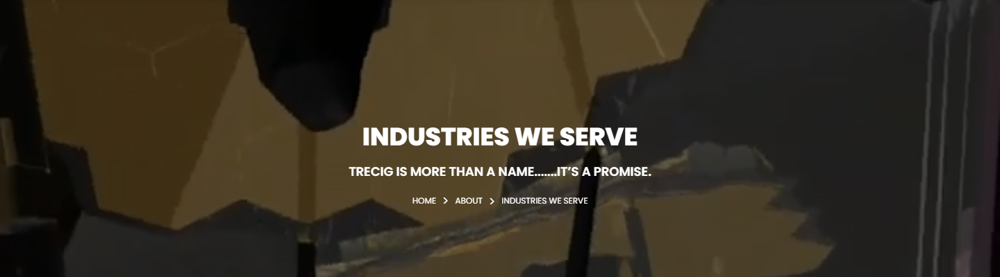
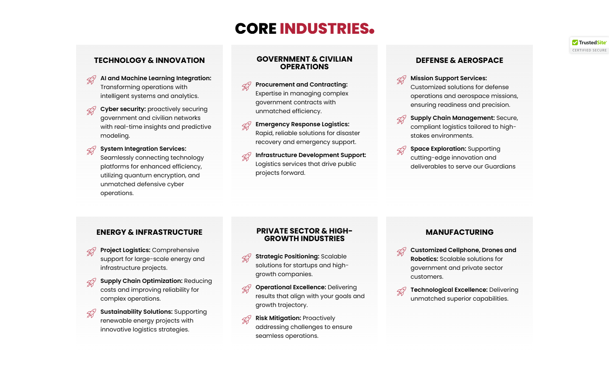
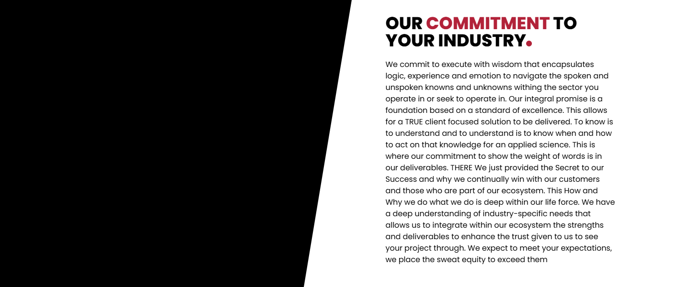

# Industries We Serve – TRECIG

*TRECIG (design reference site)* · URL: https://trecig.com/industries-we-serve/ · captured 2026-11-08 00:33:14 · HTTP 200

- **Meta description:** —
- **Page size (desktop 1440px):** 1440×2866 px · tablet (820px): 3510 px · mobile (390px): 4011 px
- **Screenshots:** [desktop](screenshots/desktop-full.png) · [tablet](screenshots/tablet-full.png) · [mobile](screenshots/mobile-full.png) · [desktop top](screenshots/desktop-viewport-top.png) · [desktop scrolled](screenshots/desktop-viewport-scrolled.png)
- **Files:** [raw.html](raw.html) (server HTML) · [rendered.html](rendered.html) (DOM after JS) · [content.txt](content.txt) (all visible text) · layout-*.json (full element tree with computed styles) · page.json (everything)

## 1. Section map (top → bottom, desktop 1440px)

| # | Role | Y from top | Height | Heading / first text | Mobile height | Screenshot |
|---|---|---|---|---|---|---|
| 0 | header | 0 | 170 | HOME ABOUT AWARDS & RECOGNITION EXPERTISE PRESS & MEDIA CONTACT | 170 | [img](screenshots/desktop-sec00-header.png) |
| 1 | section | 170 | 400 | INDUSTRIES WE SERVE | 220 | [img](screenshots/desktop-sec01-section.png) |
| 2 | section | 570 | 196 | At TRECIG, we understand that each industry comes with its own unique challenges and oppor | 229 | [img](screenshots/desktop-sec02-section.png) |
| 3 | section | 766 | 21 |  | 21 | [img](screenshots/desktop-sec03-section.png) |
| 4 | section | 787 | 881 | CORE INDUSTRIES | 1847 | [img](screenshots/desktop-sec04-section.png) |
| 5 | section | 1668 | 600 | OUR COMMITMENT TO YOUR INDUSTRY | 833 | [img](screenshots/desktop-sec05-section.png) |
| 6 | footer | 2268 | 598 | LET'S TALK: | 690 | [img](screenshots/desktop-sec06-footer.png) |
| 7 | floating (fixed, z 1000003) | 875 | 38 |  |  |  |

## 2. Section-by-section layout (desktop)

Legend: each line is an element in DOM order. `@x,y w×h` = position/size in px on the 1440px-wide page. Text lines show *font size/weight, line-height, colour*. Boxes show layout (flex/grid), background, padding, radius, shadow, etc. Pass-through wrappers are collapsed.

### 2.0 HEADER — HOME ABOUT AWARDS & RECOGNITION EXPERTISE PRESS & MEDIA CONTACT

Element: `<header class="elementor elementor-13 elementor-location-header">` at y=0, 1440×170px · 

- section.elementor-section [bg:#FFFFFF · shadow:#000000 @10% 0px 0px 12px 0px · z:9999 · transition:background, border, border-radius, box-shadow 0.3s, 0.3s, 0.3s, 0.3s ease, ease, ease, ease] `@0,0 1440×170`
  - div.elementor-container [flex row · margin:0px 85px 0px 85px · max-w:1270px] `@85,0 1270×170`
    - div.elementor-column [flex row · min-h:1px] `@85,0 1270×170`
      - div.elementor-widget-wrap [flex row wrap] `@85,0 1270×170`
        - div.elementor-container [flex row · max-w:1270px] `@85,0 1270×170`
          - div.elementor-column [flex row · min-h:1px] `@85,0 127×170`
            - div.elementor-widget-wrap [flex row wrap · align:center · pad:10px 10px 10px 10px] `@85,0 127×170`
              - a (link→/) [inline-block · align-text:center] `@95,10 200×150`
                - **IMG** `TRECIG_Logo_Registered.png` alt="" natural 1440×1080 · inline-block · max-w:200px · overflow:clip · align-text:center `@95,10 200×150`
          - div.elementor-column [flex row · min-h:1px] `@212,0 1143×170`
            - div.elementor-widget-wrap [flex row wrap · align:center · pad:10px 10px 10px 10px] `@212,0 1143×170`
              - div.elementor-widget-container [flex column · transition:background, border, border-radius, box-shadow, transform 0.3s, 0.3s, 0.3s, 0.3s, 0.4s ease, ease, ease, ease, ease] `@222,75 1123×20`
                - ul.elementor-nav-menu [flex row wrap · justify:flex-end · margin:0px 0px 0px 411.234px · z:2] · pseudo:::after{{"content": "\" \"", "w": "0px", "h": "0px"}} `@633,75 712×20`
                  - **A→/** "HOME" — Poppins 14px/400 lh 20px · #000000 · textTransform:uppercase ‖ flex row · margin:0px 15px 0px 0px · transition:all 0.4s ease `@633,75 40×20`
                  - **A→/about/** "ABOUT" — Poppins 14px/400 lh 20px · #000000 · textTransform:uppercase ‖ flex row · margin:0px 15px 0px 15px · transition:all 0.4s ease `@703,75 70×20`
                  - **A→/awards-recognition/** "AWARDS & RECOGNITION" — Poppins 14px/400 lh 20px · #000000 · textTransform:uppercase ‖ flex row · margin:0px 15px 0px 15px · transition:all 0.4s ease `@803,75 195×20`
                  - **A→/expertise/** "EXPERTISE" — Poppins 14px/400 lh 20px · #000000 · textTransform:uppercase ‖ flex row · margin:0px 15px 0px 15px · transition:all 0.4s ease `@1028,75 90×20`
                  - **A→/press-media/** "PRESS & MEDIA" — Poppins 14px/400 lh 20px · #000000 · textTransform:uppercase ‖ flex row · margin:0px 15px 0px 15px · transition:all 0.4s ease `@1148,75 100×20`
                  - **A→/contact/** "CONTACT" — Poppins 14px/400 lh 20px · #000000 · textTransform:uppercase ‖ flex row · margin:0px 0px 0px 15px · transition:all 0.4s ease `@1278,75 67×20`

### 2.1 SECTION — INDUSTRIES WE SERVE

Element: `<section class="elementor-section elementor-top-section elementor-element elementor-element-cb4c35f elementor-section-height-min-height elementor-section-bo">` at y=170, 1440×400px · 

- section.elementor-section [transition:background, border, border-radius, box-shadow 0.3s, 0.3s, 0.3s, 0.3s ease, ease, ease, ease] `@0,170 1440×400`
  - div.elementor-background-video-container [pos:absolute · z:0 · overflow:hidden · transition:opacity 1s ease] `@0,170 1440×400`
    - **IFRAME** https://www.youtube.com/embed/R7xS8Fvt-Rw?controls=0&rel=0&playsinline=1&cc_load_policy=0&enablejsapi=1&origin=https%3A%2F%2Ftrecig.com&widgetid=1&forigin=https%3A%2F%2Ftrecig.com%2Findustries-we-serve%2F&aoriginsup=1&vf=6 Industries We Serve   Top `@0,-35 1440×810`
  - div.elementor-background-overlay [bg:#000000 · pos:absolute · opacity:0.5 · transition:background, border-radius, opacity 0.3s, 0.3s, 0.3s ease, ease, ease] `@0,170 1440×400` (empty/decorative)
  - div.elementor-container [flex row · align:center · margin:0px 370px 0px 370px · max-w:700px · min-h:400px] `@370,170 700×400`
    - div.elementor-column [flex row · min-h:1px] `@370,260 700×221`
      - div.elementor-widget-wrap [flex row wrap · pad:10px 10px 10px 10px · margin:80px 0px 0px 0px] `@370,340 700×141`
        - div.elementor-widget-heading [margin:0px 0px 20px 0px · align-text:center] `@380,350 680×36`
          - **H2** "INDUSTRIES WE SERVE" — Poppins 36px/800 lh 36px · #FFFFFF · textTransform:uppercase · textAlign:center ‖ inline-block `@522,350 396×36`
        - div.elementor-widget-heading [margin:0px 0px 20px 0px · align-text:center] `@380,406 680×24`
          - **H2** "TRECIG IS MORE THAN A NAME.......IT’S A PROMISE." — Poppins 18px/600 lh 18px · #FFFFFF · textTransform:uppercase · textAlign:center ‖ inline-block `@502,409 436×18`
        - ul.elementor-icon-list-items [flex row wrap · justify:center · margin:0px -2.5px 0px -2.5px · align-text:center] `@378,450 685×21`
          - li.elementor-icon-list-item [flex row · justify:center · align:center · margin:0px 2.5px 0px 2.5px · align-text:center] `@594,450 34×21`
            - **A→/** "HOME" — Poppins 12px/400 lh 18px · #CC3366 · textTransform:uppercase · textAlign:center ‖ flex row · highlights: "HOME" #FFFFFF `@594,451 34×18`
          - li.elementor-icon-list-item [flex row · justify:center · align:center · margin:0px 2.5px 0px 2.5px · align-text:center] `@633,450 62×21`
            - **A→/about/** "ABOUT" — Poppins 12px/400 lh 18px · #CC3366 · textTransform:uppercase · textAlign:center ‖ flex row · highlights: "ABOUT" #FFFFFF `@633,450 62×21`
          - li.elementor-icon-list-item [flex row · justify:center · align:center · margin:0px 2.5px 0px 2.5px · align-text:center] `@700,450 147×21`
            - **SPAN** "INDUSTRIES WE SERVE" — Poppins 12px/400 lh 18px · #FFFFFF · textTransform:uppercase · textAlign:center ‖ pad:0px 0px 0px 5px · transition:color 0.3s ease `@717,451 129×18`

### 2.2 SECTION — At TRECIG, we understand that each industry comes with its own unique challenges

Element: `<section class="elementor-section elementor-top-section elementor-element elementor-element-145a3bb elementor-section-boxed elementor-section-height-default">` at y=570, 1440×196px · 

- section.elementor-section [pad:30px 0px 30px 0px · transition:background, border, border-radius, box-shadow 0.3s, 0.3s, 0.3s, 0.3s ease, ease, ease, ease] `@0,570 1440×196`
  - div.elementor-container [flex row · margin:0px 85px 0px 85px · max-w:1270px] `@85,600 1270×136`
    - div.elementor-column [flex row · min-h:1px] `@85,600 1270×136`
      - div.elementor-widget-wrap [flex row wrap · pad:10px 10px 10px 10px] `@85,600 1270×136`
        - div.elementor-container [flex row · margin:0px 175px 0px 175px · max-w:900px] `@270,610 900×116`
          - div.elementor-column [flex row · min-h:1px] `@270,610 900×116`
            - div.elementor-widget-wrap [flex row wrap · pad:10px 10px 10px 10px] `@270,610 900×116`
              - div.elementor-widget-container [align-text:center · transition:background, border, border-radius, box-shadow, transform 0.3s, 0.3s, 0.3s, 0.3s, 0.4s ease, ease, ease, ease, ease] `@280,620 880×96`
                - **text** "At , we understand that each industry comes with its own unique challenges and opportunities. Our expertise spans a wide range of sectors, enabling us to del…" — Poppins 16px/400 lh 24px · #000000 · textAlign:center `@280,620 880×96`
                - **STRONG** "TRECIG" — Poppins 16px/600 lh 24px · #000000 · textAlign:center ‖ inline `@317,620 57×23`

### 2.3 SECTION — 

Element: `<section class="elementor-section elementor-top-section elementor-element elementor-element-89b2c68 elementor-section-boxed elementor-section-height-default">` at y=766, 1440×21px · 

- *(empty block — vertical spacer / gap of 21px)*

### 2.4 SECTION — CORE INDUSTRIES

Element: `<section class="elementor-section elementor-top-section elementor-element elementor-element-9d3a873 elementor-section-boxed elementor-section-height-default">` at y=787, 1440×881px · 

- section.elementor-section [pad:30px 0px 30px 0px · transition:background, border, border-radius, box-shadow 0.3s, 0.3s, 0.3s, 0.3s ease, ease, ease, ease] `@0,787 1440×881`
  - div.elementor-container [flex row · margin:0px 85px 0px 85px · max-w:1270px] `@85,817 1270×821`
    - div.elementor-column [flex row · min-h:1px] `@85,817 1270×821`
      - div.elementor-widget-wrap [flex row wrap · pad:10px 10px 10px 10px] `@85,817 1270×821`
        - div.elementor-container [flex row · margin:0px 175px 0px 175px · max-w:900px] `@270,827 900×56`
          - div.elementor-column [flex row · min-h:1px] `@270,827 900×56`
            - div.elementor-widget-wrap [flex row wrap · pad:10px 10px 10px 10px] `@270,827 900×56`
              - **H2** "CORE INDUSTRIES" — Poppins 36px/800 lh 36px · #000000 · textTransform:uppercase · textAlign:center ‖ inline-block · highlights: "INDUSTRIES" #B22239 `@555,837 330×36`
        - div.elementor-container [flex row · margin:0px 75px 0px 75px · max-w:1100px] `@170,883 1100×407`
          - div.elementor-column [flex row · min-h:1px] `@170,883 367×407`
            - div.elementor-widget-wrap [flex row wrap · bg-image:linear-gradient(#F2F2F2 0%, transparent 100%) · pad:25px 25px 25px 25px · margin:10px 10px 10px 10px · transition:background, border, border-radius, box-shadow 0.3s, 0.3s, 0.3s, 0.3s ease, ease, ease, ease] `@180,893 347×387`
              - div.elementor-widget-heading [margin:0px 0px 20px 0px · align-text:center] `@205,918 297×24`
                - **H2** "TECHNOLOGY & INNOVATION" — Poppins 18px/700 lh 18px · #000000 · textTransform:uppercase · textAlign:center ‖ inline-block `@222,921 262×18`
              - ul.elementor-icon-list-items `@205,962 297×293`
                - li.elementor-icon-list-item [flex row · justify:start · align:flex-start · pad:0px 0px 5px 0px] `@205,962 297×68`
                  - **SPAN** "AI and Machine Learning Integration: Transforming operations with intelligent systems and analytics." — Poppins 14px/400 lh 21px · #000000 ‖ pad:0px 0px 0px 5px · transition:color 0.3s ease · highlights: "AI and Machine Learning Integration:"  600 `@233,962 269×63`
                - li.elementor-icon-list-item [flex row · justify:start · align:flex-start · pad:0px 0px 5px 0px · margin:5px 0px 0px 0px] `@205,1035 297×89`
                  - **SPAN** "Cyber security: proactively securing government and civilian networks with real-time insights and predictive modeling." — Poppins 14px/400 lh 21px · #000000 ‖ pad:0px 0px 0px 5px · transition:color 0.3s ease · highlights: "Cyber security:"  600 `@233,1035 269×84`
                - li.elementor-icon-list-item [flex row · justify:start · align:flex-start · margin:5px 0px 0px 0px] `@205,1129 297×126`
                  - **SPAN** "System Integration Services: Seamlessly connecting technology platforms for enhanced efficiency, utilizing quantum encryption, and unmatched defensive cyber …" — Poppins 14px/400 lh 21px · #000000 ‖ pad:0px 0px 0px 5px · transition:color 0.3s ease · highlights: "System Integration Services:"  600 `@233,1129 269×126`
          - div.elementor-column [flex row · min-h:1px] `@537,883 367×407`
            - div.elementor-widget-wrap [flex row wrap · bg-image:linear-gradient(#F2F2F2 0%, transparent 100%) · pad:25px 25px 25px 25px · margin:10px 10px 10px 10px · transition:background, border, border-radius, box-shadow 0.3s, 0.3s, 0.3s, 0.3s ease, ease, ease, ease] `@547,893 347×387`
              - div.elementor-widget-heading [margin:0px 0px 20px 0px · align-text:center] `@572,918 297×39`
                - **H2** "GOVERNMENT & CIVILIAN OPERATIONS" — Poppins 18px/700 lh 18px · #000000 · textTransform:uppercase · textAlign:center ‖ inline-block `@572,918 297×36`
              - ul.elementor-icon-list-items `@572,977 297×230`
                - li.elementor-icon-list-item [flex row · justify:start · align:flex-start · pad:0px 0px 5px 0px] `@572,977 297×89`
                  - **SPAN** "Procurement and Contracting: Expertise in managing complex government contracts with unmatched efficiency." — Poppins 14px/400 lh 21px · #000000 ‖ pad:0px 0px 0px 5px · transition:color 0.3s ease · highlights: "Procurement and Contracting:"  600 `@599,977 269×84`
                - li.elementor-icon-list-item [flex row · justify:start · align:flex-start · pad:0px 0px 5px 0px · margin:5px 0px 0px 0px] `@572,1071 297×68`
                  - **SPAN** "Emergency Response Logistics: Rapid, reliable solutions for disaster recovery and emergency support." — Poppins 14px/400 lh 21px · #000000 ‖ pad:0px 0px 0px 5px · transition:color 0.3s ease · highlights: "Emergency Response Logistics:"  600 `@599,1071 269×63`
                - li.elementor-icon-list-item [flex row · justify:start · align:flex-start · margin:5px 0px 0px 0px] `@572,1144 297×63`
                  - **SPAN** "Infrastructure Development Support: Logistics services that drive public projects forward." — Poppins 14px/400 lh 21px · #000000 ‖ pad:0px 0px 0px 5px · transition:color 0.3s ease · highlights: "Infrastructure Development Support:"  600 `@599,1144 269×63`
          - div.elementor-column [flex row · min-h:1px] `@903,883 367×407`
            - div.elementor-widget-wrap [flex row wrap · bg-image:linear-gradient(#F2F2F2 0%, transparent 100%) · pad:25px 25px 25px 25px · margin:10px 10px 10px 10px · transition:background, border, border-radius, box-shadow 0.3s, 0.3s, 0.3s, 0.3s ease, ease, ease, ease] `@913,893 347×387`
              - div.elementor-widget-heading [margin:0px 0px 20px 0px · align-text:center] `@938,918 297×24`
                - **H2** "DEFENSE & AEROSPACE" — Poppins 18px/700 lh 18px · #000000 · textTransform:uppercase · textAlign:center ‖ inline-block `@983,921 207×18`
              - ul.elementor-icon-list-items `@938,962 297×230`
                - li.elementor-icon-list-item [flex row · justify:start · align:flex-start · pad:0px 0px 5px 0px] `@938,962 297×89`
                  - **SPAN** "Mission Support Services: Customized solutions for defense operations and aerospace missions, ensuring readiness and precision." — Poppins 14px/400 lh 21px · #000000 ‖ pad:0px 0px 0px 5px · transition:color 0.3s ease · highlights: "Mission Support Services:"  600 `@966,962 269×84`
                - li.elementor-icon-list-item [flex row · justify:start · align:flex-start · pad:0px 0px 5px 0px · margin:5px 0px 0px 0px] `@938,1056 297×68`
                  - **SPAN** "Supply Chain Management: Secure, compliant logistics tailored to high-stakes environments." — Poppins 14px/400 lh 21px · #000000 ‖ pad:0px 0px 0px 5px · transition:color 0.3s ease · highlights: "Supply Chain Management:"  600 `@966,1056 269×63`
                - li.elementor-icon-list-item [flex row · justify:start · align:flex-start · margin:5px 0px 0px 0px] `@938,1129 297×63`
                  - **SPAN** "Space Exploration: Supporting cutting-edge innovation and deliverables to serve our Guardians" — Poppins 14px/400 lh 21px · #000000 ‖ pad:0px 0px 0px 5px · transition:color 0.3s ease · highlights: "Space Exploration:"  600 `@966,1129 269×63`
        - div.elementor-container [flex row · margin:0px 75px 0px 75px · max-w:1100px] `@170,1290 1100×338`
          - div.elementor-column [flex row · min-h:1px] `@170,1290 367×338`
            - div.elementor-widget-wrap [flex row wrap · bg-image:linear-gradient(#F2F2F2 0%, transparent 100%) · pad:25px 25px 25px 25px · margin:10px 10px 10px 10px · transition:background, border, border-radius, box-shadow 0.3s, 0.3s, 0.3s, 0.3s ease, ease, ease, ease] `@180,1300 347×318`
              - div.elementor-widget-heading [margin:0px 0px 20px 0px · align-text:center] `@205,1325 297×24`
                - **H2** "ENERGY & INFRASTRUCTURE" — Poppins 18px/700 lh 18px · #000000 · textTransform:uppercase · textAlign:center ‖ inline-block `@228,1328 251×18`
              - ul.elementor-icon-list-items `@205,1369 297×209`
                - li.elementor-icon-list-item [flex row · justify:start · align:flex-start · pad:0px 0px 5px 0px] `@205,1369 297×68`
                  - **SPAN** "Project Logistics: Comprehensive support for large-scale energy and infrastructure projects." — Poppins 14px/400 lh 21px · #000000 ‖ pad:0px 0px 0px 5px · transition:color 0.3s ease · highlights: "Project Logistics:"  600 `@233,1369 269×63`
                - li.elementor-icon-list-item [flex row · justify:start · align:flex-start · pad:0px 0px 5px 0px · margin:5px 0px 0px 0px] `@205,1442 297×68`
                  - **SPAN** "Supply Chain Optimization: Reducing costs and improving reliability for complex operations." — Poppins 14px/400 lh 21px · #000000 ‖ pad:0px 0px 0px 5px · transition:color 0.3s ease · highlights: "Supply Chain Optimization:"  600 `@233,1442 269×63`
                - li.elementor-icon-list-item [flex row · justify:start · align:flex-start · margin:5px 0px 0px 0px] `@205,1515 297×63`
                  - **SPAN** "Sustainability Solutions: Supporting renewable energy projects with innovative logistics strategies." — Poppins 14px/400 lh 21px · #000000 ‖ pad:0px 0px 0px 5px · transition:color 0.3s ease · highlights: "Sustainability Solutions:"  600 `@233,1515 269×63`
          - div.elementor-column [flex row · min-h:1px] `@537,1290 367×338`
            - div.elementor-widget-wrap [flex row wrap · bg-image:linear-gradient(#F2F2F2 0%, transparent 100%) · pad:25px 25px 25px 25px · margin:10px 10px 10px 10px · transition:background, border, border-radius, box-shadow 0.3s, 0.3s, 0.3s, 0.3s ease, ease, ease, ease] `@547,1300 347×318`
              - div.elementor-widget-heading [margin:0px 0px 20px 0px · align-text:center] `@572,1325 297×39`
                - **H2** "PRIVATE SECTOR & HIGH-GROWTH INDUSTRIES" — Poppins 18px/700 lh 18px · #000000 · textTransform:uppercase · textAlign:center ‖ inline-block `@572,1325 297×36`
              - ul.elementor-icon-list-items `@572,1384 297×209`
                - li.elementor-icon-list-item [flex row · justify:start · align:flex-start · pad:0px 0px 5px 0px] `@572,1384 297×68`
                  - **SPAN** "Strategic Positioning: Scalable solutions for startups and high-growth companies." — Poppins 14px/400 lh 21px · #000000 ‖ pad:0px 0px 0px 5px · transition:color 0.3s ease · highlights: "Strategic Positioning:"  600 `@599,1384 269×63`
                - li.elementor-icon-list-item [flex row · justify:start · align:flex-start · pad:0px 0px 5px 0px · margin:5px 0px 0px 0px] `@572,1457 297×68`
                  - **SPAN** "Operational Excellence: Delivering results that align with your goals and growth trajectory." — Poppins 14px/400 lh 21px · #000000 ‖ pad:0px 0px 0px 5px · transition:color 0.3s ease · highlights: "Operational Excellence:"  600 `@599,1457 269×63`
                - li.elementor-icon-list-item [flex row · justify:start · align:flex-start · margin:5px 0px 0px 0px] `@572,1530 297×63`
                  - **SPAN** "Risk Mitigation: Proactively addressing challenges to ensure seamless operations." — Poppins 14px/400 lh 21px · #000000 ‖ pad:0px 0px 0px 5px · transition:color 0.3s ease · highlights: "Risk Mitigation:"  600 `@599,1530 269×63`
          - div.elementor-column [flex row · min-h:1px] `@903,1290 367×338`
            - div.elementor-widget-wrap [flex row wrap · bg-image:linear-gradient(#F2F2F2 0%, transparent 100%) · pad:25px 25px 25px 25px · margin:10px 10px 10px 10px · transition:background, border, border-radius, box-shadow 0.3s, 0.3s, 0.3s, 0.3s ease, ease, ease, ease] `@913,1300 347×318`
              - div.elementor-widget-heading [margin:0px 0px 20px 0px · align-text:center] `@938,1325 297×24`
                - **H2** "MANUFACTURING" — Poppins 18px/700 lh 18px · #000000 · textTransform:uppercase · textAlign:center ‖ inline-block `@1006,1328 160×18`
              - ul.elementor-icon-list-items `@938,1369 297×136`
                - li.elementor-icon-list-item [flex row · justify:start · align:flex-start · pad:0px 0px 5px 0px] `@938,1369 297×89`
                  - **SPAN** "Customized Cellphone, Drones and Robotics: Scalable solutions for government and private sector customers." — Poppins 14px/400 lh 21px · #000000 ‖ pad:0px 0px 0px 5px · transition:color 0.3s ease · highlights: "Customized Cellphone, Drones and Robotics:"  600 `@966,1369 269×84`
                - li.elementor-icon-list-item [flex row · justify:start · align:flex-start · margin:5px 0px 0px 0px] `@938,1463 297×42`
                  - **SPAN** "Technological Excellence: Delivering unmatched superior capabilities." — Poppins 14px/400 lh 21px · #000000 ‖ pad:0px 0px 0px 5px · transition:color 0.3s ease · highlights: "Technological Excellence:"  600 `@966,1463 269×42`

### 2.5 SECTION — OUR COMMITMENT TO YOUR INDUSTRY

Element: `<section class="elementor-section elementor-top-section elementor-element elementor-element-63500a6 elementor-section-full_width tilt-image elementor-sectio">` at y=1668, 1440×600px · 

- section.elementor-section [bg:transparent · overflow:hidden · transition:background, border, border-radius, box-shadow 0.3s, 0.3s, 0.3s, 0.3s ease, ease, ease, ease] `@0,1668 1440×600`
  - div.elementor-container [flex row] `@0,1668 1440×600`
    - div.elementor-column [flex row · min-h:1px] `@0,1668 734×600`
      - div.elementor-widget-wrap [flex row wrap · align:center · transition:background, border, border-radius, box-shadow 0.3s, 0.3s, 0.3s, 0.3s ease, ease, ease, ease] `@0,1668 734×600`
        - div.elementor-widget-video · pseudo:::after{{"content": "\"\"", "w": "100px", "h": "600px", "position": "absolute"}} `@0,1668 734×600`
          - div.elementor-widget-container [overflow:hidden · transform:matrix(1, 0, 0, 1, 0, 0) · transition:background, border, border-radius, box-shadow, transform 0.3s, 0.3s, 0.3s, 0.3s, 0.4s ease, ease, ease, ease, ease] `@0,1668 734×600`
            - **IFRAME** https://www.youtube.com/embed/jgk3fMDfoTc?controls=0&rel=0&playsinline=1&cc_load_policy=0&autoplay=1&enablejsapi=1&origin=https%3A%2F%2Ftrecig.com&widgetid=5&forigin=https%3A%2F%2Ftrecig.com%2Findustries-we-serve%2F&aoriginsup=1&vf=1 Trecig   Industries We Serve `@0,1668 1080×600`
    - div.elementor-column [flex row · min-h:1px] `@734,1668 706×600`
      - div.elementor-widget-wrap [flex row wrap · align:center · pad:10px 10px 10px 10px · margin:0px 0px 0px 50px] `@784,1668 656×600`
        - div.elementor-container [flex row · margin:0px 135.594px 0px 0px · max-w:500px] `@794,1689 500×558`
          - div.elementor-column [flex row · min-h:1px] `@794,1689 500×558`
            - div.elementor-widget-wrap [flex row wrap · pad:10px 10px 10px 10px] `@794,1689 500×558`
              - div.elementor-widget-heading [margin:0px 0px 20px 0px] `@804,1699 480×72`
                - **H2** "OUR COMMITMENT TO YOUR INDUSTRY" — Poppins 36px/800 lh 36px · #000000 · textTransform:uppercase ‖ inline-block · highlights: "COMMITMENT" #B22239 `@804,1699 480×72`
              - **P** "We commit to execute with wisdom that encapsulates logic, experience and emotion to navigate the spoken and unspoken knowns and unknowns withing the sector y…" — Poppins 16px/400 lh 24px · #000000 ‖ margin:0px 0px 14.4px 0px `@804,1791 480×432`

### 2.6 FOOTER — LET'S TALK:

Element: `<footer class="elementor elementor-15 elementor-location-footer">` at y=2268, 1440×598px · 

- section.elementor-section [transition:background, border, border-radius, box-shadow 0.3s, 0.3s, 0.3s, 0.3s ease, ease, ease, ease] `@0,2268 1440×598`
  - div.elementor-background-video-container [pos:absolute · z:0 · overflow:hidden · transition:opacity 1s ease] `@0,2268 1440×598`
    - **IFRAME** https://www.youtube.com/embed/OzwCnEEadts?controls=0&rel=0&playsinline=1&cc_load_policy=0&enablejsapi=1&origin=https%3A%2F%2Ftrecig.com&widgetid=3&forigin=https%3A%2F%2Ftrecig.com%2Findustries-we-serve%2F&aoriginsup=1&vf=1 Triceg   Expertise Slider 1 `@0,2162 1440×810`
  - div.elementor-background-overlay [bg:#FFFFFF · pos:absolute · opacity:0.7 · transition:background, border-radius, opacity 0.3s, 0.3s, 0.3s ease, ease, ease] `@0,2268 1440×598` (empty/decorative)
  - div.elementor-container [flex row · margin:0px 85px 0px 85px · max-w:1270px] `@85,2268 1270×598`
    - div.elementor-column [flex row · min-h:1px] `@85,2268 1270×598`
      - div.elementor-widget-wrap [flex row wrap] `@85,2268 1270×598`
        - section.elementor-section [pad:40px 0px 40px 0px] `@85,2268 1270×467`
          - div.elementor-container [flex row · max-w:1270px] `@85,2308 1270×387`
            - div.elementor-column [flex row · min-h:1px] `@85,2308 324×387`
              - div.elementor-widget-wrap [flex row wrap · pad:10px 10px 10px 10px] `@85,2308 324×387`
                - div.elementor-widget-theme-site-logo [margin:0px 0px 20px 0px] `@95,2318 304×300`
                  - a (link→/) [inline-block] `@95,2318 400×300`
                    - **IMG** `TRECIG_Logo_Registered.png` alt="" natural 1440×1080 · inline-block · max-w:400px · overflow:clip `@95,2318 400×300`
                - div.elementor-button-wrapper [grid cols[134.078px]] `@95,2638 134×47`
                  - **A→/contact/** "LET’S TALK" — Poppins 15px/400 lh 15px · #000000 · textTransform:uppercase · textAlign:center ‖ pad:15px 30px 15px 30px · radius:30px · border:1px 1px 1px 1px solid #000000 · transition:all 0.3s ease `@95,2638 134×47`
            - div.elementor-column [flex row · min-h:1px] `@409,2308 371×387`
              - div.elementor-widget-wrap [flex row wrap · pad:10px 10px 10px 10px · margin:0px 0px 0px 50px] `@459,2308 321×387`
                - div.elementor-widget-heading [margin:0px 0px 20px 0px] `@469,2318 301×24`
                  - **H2** "LET'S TALK:" — Poppins 18px/700 lh 18px · #000000 · textTransform:uppercase ‖ inline-block `@469,2321 98×18`
                - ul.elementor-icon-list-items `@469,2362 301×52`
                  - li.elementor-icon-list-item [flex row · align:center · pad:0px 0px 5px 0px] `@469,2362 301×26`
                    - **A→tel:(254)%20338-6131** "(469)653-9009" — Poppins 14px/600 lh 21px · #CC3366 ‖ flex row · highlights: "(469)653-9009" #000000 `@469,2362 301×21`
                  - li.elementor-icon-list-item [flex row · align:center · margin:5px 0px 0px 0px] `@469,2393 301×21`
                    - **A→mailto:info@trecig.com** "info@trecig.com" — Poppins 14px/600 lh 21px · #CC3366 ‖ flex row · highlights: "info@trecig.com" #000000 `@469,2393 301×21`
            - div.elementor-column [flex row · min-h:1px] `@781,2308 310×387`
              - div.elementor-widget-wrap [flex row wrap · pad:10px 10px 10px 10px · margin:0px 50px 0px 0px] `@781,2308 260×387`
                - div.elementor-widget-heading [margin:0px 0px 20px 0px] `@791,2318 240×24`
                  - **H2** "TRECIG HQ:" — Poppins 18px/700 lh 18px · #000000 · textTransform:uppercase ‖ inline-block `@791,2321 101×18`
                - ul.elementor-icon-list-items `@791,2362 240×42`
                  - li.elementor-icon-list-item [flex row · align:center] `@791,2362 240×42`
                    - **SPAN** "Rockwall, Texas, United States" — Poppins 14px/400 lh 21px · #000000 ‖ transition:color 0.3s ease `@791,2362 110×42`
            - div.elementor-column [flex row · min-h:1px] `@1090,2308 264×387`
              - div.elementor-widget-wrap [flex row wrap · pad:10px 10px 10px 10px] `@1090,2308 264×387`
                - div.elementor-widget-heading [margin:0px 0px 20px 0px] `@1100,2318 244×24`
                  - **H2** "CONNECT WITH US:" — Poppins 18px/700 lh 18px · #000000 · textTransform:uppercase ‖ inline-block `@1100,2321 174×18`
                - **A→/industries-we-serve/** "Linkedin-in" +icon[e-font-icon-svg e-fab-linkedin-in] — -apple-system 16px/400 lh 16px · #69727D · textAlign:center ‖ flex row · bg:#000000 · radius:100% · transition:all 0.3s ease `@1100,2362 32×32`
        - section.elementor-section [pad:15px 0px 15px 0px · border:1px 0px 0px 0px solid #000000 @20%] `@85,2735 1270×131`
          - div.elementor-container [flex row · max-w:1270px] `@85,2751 1270×100`
            - div.elementor-column [flex row · min-h:1px] `@85,2751 1270×100`
              - div.elementor-widget-wrap [flex row wrap · align:center · pad:10px 10px 10px 10px] `@85,2751 1270×100`
                - div.elementor-element [margin:0px 0px 20px 0px · align-text:center] `@95,2761 1250×10`
                  - div.elementor-widget-container [margin:0px 0px -10px 0px · overflow:hidden · align-text:center · transition:background, border, border-radius, box-shadow, transform 0.3s, 0.3s, 0.3s, 0.3s, 0.4s ease, ease, ease, ease, ease] `@95,2761 1250×20`
                    - ul.elementor-icon-list-items [flex row wrap · justify:center · gap:30px · margin:0px -8px 0px -8px · align-text:center] `@87,2761 1266×20`
                      - li.elementor-icon-list-item [flex row · justify:center · align:center · margin:0px 8px 0px 8px · align-text:center] `@589,2761 89×20`
                        - **A→/privacy-policy/** "Privacy Policy" — Poppins 13px/400 lh 19.5px · #CC3366 · textAlign:center ‖ flex row · highlights: "Privacy Policy" #000000 `@589,2761 88×20`
                      - li.elementor-icon-list-item [flex row · justify:center · align:center · margin:0px 8px 0px 8px · align-text:center] `@724,2761 127×20`
                        - **A→/terms-conditions/** "Terms & Conditions" — Poppins 13px/400 lh 19.5px · #CC3366 · textAlign:center ‖ flex row · highlights: "Terms & Conditions" #000000 `@724,2761 127×20`
                - **P** "©2026 TRECIG, LLC" — Poppins 12px/400 lh 18px · #000000 · textTransform:uppercase · textAlign:center ‖ margin:0px 0px 14.4px 0px `@95,2791 1250×36`

### Floating / fixed elements
- `div.` fixed at [1348, 875, 92, 38] z-index 1000003 — ""

## 3. Header, navigation & interaction behaviour

- **atTop** `header.elementor.elementor-13.elementor-location-header` position:static top:0 height:170 bg:transparent shadow:none backdrop:none z:auto
- **afterScroll1400** `header.elementor.elementor-13.elementor-location-header` position:static top:-1400 height:0 bg:transparent shadow:none backdrop:none z:auto
- **afterScroll1400** `section.elementor-section.elementor-top-section.elementor-element.elementor-elem` position:fixed top:0 height:170 bg:#FFFFFF @90% shadow:#000000 @10% 0px 0px 12px 0px backdrop:none z:9999

| Menu item | Link | Dropdown | Style | Hover change |
|---|---|---|---|---|
| HOME | / | — | Poppins 14px/400 #000000 uppercase ls normal | color: #000000 → #B22239 |
| ABOUT | /about/ | The Mission (/the-mission/); The Values (/the-values/); The Legacy (/the-legacy/); The Trecig Team (/the-trecig-team/); Careers (/careers/) | Poppins 14px/400 #000000 uppercase ls normal | color: #000000 → #B22239 |
| AWARDS & RECOGNITION | /awards-recognition/ | Partnerships (/partnerships/) | Poppins 14px/400 #000000 uppercase ls normal | color: #000000 → #B22239 |
| EXPERTISE (current) | /expertise/ | Industries We Serve (/industries-we-serve/) | Poppins 14px/400 #000000 uppercase ls normal | color: #000000 → #B22239 |
| PRESS & MEDIA | /press-media/ | — | Poppins 14px/400 #000000 uppercase ls normal | color: #000000 → #B22239 |
| CONTACT | /contact/ | — | Poppins 14px/400 #000000 uppercase ls normal | color: #000000 → #B22239 |

- **Mobile menu:** toggle `.elementor-menu-toggle` → [screenshot](screenshots/mobile-menu-open.png) · items: HOME, ABOUT, AWARDS & RECOGNITION, EXPERTISE, PRESS & MEDIA, CONTACT

### Hover states (measured by hovering in Chrome)

| Element | Text | Normal | On hover |
|---|---|---|---|
| `a.elementor-item` | HOME | color #000000 · bg transparent · radius 0px · pad 0px · border 0px #000000 · transition 0.4s | color: #000000 → #B22239; borderTopColor: #000000 → #B22239 |
| `a.elementor-item` | ABOUT | color #000000 · bg transparent · radius 0px · pad 0px · border 0px #000000 · transition 0.4s | color: #000000 → #B22239; borderTopColor: #000000 → #B22239 |
| `a.elementor-item` | CONTACT | color #000000 · bg transparent · radius 0px · pad 0px · border 0px #000000 · transition 0.4s | color: #000000 → #B22239; borderTopColor: #000000 → #B22239 |
| `a.` |  | color #CC3366 · bg transparent · radius 0px · pad 0px · border 0px #CC3366 · transition all | color: #CC3366 → #B22239; borderTopColor: #CC3366 → #B22239; childColor: #CC3366 → #B22239 |
| `a.elementor-button` | LET’S TALK | color #000000 · bg transparent · radius 30px · pad 15px 30px · border 1px #000000 · transition 0.3s | color: #000000 → #FFFFFF; borderTopColor: #000000 → #B22239 |
| `a.` | (469)653-9009 | color #CC3366 · bg transparent · radius 0px · pad 0px · border 0px #CC3366 · transition all | color: #CC3366 → #B22239; borderTopColor: #CC3366 → #B22239 |
| `a.elementor-icon` | Linkedin-in | color #69727D · bg #000000 · radius 100% · pad 0px · border 0px #69727D · transition 0.3s | color: #69727D → #B22239; backgroundColor: #000000 → #B22239; borderTopColor: #69727D → #B22239; opacity: 1 → 0.9; childColor: #69727D → #B22239 |
| `a.` | Privacy Policy | color #CC3366 · bg transparent · radius 0px · pad 0px · border 0px #CC3366 · transition all | color: #CC3366 → #B22239; borderTopColor: #CC3366 → #B22239 |

## 4. Typography & colour used on this page (weighted by amount of text / area)

| Font · weight · size / line-height | chars |
|---|---|
| Poppins | 400 | 16px / 24px | 1397 |
| Poppins | 400 | 14px / 21px | 1281 |
| Poppins | 600 | 14px / 21px | 463 |
| Poppins | 700 | 18px / 18px | 186 |
| Poppins | 800 | 36px / 36px | 62 |
| Poppins | 400 | 14px / 20px | 58 |
| Poppins | 600 | 18px / 18px | 48 |
| Poppins | 400 | 12px / 18px | 45 |
| Poppins | 400 | 13px / 19.5px | 32 |
| -apple-system | 400 | 16px / 24px | 15 |
| -apple-system | 400 | 16px / 16px | 11 |
| Poppins | 400 | 15px / 15px | 10 |
| Poppins | 600 | 16px / 24px | 6 |

- **Text colours:** #000000 (3473), #FFFFFF (95), #B22239 (20), #CC3366 (15), #69727D (11)
- **Background colours (by area):** #000000 (1225), #FFFFFF (1109), transparent (864), #B22239 (0)
- **Gradients:** linear-gradient(#F2F2F2 0%, transparent 100%)
- **Border radii:** 50% (2), 30px (1), 100% (1), 2px 0px 0px (1)
- **Shadows:** #000000 @10% 0px 0px 12px 0px (1) | #000000 @20% 0px 0px 5px 0px (1)
- **Mobile text styles:** Poppins | 400 | 14px / 21px (2678); Poppins | 600 | 14px / 21px (469); Poppins | 700 | 18px / 18px (149); Poppins | 800 | 28px / 28px (62); Poppins | 400 | 12px / 18px (60); Poppins | 600 | 16px / 16px (48); Poppins | 700 | 16px / 16px (37); Poppins | 400 | 10px / 15px (17); -apple-system | 400 | 16px / 24px (15); -apple-system | 400 | 16px / 16px (11)

## 6. Images on the page

- `TRECIG_Logo_Registered.png` natural 1440×1080 → shown 200×150 · alt="" · https://trecig.com/wp-content/uploads/2026/10/TRECIG_Logo_Registered.png
- background on `div.`: https://cdn.ywxi.net/meter/trecig.com/205.svg?ts=1784975038086&l=en

## 7. Links on the page

- [body] "Skip to content" → /industries-we-serve/#content
- [header] "(icon/image)" → /
- [header] "HOME" → /
- [header] "ABOUT" → /about/
- [header] "The Mission" → /the-mission/
- [header] "The Values" → /the-values/
- [header] "The Legacy" → /the-legacy/
- [header] "The Trecig Team" → /the-trecig-team/
- [header] "Careers" → /careers/
- [header] "AWARDS & RECOGNITION" → /awards-recognition/
- [header] "Partnerships" → /partnerships/
- [header] "EXPERTISE" → /expertise/
- [header] "Industries We Serve" → /industries-we-serve/
- [header] "PRESS & MEDIA" → /press-media/
- [header] "CONTACT" → /contact/
- [header] "Home" → /
- [header] "About" → /about/
- [header] "Awards & Recognition" → /awards-recognition/
- [header] "Expertise" → /expertise/
- [header] "Press & Media" → /press-media/
- [header] "Contact" → /contact/
- [footer] "LET’S TALK" → /contact/
- [footer] "(469)653-9009" → tel:(254)%20338-6131
- [footer] "info@trecig.com" → mailto:info@trecig.com
- [footer] "Linkedin-in" → /industries-we-serve/ (target _blank)
- [footer] "Privacy Policy" → /privacy-policy/
- [footer] "Terms & Conditions" → /terms-conditions/

## 8. Mobile layout (390px) — condensed outline

### 8.0 header — HOME ABOUT AWARDS & RECOGNITION EXPERTISE PRESS & MEDIA CONTACT (y 0, h 170)
- section.elementor-section [bg:#FFFFFF · shadow:#000000 @10% 0px 0px 12px 0px · z:9999 · transition:background, border, border-radius, box-shadow 0.3s, 0.3s, 0.3s, 0.3s ease, ease, ease, ease] `@0,0 390×170`
  - div.elementor-container [flex row wrap · max-w:767px] `@0,0 390×170`
    - div.elementor-column [flex row · min-h:1px] `@0,0 390×170`
      - div.elementor-widget-wrap [flex row wrap] `@0,0 390×170`
        - div.elementor-container [flex row wrap · max-w:767px] `@0,0 390×170`
          - div.elementor-column [flex row · min-h:1px] `@0,0 234×170`
            - div.elementor-widget-wrap [flex row wrap · align:center · pad:10px 10px 10px 10px] `@0,0 234×170`
              - a (link→/) [inline-block · align-text:center] `@17,10 200×150`
                - **IMG** `TRECIG_Logo_Registered-1024x768.png` alt="" natural 390×292 · inline-block · max-w:200px · overflow:clip · align-text:center `@17,10 200×150`
          - div.elementor-column [flex row · min-h:1px] `@234,0 156×170`
            - div.elementor-widget-wrap [flex row wrap · align:center · pad:10px 10px 10px 10px] `@234,0 156×170`
              - div.elementor-widget-container [flex column · transition:background, border, border-radius, box-shadow, transform 0.3s, 0.3s, 0.3s, 0.3s, 0.4s ease, ease, ease, ease, ease] `@244,70 136×30`
                - nav.elementor-nav-menu--dropdown [bg:#FFFFFF · margin:16px 0px 0px 0px · pos:absolute · z:9997 · overflow:hidden · transform:matrix(1, 0, 0, 0, 0, 0) · transition:max-height, transform 0.3s, 0.3s ease, ease] `@0,116 390×0`
                  - ul.elementor-nav-menu [z:2] · pseudo:::after{{"content": "\" \"", "w": "390px", "h": "0px"}} `@0,116 390×0`
                    - **A→/** "HOME" — Poppins 14px/400 lh 20px · #000000 · textTransform:uppercase ‖ flex row · pad:10px 20px 10px 20px `@0,116 390×0`
                    - **A→/about/** "ABOUT" — Poppins 14px/400 lh 20px · #000000 · textTransform:uppercase ‖ flex row · pad:10px 20px 10px 20px `@0,116 390×0`
                    - **A→/awards-recognition/** "AWARDS & RECOGNITION" — Poppins 14px/400 lh 20px · #000000 · textTransform:uppercase ‖ flex row · pad:10px 20px 10px 20px `@0,116 390×0`
                    - **A→/expertise/** "EXPERTISE" — Poppins 14px/400 lh 20px · #000000 · textTransform:uppercase ‖ flex row · pad:10px 20px 10px 20px `@0,116 390×0`
                    - **A→/press-media/** "PRESS & MEDIA" — Poppins 14px/400 lh 20px · #000000 · textTransform:uppercase ‖ flex row · pad:10px 20px 10px 20px `@0,116 390×0`
                    - **A→/contact/** "CONTACT" — Poppins 14px/400 lh 20px · #000000 · textTransform:uppercase ‖ flex row · pad:10px 20px 10px 20px `@0,116 390×0`

### 8.1 section — INDUSTRIES WE SERVE (y 170, h 220)
- section.elementor-section [transition:background, border, border-radius, box-shadow 0.3s, 0.3s, 0.3s, 0.3s ease, ease, ease, ease] `@0,170 390×220`
  - div.elementor-background-overlay [bg:#000000 · pos:absolute · opacity:0.5 · transition:background, border-radius, opacity 0.3s, 0.3s, 0.3s ease, ease, ease] `@0,170 390×220` (empty/decorative)
  - div.elementor-container [flex row wrap · align:center · max-w:700px · min-h:220px] `@0,170 390×220`
    - div.elementor-column [flex row · min-h:1px] `@0,185 390×190`
      - div.elementor-widget-wrap [flex row wrap · pad:10px 10px 10px 10px · margin:65px 0px 0px 0px] `@0,250 390×125`
        - div.elementor-widget-heading [margin:0px 0px 20px 0px · align-text:center] `@10,260 370×29`
          - **H2** "INDUSTRIES WE SERVE" — Poppins 28px/800 lh 28px · #FFFFFF · textTransform:uppercase · textAlign:center ‖ inline-block `@41,260 308×28`
        - div.elementor-widget-heading [margin:0px 0px 20px 0px · align-text:center] `@10,309 370×15`
          - div.elementor-widget-container [margin:-10px 0px -10px 0px · align-text:center · transition:background, border, border-radius, box-shadow, transform 0.3s, 0.3s, 0.3s, 0.3s, 0.4s ease, ease, ease, ease, ease] `@10,299 370×35`
            - **H2** "TRECIG IS MORE THAN A NAME.......IT’S A PROMISE." — Poppins 16px/600 lh 16px · #FFFFFF · textTransform:uppercase · textAlign:center ‖ inline-block `@10,299 370×32`
        - ul.elementor-icon-list-items [flex row wrap · justify:center · margin:0px -2.5px 0px -2.5px · align-text:center] `@8,344 375×21`
          - li.elementor-icon-list-item [flex row · justify:center · align:center · margin:0px 2.5px 0px 2.5px · align-text:center] `@69,344 34×21`
            - **A→/** "HOME" — Poppins 12px/400 lh 18px · #CC3366 · textTransform:uppercase · textAlign:center ‖ flex row · highlights: "HOME" #FFFFFF `@69,346 34×18`
          - li.elementor-icon-list-item [flex row · justify:center · align:center · margin:0px 2.5px 0px 2.5px · align-text:center] `@108,344 62×21`
            - **A→/about/** "ABOUT" — Poppins 12px/400 lh 18px · #CC3366 · textTransform:uppercase · textAlign:center ‖ flex row · highlights: "ABOUT" #FFFFFF `@108,344 62×21`
          - li.elementor-icon-list-item [flex row · justify:center · align:center · margin:0px 2.5px 0px 2.5px · align-text:center] `@175,344 147×21`
            - **SPAN** "INDUSTRIES WE SERVE" — Poppins 12px/400 lh 18px · #FFFFFF · textTransform:uppercase · textAlign:center ‖ pad:0px 0px 0px 5px · transition:color 0.3s ease `@192,346 129×18`

### 8.2 section — At TRECIG, we understand that each industry comes with its own unique  (y 390, h 229)
- div.elementor-container [flex row wrap · max-w:767px] `@0,390 390×229`
  - div.elementor-column [flex row · min-h:1px] `@0,390 390×229`
    - div.elementor-widget-wrap [flex row wrap · pad:10px 10px 10px 10px] `@0,390 390×229`
      - div.elementor-container [flex row wrap · max-w:900px] `@10,400 370×209`
        - div.elementor-column [flex row · min-h:1px] `@10,400 370×209`
          - div.elementor-widget-wrap [flex row wrap · pad:10px 10px 10px 10px] `@10,400 370×209`
            - div.elementor-widget-container [align-text:center · transition:background, border, border-radius, box-shadow, transform 0.3s, 0.3s, 0.3s, 0.3s, 0.4s ease, ease, ease, ease, ease] `@20,410 350×189`
              - **text** "At , we understand that each industry comes with its own unique challenges and opportunities. Our expertise spans a wide range of sectors, enabling us to del…" — Poppins 14px/400 lh 21px · #000000 · textAlign:center `@20,410 350×189`
              - **STRONG** "TRECIG" — Poppins 14px/600 lh 21px · #000000 · textAlign:center ‖ inline `@57,410 50×20`

### 8.3 section —  (y 619, h 21)
- *(empty block — spacer of 21px)*

### 8.4 section — CORE INDUSTRIES (y 640, h 1847)
- div.elementor-container [flex row wrap · max-w:767px] `@0,640 390×1847`
  - div.elementor-column [flex row · min-h:1px] `@0,640 390×1847`
    - div.elementor-widget-wrap [flex row wrap · pad:10px 10px 10px 10px] `@0,640 390×1847`
      - div.elementor-container [flex row wrap · max-w:900px] `@10,650 370×49`
        - div.elementor-column [flex row · min-h:1px] `@10,650 370×49`
          - div.elementor-widget-wrap [flex row wrap · pad:10px 10px 10px 10px] `@10,650 370×49`
            - **H2** "CORE INDUSTRIES" — Poppins 28px/800 lh 28px · #000000 · textTransform:uppercase · textAlign:center ‖ inline-block · highlights: "INDUSTRIES" #B22239 `@69,660 252×28`
      - div.elementor-container [flex row wrap · max-w:1100px] `@10,699 370×978`
        - div.elementor-column [flex row · min-h:1px] `@10,699 370×356`
          - div.elementor-widget-wrap [flex row wrap · bg-image:linear-gradient(#F2F2F2 0%, transparent 100%) · pad:10px 10px 10px 10px · margin:10px 10px 10px 10px · transition:background, border, border-radius, box-shadow 0.3s, 0.3s, 0.3s, 0.3s ease, ease, ease, ease] `@20,709 350×336`
            - div.elementor-widget-heading [margin:0px 0px 20px 0px · align-text:center] `@30,719 330×24`
              - **H2** "TECHNOLOGY & INNOVATION" — Poppins 18px/700 lh 18px · #000000 · textTransform:uppercase · textAlign:center ‖ inline-block `@64,722 262×18`
            - ul.elementor-icon-list-items `@30,763 330×272`
              - li.elementor-icon-list-item [flex row · justify:start · align:flex-start · pad:0px 0px 5px 0px] `@30,763 330×68`
                - **SPAN** "AI and Machine Learning Integration: Transforming operations with intelligent systems and analytics." — Poppins 14px/400 lh 21px · #000000 ‖ pad:0px 0px 0px 5px · transition:color 0.3s ease · highlights: "AI and Machine Learning Integration:"  600 `@58,763 303×63`
              - li.elementor-icon-list-item [flex row · justify:start · align:flex-start · pad:0px 0px 5px 0px · margin:5px 0px 0px 0px] `@30,836 330×89`
                - **SPAN** "Cyber security: proactively securing government and civilian networks with real-time insights and predictive modeling." — Poppins 14px/400 lh 21px · #000000 ‖ pad:0px 0px 0px 5px · transition:color 0.3s ease · highlights: "Cyber security:"  600 `@58,836 303×84`
              - li.elementor-icon-list-item [flex row · justify:start · align:flex-start · margin:5px 0px 0px 0px] `@30,930 330×105`
                - **SPAN** "System Integration Services: Seamlessly connecting technology platforms for enhanced efficiency, utilizing quantum encryption, and unmatched defensive cyber …" — Poppins 14px/400 lh 21px · #000000 ‖ pad:0px 0px 0px 5px · transition:color 0.3s ease · highlights: "System Integration Services:"  600 `@58,930 303×105`
        - div.elementor-column [flex row · min-h:1px] `@10,1055 370×308`
          - div.elementor-widget-wrap [flex row wrap · bg-image:linear-gradient(#F2F2F2 0%, transparent 100%) · pad:10px 10px 10px 10px · margin:10px 10px 10px 10px · transition:background, border, border-radius, box-shadow 0.3s, 0.3s, 0.3s, 0.3s ease, ease, ease, ease] `@20,1065 350×288`
            - div.elementor-widget-heading [margin:0px 0px 20px 0px · align-text:center] `@30,1075 330×39`
              - **H2** "GOVERNMENT & CIVILIAN OPERATIONS" — Poppins 18px/700 lh 18px · #000000 · textTransform:uppercase · textAlign:center ‖ inline-block `@30,1075 330×36`
            - ul.elementor-icon-list-items `@30,1134 330×209`
              - li.elementor-icon-list-item [flex row · justify:start · align:flex-start · pad:0px 0px 5px 0px] `@30,1134 330×68`
                - **SPAN** "Procurement and Contracting: Expertise in managing complex government contracts with unmatched efficiency." — Poppins 14px/400 lh 21px · #000000 ‖ pad:0px 0px 0px 5px · transition:color 0.3s ease · highlights: "Procurement and Contracting:"  600 `@58,1134 303×63`
              - li.elementor-icon-list-item [flex row · justify:start · align:flex-start · pad:0px 0px 5px 0px · margin:5px 0px 0px 0px] `@30,1207 330×68`
                - **SPAN** "Emergency Response Logistics: Rapid, reliable solutions for disaster recovery and emergency support." — Poppins 14px/400 lh 21px · #000000 ‖ pad:0px 0px 0px 5px · transition:color 0.3s ease · highlights: "Emergency Response Logistics:"  600 `@58,1207 303×63`
              - li.elementor-icon-list-item [flex row · justify:start · align:flex-start · margin:5px 0px 0px 0px] `@30,1280 330×63`
                - **SPAN** "Infrastructure Development Support: Logistics services that drive public projects forward." — Poppins 14px/400 lh 21px · #000000 ‖ pad:0px 0px 0px 5px · transition:color 0.3s ease · highlights: "Infrastructure Development Support:"  600 `@58,1280 303×63`
        - div.elementor-column [flex row · min-h:1px] `@10,1363 370×314`
          - div.elementor-widget-wrap [flex row wrap · bg-image:linear-gradient(#F2F2F2 0%, transparent 100%) · pad:10px 10px 10px 10px · margin:10px 10px 10px 10px · transition:background, border, border-radius, box-shadow 0.3s, 0.3s, 0.3s, 0.3s ease, ease, ease, ease] `@20,1373 350×294`
            - div.elementor-widget-heading [margin:0px 0px 20px 0px · align-text:center] `@30,1383 330×24`
              - **H2** "DEFENSE & AEROSPACE" — Poppins 18px/700 lh 18px · #000000 · textTransform:uppercase · textAlign:center ‖ inline-block `@92,1386 207×18`
            - ul.elementor-icon-list-items `@30,1427 330×230`
              - li.elementor-icon-list-item [flex row · justify:start · align:flex-start · pad:0px 0px 5px 0px] `@30,1427 330×89`
                - **SPAN** "Mission Support Services: Customized solutions for defense operations and aerospace missions, ensuring readiness and precision." — Poppins 14px/400 lh 21px · #000000 ‖ pad:0px 0px 0px 5px · transition:color 0.3s ease · highlights: "Mission Support Services:"  600 `@58,1427 303×84`
              - li.elementor-icon-list-item [flex row · justify:start · align:flex-start · pad:0px 0px 5px 0px · margin:5px 0px 0px 0px] `@30,1521 330×68`
                - **SPAN** "Supply Chain Management: Secure, compliant logistics tailored to high-stakes environments." — Poppins 14px/400 lh 21px · #000000 ‖ pad:0px 0px 0px 5px · transition:color 0.3s ease · highlights: "Supply Chain Management:"  600 `@58,1521 303×63`
              - li.elementor-icon-list-item [flex row · justify:start · align:flex-start · margin:5px 0px 0px 0px] `@30,1594 330×63`
                - **SPAN** "Space Exploration: Supporting cutting-edge innovation and deliverables to serve our Guardians" — Poppins 14px/400 lh 21px · #000000 ‖ pad:0px 0px 0px 5px · transition:color 0.3s ease · highlights: "Space Exploration:"  600 `@58,1594 303×63`
      - div.elementor-container [flex row wrap · max-w:1100px] `@10,1677 370×800`
        - div.elementor-column [flex row · min-h:1px] `@10,1677 370×293`
          - div.elementor-widget-wrap [flex row wrap · bg-image:linear-gradient(#F2F2F2 0%, transparent 100%) · pad:10px 10px 10px 10px · margin:10px 10px 10px 10px · transition:background, border, border-radius, box-shadow 0.3s, 0.3s, 0.3s, 0.3s ease, ease, ease, ease] `@20,1687 350×273`
            - div.elementor-widget-heading [margin:0px 0px 20px 0px · align-text:center] `@30,1697 330×24`
              - **H2** "ENERGY & INFRASTRUCTURE" — Poppins 18px/700 lh 18px · #000000 · textTransform:uppercase · textAlign:center ‖ inline-block `@70,1700 251×18`
            - ul.elementor-icon-list-items `@30,1741 330×209`
              - li.elementor-icon-list-item [flex row · justify:start · align:flex-start · pad:0px 0px 5px 0px] `@30,1741 330×68`
                - **SPAN** "Project Logistics: Comprehensive support for large-scale energy and infrastructure projects." — Poppins 14px/400 lh 21px · #000000 ‖ pad:0px 0px 0px 5px · transition:color 0.3s ease · highlights: "Project Logistics:"  600 `@58,1741 303×63`
              - li.elementor-icon-list-item [flex row · justify:start · align:flex-start · pad:0px 0px 5px 0px · margin:5px 0px 0px 0px] `@30,1814 330×68`
                - **SPAN** "Supply Chain Optimization: Reducing costs and improving reliability for complex operations." — Poppins 14px/400 lh 21px · #000000 ‖ pad:0px 0px 0px 5px · transition:color 0.3s ease · highlights: "Supply Chain Optimization:"  600 `@58,1814 303×63`
              - li.elementor-icon-list-item [flex row · justify:start · align:flex-start · margin:5px 0px 0px 0px] `@30,1887 330×63`
                - **SPAN** "Sustainability Solutions: Supporting renewable energy projects with innovative logistics strategies." — Poppins 14px/400 lh 21px · #000000 ‖ pad:0px 0px 0px 5px · transition:color 0.3s ease · highlights: "Sustainability Solutions:"  600 `@58,1887 303×63`
        - div.elementor-column [flex row · min-h:1px] `@10,1970 370×287`
          - div.elementor-widget-wrap [flex row wrap · bg-image:linear-gradient(#F2F2F2 0%, transparent 100%) · pad:10px 10px 10px 10px · margin:10px 10px 10px 10px · transition:background, border, border-radius, box-shadow 0.3s, 0.3s, 0.3s, 0.3s ease, ease, ease, ease] `@20,1980 350×267`
            - div.elementor-widget-heading [margin:0px 0px 20px 0px · align-text:center] `@30,1990 330×39`
              - **H2** "PRIVATE SECTOR & HIGH-GROWTH INDUSTRIES" — Poppins 18px/700 lh 18px · #000000 · textTransform:uppercase · textAlign:center ‖ inline-block `@30,1990 330×36`
            - ul.elementor-icon-list-items `@30,2049 330×188`
              - li.elementor-icon-list-item [flex row · justify:start · align:flex-start · pad:0px 0px 5px 0px] `@30,2049 330×47`
                - **SPAN** "Strategic Positioning: Scalable solutions for startups and high-growth companies." — Poppins 14px/400 lh 21px · #000000 ‖ pad:0px 0px 0px 5px · transition:color 0.3s ease · highlights: "Strategic Positioning:"  600 `@58,2049 303×42`
              - li.elementor-icon-list-item [flex row · justify:start · align:flex-start · pad:0px 0px 5px 0px · margin:5px 0px 0px 0px] `@30,2101 330×68`
                - **SPAN** "Operational Excellence: Delivering results that align with your goals and growth trajectory." — Poppins 14px/400 lh 21px · #000000 ‖ pad:0px 0px 0px 5px · transition:color 0.3s ease · highlights: "Operational Excellence:"  600 `@58,2101 303×63`
              - li.elementor-icon-list-item [flex row · justify:start · align:flex-start · margin:5px 0px 0px 0px] `@30,2174 330×63`
                - **SPAN** "Risk Mitigation: Proactively addressing challenges to ensure seamless operations." — Poppins 14px/400 lh 21px · #000000 ‖ pad:0px 0px 0px 5px · transition:color 0.3s ease · highlights: "Risk Mitigation:"  600 `@58,2174 303×63`
        - div.elementor-column [flex row · min-h:1px] `@10,2257 370×220`
          - div.elementor-widget-wrap [flex row wrap · bg-image:linear-gradient(#F2F2F2 0%, transparent 100%) · pad:10px 10px 10px 10px · margin:10px 10px 10px 10px · transition:background, border, border-radius, box-shadow 0.3s, 0.3s, 0.3s, 0.3s ease, ease, ease, ease] `@20,2267 350×200`
            - div.elementor-widget-heading [margin:0px 0px 20px 0px · align-text:center] `@30,2277 330×24`
              - **H2** "MANUFACTURING" — Poppins 18px/700 lh 18px · #000000 · textTransform:uppercase · textAlign:center ‖ inline-block `@115,2280 160×18`
            - ul.elementor-icon-list-items `@30,2321 330×136`
              - li.elementor-icon-list-item [flex row · justify:start · align:flex-start · pad:0px 0px 5px 0px] `@30,2321 330×89`
                - **SPAN** "Customized Cellphone, Drones and Robotics: Scalable solutions for government and private sector customers." — Poppins 14px/400 lh 21px · #000000 ‖ pad:0px 0px 0px 5px · transition:color 0.3s ease · highlights: "Customized Cellphone, Drones and Robotics:"  600 `@58,2321 303×84`
              - li.elementor-icon-list-item [flex row · justify:start · align:flex-start · margin:5px 0px 0px 0px] `@30,2415 330×42`
                - **SPAN** "Technological Excellence: Delivering unmatched superior capabilities." — Poppins 14px/400 lh 21px · #000000 ‖ pad:0px 0px 0px 5px · transition:color 0.3s ease · highlights: "Technological Excellence:"  600 `@58,2415 303×42`

### 8.5 section — OUR COMMITMENT TO YOUR INDUSTRY (y 2487, h 833)
- section.elementor-section [bg:transparent · overflow:hidden · transition:background, border, border-radius, box-shadow 0.3s, 0.3s, 0.3s, 0.3s ease, ease, ease, ease] `@0,2487 390×833`
  - div.elementor-container [flex row wrap] `@0,2487 390×833`
    - div.elementor-column [flex row · min-h:1px] `@0,2487 390×240`
      - div.elementor-widget-wrap [flex row wrap · align:center · transition:background, border, border-radius, box-shadow 0.3s, 0.3s, 0.3s, 0.3s ease, ease, ease, ease] `@0,2487 390×240`
        - div.elementor-widget-container [overflow:hidden · transform:matrix(1, 0, 0, 1, 0, 0) · transition:background, border, border-radius, box-shadow, transform 0.3s, 0.3s, 0.3s, 0.3s, 0.4s ease, ease, ease, ease, ease] `@0,2487 390×240`
          - **IFRAME** https://www.youtube.com/embed/jgk3fMDfoTc?controls=0&rel=0&playsinline=1&cc_load_policy=0&autoplay=1&enablejsapi=1&origin=https%3A%2F%2Ftrecig.com&widgetid=1&forigin=https%3A%2F%2Ftrecig.com%2Findustries-we-serve%2F&aoriginsup=1&vf=1 Trecig   Industries We Serve `@0,2487 390×240`
    - div.elementor-column [flex row · min-h:1px] `@0,2727 390×593`
      - div.elementor-widget-wrap [flex row wrap · align:center · pad:10px 10px 10px 10px] `@0,2727 390×593`
        - div.elementor-container [flex row wrap · max-w:500px] `@10,2737 370×573`
          - div.elementor-column [flex row · min-h:1px] `@10,2737 370×573`
            - div.elementor-widget-wrap [flex row wrap · pad:10px 10px 10px 10px] `@10,2737 370×573`
              - div.elementor-widget-heading [margin:0px 0px 20px 0px] `@20,2747 350×57`
                - **H2** "OUR COMMITMENT TO YOUR INDUSTRY" — Poppins 28px/800 lh 28px · #000000 · textTransform:uppercase ‖ inline-block · highlights: "COMMITMENT" #B22239 `@20,2747 350×56`
              - **P** "We commit to execute with wisdom that encapsulates logic, experience and emotion to navigate the spoken and unspoken knowns and unknowns withing the sector y…" — Poppins 14px/400 lh 21px · #000000 ‖ margin:0px 0px 14.4px 0px `@20,2824 350×462`

### 8.6 footer — LET'S TALK: (y 3320, h 690)
- section.elementor-section [transition:background, border, border-radius, box-shadow 0.3s, 0.3s, 0.3s, 0.3s ease, ease, ease, ease] `@0,3320 390×690`
  - div.elementor-background-overlay [bg:#FFFFFF · pos:absolute · opacity:0.7 · transition:background, border-radius, opacity 0.3s, 0.3s, 0.3s ease, ease, ease] `@0,3320 390×690` (empty/decorative)
  - div.elementor-container [flex row wrap · max-w:767px] `@0,3320 390×690`
    - div.elementor-column [flex row · min-h:1px] `@0,3320 390×690`
      - div.elementor-widget-wrap [flex row wrap] `@0,3320 390×690`
        - section.elementor-section [pad:20px 0px 0px 0px] `@0,3320 390×612`
          - div.elementor-container [flex row wrap · max-w:767px] `@0,3340 390×592`
            - div.elementor-column [flex row · min-h:1px] `@0,3340 390×380`
              - div.elementor-widget-wrap [flex row wrap · pad:10px 10px 10px 10px] `@0,3340 390×380`
                - div.elementor-widget-theme-site-logo [margin:0px 0px 20px 0px · align-text:center] `@10,3350 370×300`
                  - a (link→/) [inline-block · align-text:center] `@10,3350 400×300`
                    - **IMG** `TRECIG_Logo_Registered-1024x768.png` alt="" natural 390×292 · inline-block · max-w:400px · overflow:clip · align-text:center `@10,3350 400×300`
                - div.elementor-button-wrapper [grid cols[119.281px] · align-text:center] `@135,3670 119×40`
                  - **A→/contact/** "LET’S TALK" — Poppins 14px/400 lh 14px · #000000 · textTransform:uppercase · textAlign:center ‖ pad:12px 25px 12px 25px · radius:30px · border:1px 1px 1px 1px solid #000000 · transition:all 0.3s ease `@135,3670 119×40`
            - div.elementor-column [flex row · min-h:1px] `@0,3720 195×116`
              - div.elementor-widget-wrap [flex row wrap · pad:10px 10px 10px 10px] `@0,3720 195×116`
                - div.elementor-widget-heading [margin:0px 0px 20px 0px] `@10,3730 175×24`
                  - **H2** "LET'S TALK:" — Poppins 16px/700 lh 16px · #000000 · textTransform:uppercase ‖ inline-block `@10,3735 87×16`
                - ul.elementor-icon-list-items `@10,3774 175×52`
                  - li.elementor-icon-list-item [flex row · align:center · pad:0px 0px 5px 0px] `@10,3774 175×26`
                    - **A→tel:(254)%20338-6131** "(469)653-9009" — Poppins 14px/600 lh 21px · #CC3366 ‖ flex row · highlights: "(469)653-9009" #000000 `@10,3774 175×21`
                  - li.elementor-icon-list-item [flex row · align:center · margin:5px 0px 0px 0px] `@10,3805 175×21`
                    - **A→mailto:info@trecig.com** "info@trecig.com" — Poppins 14px/600 lh 21px · #CC3366 ‖ flex row · highlights: "info@trecig.com" #000000 `@10,3805 175×21`
            - div.elementor-column [flex row · min-h:1px] `@195,3720 195×116`
              - div.elementor-widget-wrap [flex row wrap · pad:10px 10px 10px 10px] `@195,3720 195×116`
                - div.elementor-widget-heading [margin:0px 0px 20px 0px] `@205,3730 175×24`
                  - **H2** "TRECIG HQ:" — Poppins 16px/700 lh 16px · #000000 · textTransform:uppercase ‖ inline-block `@205,3735 90×16`
                - ul.elementor-icon-list-items `@205,3774 175×42`
                  - li.elementor-icon-list-item [flex row · align:center] `@205,3774 175×42`
                    - **SPAN** "Rockwall, Texas, United States" — Poppins 14px/400 lh 21px · #000000 ‖ transition:color 0.3s ease `@205,3774 175×42`
            - div.elementor-column [flex row · min-h:1px] `@0,3836 390×96`
              - div.elementor-widget-wrap [flex row wrap · pad:10px 10px 10px 10px] `@0,3836 390×96`
                - div.elementor-widget-heading [margin:0px 0px 20px 0px] `@10,3846 370×24`
                  - **H2** "CONNECT WITH US:" — Poppins 16px/700 lh 16px · #000000 · textTransform:uppercase ‖ inline-block `@10,3851 154×16`
                - **A→/industries-we-serve/** "Linkedin-in" +icon[e-font-icon-svg e-fab-linkedin-in] — -apple-system 16px/400 lh 16px · #69727D · textAlign:center ‖ flex row · bg:#000000 · radius:100% · transition:all 0.3s ease `@10,3890 32×32`
        - section.elementor-section [border:1px 0px 0px 0px solid #000000 @20%] `@0,3932 390×78`
          - div.elementor-container [flex row wrap · max-w:767px] `@0,3933 390×77`
            - div.elementor-column [flex row · min-h:1px] `@0,3933 390×77`
              - div.elementor-widget-wrap [flex row wrap · align:center · pad:10px 10px 10px 10px] `@0,3933 390×77`
                - div.elementor-element [margin:0px 0px 20px 0px · align-text:center] `@10,3943 370×8`
                  - div.elementor-widget-container [margin:0px 0px -10px 0px · overflow:hidden · align-text:center · transition:background, border, border-radius, box-shadow, transform 0.3s, 0.3s, 0.3s, 0.3s, 0.4s ease, ease, ease, ease, ease] `@10,3943 370×18`
                    - ul.elementor-icon-list-items [flex row wrap · justify:center · gap:30px · margin:0px -7.5px 0px -7.5px · align-text:center] `@3,3943 385×18`
                      - li.elementor-icon-list-item [flex row · justify:center · align:center · margin:0px 7.5px 0px 7.5px · align-text:center] `@73,3943 82×18`
                        - **A→/privacy-policy/** "Privacy Policy" — Poppins 12px/400 lh 18px · #CC3366 · textAlign:center ‖ flex row · highlights: "Privacy Policy" #000000 `@73,3943 81×18`
                      - li.elementor-icon-list-item [flex row · justify:center · align:center · margin:0px 7.5px 0px 7.5px · align-text:center] `@200,3943 117×18`
                        - **A→/terms-conditions/** "Terms & Conditions" — Poppins 12px/400 lh 18px · #CC3366 · textAlign:center ‖ flex row · highlights: "Terms & Conditions" #000000 `@200,3943 117×18`
                - **P** "©2026 TRECIG, LLC" — Poppins 10px/400 lh 15px · #000000 · textTransform:uppercase · textAlign:center ‖ margin:0px 0px 14.4px 0px `@10,3971 370×15`
