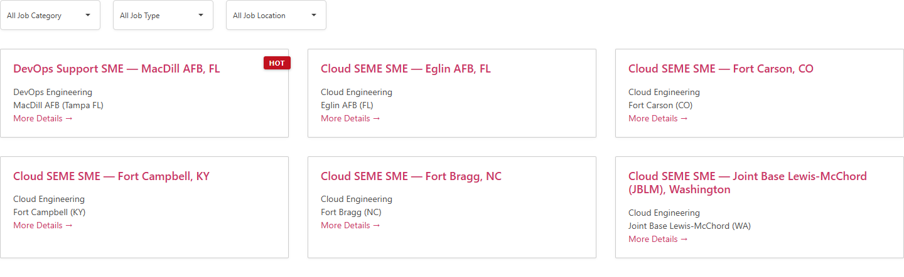
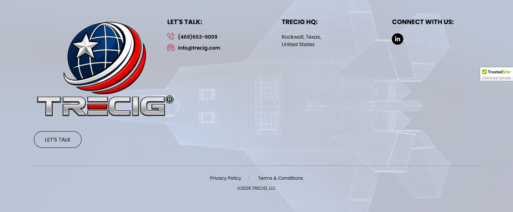

# Jobs – TRECIG

*TRECIG (design reference site)* · URL: https://trecig.com/job-openings/ · captured 2026-11-08 00:39:40 · HTTP 200

- **Meta description:** —
- **Page size (desktop 1440px):** 1455×1283 px · tablet (820px): 1326 px · mobile (390px): 2064 px
- **Screenshots:** [desktop](screenshots/desktop-full.png) · [tablet](screenshots/tablet-full.png) · [mobile](screenshots/mobile-full.png) · [desktop top](screenshots/desktop-viewport-top.png) · [desktop scrolled](screenshots/desktop-viewport-scrolled.png)
- **Files:** [raw.html](raw.html) (server HTML) · [rendered.html](rendered.html) (DOM after JS) · [content.txt](content.txt) (all visible text) · layout-*.json (full element tree with computed styles) · page.json (everything)

## 1. Section map (top → bottom, desktop 1440px)

| # | Role | Y from top | Height | Heading / first text | Mobile height | Screenshot |
|---|---|---|---|---|---|---|
| 0 | header | 0 | 170 | HOME ABOUT AWARDS & RECOGNITION EXPERTISE PRESS & MEDIA CONTACT | 170 | [img](screenshots/desktop-sec00-header.png) |
| 1 | section | 178 | 48 | Jobs | 48 | [img](screenshots/desktop-sec01-section.png) |
| 2 | section | 242 | 443 | DevOps Support SME — MacDill AFB, FL | 1131 | [img](screenshots/desktop-sec02-section.png) |
| 3 | footer | 685 | 598 | LET'S TALK: | 690 | [img](screenshots/desktop-sec03-footer.png) |
| 4 | floating (fixed, z 1000003) | 875 | 38 |  |  |  |

## 2. Section-by-section layout (desktop)

Legend: each line is an element in DOM order. `@x,y w×h` = position/size in px on the 1440px-wide page. Text lines show *font size/weight, line-height, colour*. Boxes show layout (flex/grid), background, padding, radius, shadow, etc. Pass-through wrappers are collapsed.

### 2.0 HEADER — HOME ABOUT AWARDS & RECOGNITION EXPERTISE PRESS & MEDIA CONTACT

Element: `<header class="elementor elementor-13 elementor-location-header">` at y=0, 1440×170px · 

- section.elementor-section [bg:#FFFFFF · shadow:#000000 @10% 0px 0px 12px 0px · z:9999 · transition:background, border, border-radius, box-shadow 0.3s, 0.3s, 0.3s, 0.3s ease, ease, ease, ease] `@0,0 1440×170`
  - div.elementor-container [flex row · margin:0px 85px 0px 85px · max-w:1270px] `@85,0 1270×170`
    - div.elementor-column [flex row · min-h:1px] `@85,0 1270×170`
      - div.elementor-widget-wrap [flex row wrap] `@85,0 1270×170`
        - div.elementor-container [flex row · max-w:1270px] `@85,0 1270×170`
          - div.elementor-column [flex row · min-h:1px] `@85,0 127×170`
            - div.elementor-widget-wrap [flex row wrap · align:center · pad:10px 10px 10px 10px] `@85,0 127×170`
              - a (link→/) [inline-block · align-text:center] `@95,10 200×150`
                - **IMG** `TRECIG_Logo_Registered.png` alt="" natural 1440×1080 · inline-block · max-w:200px · overflow:clip · align-text:center `@95,10 200×150`
          - div.elementor-column [flex row · min-h:1px] `@212,0 1143×170`
            - div.elementor-widget-wrap [flex row wrap · align:center · pad:10px 10px 10px 10px] `@212,0 1143×170`
              - div.elementor-widget-container [flex column · transition:background, border, border-radius, box-shadow, transform 0.3s, 0.3s, 0.3s, 0.3s, 0.4s ease, ease, ease, ease, ease] `@222,75 1123×20`
                - ul.elementor-nav-menu [flex row wrap · justify:flex-end · margin:0px 0px 0px 411.234px · z:2] · pseudo:::after{{"content": "\" \"", "w": "0px", "h": "0px"}} `@633,75 712×20`
                  - **A→/** "HOME" — Poppins 14px/400 lh 20px · #000000 · textTransform:uppercase ‖ flex row · margin:0px 15px 0px 0px · transition:all 0.4s ease `@633,75 40×20`
                  - **A→/about/** "ABOUT" — Poppins 14px/400 lh 20px · #000000 · textTransform:uppercase ‖ flex row · margin:0px 15px 0px 15px · transition:all 0.4s ease `@703,75 70×20`
                  - **A→/awards-recognition/** "AWARDS & RECOGNITION" — Poppins 14px/400 lh 20px · #000000 · textTransform:uppercase ‖ flex row · margin:0px 15px 0px 15px · transition:all 0.4s ease `@803,75 195×20`
                  - **A→/expertise/** "EXPERTISE" — Poppins 14px/400 lh 20px · #000000 · textTransform:uppercase ‖ flex row · margin:0px 15px 0px 15px · transition:all 0.4s ease `@1028,75 90×20`
                  - **A→/press-media/** "PRESS & MEDIA" — Poppins 14px/400 lh 20px · #000000 · textTransform:uppercase ‖ flex row · margin:0px 15px 0px 15px · transition:all 0.4s ease `@1148,75 100×20`
                  - **A→/contact/** "CONTACT" — Poppins 14px/400 lh 20px · #000000 · textTransform:uppercase ‖ flex row · margin:0px 0px 0px 15px · transition:all 0.4s ease `@1278,75 67×20`

### 2.1 SECTION — Jobs

Element: `
` at y=178, 1440×48px · 

- *(empty block — vertical spacer / gap of 48px)*

### 2.2 SECTION — DevOps Support SME — MacDill AFB, FL

Element: `
` at y=242, 1440×443px · 

- div.awsm-job-wrap `@0,242 1440×443`
  - div.awsm-filter-wrap [margin:0px -10px 20px -10px] `@-10,242 1460×58`
    - FORM form [flex row wrap] `@-10,242 1460×58`
      - div.awsm-filter-items [flex row wrap] `@-10,242 1460×58`
        - div.awsm-filter-item [pad:0px 10px 10px 10px] `@-10,242 180×58`
          - **LABEL** "All Job Category" — -apple-system 16px/400 lh 16px · #333333 ‖ margin:-1px -1px -1px -1px `@-1,241 1×1`
          - div.awsm-selectric-wrapper `@0,242 160×48`
            - div.awsm-selectric [bg:#FFFFFF · radius:5px · border:1px 1px 1px 1px solid #D5D5D5 · shadow:#000000 @5% 0px 1px 4px 0px · overflow:hidden] `@0,242 160×48`
              - **SPAN** "All Job Category" — -apple-system 12px/400 lh 46px · #444444 ‖ margin:0px 48px 0px 10px `@11,243 100×46`
              - **SPAN** "▾" — -apple-system 16px/400 lh 24px · #333333 · textAlign:center `@121,243 38×46`
            - **FIELD** <input type=text name=> placeholder="" — -apple-system 16px/400 lh 24px · #000000 `@0,242 1×1`
        - div.awsm-filter-item [pad:0px 10px 10px 10px] `@170,242 180×58`
          - **LABEL** "All Job Type" — -apple-system 16px/400 lh 16px · #333333 ‖ margin:-1px -1px -1px -1px `@179,241 1×1`
          - div.awsm-selectric-wrapper `@180,242 160×48`
            - div.awsm-selectric [bg:#FFFFFF · radius:5px · border:1px 1px 1px 1px solid #D5D5D5 · shadow:#000000 @5% 0px 1px 4px 0px · overflow:hidden] `@180,242 160×48`
              - **SPAN** "All Job Type" — -apple-system 12px/400 lh 46px · #444444 ‖ margin:0px 48px 0px 10px `@191,243 100×46`
              - **SPAN** "▾" — -apple-system 16px/400 lh 24px · #333333 · textAlign:center `@301,243 38×46`
            - **FIELD** <input type=text name=> placeholder="" — -apple-system 16px/400 lh 24px · #000000 `@180,242 1×1`
        - div.awsm-filter-item [pad:0px 10px 10px 10px] `@350,242 180×58`
          - **LABEL** "All Job Location" — -apple-system 16px/400 lh 16px · #333333 ‖ margin:-1px -1px -1px -1px `@359,241 1×1`
          - div.awsm-selectric-wrapper `@360,242 160×48`
            - div.awsm-selectric [bg:#FFFFFF · radius:5px · border:1px 1px 1px 1px solid #D5D5D5 · shadow:#000000 @5% 0px 1px 4px 0px · overflow:hidden] `@360,242 160×48`
              - **SPAN** "All Job Location" — -apple-system 12px/400 lh 46px · #444444 ‖ margin:0px 48px 0px 10px `@371,243 100×46`
              - **SPAN** "▾" — -apple-system 16px/400 lh 24px · #333333 · textAlign:center `@481,243 38×46`
            - **FIELD** <input type=text name=> placeholder="" — -apple-system 16px/400 lh 24px · #000000 `@360,242 1×1`
  - div.awsm-job-listings [flex row wrap · justify:center · margin:0px -15px 0px -15px] · pseudo:::after{{"content": "\"\"", "w": "1440px", "h": "900px", "bg": "#FFFFFF @50%", "bgImage": "url(\"https://trecig.com/wp-content/plugins/wp-job-openings/assets/img/loading.svg\")", "position": "absolute", "opacity": "0"}} `@-15,320 1470×365`
    - div.awsm-job-listing-item [flex column · pad:0px 15px 0px 15px] · pseudo:::before{{"content": "\"HOT\"", "w": "43.1875px", "h": "21px", "bg": "#C1121F", "position": "absolute"}} `@-15,320 490×172`
      - a.awsm-job-item (link→/jobs/devops-support-sme/) [flex column · bg:#FFFFFF · pad:20px 20px 20px 20px · margin:0px 0px 30px 0px · radius:2px · border:1px 1px 1px 1px solid #CCCCCC · shadow:#000000 @5% 0px 1px 4px 0px · transition:all 0.3s ease] `@0,320 460×142`
        - **H2** "DevOps Support SME — MacDill AFB, FL" — -apple-system 18px/500 lh 21.6px · #CC3366 ‖ margin:0px 0px 15px 0px `@21,341 418×22`
        - div.awsm-grid-right-col `@21,378 418×63`
          - div.awsm-job-specification-wrapper `@21,378 418×42`
            - **SPAN** "DevOps Engineering" — -apple-system 14px/400 lh 21px · #4C4C4C ‖ inline `@21,379 126×19`
            - **SPAN** "MacDill AFB (Tampa FL)" — -apple-system 14px/400 lh 21px · #4C4C4C ‖ inline `@21,400 144×19`
          - **SPAN** "More Details" — -apple-system 14px/400 lh 21px · #CC3366 ‖ inline `@21,421 94×19`
    - div.awsm-job-listing-item [flex column · pad:0px 15px 0px 15px] `@475,320 490×172`
      - a.awsm-job-item (link→/jobs/cloud-seme-sme-eglin-afb-fl/) [flex column · bg:#FFFFFF · pad:20px 20px 20px 20px · margin:0px 0px 30px 0px · radius:2px · border:1px 1px 1px 1px solid #CCCCCC · shadow:#000000 @5% 0px 1px 4px 0px · transition:all 0.3s ease] `@490,320 460×142`
        - **H2** "Cloud SEME SME — Eglin AFB, FL" — -apple-system 18px/500 lh 21.6px · #CC3366 ‖ margin:0px 0px 15px 0px `@511,341 418×22`
        - div.awsm-grid-right-col `@511,378 418×63`
          - div.awsm-job-specification-wrapper `@511,378 418×42`
            - **SPAN** "Cloud Engineering" — -apple-system 14px/400 lh 21px · #4C4C4C ‖ inline `@511,379 114×19`
            - **SPAN** "Eglin AFB (FL)" — -apple-system 14px/400 lh 21px · #4C4C4C ‖ inline `@511,400 83×19`
          - **SPAN** "More Details" — -apple-system 14px/400 lh 21px · #CC3366 ‖ inline `@511,421 94×19`
    - div.awsm-job-listing-item [flex column · pad:0px 15px 0px 15px] `@965,320 490×172`
      - a.awsm-job-item (link→/jobs/cloud-seme-sme-fort-carson-co/) [flex column · bg:#FFFFFF · pad:20px 20px 20px 20px · margin:0px 0px 30px 0px · radius:2px · border:1px 1px 1px 1px solid #CCCCCC · shadow:#000000 @5% 0px 1px 4px 0px · transition:all 0.3s ease] `@980,320 460×142`
        - **H2** "Cloud SEME SME — Fort Carson, CO" — -apple-system 18px/500 lh 21.6px · #CC3366 ‖ margin:0px 0px 15px 0px `@1001,341 418×22`
        - div.awsm-grid-right-col `@1001,378 418×63`
          - div.awsm-job-specification-wrapper `@1001,378 418×42`
            - **SPAN** "Cloud Engineering" — -apple-system 14px/400 lh 21px · #4C4C4C ‖ inline `@1001,379 114×19`
            - **SPAN** "Fort Carson (CO)" — -apple-system 14px/400 lh 21px · #4C4C4C ‖ inline `@1001,400 102×19`
          - **SPAN** "More Details" — -apple-system 14px/400 lh 21px · #CC3366 ‖ inline `@1001,421 94×19`
    - div.awsm-job-listing-item [flex column · pad:0px 15px 0px 15px] `@-15,492 490×193`
      - a.awsm-job-item (link→/jobs/cloud-seme-sme-fort-campbell-ky/) [flex column · bg:#FFFFFF · pad:20px 20px 20px 20px · margin:0px 0px 30px 0px · radius:2px · border:1px 1px 1px 1px solid #CCCCCC · shadow:#000000 @5% 0px 1px 4px 0px · transition:all 0.3s ease] `@0,492 460×163`
        - **H2** "Cloud SEME SME — Fort Campbell, KY" — -apple-system 18px/500 lh 21.6px · #CC3366 ‖ margin:0px 0px 15px 0px `@21,513 418×22`
        - div.awsm-grid-right-col `@21,549 418×63`
          - div.awsm-job-specification-wrapper `@21,549 418×42`
            - **SPAN** "Cloud Engineering" — -apple-system 14px/400 lh 21px · #4C4C4C ‖ inline `@21,550 114×19`
            - **SPAN** "Fort Campbell (KY)" — -apple-system 14px/400 lh 21px · #4C4C4C ‖ inline `@21,571 115×19`
          - **SPAN** "More Details" — -apple-system 14px/400 lh 21px · #CC3366 ‖ inline `@21,592 94×19`
    - div.awsm-job-listing-item [flex column · pad:0px 15px 0px 15px] `@475,492 490×193`
      - a.awsm-job-item (link→/jobs/cloud-seme-sme-fort-bragg-nc/) [flex column · bg:#FFFFFF · pad:20px 20px 20px 20px · margin:0px 0px 30px 0px · radius:2px · border:1px 1px 1px 1px solid #CCCCCC · shadow:#000000 @5% 0px 1px 4px 0px · transition:all 0.3s ease] `@490,492 460×163`
        - **H2** "Cloud SEME SME — Fort Bragg, NC" — -apple-system 18px/500 lh 21.6px · #CC3366 ‖ margin:0px 0px 15px 0px `@511,513 418×22`
        - div.awsm-grid-right-col `@511,549 418×63`
          - div.awsm-job-specification-wrapper `@511,549 418×42`
            - **SPAN** "Cloud Engineering" — -apple-system 14px/400 lh 21px · #4C4C4C ‖ inline `@511,550 114×19`
            - **SPAN** "Fort Bragg (NC)" — -apple-system 14px/400 lh 21px · #4C4C4C ‖ inline `@511,571 96×19`
          - **SPAN** "More Details" — -apple-system 14px/400 lh 21px · #CC3366 ‖ inline `@511,592 94×19`
    - div.awsm-job-listing-item [flex column · pad:0px 15px 0px 15px] `@965,492 490×193`
      - a.awsm-job-item (link→/jobs/cloud-seme-sme-joint-base-lewis-mcchord-jblm-washington/) [flex column · bg:#FFFFFF · pad:20px 20px 20px 20px · margin:0px 0px 30px 0px · radius:2px · border:1px 1px 1px 1px solid #CCCCCC · shadow:#000000 @5% 0px 1px 4px 0px · transition:all 0.3s ease] `@980,492 460×163`
        - **H2** "Cloud SEME SME — Joint Base Lewis-McChord (JBLM), Washington" — -apple-system 18px/500 lh 21.6px · #CC3366 ‖ margin:0px 0px 15px 0px `@1001,513 418×43`
        - div.awsm-grid-right-col `@1001,571 418×63`
          - div.awsm-job-specification-wrapper `@1001,571 418×42`
            - **SPAN** "Cloud Engineering" — -apple-system 14px/400 lh 21px · #4C4C4C ‖ inline `@1001,572 114×19`
            - **SPAN** "Joint Base Lewis-McChord (WA)" — -apple-system 14px/400 lh 21px · #4C4C4C ‖ inline `@1001,593 195×19`
          - **SPAN** "More Details" — -apple-system 14px/400 lh 21px · #CC3366 ‖ inline `@1001,614 94×19`

### 2.3 FOOTER — LET'S TALK:

Element: `<footer class="elementor elementor-15 elementor-location-footer">` at y=685, 1440×598px · 

- section.elementor-section [transition:background, border, border-radius, box-shadow 0.3s, 0.3s, 0.3s, 0.3s ease, ease, ease, ease] `@0,685 1440×598`
  - div.elementor-background-video-container [pos:absolute · z:0 · overflow:hidden · transition:opacity 1s ease] `@0,685 1440×598`
    - **IFRAME** https://www.youtube.com/embed/OzwCnEEadts?controls=0&rel=0&playsinline=1&cc_load_policy=0&enablejsapi=1&origin=https%3A%2F%2Ftrecig.com&widgetid=1&forigin=https%3A%2F%2Ftrecig.com%2Fjob-openings%2F&aoriginsup=1&vf=1 Triceg   Expertise Slider 1 `@0,579 1440×810`
  - div.elementor-background-overlay [bg:#FFFFFF · pos:absolute · opacity:0.7 · transition:background, border-radius, opacity 0.3s, 0.3s, 0.3s ease, ease, ease] `@0,685 1440×598` (empty/decorative)
  - div.elementor-container [flex row · margin:0px 85px 0px 85px · max-w:1270px] `@85,685 1270×598`
    - div.elementor-column [flex row · min-h:1px] `@85,685 1270×598`
      - div.elementor-widget-wrap [flex row wrap] `@85,685 1270×598`
        - section.elementor-section [pad:40px 0px 40px 0px] `@85,685 1270×467`
          - div.elementor-container [flex row · max-w:1270px] `@85,725 1270×387`
            - div.elementor-column [flex row · min-h:1px] `@85,725 324×387`
              - div.elementor-widget-wrap [flex row wrap · pad:10px 10px 10px 10px] `@85,725 324×387`
                - div.elementor-widget-theme-site-logo [margin:0px 0px 20px 0px] `@95,735 304×300`
                  - a (link→/) [inline-block] `@95,735 400×300`
                    - **IMG** `TRECIG_Logo_Registered.png` alt="" natural 1440×1080 · inline-block · max-w:400px · overflow:clip `@95,735 400×300`
                - div.elementor-button-wrapper [grid cols[134.078px]] `@95,1055 134×47`
                  - **A→/contact/** "LET’S TALK" — Poppins 15px/400 lh 15px · #000000 · textTransform:uppercase · textAlign:center ‖ pad:15px 30px 15px 30px · radius:30px · border:1px 1px 1px 1px solid #000000 · transition:all 0.3s ease `@95,1055 134×47`
            - div.elementor-column [flex row · min-h:1px] `@409,725 371×387`
              - div.elementor-widget-wrap [flex row wrap · pad:10px 10px 10px 10px · margin:0px 0px 0px 50px] `@459,725 321×387`
                - div.elementor-widget-heading [margin:0px 0px 20px 0px] `@469,735 301×24`
                  - **H2** "LET'S TALK:" — Poppins 18px/700 lh 18px · #000000 · textTransform:uppercase ‖ inline-block `@469,738 98×18`
                - ul.elementor-icon-list-items `@469,779 301×52`
                  - li.elementor-icon-list-item [flex row · align:center · pad:0px 0px 5px 0px] `@469,779 301×26`
                    - **A→tel:(254)%20338-6131** "(469)653-9009" — Poppins 14px/600 lh 21px · #CC3366 ‖ flex row · highlights: "(469)653-9009" #000000 `@469,779 301×21`
                  - li.elementor-icon-list-item [flex row · align:center · margin:5px 0px 0px 0px] `@469,810 301×21`
                    - **A→mailto:info@trecig.com** "info@trecig.com" — Poppins 14px/600 lh 21px · #CC3366 ‖ flex row · highlights: "info@trecig.com" #000000 `@469,810 301×21`
            - div.elementor-column [flex row · min-h:1px] `@781,725 310×387`
              - div.elementor-widget-wrap [flex row wrap · pad:10px 10px 10px 10px · margin:0px 50px 0px 0px] `@781,725 260×387`
                - div.elementor-widget-heading [margin:0px 0px 20px 0px] `@791,735 240×24`
                  - **H2** "TRECIG HQ:" — Poppins 18px/700 lh 18px · #000000 · textTransform:uppercase ‖ inline-block `@791,738 101×18`
                - ul.elementor-icon-list-items `@791,779 240×42`
                  - li.elementor-icon-list-item [flex row · align:center] `@791,779 240×42`
                    - **SPAN** "Rockwall, Texas, United States" — Poppins 14px/400 lh 21px · #000000 ‖ transition:color 0.3s ease `@791,779 110×42`
            - div.elementor-column [flex row · min-h:1px] `@1090,725 264×387`
              - div.elementor-widget-wrap [flex row wrap · pad:10px 10px 10px 10px] `@1090,725 264×387`
                - div.elementor-widget-heading [margin:0px 0px 20px 0px] `@1100,735 244×24`
                  - **H2** "CONNECT WITH US:" — Poppins 18px/700 lh 18px · #000000 · textTransform:uppercase ‖ inline-block `@1100,738 174×18`
                - **A→/job-openings/** "Linkedin-in" +icon[e-font-icon-svg e-fab-linkedin-in] — -apple-system 16px/400 lh 16px · #69727D · textAlign:center ‖ flex row · bg:#000000 · radius:100% · transition:all 0.3s ease `@1100,779 32×32`
        - section.elementor-section [pad:15px 0px 15px 0px · border:1px 0px 0px 0px solid #000000 @20%] `@85,1152 1270×131`
          - div.elementor-container [flex row · max-w:1270px] `@85,1168 1270×100`
            - div.elementor-column [flex row · min-h:1px] `@85,1168 1270×100`
              - div.elementor-widget-wrap [flex row wrap · align:center · pad:10px 10px 10px 10px] `@85,1168 1270×100`
                - div.elementor-element [margin:0px 0px 20px 0px · align-text:center] `@95,1178 1250×10`
                  - div.elementor-widget-container [margin:0px 0px -10px 0px · overflow:hidden · align-text:center · transition:background, border, border-radius, box-shadow, transform 0.3s, 0.3s, 0.3s, 0.3s, 0.4s ease, ease, ease, ease, ease] `@95,1178 1250×20`
                    - ul.elementor-icon-list-items [flex row wrap · justify:center · gap:30px · margin:0px -8px 0px -8px · align-text:center] `@87,1178 1266×20`
                      - li.elementor-icon-list-item [flex row · justify:center · align:center · margin:0px 8px 0px 8px · align-text:center] `@589,1178 89×20`
                        - **A→/privacy-policy/** "Privacy Policy" — Poppins 13px/400 lh 19.5px · #CC3366 · textAlign:center ‖ flex row · highlights: "Privacy Policy" #000000 `@589,1178 88×20`
                      - li.elementor-icon-list-item [flex row · justify:center · align:center · margin:0px 8px 0px 8px · align-text:center] `@724,1178 127×20`
                        - **A→/terms-conditions/** "Terms & Conditions" — Poppins 13px/400 lh 19.5px · #CC3366 · textAlign:center ‖ flex row · highlights: "Terms & Conditions" #000000 `@724,1178 127×20`
                - **P** "©2026 TRECIG, LLC" — Poppins 12px/400 lh 18px · #000000 · textTransform:uppercase · textAlign:center ‖ margin:0px 0px 14.4px 0px `@95,1207 1250×36`

### Floating / fixed elements
- `div.` fixed at [1348, 875, 92, 38] z-index 1000003 — ""

## 3. Header, navigation & interaction behaviour

- **atTop** `header.elementor.elementor-13.elementor-location-header` position:static top:0 height:170 bg:transparent shadow:none backdrop:none z:auto
- **afterScroll1400** `header.elementor.elementor-13.elementor-location-header` position:static top:-213 height:0 bg:transparent shadow:none backdrop:none z:auto
- **afterScroll1400** `section.elementor-section.elementor-top-section.elementor-element.elementor-elem` position:fixed top:0 height:170 bg:#FFFFFF @90% shadow:#000000 @10% 0px 0px 12px 0px backdrop:none z:9999

| Menu item | Link | Dropdown | Style | Hover change |
|---|---|---|---|---|
| HOME | / | — | Poppins 14px/400 #000000 uppercase ls normal | color: #000000 → #B22239 |
| ABOUT | /about/ | The Mission (/the-mission/); The Values (/the-values/); The Legacy (/the-legacy/); The Trecig Team (/the-trecig-team/); Careers (/careers/) | Poppins 14px/400 #000000 uppercase ls normal | color: #000000 → #B22239 |
| AWARDS & RECOGNITION | /awards-recognition/ | Partnerships (/partnerships/) | Poppins 14px/400 #000000 uppercase ls normal | color: #000000 → #B22239 |
| EXPERTISE | /expertise/ | Industries We Serve (/industries-we-serve/) | Poppins 14px/400 #000000 uppercase ls normal | color: #000000 → #B22239 |
| PRESS & MEDIA | /press-media/ | — | Poppins 14px/400 #000000 uppercase ls normal | color: #000000 → #B22239 |
| CONTACT | /contact/ | — | Poppins 14px/400 #000000 uppercase ls normal | color: #000000 → #B22239 |

- **Mobile menu:** toggle `.elementor-menu-toggle` → [screenshot](screenshots/mobile-menu-open.png) · items: HOME, ABOUT, AWARDS & RECOGNITION, EXPERTISE, PRESS & MEDIA, CONTACT

### Hover states (measured by hovering in Chrome)

| Element | Text | Normal | On hover |
|---|---|---|---|
| `a.elementor-item` | HOME | color #000000 · bg transparent · radius 0px · pad 0px · border 0px #000000 · transition 0.4s | color: #000000 → #B22239; borderTopColor: #000000 → #B22239 |
| `a.elementor-item` | ABOUT | color #000000 · bg transparent · radius 0px · pad 0px · border 0px #000000 · transition 0.4s | color: #000000 → #B22239; borderTopColor: #000000 → #B22239 |
| `a.elementor-item` | CONTACT | color #000000 · bg transparent · radius 0px · pad 0px · border 0px #000000 · transition 0.4s | color: #000000 → #B22239; borderTopColor: #000000 → #B22239 |
| `div.awsm-job-listing-item` | DevOps Support SME — MacDill AFB, FL Dev | color #333333 · bg transparent · radius 0px · pad 0px 15px · border 0px #333333 · transition all | no change |
| `a.` |  | color #CC3366 · bg transparent · radius 0px · pad 0px · border 0px #CC3366 · transition all | color: #CC3366 → #B22239; borderTopColor: #CC3366 → #B22239; childColor: #CC3366 → #B22239 |
| `a.elementor-button` | LET’S TALK | color #000000 · bg transparent · radius 30px · pad 15px 30px · border 1px #000000 · transition 0.3s | color: #000000 → #FFFFFF; borderTopColor: #000000 → #B22239 |
| `a.` | (469)653-9009 | color #CC3366 · bg transparent · radius 0px · pad 0px · border 0px #CC3366 · transition all | color: #CC3366 → #B22239; borderTopColor: #CC3366 → #B22239 |
| `a.elementor-icon` | Linkedin-in | color #69727D · bg #000000 · radius 100% · pad 0px · border 0px #69727D · transition 0.3s | color: #69727D → #B22239; backgroundColor: #000000 → #B22239; borderTopColor: #69727D → #B22239; opacity: 1 → 0.9; childColor: #69727D → #B22239 |
| `a.` | Privacy Policy | color #CC3366 · bg transparent · radius 0px · pad 0px · border 0px #CC3366 · transition all | color: #CC3366 → #B22239; borderTopColor: #CC3366 → #B22239 |

## 4. Typography & colour used on this page (weighted by amount of text / area)

| Font · weight · size / line-height | chars |
|---|---|
| -apple-system | 400 | 14px / 21px | 289 |
| -apple-system | 500 | 18px / 21.6px | 223 |
| Poppins | 400 | 14px / 21px | 73 |
| Poppins | 400 | 14px / 20px | 58 |
| -apple-system | 400 | 16px / 16px | 55 |
| -apple-system | 400 | 12px / 46px | 44 |
| Poppins | 700 | 18px / 18px | 37 |
| Poppins | 400 | 13px / 19.5px | 32 |
| Poppins | 600 | 14px / 21px | 28 |
| -apple-system | 400 | 16px / 24px | 18 |
| Poppins | 400 | 12px / 18px | 17 |
| Poppins | 400 | 15px / 15px | 10 |
| -apple-system | 500 | 40px / 48px | 4 |

- **Text colours:** #CC3366 (310), #4C4C4C (217), #000000 (211), #333333 (51), #666666 (44), #444444 (44), #69727D (11)
- **Background colours (by area):** #FFFFFF (1553), #000000 (1)
- **Border radii:** 2px (6), 5px (3), 30px (1), 100% (1), 2px 0px 0px (1)
- **Shadows:** #000000 @5% 0px 1px 4px 0px (9) | #000000 @10% 0px 0px 12px 0px (1) | #000000 @20% 0px 0px 5px 0px (1)
- **Mobile text styles:** -apple-system | 400 | 14px / 21px (289); -apple-system | 500 | 18px / 21.6px (223); Poppins | 700 | 16px / 16px (37); Poppins | 400 | 12px / 18px (32); Poppins | 400 | 14px / 21px (29); Poppins | 600 | 14px / 21px (28); -apple-system | 400 | 16px / 24px (24); Poppins | 400 | 10px / 15px (17); -apple-system | 400 | 16px / 16px (11); Poppins | 400 | 14px / 14px (10)

## 5. Forms
- **Form** `` → ref: <Node> (post)
  - select[select-one] name=`awsm_job_spec[job-category]` label="All Job Category" placeholder="" options: ['All Job Category', 'Cloud Engineering', 'DevOps Engineering']
  - input[text] name=`` label="" placeholder=""
  - select[select-one] name=`awsm_job_spec[job-type]` label="All Job Type" placeholder="" options: ['All Job Type', 'Full Time']
  - input[text] name=`` label="" placeholder=""
  - select[select-one] name=`awsm_job_spec[job-location]` label="All Job Location" placeholder="" options: ['All Job Location', 'MacDill AFB (Tampa FL)', 'Fort Bragg (NC)', 'Fort Campbell (KY)', 'Fort Carson (CO)', 'Eglin AFB (FL)', 'Joint Base Lewis-McChord (WA)']
  - input[text] name=`` label="" placeholder=""

## 6. Images on the page

- `TRECIG_Logo_Registered.png` natural 1440×1080 → shown 200×150 · alt="" · https://trecig.com/wp-content/uploads/2026/10/TRECIG_Logo_Registered.png
- background on `div.`: https://cdn.ywxi.net/meter/trecig.com/205.svg?ts=1784975038086&l=en

## 7. Links on the page

- [body] "Skip to content" → /job-openings/#content
- [header] "(icon/image)" → /
- [header] "HOME" → /
- [header] "ABOUT" → /about/
- [header] "The Mission" → /the-mission/
- [header] "The Values" → /the-values/
- [header] "The Legacy" → /the-legacy/
- [header] "The Trecig Team" → /the-trecig-team/
- [header] "Careers" → /careers/
- [header] "AWARDS & RECOGNITION" → /awards-recognition/
- [header] "Partnerships" → /partnerships/
- [header] "EXPERTISE" → /expertise/
- [header] "Industries We Serve" → /industries-we-serve/
- [header] "PRESS & MEDIA" → /press-media/
- [header] "CONTACT" → /contact/
- [header] "Home" → /
- [header] "About" → /about/
- [header] "Awards & Recognition" → /awards-recognition/
- [header] "Expertise" → /expertise/
- [header] "Press & Media" → /press-media/
- [header] "Contact" → /contact/
- [body] "Filter by" → /job-openings/
- [body] "DevOps Support SME — MacDill AFB, FL DevOps Engineering MacDill AFB (Tampa FL) More Details" → /jobs/devops-support-sme/
- [body] "Cloud SEME SME — Eglin AFB, FL Cloud Engineering Eglin AFB (FL) More Details" → /jobs/cloud-seme-sme-eglin-afb-fl/
- [body] "Cloud SEME SME — Fort Carson, CO Cloud Engineering Fort Carson (CO) More Details" → /jobs/cloud-seme-sme-fort-carson-co/
- [body] "Cloud SEME SME — Fort Campbell, KY Cloud Engineering Fort Campbell (KY) More Details" → /jobs/cloud-seme-sme-fort-campbell-ky/
- [body] "Cloud SEME SME — Fort Bragg, NC Cloud Engineering Fort Bragg (NC) More Details" → /jobs/cloud-seme-sme-fort-bragg-nc/
- [body] "Cloud SEME SME — Joint Base Lewis-McChord (JBLM), Washington Cloud Engineering Joint Base Lewis-McCh" → /jobs/cloud-seme-sme-joint-base-lewis-mcchord-jblm-washington/
- [footer] "LET’S TALK" → /contact/
- [footer] "(469)653-9009" → tel:(254)%20338-6131
- [footer] "info@trecig.com" → mailto:info@trecig.com
- [footer] "Linkedin-in" → /job-openings/ (target _blank)
- [footer] "Privacy Policy" → /privacy-policy/
- [footer] "Terms & Conditions" → /terms-conditions/

## 8. Mobile layout (390px) — condensed outline

### 8.0 header — HOME ABOUT AWARDS & RECOGNITION EXPERTISE PRESS & MEDIA CONTACT (y 0, h 170)
- section.elementor-section [bg:#FFFFFF · shadow:#000000 @10% 0px 0px 12px 0px · z:9999 · transition:background, border, border-radius, box-shadow 0.3s, 0.3s, 0.3s, 0.3s ease, ease, ease, ease] `@0,0 390×170`
  - div.elementor-container [flex row wrap · max-w:767px] `@0,0 390×170`
    - div.elementor-column [flex row · min-h:1px] `@0,0 390×170`
      - div.elementor-widget-wrap [flex row wrap] `@0,0 390×170`
        - div.elementor-container [flex row wrap · max-w:767px] `@0,0 390×170`
          - div.elementor-column [flex row · min-h:1px] `@0,0 234×170`
            - div.elementor-widget-wrap [flex row wrap · align:center · pad:10px 10px 10px 10px] `@0,0 234×170`
              - a (link→/) [inline-block · align-text:center] `@17,10 200×150`
                - **IMG** `TRECIG_Logo_Registered-1024x768.png` alt="" natural 390×292 · inline-block · max-w:200px · overflow:clip · align-text:center `@17,10 200×150`
          - div.elementor-column [flex row · min-h:1px] `@234,0 156×170`
            - div.elementor-widget-wrap [flex row wrap · align:center · pad:10px 10px 10px 10px] `@234,0 156×170`
              - div.elementor-widget-container [flex column · transition:background, border, border-radius, box-shadow, transform 0.3s, 0.3s, 0.3s, 0.3s, 0.4s ease, ease, ease, ease, ease] `@244,70 136×30`
                - nav.elementor-nav-menu--dropdown [bg:#FFFFFF · margin:16px 0px 0px 0px · pos:absolute · z:9997 · overflow:hidden · transform:matrix(1, 0, 0, 0, 0, 0) · transition:max-height, transform 0.3s, 0.3s ease, ease] `@0,116 390×0`
                  - ul.elementor-nav-menu [z:2] · pseudo:::after{{"content": "\" \"", "w": "390px", "h": "0px"}} `@0,116 390×0`
                    - **A→/** "HOME" — Poppins 14px/400 lh 20px · #000000 · textTransform:uppercase ‖ flex row · pad:10px 20px 10px 20px `@0,116 390×0`
                    - **A→/about/** "ABOUT" — Poppins 14px/400 lh 20px · #000000 · textTransform:uppercase ‖ flex row · pad:10px 20px 10px 20px `@0,116 390×0`
                    - **A→/awards-recognition/** "AWARDS & RECOGNITION" — Poppins 14px/400 lh 20px · #000000 · textTransform:uppercase ‖ flex row · pad:10px 20px 10px 20px `@0,116 390×0`
                    - **A→/expertise/** "EXPERTISE" — Poppins 14px/400 lh 20px · #000000 · textTransform:uppercase ‖ flex row · pad:10px 20px 10px 20px `@0,116 390×0`
                    - **A→/press-media/** "PRESS & MEDIA" — Poppins 14px/400 lh 20px · #000000 · textTransform:uppercase ‖ flex row · pad:10px 20px 10px 20px `@0,116 390×0`
                    - **A→/contact/** "CONTACT" — Poppins 14px/400 lh 20px · #000000 · textTransform:uppercase ‖ flex row · pad:10px 20px 10px 20px `@0,116 390×0`

### 8.1 section — Jobs (y 178, h 48)
- **H1** "Jobs" — -apple-system 40px/500 lh 48px · #333333 ‖ pad:0px 10px 0px 10px · margin:8px 0px 16px 0px `@0,178 390×48`

### 8.2 section — DevOps Support SME — MacDill AFB, FL (y 242, h 1131)
- div.awsm-job-wrap `@0,242 390×1131`
  - div.awsm-filter-wrap [margin:0px -10px 20px -10px] `@-10,242 410×60`
    - FORM form [flex row wrap] `@-10,242 410×60`
      - **A→/job-openings/** "Filter by" +icon[svg] — -apple-system 16px/400 lh 24px · #111111 ‖ flex row · pad:12px 12px 12px 12px · margin:0px 10px 10px 10px · radius:4px · border:1px 1px 1px 1px solid #CCCCCC `@0,242 390×50`
  - div.awsm-job-listings [flex row wrap · margin:0px -15px 0px -15px] · pseudo:::after{{"content": "\"\"", "w": "390px", "h": "844px", "bg": "#FFFFFF @50%", "bgImage": "url(\"https://trecig.com/wp-content/plugins/wp-job-openings/assets/img/loading.svg\")", "position": "absolute", "opacity": "0"}} `@-15,322 420×1051`
    - div.awsm-job-listing-item [flex column · pad:0px 15px 0px 15px] · pseudo:::before{{"content": "\"HOT\"", "w": "43.1875px", "h": "21px", "bg": "#C1121F", "position": "absolute"}} `@-15,322 420×172`
      - a.awsm-job-item (link→/jobs/devops-support-sme/) [flex column · bg:#FFFFFF · pad:20px 20px 20px 20px · margin:0px 0px 30px 0px · radius:2px · border:1px 1px 1px 1px solid #CCCCCC · shadow:#000000 @5% 0px 1px 4px 0px · transition:all 0.3s ease] `@0,322 390×142`
        - **H2** "DevOps Support SME — MacDill AFB, FL" — -apple-system 18px/500 lh 21.6px · #CC3366 ‖ margin:0px 0px 15px 0px `@21,343 348×22`
        - div.awsm-grid-right-col `@21,380 348×63`
          - div.awsm-job-specification-wrapper `@21,380 348×42`
            - **SPAN** "DevOps Engineering" — -apple-system 14px/400 lh 21px · #4C4C4C ‖ inline `@21,381 126×19`
            - **SPAN** "MacDill AFB (Tampa FL)" — -apple-system 14px/400 lh 21px · #4C4C4C ‖ inline `@21,402 144×19`
          - **SPAN** "More Details" — -apple-system 14px/400 lh 21px · #CC3366 ‖ inline `@21,423 94×19`
    - div.awsm-job-listing-item [flex column · pad:0px 15px 0px 15px] `@-15,494 420×172`
      - a.awsm-job-item (link→/jobs/cloud-seme-sme-eglin-afb-fl/) [flex column · bg:#FFFFFF · pad:20px 20px 20px 20px · margin:0px 0px 30px 0px · radius:2px · border:1px 1px 1px 1px solid #CCCCCC · shadow:#000000 @5% 0px 1px 4px 0px · transition:all 0.3s ease] `@0,494 390×142`
        - **H2** "Cloud SEME SME — Eglin AFB, FL" — -apple-system 18px/500 lh 21.6px · #CC3366 ‖ margin:0px 0px 15px 0px `@21,515 348×22`
        - div.awsm-grid-right-col `@21,551 348×63`
          - div.awsm-job-specification-wrapper `@21,551 348×42`
            - **SPAN** "Cloud Engineering" — -apple-system 14px/400 lh 21px · #4C4C4C ‖ inline `@21,552 114×19`
            - **SPAN** "Eglin AFB (FL)" — -apple-system 14px/400 lh 21px · #4C4C4C ‖ inline `@21,573 83×19`
          - **SPAN** "More Details" — -apple-system 14px/400 lh 21px · #CC3366 ‖ inline `@21,594 94×19`
    - div.awsm-job-listing-item [flex column · pad:0px 15px 0px 15px] `@-15,665 420×172`
      - a.awsm-job-item (link→/jobs/cloud-seme-sme-fort-carson-co/) [flex column · bg:#FFFFFF · pad:20px 20px 20px 20px · margin:0px 0px 30px 0px · radius:2px · border:1px 1px 1px 1px solid #CCCCCC · shadow:#000000 @5% 0px 1px 4px 0px · transition:all 0.3s ease] `@0,665 390×142`
        - **H2** "Cloud SEME SME — Fort Carson, CO" — -apple-system 18px/500 lh 21.6px · #CC3366 ‖ margin:0px 0px 15px 0px `@21,686 348×22`
        - div.awsm-grid-right-col `@21,723 348×63`
          - div.awsm-job-specification-wrapper `@21,723 348×42`
            - **SPAN** "Cloud Engineering" — -apple-system 14px/400 lh 21px · #4C4C4C ‖ inline `@21,724 114×19`
            - **SPAN** "Fort Carson (CO)" — -apple-system 14px/400 lh 21px · #4C4C4C ‖ inline `@21,745 102×19`
          - **SPAN** "More Details" — -apple-system 14px/400 lh 21px · #CC3366 ‖ inline `@21,766 94×19`
    - div.awsm-job-listing-item [flex column · pad:0px 15px 0px 15px] `@-15,837 420×172`
      - a.awsm-job-item (link→/jobs/cloud-seme-sme-fort-campbell-ky/) [flex column · bg:#FFFFFF · pad:20px 20px 20px 20px · margin:0px 0px 30px 0px · radius:2px · border:1px 1px 1px 1px solid #CCCCCC · shadow:#000000 @5% 0px 1px 4px 0px · transition:all 0.3s ease] `@0,837 390×142`
        - **H2** "Cloud SEME SME — Fort Campbell, KY" — -apple-system 18px/500 lh 21.6px · #CC3366 ‖ margin:0px 0px 15px 0px `@21,858 348×22`
        - div.awsm-grid-right-col `@21,894 348×63`
          - div.awsm-job-specification-wrapper `@21,894 348×42`
            - **SPAN** "Cloud Engineering" — -apple-system 14px/400 lh 21px · #4C4C4C ‖ inline `@21,895 114×19`
            - **SPAN** "Fort Campbell (KY)" — -apple-system 14px/400 lh 21px · #4C4C4C ‖ inline `@21,916 115×19`
          - **SPAN** "More Details" — -apple-system 14px/400 lh 21px · #CC3366 ‖ inline `@21,937 94×19`
    - div.awsm-job-listing-item [flex column · pad:0px 15px 0px 15px] `@-15,1008 420×172`
      - a.awsm-job-item (link→/jobs/cloud-seme-sme-fort-bragg-nc/) [flex column · bg:#FFFFFF · pad:20px 20px 20px 20px · margin:0px 0px 30px 0px · radius:2px · border:1px 1px 1px 1px solid #CCCCCC · shadow:#000000 @5% 0px 1px 4px 0px · transition:all 0.3s ease] `@0,1008 390×142`
        - **H2** "Cloud SEME SME — Fort Bragg, NC" — -apple-system 18px/500 lh 21.6px · #CC3366 ‖ margin:0px 0px 15px 0px `@21,1029 348×22`
        - div.awsm-grid-right-col `@21,1066 348×63`
          - div.awsm-job-specification-wrapper `@21,1066 348×42`
            - **SPAN** "Cloud Engineering" — -apple-system 14px/400 lh 21px · #4C4C4C ‖ inline `@21,1067 114×19`
            - **SPAN** "Fort Bragg (NC)" — -apple-system 14px/400 lh 21px · #4C4C4C ‖ inline `@21,1088 96×19`
          - **SPAN** "More Details" — -apple-system 14px/400 lh 21px · #CC3366 ‖ inline `@21,1109 94×19`
    - div.awsm-job-listing-item [flex column · pad:0px 15px 0px 15px] `@-15,1180 420×193`
      - a.awsm-job-item (link→/jobs/cloud-seme-sme-joint-base-lewis-mcchord-jblm-washington/) [flex column · bg:#FFFFFF · pad:20px 20px 20px 20px · margin:0px 0px 30px 0px · radius:2px · border:1px 1px 1px 1px solid #CCCCCC · shadow:#000000 @5% 0px 1px 4px 0px · transition:all 0.3s ease] `@0,1180 390×163`
        - **H2** "Cloud SEME SME — Joint Base Lewis-McChord (JBLM), Washington" — -apple-system 18px/500 lh 21.6px · #CC3366 ‖ margin:0px 0px 15px 0px `@21,1201 348×43`
        - div.awsm-grid-right-col `@21,1259 348×63`
          - div.awsm-job-specification-wrapper `@21,1259 348×42`
            - **SPAN** "Cloud Engineering" — -apple-system 14px/400 lh 21px · #4C4C4C ‖ inline `@21,1260 114×19`
            - **SPAN** "Joint Base Lewis-McChord (WA)" — -apple-system 14px/400 lh 21px · #4C4C4C ‖ inline `@21,1281 195×19`
          - **SPAN** "More Details" — -apple-system 14px/400 lh 21px · #CC3366 ‖ inline `@21,1302 94×19`

### 8.3 footer — LET'S TALK: (y 1373, h 690)
- section.elementor-section [transition:background, border, border-radius, box-shadow 0.3s, 0.3s, 0.3s, 0.3s ease, ease, ease, ease] `@0,1373 390×690`
  - div.elementor-background-overlay [bg:#FFFFFF · pos:absolute · opacity:0.7 · transition:background, border-radius, opacity 0.3s, 0.3s, 0.3s ease, ease, ease] `@0,1373 390×690` (empty/decorative)
  - div.elementor-container [flex row wrap · max-w:767px] `@0,1373 390×690`
    - div.elementor-column [flex row · min-h:1px] `@0,1373 390×690`
      - div.elementor-widget-wrap [flex row wrap] `@0,1373 390×690`
        - section.elementor-section [pad:20px 0px 0px 0px] `@0,1373 390×612`
          - div.elementor-container [flex row wrap · max-w:767px] `@0,1393 390×592`
            - div.elementor-column [flex row · min-h:1px] `@0,1393 390×380`
              - div.elementor-widget-wrap [flex row wrap · pad:10px 10px 10px 10px] `@0,1393 390×380`
                - div.elementor-widget-theme-site-logo [margin:0px 0px 20px 0px · align-text:center] `@10,1403 370×300`
                  - a (link→/) [inline-block · align-text:center] `@10,1403 400×300`
                    - **IMG** `TRECIG_Logo_Registered-1024x768.png` alt="" natural 390×292 · inline-block · max-w:400px · overflow:clip · align-text:center `@10,1403 400×300`
                - div.elementor-button-wrapper [grid cols[119.281px] · align-text:center] `@135,1723 119×40`
                  - **A→/contact/** "LET’S TALK" — Poppins 14px/400 lh 14px · #000000 · textTransform:uppercase · textAlign:center ‖ pad:12px 25px 12px 25px · radius:30px · border:1px 1px 1px 1px solid #000000 · transition:all 0.3s ease `@135,1723 119×40`
            - div.elementor-column [flex row · min-h:1px] `@0,1773 195×116`
              - div.elementor-widget-wrap [flex row wrap · pad:10px 10px 10px 10px] `@0,1773 195×116`
                - div.elementor-widget-heading [margin:0px 0px 20px 0px] `@10,1783 175×24`
                  - **H2** "LET'S TALK:" — Poppins 16px/700 lh 16px · #000000 · textTransform:uppercase ‖ inline-block `@10,1788 87×16`
                - ul.elementor-icon-list-items `@10,1827 175×52`
                  - li.elementor-icon-list-item [flex row · align:center · pad:0px 0px 5px 0px] `@10,1827 175×26`
                    - **A→tel:(254)%20338-6131** "(469)653-9009" — Poppins 14px/600 lh 21px · #CC3366 ‖ flex row · highlights: "(469)653-9009" #000000 `@10,1827 175×21`
                  - li.elementor-icon-list-item [flex row · align:center · margin:5px 0px 0px 0px] `@10,1858 175×21`
                    - **A→mailto:info@trecig.com** "info@trecig.com" — Poppins 14px/600 lh 21px · #CC3366 ‖ flex row · highlights: "info@trecig.com" #000000 `@10,1858 175×21`
            - div.elementor-column [flex row · min-h:1px] `@195,1773 195×116`
              - div.elementor-widget-wrap [flex row wrap · pad:10px 10px 10px 10px] `@195,1773 195×116`
                - div.elementor-widget-heading [margin:0px 0px 20px 0px] `@205,1783 175×24`
                  - **H2** "TRECIG HQ:" — Poppins 16px/700 lh 16px · #000000 · textTransform:uppercase ‖ inline-block `@205,1788 90×16`
                - ul.elementor-icon-list-items `@205,1827 175×42`
                  - li.elementor-icon-list-item [flex row · align:center] `@205,1827 175×42`
                    - **SPAN** "Rockwall, Texas, United States" — Poppins 14px/400 lh 21px · #000000 ‖ transition:color 0.3s ease `@205,1827 175×42`
            - div.elementor-column [flex row · min-h:1px] `@0,1889 390×96`
              - div.elementor-widget-wrap [flex row wrap · pad:10px 10px 10px 10px] `@0,1889 390×96`
                - div.elementor-widget-heading [margin:0px 0px 20px 0px] `@10,1899 370×24`
                  - **H2** "CONNECT WITH US:" — Poppins 16px/700 lh 16px · #000000 · textTransform:uppercase ‖ inline-block `@10,1904 154×16`
                - **A→/job-openings/** "Linkedin-in" +icon[e-font-icon-svg e-fab-linkedin-in] — -apple-system 16px/400 lh 16px · #69727D · textAlign:center ‖ flex row · bg:#000000 · radius:100% · transition:all 0.3s ease `@10,1943 32×32`
        - section.elementor-section [border:1px 0px 0px 0px solid #000000 @20%] `@0,1985 390×78`
          - div.elementor-container [flex row wrap · max-w:767px] `@0,1986 390×77`
            - div.elementor-column [flex row · min-h:1px] `@0,1986 390×77`
              - div.elementor-widget-wrap [flex row wrap · align:center · pad:10px 10px 10px 10px] `@0,1986 390×77`
                - div.elementor-element [margin:0px 0px 20px 0px · align-text:center] `@10,1996 370×8`
                  - div.elementor-widget-container [margin:0px 0px -10px 0px · overflow:hidden · align-text:center · transition:background, border, border-radius, box-shadow, transform 0.3s, 0.3s, 0.3s, 0.3s, 0.4s ease, ease, ease, ease, ease] `@10,1996 370×18`
                    - ul.elementor-icon-list-items [flex row wrap · justify:center · gap:30px · margin:0px -7.5px 0px -7.5px · align-text:center] `@3,1996 385×18`
                      - li.elementor-icon-list-item [flex row · justify:center · align:center · margin:0px 7.5px 0px 7.5px · align-text:center] `@73,1996 82×18`
                        - **A→/privacy-policy/** "Privacy Policy" — Poppins 12px/400 lh 18px · #CC3366 · textAlign:center ‖ flex row · highlights: "Privacy Policy" #000000 `@73,1996 81×18`
                      - li.elementor-icon-list-item [flex row · justify:center · align:center · margin:0px 7.5px 0px 7.5px · align-text:center] `@200,1996 117×18`
                        - **A→/terms-conditions/** "Terms & Conditions" — Poppins 12px/400 lh 18px · #CC3366 · textAlign:center ‖ flex row · highlights: "Terms & Conditions" #000000 `@200,1996 117×18`
                - **P** "©2026 TRECIG, LLC" — Poppins 10px/400 lh 15px · #000000 · textTransform:uppercase · textAlign:center ‖ margin:0px 0px 14.4px 0px `@10,2024 370×15`
