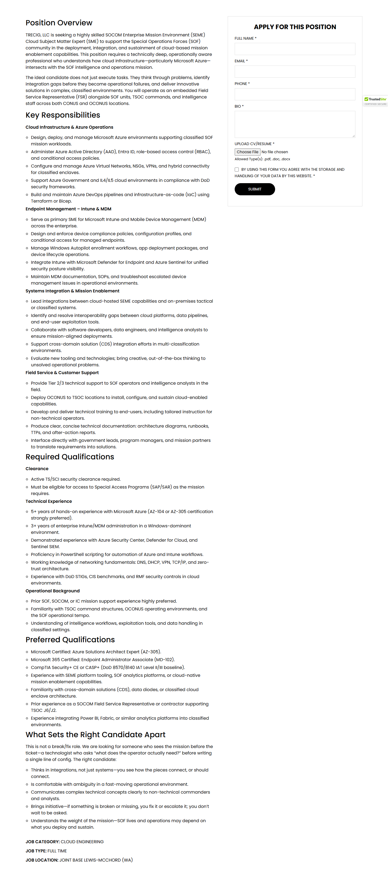
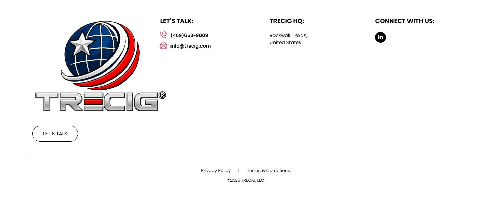

# Cloud SEME SME — Joint Base Lewis-McChord (JBLM), Washington – TRECIG

*TRECIG (design reference site)* · URL: https://trecig.com/jobs/cloud-seme-sme-joint-base-lewis-mcchord-jblm-washington/ · captured 2026-11-08 00:40:40 · HTTP 200

- **Meta description:** —
- **Page size (desktop 1440px):** 1440×4410 px · tablet (820px): 5403 px · mobile (390px): 11090 px
- **Screenshots:** [desktop](screenshots/desktop-full.png) · [tablet](screenshots/tablet-full.png) · [mobile](screenshots/mobile-full.png) · [desktop top](screenshots/desktop-viewport-top.png) · [desktop scrolled](screenshots/desktop-viewport-scrolled.png)
- **Files:** [raw.html](raw.html) (server HTML) · [rendered.html](rendered.html) (DOM after JS) · [content.txt](content.txt) (all visible text) · layout-*.json (full element tree with computed styles) · page.json (everything)

## 1. Section map (top → bottom, desktop 1440px)

| # | Role | Y from top | Height | Heading / first text | Mobile height | Screenshot |
|---|---|---|---|---|---|---|
| 0 | header | 0 | 170 | HOME ABOUT AWARDS & RECOGNITION EXPERTISE PRESS & MEDIA CONTACT | 170 | [img](screenshots/desktop-sec00-header.png) |
| 1 | section | 170 | 350 | CLOUD SEME SME — JOINT BASE LEWIS-MCCHORD (JBLM), WASHINGTON | 247 | [img](screenshots/desktop-sec01-section.png) |
| 2 | section | 520 | 3292 | Position Overview | 9983 | [img](screenshots/desktop-sec02-section.png) |
| 3 | footer | 3812 | 598 | LET'S TALK: | 690 | [img](screenshots/desktop-sec03-footer.png) |
| 4 | floating (fixed, z 1000003) | 875 | 38 |  |  |  |

## 2. Section-by-section layout (desktop)

Legend: each line is an element in DOM order. `@x,y w×h` = position/size in px on the 1440px-wide page. Text lines show *font size/weight, line-height, colour*. Boxes show layout (flex/grid), background, padding, radius, shadow, etc. Pass-through wrappers are collapsed.

### 2.0 HEADER — HOME ABOUT AWARDS & RECOGNITION EXPERTISE PRESS & MEDIA CONTACT

Element: `<header class="elementor elementor-13 elementor-location-header">` at y=0, 1440×170px · 

- section.elementor-section [bg:#FFFFFF · shadow:#000000 @10% 0px 0px 12px 0px · z:9999 · transition:background, border, border-radius, box-shadow 0.3s, 0.3s, 0.3s, 0.3s ease, ease, ease, ease] `@0,0 1440×170`
  - div.elementor-container [flex row · margin:0px 85px 0px 85px · max-w:1270px] `@85,0 1270×170`
    - div.elementor-column [flex row · min-h:1px] `@85,0 1270×170`
      - div.elementor-widget-wrap [flex row wrap] `@85,0 1270×170`
        - div.elementor-container [flex row · max-w:1270px] `@85,0 1270×170`
          - div.elementor-column [flex row · min-h:1px] `@85,0 127×170`
            - div.elementor-widget-wrap [flex row wrap · align:center · pad:10px 10px 10px 10px] `@85,0 127×170`
              - a (link→/) [inline-block · align-text:center] `@95,10 200×150`
                - **IMG** `TRECIG_Logo_Registered.png` alt="" natural 1440×1080 · inline-block · max-w:200px · overflow:clip · align-text:center `@95,10 200×150`
          - div.elementor-column [flex row · min-h:1px] `@212,0 1143×170`
            - div.elementor-widget-wrap [flex row wrap · align:center · pad:10px 10px 10px 10px] `@212,0 1143×170`
              - div.elementor-widget-container [flex column · transition:background, border, border-radius, box-shadow, transform 0.3s, 0.3s, 0.3s, 0.3s, 0.4s ease, ease, ease, ease, ease] `@222,75 1123×20`
                - ul.elementor-nav-menu [flex row wrap · justify:flex-end · margin:0px 0px 0px 411.234px · z:2] · pseudo:::after{{"content": "\" \"", "w": "0px", "h": "0px"}} `@633,75 712×20`
                  - **A→/** "HOME" — Poppins 14px/400 lh 20px · #000000 · textTransform:uppercase ‖ flex row · margin:0px 15px 0px 0px · transition:all 0.4s ease `@633,75 40×20`
                  - **A→/about/** "ABOUT" — Poppins 14px/400 lh 20px · #000000 · textTransform:uppercase ‖ flex row · margin:0px 15px 0px 15px · transition:all 0.4s ease `@703,75 70×20`
                  - **A→/awards-recognition/** "AWARDS & RECOGNITION" — Poppins 14px/400 lh 20px · #000000 · textTransform:uppercase ‖ flex row · margin:0px 15px 0px 15px · transition:all 0.4s ease `@803,75 195×20`
                  - **A→/expertise/** "EXPERTISE" — Poppins 14px/400 lh 20px · #000000 · textTransform:uppercase ‖ flex row · margin:0px 15px 0px 15px · transition:all 0.4s ease `@1028,75 90×20`
                  - **A→/press-media/** "PRESS & MEDIA" — Poppins 14px/400 lh 20px · #000000 · textTransform:uppercase ‖ flex row · margin:0px 15px 0px 15px · transition:all 0.4s ease `@1148,75 100×20`
                  - **A→/contact/** "CONTACT" — Poppins 14px/400 lh 20px · #000000 · textTransform:uppercase ‖ flex row · margin:0px 0px 0px 15px · transition:all 0.4s ease `@1278,75 67×20`

### 2.1 SECTION — CLOUD SEME SME — JOINT BASE LEWIS-MCCHORD (JBLM), WASHINGTON

Element: `<section class="elementor-section elementor-top-section elementor-element elementor-element-11138e5 elementor-section-height-min-height elementor-section-bo">` at y=170, 1440×350px · 

- section.elementor-section [bg-image:PROCESS-scaled.jpg · bg-size:cover · bg-pos:50% 0% · transition:background, border, border-radius, box-shadow 0.3s, 0.3s, 0.3s, 0.3s ease, ease, ease, ease] `@0,170 1440×350`
  - div.elementor-background-overlay [bg:#000000 · pos:absolute · opacity:0.5 · transition:background, border-radius, opacity 0.3s, 0.3s, 0.3s ease, ease, ease] `@0,170 1440×350` (empty/decorative)
  - div.elementor-container [flex row · align:center · margin:0px 370px 0px 370px · max-w:700px · min-h:350px] `@370,170 700×350`
    - div.elementor-column [flex row · min-h:1px] `@370,221 700×249`
      - div.elementor-widget-wrap [flex row wrap · pad:10px 10px 10px 10px · margin:80px 0px 0px 0px] `@370,301 700×169`
        - div.elementor-widget-heading [margin:0px 0px 20px 0px · align-text:center] `@380,311 680×108`
          - **H2** "CLOUD SEME SME — JOINT BASE LEWIS-MCCHORD (JBLM), WASHINGTON" — Poppins 36px/800 lh 36px · #FFFFFF · textTransform:uppercase · textAlign:center ‖ inline-block `@380,311 680×108`
        - ul.elementor-icon-list-items [flex row wrap · justify:center · margin:0px -2.5px 0px -2.5px · align-text:center] `@378,439 685×21`
          - li.elementor-icon-list-item [flex row · justify:center · align:center · margin:0px 2.5px 0px 2.5px · align-text:center] `@441,439 34×21`
            - **A→/** "HOME" — Poppins 12px/400 lh 18px · #CC3366 · textTransform:uppercase · textAlign:center ‖ flex row · highlights: "HOME" #FFFFFF `@441,440 34×18`
          - li.elementor-icon-list-item [flex row · justify:center · align:center · margin:0px 2.5px 0px 2.5px · align-text:center] `@480,439 74×21`
            - **A→/careers/** "CAREERS" — Poppins 12px/400 lh 18px · #CC3366 · textTransform:uppercase · textAlign:center ‖ flex row · highlights: "CAREERS" #FFFFFF `@480,439 74×21`
          - li.elementor-icon-list-item [flex row · justify:center · align:center · margin:0px 2.5px 0px 2.5px · align-text:center] `@559,439 440×21`
            - **SPAN** "CLOUD SEME SME — JOINT BASE LEWIS-MCCHORD (JBLM), WASHINGTON" — Poppins 12px/400 lh 18px · #FFFFFF · textTransform:uppercase · textAlign:center ‖ pad:0px 0px 0px 5px · transition:color 0.3s ease `@577,440 422×18`

### 2.2 SECTION — Position Overview

Element: `<section class="elementor-section elementor-top-section elementor-element elementor-element-5abc1bd elementor-section-boxed elementor-section-height-default">` at y=520, 1440×3292px · 

- section.elementor-section [pad:50px 0px 50px 0px] `@0,520 1440×3292`
  - div.elementor-container [flex row · margin:0px 85px 0px 85px · max-w:1270px] `@85,570 1270×3192`
    - div.elementor-column [flex row · min-h:1px] `@85,570 1270×3192`
      - div.elementor-widget-wrap [flex row wrap · pad:10px 10px 10px 10px] `@85,570 1270×3192`
        - div.awsm-job-single-wrap [flex row · margin:0px 0px 20.8px 0px] `@95,580 1250×3151`
          - div.awsm-job-content [pad:0px 50px 0px 0px] `@95,580 750×3151`
            - div.awsm-job-entry-content `@95,588 700×3011`
              - **H3** "Position Overview" — Poppins 28px/500 lh 33.6px · #000000 ‖ margin:8px 0px 16px 0px `@95,588 700×34`
              - **P** "TRECIG, LLC is seeking a highly skilled SOCOM Enterprise Mission Environment (SEME) Cloud Subject Matter Expert (SME) to support the Special Operations Force…" — Poppins 16px/400 lh 24px · #000000 ‖ margin:0px 0px 14.4px 0px `@95,638 700×144`
              - **P** "The ideal candidate does not just execute tasks. They think through problems, identify integration gaps before they become operational failures, and deliver …" — Poppins 16px/400 lh 24px · #000000 ‖ margin:0px 0px 14.4px 0px `@95,796 700×120`
              - **H3** "Key Responsibilities" — Poppins 28px/500 lh 33.6px · #000000 ‖ margin:8px 0px 16px 0px `@95,930 700×34`
              - **P** "Cloud Infrastructure & Azure Operations" — Poppins 16px/400 lh 24px · #000000 ‖ margin:0px 0px 14.4px 0px · highlights: "Cloud Infrastructure & Azure Operations"  600 `@95,980 700×24`
              - ul [pad:0px 0px 0px 20px] `@95,1018 700×260`
                - **LI** "Design, deploy, and manage Microsoft Azure environments supporting classified SOF mission workloads." — Poppins 16px/400 lh 24px · #000000 ‖ list-item · margin:0px 0px 5px 0px `@115,1018 680×48`
                - **LI** "Administer Azure Active Directory (AAD), Entra ID, role-based access control (RBAC), and conditional access policies." — Poppins 16px/400 lh 24px · #000000 ‖ list-item · margin:0px 0px 5px 0px `@115,1071 680×48`
                - **LI** "Configure and manage Azure Virtual Networks, NSGs, VPNs, and hybrid connectivity for classified enclaves." — Poppins 16px/400 lh 24px · #000000 ‖ list-item · margin:0px 0px 5px 0px `@115,1124 680×48`
                - **LI** "Support Azure Government and IL4/IL5 cloud environments in compliance with DoD security frameworks." — Poppins 16px/400 lh 24px · #000000 ‖ list-item · margin:0px 0px 5px 0px `@115,1177 680×48`
                - **LI** "Build and maintain Azure DevOps pipelines and infrastructure-as-code (IaC) using Terraform or Bicep." — Poppins 16px/400 lh 24px · #000000 ‖ list-item · margin:0px 0px 5px 0px `@115,1230 680×48`
              - **P** "Endpoint Management – Intune & MDM" — Poppins 16px/400 lh 24px · #000000 ‖ margin:0px 0px 14.4px 0px · highlights: "Endpoint Management – Intune & MDM"  600 `@95,1283 700×24`
              - ul [pad:0px 0px 0px 20px] `@95,1322 700×260`
                - **LI** "Serve as primary SME for Microsoft Intune and Mobile Device Management (MDM) across the enterprise." — Poppins 16px/400 lh 24px · #000000 ‖ list-item · margin:0px 0px 5px 0px `@115,1322 680×48`
                - **LI** "Design and enforce device compliance policies, configuration profiles, and conditional access for managed endpoints." — Poppins 16px/400 lh 24px · #000000 ‖ list-item · margin:0px 0px 5px 0px `@115,1375 680×48`
                - **LI** "Manage Windows Autopilot enrollment workflows, app deployment packages, and device lifecycle operations." — Poppins 16px/400 lh 24px · #000000 ‖ list-item · margin:0px 0px 5px 0px `@115,1428 680×48`
                - **LI** "Integrate Intune with Microsoft Defender for Endpoint and Azure Sentinel for unified security posture visibility." — Poppins 16px/400 lh 24px · #000000 ‖ list-item · margin:0px 0px 5px 0px `@115,1481 680×48`
                - **LI** "Maintain MDM documentation, SOPs, and troubleshoot escalated device management issues in operational environments." — Poppins 16px/400 lh 24px · #000000 ‖ list-item · margin:0px 0px 5px 0px `@115,1534 680×48`
              - **P** "Systems Integration & Mission Enablement" — Poppins 16px/400 lh 24px · #000000 ‖ margin:0px 0px 14.4px 0px · highlights: "Systems Integration & Mission Enablement"  600 `@95,1587 700×24`
              - ul [pad:0px 0px 0px 20px] `@95,1625 700×260`
                - **LI** "Lead integrations between cloud-hosted SEME capabilities and on-premises tactical or classified systems." — Poppins 16px/400 lh 24px · #000000 ‖ list-item · margin:0px 0px 5px 0px `@115,1625 680×48`
                - **LI** "Identify and resolve interoperability gaps between cloud platforms, data pipelines, and end-user exploitation tools." — Poppins 16px/400 lh 24px · #000000 ‖ list-item · margin:0px 0px 5px 0px `@115,1678 680×48`
                - **LI** "Collaborate with software developers, data engineers, and intelligence analysts to ensure mission-aligned deployments." — Poppins 16px/400 lh 24px · #000000 ‖ list-item · margin:0px 0px 5px 0px `@115,1731 680×48`
                - **LI** "Support cross-domain solution (CDS) integration efforts in multi-classification environments." — Poppins 16px/400 lh 24px · #000000 ‖ list-item · margin:0px 0px 5px 0px `@115,1784 680×48`
                - **LI** "Evaluate new tooling and technologies; bring creative, out-of-the-box thinking to unsolved operational problems." — Poppins 16px/400 lh 24px · #000000 ‖ list-item · margin:0px 0px 5px 0px `@115,1837 680×48`
              - **P** "Field Service & Customer Support" — Poppins 16px/400 lh 24px · #000000 ‖ margin:0px 0px 14.4px 0px · highlights: "Field Service & Customer Support"  600 `@95,1890 700×24`
              - ul [pad:0px 0px 0px 20px] `@95,1929 700×260`
                - **LI** "Provide Tier 2/3 technical support to SOF operators and intelligence analysts in the field." — Poppins 16px/400 lh 24px · #000000 ‖ list-item · margin:0px 0px 5px 0px `@115,1929 680×48`
                - **LI** "Deploy OCONUS to TSOC locations to install, configure, and sustain cloud-enabled capabilities." — Poppins 16px/400 lh 24px · #000000 ‖ list-item · margin:0px 0px 5px 0px `@115,1982 680×48`
                - **LI** "Develop and deliver technical training to end-users, including tailored instruction for non-technical operators." — Poppins 16px/400 lh 24px · #000000 ‖ list-item · margin:0px 0px 5px 0px `@115,2035 680×48`
                - **LI** "Produce clear, concise technical documentation: architecture diagrams, runbooks, TTPs, and after-action reports." — Poppins 16px/400 lh 24px · #000000 ‖ list-item · margin:0px 0px 5px 0px `@115,2088 680×48`
                - **LI** "Interface directly with government leads, program managers, and mission partners to translate requirements into solutions." — Poppins 16px/400 lh 24px · #000000 ‖ list-item · margin:0px 0px 5px 0px `@115,2141 680×48`
              - **H3** "Required Qualifications" — Poppins 28px/500 lh 33.6px · #000000 ‖ margin:8px 0px 16px 0px `@95,2197 700×34`
              - **P** "Clearance" — Poppins 16px/400 lh 24px · #000000 ‖ margin:0px 0px 14.4px 0px · highlights: "Clearance"  600 `@95,2246 700×24`
              - ul [pad:0px 0px 0px 20px] `@95,2285 700×77`
                - **LI** "Active TS/SCI security clearance required." — Poppins 16px/400 lh 24px · #000000 ‖ list-item · margin:0px 0px 5px 0px `@115,2285 680×24`
                - **LI** "Must be eligible for access to Special Access Programs (SAP/SAR) as the mission requires." — Poppins 16px/400 lh 24px · #000000 ‖ list-item · margin:0px 0px 5px 0px `@115,2314 680×48`
              - **P** "Technical Experience" — Poppins 16px/400 lh 24px · #000000 ‖ margin:0px 0px 14.4px 0px · highlights: "Technical Experience"  600 `@95,2367 700×24`
              - ul [pad:0px 0px 0px 20px] `@95,2405 700×289`
                - **LI** "5+ years of hands-on experience with Microsoft Azure (AZ-104 or AZ-305 certification strongly preferred)." — Poppins 16px/400 lh 24px · #000000 ‖ list-item · margin:0px 0px 5px 0px `@115,2405 680×48`
                - **LI** "3+ years of enterprise Intune/MDM administration in a Windows-dominant environment." — Poppins 16px/400 lh 24px · #000000 ‖ list-item · margin:0px 0px 5px 0px `@115,2458 680×48`
                - **LI** "Demonstrated experience with Azure Security Center, Defender for Cloud, and Sentinel SIEM." — Poppins 16px/400 lh 24px · #000000 ‖ list-item · margin:0px 0px 5px 0px `@115,2511 680×48`
                - **LI** "Proficiency in PowerShell scripting for automation of Azure and Intune workflows." — Poppins 16px/400 lh 24px · #000000 ‖ list-item · margin:0px 0px 5px 0px `@115,2564 680×24`
                - **LI** "Working knowledge of networking fundamentals: DNS, DHCP, VPN, TCP/IP, and zero-trust architecture." — Poppins 16px/400 lh 24px · #000000 ‖ list-item · margin:0px 0px 5px 0px `@115,2593 680×48`
                - **LI** "Experience with DoD STIGs, CIS benchmarks, and RMF security controls in cloud environments." — Poppins 16px/400 lh 24px · #000000 ‖ list-item · margin:0px 0px 5px 0px `@115,2646 680×48`
              - **P** "Operational Background" — Poppins 16px/400 lh 24px · #000000 ‖ margin:0px 0px 14.4px 0px · highlights: "Operational Background"  600 `@95,2699 700×24`
              - ul [pad:0px 0px 0px 20px] `@95,2737 700×130`
                - **LI** "Prior SOF, SOCOM, or IC mission support experience highly preferred." — Poppins 16px/400 lh 24px · #000000 ‖ list-item · margin:0px 0px 5px 0px `@115,2737 680×24`
                - **LI** "Familiarity with TSOC command structures, OCONUS operating environments, and the SOF operational tempo." — Poppins 16px/400 lh 24px · #000000 ‖ list-item · margin:0px 0px 5px 0px `@115,2766 680×48`
                - **LI** "Understanding of intelligence workflows, exploitation tools, and data handling in classified settings." — Poppins 16px/400 lh 24px · #000000 ‖ list-item · margin:0px 0px 5px 0px `@115,2819 680×48`
              - **H3** "Preferred Qualifications" — Poppins 28px/500 lh 33.6px · #000000 ‖ margin:8px 0px 16px 0px `@95,2875 700×34`
              - ul [pad:0px 0px 0px 20px] `@95,2925 700×294`
                - **LI** "Microsoft Certified: Azure Solutions Architect Expert (AZ-305)." — Poppins 16px/400 lh 24px · #000000 ‖ list-item · margin:0px 0px 5px 0px `@115,2925 680×24`
                - **LI** "Microsoft 365 Certified: Endpoint Administrator Associate (MD-102)." — Poppins 16px/400 lh 24px · #000000 ‖ list-item · margin:0px 0px 5px 0px `@115,2954 680×24`
                - **LI** "CompTIA Security+ CE or CASP+ (DoD 8570/8140 IAT Level II/III baseline)." — Poppins 16px/400 lh 24px · #000000 ‖ list-item · margin:0px 0px 5px 0px `@115,2983 680×24`
                - **LI** "Experience with SEME platform tooling, SOF analytics platforms, or cloud-native mission enablement capabilities." — Poppins 16px/400 lh 24px · #000000 ‖ list-item · margin:0px 0px 5px 0px `@115,3012 680×48`
                - **LI** "Familiarity with cross-domain solutions (CDS), data diodes, or classified cloud enclave architecture." — Poppins 16px/400 lh 24px · #000000 ‖ list-item · margin:0px 0px 5px 0px `@115,3065 680×48`
                - **LI** "Prior experience as a SOCOM Field Service Representative or contractor supporting TSOC J6/J2." — Poppins 16px/400 lh 24px · #000000 ‖ list-item · margin:0px 0px 5px 0px `@115,3118 680×48`
                - **LI** "Experience integrating Power BI, Fabric, or similar analytics platforms into classified environments." — Poppins 16px/400 lh 24px · #000000 ‖ list-item · margin:0px 0px 5px 0px `@115,3171 680×48`
              - **H3** "What Sets the Right Candidate Apart" — Poppins 28px/500 lh 33.6px · #000000 ‖ margin:8px 0px 16px 0px `@95,3227 700×34`
              - **P** "This is not a break/fix role. We are looking for someone who sees the mission before the ticket—a technologist who asks “what does the operator actually need…" — Poppins 16px/400 lh 24px · #000000 ‖ margin:0px 0px 14.4px 0px `@95,3276 700×72`
              - ul [pad:0px 0px 0px 20px] `@95,3363 700×236`
                - **LI** "Thinks in integrations, not just systems—you see how the pieces connect, or should connect." — Poppins 16px/400 lh 24px · #000000 ‖ list-item · margin:0px 0px 5px 0px `@115,3363 680×48`
                - **LI** "Is comfortable with ambiguity in a fast-moving operational environment." — Poppins 16px/400 lh 24px · #000000 ‖ list-item · margin:0px 0px 5px 0px `@115,3416 680×24`
                - **LI** "Communicates complex technical concepts clearly to non-technical commanders and analysts." — Poppins 16px/400 lh 24px · #000000 ‖ list-item · margin:0px 0px 5px 0px `@115,3445 680×48`
                - **LI** "Brings initiative—if something is broken or missing, you fix it or escalate it; you don’t wait to be asked." — Poppins 16px/400 lh 24px · #000000 ‖ list-item · margin:0px 0px 5px 0px `@115,3498 680×48`
                - **LI** "Understands the weight of the mission—SOF lives and operations may depend on what you deploy and sustain." — Poppins 16px/400 lh 24px · #000000 ‖ list-item · margin:0px 0px 5px 0px `@115,3551 680×48`
            - div.awsm-job-specifications-container [margin:30px 0px 0px 0px] `@95,3629 700×92`
              - div.awsm-job-specification-wrapper `@95,3629 700×92`
                - div.awsm-job-specification-item [margin:0px 0px 10px 0px] `@95,3629 700×24`
                  - **SPAN** "JOB CATEGORY:" — Poppins 16px/400 lh 24px · #000000 · textTransform:uppercase ‖ inline · highlights: "JOB CATEGORY:"  600 `@95,3629 131×23`
                  - **SPAN** "CLOUD ENGINEERING" — Poppins 16px/400 lh 24px · #000000 · textTransform:uppercase ‖ inline `@226,3629 159×23`
                - div.awsm-job-specification-item [margin:0px 0px 10px 0px] `@95,3663 700×24`
                  - **SPAN** "JOB TYPE:" — Poppins 16px/400 lh 24px · #000000 · textTransform:uppercase ‖ inline · highlights: "JOB TYPE:"  600 `@95,3663 81×23`
                  - **SPAN** "FULL TIME" — Poppins 16px/400 lh 24px · #000000 · textTransform:uppercase ‖ inline `@176,3663 72×23`
                - div.awsm-job-specification-item [margin:0px 0px 10px 0px] `@95,3697 700×24`
                  - **SPAN** "JOB LOCATION:" — Poppins 16px/400 lh 24px · #000000 · textTransform:uppercase ‖ inline · highlights: "JOB LOCATION:"  600 `@95,3697 125×23`
                  - **SPAN** "JOINT BASE LEWIS-MCCHORD (WA)" — Poppins 16px/400 lh 24px · #000000 · textTransform:uppercase ‖ inline `@220,3697 273×23`
          - div.awsm-job-form-inner [bg:#FFFFFF · pad:25px 25px 25px 25px · border:1px 1px 1px 1px solid #DDDDDD] `@845,580 500×705`
            - **H2** "APPLY FOR THIS POSITION" — Poppins 24px/700 lh 28.8px · #000000 · textTransform:uppercase · textAlign:center ‖ margin:0px 0px 20px 0px `@871,606 448×29`
            - FORM form.awsm-application-form `@871,655 448×589`
              - div.awsm-job-form-group [margin:0px 0px 15px 0px] `@871,655 448×69`
                - **LABEL** "FULL NAME *" — Poppins 14px/400 lh 14px · #000000 · textTransform:uppercase ‖ margin:0px 0px 10px 0px `@871,655 448×14`
                - **FIELD** <input type=text name=awsm_applicant_name> placeholder="" required — Poppins 14px/400 lh 21px · #000000 ‖ bg:#FFFFFF · pad:8px 16px 8px 16px · border:1px 1px 1px 1px solid #DDDDDD · transition:all 0.3s ease `@871,679 448×45`
              - div.awsm-job-form-group [margin:0px 0px 15px 0px] `@871,739 448×69`
                - **LABEL** "EMAIL *" — Poppins 14px/400 lh 14px · #000000 · textTransform:uppercase ‖ margin:0px 0px 10px 0px `@871,739 448×14`
                - **FIELD** <input type=email name=awsm_applicant_email> placeholder="" required — Poppins 14px/400 lh 21px · #000000 ‖ bg:#FFFFFF · pad:8px 16px 8px 16px · border:1px 1px 1px 1px solid #DDDDDD · transition:all 0.3s ease `@871,763 448×45`
              - div.awsm-job-form-group [margin:0px 0px 15px 0px] `@871,823 448×69`
                - **LABEL** "PHONE *" — Poppins 14px/400 lh 14px · #000000 · textTransform:uppercase ‖ margin:0px 0px 10px 0px `@871,823 448×14`
                - **FIELD** <input type=tel name=awsm_applicant_phone> placeholder="" required — Poppins 14px/400 lh 21px · #000000 ‖ bg:#FFFFFF · pad:8px 16px 8px 16px · border:1px 1px 1px 1px solid #DDDDDD · transition:all 0.3s ease `@871,847 448×45`
              - div.awsm-job-form-group [margin:0px 0px 15px 0px] `@871,907 448×124`
                - **LABEL** "BIO *" — Poppins 14px/400 lh 14px · #000000 · textTransform:uppercase ‖ margin:0px 0px 10px 0px `@871,907 448×14`
                - **FIELD** <textarea type=textarea name=awsm_applicant_letter> placeholder="" required — Poppins 14px/400 lh 21px · #000000 ‖ bg:#FFFFFF · pad:8px 16px 8px 16px · border:1px 1px 1px 1px solid #DDDDDD · transition:all 0.3s ease `@871,931 448×100`
              - div.awsm-job-form-group [margin:0px 0px 15px 0px] `@871,1046 448×75`
                - **LABEL** "UPLOAD CV/RESUME *" — Poppins 14px/400 lh 14px · #000000 · textTransform:uppercase ‖ margin:0px 0px 10px 0px `@871,1046 448×14`
                - **FIELD** <input type=file name=awsm_file> placeholder="" required — Poppins 14px/400 lh 21px · #000000 `@871,1070 448×27`
                - **SMALL** "Allowed Type(s): .pdf, .doc, .docx" — Poppins 12.8px/400 lh 19.2px · #000000 ‖ inline `@871,1101 206×17`
              - div.awsm-job-form-group [margin:0px 0px 15px 0px] `@871,1136 448×48`
                - **FIELD** <input type=checkbox name=awsm_form_privacy_policy> placeholder="" required — Poppins 14px/400 lh 21px · #000000 ‖ inline-block · margin:0px 10px 0px 0px `@871,1141 15×15`
                - **LABEL** "BY USING THIS FORM YOU AGREE WITH THE STORAGE AND HANDLING OF YOUR DATA BY THIS WEBSITE. *" — Poppins 14px/400 lh 14px · #000000 · textTransform:uppercase ‖ inline · margin:0px 0px 10px 0px `@871,1138 407×44`
              - div.awsm-job-form-group [margin:0px 0px 15px 0px] `@871,1199 448×45`
                - **FIELD** <input type=submit name=form_sub> placeholder="" value='Submit' — Poppins 14px/400 lh 21px · #FFFFFF · textTransform:uppercase · textAlign:center ‖ inline-block · bg:#000000 · pad:8px 16px 8px 16px · radius:40px · transition:all 0.3s ease `@871,1199 150×45`

### 2.3 FOOTER — LET'S TALK:

Element: `<footer class="elementor elementor-15 elementor-location-footer">` at y=3812, 1440×598px · 

- section.elementor-section [transition:background, border, border-radius, box-shadow 0.3s, 0.3s, 0.3s, 0.3s ease, ease, ease, ease] `@0,3812 1440×598`
  - div.elementor-background-video-container [pos:absolute · z:0 · overflow:hidden · transition:opacity 1s ease] `@0,3812 1440×598`
    - **IFRAME** https://www.youtube.com/embed/OzwCnEEadts?controls=0&rel=0&playsinline=1&cc_load_policy=0&enablejsapi=1&origin=https%3A%2F%2Ftrecig.com&widgetid=1&forigin=https%3A%2F%2Ftrecig.com%2Fjobs%2Fcloud-seme-sme-joint-base-lewis-mcchord-jblm-washington%2F&aoriginsup=1&vf=1 Triceg   Expertise Slider 1 `@0,3706 1440×810`
  - div.elementor-background-overlay [bg:#FFFFFF · pos:absolute · opacity:0.7 · transition:background, border-radius, opacity 0.3s, 0.3s, 0.3s ease, ease, ease] `@0,3812 1440×598` (empty/decorative)
  - div.elementor-container [flex row · margin:0px 85px 0px 85px · max-w:1270px] `@85,3812 1270×598`
    - div.elementor-column [flex row · min-h:1px] `@85,3812 1270×598`
      - div.elementor-widget-wrap [flex row wrap] `@85,3812 1270×598`
        - section.elementor-section [pad:40px 0px 40px 0px] `@85,3812 1270×467`
          - div.elementor-container [flex row · max-w:1270px] `@85,3852 1270×387`
            - div.elementor-column [flex row · min-h:1px] `@85,3852 324×387`
              - div.elementor-widget-wrap [flex row wrap · pad:10px 10px 10px 10px] `@85,3852 324×387`
                - div.elementor-widget-theme-site-logo [margin:0px 0px 20px 0px] `@95,3862 304×300`
                  - a (link→/) [inline-block] `@95,3862 400×300`
                    - **IMG** `TRECIG_Logo_Registered.png` alt="" natural 1440×1080 · inline-block · max-w:400px · overflow:clip `@95,3862 400×300`
                - div.elementor-button-wrapper [grid cols[134.078px]] `@95,4182 134×47`
                  - **A→/contact/** "LET’S TALK" — Poppins 15px/400 lh 15px · #000000 · textTransform:uppercase · textAlign:center ‖ pad:15px 30px 15px 30px · radius:30px · border:1px 1px 1px 1px solid #000000 · transition:all 0.3s ease `@95,4182 134×47`
            - div.elementor-column [flex row · min-h:1px] `@409,3852 371×387`
              - div.elementor-widget-wrap [flex row wrap · pad:10px 10px 10px 10px · margin:0px 0px 0px 50px] `@459,3852 321×387`
                - div.elementor-widget-heading [margin:0px 0px 20px 0px] `@469,3862 301×24`
                  - **H2** "LET'S TALK:" — Poppins 18px/700 lh 18px · #000000 · textTransform:uppercase ‖ inline-block `@469,3865 98×18`
                - ul.elementor-icon-list-items `@469,3906 301×52`
                  - li.elementor-icon-list-item [flex row · align:center · pad:0px 0px 5px 0px] `@469,3906 301×26`
                    - **A→tel:(254)%20338-6131** "(469)653-9009" — Poppins 14px/600 lh 21px · #CC3366 ‖ flex row · highlights: "(469)653-9009" #000000 `@469,3906 301×21`
                  - li.elementor-icon-list-item [flex row · align:center · margin:5px 0px 0px 0px] `@469,3937 301×21`
                    - **A→mailto:info@trecig.com** "info@trecig.com" — Poppins 14px/600 lh 21px · #CC3366 ‖ flex row · highlights: "info@trecig.com" #000000 `@469,3937 301×21`
            - div.elementor-column [flex row · min-h:1px] `@781,3852 310×387`
              - div.elementor-widget-wrap [flex row wrap · pad:10px 10px 10px 10px · margin:0px 50px 0px 0px] `@781,3852 260×387`
                - div.elementor-widget-heading [margin:0px 0px 20px 0px] `@791,3862 240×24`
                  - **H2** "TRECIG HQ:" — Poppins 18px/700 lh 18px · #000000 · textTransform:uppercase ‖ inline-block `@791,3865 101×18`
                - ul.elementor-icon-list-items `@791,3906 240×42`
                  - li.elementor-icon-list-item [flex row · align:center] `@791,3906 240×42`
                    - **SPAN** "Rockwall, Texas, United States" — Poppins 14px/400 lh 21px · #000000 ‖ transition:color 0.3s ease `@791,3906 110×42`
            - div.elementor-column [flex row · min-h:1px] `@1090,3852 264×387`
              - div.elementor-widget-wrap [flex row wrap · pad:10px 10px 10px 10px] `@1090,3852 264×387`
                - div.elementor-widget-heading [margin:0px 0px 20px 0px] `@1100,3862 244×24`
                  - **H2** "CONNECT WITH US:" — Poppins 18px/700 lh 18px · #000000 · textTransform:uppercase ‖ inline-block `@1100,3865 174×18`
                - **A→/jobs/cloud-seme-sme-joint-base-lewis-mcchord-jblm-washington/** "Linkedin-in" +icon[e-font-icon-svg e-fab-linkedin-in] — -apple-system 16px/400 lh 16px · #69727D · textAlign:center ‖ flex row · bg:#000000 · radius:100% · transition:all 0.3s ease `@1100,3906 32×32`
        - section.elementor-section [pad:15px 0px 15px 0px · border:1px 0px 0px 0px solid #000000 @20%] `@85,4279 1270×131`
          - div.elementor-container [flex row · max-w:1270px] `@85,4295 1270×100`
            - div.elementor-column [flex row · min-h:1px] `@85,4295 1270×100`
              - div.elementor-widget-wrap [flex row wrap · align:center · pad:10px 10px 10px 10px] `@85,4295 1270×100`
                - div.elementor-element [margin:0px 0px 20px 0px · align-text:center] `@95,4305 1250×10`
                  - div.elementor-widget-container [margin:0px 0px -10px 0px · overflow:hidden · align-text:center · transition:background, border, border-radius, box-shadow, transform 0.3s, 0.3s, 0.3s, 0.3s, 0.4s ease, ease, ease, ease, ease] `@95,4305 1250×20`
                    - ul.elementor-icon-list-items [flex row wrap · justify:center · gap:30px · margin:0px -8px 0px -8px · align-text:center] `@87,4305 1266×20`
                      - li.elementor-icon-list-item [flex row · justify:center · align:center · margin:0px 8px 0px 8px · align-text:center] `@589,4305 89×20`
                        - **A→/privacy-policy/** "Privacy Policy" — Poppins 13px/400 lh 19.5px · #CC3366 · textAlign:center ‖ flex row · highlights: "Privacy Policy" #000000 `@589,4305 88×20`
                      - li.elementor-icon-list-item [flex row · justify:center · align:center · margin:0px 8px 0px 8px · align-text:center] `@724,4305 127×20`
                        - **A→/terms-conditions/** "Terms & Conditions" — Poppins 13px/400 lh 19.5px · #CC3366 · textAlign:center ‖ flex row · highlights: "Terms & Conditions" #000000 `@724,4305 127×20`
                - **P** "©2026 TRECIG, LLC" — Poppins 12px/400 lh 18px · #000000 · textTransform:uppercase · textAlign:center ‖ margin:0px 0px 14.4px 0px `@95,4334 1250×36`

### Floating / fixed elements
- `div.` fixed at [1348, 875, 92, 38] z-index 1000003 — ""

## 3. Header, navigation & interaction behaviour

- **atTop** `header.elementor.elementor-13.elementor-location-header` position:static top:0 height:170 bg:transparent shadow:none backdrop:none z:auto
- **afterScroll1400** `header.elementor.elementor-13.elementor-location-header` position:static top:-1400 height:0 bg:transparent shadow:none backdrop:none z:auto
- **afterScroll1400** `section.elementor-section.elementor-top-section.elementor-element.elementor-elem` position:fixed top:0 height:170 bg:#FFFFFF @90% shadow:#000000 @10% 0px 0px 12px 0px backdrop:none z:9999

| Menu item | Link | Dropdown | Style | Hover change |
|---|---|---|---|---|
| HOME | / | — | Poppins 14px/400 #000000 uppercase ls normal | color: #000000 → #B22239 |
| ABOUT | /about/ | The Mission (/the-mission/); The Values (/the-values/); The Legacy (/the-legacy/); The Trecig Team (/the-trecig-team/); Careers (/careers/) | Poppins 14px/400 #000000 uppercase ls normal | color: #000000 → #B22239 |
| AWARDS & RECOGNITION | /awards-recognition/ | Partnerships (/partnerships/) | Poppins 14px/400 #000000 uppercase ls normal | color: #000000 → #B22239 |
| EXPERTISE | /expertise/ | Industries We Serve (/industries-we-serve/) | Poppins 14px/400 #000000 uppercase ls normal | color: #000000 → #B22239 |
| PRESS & MEDIA | /press-media/ | — | Poppins 14px/400 #000000 uppercase ls normal | color: #000000 → #B22239 |
| CONTACT | /contact/ | — | Poppins 14px/400 #000000 uppercase ls normal | color: #000000 → #B22239 |

- **Mobile menu:** toggle `.elementor-menu-toggle` → [screenshot](screenshots/mobile-menu-open.png) · items: HOME, ABOUT, AWARDS & RECOGNITION, EXPERTISE, PRESS & MEDIA, CONTACT

### Hover states (measured by hovering in Chrome)

| Element | Text | Normal | On hover |
|---|---|---|---|
| `a.elementor-item` | HOME | color #000000 · bg transparent · radius 0px · pad 0px · border 0px #000000 · transition 0.4s | color: #000000 → #B22239; borderTopColor: #000000 → #B22239 |
| `a.elementor-item` | ABOUT | color #000000 · bg transparent · radius 0px · pad 0px · border 0px #000000 · transition 0.4s | color: #000000 → #B22239; borderTopColor: #000000 → #B22239 |
| `a.elementor-item` | CONTACT | color #000000 · bg transparent · radius 0px · pad 0px · border 0px #000000 · transition 0.4s | color: #000000 → #B22239; borderTopColor: #000000 → #B22239 |
| `input.awsm-application-submit-btn` | Submit | color #FFFFFF · bg #000000 · radius 40px · pad 8px 16px · border 0px #FFFFFF · transition 0.3s | backgroundColor: #000000 → #B02334 |
| `a.` |  | color #CC3366 · bg transparent · radius 0px · pad 0px · border 0px #CC3366 · transition all | color: #CC3366 → #B22239; borderTopColor: #CC3366 → #B22239; childColor: #CC3366 → #B22239 |
| `a.elementor-button` | LET’S TALK | color #000000 · bg transparent · radius 30px · pad 15px 30px · border 1px #000000 · transition 0.3s | color: #000000 → #FFFFFF; borderTopColor: #000000 → #B22239 |
| `a.` | (469)653-9009 | color #CC3366 · bg transparent · radius 0px · pad 0px · border 0px #CC3366 · transition all | color: #CC3366 → #B22239; borderTopColor: #CC3366 → #B22239 |
| `a.elementor-icon` | Linkedin-in | color #69727D · bg #000000 · radius 100% · pad 0px · border 0px #69727D · transition 0.3s | color: #69727D → #B22239; backgroundColor: #000000 → #B22239; borderTopColor: #69727D → #B22239; opacity: 1 → 0.9; childColor: #69727D → #B22239 |
| `a.` | Privacy Policy | color #CC3366 · bg transparent · radius 0px · pad 0px · border 0px #CC3366 · transition all | color: #CC3366 → #B22239; borderTopColor: #CC3366 → #B22239 |

## 4. Typography & colour used on this page (weighted by amount of text / area)

| Font · weight · size / line-height | chars |
|---|---|
| Poppins | 400 | 16px / 24px | 5297 |
| Poppins | 600 | 16px / 24px | 231 |
| Poppins | 400 | 14px / 14px | 132 |
| Poppins | 500 | 28px / 33.6px | 119 |
| Poppins | 400 | 12px / 18px | 88 |
| Poppins | 800 | 36px / 36px | 60 |
| Poppins | 400 | 14px / 20px | 58 |
| Poppins | 700 | 18px / 18px | 37 |
| Poppins | 400 | 12.8px / 19.2px | 34 |
| Poppins | 400 | 13px / 19.5px | 32 |
| Poppins | 400 | 14px / 21px | 29 |
| Poppins | 600 | 14px / 21px | 28 |
| Poppins | 700 | 24px / 28.8px | 23 |
| -apple-system | 400 | 16px / 24px | 15 |
| -apple-system | 400 | 16px / 16px | 11 |
| Poppins | 400 | 15px / 15px | 10 |

- **Text colours:** #000000 (6047), #FFFFFF (131), #CC3366 (15), #69727D (11)
- **Background colours (by area):** #FFFFFF (1566), #000000 (512)
- **Border radii:** 40px (1), 30px (1), 100% (1), 2px 0px 0px (1)
- **Shadows:** #000000 @10% 0px 0px 12px 0px (1) | #000000 @20% 0px 0px 5px 0px (1)
- **Mobile text styles:** Poppins | 400 | 16px / 24px (5297); Poppins | 600 | 16px / 24px (231); Poppins | 400 | 14px / 14px (142); Poppins | 500 | 28px / 33.6px (119); Poppins | 400 | 12px / 18px (103); Poppins | 800 | 28px / 28px (60); Poppins | 700 | 16px / 16px (37); Poppins | 400 | 12.8px / 19.2px (34); Poppins | 400 | 14px / 21px (29); Poppins | 600 | 14px / 21px (28)

## 5. Forms
- **Form** `awsm-application-form` → ref: <Node> (post)
  - input[text] name=`awsm_applicant_name` label="FULL NAME *" placeholder="" *required*
  - input[email] name=`awsm_applicant_email` label="EMAIL *" placeholder="" *required*
  - input[tel] name=`awsm_applicant_phone` label="PHONE *" placeholder="" *required*
  - textarea[textarea] name=`awsm_applicant_letter` label="BIO *" placeholder="" *required*
  - input[file] name=`awsm_file` label="UPLOAD CV/RESUME *" placeholder="" *required*
  - input[checkbox] name=`awsm_form_privacy_policy` label="BY USING THIS FORM YOU AGREE WITH THE STORAGE AND HANDLING OF YOUR DATA BY THIS WEBSITE. *" placeholder="" *required*
  - input[submit] name=`form_sub` label="" placeholder="" value="Submit"

## 6. Images on the page

- `TRECIG_Logo_Registered.png` natural 1440×1080 → shown 200×150 · alt="" · https://trecig.com/wp-content/uploads/2026/10/TRECIG_Logo_Registered.png
- background on `section.elementor-section`: https://trecig.com/wp-content/uploads/2024/09/PROCESS-scaled.jpg
- background on `div.`: https://cdn.ywxi.net/meter/trecig.com/205.svg?ts=1784975038086&l=en

## 7. Links on the page

- [body] "Skip to content" → /jobs/cloud-seme-sme-joint-base-lewis-mcchord-jblm-washington/#content
- [header] "(icon/image)" → /
- [header] "HOME" → /
- [header] "ABOUT" → /about/
- [header] "The Mission" → /the-mission/
- [header] "The Values" → /the-values/
- [header] "The Legacy" → /the-legacy/
- [header] "The Trecig Team" → /the-trecig-team/
- [header] "Careers" → /careers/
- [header] "AWARDS & RECOGNITION" → /awards-recognition/
- [header] "Partnerships" → /partnerships/
- [header] "EXPERTISE" → /expertise/
- [header] "Industries We Serve" → /industries-we-serve/
- [header] "PRESS & MEDIA" → /press-media/
- [header] "CONTACT" → /contact/
- [header] "Home" → /
- [header] "About" → /about/
- [header] "Awards & Recognition" → /awards-recognition/
- [header] "Expertise" → /expertise/
- [header] "Press & Media" → /press-media/
- [header] "Contact" → /contact/
- [body] "CAREERS" → /careers/
- [footer] "LET’S TALK" → /contact/
- [footer] "(469)653-9009" → tel:(254)%20338-6131
- [footer] "info@trecig.com" → mailto:info@trecig.com
- [footer] "Linkedin-in" → /jobs/cloud-seme-sme-joint-base-lewis-mcchord-jblm-washington/ (target _blank)
- [footer] "Privacy Policy" → /privacy-policy/
- [footer] "Terms & Conditions" → /terms-conditions/

## 8. Mobile layout (390px) — condensed outline

### 8.0 header — HOME ABOUT AWARDS & RECOGNITION EXPERTISE PRESS & MEDIA CONTACT (y 0, h 170)
- section.elementor-section [bg:#FFFFFF · shadow:#000000 @10% 0px 0px 12px 0px · z:9999 · transition:background, border, border-radius, box-shadow 0.3s, 0.3s, 0.3s, 0.3s ease, ease, ease, ease] `@0,0 390×170`
  - div.elementor-container [flex row wrap · max-w:767px] `@0,0 390×170`
    - div.elementor-column [flex row · min-h:1px] `@0,0 390×170`
      - div.elementor-widget-wrap [flex row wrap] `@0,0 390×170`
        - div.elementor-container [flex row wrap · max-w:767px] `@0,0 390×170`
          - div.elementor-column [flex row · min-h:1px] `@0,0 234×170`
            - div.elementor-widget-wrap [flex row wrap · align:center · pad:10px 10px 10px 10px] `@0,0 234×170`
              - a (link→/) [inline-block · align-text:center] `@17,10 200×150`
                - **IMG** `TRECIG_Logo_Registered-1024x768.png` alt="" natural 390×292 · inline-block · max-w:200px · overflow:clip · align-text:center `@17,10 200×150`
          - div.elementor-column [flex row · min-h:1px] `@234,0 156×170`
            - div.elementor-widget-wrap [flex row wrap · align:center · pad:10px 10px 10px 10px] `@234,0 156×170`
              - div.elementor-widget-container [flex column · transition:background, border, border-radius, box-shadow, transform 0.3s, 0.3s, 0.3s, 0.3s, 0.4s ease, ease, ease, ease, ease] `@244,70 136×30`
                - nav.elementor-nav-menu--dropdown [bg:#FFFFFF · margin:16px 0px 0px 0px · pos:absolute · z:9997 · overflow:hidden · transform:matrix(1, 0, 0, 0, 0, 0) · transition:max-height, transform 0.3s, 0.3s ease, ease] `@0,116 390×0`
                  - ul.elementor-nav-menu [z:2] · pseudo:::after{{"content": "\" \"", "w": "390px", "h": "0px"}} `@0,116 390×0`
                    - **A→/** "HOME" — Poppins 14px/400 lh 20px · #000000 · textTransform:uppercase ‖ flex row · pad:10px 20px 10px 20px `@0,116 390×0`
                    - **A→/about/** "ABOUT" — Poppins 14px/400 lh 20px · #000000 · textTransform:uppercase ‖ flex row · pad:10px 20px 10px 20px `@0,116 390×0`
                    - **A→/awards-recognition/** "AWARDS & RECOGNITION" — Poppins 14px/400 lh 20px · #000000 · textTransform:uppercase ‖ flex row · pad:10px 20px 10px 20px `@0,116 390×0`
                    - **A→/expertise/** "EXPERTISE" — Poppins 14px/400 lh 20px · #000000 · textTransform:uppercase ‖ flex row · pad:10px 20px 10px 20px `@0,116 390×0`
                    - **A→/press-media/** "PRESS & MEDIA" — Poppins 14px/400 lh 20px · #000000 · textTransform:uppercase ‖ flex row · pad:10px 20px 10px 20px `@0,116 390×0`
                    - **A→/contact/** "CONTACT" — Poppins 14px/400 lh 20px · #000000 · textTransform:uppercase ‖ flex row · pad:10px 20px 10px 20px `@0,116 390×0`

### 8.1 section — CLOUD SEME SME — JOINT BASE LEWIS-MCCHORD (JBLM), WASHINGTON (y 170, h 247)
- section.elementor-section [bg-image:PROCESS-scaled.jpg · bg-size:cover · bg-pos:50% 0% · transition:background, border, border-radius, box-shadow 0.3s, 0.3s, 0.3s, 0.3s ease, ease, ease, ease] `@0,170 390×247`
  - div.elementor-background-overlay [bg:#000000 · pos:absolute · opacity:0.5 · transition:background, border-radius, opacity 0.3s, 0.3s, 0.3s ease, ease, ease] `@0,170 390×247` (empty/decorative)
  - div.elementor-container [flex row wrap · align:center · max-w:700px · min-h:220px] `@0,170 390×247`
    - div.elementor-column [flex row · min-h:1px] `@0,170 390×247`
      - div.elementor-widget-wrap [flex row wrap · pad:10px 10px 10px 10px · margin:65px 0px 0px 0px] `@0,235 390×182`
        - div.elementor-widget-heading [margin:0px 0px 20px 0px · align-text:center] `@10,245 370×85`
          - **H2** "CLOUD SEME SME — JOINT BASE LEWIS-MCCHORD (JBLM), WASHINGTON" — Poppins 28px/800 lh 28px · #FFFFFF · textTransform:uppercase · textAlign:center ‖ inline-block `@10,245 370×84`
        - ul.elementor-icon-list-items [flex row wrap · justify:center · margin:0px -2.5px 0px -2.5px · align-text:center] `@8,350 375×57`
          - li.elementor-icon-list-item [flex row · justify:center · align:center · margin:0px 2.5px 0px 2.5px · align-text:center] `@138,350 34×21`
            - **A→/** "HOME" — Poppins 12px/400 lh 18px · #CC3366 · textTransform:uppercase · textAlign:center ‖ flex row · highlights: "HOME" #FFFFFF `@138,352 34×18`
          - li.elementor-icon-list-item [flex row · justify:center · align:center · margin:0px 2.5px 0px 2.5px · align-text:center] `@178,350 74×21`
            - **A→/careers/** "CAREERS" — Poppins 12px/400 lh 18px · #CC3366 · textTransform:uppercase · textAlign:center ‖ flex row · highlights: "CAREERS" #FFFFFF `@178,350 74×21`
          - li.elementor-icon-list-item [flex row · justify:center · align:center · margin:0px 2.5px 0px 2.5px · align-text:center] `@10,371 370×36`
            - **SPAN** "CLOUD SEME SME — JOINT BASE LEWIS-MCCHORD (JBLM), WASHINGTON" — Poppins 12px/400 lh 18px · #FFFFFF · textTransform:uppercase · textAlign:center ‖ pad:0px 0px 0px 5px · transition:color 0.3s ease `@28,371 353×36`

### 8.2 section — Position Overview (y 417, h 9983)
- section.elementor-section [pad:50px 0px 50px 0px] `@0,417 390×9983`
  - div.elementor-container [flex row wrap · max-w:767px] `@0,467 390×9883`
    - div.elementor-column [flex row · min-h:1px] `@0,467 390×9883`
      - div.elementor-widget-wrap [flex row wrap · pad:10px 10px 10px 10px] `@0,467 390×9883`
        - div.awsm-job-single-wrap [flex row · margin:0px 0px 20.8px 0px] `@10,477 370×9842`
          - div.awsm-job-content [pad:0px 50px 0px 0px] `@10,477 222×9842`
            - div.awsm-job-entry-content `@10,485 172×9630`
              - **H3** "Position Overview" — Poppins 28px/500 lh 33.6px · #000000 ‖ margin:8px 0px 16px 0px `@10,485 172×67`
              - **P** "TRECIG, LLC is seeking a highly skilled SOCOM Enterprise Mission Environment (SEME) Cloud Subject Matter Expert (SME) to support the Special Operations Force…" — Poppins 16px/400 lh 24px · #000000 ‖ margin:0px 0px 14.4px 0px `@10,568 172×648`
              - **P** "The ideal candidate does not just execute tasks. They think through problems, identify integration gaps before they become operational failures, and deliver …" — Poppins 16px/400 lh 24px · #000000 ‖ margin:0px 0px 14.4px 0px `@10,1231 172×504`
              - **H3** "Key Responsibilities" — Poppins 28px/500 lh 33.6px · #000000 ‖ margin:8px 0px 16px 0px `@10,1749 172×67`
              - **P** "Cloud Infrastructure & Azure Operations" — Poppins 16px/400 lh 24px · #000000 ‖ margin:0px 0px 14.4px 0px · highlights: "Cloud Infrastructure & Azure Operations"  600 `@10,1832 172×48`
              - ul [pad:0px 0px 0px 20px] `@10,1895 172×860`
                - **LI** "Design, deploy, and manage Microsoft Azure environments supporting classified SOF mission workloads." — Poppins 16px/400 lh 24px · #000000 ‖ list-item · margin:0px 0px 5px 0px `@30,1895 152×168`
                - **LI** "Administer Azure Active Directory (AAD), Entra ID, role-based access control (RBAC), and conditional access policies." — Poppins 16px/400 lh 24px · #000000 ‖ list-item · margin:0px 0px 5px 0px `@30,2068 152×168`
                - **LI** "Configure and manage Azure Virtual Networks, NSGs, VPNs, and hybrid connectivity for classified enclaves." — Poppins 16px/400 lh 24px · #000000 ‖ list-item · margin:0px 0px 5px 0px `@30,2241 152×192`
                - **LI** "Support Azure Government and IL4/IL5 cloud environments in compliance with DoD security frameworks." — Poppins 16px/400 lh 24px · #000000 ‖ list-item · margin:0px 0px 5px 0px `@30,2438 152×168`
                - **LI** "Build and maintain Azure DevOps pipelines and infrastructure-as-code (IaC) using Terraform or Bicep." — Poppins 16px/400 lh 24px · #000000 ‖ list-item · margin:0px 0px 5px 0px `@30,2611 152×144`
              - **P** "Endpoint Management – Intune & MDM" — Poppins 16px/400 lh 24px · #000000 ‖ margin:0px 0px 14.4px 0px · highlights: "Endpoint Management – Intune & MDM"  600 `@10,2760 172×72`
              - ul [pad:0px 0px 0px 20px] `@10,2846 172×980`
                - **LI** "Serve as primary SME for Microsoft Intune and Mobile Device Management (MDM) across the enterprise." — Poppins 16px/400 lh 24px · #000000 ‖ list-item · margin:0px 0px 5px 0px `@30,2846 152×168`
                - **LI** "Design and enforce device compliance policies, configuration profiles, and conditional access for managed endpoints." — Poppins 16px/400 lh 24px · #000000 ‖ list-item · margin:0px 0px 5px 0px `@30,3019 152×216`
                - **LI** "Manage Windows Autopilot enrollment workflows, app deployment packages, and device lifecycle operations." — Poppins 16px/400 lh 24px · #000000 ‖ list-item · margin:0px 0px 5px 0px `@30,3240 152×192`
                - **LI** "Integrate Intune with Microsoft Defender for Endpoint and Azure Sentinel for unified security posture visibility." — Poppins 16px/400 lh 24px · #000000 ‖ list-item · margin:0px 0px 5px 0px `@30,3437 152×168`
                - **LI** "Maintain MDM documentation, SOPs, and troubleshoot escalated device management issues in operational environments." — Poppins 16px/400 lh 24px · #000000 ‖ list-item · margin:0px 0px 5px 0px `@30,3610 152×216`
              - **P** "Systems Integration & Mission Enablement" — Poppins 16px/400 lh 24px · #000000 ‖ margin:0px 0px 14.4px 0px · highlights: "Systems Integration & Mission Enablement"  600 `@10,3831 172×72`
              - ul [pad:0px 0px 0px 20px] `@10,3917 172×932`
                - **LI** "Lead integrations between cloud-hosted SEME capabilities and on-premises tactical or classified systems." — Poppins 16px/400 lh 24px · #000000 ‖ list-item · margin:0px 0px 5px 0px `@30,3917 152×168`
                - **LI** "Identify and resolve interoperability gaps between cloud platforms, data pipelines, and end-user exploitation tools." — Poppins 16px/400 lh 24px · #000000 ‖ list-item · margin:0px 0px 5px 0px `@30,4090 152×192`
                - **LI** "Collaborate with software developers, data engineers, and intelligence analysts to ensure mission-aligned deployments." — Poppins 16px/400 lh 24px · #000000 ‖ list-item · margin:0px 0px 5px 0px `@30,4287 152×192`
                - **LI** "Support cross-domain solution (CDS) integration efforts in multi-classification environments." — Poppins 16px/400 lh 24px · #000000 ‖ list-item · margin:0px 0px 5px 0px `@30,4484 152×144`
                - **LI** "Evaluate new tooling and technologies; bring creative, out-of-the-box thinking to unsolved operational problems." — Poppins 16px/400 lh 24px · #000000 ‖ list-item · margin:0px 0px 5px 0px `@30,4633 152×216`
              - **P** "Field Service & Customer Support" — Poppins 16px/400 lh 24px · #000000 ‖ margin:0px 0px 14.4px 0px · highlights: "Field Service & Customer Support"  600 `@10,4854 172×48`
              - ul [pad:0px 0px 0px 20px] `@10,4917 172×860`
                - **LI** "Provide Tier 2/3 technical support to SOF operators and intelligence analysts in the field." — Poppins 16px/400 lh 24px · #000000 ‖ list-item · margin:0px 0px 5px 0px `@30,4917 152×144`
                - **LI** "Deploy OCONUS to TSOC locations to install, configure, and sustain cloud-enabled capabilities." — Poppins 16px/400 lh 24px · #000000 ‖ list-item · margin:0px 0px 5px 0px `@30,5066 152×144`
                - **LI** "Develop and deliver technical training to end-users, including tailored instruction for non-technical operators." — Poppins 16px/400 lh 24px · #000000 ‖ list-item · margin:0px 0px 5px 0px `@30,5215 152×168`
                - **LI** "Produce clear, concise technical documentation: architecture diagrams, runbooks, TTPs, and after-action reports." — Poppins 16px/400 lh 24px · #000000 ‖ list-item · margin:0px 0px 5px 0px `@30,5388 152×192`
                - **LI** "Interface directly with government leads, program managers, and mission partners to translate requirements into solutions." — Poppins 16px/400 lh 24px · #000000 ‖ list-item · margin:0px 0px 5px 0px `@30,5585 152×192`
              - **H3** "Required Qualifications" — Poppins 28px/500 lh 33.6px · #000000 ‖ margin:8px 0px 16px 0px `@10,5785 172×67`
              - **P** "Clearance" — Poppins 16px/400 lh 24px · #000000 ‖ margin:0px 0px 14.4px 0px · highlights: "Clearance"  600 `@10,5868 172×24`
              - ul [pad:0px 0px 0px 20px] `@10,5906 172×197`
                - **LI** "Active TS/SCI security clearance required." — Poppins 16px/400 lh 24px · #000000 ‖ list-item · margin:0px 0px 5px 0px `@30,5906 152×72`
                - **LI** "Must be eligible for access to Special Access Programs (SAP/SAR) as the mission requires." — Poppins 16px/400 lh 24px · #000000 ‖ list-item · margin:0px 0px 5px 0px `@30,5983 152×120`
              - **P** "Technical Experience" — Poppins 16px/400 lh 24px · #000000 ‖ margin:0px 0px 14.4px 0px · highlights: "Technical Experience"  600 `@10,6108 172×24`
              - ul [pad:0px 0px 0px 20px] `@10,6147 172×985`
                - **LI** "5+ years of hands-on experience with Microsoft Azure (AZ-104 or AZ-305 certification strongly preferred)." — Poppins 16px/400 lh 24px · #000000 ‖ list-item · margin:0px 0px 5px 0px `@30,6147 152×192`
                - **LI** "3+ years of enterprise Intune/MDM administration in a Windows-dominant environment." — Poppins 16px/400 lh 24px · #000000 ‖ list-item · margin:0px 0px 5px 0px `@30,6344 152×168`
                - **LI** "Demonstrated experience with Azure Security Center, Defender for Cloud, and Sentinel SIEM." — Poppins 16px/400 lh 24px · #000000 ‖ list-item · margin:0px 0px 5px 0px `@30,6517 152×144`
                - **LI** "Proficiency in PowerShell scripting for automation of Azure and Intune workflows." — Poppins 16px/400 lh 24px · #000000 ‖ list-item · margin:0px 0px 5px 0px `@30,6666 152×144`
                - **LI** "Working knowledge of networking fundamentals: DNS, DHCP, VPN, TCP/IP, and zero-trust architecture." — Poppins 16px/400 lh 24px · #000000 ‖ list-item · margin:0px 0px 5px 0px `@30,6815 152×168`
                - **LI** "Experience with DoD STIGs, CIS benchmarks, and RMF security controls in cloud environments." — Poppins 16px/400 lh 24px · #000000 ‖ list-item · margin:0px 0px 5px 0px `@30,6988 152×144`
              - **P** "Operational Background" — Poppins 16px/400 lh 24px · #000000 ‖ margin:0px 0px 14.4px 0px · highlights: "Operational Background"  600 `@10,7137 172×48`
              - ul [pad:0px 0px 0px 20px] `@10,7199 172×490`
                - **LI** "Prior SOF, SOCOM, or IC mission support experience highly preferred." — Poppins 16px/400 lh 24px · #000000 ‖ list-item · margin:0px 0px 5px 0px `@30,7199 152×120`
                - **LI** "Familiarity with TSOC command structures, OCONUS operating environments, and the SOF operational tempo." — Poppins 16px/400 lh 24px · #000000 ‖ list-item · margin:0px 0px 5px 0px `@30,7324 152×192`
                - **LI** "Understanding of intelligence workflows, exploitation tools, and data handling in classified settings." — Poppins 16px/400 lh 24px · #000000 ‖ list-item · margin:0px 0px 5px 0px `@30,7521 152×168`
              - **H3** "Preferred Qualifications" — Poppins 28px/500 lh 33.6px · #000000 ‖ margin:8px 0px 16px 0px `@10,7697 172×67`
              - ul [pad:0px 0px 0px 20px] `@10,7780 172×1110`
                - **LI** "Microsoft Certified: Azure Solutions Architect Expert (AZ-305)." — Poppins 16px/400 lh 24px · #000000 ‖ list-item · margin:0px 0px 5px 0px `@30,7780 152×96`
                - **LI** "Microsoft 365 Certified: Endpoint Administrator Associate (MD-102)." — Poppins 16px/400 lh 24px · #000000 ‖ list-item · margin:0px 0px 5px 0px `@30,7881 152×120`
                - **LI** "CompTIA Security+ CE or CASP+ (DoD 8570/8140 IAT Level II/III baseline)." — Poppins 16px/400 lh 24px · #000000 ‖ list-item · margin:0px 0px 5px 0px `@30,8006 152×144`
                - **LI** "Experience with SEME platform tooling, SOF analytics platforms, or cloud-native mission enablement capabilities." — Poppins 16px/400 lh 24px · #000000 ‖ list-item · margin:0px 0px 5px 0px `@30,8155 152×216`
                - **LI** "Familiarity with cross-domain solutions (CDS), data diodes, or classified cloud enclave architecture." — Poppins 16px/400 lh 24px · #000000 ‖ list-item · margin:0px 0px 5px 0px `@30,8376 152×168`
                - **LI** "Prior experience as a SOCOM Field Service Representative or contractor supporting TSOC J6/J2." — Poppins 16px/400 lh 24px · #000000 ‖ list-item · margin:0px 0px 5px 0px `@30,8549 152×168`
                - **LI** "Experience integrating Power BI, Fabric, or similar analytics platforms into classified environments." — Poppins 16px/400 lh 24px · #000000 ‖ list-item · margin:0px 0px 5px 0px `@30,8722 152×168`
              - **H3** "What Sets the Right Candidate Apart" — Poppins 28px/500 lh 33.6px · #000000 ‖ margin:8px 0px 16px 0px `@10,8898 172×134`
              - **P** "This is not a break/fix role. We are looking for someone who sees the mission before the ticket—a technologist who asks “what does the operator actually need…" — Poppins 16px/400 lh 24px · #000000 ‖ margin:0px 0px 14.4px 0px `@10,9049 172×288`
              - ul [pad:0px 0px 0px 20px] `@10,9351 172×764`
                - **LI** "Thinks in integrations, not just systems—you see how the pieces connect, or should connect." — Poppins 16px/400 lh 24px · #000000 ‖ list-item · margin:0px 0px 5px 0px `@30,9351 152×144`
                - **LI** "Is comfortable with ambiguity in a fast-moving operational environment." — Poppins 16px/400 lh 24px · #000000 ‖ list-item · margin:0px 0px 5px 0px `@30,9500 152×120`
                - **LI** "Communicates complex technical concepts clearly to non-technical commanders and analysts." — Poppins 16px/400 lh 24px · #000000 ‖ list-item · margin:0px 0px 5px 0px `@30,9625 152×144`
                - **LI** "Brings initiative—if something is broken or missing, you fix it or escalate it; you don’t wait to be asked." — Poppins 16px/400 lh 24px · #000000 ‖ list-item · margin:0px 0px 5px 0px `@30,9774 152×168`
                - **LI** "Understands the weight of the mission—SOF lives and operations may depend on what you deploy and sustain." — Poppins 16px/400 lh 24px · #000000 ‖ list-item · margin:0px 0px 5px 0px `@30,9947 152×168`
            - div.awsm-job-specifications-container [margin:30px 0px 0px 0px] `@10,10145 172×164`
              - div.awsm-job-specification-wrapper `@10,10145 172×164`
                - div.awsm-job-specification-item [margin:0px 0px 10px 0px] `@10,10145 172×48`
                  - **SPAN** "JOB CATEGORY:" — Poppins 16px/400 lh 24px · #000000 · textTransform:uppercase ‖ inline · highlights: "JOB CATEGORY:"  600 `@10,10145 127×23`
                  - **SPAN** "CLOUD ENGINEERING" — Poppins 16px/400 lh 24px · #000000 · textTransform:uppercase ‖ inline `@10,10169 159×23`
                - div.awsm-job-specification-item [margin:0px 0px 10px 0px] `@10,10203 172×24`

### 8.3 footer — LET'S TALK: (y 10400, h 690)
- section.elementor-section [transition:background, border, border-radius, box-shadow 0.3s, 0.3s, 0.3s, 0.3s ease, ease, ease, ease] `@0,10400 390×690`
  - div.elementor-background-overlay [bg:#FFFFFF · pos:absolute · opacity:0.7 · transition:background, border-radius, opacity 0.3s, 0.3s, 0.3s ease, ease, ease] `@0,10400 390×690` (empty/decorative)
  - div.elementor-container [flex row wrap · max-w:767px] `@0,10400 390×690`
    - div.elementor-column [flex row · min-h:1px] `@0,10400 390×690`
      - div.elementor-widget-wrap [flex row wrap] `@0,10400 390×690`
        - section.elementor-section [pad:20px 0px 0px 0px] `@0,10400 390×612`
          - div.elementor-container [flex row wrap · max-w:767px] `@0,10420 390×592`
            - div.elementor-column [flex row · min-h:1px] `@0,10420 390×380`
              - div.elementor-widget-wrap [flex row wrap · pad:10px 10px 10px 10px] `@0,10420 390×380`
                - div.elementor-widget-theme-site-logo [margin:0px 0px 20px 0px · align-text:center] `@10,10430 370×300`
                  - a (link→/) [inline-block · align-text:center] `@10,10430 400×300`
                    - **IMG** `TRECIG_Logo_Registered-1024x768.png` alt="" natural 390×292 · inline-block · max-w:400px · overflow:clip · align-text:center `@10,10430 400×300`
                - div.elementor-button-wrapper [grid cols[119.281px] · align-text:center] `@135,10750 119×40`
                  - **A→/contact/** "LET’S TALK" — Poppins 14px/400 lh 14px · #000000 · textTransform:uppercase · textAlign:center ‖ pad:12px 25px 12px 25px · radius:30px · border:1px 1px 1px 1px solid #000000 · transition:all 0.3s ease `@135,10750 119×40`
            - div.elementor-column [flex row · min-h:1px] `@0,10800 195×116`
              - div.elementor-widget-wrap [flex row wrap · pad:10px 10px 10px 10px] `@0,10800 195×116`
                - div.elementor-widget-heading [margin:0px 0px 20px 0px] `@10,10810 175×24`
                  - **H2** "LET'S TALK:" — Poppins 16px/700 lh 16px · #000000 · textTransform:uppercase ‖ inline-block `@10,10815 87×16`
                - ul.elementor-icon-list-items `@10,10854 175×52`
                  - li.elementor-icon-list-item [flex row · align:center · pad:0px 0px 5px 0px] `@10,10854 175×26`
                    - **A→tel:(254)%20338-6131** "(469)653-9009" — Poppins 14px/600 lh 21px · #CC3366 ‖ flex row · highlights: "(469)653-9009" #000000 `@10,10854 175×21`
                  - li.elementor-icon-list-item [flex row · align:center · margin:5px 0px 0px 0px] `@10,10885 175×21`
                    - **A→mailto:info@trecig.com** "info@trecig.com" — Poppins 14px/600 lh 21px · #CC3366 ‖ flex row · highlights: "info@trecig.com" #000000 `@10,10885 175×21`
            - div.elementor-column [flex row · min-h:1px] `@195,10800 195×116`
              - div.elementor-widget-wrap [flex row wrap · pad:10px 10px 10px 10px] `@195,10800 195×116`
                - div.elementor-widget-heading [margin:0px 0px 20px 0px] `@205,10810 175×24`
                  - **H2** "TRECIG HQ:" — Poppins 16px/700 lh 16px · #000000 · textTransform:uppercase ‖ inline-block `@205,10815 90×16`
                - ul.elementor-icon-list-items `@205,10854 175×42`
                  - li.elementor-icon-list-item [flex row · align:center] `@205,10854 175×42`
                    - **SPAN** "Rockwall, Texas, United States" — Poppins 14px/400 lh 21px · #000000 ‖ transition:color 0.3s ease `@205,10854 175×42`
            - div.elementor-column [flex row · min-h:1px] `@0,10916 390×96`
              - div.elementor-widget-wrap [flex row wrap · pad:10px 10px 10px 10px] `@0,10916 390×96`
                - div.elementor-widget-heading [margin:0px 0px 20px 0px] `@10,10926 370×24`
                  - **H2** "CONNECT WITH US:" — Poppins 16px/700 lh 16px · #000000 · textTransform:uppercase ‖ inline-block `@10,10931 154×16`
                - **A→/jobs/cloud-seme-sme-joint-base-lewis-mcchord-jblm-washington/** "Linkedin-in" +icon[e-font-icon-svg e-fab-linkedin-in] — -apple-system 16px/400 lh 16px · #69727D · textAlign:center ‖ flex row · bg:#000000 · radius:100% · transition:all 0.3s ease `@10,10970 32×32`
        - section.elementor-section [border:1px 0px 0px 0px solid #000000 @20%] `@0,11012 390×78`
          - div.elementor-container [flex row wrap · max-w:767px] `@0,11013 390×77`
            - div.elementor-column [flex row · min-h:1px] `@0,11013 390×77`
              - div.elementor-widget-wrap [flex row wrap · align:center · pad:10px 10px 10px 10px] `@0,11013 390×77`
                - div.elementor-element [margin:0px 0px 20px 0px · align-text:center] `@10,11023 370×8`
                  - div.elementor-widget-container [margin:0px 0px -10px 0px · overflow:hidden · align-text:center · transition:background, border, border-radius, box-shadow, transform 0.3s, 0.3s, 0.3s, 0.3s, 0.4s ease, ease, ease, ease, ease] `@10,11023 370×18`
                    - ul.elementor-icon-list-items [flex row wrap · justify:center · gap:30px · margin:0px -7.5px 0px -7.5px · align-text:center] `@3,11023 385×18`
                      - li.elementor-icon-list-item [flex row · justify:center · align:center · margin:0px 7.5px 0px 7.5px · align-text:center] `@73,11023 82×18`
                        - **A→/privacy-policy/** "Privacy Policy" — Poppins 12px/400 lh 18px · #CC3366 · textAlign:center ‖ flex row · highlights: "Privacy Policy" #000000 `@73,11023 81×18`
                      - li.elementor-icon-list-item [flex row · justify:center · align:center · margin:0px 7.5px 0px 7.5px · align-text:center] `@200,11023 117×18`
                        - **A→/terms-conditions/** "Terms & Conditions" — Poppins 12px/400 lh 18px · #CC3366 · textAlign:center ‖ flex row · highlights: "Terms & Conditions" #000000 `@200,11023 117×18`
                - **P** "©2026 TRECIG, LLC" — Poppins 10px/400 lh 15px · #000000 · textTransform:uppercase · textAlign:center ‖ margin:0px 0px 14.4px 0px `@10,11051 370×15`
