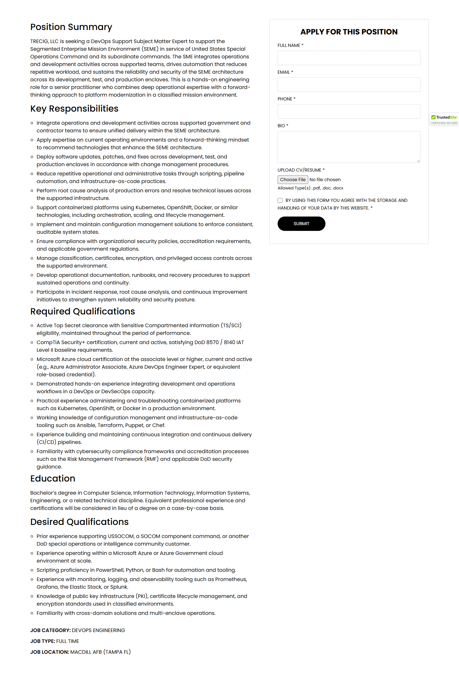
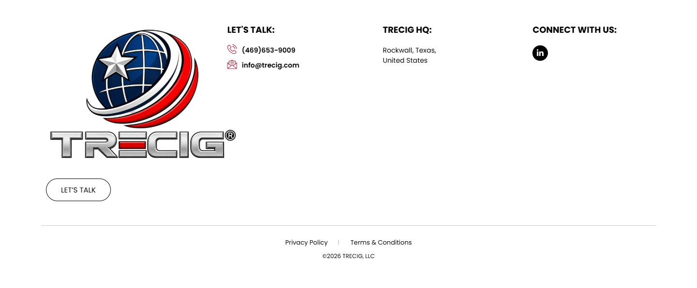

# DevOps Support SME — MacDill AFB, FL – TRECIG

*TRECIG (design reference site)* · URL: https://trecig.com/jobs/devops-support-sme/ · captured 2026-11-08 00:41:13 · HTTP 200

- **Meta description:** —
- **Page size (desktop 1440px):** 1440×3265 px · tablet (820px): 4153 px · mobile (390px): 8714 px
- **Screenshots:** [desktop](screenshots/desktop-full.png) · [tablet](screenshots/tablet-full.png) · [mobile](screenshots/mobile-full.png) · [desktop top](screenshots/desktop-viewport-top.png) · [desktop scrolled](screenshots/desktop-viewport-scrolled.png)
- **Files:** [raw.html](raw.html) (server HTML) · [rendered.html](rendered.html) (DOM after JS) · [content.txt](content.txt) (all visible text) · layout-*.json (full element tree with computed styles) · page.json (everything)

## 1. Section map (top → bottom, desktop 1440px)

| # | Role | Y from top | Height | Heading / first text | Mobile height | Screenshot |
|---|---|---|---|---|---|---|
| 0 | header | 0 | 170 | HOME ABOUT AWARDS & RECOGNITION EXPERTISE PRESS & MEDIA CONTACT | 170 | [img](screenshots/desktop-sec00-header.png) |
| 1 | section | 170 | 350 | DEVOPS SUPPORT SME — MACDILL AFB, FL | 220 | [img](screenshots/desktop-sec01-section.png) |
| 2 | section | 520 | 2148 | Position Summary | 7634 | [img](screenshots/desktop-sec02-section.png) |
| 3 | footer | 2668 | 598 | LET'S TALK: | 690 | [img](screenshots/desktop-sec03-footer.png) |
| 4 | floating (fixed, z 1000003) | 875 | 38 |  |  |  |

## 2. Section-by-section layout (desktop)

Legend: each line is an element in DOM order. `@x,y w×h` = position/size in px on the 1440px-wide page. Text lines show *font size/weight, line-height, colour*. Boxes show layout (flex/grid), background, padding, radius, shadow, etc. Pass-through wrappers are collapsed.

### 2.0 HEADER — HOME ABOUT AWARDS & RECOGNITION EXPERTISE PRESS & MEDIA CONTACT

Element: `<header class="elementor elementor-13 elementor-location-header">` at y=0, 1440×170px · 

- section.elementor-section [bg:#FFFFFF · shadow:#000000 @10% 0px 0px 12px 0px · z:9999 · transition:background, border, border-radius, box-shadow 0.3s, 0.3s, 0.3s, 0.3s ease, ease, ease, ease] `@0,0 1440×170`
  - div.elementor-container [flex row · margin:0px 85px 0px 85px · max-w:1270px] `@85,0 1270×170`
    - div.elementor-column [flex row · min-h:1px] `@85,0 1270×170`
      - div.elementor-widget-wrap [flex row wrap] `@85,0 1270×170`
        - div.elementor-container [flex row · max-w:1270px] `@85,0 1270×170`
          - div.elementor-column [flex row · min-h:1px] `@85,0 127×170`
            - div.elementor-widget-wrap [flex row wrap · align:center · pad:10px 10px 10px 10px] `@85,0 127×170`
              - a (link→/) [inline-block · align-text:center] `@95,10 200×150`
                - **IMG** `TRECIG_Logo_Registered.png` alt="" natural 1440×1080 · inline-block · max-w:200px · overflow:clip · align-text:center `@95,10 200×150`
          - div.elementor-column [flex row · min-h:1px] `@212,0 1143×170`
            - div.elementor-widget-wrap [flex row wrap · align:center · pad:10px 10px 10px 10px] `@212,0 1143×170`
              - div.elementor-widget-container [flex column · transition:background, border, border-radius, box-shadow, transform 0.3s, 0.3s, 0.3s, 0.3s, 0.4s ease, ease, ease, ease, ease] `@222,75 1123×20`
                - ul.elementor-nav-menu [flex row wrap · justify:flex-end · margin:0px 0px 0px 411.234px · z:2] · pseudo:::after{{"content": "\" \"", "w": "0px", "h": "0px"}} `@633,75 712×20`
                  - **A→/** "HOME" — Poppins 14px/400 lh 20px · #000000 · textTransform:uppercase ‖ flex row · margin:0px 15px 0px 0px · transition:all 0.4s ease `@633,75 40×20`
                  - **A→/about/** "ABOUT" — Poppins 14px/400 lh 20px · #000000 · textTransform:uppercase ‖ flex row · margin:0px 15px 0px 15px · transition:all 0.4s ease `@703,75 70×20`
                  - **A→/awards-recognition/** "AWARDS & RECOGNITION" — Poppins 14px/400 lh 20px · #000000 · textTransform:uppercase ‖ flex row · margin:0px 15px 0px 15px · transition:all 0.4s ease `@803,75 195×20`
                  - **A→/expertise/** "EXPERTISE" — Poppins 14px/400 lh 20px · #000000 · textTransform:uppercase ‖ flex row · margin:0px 15px 0px 15px · transition:all 0.4s ease `@1028,75 90×20`
                  - **A→/press-media/** "PRESS & MEDIA" — Poppins 14px/400 lh 20px · #000000 · textTransform:uppercase ‖ flex row · margin:0px 15px 0px 15px · transition:all 0.4s ease `@1148,75 100×20`
                  - **A→/contact/** "CONTACT" — Poppins 14px/400 lh 20px · #000000 · textTransform:uppercase ‖ flex row · margin:0px 0px 0px 15px · transition:all 0.4s ease `@1278,75 67×20`

### 2.1 SECTION — DEVOPS SUPPORT SME — MACDILL AFB, FL

Element: `<section class="elementor-section elementor-top-section elementor-element elementor-element-11138e5 elementor-section-height-min-height elementor-section-bo">` at y=170, 1440×350px · 

- section.elementor-section [bg-image:PROCESS-scaled.jpg · bg-size:cover · bg-pos:50% 0% · transition:background, border, border-radius, box-shadow 0.3s, 0.3s, 0.3s, 0.3s ease, ease, ease, ease] `@0,170 1440×350`
  - div.elementor-background-overlay [bg:#000000 · pos:absolute · opacity:0.5 · transition:background, border-radius, opacity 0.3s, 0.3s, 0.3s ease, ease, ease] `@0,170 1440×350` (empty/decorative)
  - div.elementor-container [flex row · align:center · margin:0px 370px 0px 370px · max-w:700px · min-h:350px] `@370,170 700×350`
    - div.elementor-column [flex row · min-h:1px] `@370,239 700×213`
      - div.elementor-widget-wrap [flex row wrap · pad:10px 10px 10px 10px · margin:80px 0px 0px 0px] `@370,319 700×133`
        - div.elementor-widget-heading [margin:0px 0px 20px 0px · align-text:center] `@380,329 680×72`
          - **H2** "DEVOPS SUPPORT SME — MACDILL AFB, FL" — Poppins 36px/800 lh 36px · #FFFFFF · textTransform:uppercase · textAlign:center ‖ inline-block `@380,329 680×72`
        - ul.elementor-icon-list-items [flex row wrap · justify:center · margin:0px -2.5px 0px -2.5px · align-text:center] `@378,421 685×21`
          - li.elementor-icon-list-item [flex row · justify:center · align:center · margin:0px 2.5px 0px 2.5px · align-text:center] `@532,421 34×21`
            - **A→/** "HOME" — Poppins 12px/400 lh 18px · #CC3366 · textTransform:uppercase · textAlign:center ‖ flex row · highlights: "HOME" #FFFFFF `@532,422 34×18`
          - li.elementor-icon-list-item [flex row · justify:center · align:center · margin:0px 2.5px 0px 2.5px · align-text:center] `@571,421 74×21`
            - **A→/careers/** "CAREERS" — Poppins 12px/400 lh 18px · #CC3366 · textTransform:uppercase · textAlign:center ‖ flex row · highlights: "CAREERS" #FFFFFF `@571,421 74×21`
          - li.elementor-icon-list-item [flex row · justify:center · align:center · margin:0px 2.5px 0px 2.5px · align-text:center] `@650,421 259×21`
            - **SPAN** "DEVOPS SUPPORT SME — MACDILL AFB, FL" — Poppins 12px/400 lh 18px · #FFFFFF · textTransform:uppercase · textAlign:center ‖ pad:0px 0px 0px 5px · transition:color 0.3s ease `@667,422 241×18`

### 2.2 SECTION — Position Summary

Element: `<section class="elementor-section elementor-top-section elementor-element elementor-element-5abc1bd elementor-section-boxed elementor-section-height-default">` at y=520, 1440×2148px · 

- section.elementor-section [pad:50px 0px 50px 0px] `@0,520 1440×2148`
  - div.elementor-container [flex row · margin:0px 85px 0px 85px · max-w:1270px] `@85,570 1270×2048`
    - div.elementor-column [flex row · min-h:1px] `@85,570 1270×2048`
      - div.elementor-widget-wrap [flex row wrap · pad:10px 10px 10px 10px] `@85,570 1270×2048`
        - div.awsm-job-single-wrap [flex row · margin:0px 0px 20.8px 0px] `@95,580 1250×2007`
          - div.awsm-job-content [pad:0px 50px 0px 0px] `@95,580 750×2007`
            - div.awsm-job-entry-content `@95,588 700×1867`
              - **H3** "Position Summary" — Poppins 28px/500 lh 33.6px · #000000 ‖ margin:8px 0px 16px 0px `@95,588 700×34`
              - **P** "TRECIG, LLC is seeking a DevOps Support Subject Matter Expert to support the Segmented Enterprise Mission Environment (SEME) in service of United States Spec…" — Poppins 16px/400 lh 24px · #000000 ‖ margin:0px 0px 14.4px 0px `@95,638 700×192`
              - **H3** "Key Responsibilities" — Poppins 28px/500 lh 33.6px · #000000 ‖ margin:8px 0px 16px 0px `@95,844 700×34`
              - ul [pad:0px 0px 0px 20px] `@95,894 700×578`
                - **LI** "Integrate operations and development activities across supported government and contractor teams to ensure unified delivery within the SEME architecture." — Poppins 16px/400 lh 24px · #000000 ‖ list-item · margin:0px 0px 5px 0px `@115,894 680×48`
                - **LI** "Apply expertise on current operating environments and a forward-thinking mindset to recommend technologies that enhance the SEME architecture." — Poppins 16px/400 lh 24px · #000000 ‖ list-item · margin:0px 0px 5px 0px `@115,947 680×48`
                - **LI** "Deploy software updates, patches, and fixes across development, test, and production enclaves in accordance with change management procedures." — Poppins 16px/400 lh 24px · #000000 ‖ list-item · margin:0px 0px 5px 0px `@115,1000 680×48`
                - **LI** "Reduce repetitive operational and administrative tasks through scripting, pipeline automation, and infrastructure-as-code practices." — Poppins 16px/400 lh 24px · #000000 ‖ list-item · margin:0px 0px 5px 0px `@115,1053 680×48`
                - **LI** "Perform root cause analysis of production errors and resolve technical issues across the supported infrastructure." — Poppins 16px/400 lh 24px · #000000 ‖ list-item · margin:0px 0px 5px 0px `@115,1106 680×48`
                - **LI** "Support containerized platforms using Kubernetes, OpenShift, Docker, or similar technologies, including orchestration, scaling, and lifecycle management." — Poppins 16px/400 lh 24px · #000000 ‖ list-item · margin:0px 0px 5px 0px `@115,1159 680×48`
                - … 5 more siblings of the same type (carousel slides / repeated items — see layout-desktop.json)
              - **H3** "Required Qualifications" — Poppins 28px/500 lh 33.6px · #000000 ‖ margin:8px 0px 16px 0px `@95,1480 700×34`
              - ul [pad:0px 0px 0px 20px] `@95,1529 700×467`
                - **LI** "Active Top Secret clearance with Sensitive Compartmented Information (TS/SCI) eligibility, maintained throughout the period of performance." — Poppins 16px/400 lh 24px · #000000 ‖ list-item · margin:0px 0px 5px 0px `@115,1529 680×48`
                - **LI** "CompTIA Security+ certification, current and active, satisfying DoD 8570 / 8140 IAT Level II baseline requirements." — Poppins 16px/400 lh 24px · #000000 ‖ list-item · margin:0px 0px 5px 0px `@115,1582 680×48`
                - **LI** "Microsoft Azure cloud certification at the associate level or higher, current and active (e.g., Azure Administrator Associate, Azure DevOps Engineer Expert, …" — Poppins 16px/400 lh 24px · #000000 ‖ list-item · margin:0px 0px 5px 0px `@115,1635 680×72`
                - **LI** "Demonstrated hands-on experience integrating development and operations workflows in a DevOps or DevSecOps capacity." — Poppins 16px/400 lh 24px · #000000 ‖ list-item · margin:0px 0px 5px 0px `@115,1712 680×48`
                - **LI** "Practical experience administering and troubleshooting containerized platforms such as Kubernetes, OpenShift, or Docker in a production environment." — Poppins 16px/400 lh 24px · #000000 ‖ list-item · margin:0px 0px 5px 0px `@115,1765 680×48`
                - **LI** "Working knowledge of configuration management and infrastructure-as-code tooling such as Ansible, Terraform, Puppet, or Chef." — Poppins 16px/400 lh 24px · #000000 ‖ list-item · margin:0px 0px 5px 0px `@115,1818 680×48`
                - **LI** "Experience building and maintaining continuous integration and continuous delivery (CI/CD) pipelines." — Poppins 16px/400 lh 24px · #000000 ‖ list-item · margin:0px 0px 5px 0px `@115,1871 680×48`
                - **LI** "Familiarity with cybersecurity compliance frameworks and accreditation processes such as the Risk Management Framework (RMF) and applicable DoD security guid…" — Poppins 16px/400 lh 24px · #000000 ‖ list-item · margin:0px 0px 5px 0px `@115,1924 680×72`
              - **H3** "Education" — Poppins 28px/500 lh 33.6px · #000000 ‖ margin:8px 0px 16px 0px `@95,2004 700×34`
              - **P** "Bachelor’s degree in Computer Science, Information Technology, Information Systems, Engineering, or a related technical discipline. Equivalent professional e…" — Poppins 16px/400 lh 24px · #000000 ‖ margin:0px 0px 14.4px 0px `@95,2054 700×72`
              - **H3** "Desired Qualifications" — Poppins 28px/500 lh 33.6px · #000000 ‖ margin:8px 0px 16px 0px `@95,2140 700×34`
              - ul [pad:0px 0px 0px 20px] `@95,2190 700×265`
                - **LI** "Prior experience supporting USSOCOM, a SOCOM component command, or another DoD special operations or intelligence community customer." — Poppins 16px/400 lh 24px · #000000 ‖ list-item · margin:0px 0px 5px 0px `@115,2190 680×48`
                - **LI** "Experience operating within a Microsoft Azure or Azure Government cloud environment at scale." — Poppins 16px/400 lh 24px · #000000 ‖ list-item · margin:0px 0px 5px 0px `@115,2243 680×48`
                - **LI** "Scripting proficiency in PowerShell, Python, or Bash for automation and tooling." — Poppins 16px/400 lh 24px · #000000 ‖ list-item · margin:0px 0px 5px 0px `@115,2296 680×24`
                - **LI** "Experience with monitoring, logging, and observability tooling such as Prometheus, Grafana, the Elastic Stack, or Splunk." — Poppins 16px/400 lh 24px · #000000 ‖ list-item · margin:0px 0px 5px 0px `@115,2325 680×48`
                - **LI** "Knowledge of public key infrastructure (PKI), certificate lifecycle management, and encryption standards used in classified environments." — Poppins 16px/400 lh 24px · #000000 ‖ list-item · margin:0px 0px 5px 0px `@115,2378 680×48`
                - **LI** "Familiarity with cross-domain solutions and multi-enclave operations." — Poppins 16px/400 lh 24px · #000000 ‖ list-item · margin:0px 0px 5px 0px `@115,2431 680×24`
            - div.awsm-job-specifications-container [margin:30px 0px 0px 0px] `@95,2485 700×92`
              - div.awsm-job-specification-wrapper `@95,2485 700×92`
                - div.awsm-job-specification-item [margin:0px 0px 10px 0px] `@95,2485 700×24`
                  - **SPAN** "JOB CATEGORY:" — Poppins 16px/400 lh 24px · #000000 · textTransform:uppercase ‖ inline · highlights: "JOB CATEGORY:"  600 `@95,2485 131×23`
                  - **SPAN** "DEVOPS ENGINEERING" — Poppins 16px/400 lh 24px · #000000 · textTransform:uppercase ‖ inline `@226,2485 167×23`
                - div.awsm-job-specification-item [margin:0px 0px 10px 0px] `@95,2519 700×24`
                  - **SPAN** "JOB TYPE:" — Poppins 16px/400 lh 24px · #000000 · textTransform:uppercase ‖ inline · highlights: "JOB TYPE:"  600 `@95,2519 81×23`
                  - **SPAN** "FULL TIME" — Poppins 16px/400 lh 24px · #000000 · textTransform:uppercase ‖ inline `@176,2519 72×23`
                - div.awsm-job-specification-item [margin:0px 0px 10px 0px] `@95,2553 700×24`
                  - **SPAN** "JOB LOCATION:" — Poppins 16px/400 lh 24px · #000000 · textTransform:uppercase ‖ inline · highlights: "JOB LOCATION:"  600 `@95,2553 125×23`
                  - **SPAN** "MACDILL AFB (TAMPA FL)" — Poppins 16px/400 lh 24px · #000000 · textTransform:uppercase ‖ inline `@220,2553 190×23`
          - div.awsm-job-form-inner [bg:#FFFFFF · pad:25px 25px 25px 25px · border:1px 1px 1px 1px solid #DDDDDD] `@845,580 500×705`
            - **H2** "APPLY FOR THIS POSITION" — Poppins 24px/700 lh 28.8px · #000000 · textTransform:uppercase · textAlign:center ‖ margin:0px 0px 20px 0px `@871,606 448×29`
            - FORM form.awsm-application-form `@871,655 448×589`
              - div.awsm-job-form-group [margin:0px 0px 15px 0px] `@871,655 448×69`
                - **LABEL** "FULL NAME *" — Poppins 14px/400 lh 14px · #000000 · textTransform:uppercase ‖ margin:0px 0px 10px 0px `@871,655 448×14`
                - **FIELD** <input type=text name=awsm_applicant_name> placeholder="" required — Poppins 14px/400 lh 21px · #000000 ‖ bg:#FFFFFF · pad:8px 16px 8px 16px · border:1px 1px 1px 1px solid #DDDDDD · transition:all 0.3s ease `@871,679 448×45`
              - div.awsm-job-form-group [margin:0px 0px 15px 0px] `@871,739 448×69`
                - **LABEL** "EMAIL *" — Poppins 14px/400 lh 14px · #000000 · textTransform:uppercase ‖ margin:0px 0px 10px 0px `@871,739 448×14`
                - **FIELD** <input type=email name=awsm_applicant_email> placeholder="" required — Poppins 14px/400 lh 21px · #000000 ‖ bg:#FFFFFF · pad:8px 16px 8px 16px · border:1px 1px 1px 1px solid #DDDDDD · transition:all 0.3s ease `@871,763 448×45`
              - div.awsm-job-form-group [margin:0px 0px 15px 0px] `@871,823 448×69`
                - **LABEL** "PHONE *" — Poppins 14px/400 lh 14px · #000000 · textTransform:uppercase ‖ margin:0px 0px 10px 0px `@871,823 448×14`
                - **FIELD** <input type=tel name=awsm_applicant_phone> placeholder="" required — Poppins 14px/400 lh 21px · #000000 ‖ bg:#FFFFFF · pad:8px 16px 8px 16px · border:1px 1px 1px 1px solid #DDDDDD · transition:all 0.3s ease `@871,847 448×45`
              - div.awsm-job-form-group [margin:0px 0px 15px 0px] `@871,907 448×124`
                - **LABEL** "BIO *" — Poppins 14px/400 lh 14px · #000000 · textTransform:uppercase ‖ margin:0px 0px 10px 0px `@871,907 448×14`
                - **FIELD** <textarea type=textarea name=awsm_applicant_letter> placeholder="" required — Poppins 14px/400 lh 21px · #000000 ‖ bg:#FFFFFF · pad:8px 16px 8px 16px · border:1px 1px 1px 1px solid #DDDDDD · transition:all 0.3s ease `@871,931 448×100`
              - div.awsm-job-form-group [margin:0px 0px 15px 0px] `@871,1046 448×75`
                - **LABEL** "UPLOAD CV/RESUME *" — Poppins 14px/400 lh 14px · #000000 · textTransform:uppercase ‖ margin:0px 0px 10px 0px `@871,1046 448×14`
                - **FIELD** <input type=file name=awsm_file> placeholder="" required — Poppins 14px/400 lh 21px · #000000 `@871,1070 448×27`
                - **SMALL** "Allowed Type(s): .pdf, .doc, .docx" — Poppins 12.8px/400 lh 19.2px · #000000 ‖ inline `@871,1101 206×17`
              - div.awsm-job-form-group [margin:0px 0px 15px 0px] `@871,1136 448×48`
                - **FIELD** <input type=checkbox name=awsm_form_privacy_policy> placeholder="" required — Poppins 14px/400 lh 21px · #000000 ‖ inline-block · margin:0px 10px 0px 0px `@871,1141 15×15`
                - **LABEL** "BY USING THIS FORM YOU AGREE WITH THE STORAGE AND HANDLING OF YOUR DATA BY THIS WEBSITE. *" — Poppins 14px/400 lh 14px · #000000 · textTransform:uppercase ‖ inline · margin:0px 0px 10px 0px `@871,1138 407×44`
              - div.awsm-job-form-group [margin:0px 0px 15px 0px] `@871,1199 448×45`
                - **FIELD** <input type=submit name=form_sub> placeholder="" value='Submit' — Poppins 14px/400 lh 21px · #FFFFFF · textTransform:uppercase · textAlign:center ‖ inline-block · bg:#000000 · pad:8px 16px 8px 16px · radius:40px · transition:all 0.3s ease `@871,1199 150×45`

### 2.3 FOOTER — LET'S TALK:

Element: `<footer class="elementor elementor-15 elementor-location-footer">` at y=2668, 1440×598px · 

- section.elementor-section [transition:background, border, border-radius, box-shadow 0.3s, 0.3s, 0.3s, 0.3s ease, ease, ease, ease] `@0,2668 1440×598`
  - div.elementor-background-video-container [pos:absolute · z:0 · overflow:hidden · transition:opacity 1s ease] `@0,2668 1440×598`
    - **IFRAME** https://www.youtube.com/embed/OzwCnEEadts?controls=0&rel=0&playsinline=1&cc_load_policy=0&enablejsapi=1&origin=https%3A%2F%2Ftrecig.com&widgetid=1&forigin=https%3A%2F%2Ftrecig.com%2Fjobs%2Fdevops-support-sme%2F&aoriginsup=1&vf=1 Triceg   Expertise Slider 1 `@0,2561 1440×810`
  - div.elementor-background-overlay [bg:#FFFFFF · pos:absolute · opacity:0.7 · transition:background, border-radius, opacity 0.3s, 0.3s, 0.3s ease, ease, ease] `@0,2668 1440×598` (empty/decorative)
  - div.elementor-container [flex row · margin:0px 85px 0px 85px · max-w:1270px] `@85,2668 1270×598`
    - div.elementor-column [flex row · min-h:1px] `@85,2668 1270×598`
      - div.elementor-widget-wrap [flex row wrap] `@85,2668 1270×598`
        - section.elementor-section [pad:40px 0px 40px 0px] `@85,2668 1270×467`
          - div.elementor-container [flex row · max-w:1270px] `@85,2708 1270×387`
            - div.elementor-column [flex row · min-h:1px] `@85,2708 324×387`
              - div.elementor-widget-wrap [flex row wrap · pad:10px 10px 10px 10px] `@85,2708 324×387`
                - div.elementor-widget-theme-site-logo [margin:0px 0px 20px 0px] `@95,2718 304×300`
                  - a (link→/) [inline-block] `@95,2718 400×300`
                    - **IMG** `TRECIG_Logo_Registered.png` alt="" natural 1440×1080 · inline-block · max-w:400px · overflow:clip `@95,2718 400×300`
                - div.elementor-button-wrapper [grid cols[134.078px]] `@95,3038 134×47`
                  - **A→/contact/** "LET’S TALK" — Poppins 15px/400 lh 15px · #000000 · textTransform:uppercase · textAlign:center ‖ pad:15px 30px 15px 30px · radius:30px · border:1px 1px 1px 1px solid #000000 · transition:all 0.3s ease `@95,3038 134×47`
            - div.elementor-column [flex row · min-h:1px] `@409,2708 371×387`
              - div.elementor-widget-wrap [flex row wrap · pad:10px 10px 10px 10px · margin:0px 0px 0px 50px] `@459,2708 321×387`
                - div.elementor-widget-heading [margin:0px 0px 20px 0px] `@469,2718 301×24`
                  - **H2** "LET'S TALK:" — Poppins 18px/700 lh 18px · #000000 · textTransform:uppercase ‖ inline-block `@469,2721 98×18`
                - ul.elementor-icon-list-items `@469,2762 301×52`
                  - li.elementor-icon-list-item [flex row · align:center · pad:0px 0px 5px 0px] `@469,2762 301×26`
                    - **A→tel:(254)%20338-6131** "(469)653-9009" — Poppins 14px/600 lh 21px · #CC3366 ‖ flex row · highlights: "(469)653-9009" #000000 `@469,2762 301×21`
                  - li.elementor-icon-list-item [flex row · align:center · margin:5px 0px 0px 0px] `@469,2793 301×21`
                    - **A→mailto:info@trecig.com** "info@trecig.com" — Poppins 14px/600 lh 21px · #CC3366 ‖ flex row · highlights: "info@trecig.com" #000000 `@469,2793 301×21`
            - div.elementor-column [flex row · min-h:1px] `@781,2708 310×387`
              - div.elementor-widget-wrap [flex row wrap · pad:10px 10px 10px 10px · margin:0px 50px 0px 0px] `@781,2708 260×387`
                - div.elementor-widget-heading [margin:0px 0px 20px 0px] `@791,2718 240×24`
                  - **H2** "TRECIG HQ:" — Poppins 18px/700 lh 18px · #000000 · textTransform:uppercase ‖ inline-block `@791,2721 101×18`
                - ul.elementor-icon-list-items `@791,2762 240×42`
                  - li.elementor-icon-list-item [flex row · align:center] `@791,2762 240×42`
                    - **SPAN** "Rockwall, Texas, United States" — Poppins 14px/400 lh 21px · #000000 ‖ transition:color 0.3s ease `@791,2762 110×42`
            - div.elementor-column [flex row · min-h:1px] `@1090,2708 264×387`
              - div.elementor-widget-wrap [flex row wrap · pad:10px 10px 10px 10px] `@1090,2708 264×387`
                - div.elementor-widget-heading [margin:0px 0px 20px 0px] `@1100,2718 244×24`
                  - **H2** "CONNECT WITH US:" — Poppins 18px/700 lh 18px · #000000 · textTransform:uppercase ‖ inline-block `@1100,2721 174×18`
                - **A→/jobs/devops-support-sme/** "Linkedin-in" +icon[e-font-icon-svg e-fab-linkedin-in] — -apple-system 16px/400 lh 16px · #69727D · textAlign:center ‖ flex row · bg:#000000 · radius:100% · transition:all 0.3s ease `@1100,2762 32×32`
        - section.elementor-section [pad:15px 0px 15px 0px · border:1px 0px 0px 0px solid #000000 @20%] `@85,3135 1270×131`
          - div.elementor-container [flex row · max-w:1270px] `@85,3151 1270×100`
            - div.elementor-column [flex row · min-h:1px] `@85,3151 1270×100`
              - div.elementor-widget-wrap [flex row wrap · align:center · pad:10px 10px 10px 10px] `@85,3151 1270×100`
                - div.elementor-element [margin:0px 0px 20px 0px · align-text:center] `@95,3161 1250×10`
                  - div.elementor-widget-container [margin:0px 0px -10px 0px · overflow:hidden · align-text:center · transition:background, border, border-radius, box-shadow, transform 0.3s, 0.3s, 0.3s, 0.3s, 0.4s ease, ease, ease, ease, ease] `@95,3161 1250×20`
                    - ul.elementor-icon-list-items [flex row wrap · justify:center · gap:30px · margin:0px -8px 0px -8px · align-text:center] `@87,3161 1266×20`
                      - li.elementor-icon-list-item [flex row · justify:center · align:center · margin:0px 8px 0px 8px · align-text:center] `@589,3161 89×20`
                        - **A→/privacy-policy/** "Privacy Policy" — Poppins 13px/400 lh 19.5px · #CC3366 · textAlign:center ‖ flex row · highlights: "Privacy Policy" #000000 `@589,3161 88×20`
                      - li.elementor-icon-list-item [flex row · justify:center · align:center · margin:0px 8px 0px 8px · align-text:center] `@724,3161 127×20`
                        - **A→/terms-conditions/** "Terms & Conditions" — Poppins 13px/400 lh 19.5px · #CC3366 · textAlign:center ‖ flex row · highlights: "Terms & Conditions" #000000 `@724,3161 127×20`
                - **P** "©2026 TRECIG, LLC" — Poppins 12px/400 lh 18px · #000000 · textTransform:uppercase · textAlign:center ‖ margin:0px 0px 14.4px 0px `@95,3190 1250×36`

### Floating / fixed elements
- `div.` fixed at [1348, 875, 92, 38] z-index 1000003 — ""

## 3. Header, navigation & interaction behaviour

- **atTop** `header.elementor.elementor-13.elementor-location-header` position:static top:0 height:170 bg:transparent shadow:none backdrop:none z:auto
- **afterScroll1400** `header.elementor.elementor-13.elementor-location-header` position:static top:-1400 height:0 bg:transparent shadow:none backdrop:none z:auto
- **afterScroll1400** `section.elementor-section.elementor-top-section.elementor-element.elementor-elem` position:fixed top:0 height:170 bg:#FFFFFF @90% shadow:#000000 @10% 0px 0px 12px 0px backdrop:none z:9999

| Menu item | Link | Dropdown | Style | Hover change |
|---|---|---|---|---|
| HOME | / | — | Poppins 14px/400 #000000 uppercase ls normal | color: #000000 → #B22239 |
| ABOUT | /about/ | The Mission (/the-mission/); The Values (/the-values/); The Legacy (/the-legacy/); The Trecig Team (/the-trecig-team/); Careers (/careers/) | Poppins 14px/400 #000000 uppercase ls normal | color: #000000 → #B22239 |
| AWARDS & RECOGNITION | /awards-recognition/ | Partnerships (/partnerships/) | Poppins 14px/400 #000000 uppercase ls normal | color: #000000 → #B22239 |
| EXPERTISE | /expertise/ | Industries We Serve (/industries-we-serve/) | Poppins 14px/400 #000000 uppercase ls normal | color: #000000 → #B22239 |
| PRESS & MEDIA | /press-media/ | — | Poppins 14px/400 #000000 uppercase ls normal | color: #000000 → #B22239 |
| CONTACT | /contact/ | — | Poppins 14px/400 #000000 uppercase ls normal | color: #000000 → #B22239 |

- **Mobile menu:** toggle `.elementor-menu-toggle` → [screenshot](screenshots/mobile-menu-open.png) · items: HOME, ABOUT, AWARDS & RECOGNITION, EXPERTISE, PRESS & MEDIA, CONTACT

### Hover states (measured by hovering in Chrome)

| Element | Text | Normal | On hover |
|---|---|---|---|
| `a.elementor-item` | HOME | color #000000 · bg transparent · radius 0px · pad 0px · border 0px #000000 · transition 0.4s | color: #000000 → #B22239; borderTopColor: #000000 → #B22239 |
| `a.elementor-item` | ABOUT | color #000000 · bg transparent · radius 0px · pad 0px · border 0px #000000 · transition 0.4s | color: #000000 → #B22239; borderTopColor: #000000 → #B22239 |
| `a.elementor-item` | CONTACT | color #000000 · bg transparent · radius 0px · pad 0px · border 0px #000000 · transition 0.4s | color: #000000 → #B22239; borderTopColor: #000000 → #B22239 |
| `input.awsm-application-submit-btn` | Submit | color #FFFFFF · bg #000000 · radius 40px · pad 8px 16px · border 0px #FFFFFF · transition 0.3s | backgroundColor: #000000 → #B02334 |
| `a.` |  | color #CC3366 · bg transparent · radius 0px · pad 0px · border 0px #CC3366 · transition all | color: #CC3366 → #B22239; borderTopColor: #CC3366 → #B22239; childColor: #CC3366 → #B22239 |
| `a.elementor-button` | LET’S TALK | color #000000 · bg transparent · radius 30px · pad 15px 30px · border 1px #000000 · transition 0.3s | color: #000000 → #FFFFFF; borderTopColor: #000000 → #B22239 |
| `a.` | (469)653-9009 | color #CC3366 · bg transparent · radius 0px · pad 0px · border 0px #CC3366 · transition all | color: #CC3366 → #B22239; borderTopColor: #CC3366 → #B22239 |
| `a.elementor-icon` | Linkedin-in | color #69727D · bg #000000 · radius 100% · pad 0px · border 0px #69727D · transition 0.3s | color: #69727D → #B22239; backgroundColor: #000000 → #B22239; borderTopColor: #69727D → #B22239; opacity: 1 → 0.9; childColor: #69727D → #B22239 |
| `a.` | Privacy Policy | color #CC3366 · bg transparent · radius 0px · pad 0px · border 0px #CC3366 · transition all | color: #CC3366 → #B22239; borderTopColor: #CC3366 → #B22239 |

## 4. Typography & colour used on this page (weighted by amount of text / area)

| Font · weight · size / line-height | chars |
|---|---|
| Poppins | 400 | 16px / 24px | 4134 |
| Poppins | 400 | 14px / 14px | 132 |
| Poppins | 500 | 28px / 33.6px | 90 |
| Poppins | 400 | 12px / 18px | 64 |
| Poppins | 400 | 14px / 20px | 58 |
| Poppins | 700 | 18px / 18px | 37 |
| Poppins | 800 | 36px / 36px | 36 |
| Poppins | 600 | 16px / 24px | 35 |
| Poppins | 400 | 12.8px / 19.2px | 34 |
| Poppins | 400 | 13px / 19.5px | 32 |
| Poppins | 400 | 14px / 21px | 29 |
| Poppins | 600 | 14px / 21px | 28 |
| Poppins | 700 | 24px / 28.8px | 23 |
| -apple-system | 400 | 16px / 24px | 15 |
| -apple-system | 400 | 16px / 16px | 11 |
| Poppins | 400 | 15px / 15px | 10 |

- **Text colours:** #000000 (4659), #FFFFFF (83), #CC3366 (15), #69727D (11)
- **Background colours (by area):** #FFFFFF (1566), #000000 (512)
- **Border radii:** 40px (1), 30px (1), 100% (1), 2px 0px 0px (1)
- **Shadows:** #000000 @10% 0px 0px 12px 0px (1) | #000000 @20% 0px 0px 5px 0px (1)
- **Mobile text styles:** Poppins | 400 | 16px / 24px (4134); Poppins | 400 | 14px / 14px (142); Poppins | 500 | 28px / 33.6px (90); Poppins | 400 | 12px / 18px (79); Poppins | 700 | 16px / 16px (37); Poppins | 800 | 28px / 28px (36); Poppins | 600 | 16px / 24px (35); Poppins | 400 | 12.8px / 19.2px (34); Poppins | 400 | 14px / 21px (29); Poppins | 600 | 14px / 21px (28)

## 5. Forms
- **Form** `awsm-application-form` → ref: <Node> (post)
  - input[text] name=`awsm_applicant_name` label="FULL NAME *" placeholder="" *required*
  - input[email] name=`awsm_applicant_email` label="EMAIL *" placeholder="" *required*
  - input[tel] name=`awsm_applicant_phone` label="PHONE *" placeholder="" *required*
  - textarea[textarea] name=`awsm_applicant_letter` label="BIO *" placeholder="" *required*
  - input[file] name=`awsm_file` label="UPLOAD CV/RESUME *" placeholder="" *required*
  - input[checkbox] name=`awsm_form_privacy_policy` label="BY USING THIS FORM YOU AGREE WITH THE STORAGE AND HANDLING OF YOUR DATA BY THIS WEBSITE. *" placeholder="" *required*
  - input[submit] name=`form_sub` label="" placeholder="" value="Submit"

## 6. Images on the page

- `TRECIG_Logo_Registered.png` natural 1440×1080 → shown 200×150 · alt="" · https://trecig.com/wp-content/uploads/2026/10/TRECIG_Logo_Registered.png
- background on `section.elementor-section`: https://trecig.com/wp-content/uploads/2024/09/PROCESS-scaled.jpg
- background on `div.`: https://cdn.ywxi.net/meter/trecig.com/205.svg?ts=1784975038086&l=en

## 7. Links on the page

- [body] "Skip to content" → /jobs/devops-support-sme/#content
- [header] "(icon/image)" → /
- [header] "HOME" → /
- [header] "ABOUT" → /about/
- [header] "The Mission" → /the-mission/
- [header] "The Values" → /the-values/
- [header] "The Legacy" → /the-legacy/
- [header] "The Trecig Team" → /the-trecig-team/
- [header] "Careers" → /careers/
- [header] "AWARDS & RECOGNITION" → /awards-recognition/
- [header] "Partnerships" → /partnerships/
- [header] "EXPERTISE" → /expertise/
- [header] "Industries We Serve" → /industries-we-serve/
- [header] "PRESS & MEDIA" → /press-media/
- [header] "CONTACT" → /contact/
- [header] "Home" → /
- [header] "About" → /about/
- [header] "Awards & Recognition" → /awards-recognition/
- [header] "Expertise" → /expertise/
- [header] "Press & Media" → /press-media/
- [header] "Contact" → /contact/
- [body] "CAREERS" → /careers/
- [footer] "LET’S TALK" → /contact/
- [footer] "(469)653-9009" → tel:(254)%20338-6131
- [footer] "info@trecig.com" → mailto:info@trecig.com
- [footer] "Linkedin-in" → /jobs/devops-support-sme/ (target _blank)
- [footer] "Privacy Policy" → /privacy-policy/
- [footer] "Terms & Conditions" → /terms-conditions/

## 8. Mobile layout (390px) — condensed outline

### 8.0 header — HOME ABOUT AWARDS & RECOGNITION EXPERTISE PRESS & MEDIA CONTACT (y 0, h 170)
- section.elementor-section [bg:#FFFFFF · shadow:#000000 @10% 0px 0px 12px 0px · z:9999 · transition:background, border, border-radius, box-shadow 0.3s, 0.3s, 0.3s, 0.3s ease, ease, ease, ease] `@0,0 390×170`
  - div.elementor-container [flex row wrap · max-w:767px] `@0,0 390×170`
    - div.elementor-column [flex row · min-h:1px] `@0,0 390×170`
      - div.elementor-widget-wrap [flex row wrap] `@0,0 390×170`
        - div.elementor-container [flex row wrap · max-w:767px] `@0,0 390×170`
          - div.elementor-column [flex row · min-h:1px] `@0,0 234×170`
            - div.elementor-widget-wrap [flex row wrap · align:center · pad:10px 10px 10px 10px] `@0,0 234×170`
              - a (link→/) [inline-block · align-text:center] `@17,10 200×150`
                - **IMG** `TRECIG_Logo_Registered-1024x768.png` alt="" natural 390×292 · inline-block · max-w:200px · overflow:clip · align-text:center `@17,10 200×150`
          - div.elementor-column [flex row · min-h:1px] `@234,0 156×170`
            - div.elementor-widget-wrap [flex row wrap · align:center · pad:10px 10px 10px 10px] `@234,0 156×170`
              - div.elementor-widget-container [flex column · transition:background, border, border-radius, box-shadow, transform 0.3s, 0.3s, 0.3s, 0.3s, 0.4s ease, ease, ease, ease, ease] `@244,70 136×30`
                - nav.elementor-nav-menu--dropdown [bg:#FFFFFF · margin:16px 0px 0px 0px · pos:absolute · z:9997 · overflow:hidden · transform:matrix(1, 0, 0, 0, 0, 0) · transition:max-height, transform 0.3s, 0.3s ease, ease] `@0,116 390×0`
                  - ul.elementor-nav-menu [z:2] · pseudo:::after{{"content": "\" \"", "w": "390px", "h": "0px"}} `@0,116 390×0`
                    - **A→/** "HOME" — Poppins 14px/400 lh 20px · #000000 · textTransform:uppercase ‖ flex row · pad:10px 20px 10px 20px `@0,116 390×0`
                    - **A→/about/** "ABOUT" — Poppins 14px/400 lh 20px · #000000 · textTransform:uppercase ‖ flex row · pad:10px 20px 10px 20px `@0,116 390×0`
                    - **A→/awards-recognition/** "AWARDS & RECOGNITION" — Poppins 14px/400 lh 20px · #000000 · textTransform:uppercase ‖ flex row · pad:10px 20px 10px 20px `@0,116 390×0`
                    - **A→/expertise/** "EXPERTISE" — Poppins 14px/400 lh 20px · #000000 · textTransform:uppercase ‖ flex row · pad:10px 20px 10px 20px `@0,116 390×0`
                    - **A→/press-media/** "PRESS & MEDIA" — Poppins 14px/400 lh 20px · #000000 · textTransform:uppercase ‖ flex row · pad:10px 20px 10px 20px `@0,116 390×0`
                    - **A→/contact/** "CONTACT" — Poppins 14px/400 lh 20px · #000000 · textTransform:uppercase ‖ flex row · pad:10px 20px 10px 20px `@0,116 390×0`

### 8.1 section — DEVOPS SUPPORT SME — MACDILL AFB, FL (y 170, h 220)
- section.elementor-section [bg-image:PROCESS-scaled.jpg · bg-size:cover · bg-pos:50% 0% · transition:background, border, border-radius, box-shadow 0.3s, 0.3s, 0.3s, 0.3s ease, ease, ease, ease] `@0,170 390×220`
  - div.elementor-background-overlay [bg:#000000 · pos:absolute · opacity:0.5 · transition:background, border-radius, opacity 0.3s, 0.3s, 0.3s ease, ease, ease] `@0,170 390×220` (empty/decorative)
  - div.elementor-container [flex row wrap · align:center · max-w:700px · min-h:220px] `@0,170 390×220`
    - div.elementor-column [flex row · min-h:1px] `@0,178 390×204`
      - div.elementor-widget-wrap [flex row wrap · pad:10px 10px 10px 10px · margin:65px 0px 0px 0px] `@0,243 390×139`
        - div.elementor-widget-heading [margin:0px 0px 20px 0px · align-text:center] `@10,253 370×57`
          - **H2** "DEVOPS SUPPORT SME — MACDILL AFB, FL" — Poppins 28px/800 lh 28px · #FFFFFF · textTransform:uppercase · textAlign:center ‖ inline-block `@10,253 370×56`
        - ul.elementor-icon-list-items [flex row wrap · justify:center · margin:0px -2.5px 0px -2.5px · align-text:center] `@8,330 375×42`
          - li.elementor-icon-list-item [flex row · justify:center · align:center · margin:0px 2.5px 0px 2.5px · align-text:center] `@138,330 34×21`
            - **A→/** "HOME" — Poppins 12px/400 lh 18px · #CC3366 · textTransform:uppercase · textAlign:center ‖ flex row · highlights: "HOME" #FFFFFF `@138,332 34×18`
          - li.elementor-icon-list-item [flex row · justify:center · align:center · margin:0px 2.5px 0px 2.5px · align-text:center] `@178,330 74×21`
            - **A→/careers/** "CAREERS" — Poppins 12px/400 lh 18px · #CC3366 · textTransform:uppercase · textAlign:center ‖ flex row · highlights: "CAREERS" #FFFFFF `@178,330 74×21`
          - li.elementor-icon-list-item [flex row · justify:center · align:center · margin:0px 2.5px 0px 2.5px · align-text:center] `@66,351 259×21`
            - **SPAN** "DEVOPS SUPPORT SME — MACDILL AFB, FL" — Poppins 12px/400 lh 18px · #FFFFFF · textTransform:uppercase · textAlign:center ‖ pad:0px 0px 0px 5px · transition:color 0.3s ease `@83,353 241×18`

### 8.2 section — Position Summary (y 390, h 7634)
- section.elementor-section [pad:50px 0px 50px 0px] `@0,390 390×7634`
  - div.elementor-container [flex row wrap · max-w:767px] `@0,440 390×7534`
    - div.elementor-column [flex row · min-h:1px] `@0,440 390×7534`
      - div.elementor-widget-wrap [flex row wrap · pad:10px 10px 10px 10px] `@0,440 390×7534`
        - div.awsm-job-single-wrap [flex row · margin:0px 0px 20.8px 0px] `@10,450 370×7493`
          - div.awsm-job-content [pad:0px 50px 0px 0px] `@10,450 222×7493`
            - div.awsm-job-entry-content `@10,458 172×7281`
              - **H3** "Position Summary" — Poppins 28px/500 lh 33.6px · #000000 ‖ margin:8px 0px 16px 0px `@10,458 172×67`
              - **P** "TRECIG, LLC is seeking a DevOps Support Subject Matter Expert to support the Segmented Enterprise Mission Environment (SEME) in service of United States Spec…" — Poppins 16px/400 lh 24px · #000000 ‖ margin:0px 0px 14.4px 0px `@10,541 172×936`
              - **H3** "Key Responsibilities" — Poppins 28px/500 lh 33.6px · #000000 ‖ margin:8px 0px 16px 0px `@10,1492 172×67`
              - ul [pad:0px 0px 0px 20px] `@10,1575 172×2474`
                - **LI** "Integrate operations and development activities across supported government and contractor teams to ensure unified delivery within the SEME architecture." — Poppins 16px/400 lh 24px · #000000 ‖ list-item · margin:0px 0px 5px 0px `@30,1575 152×240`
                - **LI** "Apply expertise on current operating environments and a forward-thinking mindset to recommend technologies that enhance the SEME architecture." — Poppins 16px/400 lh 24px · #000000 ‖ list-item · margin:0px 0px 5px 0px `@30,1820 152×216`
                - **LI** "Deploy software updates, patches, and fixes across development, test, and production enclaves in accordance with change management procedures." — Poppins 16px/400 lh 24px · #000000 ‖ list-item · margin:0px 0px 5px 0px `@30,2041 152×240`
                - **LI** "Reduce repetitive operational and administrative tasks through scripting, pipeline automation, and infrastructure-as-code practices." — Poppins 16px/400 lh 24px · #000000 ‖ list-item · margin:0px 0px 5px 0px `@30,2286 152×192`
                - **LI** "Perform root cause analysis of production errors and resolve technical issues across the supported infrastructure." — Poppins 16px/400 lh 24px · #000000 ‖ list-item · margin:0px 0px 5px 0px `@30,2483 152×192`
                - **LI** "Support containerized platforms using Kubernetes, OpenShift, Docker, or similar technologies, including orchestration, scaling, and lifecycle management." — Poppins 16px/400 lh 24px · #000000 ‖ list-item · margin:0px 0px 5px 0px `@30,2680 152×288`
                - … 5 more siblings of the same type (carousel slides / repeated items — see layout-desktop.json)
              - **H3** "Required Qualifications" — Poppins 28px/500 lh 33.6px · #000000 ‖ margin:8px 0px 16px 0px `@10,4057 172×67`
              - ul [pad:0px 0px 0px 20px] `@10,4140 172×1955`
                - **LI** "Active Top Secret clearance with Sensitive Compartmented Information (TS/SCI) eligibility, maintained throughout the period of performance." — Poppins 16px/400 lh 24px · #000000 ‖ list-item · margin:0px 0px 5px 0px `@30,4140 152×240`
                - **LI** "CompTIA Security+ certification, current and active, satisfying DoD 8570 / 8140 IAT Level II baseline requirements." — Poppins 16px/400 lh 24px · #000000 ‖ list-item · margin:0px 0px 5px 0px `@30,4385 152×192`
                - **LI** "Microsoft Azure cloud certification at the associate level or higher, current and active (e.g., Azure Administrator Associate, Azure DevOps Engineer Expert, …" — Poppins 16px/400 lh 24px · #000000 ‖ list-item · margin:0px 0px 5px 0px `@30,4582 152×288`
                - **LI** "Demonstrated hands-on experience integrating development and operations workflows in a DevOps or DevSecOps capacity." — Poppins 16px/400 lh 24px · #000000 ‖ list-item · margin:0px 0px 5px 0px `@30,4875 152×240`
                - **LI** "Practical experience administering and troubleshooting containerized platforms such as Kubernetes, OpenShift, or Docker in a production environment." — Poppins 16px/400 lh 24px · #000000 ‖ list-item · margin:0px 0px 5px 0px `@30,5120 152×264`
                - **LI** "Working knowledge of configuration management and infrastructure-as-code tooling such as Ansible, Terraform, Puppet, or Chef." — Poppins 16px/400 lh 24px · #000000 ‖ list-item · margin:0px 0px 5px 0px `@30,5389 152×216`
                - **LI** "Experience building and maintaining continuous integration and continuous delivery (CI/CD) pipelines." — Poppins 16px/400 lh 24px · #000000 ‖ list-item · margin:0px 0px 5px 0px `@30,5610 152×192`
                - **LI** "Familiarity with cybersecurity compliance frameworks and accreditation processes such as the Risk Management Framework (RMF) and applicable DoD security guid…" — Poppins 16px/400 lh 24px · #000000 ‖ list-item · margin:0px 0px 5px 0px `@30,5807 152×288`
              - **H3** "Education" — Poppins 28px/500 lh 33.6px · #000000 ‖ margin:8px 0px 16px 0px `@10,6103 172×34`
              - **P** "Bachelor’s degree in Computer Science, Information Technology, Information Systems, Engineering, or a related technical discipline. Equivalent professional e…" — Poppins 16px/400 lh 24px · #000000 ‖ margin:0px 0px 14.4px 0px `@10,6153 172×336`
              - **H3** "Desired Qualifications" — Poppins 28px/500 lh 33.6px · #000000 ‖ margin:8px 0px 16px 0px `@10,6503 172×67`
              - ul [pad:0px 0px 0px 20px] `@10,6586 172×1153`
                - **LI** "Prior experience supporting USSOCOM, a SOCOM component command, or another DoD special operations or intelligence community customer." — Poppins 16px/400 lh 24px · #000000 ‖ list-item · margin:0px 0px 5px 0px `@30,6586 152×264`
                - **LI** "Experience operating within a Microsoft Azure or Azure Government cloud environment at scale." — Poppins 16px/400 lh 24px · #000000 ‖ list-item · margin:0px 0px 5px 0px `@30,6855 152×144`
                - **LI** "Scripting proficiency in PowerShell, Python, or Bash for automation and tooling." — Poppins 16px/400 lh 24px · #000000 ‖ list-item · margin:0px 0px 5px 0px `@30,7004 152×144`
                - **LI** "Experience with monitoring, logging, and observability tooling such as Prometheus, Grafana, the Elastic Stack, or Splunk." — Poppins 16px/400 lh 24px · #000000 ‖ list-item · margin:0px 0px 5px 0px `@30,7153 152×216`
                - **LI** "Knowledge of public key infrastructure (PKI), certificate lifecycle management, and encryption standards used in classified environments." — Poppins 16px/400 lh 24px · #000000 ‖ list-item · margin:0px 0px 5px 0px `@30,7374 152×240`
                - **LI** "Familiarity with cross-domain solutions and multi-enclave operations." — Poppins 16px/400 lh 24px · #000000 ‖ list-item · margin:0px 0px 5px 0px `@30,7619 152×120`
            - div.awsm-job-specifications-container [margin:30px 0px 0px 0px] `@10,7769 172×164`
              - div.awsm-job-specification-wrapper `@10,7769 172×164`
                - div.awsm-job-specification-item [margin:0px 0px 10px 0px] `@10,7769 172×48`
                  - **SPAN** "JOB CATEGORY:" — Poppins 16px/400 lh 24px · #000000 · textTransform:uppercase ‖ inline · highlights: "JOB CATEGORY:"  600 `@10,7769 127×23`
                  - **SPAN** "DEVOPS ENGINEERING" — Poppins 16px/400 lh 24px · #000000 · textTransform:uppercase ‖ inline `@10,7793 167×23`
                - div.awsm-job-specification-item [margin:0px 0px 10px 0px] `@10,7827 172×24`
                  - **SPAN** "JOB TYPE:" — Poppins 16px/400 lh 24px · #000000 · textTransform:uppercase ‖ inline · highlights: "JOB TYPE:"  600 `@10,7827 81×23`
                  - **SPAN** "FULL TIME" — Poppins 16px/400 lh 24px · #000000 · textTransform:uppercase ‖ inline `@91,7827 72×23`
                - div.awsm-job-specification-item [margin:0px 0px 10px 0px] `@10,7861 172×72`
                  - **SPAN** "JOB LOCATION:" — Poppins 16px/400 lh 24px · #000000 · textTransform:uppercase ‖ inline · highlights: "JOB LOCATION:"  600 `@10,7861 122×23`
                  - **SPAN** "MACDILL AFB (TAMPA FL)" — Poppins 16px/400 lh 24px · #000000 · textTransform:uppercase ‖ inline `@10,7885 164×47`
          - div.awsm-job-form-inner [bg:#FFFFFF · pad:25px 25px 25px 25px · border:1px 1px 1px 1px solid #DDDDDD] `@232,450 148×1021`
            - **H2** "APPLY FOR THIS POSITION" — Poppins 24px/700 lh 28.8px · #000000 · textTransform:uppercase · textAlign:center ‖ margin:0px 0px 20px 0px `@258,476 96×115`
            - FORM form.awsm-application-form `@258,611 96×819`
              - div.awsm-job-form-group [margin:0px 0px 15px 0px] `@258,611 96×69`
                - **LABEL** "FULL NAME *" — Poppins 14px/400 lh 14px · #000000 · textTransform:uppercase ‖ margin:0px 0px 10px 0px `@258,611 96×14`
                - **FIELD** <input type=text name=awsm_applicant_name> placeholder="" required — Poppins 14px/400 lh 21px · #000000 ‖ bg:#FFFFFF · pad:8px 16px 8px 16px · border:1px 1px 1px 1px solid #DDDDDD · transition:all 0.3s ease `@258,635 96×45`
              - div.awsm-job-form-group [margin:0px 0px 15px 0px] `@258,695 96×69`
                - **LABEL** "EMAIL *" — Poppins 14px/400 lh 14px · #000000 · textTransform:uppercase ‖ margin:0px 0px 10px 0px `@258,695 96×14`
                - **FIELD** <input type=email name=awsm_applicant_email> placeholder="" required — Poppins 14px/400 lh 21px · #000000 ‖ bg:#FFFFFF · pad:8px 16px 8px 16px · border:1px 1px 1px 1px solid #DDDDDD · transition:all 0.3s ease `@258,719 96×45`
              - div.awsm-job-form-group [margin:0px 0px 15px 0px] `@258,779 96×69`
                - **LABEL** "PHONE *" — Poppins 14px/400 lh 14px · #000000 · textTransform:uppercase ‖ margin:0px 0px 10px 0px `@258,779 96×14`
                - **FIELD** <input type=tel name=awsm_applicant_phone> placeholder="" required — Poppins 14px/400 lh 21px · #000000 ‖ bg:#FFFFFF · pad:8px 16px 8px 16px · border:1px 1px 1px 1px solid #DDDDDD · transition:all 0.3s ease `@258,803 96×45`
              - div.awsm-job-form-group [margin:0px 0px 15px 0px] `@258,863 96×124`
                - **LABEL** "BIO *" — Poppins 14px/400 lh 14px · #000000 · textTransform:uppercase ‖ margin:0px 0px 10px 0px `@258,863 96×14`
                - **FIELD** <textarea type=textarea name=awsm_applicant_letter> placeholder="" required — Poppins 14px/400 lh 21px · #000000 ‖ bg:#FFFFFF · pad:8px 16px 8px 16px · border:1px 1px 1px 1px solid #DDDDDD · transition:all 0.3s ease `@258,887 96×100`
              - div.awsm-job-form-group [margin:0px 0px 15px 0px] `@258,1002 96×137`
                - **LABEL** "UPLOAD CV/RESUME *" — Poppins 14px/400 lh 14px · #000000 · textTransform:uppercase ‖ margin:0px 0px 10px 0px `@258,1002 96×28`
                - **FIELD** <input type=file name=awsm_file> placeholder="" required — Poppins 14px/400 lh 21px · #000000 `@258,1040 96×27`
                - **SMALL** "Allowed Type(s): .pdf, .doc, .docx" — Poppins 12.8px/400 lh 19.2px · #000000 ‖ inline `@258,1071 82×65`
              - div.awsm-job-form-group [margin:0px 0px 15px 0px] `@258,1154 96×216`
                - **FIELD** <input type=checkbox name=awsm_form_privacy_policy> placeholder="" required — Poppins 14px/400 lh 21px · #000000 ‖ inline-block · margin:0px 10px 0px 0px `@258,1159 15×15`
                - **LABEL** "BY USING THIS FORM YOU AGREE WITH THE STORAGE AND HANDLING OF YOUR DATA BY THIS WEBSITE. *" — Poppins 14px/400 lh 14px · #000000 · textTransform:uppercase ‖ inline · margin:0px 0px 10px 0px `@258,1157 96×212`
              - div.awsm-job-form-group [margin:0px 0px 15px 0px] `@258,1385 96×45`
                - **FIELD** <input type=submit name=form_sub> placeholder="" value='Submit' — Poppins 14px/400 lh 21px · #FFFFFF · textTransform:uppercase · textAlign:center ‖ inline-block · bg:#000000 · pad:8px 16px 8px 16px · radius:40px · transition:all 0.3s ease `@258,1385 150×45`

### 8.3 footer — LET'S TALK: (y 8024, h 690)
- section.elementor-section [transition:background, border, border-radius, box-shadow 0.3s, 0.3s, 0.3s, 0.3s ease, ease, ease, ease] `@0,8024 390×690`
  - div.elementor-background-overlay [bg:#FFFFFF · pos:absolute · opacity:0.7 · transition:background, border-radius, opacity 0.3s, 0.3s, 0.3s ease, ease, ease] `@0,8024 390×690` (empty/decorative)
  - div.elementor-container [flex row wrap · max-w:767px] `@0,8024 390×690`
    - div.elementor-column [flex row · min-h:1px] `@0,8024 390×690`
      - div.elementor-widget-wrap [flex row wrap] `@0,8024 390×690`
        - section.elementor-section [pad:20px 0px 0px 0px] `@0,8024 390×612`
          - div.elementor-container [flex row wrap · max-w:767px] `@0,8044 390×592`
            - div.elementor-column [flex row · min-h:1px] `@0,8044 390×380`
              - div.elementor-widget-wrap [flex row wrap · pad:10px 10px 10px 10px] `@0,8044 390×380`
                - div.elementor-widget-theme-site-logo [margin:0px 0px 20px 0px · align-text:center] `@10,8054 370×300`
                  - a (link→/) [inline-block · align-text:center] `@10,8054 400×300`
                    - **IMG** `TRECIG_Logo_Registered-1024x768.png` alt="" natural 390×292 · inline-block · max-w:400px · overflow:clip · align-text:center `@10,8054 400×300`
                - div.elementor-button-wrapper [grid cols[119.281px] · align-text:center] `@135,8374 119×40`
                  - **A→/contact/** "LET’S TALK" — Poppins 14px/400 lh 14px · #000000 · textTransform:uppercase · textAlign:center ‖ pad:12px 25px 12px 25px · radius:30px · border:1px 1px 1px 1px solid #000000 · transition:all 0.3s ease `@135,8374 119×40`
            - div.elementor-column [flex row · min-h:1px] `@0,8424 195×116`
              - div.elementor-widget-wrap [flex row wrap · pad:10px 10px 10px 10px] `@0,8424 195×116`
                - div.elementor-widget-heading [margin:0px 0px 20px 0px] `@10,8434 175×24`
                  - **H2** "LET'S TALK:" — Poppins 16px/700 lh 16px · #000000 · textTransform:uppercase ‖ inline-block `@10,8439 87×16`
                - ul.elementor-icon-list-items `@10,8478 175×52`
                  - li.elementor-icon-list-item [flex row · align:center · pad:0px 0px 5px 0px] `@10,8478 175×26`
                    - **A→tel:(254)%20338-6131** "(469)653-9009" — Poppins 14px/600 lh 21px · #CC3366 ‖ flex row · highlights: "(469)653-9009" #000000 `@10,8478 175×21`
                  - li.elementor-icon-list-item [flex row · align:center · margin:5px 0px 0px 0px] `@10,8509 175×21`
                    - **A→mailto:info@trecig.com** "info@trecig.com" — Poppins 14px/600 lh 21px · #CC3366 ‖ flex row · highlights: "info@trecig.com" #000000 `@10,8509 175×21`
            - div.elementor-column [flex row · min-h:1px] `@195,8424 195×116`
              - div.elementor-widget-wrap [flex row wrap · pad:10px 10px 10px 10px] `@195,8424 195×116`
                - div.elementor-widget-heading [margin:0px 0px 20px 0px] `@205,8434 175×24`
                  - **H2** "TRECIG HQ:" — Poppins 16px/700 lh 16px · #000000 · textTransform:uppercase ‖ inline-block `@205,8439 90×16`
                - ul.elementor-icon-list-items `@205,8478 175×42`
                  - li.elementor-icon-list-item [flex row · align:center] `@205,8478 175×42`
                    - **SPAN** "Rockwall, Texas, United States" — Poppins 14px/400 lh 21px · #000000 ‖ transition:color 0.3s ease `@205,8478 175×42`
            - div.elementor-column [flex row · min-h:1px] `@0,8540 390×96`
              - div.elementor-widget-wrap [flex row wrap · pad:10px 10px 10px 10px] `@0,8540 390×96`
                - div.elementor-widget-heading [margin:0px 0px 20px 0px] `@10,8550 370×24`
                  - **H2** "CONNECT WITH US:" — Poppins 16px/700 lh 16px · #000000 · textTransform:uppercase ‖ inline-block `@10,8555 154×16`
                - **A→/jobs/devops-support-sme/** "Linkedin-in" +icon[e-font-icon-svg e-fab-linkedin-in] — -apple-system 16px/400 lh 16px · #69727D · textAlign:center ‖ flex row · bg:#000000 · radius:100% · transition:all 0.3s ease `@10,8594 32×32`
        - section.elementor-section [border:1px 0px 0px 0px solid #000000 @20%] `@0,8636 390×78`
          - div.elementor-container [flex row wrap · max-w:767px] `@0,8637 390×77`
            - div.elementor-column [flex row · min-h:1px] `@0,8637 390×77`
              - div.elementor-widget-wrap [flex row wrap · align:center · pad:10px 10px 10px 10px] `@0,8637 390×77`
                - div.elementor-element [margin:0px 0px 20px 0px · align-text:center] `@10,8647 370×8`
                  - div.elementor-widget-container [margin:0px 0px -10px 0px · overflow:hidden · align-text:center · transition:background, border, border-radius, box-shadow, transform 0.3s, 0.3s, 0.3s, 0.3s, 0.4s ease, ease, ease, ease, ease] `@10,8647 370×18`
                    - ul.elementor-icon-list-items [flex row wrap · justify:center · gap:30px · margin:0px -7.5px 0px -7.5px · align-text:center] `@3,8647 385×18`
                      - li.elementor-icon-list-item [flex row · justify:center · align:center · margin:0px 7.5px 0px 7.5px · align-text:center] `@73,8647 82×18`
                        - **A→/privacy-policy/** "Privacy Policy" — Poppins 12px/400 lh 18px · #CC3366 · textAlign:center ‖ flex row · highlights: "Privacy Policy" #000000 `@73,8647 81×18`
                      - li.elementor-icon-list-item [flex row · justify:center · align:center · margin:0px 7.5px 0px 7.5px · align-text:center] `@200,8647 117×18`
                        - **A→/terms-conditions/** "Terms & Conditions" — Poppins 12px/400 lh 18px · #CC3366 · textAlign:center ‖ flex row · highlights: "Terms & Conditions" #000000 `@200,8647 117×18`
                - **P** "©2026 TRECIG, LLC" — Poppins 10px/400 lh 15px · #000000 · textTransform:uppercase · textAlign:center ‖ margin:0px 0px 14.4px 0px `@10,8675 370×15`
