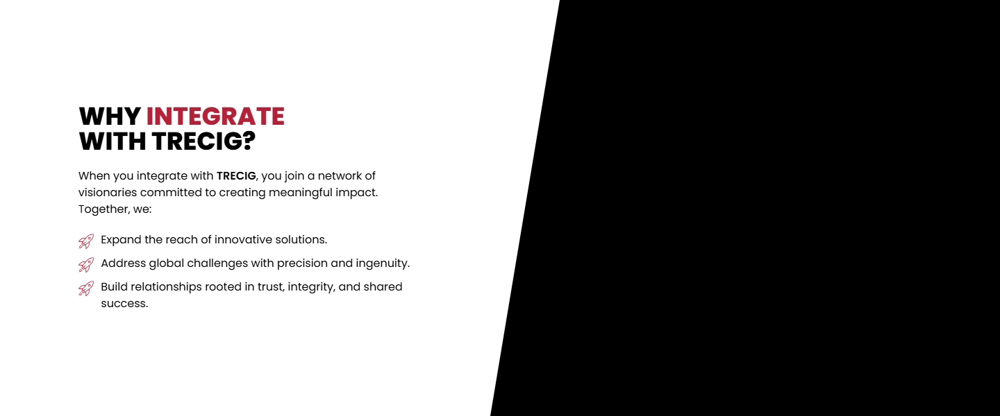
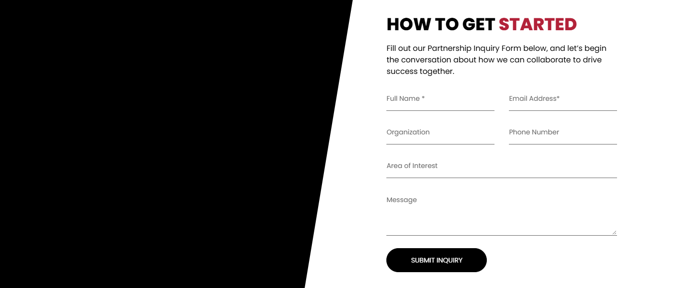
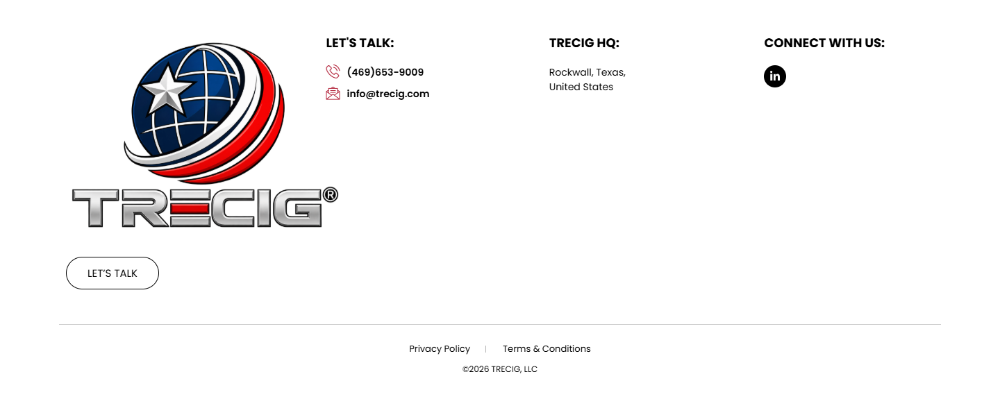

# Partnerships – TRECIG

*TRECIG (design reference site)* · URL: https://trecig.com/partnerships/ · captured 2026-11-08 00:35:54 · HTTP 200

- **Meta description:** —
- **Page size (desktop 1440px):** 1440×3440 px · tablet (820px): 3474 px · mobile (390px): 3601 px
- **Screenshots:** [desktop](screenshots/desktop-full.png) · [tablet](screenshots/tablet-full.png) · [mobile](screenshots/mobile-full.png) · [desktop top](screenshots/desktop-viewport-top.png) · [desktop scrolled](screenshots/desktop-viewport-scrolled.png)
- **Files:** [raw.html](raw.html) (server HTML) · [rendered.html](rendered.html) (DOM after JS) · [content.txt](content.txt) (all visible text) · layout-*.json (full element tree with computed styles) · page.json (everything)

## 1. Section map (top → bottom, desktop 1440px)

| # | Role | Y from top | Height | Heading / first text | Mobile height | Screenshot |
|---|---|---|---|---|---|---|
| 0 | header | 0 | 170 | HOME ABOUT AWARDS & RECOGNITION EXPERTISE PRESS & MEDIA CONTACT | 170 | [img](screenshots/desktop-sec00-header.png) |
| 1 | section | 170 | 400 | PARTNERSHIPS | 220 | [img](screenshots/desktop-sec01-section.png) |
| 2 | section | 570 | 288 | AN INROAD TO OUR ECOSYSTEM FOR COLLABORATIVE IMPACT | 320 | [img](screenshots/desktop-sec02-section.png) |
| 3 | section | 858 | 268 | OUR KEY INROAD INTEGRATORS | 278 | [img](screenshots/desktop-sec03-section.png) |
| 4 | section | 1126 | 248 | OUR SHARED VISION: | 235 | [img](screenshots/desktop-sec04-section.png) |
| 5 | section | 1374 | 600 | WHY INTEGRATE WITH TRECIG? | 566 | [img](screenshots/desktop-sec05-section.png) |
| 6 | section | 1974 | 268 | READY TO COLLABORATE? | 264 | [img](screenshots/desktop-sec06-section.png) |
| 7 | section | 2242 | 600 | HOW TO GET STARTED | 858 | [img](screenshots/desktop-sec07-section.png) |
| 8 | footer | 2842 | 598 | LET'S TALK: | 690 | [img](screenshots/desktop-sec08-footer.png) |
| 9 | floating (fixed, z 1000003) | 875 | 38 |  |  |  |

## 2. Section-by-section layout (desktop)

Legend: each line is an element in DOM order. `@x,y w×h` = position/size in px on the 1440px-wide page. Text lines show *font size/weight, line-height, colour*. Boxes show layout (flex/grid), background, padding, radius, shadow, etc. Pass-through wrappers are collapsed.

### 2.0 HEADER — HOME ABOUT AWARDS & RECOGNITION EXPERTISE PRESS & MEDIA CONTACT

Element: `<header class="elementor elementor-13 elementor-location-header">` at y=0, 1440×170px · 

- section.elementor-section [bg:#FFFFFF · shadow:#000000 @10% 0px 0px 12px 0px · z:9999 · transition:background, border, border-radius, box-shadow 0.3s, 0.3s, 0.3s, 0.3s ease, ease, ease, ease] `@0,0 1440×170`
  - div.elementor-container [flex row · margin:0px 85px 0px 85px · max-w:1270px] `@85,0 1270×170`
    - div.elementor-column [flex row · min-h:1px] `@85,0 1270×170`
      - div.elementor-widget-wrap [flex row wrap] `@85,0 1270×170`
        - div.elementor-container [flex row · max-w:1270px] `@85,0 1270×170`
          - div.elementor-column [flex row · min-h:1px] `@85,0 127×170`
            - div.elementor-widget-wrap [flex row wrap · align:center · pad:10px 10px 10px 10px] `@85,0 127×170`
              - a (link→/) [inline-block · align-text:center] `@95,10 200×150`
                - **IMG** `TRECIG_Logo_Registered.png` alt="" natural 1440×1080 · inline-block · max-w:200px · overflow:clip · align-text:center `@95,10 200×150`
          - div.elementor-column [flex row · min-h:1px] `@212,0 1143×170`
            - div.elementor-widget-wrap [flex row wrap · align:center · pad:10px 10px 10px 10px] `@212,0 1143×170`
              - div.elementor-widget-container [flex column · transition:background, border, border-radius, box-shadow, transform 0.3s, 0.3s, 0.3s, 0.3s, 0.4s ease, ease, ease, ease, ease] `@222,75 1123×20`
                - ul.elementor-nav-menu [flex row wrap · justify:flex-end · margin:0px 0px 0px 411.234px · z:2] · pseudo:::after{{"content": "\" \"", "w": "0px", "h": "0px"}} `@633,75 712×20`
                  - **A→/** "HOME" — Poppins 14px/400 lh 20px · #000000 · textTransform:uppercase ‖ flex row · margin:0px 15px 0px 0px · transition:all 0.4s ease `@633,75 40×20`
                  - **A→/about/** "ABOUT" — Poppins 14px/400 lh 20px · #000000 · textTransform:uppercase ‖ flex row · margin:0px 15px 0px 15px · transition:all 0.4s ease `@703,75 70×20`
                  - **A→/awards-recognition/** "AWARDS & RECOGNITION" — Poppins 14px/400 lh 20px · #000000 · textTransform:uppercase ‖ flex row · margin:0px 15px 0px 15px · transition:all 0.4s ease `@803,75 195×20`
                  - **A→/expertise/** "EXPERTISE" — Poppins 14px/400 lh 20px · #000000 · textTransform:uppercase ‖ flex row · margin:0px 15px 0px 15px · transition:all 0.4s ease `@1028,75 90×20`
                  - **A→/press-media/** "PRESS & MEDIA" — Poppins 14px/400 lh 20px · #000000 · textTransform:uppercase ‖ flex row · margin:0px 15px 0px 15px · transition:all 0.4s ease `@1148,75 100×20`
                  - **A→/contact/** "CONTACT" — Poppins 14px/400 lh 20px · #000000 · textTransform:uppercase ‖ flex row · margin:0px 0px 0px 15px · transition:all 0.4s ease `@1278,75 67×20`

### 2.1 SECTION — PARTNERSHIPS

Element: `<section class="elementor-section elementor-top-section elementor-element elementor-element-d309402 elementor-section-height-min-height elementor-section-bo">` at y=170, 1440×400px · 

- section.elementor-section [transition:background, border, border-radius, box-shadow 0.3s, 0.3s, 0.3s, 0.3s ease, ease, ease, ease] `@0,170 1440×400`
  - div.elementor-background-video-container [pos:absolute · z:0 · overflow:hidden · transition:opacity 1s ease] `@0,170 1440×400`
    - **IFRAME** https://www.youtube.com/embed/Fj-BbfimVMc?controls=0&rel=0&playsinline=1&cc_load_policy=0&enablejsapi=1&origin=https%3A%2F%2Ftrecig.com&widgetid=1&forigin=https%3A%2F%2Ftrecig.com%2Fpartnerships%2F&aoriginsup=1&vf=6 Trecig   Partnerships `@0,-35 1440×810`
  - div.elementor-background-overlay [bg:#000000 · pos:absolute · opacity:0.5 · transition:background, border-radius, opacity 0.3s, 0.3s, 0.3s ease, ease, ease] `@0,170 1440×400` (empty/decorative)
  - div.elementor-container [flex row · align:center · margin:0px 370px 0px 370px · max-w:700px · min-h:400px] `@370,170 700×400`
    - div.elementor-column [flex row · min-h:1px] `@370,260 700×221`
      - div.elementor-widget-wrap [flex row wrap · pad:10px 10px 10px 10px · margin:80px 0px 0px 0px] `@370,340 700×141`
        - div.elementor-widget-heading [margin:0px 0px 20px 0px · align-text:center] `@380,350 680×36`
          - **H2** "PARTNERSHIPS" — Poppins 36px/800 lh 36px · #FFFFFF · textTransform:uppercase · textAlign:center ‖ inline-block `@584,350 272×36`
        - div.elementor-widget-heading [margin:0px 0px 20px 0px · align-text:center] `@380,406 680×24`
          - **H2** "TRECIG IS MORE THAN A NAME—IT’S A PROMISE." — Poppins 18px/600 lh 18px · #FFFFFF · textTransform:uppercase · textAlign:center ‖ inline-block `@510,409 420×18`
        - ul.elementor-icon-list-items [flex row wrap · justify:center · margin:0px -2.5px 0px -2.5px · align-text:center] `@378,450 685×21`
          - li.elementor-icon-list-item [flex row · justify:center · align:center · margin:0px 2.5px 0px 2.5px · align-text:center] `@648,450 34×21`
            - **A→/** "HOME" — Poppins 12px/400 lh 18px · #CC3366 · textTransform:uppercase · textAlign:center ‖ flex row · highlights: "HOME" #FFFFFF `@648,451 34×18`
          - li.elementor-icon-list-item [flex row · justify:center · align:center · margin:0px 2.5px 0px 2.5px · align-text:center] `@687,450 106×21`
            - **SPAN** "PARTNERSHIPS" — Poppins 12px/400 lh 18px · #FFFFFF · textTransform:uppercase · textAlign:center ‖ pad:0px 0px 0px 5px · transition:color 0.3s ease `@704,451 88×18`

### 2.2 SECTION — AN INROAD TO OUR ECOSYSTEM FOR COLLABORATIVE IMPACT

Element: `<section class="elementor-section elementor-top-section elementor-element elementor-element-b1c2aaa logo-sec elementor-section-boxed elementor-section-heigh">` at y=570, 1440×288px · 

- section.elementor-section [pad:30px 0px 30px 0px · transition:background, border, border-radius, box-shadow 0.3s, 0.3s, 0.3s, 0.3s ease, ease, ease, ease] `@0,570 1440×288`
  - div.elementor-container [flex row · margin:0px 85px 0px 85px · max-w:1270px] `@85,600 1270×228`
    - div.elementor-column [flex row · min-h:1px] `@85,600 1270×228`
      - div.elementor-widget-wrap [flex row wrap · pad:10px 10px 10px 10px] `@85,600 1270×228`
        - div.elementor-container [flex row · margin:0px 225px 0px 225px · max-w:800px] `@320,610 800×208`
          - div.elementor-column [flex row · min-h:1px] `@320,610 800×208`
            - div.elementor-widget-wrap [flex row wrap · pad:10px 10px 10px 10px] `@320,610 800×208`
              - div.elementor-widget-heading [margin:0px 0px 20px 0px · align-text:center] `@330,620 780×72`
                - **H2** "AN INROAD TO OUR ECOSYSTEM FOR COLLABORATIVE IMPACT" — Poppins 36px/800 lh 36px · #000000 · textTransform:uppercase · textAlign:center ‖ inline-block · highlights: "OUR ECOSYSTEM" #B22239 `@330,620 780×72`
              - div.elementor-widget-container [align-text:center · transition:background, border, border-radius, box-shadow, transform 0.3s, 0.3s, 0.3s, 0.3s, 0.4s ease, ease, ease, ease, ease] `@330,712 780×96`
                - **text** "At , collaboration is at the heart of everything we do. By integrating organizations within our ecosystem that share our vision for innovation and excellence…" — Poppins 16px/400 lh 24px · #000000 · textAlign:center `@330,712 780×96`
                - **STRONG** "TRECIG" — Poppins 16px/600 lh 24px · #000000 · textAlign:center ‖ inline `@365,712 57×23`

### 2.3 SECTION — OUR KEY INROAD INTEGRATORS

Element: `<section class="elementor-section elementor-top-section elementor-element elementor-element-78df6d5 logo-sec elementor-section-boxed elementor-section-heigh">` at y=858, 1440×268px · 

- section.elementor-section [pad:50px 0px 50px 0px · transition:background, border, border-radius, box-shadow 0.3s, 0.3s, 0.3s, 0.3s ease, ease, ease, ease] `@0,858 1440×268`
  - div.elementor-background-video-container [pos:absolute · z:0 · overflow:hidden · transition:opacity 1s ease] `@0,858 1440×268`
    - **IFRAME** https://www.youtube.com/embed/Fj-BbfimVMc?controls=0&rel=0&playsinline=1&cc_load_policy=0&enablejsapi=1&origin=https%3A%2F%2Ftrecig.com&widgetid=3&forigin=https%3A%2F%2Ftrecig.com%2Fpartnerships%2F&aoriginsup=1&vf=1 Trecig   Partnerships `@0,587 1440×810`
  - div.elementor-background-overlay [bg:#000000 · pos:absolute · opacity:0.5 · transition:background, border-radius, opacity 0.3s, 0.3s, 0.3s ease, ease, ease] `@0,858 1440×268` (empty/decorative)
  - div.elementor-container [flex row · margin:0px 85px 0px 85px · max-w:1270px] `@85,908 1270×168`
    - div.elementor-column [flex row · min-h:1px] `@85,908 1270×168`
      - div.elementor-widget-wrap [flex row wrap · pad:10px 10px 10px 10px] `@85,908 1270×168`
        - div.elementor-container [flex row · margin:0px 225px 0px 225px · max-w:800px] `@320,918 800×148`
          - div.elementor-column [flex row · min-h:1px] `@320,918 800×148`
            - div.elementor-widget-wrap [flex row wrap · pad:10px 10px 10px 10px] `@320,918 800×148`
              - div.elementor-widget-heading [margin:0px 0px 20px 0px · align-text:center] `@330,928 780×36`
                - **H2** "OUR KEY INROAD INTEGRATORS" — Poppins 36px/800 lh 36px · #FFFFFF · textTransform:uppercase · textAlign:center ‖ inline-block · highlights: "KEY INROAD" #B22239 `@436,928 568×36`
              - div.elementor-widget-container [align-text:center · transition:background, border, border-radius, box-shadow, transform 0.3s, 0.3s, 0.3s, 0.3s, 0.4s ease, ease, ease, ease, ease] `@330,984 780×72`
                - **text** "We are proud to collaborate with organizations like , a leader in logistics and operational excellence. Through this partnership, we combine strengths, exper…" — Poppins 16px/400 lh 24px · #FFFFFF · textAlign:center `@330,984 780×72`
                - **STRONG** "KUOG Corporation" — Poppins 16px/600 lh 24px · #FFFFFF · textAlign:center ‖ inline `@752,984 149×23`

### 2.4 SECTION — OUR SHARED VISION:

Element: `<section class="elementor-section elementor-top-section elementor-element elementor-element-c858b5d logo-sec elementor-section-boxed elementor-section-heigh">` at y=1126, 1440×248px · 

- section.elementor-section [pad:30px 0px 30px 0px · transition:background, border, border-radius, box-shadow 0.3s, 0.3s, 0.3s, 0.3s ease, ease, ease, ease] `@0,1126 1440×248`
  - div.elementor-container [flex row · margin:0px 85px 0px 85px · max-w:1270px] `@85,1156 1270×188`
    - div.elementor-column [flex row · min-h:1px] `@85,1156 1270×188`
      - div.elementor-widget-wrap [flex row wrap · pad:10px 10px 10px 10px] `@85,1156 1270×188`
        - div.elementor-container [flex row · margin:0px 307.5px 0px 307.5px · max-w:635px] `@403,1166 635×168`
          - div.elementor-column [flex row · min-h:1px] `@403,1166 635×168`
            - div.elementor-widget-wrap [flex row wrap · pad:10px 10px 10px 10px] `@403,1166 635×168`
              - div.elementor-widget-heading [margin:0px 0px 20px 0px · align-text:center] `@413,1176 615×36`
                - **H2** "OUR SHARED VISION:" — Poppins 36px/800 lh 36px · #000000 · textTransform:uppercase · textAlign:center ‖ inline-block · highlights: "VISION:" #B22239 `@532,1176 376×36`
              - ul.elementor-icon-list-items `@413,1232 615×92`
                - li.elementor-icon-list-item [flex row · justify:start · align:flex-start · pad:0px 0px 5px 0px] `@413,1232 615×29`
                  - **SPAN** "Driving innovation in logistics and supply chain management." — Poppins 16px/400 lh 24px · #000000 ‖ pad:0px 0px 0px 5px · transition:color 0.3s ease `@440,1232 499×24`
                - li.elementor-icon-list-item [flex row · justify:start · align:flex-start · pad:0px 0px 5px 0px · margin:5px 0px 0px 0px] `@413,1266 615×29`
                  - **SPAN** "Delivering unparalleled results for defense, civilian, and private sectors." — Poppins 16px/400 lh 24px · #000000 ‖ pad:0px 0px 0px 5px · transition:color 0.3s ease `@440,1266 570×24`
                - li.elementor-icon-list-item [flex row · justify:start · align:flex-start · margin:5px 0px 0px 0px] `@413,1300 615×24`
                  - **SPAN** "Shaping industries through strategic collaboration and shared expertise." — Poppins 16px/400 lh 24px · #000000 ‖ pad:0px 0px 0px 5px · transition:color 0.3s ease `@440,1300 584×24`

### 2.5 SECTION — WHY INTEGRATE WITH TRECIG?

Element: `<section class="elementor-section elementor-top-section elementor-element elementor-element-6c0982d elementor-section-full_width tilt-sec2 elementor-section">` at y=1374, 1440×600px · 

- section.elementor-section [bg:transparent · transition:background, border, border-radius, box-shadow 0.3s, 0.3s, 0.3s, 0.3s ease, ease, ease, ease] `@0,1374 1440×600`
  - div.elementor-container [flex row] `@0,1374 1440×600`
    - div.elementor-column [flex row · min-h:1px] `@0,1374 706×600`
      - div.elementor-widget-wrap [flex row wrap · align:center · pad:10px 10px 10px 10px] `@0,1374 706×600`
        - div.elementor-container [flex row · margin:0px 92.7969px 0px 92.7969px · max-w:500px] `@103,1514 500×320`
          - div.elementor-column [flex row · min-h:1px] `@103,1514 500×320`
            - div.elementor-widget-wrap [flex row wrap · pad:10px 10px 10px 10px] `@103,1514 500×320`
              - div.elementor-widget-heading [margin:0px 0px 20px 0px] `@113,1524 480×72`
                - **H2** "WHY INTEGRATE WITH TRECIG?" — Poppins 36px/800 lh 36px · #000000 · textTransform:uppercase ‖ inline-block · highlights: "INTEGRATE" #B22239 `@113,1524 297×72`
              - div.elementor-widget-text-editor [margin:0px 0px 20px 0px] `@113,1616 480×72`
                - div.elementor-widget-container [transition:background, border, border-radius, box-shadow, transform 0.3s, 0.3s, 0.3s, 0.3s, 0.4s ease, ease, ease, ease, ease] `@113,1616 480×72`
                  - **text** "When you integrate with , you join a network of visionaries committed to creating meaningful impact. Together, we:" — Poppins 16px/400 lh 24px · #000000 `@113,1616 480×72`
                  - **STRONG** "TRECIG" — Poppins 16px/600 lh 24px · #000000 ‖ inline `@312,1616 57×23`
              - ul.elementor-icon-list-items `@113,1708 480×116`
                - li.elementor-icon-list-item [flex row · justify:start · align:flex-start · pad:0px 0px 5px 0px] `@113,1708 480×29`
                  - **SPAN** "Expand the reach of innovative solutions." — Poppins 16px/400 lh 24px · #000000 ‖ pad:0px 0px 0px 5px · transition:color 0.3s ease `@140,1708 331×24`
                - li.elementor-icon-list-item [flex row · justify:start · align:flex-start · pad:0px 0px 5px 0px · margin:5px 0px 0px 0px] `@113,1742 480×29`
                  - **SPAN** "Address global challenges with precision and ingenuity." — Poppins 16px/400 lh 24px · #000000 ‖ pad:0px 0px 0px 5px · transition:color 0.3s ease `@140,1742 450×24`
                - li.elementor-icon-list-item [flex row · justify:start · align:flex-start · margin:5px 0px 0px 0px] `@113,1776 480×48`
                  - **SPAN** "Build relationships rooted in trust, integrity, and shared success." — Poppins 16px/400 lh 24px · #000000 ‖ pad:0px 0px 0px 5px · transition:color 0.3s ease `@140,1776 453×48`
    - div.elementor-column [flex row · min-h:1px] `@706,1374 734×600`
      - div.elementor-widget-wrap [flex row wrap · align:center · transition:background, border, border-radius, box-shadow 0.3s, 0.3s, 0.3s, 0.3s ease, ease, ease, ease] `@706,1374 734×600`
        - div.elementor-widget-container [overflow:hidden · transform:matrix(1, 0, 0, 1, 0, 0) · transition:background, border, border-radius, box-shadow, transform 0.3s, 0.3s, 0.3s, 0.3s, 0.4s ease, ease, ease, ease, ease] `@706,1374 734×600`
          - **IFRAME** https://www.youtube.com/embed/X7fXtLsp0No?controls=0&rel=0&playsinline=1&cc_load_policy=0&autoplay=1&enablejsapi=1&origin=https%3A%2F%2Ftrecig.com&widgetid=7&forigin=https%3A%2F%2Ftrecig.com%2Fpartnerships%2F&aoriginsup=1&vf=1 Partnership Video 1 `@706,1374 1080×600`

### 2.6 SECTION — READY TO COLLABORATE?

Element: `<section class="elementor-section elementor-top-section elementor-element elementor-element-ec29465 logo-sec elementor-section-boxed elementor-section-heigh">` at y=1974, 1440×268px · 

- section.elementor-section [pad:50px 0px 50px 0px · transition:background, border, border-radius, box-shadow 0.3s, 0.3s, 0.3s, 0.3s ease, ease, ease, ease] `@0,1974 1440×268`
  - div.elementor-container [flex row · margin:0px 85px 0px 85px · max-w:1270px] `@85,2024 1270×168`
    - div.elementor-column [flex row · min-h:1px] `@85,2024 1270×168`
      - div.elementor-widget-wrap [flex row wrap · pad:10px 10px 10px 10px] `@85,2024 1270×168`
        - div.elementor-container [flex row · margin:0px 225px 0px 225px · max-w:800px] `@320,2034 800×148`
          - div.elementor-column [flex row · min-h:1px] `@320,2034 800×148`
            - div.elementor-widget-wrap [flex row wrap · pad:10px 10px 10px 10px] `@320,2034 800×148`
              - div.elementor-widget-heading [margin:0px 0px 20px 0px · align-text:center] `@330,2044 780×36`
                - **H2** "READY TO COLLABORATE?" — Poppins 36px/800 lh 36px · #000000 · textTransform:uppercase · textAlign:center ‖ inline-block · highlights: "COLLABORATE?" #B22239 `@486,2044 469×36`
              - **text** "We’re always looking for like-minded organizations to join us in transforming industries and achieving extraordinary results. Whether you’re seeking to expan…" — Poppins 16px/400 lh 24px · #000000 · textAlign:center `@330,2100 780×72`

### 2.7 SECTION — HOW TO GET STARTED

Element: `<section class="elementor-section elementor-top-section elementor-element elementor-element-f758183 elementor-section-full_width tilt-image elementor-sectio">` at y=2242, 1440×600px · 

- section.elementor-section [bg:transparent · overflow:hidden · transition:background, border, border-radius, box-shadow 0.3s, 0.3s, 0.3s, 0.3s ease, ease, ease, ease] `@0,2242 1440×600`
  - div.elementor-container [flex row] `@0,2242 1440×600`
    - div.elementor-column [flex row · min-h:1px] `@0,2242 734×600`
      - div.elementor-widget-wrap [flex row wrap · align:center · transition:background, border, border-radius, box-shadow 0.3s, 0.3s, 0.3s, 0.3s ease, ease, ease, ease] `@0,2242 734×600`
        - div.elementor-widget-video · pseudo:::after{{"content": "\"\"", "w": "100px", "h": "600px", "position": "absolute"}} `@0,2242 734×600`
          - div.elementor-widget-container [overflow:hidden · transform:matrix(1, 0, 0, 1, 0, 0) · transition:background, border, border-radius, box-shadow, transform 0.3s, 0.3s, 0.3s, 0.3s, 0.4s ease, ease, ease, ease, ease] `@0,2242 734×600`
            - **IFRAME** https://www.youtube.com/embed/zAUxhtVDqc0?controls=0&rel=0&playsinline=1&cc_load_policy=0&autoplay=1&enablejsapi=1&origin=https%3A%2F%2Ftrecig.com&widgetid=9&forigin=https%3A%2F%2Ftrecig.com%2Fpartnerships%2F&aoriginsup=1&vf=1 Partnership Video 2 `@0,2242 1080×600`
    - div.elementor-column [flex row · min-h:1px] `@734,2242 706×600`
      - div.elementor-widget-wrap [flex row wrap · align:center · pad:10px 10px 10px 10px · margin:0px 0px 0px 50px] `@784,2242 656×600`
        - div.elementor-container [flex row · margin:0px 135.594px 0px 0px · max-w:500px] `@794,2265 500×554`
          - div.elementor-column [flex row · min-h:1px] `@794,2265 500×554`
            - div.elementor-widget-wrap [flex row wrap · pad:10px 10px 10px 10px] `@794,2265 500×554`
              - div.elementor-widget-heading [margin:0px 0px 20px 0px] `@804,2275 480×36`
                - **H2** "HOW TO GET STARTED" — Poppins 36px/800 lh 36px · #000000 · textTransform:uppercase ‖ inline-block · highlights: "STARTED" #B22239 `@804,2275 396×36`
              - div.elementor-widget-text-editor [margin:0px 0px 20px 0px] `@804,2331 480×72`
                - **text** "Fill out our Partnership Inquiry Form below, and let’s begin the conversation about how we can collaborate to drive success together." — Poppins 16px/400 lh 24px · #000000 `@804,2331 480×72`
              - FORM form.wpcf7-form `@804,2423 480×386`
                - div.secfr-1 `@804,2423 480×140`
                  - p [flex row · gap:15px] `@804,2423 480×70`
                    - span.wpcf7-form-control-wrap [margin:0px 0px 20px 0px] `@804,2423 225×50`
                      - **FIELD** <input type=text name=fullname> placeholder="Full Name *" — Poppins 14px/400 lh 21px · #000000 ‖ inline-block · border:0px 0px 1px 0px none #000000 · transition:all 0.3s ease `@804,2423 225×50`
                    - span.wpcf7-form-control-wrap [margin:0px 0px 20px 0px] `@1059,2423 225×50`
                      - **FIELD** <input type=email name=email> placeholder="Email Address*" — Poppins 14px/400 lh 21px · #000000 ‖ inline-block · border:0px 0px 1px 0px none #000000 · transition:all 0.3s ease `@1059,2423 225×50`
                  - p [flex row · gap:15px] `@804,2493 480×70`
                    - span.wpcf7-form-control-wrap [margin:0px 0px 20px 0px] `@804,2493 225×50`
                      - **FIELD** <input type=text name=organization> placeholder="Organization" — Poppins 14px/400 lh 21px · #000000 ‖ inline-block · border:0px 0px 1px 0px none #000000 · transition:all 0.3s ease `@804,2493 225×50`
                    - span.wpcf7-form-control-wrap [margin:0px 0px 20px 0px] `@1059,2493 225×50`
                      - **FIELD** <input type=tel name=phone> placeholder="Phone Number" — Poppins 14px/400 lh 21px · #000000 ‖ inline-block · border:0px 0px 1px 0px none #000000 · transition:all 0.3s ease `@1059,2493 225×50`
                - **FIELD** <input type=submit name=> placeholder="" value='Submit Inquiry' — Poppins 14px/400 lh 21px · #FFFFFF · textTransform:uppercase · textAlign:center ‖ inline-block · bg:#000000 · pad:0px 50px 0px 50px · radius:30px · border:1px 1px 1px 1px solid #000000 · transition:all 0.3s ease `@804,2759 209×50`

### 2.8 FOOTER — LET'S TALK:

Element: `<footer class="elementor elementor-15 elementor-location-footer">` at y=2842, 1440×598px · 

- section.elementor-section [transition:background, border, border-radius, box-shadow 0.3s, 0.3s, 0.3s, 0.3s ease, ease, ease, ease] `@0,2842 1440×598`
  - div.elementor-background-video-container [pos:absolute · z:0 · overflow:hidden · transition:opacity 1s ease] `@0,2842 1440×598`
    - **IFRAME** https://www.youtube.com/embed/OzwCnEEadts?controls=0&rel=0&playsinline=1&cc_load_policy=0&enablejsapi=1&origin=https%3A%2F%2Ftrecig.com&widgetid=5&forigin=https%3A%2F%2Ftrecig.com%2Fpartnerships%2F&aoriginsup=1&vf=1 Triceg   Expertise Slider 1 `@0,2736 1440×810`
  - div.elementor-background-overlay [bg:#FFFFFF · pos:absolute · opacity:0.7 · transition:background, border-radius, opacity 0.3s, 0.3s, 0.3s ease, ease, ease] `@0,2842 1440×598` (empty/decorative)
  - div.elementor-container [flex row · margin:0px 85px 0px 85px · max-w:1270px] `@85,2842 1270×598`
    - div.elementor-column [flex row · min-h:1px] `@85,2842 1270×598`
      - div.elementor-widget-wrap [flex row wrap] `@85,2842 1270×598`
        - section.elementor-section [pad:40px 0px 40px 0px] `@85,2842 1270×467`
          - div.elementor-container [flex row · max-w:1270px] `@85,2882 1270×387`
            - div.elementor-column [flex row · min-h:1px] `@85,2882 324×387`
              - div.elementor-widget-wrap [flex row wrap · pad:10px 10px 10px 10px] `@85,2882 324×387`
                - div.elementor-widget-theme-site-logo [margin:0px 0px 20px 0px] `@95,2892 304×300`
                  - a (link→/) [inline-block] `@95,2892 400×300`
                    - **IMG** `TRECIG_Logo_Registered.png` alt="" natural 1440×1080 · inline-block · max-w:400px · overflow:clip `@95,2892 400×300`
                - div.elementor-button-wrapper [grid cols[134.078px]] `@95,3212 134×47`
                  - **A→/contact/** "LET’S TALK" — Poppins 15px/400 lh 15px · #000000 · textTransform:uppercase · textAlign:center ‖ pad:15px 30px 15px 30px · radius:30px · border:1px 1px 1px 1px solid #000000 · transition:all 0.3s ease `@95,3212 134×47`
            - div.elementor-column [flex row · min-h:1px] `@409,2882 371×387`
              - div.elementor-widget-wrap [flex row wrap · pad:10px 10px 10px 10px · margin:0px 0px 0px 50px] `@459,2882 321×387`
                - div.elementor-widget-heading [margin:0px 0px 20px 0px] `@469,2892 301×24`
                  - **H2** "LET'S TALK:" — Poppins 18px/700 lh 18px · #000000 · textTransform:uppercase ‖ inline-block `@469,2895 98×18`
                - ul.elementor-icon-list-items `@469,2936 301×52`
                  - li.elementor-icon-list-item [flex row · align:center · pad:0px 0px 5px 0px] `@469,2936 301×26`
                    - **A→tel:(254)%20338-6131** "(469)653-9009" — Poppins 14px/600 lh 21px · #CC3366 ‖ flex row · highlights: "(469)653-9009" #000000 `@469,2936 301×21`
                  - li.elementor-icon-list-item [flex row · align:center · margin:5px 0px 0px 0px] `@469,2967 301×21`
                    - **A→mailto:info@trecig.com** "info@trecig.com" — Poppins 14px/600 lh 21px · #CC3366 ‖ flex row · highlights: "info@trecig.com" #000000 `@469,2967 301×21`
            - div.elementor-column [flex row · min-h:1px] `@781,2882 310×387`
              - div.elementor-widget-wrap [flex row wrap · pad:10px 10px 10px 10px · margin:0px 50px 0px 0px] `@781,2882 260×387`
                - div.elementor-widget-heading [margin:0px 0px 20px 0px] `@791,2892 240×24`
                  - **H2** "TRECIG HQ:" — Poppins 18px/700 lh 18px · #000000 · textTransform:uppercase ‖ inline-block `@791,2895 101×18`
                - ul.elementor-icon-list-items `@791,2936 240×42`
                  - li.elementor-icon-list-item [flex row · align:center] `@791,2936 240×42`
                    - **SPAN** "Rockwall, Texas, United States" — Poppins 14px/400 lh 21px · #000000 ‖ transition:color 0.3s ease `@791,2936 110×42`
            - div.elementor-column [flex row · min-h:1px] `@1090,2882 264×387`
              - div.elementor-widget-wrap [flex row wrap · pad:10px 10px 10px 10px] `@1090,2882 264×387`
                - div.elementor-widget-heading [margin:0px 0px 20px 0px] `@1100,2892 244×24`
                  - **H2** "CONNECT WITH US:" — Poppins 18px/700 lh 18px · #000000 · textTransform:uppercase ‖ inline-block `@1100,2895 174×18`
                - **A→/partnerships/** "Linkedin-in" +icon[e-font-icon-svg e-fab-linkedin-in] — -apple-system 16px/400 lh 16px · #69727D · textAlign:center ‖ flex row · bg:#000000 · radius:100% · transition:all 0.3s ease `@1100,2936 32×32`
        - section.elementor-section [pad:15px 0px 15px 0px · border:1px 0px 0px 0px solid #000000 @20%] `@85,3309 1270×131`
          - div.elementor-container [flex row · max-w:1270px] `@85,3325 1270×100`
            - div.elementor-column [flex row · min-h:1px] `@85,3325 1270×100`
              - div.elementor-widget-wrap [flex row wrap · align:center · pad:10px 10px 10px 10px] `@85,3325 1270×100`
                - div.elementor-element [margin:0px 0px 20px 0px · align-text:center] `@95,3335 1250×10`
                  - div.elementor-widget-container [margin:0px 0px -10px 0px · overflow:hidden · align-text:center · transition:background, border, border-radius, box-shadow, transform 0.3s, 0.3s, 0.3s, 0.3s, 0.4s ease, ease, ease, ease, ease] `@95,3335 1250×20`
                    - ul.elementor-icon-list-items [flex row wrap · justify:center · gap:30px · margin:0px -8px 0px -8px · align-text:center] `@87,3335 1266×20`
                      - li.elementor-icon-list-item [flex row · justify:center · align:center · margin:0px 8px 0px 8px · align-text:center] `@589,3335 89×20`
                        - **A→/privacy-policy/** "Privacy Policy" — Poppins 13px/400 lh 19.5px · #CC3366 · textAlign:center ‖ flex row · highlights: "Privacy Policy" #000000 `@589,3335 88×20`
                      - li.elementor-icon-list-item [flex row · justify:center · align:center · margin:0px 8px 0px 8px · align-text:center] `@724,3335 127×20`
                        - **A→/terms-conditions/** "Terms & Conditions" — Poppins 13px/400 lh 19.5px · #CC3366 · textAlign:center ‖ flex row · highlights: "Terms & Conditions" #000000 `@724,3335 127×20`
                - **P** "©2026 TRECIG, LLC" — Poppins 12px/400 lh 18px · #000000 · textTransform:uppercase · textAlign:center ‖ margin:0px 0px 14.4px 0px `@95,3365 1250×36`

### Floating / fixed elements
- `div.` fixed at [1348, 875, 92, 38] z-index 1000003 — ""

## 3. Header, navigation & interaction behaviour

- **atTop** `header.elementor.elementor-13.elementor-location-header` position:static top:0 height:170 bg:transparent shadow:none backdrop:none z:auto
- **afterScroll1400** `header.elementor.elementor-13.elementor-location-header` position:static top:-1400 height:0 bg:transparent shadow:none backdrop:none z:auto
- **afterScroll1400** `section.elementor-section.elementor-top-section.elementor-element.elementor-elem` position:fixed top:0 height:170 bg:#FFFFFF @90% shadow:#000000 @10% 0px 0px 12px 0px backdrop:none z:9999

| Menu item | Link | Dropdown | Style | Hover change |
|---|---|---|---|---|
| HOME | / | — | Poppins 14px/400 #000000 uppercase ls normal | color: #000000 → #B22239 |
| ABOUT | /about/ | The Mission (/the-mission/); The Values (/the-values/); The Legacy (/the-legacy/); The Trecig Team (/the-trecig-team/); Careers (/careers/) | Poppins 14px/400 #000000 uppercase ls normal | color: #000000 → #B22239 |
| AWARDS & RECOGNITION (current) | /awards-recognition/ | Partnerships (/partnerships/) | Poppins 14px/400 #000000 uppercase ls normal | color: #000000 → #B22239 |
| EXPERTISE | /expertise/ | Industries We Serve (/industries-we-serve/) | Poppins 14px/400 #000000 uppercase ls normal | color: #000000 → #B22239 |
| PRESS & MEDIA | /press-media/ | — | Poppins 14px/400 #000000 uppercase ls normal | color: #000000 → #B22239 |
| CONTACT | /contact/ | — | Poppins 14px/400 #000000 uppercase ls normal | color: #000000 → #B22239 |

- **Mobile menu:** toggle `.elementor-menu-toggle` → [screenshot](screenshots/mobile-menu-open.png) · items: HOME, ABOUT, AWARDS & RECOGNITION, EXPERTISE, PRESS & MEDIA, CONTACT

### Hover states (measured by hovering in Chrome)

| Element | Text | Normal | On hover |
|---|---|---|---|
| `a.elementor-item` | HOME | color #000000 · bg transparent · radius 0px · pad 0px · border 0px #000000 · transition 0.4s | color: #000000 → #B22239; borderTopColor: #000000 → #B22239 |
| `a.elementor-item` | ABOUT | color #000000 · bg transparent · radius 0px · pad 0px · border 0px #000000 · transition 0.4s | color: #000000 → #B22239; borderTopColor: #000000 → #B22239 |
| `a.elementor-item` | CONTACT | color #000000 · bg transparent · radius 0px · pad 0px · border 0px #000000 · transition 0.4s | color: #000000 → #B22239; borderTopColor: #000000 → #B22239 |
| `input.wpcf7-form-control` | Submit Inquiry | color #FFFFFF · bg #000000 · radius 30px · pad 0px 50px · border 1px #000000 · transition 0.3s | backgroundColor: #000000 → #B22239; borderTopColor: #000000 → #B22239 |
| `a.` |  | color #CC3366 · bg transparent · radius 0px · pad 0px · border 0px #CC3366 · transition all | color: #CC3366 → #B22239; borderTopColor: #CC3366 → #B22239; childColor: #CC3366 → #B22239 |
| `a.elementor-button` | LET’S TALK | color #000000 · bg transparent · radius 30px · pad 15px 30px · border 1px #000000 · transition 0.3s | color: #000000 → #FFFFFF; borderTopColor: #000000 → #B22239 |
| `a.` | (469)653-9009 | color #CC3366 · bg transparent · radius 0px · pad 0px · border 0px #CC3366 · transition all | color: #CC3366 → #B22239; borderTopColor: #CC3366 → #B22239 |
| `a.elementor-icon` | Linkedin-in | color #69727D · bg #000000 · radius 100% · pad 0px · border 0px #69727D · transition 0.3s | color: #69727D → #B22239; backgroundColor: #000000 → #B22239; borderTopColor: #69727D → #B22239; opacity: 1 → 0.9; childColor: #69727D → #B22239 |
| `a.` | Privacy Policy | color #CC3366 · bg transparent · radius 0px · pad 0px · border 0px #CC3366 · transition all | color: #CC3366 → #B22239; borderTopColor: #CC3366 → #B22239 |

## 4. Typography & colour used on this page (weighted by amount of text / area)

| Font · weight · size / line-height | chars |
|---|---|
| Poppins | 400 | 16px / 24px | 1441 |
| Poppins | 800 | 36px / 36px | 163 |
| Poppins | 400 | 14px / 20px | 58 |
| Poppins | 600 | 18px / 18px | 42 |
| Poppins | 700 | 18px / 18px | 37 |
| Poppins | 400 | 12px / 18px | 33 |
| Poppins | 400 | 13px / 19.5px | 32 |
| Poppins | 400 | 14px / 21px | 29 |
| Poppins | 600 | 16px / 24px | 28 |
| Poppins | 600 | 14px / 21px | 28 |
| -apple-system | 400 | 16px / 24px | 15 |
| -apple-system | 400 | 16px / 16px | 11 |
| Poppins | 400 | 15px / 15px | 10 |

- **Text colours:** #000000 (1507), #FFFFFF (336), #B22239 (58), #CC3366 (15), #69727D (11)
- **Background colours (by area):** #000000 (2269), transparent (1728), #FFFFFF (1109)
- **Border radii:** 30px (2), 100% (1), 2px 0px 0px (1)
- **Shadows:** #000000 @10% 0px 0px 12px 0px (1) | #000000 @20% 0px 0px 5px 0px (1)
- **Mobile text styles:** Poppins | 400 | 14px / 21px (1470); Poppins | 800 | 28px / 28px (163); Poppins | 600 | 14px / 21px (56); Poppins | 400 | 12px / 18px (48); Poppins | 600 | 16px / 16px (42); Poppins | 700 | 16px / 16px (37); Poppins | 400 | 10px / 15px (17); -apple-system | 400 | 16px / 24px (15); -apple-system | 400 | 16px / 16px (11); Poppins | 400 | 14px / 14px (10)

## 5. Forms
- **Form** `wpcf7-form init` → https://trecig.com/partnerships/#wpcf7-f2468-p1935-o1 (post)
  - fieldset[fieldset] name=`` label="" placeholder=""
  - input[text] name=`fullname` label="" placeholder="Full Name *"
  - input[email] name=`email` label="" placeholder="Email Address*"
  - input[text] name=`organization` label="" placeholder="Organization"
  - input[tel] name=`phone` label="" placeholder="Phone Number"
  - input[text] name=`areainterest` label="" placeholder="Area of Interest"
  - textarea[textarea] name=`message` label="" placeholder="Message"
  - input[submit] name=`` label="" placeholder="" value="Submit Inquiry"

## 6. Images on the page

- `TRECIG_Logo_Registered.png` natural 1440×1080 → shown 200×150 · alt="" · https://trecig.com/wp-content/uploads/2026/10/TRECIG_Logo_Registered.png
- background on `div.`: https://cdn.ywxi.net/meter/trecig.com/205.svg?ts=1784975038086&l=en

## 7. Links on the page

- [body] "Skip to content" → /partnerships/#content
- [header] "(icon/image)" → /
- [header] "HOME" → /
- [header] "ABOUT" → /about/
- [header] "The Mission" → /the-mission/
- [header] "The Values" → /the-values/
- [header] "The Legacy" → /the-legacy/
- [header] "The Trecig Team" → /the-trecig-team/
- [header] "Careers" → /careers/
- [header] "AWARDS & RECOGNITION" → /awards-recognition/
- [header] "Partnerships" → /partnerships/
- [header] "EXPERTISE" → /expertise/
- [header] "Industries We Serve" → /industries-we-serve/
- [header] "PRESS & MEDIA" → /press-media/
- [header] "CONTACT" → /contact/
- [header] "Home" → /
- [header] "About" → /about/
- [header] "Awards & Recognition" → /awards-recognition/
- [header] "Expertise" → /expertise/
- [header] "Press & Media" → /press-media/
- [header] "Contact" → /contact/
- [footer] "LET’S TALK" → /contact/
- [footer] "(469)653-9009" → tel:(254)%20338-6131
- [footer] "info@trecig.com" → mailto:info@trecig.com
- [footer] "Linkedin-in" → /partnerships/ (target _blank)
- [footer] "Privacy Policy" → /privacy-policy/
- [footer] "Terms & Conditions" → /terms-conditions/

## 8. Mobile layout (390px) — condensed outline

### 8.0 header — HOME ABOUT AWARDS & RECOGNITION EXPERTISE PRESS & MEDIA CONTACT (y 0, h 170)
- section.elementor-section [bg:#FFFFFF · shadow:#000000 @10% 0px 0px 12px 0px · z:9999 · transition:background, border, border-radius, box-shadow 0.3s, 0.3s, 0.3s, 0.3s ease, ease, ease, ease] `@0,0 390×170`
  - div.elementor-container [flex row wrap · max-w:767px] `@0,0 390×170`
    - div.elementor-column [flex row · min-h:1px] `@0,0 390×170`
      - div.elementor-widget-wrap [flex row wrap] `@0,0 390×170`
        - div.elementor-container [flex row wrap · max-w:767px] `@0,0 390×170`
          - div.elementor-column [flex row · min-h:1px] `@0,0 234×170`
            - div.elementor-widget-wrap [flex row wrap · align:center · pad:10px 10px 10px 10px] `@0,0 234×170`
              - a (link→/) [inline-block · align-text:center] `@17,10 200×150`
                - **IMG** `TRECIG_Logo_Registered-1024x768.png` alt="" natural 390×292 · inline-block · max-w:200px · overflow:clip · align-text:center `@17,10 200×150`
          - div.elementor-column [flex row · min-h:1px] `@234,0 156×170`
            - div.elementor-widget-wrap [flex row wrap · align:center · pad:10px 10px 10px 10px] `@234,0 156×170`
              - div.elementor-widget-container [flex column · transition:background, border, border-radius, box-shadow, transform 0.3s, 0.3s, 0.3s, 0.3s, 0.4s ease, ease, ease, ease, ease] `@244,70 136×30`
                - nav.elementor-nav-menu--dropdown [bg:#FFFFFF · margin:16px 0px 0px 0px · pos:absolute · z:9997 · overflow:hidden · transform:matrix(1, 0, 0, 0, 0, 0) · transition:max-height, transform 0.3s, 0.3s ease, ease] `@0,116 390×0`
                  - ul.elementor-nav-menu [z:2] · pseudo:::after{{"content": "\" \"", "w": "390px", "h": "0px"}} `@0,116 390×0`
                    - **A→/** "HOME" — Poppins 14px/400 lh 20px · #000000 · textTransform:uppercase ‖ flex row · pad:10px 20px 10px 20px `@0,116 390×0`
                    - **A→/about/** "ABOUT" — Poppins 14px/400 lh 20px · #000000 · textTransform:uppercase ‖ flex row · pad:10px 20px 10px 20px `@0,116 390×0`
                    - **A→/awards-recognition/** "AWARDS & RECOGNITION" — Poppins 14px/400 lh 20px · #000000 · textTransform:uppercase ‖ flex row · pad:10px 20px 10px 20px `@0,116 390×0`
                    - **A→/expertise/** "EXPERTISE" — Poppins 14px/400 lh 20px · #000000 · textTransform:uppercase ‖ flex row · pad:10px 20px 10px 20px `@0,116 390×0`
                    - **A→/press-media/** "PRESS & MEDIA" — Poppins 14px/400 lh 20px · #000000 · textTransform:uppercase ‖ flex row · pad:10px 20px 10px 20px `@0,116 390×0`
                    - **A→/contact/** "CONTACT" — Poppins 14px/400 lh 20px · #000000 · textTransform:uppercase ‖ flex row · pad:10px 20px 10px 20px `@0,116 390×0`

### 8.1 section — PARTNERSHIPS (y 170, h 220)
- section.elementor-section [transition:background, border, border-radius, box-shadow 0.3s, 0.3s, 0.3s, 0.3s ease, ease, ease, ease] `@0,170 390×220`
  - div.elementor-background-overlay [bg:#000000 · pos:absolute · opacity:0.5 · transition:background, border-radius, opacity 0.3s, 0.3s, 0.3s ease, ease, ease] `@0,170 390×220` (empty/decorative)
  - div.elementor-container [flex row wrap · align:center · max-w:700px · min-h:220px] `@0,170 390×220`
    - div.elementor-column [flex row · min-h:1px] `@0,185 390×190`
      - div.elementor-widget-wrap [flex row wrap · pad:10px 10px 10px 10px · margin:65px 0px 0px 0px] `@0,250 390×125`
        - div.elementor-widget-heading [margin:0px 0px 20px 0px · align-text:center] `@10,260 370×29`
          - **H2** "PARTNERSHIPS" — Poppins 28px/800 lh 28px · #FFFFFF · textTransform:uppercase · textAlign:center ‖ inline-block `@89,260 212×28`
        - div.elementor-widget-heading [margin:0px 0px 20px 0px · align-text:center] `@10,309 370×15`
          - div.elementor-widget-container [margin:-10px 0px -10px 0px · align-text:center · transition:background, border, border-radius, box-shadow, transform 0.3s, 0.3s, 0.3s, 0.3s, 0.4s ease, ease, ease, ease, ease] `@10,299 370×35`
            - **H2** "TRECIG IS MORE THAN A NAME—IT’S A PROMISE." — Poppins 16px/600 lh 16px · #FFFFFF · textTransform:uppercase · textAlign:center ‖ inline-block `@10,299 370×32`
        - ul.elementor-icon-list-items [flex row wrap · justify:center · margin:0px -2.5px 0px -2.5px · align-text:center] `@8,344 375×21`
          - li.elementor-icon-list-item [flex row · justify:center · align:center · margin:0px 2.5px 0px 2.5px · align-text:center] `@123,344 34×21`
            - **A→/** "HOME" — Poppins 12px/400 lh 18px · #CC3366 · textTransform:uppercase · textAlign:center ‖ flex row · highlights: "HOME" #FFFFFF `@123,346 34×18`
          - li.elementor-icon-list-item [flex row · justify:center · align:center · margin:0px 2.5px 0px 2.5px · align-text:center] `@162,344 106×21`
            - **SPAN** "PARTNERSHIPS" — Poppins 12px/400 lh 18px · #FFFFFF · textTransform:uppercase · textAlign:center ‖ pad:0px 0px 0px 5px · transition:color 0.3s ease `@179,346 88×18`

### 8.2 section — AN INROAD TO OUR ECOSYSTEM FOR COLLABORATIVE IMPACT (y 390, h 320)
- div.elementor-container [flex row wrap · max-w:767px] `@0,390 390×320`
  - div.elementor-column [flex row · min-h:1px] `@0,390 390×320`
    - div.elementor-widget-wrap [flex row wrap · pad:10px 10px 10px 10px] `@0,390 390×320`
      - div.elementor-container [flex row wrap · max-w:800px] `@10,400 370×300`
        - div.elementor-column [flex row · min-h:1px] `@10,400 370×300`
          - div.elementor-widget-wrap [flex row wrap · pad:10px 10px 10px 10px] `@10,400 370×300`
            - div.elementor-widget-heading [margin:0px 0px 20px 0px · align-text:center] `@20,410 350×113`
              - **H2** "AN INROAD TO OUR ECOSYSTEM FOR COLLABORATIVE IMPACT" — Poppins 28px/800 lh 28px · #000000 · textTransform:uppercase · textAlign:center ‖ inline-block · highlights: "OUR ECOSYSTEM" #B22239 `@20,410 350×112`
            - div.elementor-widget-container [align-text:center · transition:background, border, border-radius, box-shadow, transform 0.3s, 0.3s, 0.3s, 0.3s, 0.4s ease, ease, ease, ease, ease] `@20,543 350×147`
              - **text** "At , collaboration is at the heart of everything we do. By integrating organizations within our ecosystem that share our vision for innovation and excellence…" — Poppins 14px/400 lh 21px · #000000 · textAlign:center `@20,543 350×147`
              - **STRONG** "TRECIG" — Poppins 14px/600 lh 21px · #000000 · textAlign:center ‖ inline `@70,543 50×20`

### 8.3 section — OUR KEY INROAD INTEGRATORS (y 710, h 278)
- section.elementor-section [pad:30px 0px 30px 0px · transition:background, border, border-radius, box-shadow 0.3s, 0.3s, 0.3s, 0.3s ease, ease, ease, ease] `@0,710 390×278`
  - div.elementor-background-overlay [bg:#000000 · pos:absolute · opacity:0.5 · transition:background, border-radius, opacity 0.3s, 0.3s, 0.3s ease, ease, ease] `@0,710 390×278` (empty/decorative)
  - div.elementor-container [flex row wrap · max-w:767px] `@0,740 390×218`
    - div.elementor-column [flex row · min-h:1px] `@0,740 390×218`
      - div.elementor-widget-wrap [flex row wrap · pad:10px 10px 10px 10px] `@0,740 390×218`
        - div.elementor-container [flex row wrap · max-w:800px] `@10,750 370×198`
          - div.elementor-column [flex row · min-h:1px] `@10,750 370×198`
            - div.elementor-widget-wrap [flex row wrap · pad:10px 10px 10px 10px] `@10,750 370×198`
              - div.elementor-widget-heading [margin:0px 0px 20px 0px · align-text:center] `@20,760 350×32`
                - div.elementor-widget-container [margin:-10px 0px -15px 0px · align-text:center · transition:background, border, border-radius, box-shadow, transform 0.3s, 0.3s, 0.3s, 0.3s, 0.4s ease, ease, ease, ease, ease] `@20,750 350×57`
                  - **H2** "OUR KEY INROAD INTEGRATORS" — Poppins 28px/800 lh 28px · #FFFFFF · textTransform:uppercase · textAlign:center ‖ inline-block · highlights: "KEY INROAD" #B22239 `@20,750 350×56`
              - div.elementor-widget-container [align-text:center · transition:background, border, border-radius, box-shadow, transform 0.3s, 0.3s, 0.3s, 0.3s, 0.4s ease, ease, ease, ease, ease] `@20,812 350×126`
                - **text** "We are proud to collaborate with organizations like , a leader in logistics and operational excellence. Through this partnership, we combine strengths, exper…" — Poppins 14px/400 lh 21px · #FFFFFF · textAlign:center `@20,812 350×126`
                - **STRONG** "KUOG Corporation" — Poppins 14px/600 lh 21px · #FFFFFF · textAlign:center ‖ inline `@56,833 131×20`

### 8.4 section — OUR SHARED VISION: (y 988, h 235)
- div.elementor-container [flex row wrap · max-w:767px] `@0,988 390×235`
  - div.elementor-column [flex row · min-h:1px] `@0,988 390×235`
    - div.elementor-widget-wrap [flex row wrap · pad:10px 10px 10px 10px] `@0,988 390×235`
      - div.elementor-container [flex row wrap · max-w:635px] `@10,998 370×215`
        - div.elementor-column [flex row · min-h:1px] `@10,998 370×215`
          - div.elementor-widget-wrap [flex row wrap · pad:10px 10px 10px 10px] `@10,998 370×215`
            - div.elementor-widget-heading [margin:0px 0px 20px 0px · align-text:center] `@20,1008 350×29`
              - **H2** "OUR SHARED VISION:" — Poppins 28px/800 lh 28px · #000000 · textTransform:uppercase · textAlign:center ‖ inline-block · highlights: "VISION:" #B22239 `@49,1008 292×28`
            - ul.elementor-icon-list-items `@20,1057 350×146`
              - li.elementor-icon-list-item [flex row · justify:start · align:flex-start · pad:0px 0px 5px 0px] `@20,1057 350×47`
                - **SPAN** "Driving innovation in logistics and supply chain management." — Poppins 14px/400 lh 21px · #000000 ‖ pad:0px 0px 0px 5px · transition:color 0.3s ease `@48,1057 323×42`
              - li.elementor-icon-list-item [flex row · justify:start · align:flex-start · pad:0px 0px 5px 0px · margin:5px 0px 0px 0px] `@20,1109 350×47`
                - **SPAN** "Delivering unparalleled results for defense, civilian, and private sectors." — Poppins 14px/400 lh 21px · #000000 ‖ pad:0px 0px 0px 5px · transition:color 0.3s ease `@48,1109 323×42`
              - li.elementor-icon-list-item [flex row · justify:start · align:flex-start · margin:5px 0px 0px 0px] `@20,1161 350×42`
                - **SPAN** "Shaping industries through strategic collaboration and shared expertise." — Poppins 14px/400 lh 21px · #000000 ‖ pad:0px 0px 0px 5px · transition:color 0.3s ease `@48,1161 323×42`

### 8.5 section — WHY INTEGRATE WITH TRECIG? (y 1223, h 566)
- section.elementor-section [bg:transparent · transition:background, border, border-radius, box-shadow 0.3s, 0.3s, 0.3s, 0.3s ease, ease, ease, ease] `@0,1223 390×566`
  - div.elementor-container [flex row wrap] `@0,1223 390×566`
    - div.elementor-column [flex row · min-h:1px] `@0,1223 390×326`
      - div.elementor-widget-wrap [flex row wrap · align:center · pad:10px 10px 10px 10px] `@0,1223 390×326`
        - div.elementor-container [flex row wrap · max-w:500px] `@10,1233 370×306`
          - div.elementor-column [flex row · min-h:1px] `@10,1233 370×306`
            - div.elementor-widget-wrap [flex row wrap · pad:10px 10px 10px 10px] `@10,1233 370×306`
              - div.elementor-widget-heading [margin:0px 0px 20px 0px] `@20,1243 350×57`
                - **H2** "WHY INTEGRATE WITH TRECIG?" — Poppins 28px/800 lh 28px · #000000 · textTransform:uppercase ‖ inline-block · highlights: "INTEGRATE" #B22239 `@20,1243 350×56`
              - div.elementor-widget-text-editor [margin:0px 0px 20px 0px] `@20,1320 350×63`
                - div.elementor-widget-container [transition:background, border, border-radius, box-shadow, transform 0.3s, 0.3s, 0.3s, 0.3s, 0.4s ease, ease, ease, ease, ease] `@20,1320 350×63`
                  - **text** "When you integrate with , you join a network of visionaries committed to creating meaningful impact. Together, we:" — Poppins 14px/400 lh 21px · #000000 `@20,1320 350×63`
                  - **STRONG** "TRECIG" — Poppins 14px/600 lh 21px · #000000 ‖ inline `@194,1320 50×20`
              - ul.elementor-icon-list-items `@20,1403 350×126`
                - li.elementor-icon-list-item [flex row · justify:start · align:flex-start · pad:0px 0px 5px 0px] `@20,1403 350×27`
                  - **SPAN** "Expand the reach of innovative solutions." — Poppins 14px/400 lh 21px · #000000 ‖ pad:0px 0px 0px 5px · transition:color 0.3s ease `@48,1404 290×21`
                - li.elementor-icon-list-item [flex row · justify:start · align:flex-start · pad:0px 0px 5px 0px · margin:5px 0px 0px 0px] `@20,1435 350×47`
                  - **SPAN** "Address global challenges with precision and ingenuity." — Poppins 14px/400 lh 21px · #000000 ‖ pad:0px 0px 0px 5px · transition:color 0.3s ease `@48,1435 323×42`
                - li.elementor-icon-list-item [flex row · justify:start · align:flex-start · margin:5px 0px 0px 0px] `@20,1487 350×42`
                  - **SPAN** "Build relationships rooted in trust, integrity, and shared success." — Poppins 14px/400 lh 21px · #000000 ‖ pad:0px 0px 0px 5px · transition:color 0.3s ease `@48,1487 323×42`
    - div.elementor-column [flex row · min-h:1px] `@0,1549 390×240`
      - div.elementor-widget-wrap [flex row wrap · align:center · transition:background, border, border-radius, box-shadow 0.3s, 0.3s, 0.3s, 0.3s ease, ease, ease, ease] `@0,1549 390×240`
        - div.elementor-widget-container [overflow:hidden · transform:matrix(1, 0, 0, 1, 0, 0) · transition:background, border, border-radius, box-shadow, transform 0.3s, 0.3s, 0.3s, 0.3s, 0.4s ease, ease, ease, ease, ease] `@0,1549 390×240`
          - **IFRAME** https://www.youtube.com/embed/X7fXtLsp0No?controls=0&rel=0&playsinline=1&cc_load_policy=0&autoplay=1&enablejsapi=1&origin=https%3A%2F%2Ftrecig.com&widgetid=1&forigin=https%3A%2F%2Ftrecig.com%2Fpartnerships%2F&aoriginsup=1&vf=1 Partnership Video 1 `@0,1549 390×240`

### 8.6 section — READY TO COLLABORATE? (y 1789, h 264)
- div.elementor-container [flex row wrap · max-w:767px] `@0,1789 390×264`
  - div.elementor-column [flex row · min-h:1px] `@0,1789 390×264`
    - div.elementor-widget-wrap [flex row wrap · pad:10px 10px 10px 10px] `@0,1789 390×264`
      - div.elementor-container [flex row wrap · max-w:800px] `@10,1799 370×244`
        - div.elementor-column [flex row · min-h:1px] `@10,1799 370×244`
          - div.elementor-widget-wrap [flex row wrap · pad:10px 10px 10px 10px] `@10,1799 370×244`
            - div.elementor-widget-heading [margin:0px 0px 20px 0px · align-text:center] `@20,1809 350×57`
              - **H2** "READY TO COLLABORATE?" — Poppins 28px/800 lh 28px · #000000 · textTransform:uppercase · textAlign:center ‖ inline-block · highlights: "COLLABORATE?" #B22239 `@20,1809 350×56`
            - **text** "We’re always looking for like-minded organizations to join us in transforming industries and achieving extraordinary results. Whether you’re seeking to expan…" — Poppins 14px/400 lh 21px · #000000 · textAlign:center `@20,1886 350×147`

### 8.7 section — HOW TO GET STARTED (y 2053, h 858)
- section.elementor-section [bg:transparent · overflow:hidden · transition:background, border, border-radius, box-shadow 0.3s, 0.3s, 0.3s, 0.3s ease, ease, ease, ease] `@0,2053 390×858`
  - div.elementor-container [flex row wrap] `@0,2053 390×858`
    - div.elementor-column [flex row · min-h:1px] `@0,2053 390×240`
      - div.elementor-widget-wrap [flex row wrap · align:center · transition:background, border, border-radius, box-shadow 0.3s, 0.3s, 0.3s, 0.3s ease, ease, ease, ease] `@0,2053 390×240`
        - div.elementor-widget-container [overflow:hidden · transform:matrix(1, 0, 0, 1, 0, 0) · transition:background, border, border-radius, box-shadow, transform 0.3s, 0.3s, 0.3s, 0.3s, 0.4s ease, ease, ease, ease, ease] `@0,2053 390×240`
          - **IFRAME** https://www.youtube.com/embed/zAUxhtVDqc0?controls=0&rel=0&playsinline=1&cc_load_policy=0&autoplay=1&enablejsapi=1&origin=https%3A%2F%2Ftrecig.com&widgetid=3&forigin=https%3A%2F%2Ftrecig.com%2Fpartnerships%2F&aoriginsup=1&vf=1 Partnership Video 2 `@0,2053 390×240`
    - div.elementor-column [flex row · min-h:1px] `@0,2293 390×618`
      - div.elementor-widget-wrap [flex row wrap · align:center · pad:10px 10px 10px 10px] `@0,2293 390×618`
        - div.elementor-container [flex row wrap · max-w:500px] `@10,2303 370×598`
          - div.elementor-column [flex row · min-h:1px] `@10,2303 370×598`
            - div.elementor-widget-wrap [flex row wrap · pad:10px 10px 10px 10px] `@10,2303 370×598`
              - div.elementor-widget-heading [margin:0px 0px 20px 0px] `@20,2313 350×29`
                - **H2** "HOW TO GET STARTED" — Poppins 28px/800 lh 28px · #000000 · textTransform:uppercase ‖ inline-block · highlights: "STARTED" #B22239 `@20,2313 308×28`
              - div.elementor-widget-text-editor [margin:0px 0px 20px 0px] `@20,2362 350×63`
                - **text** "Fill out our Partnership Inquiry Form below, and let’s begin the conversation about how we can collaborate to drive success together." — Poppins 14px/400 lh 21px · #000000 `@20,2362 350×63`
              - FORM form.wpcf7-form `@20,2445 350×446`
                - div.secfr-1 `@20,2445 350×240`
                  - p [flex row wrap] `@20,2445 350×120`
                    - span.wpcf7-form-control-wrap [margin:0px 0px 15px 0px] `@20,2445 350×45`
                      - **FIELD** <input type=text name=fullname> placeholder="Full Name *" — Poppins 14px/400 lh 21px · #000000 ‖ inline-block · border:0px 0px 1px 0px none #000000 · transition:all 0.3s ease `@20,2445 350×45`
                    - span.wpcf7-form-control-wrap [margin:0px 0px 15px 0px] `@20,2505 350×45`
                      - **FIELD** <input type=email name=email> placeholder="Email Address*" — Poppins 14px/400 lh 21px · #000000 ‖ inline-block · border:0px 0px 1px 0px none #000000 · transition:all 0.3s ease `@20,2505 350×45`
                  - p [flex row wrap] `@20,2565 350×120`
                    - span.wpcf7-form-control-wrap [margin:0px 0px 15px 0px] `@20,2565 350×45`
                      - **FIELD** <input type=text name=organization> placeholder="Organization" — Poppins 14px/400 lh 21px · #000000 ‖ inline-block · border:0px 0px 1px 0px none #000000 · transition:all 0.3s ease `@20,2565 350×45`
                    - span.wpcf7-form-control-wrap [margin:0px 0px 15px 0px] `@20,2625 350×45`
                      - **FIELD** <input type=tel name=phone> placeholder="Phone Number" — Poppins 14px/400 lh 21px · #000000 ‖ inline-block · border:0px 0px 1px 0px none #000000 · transition:all 0.3s ease `@20,2625 350×45`
                - **FIELD** <input type=submit name=> placeholder="" value='Submit Inquiry' — Poppins 14px/400 lh 21px · #FFFFFF · textTransform:uppercase · textAlign:center ‖ inline-block · bg:#000000 · pad:0px 30px 0px 30px · radius:30px · border:1px 1px 1px 1px solid #000000 · transition:all 0.3s ease `@20,2846 169×45`

### 8.8 footer — LET'S TALK: (y 2911, h 690)
- section.elementor-section [transition:background, border, border-radius, box-shadow 0.3s, 0.3s, 0.3s, 0.3s ease, ease, ease, ease] `@0,2911 390×690`
  - div.elementor-background-overlay [bg:#FFFFFF · pos:absolute · opacity:0.7 · transition:background, border-radius, opacity 0.3s, 0.3s, 0.3s ease, ease, ease] `@0,2911 390×690` (empty/decorative)
  - div.elementor-container [flex row wrap · max-w:767px] `@0,2911 390×690`
    - div.elementor-column [flex row · min-h:1px] `@0,2911 390×690`
      - div.elementor-widget-wrap [flex row wrap] `@0,2911 390×690`
        - section.elementor-section [pad:20px 0px 0px 0px] `@0,2911 390×612`
          - div.elementor-container [flex row wrap · max-w:767px] `@0,2931 390×592`
            - div.elementor-column [flex row · min-h:1px] `@0,2931 390×380`
              - div.elementor-widget-wrap [flex row wrap · pad:10px 10px 10px 10px] `@0,2931 390×380`
                - div.elementor-widget-theme-site-logo [margin:0px 0px 20px 0px · align-text:center] `@10,2941 370×300`
                  - a (link→/) [inline-block · align-text:center] `@10,2941 400×300`
                    - **IMG** `TRECIG_Logo_Registered-1024x768.png` alt="" natural 390×292 · inline-block · max-w:400px · overflow:clip · align-text:center `@10,2941 400×300`
                - div.elementor-button-wrapper [grid cols[119.281px] · align-text:center] `@135,3261 119×40`
                  - **A→/contact/** "LET’S TALK" — Poppins 14px/400 lh 14px · #000000 · textTransform:uppercase · textAlign:center ‖ pad:12px 25px 12px 25px · radius:30px · border:1px 1px 1px 1px solid #000000 · transition:all 0.3s ease `@135,3261 119×40`
            - div.elementor-column [flex row · min-h:1px] `@0,3311 195×116`
              - div.elementor-widget-wrap [flex row wrap · pad:10px 10px 10px 10px] `@0,3311 195×116`
                - div.elementor-widget-heading [margin:0px 0px 20px 0px] `@10,3321 175×24`
                  - **H2** "LET'S TALK:" — Poppins 16px/700 lh 16px · #000000 · textTransform:uppercase ‖ inline-block `@10,3326 87×16`
                - ul.elementor-icon-list-items `@10,3365 175×52`
                  - li.elementor-icon-list-item [flex row · align:center · pad:0px 0px 5px 0px] `@10,3365 175×26`
                    - **A→tel:(254)%20338-6131** "(469)653-9009" — Poppins 14px/600 lh 21px · #CC3366 ‖ flex row · highlights: "(469)653-9009" #000000 `@10,3365 175×21`
                  - li.elementor-icon-list-item [flex row · align:center · margin:5px 0px 0px 0px] `@10,3396 175×21`
                    - **A→mailto:info@trecig.com** "info@trecig.com" — Poppins 14px/600 lh 21px · #CC3366 ‖ flex row · highlights: "info@trecig.com" #000000 `@10,3396 175×21`
            - div.elementor-column [flex row · min-h:1px] `@195,3311 195×116`
              - div.elementor-widget-wrap [flex row wrap · pad:10px 10px 10px 10px] `@195,3311 195×116`
                - div.elementor-widget-heading [margin:0px 0px 20px 0px] `@205,3321 175×24`
                  - **H2** "TRECIG HQ:" — Poppins 16px/700 lh 16px · #000000 · textTransform:uppercase ‖ inline-block `@205,3326 90×16`
                - ul.elementor-icon-list-items `@205,3365 175×42`
                  - li.elementor-icon-list-item [flex row · align:center] `@205,3365 175×42`
                    - **SPAN** "Rockwall, Texas, United States" — Poppins 14px/400 lh 21px · #000000 ‖ transition:color 0.3s ease `@205,3365 175×42`
            - div.elementor-column [flex row · min-h:1px] `@0,3427 390×96`
              - div.elementor-widget-wrap [flex row wrap · pad:10px 10px 10px 10px] `@0,3427 390×96`
                - div.elementor-widget-heading [margin:0px 0px 20px 0px] `@10,3437 370×24`
                  - **H2** "CONNECT WITH US:" — Poppins 16px/700 lh 16px · #000000 · textTransform:uppercase ‖ inline-block `@10,3442 154×16`
                - **A→/partnerships/** "Linkedin-in" +icon[e-font-icon-svg e-fab-linkedin-in] — -apple-system 16px/400 lh 16px · #69727D · textAlign:center ‖ flex row · bg:#000000 · radius:100% · transition:all 0.3s ease `@10,3481 32×32`
        - section.elementor-section [border:1px 0px 0px 0px solid #000000 @20%] `@0,3523 390×78`
          - div.elementor-container [flex row wrap · max-w:767px] `@0,3524 390×77`
            - div.elementor-column [flex row · min-h:1px] `@0,3524 390×77`
              - div.elementor-widget-wrap [flex row wrap · align:center · pad:10px 10px 10px 10px] `@0,3524 390×77`
                - div.elementor-element [margin:0px 0px 20px 0px · align-text:center] `@10,3534 370×8`
                  - div.elementor-widget-container [margin:0px 0px -10px 0px · overflow:hidden · align-text:center · transition:background, border, border-radius, box-shadow, transform 0.3s, 0.3s, 0.3s, 0.3s, 0.4s ease, ease, ease, ease, ease] `@10,3534 370×18`
                    - ul.elementor-icon-list-items [flex row wrap · justify:center · gap:30px · margin:0px -7.5px 0px -7.5px · align-text:center] `@3,3534 385×18`
                      - li.elementor-icon-list-item [flex row · justify:center · align:center · margin:0px 7.5px 0px 7.5px · align-text:center] `@73,3534 82×18`
                        - **A→/privacy-policy/** "Privacy Policy" — Poppins 12px/400 lh 18px · #CC3366 · textAlign:center ‖ flex row · highlights: "Privacy Policy" #000000 `@73,3534 81×18`
                      - li.elementor-icon-list-item [flex row · justify:center · align:center · margin:0px 7.5px 0px 7.5px · align-text:center] `@200,3534 117×18`
                        - **A→/terms-conditions/** "Terms & Conditions" — Poppins 12px/400 lh 18px · #CC3366 · textAlign:center ‖ flex row · highlights: "Terms & Conditions" #000000 `@200,3534 117×18`
                - **P** "©2026 TRECIG, LLC" — Poppins 10px/400 lh 15px · #000000 · textTransform:uppercase · textAlign:center ‖ margin:0px 0px 14.4px 0px `@10,3562 370×15`
