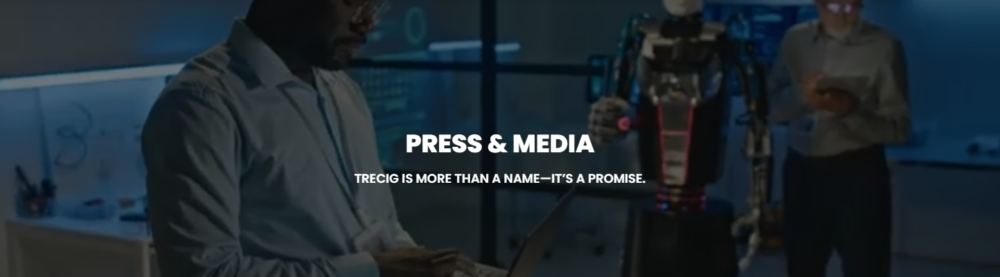
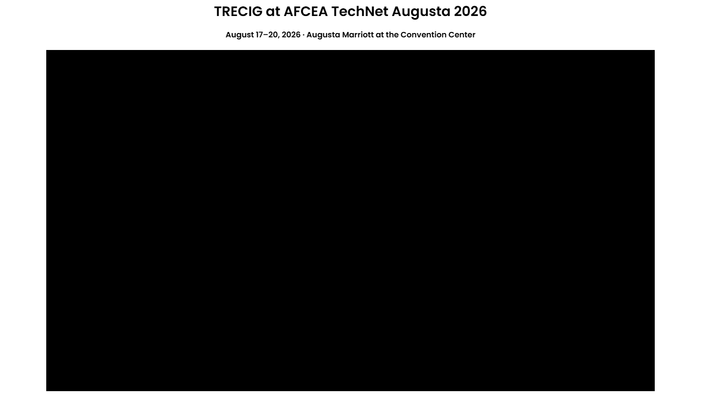
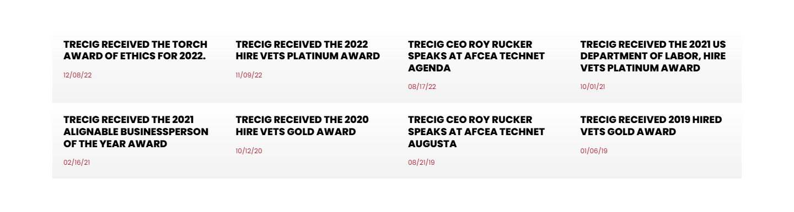

# Press & Media – TRECIG

*TRECIG (design reference site)* · URL: https://trecig.com/press-media/ · captured 2026-11-08 00:32:04 · HTTP 200

- **Meta description:** —
- **Page size (desktop 1440px):** 1440×2760 px · tablet (820px): 2637 px · mobile (390px): 2805 px
- **Screenshots:** [desktop](screenshots/desktop-full.png) · [tablet](screenshots/tablet-full.png) · [mobile](screenshots/mobile-full.png) · [desktop top](screenshots/desktop-viewport-top.png) · [desktop scrolled](screenshots/desktop-viewport-scrolled.png)
- **Files:** [raw.html](raw.html) (server HTML) · [rendered.html](rendered.html) (DOM after JS) · [content.txt](content.txt) (all visible text) · layout-*.json (full element tree with computed styles) · page.json (everything)

## 1. Section map (top → bottom, desktop 1440px)

| # | Role | Y from top | Height | Heading / first text | Mobile height | Screenshot |
|---|---|---|---|---|---|---|
| 0 | header | 0 | 170 | HOME ABOUT AWARDS & RECOGNITION EXPERTISE PRESS & MEDIA CONTACT | 170 | [img](screenshots/desktop-sec00-header.png) |
| 1 | section | 170 | 400 | PRESS & MEDIA | 220 | [img](screenshots/desktop-sec01-section.png) |
| 2 | section | 570 | 370 | FEATURED IN | 291 | [img](screenshots/desktop-sec02-section.png) |
| 3 | section | 940 | 816 | TRECIG at AFCEA TechNet Augusta 2026 | 360 | [img](screenshots/desktop-sec03-section.png) |
| 4 | section | 1756 | 21 |  | 21 | [img](screenshots/desktop-sec04-section.png) |
| 5 | section | 1777 | 386 | TRECIG RECEIVED THE TORCH AWARD OF ETHICS FOR 2022. | 1053 | [img](screenshots/desktop-sec05-section.png) |
| 6 | footer | 2162 | 598 | LET'S TALK: | 690 | [img](screenshots/desktop-sec06-footer.png) |
| 7 | floating (fixed, z 1000003) | 875 | 38 |  |  |  |

## 2. Section-by-section layout (desktop)

Legend: each line is an element in DOM order. `@x,y w×h` = position/size in px on the 1440px-wide page. Text lines show *font size/weight, line-height, colour*. Boxes show layout (flex/grid), background, padding, radius, shadow, etc. Pass-through wrappers are collapsed.

### 2.0 HEADER — HOME ABOUT AWARDS & RECOGNITION EXPERTISE PRESS & MEDIA CONTACT

Element: `<header class="elementor elementor-13 elementor-location-header">` at y=0, 1440×170px · 

- section.elementor-section [bg:#FFFFFF · shadow:#000000 @10% 0px 0px 12px 0px · z:9999 · transition:background, border, border-radius, box-shadow 0.3s, 0.3s, 0.3s, 0.3s ease, ease, ease, ease] `@0,0 1440×170`
  - div.elementor-container [flex row · margin:0px 85px 0px 85px · max-w:1270px] `@85,0 1270×170`
    - div.elementor-column [flex row · min-h:1px] `@85,0 1270×170`
      - div.elementor-widget-wrap [flex row wrap] `@85,0 1270×170`
        - div.elementor-container [flex row · max-w:1270px] `@85,0 1270×170`
          - div.elementor-column [flex row · min-h:1px] `@85,0 127×170`
            - div.elementor-widget-wrap [flex row wrap · align:center · pad:10px 10px 10px 10px] `@85,0 127×170`
              - a (link→/) [inline-block · align-text:center] `@95,10 200×150`
                - **IMG** `TRECIG_Logo_Registered.png` alt="" natural 1440×1080 · inline-block · max-w:200px · overflow:clip · align-text:center `@95,10 200×150`
          - div.elementor-column [flex row · min-h:1px] `@212,0 1143×170`
            - div.elementor-widget-wrap [flex row wrap · align:center · pad:10px 10px 10px 10px] `@212,0 1143×170`
              - div.elementor-widget-container [flex column · transition:background, border, border-radius, box-shadow, transform 0.3s, 0.3s, 0.3s, 0.3s, 0.4s ease, ease, ease, ease, ease] `@222,75 1123×20`
                - ul.elementor-nav-menu [flex row wrap · justify:flex-end · margin:0px 0px 0px 411.234px · z:2] · pseudo:::after{{"content": "\" \"", "w": "0px", "h": "0px"}} `@633,75 712×20`
                  - **A→/** "HOME" — Poppins 14px/400 lh 20px · #000000 · textTransform:uppercase ‖ flex row · margin:0px 15px 0px 0px · transition:all 0.4s ease `@633,75 40×20`
                  - **A→/about/** "ABOUT" — Poppins 14px/400 lh 20px · #000000 · textTransform:uppercase ‖ flex row · margin:0px 15px 0px 15px · transition:all 0.4s ease `@703,75 70×20`
                  - **A→/awards-recognition/** "AWARDS & RECOGNITION" — Poppins 14px/400 lh 20px · #000000 · textTransform:uppercase ‖ flex row · margin:0px 15px 0px 15px · transition:all 0.4s ease `@803,75 195×20`
                  - **A→/expertise/** "EXPERTISE" — Poppins 14px/400 lh 20px · #000000 · textTransform:uppercase ‖ flex row · margin:0px 15px 0px 15px · transition:all 0.4s ease `@1028,75 90×20`
                  - **A→/press-media/** "PRESS & MEDIA" — Poppins 14px/400 lh 20px · #B22239 · textTransform:uppercase ‖ flex row · margin:0px 15px 0px 15px · transition:all 0.4s ease `@1148,75 100×20`
                  - **A→/contact/** "CONTACT" — Poppins 14px/400 lh 20px · #000000 · textTransform:uppercase ‖ flex row · margin:0px 0px 0px 15px · transition:all 0.4s ease `@1278,75 67×20`

### 2.1 SECTION — PRESS & MEDIA

Element: `<section class="elementor-section elementor-top-section elementor-element elementor-element-896418b elementor-section-height-min-height elementor-section-bo">` at y=170, 1440×400px · 

- section.elementor-section [transition:background, border, border-radius, box-shadow 0.3s, 0.3s, 0.3s, 0.3s ease, ease, ease, ease] `@0,170 1440×400`
  - div.elementor-background-video-container [pos:absolute · z:0 · overflow:hidden · transition:opacity 1s ease] `@0,170 1440×400`
    - **IFRAME** https://www.youtube.com/embed/tfwaCfptyq0?controls=0&rel=0&playsinline=1&cc_load_policy=0&enablejsapi=1&origin=https%3A%2F%2Ftrecig.com&widgetid=1&forigin=https%3A%2F%2Ftrecig.com%2Fpress-media%2F&aoriginsup=1&vf=6 Trecig   Press and Media `@0,-35 1440×810`
  - div.elementor-background-overlay [bg:#000000 · pos:absolute · opacity:0.5 · transition:background, border-radius, opacity 0.3s, 0.3s, 0.3s ease, ease, ease] `@0,170 1440×400` (empty/decorative)
  - div.elementor-container [flex row · align:center · margin:0px 370px 0px 370px · max-w:700px · min-h:400px] `@370,170 700×400`
    - div.elementor-column [flex row · min-h:1px] `@370,270 700×200`
      - div.elementor-widget-wrap [flex row wrap · pad:10px 10px 10px 10px · margin:80px 0px 0px 0px] `@370,350 700×120`
        - div.elementor-widget-heading [margin:0px 0px 20px 0px · align-text:center] `@380,360 680×36`
          - **H2** "PRESS & MEDIA" — Poppins 36px/800 lh 36px · #FFFFFF · textTransform:uppercase · textAlign:center ‖ inline-block `@584,360 272×36`
        - div.elementor-widget-heading [margin:0px 0px 20px 0px · align-text:center] `@380,416 680×24`
          - **H2** "TRECIG IS MORE THAN A NAME—IT’S A PROMISE." — Poppins 18px/600 lh 18px · #FFFFFF · textTransform:uppercase · textAlign:center ‖ inline-block `@510,419 420×18`

### 2.2 SECTION — FEATURED IN

Element: `<section class="elementor-section elementor-top-section elementor-element elementor-element-35cbe19 logo-sec elementor-section-boxed elementor-section-heigh">` at y=570, 1440×370px · 

- section.elementor-section [pad:30px 0px 30px 0px · transition:background, border, border-radius, box-shadow 0.3s, 0.3s, 0.3s, 0.3s ease, ease, ease, ease] `@0,570 1440×370`
  - div.elementor-container [flex row · margin:0px 85px 0px 85px · max-w:1270px] `@85,600 1270×310`
    - div.elementor-column [flex row · min-h:1px] `@85,600 1270×310`
      - div.elementor-widget-wrap [flex row wrap · pad:10px 10px 10px 10px] `@85,600 1270×310`
        - div.elementor-container [flex row · margin:0px 250px 0px 250px · max-w:750px] `@345,610 750×114`
          - div.elementor-column [flex row · min-h:1px] `@345,610 750×114`
            - div.elementor-widget-wrap [flex row wrap · pad:10px 10px 10px 10px] `@345,610 750×114`
              - div.elementor-widget-heading [margin:0px 0px 20px 0px · align-text:center] `@355,620 730×36`
                - **H2** "FEATURED IN" — Poppins 36px/800 lh 36px · #000000 · textTransform:uppercase · textAlign:center ‖ inline-block `@605,620 230×36`
              - **P** "TRECIG has been proudly featured in some of the world’s leading publications." — Poppins 16px/400 lh 24px · #000000 · textAlign:center ‖ margin:0px 0px 14.4px 0px · highlights: "TRECIG"  600 `@355,676 730×24`
        - div.elementor-container [flex row · margin:0px 375px 0px 375px · max-w:500px] `@470,724 500×175`
          - div.elementor-column [flex row · min-h:1px] `@470,724 275×175`
            - div.elementor-widget-wrap [flex row wrap · align:center · pad:10px 10px 10px 10px] `@470,724 275×175`
              - a (link→https://www.bbb.org/us/tx/rockwall/profile/information-technology-services/trecig-llc-0875-90934393) [inline-block · align-text:center] `@480,740 255×144`
                - **IMG** `BBB_Accredited_Business_A_Rating-300x169-1.png` alt="" natural 300×169 · inline-block · max-w:100% · overflow:clip · align-text:center `@480,740 255×144`
          - div.elementor-column [flex row · min-h:1px] `@745,724 224×175`
            - div.elementor-widget-wrap [flex row wrap · align:center · pad:10px 10px 10px 10px] `@745,724 224×175`
              - a (link→https://www.alignable.com/rockwall-tx/trecig-llc) [inline-block · align-text:center] `@755,734 204×155`
                - **IMG** `highly-recommended-bdcd9d666c33af66db04744d399e5edeaca995aba8c3563aaa1b063c7e8a4e79.png` alt="" natural 1317×1000 · inline-block · max-w:100% · overflow:clip · align-text:center `@755,734 204×155`

### 2.3 SECTION — TRECIG at AFCEA TechNet Augusta 2026

Element: `<section class="elementor-section elementor-top-section elementor-element elementor-element-2364c79 elementor-section-boxed elementor-section-height-default">` at y=940, 1440×816px · 

- *(empty block — vertical spacer / gap of 816px)*

### 2.4 SECTION — 

Element: `<section class="elementor-section elementor-top-section elementor-element elementor-element-a157144 elementor-section-boxed elementor-section-height-default">` at y=1756, 1440×21px · 

- *(empty block — vertical spacer / gap of 21px)*

### 2.5 SECTION — TRECIG RECEIVED THE TORCH AWARD OF ETHICS FOR 2022.

Element: `<section class="elementor-section elementor-top-section elementor-element elementor-element-73bd7f9 awardslink elementor-section-boxed elementor-section-hei">` at y=1777, 1440×386px · 

- section.elementor-section [pad:40px 0px 50px 0px] `@0,1777 1440×386`
  - div.elementor-container [flex row · margin:0px 85px 0px 85px · max-w:1270px] `@85,1817 1270×296`
    - div.elementor-column [flex row · min-h:1px] `@85,1817 1270×296`
      - div.elementor-widget-wrap [flex row wrap · pad:10px 10px 10px 10px] `@85,1817 1270×296`
        - div.elementor-container [flex row · max-w:1270px] `@95,1827 1250×138`
          - div.elementor-column [flex row · min-h:1px] `@95,1827 313×138`
            - div.elementor-widget-wrap [flex row wrap · bg-image:linear-gradient(360deg, #F2F2F2 0%, transparent 100%) · pad:20px 20px 20px 20px · transition:background, border, border-radius, box-shadow 0.3s, 0.3s, 0.3s, 0.3s ease, ease, ease, ease] `@95,1827 313×138`
              - div.elementor-image-box-content `@115,1847 273×76`
                - **H3** "TRECIG RECEIVED THE TORCH AWARD OF ETHICS FOR 2022." — Poppins 18px/800 lh 21.6px · #000000 · textTransform:uppercase ‖ margin:0px 0px 15px 0px `@115,1847 273×43`
                - **P** "12/08/22" — Poppins 12px/400 lh 18px · #B22239 `@115,1905 273×18`
          - div.elementor-column [flex row · min-h:1px] `@408,1827 313×138`
            - div.elementor-widget-wrap [flex row wrap · bg-image:linear-gradient(360deg, #F2F2F2 0%, transparent 100%) · pad:20px 20px 20px 20px · transition:background, border, border-radius, box-shadow 0.3s, 0.3s, 0.3s, 0.3s ease, ease, ease, ease] `@408,1827 313×138`
              - div.elementor-image-box-content `@428,1847 273×76`
                - **H3** "TRECIG RECEIVED THE 2022 HIRE VETS PLATINUM AWARD" — Poppins 18px/800 lh 21.6px · #000000 · textTransform:uppercase ‖ margin:0px 0px 15px 0px `@428,1847 273×43`
                - **P** "11/09/22" — Poppins 12px/400 lh 18px · #B22239 `@428,1905 273×18`
          - div.elementor-column [flex row · min-h:1px] `@720,1827 313×138`
            - div.elementor-widget-wrap [flex row wrap · bg-image:linear-gradient(360deg, #F2F2F2 0%, transparent 100%) · pad:20px 20px 20px 20px · transition:background, border, border-radius, box-shadow 0.3s, 0.3s, 0.3s, 0.3s ease, ease, ease, ease] `@720,1827 313×138`
              - div.elementor-image-box-content `@740,1847 273×98`
                - **H3** "TRECIG CEO ROY RUCKER SPEAKS AT AFCEA TECHNET AGENDA" — Poppins 18px/800 lh 21.6px · #000000 · textTransform:uppercase ‖ margin:0px 0px 15px 0px `@740,1847 273×65`
                - **P** "08/17/22" — Poppins 12px/400 lh 18px · #B22239 `@740,1926 273×18`
          - div.elementor-column [flex row · min-h:1px] `@1033,1827 313×138`
            - div.elementor-widget-wrap [flex row wrap · bg-image:linear-gradient(360deg, #F2F2F2 0%, transparent 100%) · pad:20px 20px 20px 20px · transition:background, border, border-radius, box-shadow 0.3s, 0.3s, 0.3s, 0.3s ease, ease, ease, ease] `@1033,1827 313×138`
              - div.elementor-image-box-content `@1053,1847 273×98`
                - **H3** "TRECIG RECEIVED THE 2021 US DEPARTMENT OF LABOR, HIRE VETS PLATINUM AWARD" — Poppins 18px/800 lh 21.6px · #000000 · textTransform:uppercase ‖ margin:0px 0px 15px 0px `@1053,1847 273×65`
                - **P** "10/01/21" — Poppins 12px/400 lh 18px · #B22239 `@1053,1926 273×18`
        - div.elementor-container [flex row · max-w:1270px] `@95,1964 1250×138`
          - div.elementor-column [flex row · min-h:1px] `@95,1964 313×138`
            - div.elementor-widget-wrap [flex row wrap · bg-image:linear-gradient(360deg, #F2F2F2 0%, transparent 100%) · pad:20px 20px 20px 20px · transition:background, border, border-radius, box-shadow 0.3s, 0.3s, 0.3s, 0.3s ease, ease, ease, ease] `@95,1964 313×138`
              - div.elementor-image-box-content `@115,1984 273×98`
                - **H3** "TRECIG RECEIVED THE 2021 ALIGNABLE BUSINESSPERSON OF THE YEAR AWARD" — Poppins 18px/800 lh 21.6px · #000000 · textTransform:uppercase ‖ margin:0px 0px 15px 0px `@115,1984 273×65`
                - **P** "02/16/21" — Poppins 12px/400 lh 18px · #B22239 `@115,2064 273×18`
          - div.elementor-column [flex row · min-h:1px] `@408,1964 313×138`
            - div.elementor-widget-wrap [flex row wrap · bg-image:linear-gradient(360deg, #F2F2F2 0%, transparent 100%) · pad:20px 20px 20px 20px · transition:background, border, border-radius, box-shadow 0.3s, 0.3s, 0.3s, 0.3s ease, ease, ease, ease] `@408,1964 313×138`
              - div.elementor-image-box-content `@428,1984 273×76`
                - **H3** "TRECIG RECEIVED THE 2020 HIRE VETS GOLD AWARD" — Poppins 18px/800 lh 21.6px · #000000 · textTransform:uppercase ‖ margin:0px 0px 15px 0px `@428,1984 273×43`
                - **P** "10/12/20" — Poppins 12px/400 lh 18px · #B22239 `@428,2043 273×18`
          - div.elementor-column [flex row · min-h:1px] `@720,1964 313×138`
            - div.elementor-widget-wrap [flex row wrap · bg-image:linear-gradient(360deg, #F2F2F2 0%, transparent 100%) · pad:20px 20px 20px 20px · transition:background, border, border-radius, box-shadow 0.3s, 0.3s, 0.3s, 0.3s ease, ease, ease, ease] `@720,1964 313×138`
              - div.elementor-image-box-content `@740,1984 273×98`
                - **H3** "TRECIG CEO ROY RUCKER SPEAKS AT AFCEA TECHNET AUGUSTA" — Poppins 18px/800 lh 21.6px · #000000 · textTransform:uppercase ‖ margin:0px 0px 15px 0px `@740,1984 273×65`
                - **P** "08/21/19" — Poppins 12px/400 lh 18px · #B22239 `@740,2064 273×18`
          - div.elementor-column [flex row · min-h:1px] `@1033,1964 313×138`
            - div.elementor-widget-wrap [flex row wrap · bg-image:linear-gradient(360deg, #F2F2F2 0%, transparent 100%) · pad:20px 20px 20px 20px · transition:background, border, border-radius, box-shadow 0.3s, 0.3s, 0.3s, 0.3s ease, ease, ease, ease] `@1033,1964 313×138`
              - div.elementor-image-box-content `@1053,1984 273×76`
                - **H3** "TRECIG RECEIVED 2019 HIRED VETS GOLD AWARD" — Poppins 18px/800 lh 21.6px · #000000 · textTransform:uppercase ‖ margin:0px 0px 15px 0px `@1053,1984 273×43`
                - **P** "01/06/19" — Poppins 12px/400 lh 18px · #B22239 `@1053,2043 273×18`

### 2.6 FOOTER — LET'S TALK:

Element: `<footer class="elementor elementor-15 elementor-location-footer">` at y=2162, 1440×598px · 

- section.elementor-section [transition:background, border, border-radius, box-shadow 0.3s, 0.3s, 0.3s, 0.3s ease, ease, ease, ease] `@0,2162 1440×598`
  - div.elementor-background-video-container [pos:absolute · z:0 · overflow:hidden · transition:opacity 1s ease] `@0,2162 1440×598`
    - **IFRAME** https://www.youtube.com/embed/OzwCnEEadts?controls=0&rel=0&playsinline=1&cc_load_policy=0&enablejsapi=1&origin=https%3A%2F%2Ftrecig.com&widgetid=3&forigin=https%3A%2F%2Ftrecig.com%2Fpress-media%2F&aoriginsup=1&vf=1 Triceg   Expertise Slider 1 `@0,2056 1440×810`
  - div.elementor-background-overlay [bg:#FFFFFF · pos:absolute · opacity:0.7 · transition:background, border-radius, opacity 0.3s, 0.3s, 0.3s ease, ease, ease] `@0,2162 1440×598` (empty/decorative)
  - div.elementor-container [flex row · margin:0px 85px 0px 85px · max-w:1270px] `@85,2162 1270×598`
    - div.elementor-column [flex row · min-h:1px] `@85,2162 1270×598`
      - div.elementor-widget-wrap [flex row wrap] `@85,2162 1270×598`
        - section.elementor-section [pad:40px 0px 40px 0px] `@85,2162 1270×467`
          - div.elementor-container [flex row · max-w:1270px] `@85,2202 1270×387`
            - div.elementor-column [flex row · min-h:1px] `@85,2202 324×387`
              - div.elementor-widget-wrap [flex row wrap · pad:10px 10px 10px 10px] `@85,2202 324×387`
                - div.elementor-widget-theme-site-logo [margin:0px 0px 20px 0px] `@95,2212 304×300`
                  - a (link→/) [inline-block] `@95,2212 400×300`
                    - **IMG** `TRECIG_Logo_Registered.png` alt="" natural 1440×1080 · inline-block · max-w:400px · overflow:clip `@95,2212 400×300`
                - div.elementor-button-wrapper [grid cols[134.078px]] `@95,2532 134×47`
                  - **A→/contact/** "LET’S TALK" — Poppins 15px/400 lh 15px · #000000 · textTransform:uppercase · textAlign:center ‖ pad:15px 30px 15px 30px · radius:30px · border:1px 1px 1px 1px solid #000000 · transition:all 0.3s ease `@95,2532 134×47`
            - div.elementor-column [flex row · min-h:1px] `@409,2202 371×387`
              - div.elementor-widget-wrap [flex row wrap · pad:10px 10px 10px 10px · margin:0px 0px 0px 50px] `@459,2202 321×387`
                - div.elementor-widget-heading [margin:0px 0px 20px 0px] `@469,2212 301×24`
                  - **H2** "LET'S TALK:" — Poppins 18px/700 lh 18px · #000000 · textTransform:uppercase ‖ inline-block `@469,2215 98×18`
                - ul.elementor-icon-list-items `@469,2256 301×52`
                  - li.elementor-icon-list-item [flex row · align:center · pad:0px 0px 5px 0px] `@469,2256 301×26`
                    - **A→tel:(254)%20338-6131** "(469)653-9009" — Poppins 14px/600 lh 21px · #CC3366 ‖ flex row · highlights: "(469)653-9009" #000000 `@469,2256 301×21`
                  - li.elementor-icon-list-item [flex row · align:center · margin:5px 0px 0px 0px] `@469,2287 301×21`
                    - **A→mailto:info@trecig.com** "info@trecig.com" — Poppins 14px/600 lh 21px · #CC3366 ‖ flex row · highlights: "info@trecig.com" #000000 `@469,2287 301×21`
            - div.elementor-column [flex row · min-h:1px] `@781,2202 310×387`
              - div.elementor-widget-wrap [flex row wrap · pad:10px 10px 10px 10px · margin:0px 50px 0px 0px] `@781,2202 260×387`
                - div.elementor-widget-heading [margin:0px 0px 20px 0px] `@791,2212 240×24`
                  - **H2** "TRECIG HQ:" — Poppins 18px/700 lh 18px · #000000 · textTransform:uppercase ‖ inline-block `@791,2215 101×18`
                - ul.elementor-icon-list-items `@791,2256 240×42`
                  - li.elementor-icon-list-item [flex row · align:center] `@791,2256 240×42`
                    - **SPAN** "Rockwall, Texas, United States" — Poppins 14px/400 lh 21px · #000000 ‖ transition:color 0.3s ease `@791,2256 110×42`
            - div.elementor-column [flex row · min-h:1px] `@1090,2202 264×387`
              - div.elementor-widget-wrap [flex row wrap · pad:10px 10px 10px 10px] `@1090,2202 264×387`
                - div.elementor-widget-heading [margin:0px 0px 20px 0px] `@1100,2212 244×24`
                  - **H2** "CONNECT WITH US:" — Poppins 18px/700 lh 18px · #000000 · textTransform:uppercase ‖ inline-block `@1100,2215 174×18`
                - **A→/press-media/** "Linkedin-in" +icon[e-font-icon-svg e-fab-linkedin-in] — -apple-system 16px/400 lh 16px · #69727D · textAlign:center ‖ flex row · bg:#000000 · radius:100% · transition:all 0.3s ease `@1100,2256 32×32`
        - section.elementor-section [pad:15px 0px 15px 0px · border:1px 0px 0px 0px solid #000000 @20%] `@85,2629 1270×131`
          - div.elementor-container [flex row · max-w:1270px] `@85,2645 1270×100`
            - div.elementor-column [flex row · min-h:1px] `@85,2645 1270×100`
              - div.elementor-widget-wrap [flex row wrap · align:center · pad:10px 10px 10px 10px] `@85,2645 1270×100`
                - div.elementor-element [margin:0px 0px 20px 0px · align-text:center] `@95,2655 1250×10`
                  - div.elementor-widget-container [margin:0px 0px -10px 0px · overflow:hidden · align-text:center · transition:background, border, border-radius, box-shadow, transform 0.3s, 0.3s, 0.3s, 0.3s, 0.4s ease, ease, ease, ease, ease] `@95,2655 1250×20`
                    - ul.elementor-icon-list-items [flex row wrap · justify:center · gap:30px · margin:0px -8px 0px -8px · align-text:center] `@87,2655 1266×20`
                      - li.elementor-icon-list-item [flex row · justify:center · align:center · margin:0px 8px 0px 8px · align-text:center] `@589,2655 89×20`
                        - **A→/privacy-policy/** "Privacy Policy" — Poppins 13px/400 lh 19.5px · #CC3366 · textAlign:center ‖ flex row · highlights: "Privacy Policy" #000000 `@589,2655 88×20`
                      - li.elementor-icon-list-item [flex row · justify:center · align:center · margin:0px 8px 0px 8px · align-text:center] `@724,2655 127×20`
                        - **A→/terms-conditions/** "Terms & Conditions" — Poppins 13px/400 lh 19.5px · #CC3366 · textAlign:center ‖ flex row · highlights: "Terms & Conditions" #000000 `@724,2655 127×20`
                - **P** "©2026 TRECIG, LLC" — Poppins 12px/400 lh 18px · #000000 · textTransform:uppercase · textAlign:center ‖ margin:0px 0px 14.4px 0px `@95,2685 1250×36`

### Floating / fixed elements
- `div.` fixed at [1348, 875, 92, 38] z-index 1000003 — ""

## 3. Header, navigation & interaction behaviour

- **atTop** `header.elementor.elementor-13.elementor-location-header` position:static top:0 height:170 bg:transparent shadow:none backdrop:none z:auto
- **afterScroll1400** `header.elementor.elementor-13.elementor-location-header` position:static top:-1400 height:0 bg:transparent shadow:none backdrop:none z:auto
- **afterScroll1400** `section.elementor-section.elementor-top-section.elementor-element.elementor-elem` position:fixed top:0 height:170 bg:#FFFFFF @90% shadow:#000000 @10% 0px 0px 12px 0px backdrop:none z:9999

| Menu item | Link | Dropdown | Style | Hover change |
|---|---|---|---|---|
| HOME | / | — | Poppins 14px/400 #000000 uppercase ls normal | color: #000000 → #B22239 |
| ABOUT | /about/ | The Mission (/the-mission/); The Values (/the-values/); The Legacy (/the-legacy/); The Trecig Team (/the-trecig-team/); Careers (/careers/) | Poppins 14px/400 #000000 uppercase ls normal | color: #000000 → #B22239 |
| AWARDS & RECOGNITION | /awards-recognition/ | Partnerships (/partnerships/) | Poppins 14px/400 #000000 uppercase ls normal | color: #000000 → #B22239 |
| EXPERTISE | /expertise/ | Industries We Serve (/industries-we-serve/) | Poppins 14px/400 #000000 uppercase ls normal | color: #000000 → #B22239 |
| PRESS & MEDIA (current) | /press-media/ | — | Poppins 14px/400 #B22239 uppercase ls normal | none |
| CONTACT | /contact/ | — | Poppins 14px/400 #000000 uppercase ls normal | color: #000000 → #B22239 |

- **Mobile menu:** toggle `.elementor-menu-toggle` → [screenshot](screenshots/mobile-menu-open.png) · items: HOME, ABOUT, AWARDS & RECOGNITION, EXPERTISE, PRESS & MEDIA, CONTACT

### Hover states (measured by hovering in Chrome)

| Element | Text | Normal | On hover |
|---|---|---|---|
| `a.elementor-item` | HOME | color #000000 · bg transparent · radius 0px · pad 0px · border 0px #000000 · transition 0.4s | color: #000000 → #B22239; borderTopColor: #000000 → #B22239 |
| `a.elementor-item` | ABOUT | color #000000 · bg transparent · radius 0px · pad 0px · border 0px #000000 · transition 0.4s | color: #000000 → #B22239; borderTopColor: #000000 → #B22239 |
| `a.elementor-item` | PRESS & MEDIA | color #B22239 · bg transparent · radius 0px · pad 0px · border 0px #B22239 · transition 0.4s | no change |
| `a.elementor-item` | CONTACT | color #000000 · bg transparent · radius 0px · pad 0px · border 0px #000000 · transition 0.4s | color: #000000 → #B22239; borderTopColor: #000000 → #B22239 |
| `div.elementor-image-box-wrapper` | TRECIG RECEIVED THE TORCH AWARD OF ETHIC | color #333333 · bg transparent · radius 0px · pad 0px · border 0px #333333 · transition all | no change |
| `a.` |  | color #CC3366 · bg transparent · radius 0px · pad 0px · border 0px #CC3366 · transition all | color: #CC3366 → #B22239; borderTopColor: #CC3366 → #B22239; childColor: #CC3366 → #B22239 |
| `a.elementor-button` | LET’S TALK | color #000000 · bg transparent · radius 30px · pad 15px 30px · border 1px #000000 · transition 0.3s | color: #000000 → #FFFFFF; borderTopColor: #000000 → #B22239 |
| `a.` | (469)653-9009 | color #CC3366 · bg transparent · radius 0px · pad 0px · border 0px #CC3366 · transition all | color: #CC3366 → #B22239; borderTopColor: #CC3366 → #B22239 |
| `a.elementor-icon` | Linkedin-in | color #69727D · bg #000000 · radius 100% · pad 0px · border 0px #69727D · transition 0.3s | color: #69727D → #B22239; backgroundColor: #000000 → #B22239; borderTopColor: #69727D → #B22239; opacity: 1 → 0.9; childColor: #69727D → #B22239 |
| `a.` | Privacy Policy | color #CC3366 · bg transparent · radius 0px · pad 0px · border 0px #CC3366 · transition all | color: #CC3366 → #B22239; borderTopColor: #CC3366 → #B22239 |

## 4. Typography & colour used on this page (weighted by amount of text / area)

| Font · weight · size / line-height | chars |
|---|---|
| Poppins | 800 | 18px / 21.6px | 432 |
| Poppins | 400 | 12px / 18px | 81 |
| Poppins | 400 | 16px / 24px | 70 |
| Poppins | 600 | 16px / 16px | 62 |
| Poppins | 400 | 14px / 20px | 58 |
| Poppins | 600 | 18px / 18px | 42 |
| Poppins | 700 | 18px / 18px | 37 |
| Poppins | 600 | 28px / 28px | 36 |
| Poppins | 400 | 13px / 19.5px | 32 |
| Poppins | 400 | 14px / 21px | 29 |
| Poppins | 600 | 14px / 21px | 28 |
| Poppins | 800 | 36px / 36px | 24 |
| -apple-system | 400 | 16px / 24px | 15 |
| -apple-system | 400 | 16px / 16px | 11 |
| Poppins | 400 | 15px / 15px | 10 |
| Poppins | 600 | 16px / 24px | 6 |

- **Text colours:** #000000 (815), #B22239 (77), #FFFFFF (55), #CC3366 (15), #69727D (11)
- **Background colours (by area):** #000000 (1456), #FFFFFF (1109)
- **Gradients:** linear-gradient(360deg, #F2F2F2 0%, transparent 100%)
- **Border radii:** 30px (1), 100% (1), 2px 0px 0px (1)
- **Shadows:** #000000 @10% 0px 0px 12px 0px (1) | #000000 @20% 0px 0px 5px 0px (1)
- **Mobile text styles:** Poppins | 800 | 18px / 21.6px (432); Poppins | 600 | 16px / 16px (104); Poppins | 400 | 14px / 21px (99); Poppins | 400 | 12px / 18px (96); Poppins | 700 | 16px / 16px (37); Poppins | 600 | 28px / 28px (36); Poppins | 600 | 14px / 21px (34); Poppins | 800 | 28px / 28px (24); Poppins | 400 | 10px / 15px (17); -apple-system | 400 | 16px / 24px (15)

## 6. Images on the page

- `TRECIG_Logo_Registered.png` natural 1440×1080 → shown 200×150 · alt="" · https://trecig.com/wp-content/uploads/2026/10/TRECIG_Logo_Registered.png
- `BBB_Accredited_Business_A_Rating-300x169-1.png` natural 300×169 → shown 255×144 · alt="" · https://trecig.com/wp-content/uploads/2025/02/BBB_Accredited_Business_A_Rating-300x169-1.png
- `highly-recommended-bdcd9d666c33af66db04744d399e5edeaca995aba8c3563aaa1b063c7e8a4e79.png` natural 1317×1000 → shown 204×155 · alt="" · https://trecig.com/wp-content/uploads/2025/02/highly-recommended-bdcd9d666c33af66db04744d399e5edeaca995aba8c3563aaa1b063c7e8a4e79.png
- background on `div.`: https://cdn.ywxi.net/meter/trecig.com/205.svg?ts=1784975038086&l=en

## 7. Links on the page

- [body] "Skip to content" → /press-media/#content
- [header] "(icon/image)" → /
- [header] "HOME" → /
- [header] "ABOUT" → /about/
- [header] "The Mission" → /the-mission/
- [header] "The Values" → /the-values/
- [header] "The Legacy" → /the-legacy/
- [header] "The Trecig Team" → /the-trecig-team/
- [header] "Careers" → /careers/
- [header] "AWARDS & RECOGNITION" → /awards-recognition/
- [header] "Partnerships" → /partnerships/
- [header] "EXPERTISE" → /expertise/
- [header] "Industries We Serve" → /industries-we-serve/
- [header] "PRESS & MEDIA" → /press-media/
- [header] "CONTACT" → /contact/
- [header] "Home" → /
- [header] "About" → /about/
- [header] "Awards & Recognition" → /awards-recognition/
- [header] "Expertise" → /expertise/
- [header] "Press & Media" → /press-media/
- [header] "Contact" → /contact/
- [body] "(icon/image)" → https://www.bbb.org/us/tx/rockwall/profile/information-technology-services/trecig-llc-0875-90934393 (target _blank)
- [body] "(icon/image)" → https://www.alignable.com/rockwall-tx/trecig-llc (target _blank)
- [footer] "LET’S TALK" → /contact/
- [footer] "(469)653-9009" → tel:(254)%20338-6131
- [footer] "info@trecig.com" → mailto:info@trecig.com
- [footer] "Linkedin-in" → /press-media/ (target _blank)
- [footer] "Privacy Policy" → /privacy-policy/
- [footer] "Terms & Conditions" → /terms-conditions/

## 8. Mobile layout (390px) — condensed outline

### 8.0 header — HOME ABOUT AWARDS & RECOGNITION EXPERTISE PRESS & MEDIA CONTACT (y 0, h 170)
- section.elementor-section [bg:#FFFFFF · shadow:#000000 @10% 0px 0px 12px 0px · z:9999 · transition:background, border, border-radius, box-shadow 0.3s, 0.3s, 0.3s, 0.3s ease, ease, ease, ease] `@0,0 390×170`
  - div.elementor-container [flex row wrap · max-w:767px] `@0,0 390×170`
    - div.elementor-column [flex row · min-h:1px] `@0,0 390×170`
      - div.elementor-widget-wrap [flex row wrap] `@0,0 390×170`
        - div.elementor-container [flex row wrap · max-w:767px] `@0,0 390×170`
          - div.elementor-column [flex row · min-h:1px] `@0,0 234×170`
            - div.elementor-widget-wrap [flex row wrap · align:center · pad:10px 10px 10px 10px] `@0,0 234×170`
              - a (link→/) [inline-block · align-text:center] `@17,10 200×150`
                - **IMG** `TRECIG_Logo_Registered-1024x768.png` alt="" natural 390×292 · inline-block · max-w:200px · overflow:clip · align-text:center `@17,10 200×150`
          - div.elementor-column [flex row · min-h:1px] `@234,0 156×170`
            - div.elementor-widget-wrap [flex row wrap · align:center · pad:10px 10px 10px 10px] `@234,0 156×170`
              - div.elementor-widget-container [flex column · transition:background, border, border-radius, box-shadow, transform 0.3s, 0.3s, 0.3s, 0.3s, 0.4s ease, ease, ease, ease, ease] `@244,70 136×30`
                - nav.elementor-nav-menu--dropdown [bg:#FFFFFF · margin:16px 0px 0px 0px · pos:absolute · z:9997 · overflow:hidden · transform:matrix(1, 0, 0, 0, 0, 0) · transition:max-height, transform 0.3s, 0.3s ease, ease] `@0,116 390×0`
                  - ul.elementor-nav-menu [z:2] · pseudo:::after{{"content": "\" \"", "w": "390px", "h": "0px"}} `@0,116 390×0`
                    - **A→/** "HOME" — Poppins 14px/400 lh 20px · #000000 · textTransform:uppercase ‖ flex row · pad:10px 20px 10px 20px `@0,116 390×0`
                    - **A→/about/** "ABOUT" — Poppins 14px/400 lh 20px · #000000 · textTransform:uppercase ‖ flex row · pad:10px 20px 10px 20px `@0,116 390×0`
                    - **A→/awards-recognition/** "AWARDS & RECOGNITION" — Poppins 14px/400 lh 20px · #000000 · textTransform:uppercase ‖ flex row · pad:10px 20px 10px 20px `@0,116 390×0`
                    - **A→/expertise/** "EXPERTISE" — Poppins 14px/400 lh 20px · #000000 · textTransform:uppercase ‖ flex row · pad:10px 20px 10px 20px `@0,116 390×0`
                    - **A→/press-media/** "PRESS & MEDIA" — Poppins 14px/400 lh 20px · #FFFFFF · textTransform:uppercase ‖ flex row · bg:#B22239 · pad:10px 20px 10px 20px `@0,116 390×0`
                    - **A→/contact/** "CONTACT" — Poppins 14px/400 lh 20px · #000000 · textTransform:uppercase ‖ flex row · pad:10px 20px 10px 20px `@0,116 390×0`

### 8.1 section — PRESS & MEDIA (y 170, h 220)
- section.elementor-section [transition:background, border, border-radius, box-shadow 0.3s, 0.3s, 0.3s, 0.3s ease, ease, ease, ease] `@0,170 390×220`
  - div.elementor-background-overlay [bg:#000000 · pos:absolute · opacity:0.5 · transition:background, border-radius, opacity 0.3s, 0.3s, 0.3s ease, ease, ease] `@0,170 390×220` (empty/decorative)
  - div.elementor-container [flex row wrap · align:center · max-w:700px · min-h:220px] `@0,170 390×220`
    - div.elementor-column [flex row · min-h:1px] `@0,196 390×169`
      - div.elementor-widget-wrap [flex row wrap · pad:10px 10px 10px 10px · margin:65px 0px 0px 0px] `@0,261 390×104`
        - div.elementor-widget-heading [margin:0px 0px 20px 0px · align-text:center] `@10,271 370×29`
          - **H2** "PRESS & MEDIA" — Poppins 28px/800 lh 28px · #FFFFFF · textTransform:uppercase · textAlign:center ‖ inline-block `@89,271 212×28`
        - div.elementor-widget-heading [margin:0px 0px 20px 0px · align-text:center] `@10,320 370×15`
          - div.elementor-widget-container [margin:-10px 0px -10px 0px · align-text:center · transition:background, border, border-radius, box-shadow, transform 0.3s, 0.3s, 0.3s, 0.3s, 0.4s ease, ease, ease, ease, ease] `@10,310 370×35`
            - **H2** "TRECIG IS MORE THAN A NAME—IT’S A PROMISE." — Poppins 16px/600 lh 16px · #FFFFFF · textTransform:uppercase · textAlign:center ‖ inline-block `@10,310 370×32`

### 8.2 section — FEATURED IN (y 390, h 291)
- div.elementor-container [flex row wrap · max-w:767px] `@0,390 390×291`
  - div.elementor-column [flex row · min-h:1px] `@0,390 390×291`
    - div.elementor-widget-wrap [flex row wrap · pad:10px 10px 10px 10px] `@0,390 390×291`
      - div.elementor-container [flex row wrap · max-w:750px] `@10,400 370×125`
        - div.elementor-column [flex row · min-h:1px] `@10,400 370×125`
          - div.elementor-widget-wrap [flex row wrap · pad:10px 10px 10px 10px] `@10,400 370×125`
            - div.elementor-widget-heading [margin:0px 0px 20px 0px · align-text:center] `@20,410 350×29`
              - **H2** "FEATURED IN" — Poppins 28px/800 lh 28px · #000000 · textTransform:uppercase · textAlign:center ‖ inline-block `@106,410 179×28`
            - **P** "TRECIG has been proudly featured in some of the world’s leading publications." — Poppins 14px/400 lh 21px · #000000 · textAlign:center ‖ margin:0px 0px 14.4px 0px · highlights: "TRECIG"  600 `@20,459 350×42`
      - div.elementor-container [flex row wrap · max-w:500px] `@10,525 370×145`
        - div.elementor-column [flex row · min-h:1px] `@10,525 185×145`
          - div.elementor-widget-wrap [flex row wrap · align:center · pad:10px 10px 10px 10px] `@10,525 185×145`
            - a (link→https://www.bbb.org/us/tx/rockwall/profile/information-technology-services/trecig-llc-0875-90934393) [inline-block · align-text:center] `@20,552 165×93`
              - **IMG** `BBB_Accredited_Business_A_Rating-300x169-1.png` alt="" natural 300×169 · inline-block · max-w:100% · overflow:clip · align-text:center `@20,552 165×93`
        - div.elementor-column [flex row · min-h:1px] `@195,525 185×145`
          - div.elementor-widget-wrap [flex row wrap · align:center · pad:10px 10px 10px 10px] `@195,525 185×145`
            - a (link→https://www.alignable.com/rockwall-tx/trecig-llc) [inline-block · align-text:center] `@205,535 165×125`
              - **IMG** `highly-recommended-bdcd9d666c33af66db04744d399e5edeaca995aba8c3563aaa1b063c7e8a4e79-1024x778.png` alt="" natural 390×296 · inline-block · max-w:100% · overflow:clip · align-text:center `@205,535 165×125`

### 8.3 section — TRECIG at AFCEA TechNet Augusta 2026 (y 681, h 360)
- div.elementor-container [flex row wrap · max-w:767px] `@0,681 390×360`
  - div.elementor-column [flex row · min-h:1px] `@0,681 390×360`
    - div.elementor-widget-wrap [flex row wrap · pad:10px 10px 10px 10px] `@0,681 390×360`
      - div.elementor-widget-heading [margin:0px 0px 20px 0px · align-text:center] `@10,691 370×57`
        - **H3** "TRECIG at AFCEA TechNet Augusta 2026" — Poppins 28px/600 lh 28px · #000000 · textAlign:center ‖ inline-block `@10,691 370×56`
      - div.elementor-widget-heading [margin:0px 0px 20px 0px · align-text:center] `@10,768 370×35`
        - **H6** "August 17–20, 2026 · Augusta Marriott at the Convention Center" — Poppins 16px/600 lh 16px · #000000 · textAlign:center ‖ inline-block `@10,768 370×32`
      - div.elementor-widget-container [overflow:hidden · transform:matrix(1, 0, 0, 1, 0, 0) · transition:background, border, border-radius, box-shadow, transform 0.3s, 0.3s, 0.3s, 0.3s, 0.4s ease, ease, ease, ease, ease] `@10,823 370×208`
        - **IFRAME** https://www.youtube.com/embed/FGl_ErplQ0s?controls=1&rel=0&playsinline=0&cc_load_policy=0&autoplay=0&enablejsapi=1&origin=https%3A%2F%2Ftrecig.com&widgetid=1&forigin=https%3A%2F%2Ftrecig.com%2Fpress-media%2F&aoriginsup=1&vf=1 TRECIG Video TechNet `@10,823 370×208`

### 8.4 section —  (y 1041, h 21)
- *(empty block — spacer of 21px)*

### 8.5 section — TRECIG RECEIVED THE TORCH AWARD OF ETHICS FOR 2022. (y 1062, h 1053)
- section.elementor-section [pad:30px 0px 30px 0px] `@0,1062 390×1053`
  - div.elementor-container [flex row wrap · max-w:767px] `@0,1092 390×993`
    - div.elementor-column [flex row · min-h:1px] `@0,1092 390×993`
      - div.elementor-widget-wrap [flex row wrap · pad:10px 10px 10px 10px] `@0,1092 390×993`
        - div.elementor-container [flex row wrap · max-w:767px] `@10,1102 370×486`
          - div.elementor-column [flex row · min-h:1px] `@10,1102 370×116`
            - div.elementor-widget-wrap [flex row wrap · bg-image:linear-gradient(360deg, #F2F2F2 0%, transparent 100%) · pad:20px 20px 20px 20px · transition:background, border, border-radius, box-shadow 0.3s, 0.3s, 0.3s, 0.3s ease, ease, ease, ease] `@10,1102 370×116`
              - div.elementor-image-box-content `@30,1122 330×76`
                - **H3** "TRECIG RECEIVED THE TORCH AWARD OF ETHICS FOR 2022." — Poppins 18px/800 lh 21.6px · #000000 · textTransform:uppercase ‖ margin:0px 0px 15px 0px `@30,1122 330×43`
                - **P** "12/08/22" — Poppins 12px/400 lh 18px · #B22239 `@30,1180 330×18`
          - div.elementor-column [flex row · min-h:1px] `@10,1218 370×116`
            - div.elementor-widget-wrap [flex row wrap · bg-image:linear-gradient(360deg, #F2F2F2 0%, transparent 100%) · pad:20px 20px 20px 20px · transition:background, border, border-radius, box-shadow 0.3s, 0.3s, 0.3s, 0.3s ease, ease, ease, ease] `@10,1218 370×116`
              - div.elementor-image-box-content `@30,1238 330×76`
                - **H3** "TRECIG RECEIVED THE 2022 HIRE VETS PLATINUM AWARD" — Poppins 18px/800 lh 21.6px · #000000 · textTransform:uppercase ‖ margin:0px 0px 15px 0px `@30,1238 330×43`
                - **P** "11/09/22" — Poppins 12px/400 lh 18px · #B22239 `@30,1296 330×18`
          - div.elementor-column [flex row · min-h:1px] `@10,1334 370×116`
            - div.elementor-widget-wrap [flex row wrap · bg-image:linear-gradient(360deg, #F2F2F2 0%, transparent 100%) · pad:20px 20px 20px 20px · transition:background, border, border-radius, box-shadow 0.3s, 0.3s, 0.3s, 0.3s ease, ease, ease, ease] `@10,1334 370×116`
              - div.elementor-image-box-content `@30,1354 330×76`
                - **H3** "TRECIG CEO ROY RUCKER SPEAKS AT AFCEA TECHNET AGENDA" — Poppins 18px/800 lh 21.6px · #000000 · textTransform:uppercase ‖ margin:0px 0px 15px 0px `@30,1354 330×43`
                - **P** "08/17/22" — Poppins 12px/400 lh 18px · #B22239 `@30,1412 330×18`
          - div.elementor-column [flex row · min-h:1px] `@10,1450 370×138`
            - div.elementor-widget-wrap [flex row wrap · bg-image:linear-gradient(360deg, #F2F2F2 0%, transparent 100%) · pad:20px 20px 20px 20px · transition:background, border, border-radius, box-shadow 0.3s, 0.3s, 0.3s, 0.3s ease, ease, ease, ease] `@10,1450 370×138`
              - div.elementor-image-box-content `@30,1470 330×98`
                - **H3** "TRECIG RECEIVED THE 2021 US DEPARTMENT OF LABOR, HIRE VETS PLATINUM AWARD" — Poppins 18px/800 lh 21.6px · #000000 · textTransform:uppercase ‖ margin:0px 0px 15px 0px `@30,1470 330×65`
                - **P** "10/01/21" — Poppins 12px/400 lh 18px · #B22239 `@30,1550 330×18`
        - div.elementor-container [flex row wrap · max-w:767px] `@10,1588 370×486`
          - div.elementor-column [flex row · min-h:1px] `@10,1588 370×138`
            - div.elementor-widget-wrap [flex row wrap · bg-image:linear-gradient(360deg, #F2F2F2 0%, transparent 100%) · pad:20px 20px 20px 20px · transition:background, border, border-radius, box-shadow 0.3s, 0.3s, 0.3s, 0.3s ease, ease, ease, ease] `@10,1588 370×138`
              - div.elementor-image-box-content `@30,1608 330×98`
                - **H3** "TRECIG RECEIVED THE 2021 ALIGNABLE BUSINESSPERSON OF THE YEAR AWARD" — Poppins 18px/800 lh 21.6px · #000000 · textTransform:uppercase ‖ margin:0px 0px 15px 0px `@30,1608 330×65`
                - **P** "02/16/21" — Poppins 12px/400 lh 18px · #B22239 `@30,1688 330×18`
          - div.elementor-column [flex row · min-h:1px] `@10,1726 370×116`
            - div.elementor-widget-wrap [flex row wrap · bg-image:linear-gradient(360deg, #F2F2F2 0%, transparent 100%) · pad:20px 20px 20px 20px · transition:background, border, border-radius, box-shadow 0.3s, 0.3s, 0.3s, 0.3s ease, ease, ease, ease] `@10,1726 370×116`
              - div.elementor-image-box-content `@30,1746 330×76`
                - **H3** "TRECIG RECEIVED THE 2020 HIRE VETS GOLD AWARD" — Poppins 18px/800 lh 21.6px · #000000 · textTransform:uppercase ‖ margin:0px 0px 15px 0px `@30,1746 330×43`
                - **P** "10/12/20" — Poppins 12px/400 lh 18px · #B22239 `@30,1804 330×18`
          - div.elementor-column [flex row · min-h:1px] `@10,1842 370×116`
            - div.elementor-widget-wrap [flex row wrap · bg-image:linear-gradient(360deg, #F2F2F2 0%, transparent 100%) · pad:20px 20px 20px 20px · transition:background, border, border-radius, box-shadow 0.3s, 0.3s, 0.3s, 0.3s ease, ease, ease, ease] `@10,1842 370×116`
              - div.elementor-image-box-content `@30,1862 330×76`
                - **H3** "TRECIG CEO ROY RUCKER SPEAKS AT AFCEA TECHNET AUGUSTA" — Poppins 18px/800 lh 21.6px · #000000 · textTransform:uppercase ‖ margin:0px 0px 15px 0px `@30,1862 330×43`
                - **P** "08/21/19" — Poppins 12px/400 lh 18px · #B22239 `@30,1920 330×18`
          - div.elementor-column [flex row · min-h:1px] `@10,1958 370×116`
            - div.elementor-widget-wrap [flex row wrap · bg-image:linear-gradient(360deg, #F2F2F2 0%, transparent 100%) · pad:20px 20px 20px 20px · transition:background, border, border-radius, box-shadow 0.3s, 0.3s, 0.3s, 0.3s ease, ease, ease, ease] `@10,1958 370×116`
              - div.elementor-image-box-content `@30,1978 330×76`
                - **H3** "TRECIG RECEIVED 2019 HIRED VETS GOLD AWARD" — Poppins 18px/800 lh 21.6px · #000000 · textTransform:uppercase ‖ margin:0px 0px 15px 0px `@30,1978 330×43`
                - **P** "01/06/19" — Poppins 12px/400 lh 18px · #B22239 `@30,2037 330×18`

### 8.6 footer — LET'S TALK: (y 2115, h 690)
- section.elementor-section [transition:background, border, border-radius, box-shadow 0.3s, 0.3s, 0.3s, 0.3s ease, ease, ease, ease] `@0,2115 390×690`
  - div.elementor-background-overlay [bg:#FFFFFF · pos:absolute · opacity:0.7 · transition:background, border-radius, opacity 0.3s, 0.3s, 0.3s ease, ease, ease] `@0,2115 390×690` (empty/decorative)
  - div.elementor-container [flex row wrap · max-w:767px] `@0,2115 390×690`
    - div.elementor-column [flex row · min-h:1px] `@0,2115 390×690`
      - div.elementor-widget-wrap [flex row wrap] `@0,2115 390×690`
        - section.elementor-section [pad:20px 0px 0px 0px] `@0,2115 390×612`
          - div.elementor-container [flex row wrap · max-w:767px] `@0,2135 390×592`
            - div.elementor-column [flex row · min-h:1px] `@0,2135 390×380`
              - div.elementor-widget-wrap [flex row wrap · pad:10px 10px 10px 10px] `@0,2135 390×380`
                - div.elementor-widget-theme-site-logo [margin:0px 0px 20px 0px · align-text:center] `@10,2145 370×300`
                  - a (link→/) [inline-block · align-text:center] `@10,2145 400×300`
                    - **IMG** `TRECIG_Logo_Registered-1024x768.png` alt="" natural 390×292 · inline-block · max-w:400px · overflow:clip · align-text:center `@10,2145 400×300`
                - div.elementor-button-wrapper [grid cols[119.281px] · align-text:center] `@135,2465 119×40`
                  - **A→/contact/** "LET’S TALK" — Poppins 14px/400 lh 14px · #000000 · textTransform:uppercase · textAlign:center ‖ pad:12px 25px 12px 25px · radius:30px · border:1px 1px 1px 1px solid #000000 · transition:all 0.3s ease `@135,2465 119×40`
            - div.elementor-column [flex row · min-h:1px] `@0,2515 195×116`
              - div.elementor-widget-wrap [flex row wrap · pad:10px 10px 10px 10px] `@0,2515 195×116`
                - div.elementor-widget-heading [margin:0px 0px 20px 0px] `@10,2525 175×24`
                  - **H2** "LET'S TALK:" — Poppins 16px/700 lh 16px · #000000 · textTransform:uppercase ‖ inline-block `@10,2530 87×16`
                - ul.elementor-icon-list-items `@10,2569 175×52`
                  - li.elementor-icon-list-item [flex row · align:center · pad:0px 0px 5px 0px] `@10,2569 175×26`
                    - **A→tel:(254)%20338-6131** "(469)653-9009" — Poppins 14px/600 lh 21px · #CC3366 ‖ flex row · highlights: "(469)653-9009" #000000 `@10,2569 175×21`
                  - li.elementor-icon-list-item [flex row · align:center · margin:5px 0px 0px 0px] `@10,2600 175×21`
                    - **A→mailto:info@trecig.com** "info@trecig.com" — Poppins 14px/600 lh 21px · #CC3366 ‖ flex row · highlights: "info@trecig.com" #000000 `@10,2600 175×21`
            - div.elementor-column [flex row · min-h:1px] `@195,2515 195×116`
              - div.elementor-widget-wrap [flex row wrap · pad:10px 10px 10px 10px] `@195,2515 195×116`
                - div.elementor-widget-heading [margin:0px 0px 20px 0px] `@205,2525 175×24`
                  - **H2** "TRECIG HQ:" — Poppins 16px/700 lh 16px · #000000 · textTransform:uppercase ‖ inline-block `@205,2530 90×16`
                - ul.elementor-icon-list-items `@205,2569 175×42`
                  - li.elementor-icon-list-item [flex row · align:center] `@205,2569 175×42`
                    - **SPAN** "Rockwall, Texas, United States" — Poppins 14px/400 lh 21px · #000000 ‖ transition:color 0.3s ease `@205,2569 175×42`
            - div.elementor-column [flex row · min-h:1px] `@0,2631 390×96`
              - div.elementor-widget-wrap [flex row wrap · pad:10px 10px 10px 10px] `@0,2631 390×96`
                - div.elementor-widget-heading [margin:0px 0px 20px 0px] `@10,2641 370×24`
                  - **H2** "CONNECT WITH US:" — Poppins 16px/700 lh 16px · #000000 · textTransform:uppercase ‖ inline-block `@10,2646 154×16`
                - **A→/press-media/** "Linkedin-in" +icon[e-font-icon-svg e-fab-linkedin-in] — -apple-system 16px/400 lh 16px · #69727D · textAlign:center ‖ flex row · bg:#000000 · radius:100% · transition:all 0.3s ease `@10,2685 32×32`
        - section.elementor-section [border:1px 0px 0px 0px solid #000000 @20%] `@0,2727 390×78`
          - div.elementor-container [flex row wrap · max-w:767px] `@0,2728 390×77`
            - div.elementor-column [flex row · min-h:1px] `@0,2728 390×77`
              - div.elementor-widget-wrap [flex row wrap · align:center · pad:10px 10px 10px 10px] `@0,2728 390×77`
                - div.elementor-element [margin:0px 0px 20px 0px · align-text:center] `@10,2738 370×8`
                  - div.elementor-widget-container [margin:0px 0px -10px 0px · overflow:hidden · align-text:center · transition:background, border, border-radius, box-shadow, transform 0.3s, 0.3s, 0.3s, 0.3s, 0.4s ease, ease, ease, ease, ease] `@10,2738 370×18`
                    - ul.elementor-icon-list-items [flex row wrap · justify:center · gap:30px · margin:0px -7.5px 0px -7.5px · align-text:center] `@3,2738 385×18`
                      - li.elementor-icon-list-item [flex row · justify:center · align:center · margin:0px 7.5px 0px 7.5px · align-text:center] `@73,2738 82×18`
                        - **A→/privacy-policy/** "Privacy Policy" — Poppins 12px/400 lh 18px · #CC3366 · textAlign:center ‖ flex row · highlights: "Privacy Policy" #000000 `@73,2738 81×18`
                      - li.elementor-icon-list-item [flex row · justify:center · align:center · margin:0px 7.5px 0px 7.5px · align-text:center] `@200,2738 117×18`
                        - **A→/terms-conditions/** "Terms & Conditions" — Poppins 12px/400 lh 18px · #CC3366 · textAlign:center ‖ flex row · highlights: "Terms & Conditions" #000000 `@200,2738 117×18`
                - **P** "©2026 TRECIG, LLC" — Poppins 10px/400 lh 15px · #000000 · textTransform:uppercase · textAlign:center ‖ margin:0px 0px 14.4px 0px `@10,2766 370×15`
