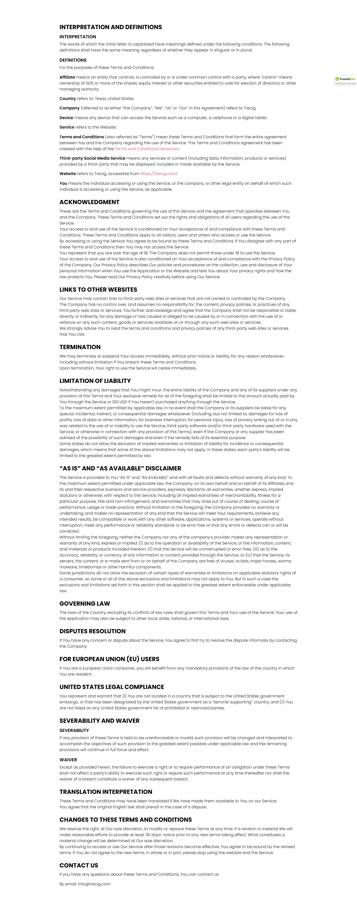

# Terms & Conditions – TRECIG

*TRECIG (design reference site)* · URL: https://trecig.com/terms-conditions/ · captured 2026-11-08 00:37:13 · HTTP 200

- **Meta description:** —
- **Page size (desktop 1440px):** 1440×4820 px · tablet (820px): 5324 px · mobile (390px): 6743 px
- **Screenshots:** [desktop](screenshots/desktop-full.png) · [tablet](screenshots/tablet-full.png) · [mobile](screenshots/mobile-full.png) · [desktop top](screenshots/desktop-viewport-top.png) · [desktop scrolled](screenshots/desktop-viewport-scrolled.png)
- **Files:** [raw.html](raw.html) (server HTML) · [rendered.html](rendered.html) (DOM after JS) · [content.txt](content.txt) (all visible text) · layout-*.json (full element tree with computed styles) · page.json (everything)

## 1. Section map (top → bottom, desktop 1440px)

| # | Role | Y from top | Height | Heading / first text | Mobile height | Screenshot |
|---|---|---|---|---|---|---|
| 0 | header | 0 | 170 | HOME ABOUT AWARDS & RECOGNITION EXPERTISE PRESS & MEDIA CONTACT | 170 | [img](screenshots/desktop-sec00-header.png) |
| 1 | section | 170 | 400 | TERMS & CONDITIONS | 220 | [img](screenshots/desktop-sec01-section.png) |
| 2 | section | 570 | 3652 | INTERPRETATION AND DEFINITIONS | 5663 | [img](screenshots/desktop-sec02-section.png) |
| 3 | footer | 4222 | 598 | LET'S TALK: | 690 | [img](screenshots/desktop-sec03-footer.png) |
| 4 | floating (fixed, z 1000003) | 875 | 38 |  |  |  |

## 2. Section-by-section layout (desktop)

Legend: each line is an element in DOM order. `@x,y w×h` = position/size in px on the 1440px-wide page. Text lines show *font size/weight, line-height, colour*. Boxes show layout (flex/grid), background, padding, radius, shadow, etc. Pass-through wrappers are collapsed.

### 2.0 HEADER — HOME ABOUT AWARDS & RECOGNITION EXPERTISE PRESS & MEDIA CONTACT

Element: `<header class="elementor elementor-13 elementor-location-header">` at y=0, 1440×170px · 

- section.elementor-section [bg:#FFFFFF · shadow:#000000 @10% 0px 0px 12px 0px · z:9999 · transition:background, border, border-radius, box-shadow 0.3s, 0.3s, 0.3s, 0.3s ease, ease, ease, ease] `@0,0 1440×170`
  - div.elementor-container [flex row · margin:0px 85px 0px 85px · max-w:1270px] `@85,0 1270×170`
    - div.elementor-column [flex row · min-h:1px] `@85,0 1270×170`
      - div.elementor-widget-wrap [flex row wrap] `@85,0 1270×170`
        - div.elementor-container [flex row · max-w:1270px] `@85,0 1270×170`
          - div.elementor-column [flex row · min-h:1px] `@85,0 127×170`
            - div.elementor-widget-wrap [flex row wrap · align:center · pad:10px 10px 10px 10px] `@85,0 127×170`
              - a (link→/) [inline-block · align-text:center] `@95,10 200×150`
                - **IMG** `TRECIG_Logo_Registered.png` alt="" natural 1440×1080 · inline-block · max-w:200px · overflow:clip · align-text:center `@95,10 200×150`
          - div.elementor-column [flex row · min-h:1px] `@212,0 1143×170`
            - div.elementor-widget-wrap [flex row wrap · align:center · pad:10px 10px 10px 10px] `@212,0 1143×170`
              - div.elementor-widget-container [flex column · transition:background, border, border-radius, box-shadow, transform 0.3s, 0.3s, 0.3s, 0.3s, 0.4s ease, ease, ease, ease, ease] `@222,75 1123×20`
                - ul.elementor-nav-menu [flex row wrap · justify:flex-end · margin:0px 0px 0px 411.234px · z:2] · pseudo:::after{{"content": "\" \"", "w": "0px", "h": "0px"}} `@633,75 712×20`
                  - **A→/** "HOME" — Poppins 14px/400 lh 20px · #000000 · textTransform:uppercase ‖ flex row · margin:0px 15px 0px 0px · transition:all 0.4s ease `@633,75 40×20`
                  - **A→/about/** "ABOUT" — Poppins 14px/400 lh 20px · #000000 · textTransform:uppercase ‖ flex row · margin:0px 15px 0px 15px · transition:all 0.4s ease `@703,75 70×20`
                  - **A→/awards-recognition/** "AWARDS & RECOGNITION" — Poppins 14px/400 lh 20px · #000000 · textTransform:uppercase ‖ flex row · margin:0px 15px 0px 15px · transition:all 0.4s ease `@803,75 195×20`
                  - **A→/expertise/** "EXPERTISE" — Poppins 14px/400 lh 20px · #000000 · textTransform:uppercase ‖ flex row · margin:0px 15px 0px 15px · transition:all 0.4s ease `@1028,75 90×20`
                  - **A→/press-media/** "PRESS & MEDIA" — Poppins 14px/400 lh 20px · #000000 · textTransform:uppercase ‖ flex row · margin:0px 15px 0px 15px · transition:all 0.4s ease `@1148,75 100×20`
                  - **A→/contact/** "CONTACT" — Poppins 14px/400 lh 20px · #000000 · textTransform:uppercase ‖ flex row · margin:0px 0px 0px 15px · transition:all 0.4s ease `@1278,75 67×20`

### 2.1 SECTION — TERMS & CONDITIONS

Element: `<section class="elementor-section elementor-top-section elementor-element elementor-element-0ec6cc9 elementor-section-height-min-height elementor-section-bo">` at y=170, 1440×400px · 

- section.elementor-section [bg-image:LEGACY2-scaled.jpg · bg-size:cover · bg-pos:50% 0% · transition:background, border, border-radius, box-shadow 0.3s, 0.3s, 0.3s, 0.3s ease, ease, ease, ease] `@0,170 1440×400`
  - div.elementor-background-overlay [bg:#000000 · pos:absolute · opacity:0.5 · transition:background, border-radius, opacity 0.3s, 0.3s, 0.3s ease, ease, ease] `@0,170 1440×400` (empty/decorative)
  - div.elementor-container [flex row · align:center · margin:0px 370px 0px 370px · max-w:700px · min-h:400px] `@370,170 700×400`
    - div.elementor-column [flex row · min-h:1px] `@370,293 700×155`
      - div.elementor-widget-wrap [flex row wrap · pad:10px 10px 10px 10px · margin:50px 0px 0px 0px] `@370,343 700×105`
        - div.elementor-widget-heading [margin:0px 0px 20px 0px · align-text:center] `@380,353 680×44`
          - **H2** "TERMS & CONDITIONS" — Poppins 44px/800 lh 44px · #FFFFFF · textTransform:uppercase · textAlign:center ‖ inline-block `@478,353 484×44`
        - ul.elementor-icon-list-items [flex row wrap · justify:center · margin:0px -2.5px 0px -2.5px · align-text:center] `@378,417 685×21`
          - li.elementor-icon-list-item [flex row · justify:center · align:center · margin:0px 2.5px 0px 2.5px · align-text:center] `@626,417 34×21`
            - **A→/** "HOME" — Poppins 12px/400 lh 18px · #CC3366 · textTransform:uppercase · textAlign:center ‖ flex row · highlights: "HOME" #FFFFFF `@626,418 34×18`
          - li.elementor-icon-list-item [flex row · justify:center · align:center · margin:0px 2.5px 0px 2.5px · align-text:center] `@666,417 148×21`
            - **SPAN** "TERMS & CONDITIONS" — Poppins 12px/400 lh 18px · #FFFFFF · textTransform:uppercase · textAlign:center ‖ pad:0px 0px 0px 5px · transition:color 0.3s ease `@683,418 131×18`

### 2.2 SECTION — INTERPRETATION AND DEFINITIONS

Element: `<section class="elementor-section elementor-top-section elementor-element elementor-element-d6968d0 elementor-section-boxed elementor-section-height-default">` at y=570, 1440×3652px · 

- section.elementor-section [pad:50px 0px 50px 0px · transition:background, border, border-radius, box-shadow 0.3s, 0.3s, 0.3s, 0.3s ease, ease, ease, ease] `@0,570 1440×3652`
  - div.elementor-container [flex row · margin:0px 220px 0px 220px · max-w:1000px] `@220,620 1000×3552`
    - div.elementor-column [flex row · min-h:1px] `@220,620 1000×3552`
      - div.elementor-widget-wrap [flex row wrap · pad:10px 10px 10px 10px] `@220,620 1000×3552`
        - div.elementor-container [flex row · max-w:1270px] `@230,630 980×3532`
          - div.elementor-column [flex row · min-h:1px] `@230,630 980×3532`
            - div.elementor-widget-wrap [flex row wrap · align:center · pad:10px 10px 10px 10px] `@230,630 980×3532`
              - div.elementor-widget-container [transition:background, border, border-radius, box-shadow, transform 0.3s, 0.3s, 0.3s, 0.3s, 0.4s ease, ease, ease, ease, ease] `@240,665 960×3473`
                - **H4** "INTERPRETATION AND DEFINITIONS" — Poppins 24px/700 lh 28.8px · #000000 · textTransform:uppercase ‖ margin:25px 0px 10px 0px `@240,665 960×29`
                - **P** "INTERPRETATION The words of which the initial letter is capitalized have meanings defined under the following conditions. The following definitions shall hav…" — Poppins 16px/300 lh 24px · #000000 ‖ margin:0px 0px 14.4px 0px · highlights: "INTERPRETATION"  600 18px `@240,704 960×80`
                - **P** "DEFINITIONS For the purposes of these Terms and Conditions:" — Poppins 16px/300 lh 24px · #000000 ‖ margin:0px 0px 14.4px 0px · highlights: "DEFINITIONS"  600 18px `@240,798 960×56`
                - **P** "Affiliate means an entity that controls, is controlled by or is under common control with a party, where “control” means ownership of 50% or more of the shar…" — Poppins 16px/300 lh 24px · #000000 ‖ margin:0px 0px 14.4px 0px · highlights: "Affiliate"  600 `@240,869 960×72`
                - **P** "Country refers to: Texas, United States" — Poppins 16px/300 lh 24px · #000000 ‖ margin:0px 0px 14.4px 0px · highlights: "Country"  600 `@240,955 960×24`
                - **P** "Company (referred to as either “the Company”, “We”, “Us” or “Our” in this Agreement) refers to Trecig." — Poppins 16px/300 lh 24px · #000000 ‖ margin:0px 0px 14.4px 0px · highlights: "Company"  600 `@240,993 960×24`
                - **P** "Device means any device that can access the Service such as a computer, a cellphone or a digital tablet." — Poppins 16px/300 lh 24px · #000000 ‖ margin:0px 0px 14.4px 0px · highlights: "Device"  600 `@240,1032 960×24`
                - **P** "Service refers to the Website." — Poppins 16px/300 lh 24px · #000000 ‖ margin:0px 0px 14.4px 0px · highlights: "Service"  600 `@240,1070 960×24`
                - p [margin:0px 0px 14.4px 0px] `@240,1109 960×72`
                  - **text** "(also referred as “Terms”) mean these Terms and Conditions that form the entire agreement between You and the Company regarding the use of the Service. This …" — Poppins 16px/300 lh 24px · #000000 `@240,1109 960×72`
                  - **B** "Terms and Conditions" — Poppins 16px/600 lh 24px · #000000 ‖ inline `@240,1109 179×23`
                  - **A→https://www.termsfeed.com/terms-conditions-generator/** "Terms and Conditions Generator" — Poppins 16px/300 lh 24px · #CC3366 ‖ inline `@463,1157 259×23`
                - **P** "Third-party Social Media Service means any services or content (including data, information, products or services) provided by a third-party that may be disp…" — Poppins 16px/300 lh 24px · #000000 ‖ margin:0px 0px 14.4px 0px · highlights: "Third-party Social Media Service"  600 `@240,1195 960×48`
                - p [margin:0px 0px 14.4px 0px] `@240,1257 960×24`
                  - **text** "refers to Trecig, accessible from" — Poppins 16px/300 lh 24px · #000000 `@240,1257 960×24`
                  - **B** "Website" — Poppins 16px/600 lh 24px · #000000 ‖ inline `@240,1257 66×23`
                  - **A→/** "https://trecig.com/" — Poppins 16px/300 lh 24px · #CC3366 ‖ inline `@567,1257 150×23`
                - **P** "You means the individual accessing or using the Service, or the company, or other legal entity on behalf of which such individual is accessing or using the S…" — Poppins 16px/300 lh 24px · #000000 ‖ margin:0px 0px 14.4px 0px · highlights: "You"  600 `@240,1296 960×48`
                - **H4** "ACKNOWLEDGMENT" — Poppins 24px/700 lh 28.8px · #000000 · textTransform:uppercase ‖ margin:25px 0px 10px 0px `@240,1369 960×29`
                - **P** "These are the Terms and Conditions governing the use of this Service and the agreement that operates between You and the Company. These Terms and Conditions …" — Poppins 16px/300 lh 24px · #000000 ‖ margin:0px 0px 14.4px 0px `@240,1408 960×288`
                - **H4** "LINKS TO OTHER WEBSITES" — Poppins 24px/700 lh 28.8px · #000000 · textTransform:uppercase ‖ margin:25px 0px 10px 0px `@240,1721 960×29`
                - **P** "Our Service may contain links to third-party web sites or services that are not owned or controlled by the Company. The Company has no control over, and assu…" — Poppins 16px/300 lh 24px · #000000 ‖ margin:0px 0px 14.4px 0px `@240,1759 960×168`
                - **H4** "TERMINATION" — Poppins 24px/700 lh 28.8px · #000000 · textTransform:uppercase ‖ margin:25px 0px 10px 0px `@240,1952 960×29`
                - **P** "We may terminate or suspend Your access immediately, without prior notice or liability, for any reason whatsoever, including without limitation if You breach…" — Poppins 16px/300 lh 24px · #000000 ‖ margin:0px 0px 14.4px 0px `@240,1991 960×72`
                - **H4** "LIMITATION OF LIABILITY" — Poppins 24px/700 lh 28.8px · #000000 · textTransform:uppercase ‖ margin:25px 0px 10px 0px `@240,2088 960×29`
                - **P** "Notwithstanding any damages that You might incur, the entire liability of the Company and any of its suppliers under any provision of this Terms and Your exc…" — Poppins 16px/300 lh 24px · #000000 ‖ margin:0px 0px 14.4px 0px `@240,2127 960×288`
                - **H4** "“AS IS” AND “AS AVAILABLE” DISCLAIMER" — Poppins 24px/700 lh 28.8px · #000000 · textTransform:uppercase ‖ margin:25px 0px 10px 0px `@240,2440 960×29`
                - **P** "The Service is provided to You “AS IS” and “AS AVAILABLE” and with all faults and defects without warranty of any kind. To the maximum extent permitted under…" — Poppins 16px/300 lh 24px · #000000 ‖ margin:0px 0px 14.4px 0px `@240,2479 960×480`
                - **H4** "GOVERNING LAW" — Poppins 24px/700 lh 28.8px · #000000 · textTransform:uppercase ‖ margin:25px 0px 10px 0px `@240,2984 960×29`
                - **P** "The laws of the Country, excluding its conflicts of law rules, shall govern this Terms and Your use of the Service. Your use of the Application may also be s…" — Poppins 16px/300 lh 24px · #000000 ‖ margin:0px 0px 14.4px 0px `@240,3022 960×48`
                - **H4** "DISPUTES RESOLUTION" — Poppins 24px/700 lh 28.8px · #000000 · textTransform:uppercase ‖ margin:25px 0px 10px 0px `@240,3095 960×29`
                - **P** "If You have any concern or dispute about the Service, You agree to first try to resolve the dispute informally by contacting the Company." — Poppins 16px/300 lh 24px · #000000 ‖ margin:0px 0px 14.4px 0px `@240,3134 960×48`
                - **H4** "FOR EUROPEAN UNION (EU) USERS" — Poppins 24px/700 lh 28.8px · #000000 · textTransform:uppercase ‖ margin:25px 0px 10px 0px `@240,3207 960×29`
                - **P** "If You are a European Union consumer, you will benefit from any mandatory provisions of the law of the country in which You are resident." — Poppins 16px/300 lh 24px · #000000 ‖ margin:0px 0px 14.4px 0px `@240,3246 960×48`
                - **H4** "UNITED STATES LEGAL COMPLIANCE" — Poppins 24px/700 lh 28.8px · #000000 · textTransform:uppercase ‖ margin:25px 0px 10px 0px `@240,3319 960×29`
                - **P** "You represent and warrant that (i) You are not located in a country that is subject to the United States government embargo, or that has been designated by t…" — Poppins 16px/300 lh 24px · #000000 ‖ margin:0px 0px 14.4px 0px `@240,3358 960×72`
                - **H4** "SEVERABILITY AND WAIVER" — Poppins 24px/700 lh 28.8px · #000000 · textTransform:uppercase ‖ margin:25px 0px 10px 0px `@240,3455 960×29`
                - **P** "SEVERABILITY If any provision of these Terms is held to be unenforceable or invalid, such provision will be changed and interpreted to accomplish the objecti…" — Poppins 16px/300 lh 24px · #000000 ‖ margin:0px 0px 14.4px 0px · highlights: "SEVERABILITY"  600 18px `@240,3494 960×104`
                - **P** "WAIVER Except as provided herein, the failure to exercise a right or to require performance of an obligation under these Terms shall not affect a party’s abi…" — Poppins 16px/300 lh 24px · #000000 ‖ margin:0px 0px 14.4px 0px · highlights: "WAIVER"  600 18px `@240,3612 960×104`
                - **H4** "TRANSLATION INTERPRETATION" — Poppins 24px/700 lh 28.8px · #000000 · textTransform:uppercase ‖ margin:25px 0px 10px 0px `@240,3741 960×29`
                - **P** "These Terms and Conditions may have been translated if We have made them available to You on our Service. You agree that the original English text shall prev…" — Poppins 16px/300 lh 24px · #000000 ‖ margin:0px 0px 14.4px 0px `@240,3780 960×48`
                - **H4** "CHANGES TO THESE TERMS AND CONDITIONS" — Poppins 24px/700 lh 28.8px · #000000 · textTransform:uppercase ‖ margin:25px 0px 10px 0px `@240,3853 960×29`
                - **P** "We reserve the right, at Our sole discretion, to modify or replace these Terms at any time. If a revision is material We will make reasonable efforts to prov…" — Poppins 16px/300 lh 24px · #000000 ‖ margin:0px 0px 14.4px 0px `@240,3892 960×120`
                - **H4** "CONTACT US" — Poppins 24px/700 lh 28.8px · #000000 · textTransform:uppercase ‖ margin:25px 0px 10px 0px `@240,4037 960×29`
                - **P** "If you have any questions about these Terms and Conditions, You can contact us:" — Poppins 16px/300 lh 24px · #000000 ‖ margin:0px 0px 14.4px 0px `@240,4075 960×24`
                - **P** "By email: info@trecig.com" — Poppins 16px/300 lh 24px · #000000 ‖ margin:0px 0px 14.4px 0px `@240,4114 960×24`

### 2.3 FOOTER — LET'S TALK:

Element: `<footer class="elementor elementor-15 elementor-location-footer">` at y=4222, 1440×598px · 

- section.elementor-section [transition:background, border, border-radius, box-shadow 0.3s, 0.3s, 0.3s, 0.3s ease, ease, ease, ease] `@0,4222 1440×598`
  - div.elementor-background-video-container [pos:absolute · z:0 · overflow:hidden · transition:opacity 1s ease] `@0,4222 1440×598`
    - **IFRAME** https://www.youtube.com/embed/OzwCnEEadts?controls=0&rel=0&playsinline=1&cc_load_policy=0&enablejsapi=1&origin=https%3A%2F%2Ftrecig.com&widgetid=1&forigin=https%3A%2F%2Ftrecig.com%2Fterms-conditions%2F&aoriginsup=1&vf=1 Triceg   Expertise Slider 1 `@0,4116 1440×810`
  - div.elementor-background-overlay [bg:#FFFFFF · pos:absolute · opacity:0.7 · transition:background, border-radius, opacity 0.3s, 0.3s, 0.3s ease, ease, ease] `@0,4222 1440×598` (empty/decorative)
  - div.elementor-container [flex row · margin:0px 85px 0px 85px · max-w:1270px] `@85,4222 1270×598`
    - div.elementor-column [flex row · min-h:1px] `@85,4222 1270×598`
      - div.elementor-widget-wrap [flex row wrap] `@85,4222 1270×598`
        - section.elementor-section [pad:40px 0px 40px 0px] `@85,4222 1270×467`
          - div.elementor-container [flex row · max-w:1270px] `@85,4262 1270×387`
            - div.elementor-column [flex row · min-h:1px] `@85,4262 324×387`
              - div.elementor-widget-wrap [flex row wrap · pad:10px 10px 10px 10px] `@85,4262 324×387`
                - div.elementor-widget-theme-site-logo [margin:0px 0px 20px 0px] `@95,4272 304×300`
                  - a (link→/) [inline-block] `@95,4272 400×300`
                    - **IMG** `TRECIG_Logo_Registered.png` alt="" natural 1440×1080 · inline-block · max-w:400px · overflow:clip `@95,4272 400×300`
                - div.elementor-button-wrapper [grid cols[134.078px]] `@95,4592 134×47`
                  - **A→/contact/** "LET’S TALK" — Poppins 15px/400 lh 15px · #000000 · textTransform:uppercase · textAlign:center ‖ pad:15px 30px 15px 30px · radius:30px · border:1px 1px 1px 1px solid #000000 · transition:all 0.3s ease `@95,4592 134×47`
            - div.elementor-column [flex row · min-h:1px] `@409,4262 371×387`
              - div.elementor-widget-wrap [flex row wrap · pad:10px 10px 10px 10px · margin:0px 0px 0px 50px] `@459,4262 321×387`
                - div.elementor-widget-heading [margin:0px 0px 20px 0px] `@469,4272 301×24`
                  - **H2** "LET'S TALK:" — Poppins 18px/700 lh 18px · #000000 · textTransform:uppercase ‖ inline-block `@469,4275 98×18`
                - ul.elementor-icon-list-items `@469,4316 301×52`
                  - li.elementor-icon-list-item [flex row · align:center · pad:0px 0px 5px 0px] `@469,4316 301×26`
                    - **A→tel:(254)%20338-6131** "(469)653-9009" — Poppins 14px/600 lh 21px · #CC3366 ‖ flex row · highlights: "(469)653-9009" #000000 `@469,4316 301×21`
                  - li.elementor-icon-list-item [flex row · align:center · margin:5px 0px 0px 0px] `@469,4347 301×21`
                    - **A→mailto:info@trecig.com** "info@trecig.com" — Poppins 14px/600 lh 21px · #CC3366 ‖ flex row · highlights: "info@trecig.com" #000000 `@469,4347 301×21`
            - div.elementor-column [flex row · min-h:1px] `@781,4262 310×387`
              - div.elementor-widget-wrap [flex row wrap · pad:10px 10px 10px 10px · margin:0px 50px 0px 0px] `@781,4262 260×387`
                - div.elementor-widget-heading [margin:0px 0px 20px 0px] `@791,4272 240×24`
                  - **H2** "TRECIG HQ:" — Poppins 18px/700 lh 18px · #000000 · textTransform:uppercase ‖ inline-block `@791,4275 101×18`
                - ul.elementor-icon-list-items `@791,4316 240×42`
                  - li.elementor-icon-list-item [flex row · align:center] `@791,4316 240×42`
                    - **SPAN** "Rockwall, Texas, United States" — Poppins 14px/400 lh 21px · #000000 ‖ transition:color 0.3s ease `@791,4316 110×42`
            - div.elementor-column [flex row · min-h:1px] `@1090,4262 264×387`
              - div.elementor-widget-wrap [flex row wrap · pad:10px 10px 10px 10px] `@1090,4262 264×387`
                - div.elementor-widget-heading [margin:0px 0px 20px 0px] `@1100,4272 244×24`
                  - **H2** "CONNECT WITH US:" — Poppins 18px/700 lh 18px · #000000 · textTransform:uppercase ‖ inline-block `@1100,4275 174×18`
                - **A→/terms-conditions/** "Linkedin-in" +icon[e-font-icon-svg e-fab-linkedin-in] — -apple-system 16px/400 lh 16px · #69727D · textAlign:center ‖ flex row · bg:#000000 · radius:100% · transition:all 0.3s ease `@1100,4316 32×32`
        - section.elementor-section [pad:15px 0px 15px 0px · border:1px 0px 0px 0px solid #000000 @20%] `@85,4689 1270×131`
          - div.elementor-container [flex row · max-w:1270px] `@85,4705 1270×100`
            - div.elementor-column [flex row · min-h:1px] `@85,4705 1270×100`
              - div.elementor-widget-wrap [flex row wrap · align:center · pad:10px 10px 10px 10px] `@85,4705 1270×100`
                - div.elementor-element [margin:0px 0px 20px 0px · align-text:center] `@95,4715 1250×10`
                  - div.elementor-widget-container [margin:0px 0px -10px 0px · overflow:hidden · align-text:center · transition:background, border, border-radius, box-shadow, transform 0.3s, 0.3s, 0.3s, 0.3s, 0.4s ease, ease, ease, ease, ease] `@95,4715 1250×20`
                    - ul.elementor-icon-list-items [flex row wrap · justify:center · gap:30px · margin:0px -8px 0px -8px · align-text:center] `@87,4715 1266×20`
                      - li.elementor-icon-list-item [flex row · justify:center · align:center · margin:0px 8px 0px 8px · align-text:center] `@589,4715 89×20`
                        - **A→/privacy-policy/** "Privacy Policy" — Poppins 13px/400 lh 19.5px · #CC3366 · textAlign:center ‖ flex row · highlights: "Privacy Policy" #000000 `@589,4715 88×20`
                      - li.elementor-icon-list-item [flex row · justify:center · align:center · margin:0px 8px 0px 8px · align-text:center] `@724,4715 127×20`
                        - **A→/terms-conditions/** "Terms & Conditions" — Poppins 13px/400 lh 19.5px · #CC3366 · textAlign:center ‖ flex row · highlights: "Terms & Conditions" #000000 `@724,4715 127×20`
                - **P** "©2026 TRECIG, LLC" — Poppins 12px/400 lh 18px · #000000 · textTransform:uppercase · textAlign:center ‖ margin:0px 0px 14.4px 0px `@95,4745 1250×36`

### Floating / fixed elements
- `div.` fixed at [1348, 875, 92, 38] z-index 1000003 — ""

## 3. Header, navigation & interaction behaviour

- **atTop** `header.elementor.elementor-13.elementor-location-header` position:static top:0 height:170 bg:transparent shadow:none backdrop:none z:auto
- **afterScroll1400** `header.elementor.elementor-13.elementor-location-header` position:static top:-1400 height:0 bg:transparent shadow:none backdrop:none z:auto
- **afterScroll1400** `section.elementor-section.elementor-top-section.elementor-element.elementor-elem` position:fixed top:0 height:170 bg:#FFFFFF @90% shadow:#000000 @10% 0px 0px 12px 0px backdrop:none z:9999

| Menu item | Link | Dropdown | Style | Hover change |
|---|---|---|---|---|
| HOME | / | — | Poppins 14px/400 #000000 uppercase ls normal | color: #000000 → #B22239 |
| ABOUT | /about/ | The Mission (/the-mission/); The Values (/the-values/); The Legacy (/the-legacy/); The Trecig Team (/the-trecig-team/); Careers (/careers/) | Poppins 14px/400 #000000 uppercase ls normal | color: #000000 → #B22239 |
| AWARDS & RECOGNITION | /awards-recognition/ | Partnerships (/partnerships/) | Poppins 14px/400 #000000 uppercase ls normal | color: #000000 → #B22239 |
| EXPERTISE | /expertise/ | Industries We Serve (/industries-we-serve/) | Poppins 14px/400 #000000 uppercase ls normal | color: #000000 → #B22239 |
| PRESS & MEDIA | /press-media/ | — | Poppins 14px/400 #000000 uppercase ls normal | color: #000000 → #B22239 |
| CONTACT | /contact/ | — | Poppins 14px/400 #000000 uppercase ls normal | color: #000000 → #B22239 |

- **Mobile menu:** toggle `.elementor-menu-toggle` → [screenshot](screenshots/mobile-menu-open.png) · items: HOME, ABOUT, AWARDS & RECOGNITION, EXPERTISE, PRESS & MEDIA, CONTACT

### Hover states (measured by hovering in Chrome)

| Element | Text | Normal | On hover |
|---|---|---|---|
| `a.elementor-item` | HOME | color #000000 · bg transparent · radius 0px · pad 0px · border 0px #000000 · transition 0.4s | color: #000000 → #B22239; borderTopColor: #000000 → #B22239 |
| `a.elementor-item` | ABOUT | color #000000 · bg transparent · radius 0px · pad 0px · border 0px #000000 · transition 0.4s | color: #000000 → #B22239; borderTopColor: #000000 → #B22239 |
| `a.elementor-item` | CONTACT | color #000000 · bg transparent · radius 0px · pad 0px · border 0px #000000 · transition 0.4s | color: #000000 → #B22239; borderTopColor: #000000 → #B22239 |
| `a.` |  | color #CC3366 · bg transparent · radius 0px · pad 0px · border 0px #CC3366 · transition all | color: #CC3366 → #B22239; borderTopColor: #CC3366 → #B22239; childColor: #CC3366 → #B22239 |
| `a.elementor-button` | LET’S TALK | color #000000 · bg transparent · radius 30px · pad 15px 30px · border 1px #000000 · transition 0.3s | color: #000000 → #FFFFFF; borderTopColor: #000000 → #B22239 |
| `a.` | (469)653-9009 | color #CC3366 · bg transparent · radius 0px · pad 0px · border 0px #CC3366 · transition all | color: #CC3366 → #B22239; borderTopColor: #CC3366 → #B22239 |
| `a.elementor-icon` | Linkedin-in | color #69727D · bg #000000 · radius 100% · pad 0px · border 0px #69727D · transition 0.3s | color: #69727D → #B22239; backgroundColor: #000000 → #B22239; borderTopColor: #69727D → #B22239; opacity: 1 → 0.9; childColor: #69727D → #B22239 |
| `a.` | Privacy Policy | color #CC3366 · bg transparent · radius 0px · pad 0px · border 0px #CC3366 · transition all | color: #CC3366 → #B22239; borderTopColor: #CC3366 → #B22239 |

## 4. Typography & colour used on this page (weighted by amount of text / area)

| Font · weight · size / line-height | chars |
|---|---|
| Poppins | 300 | 16px / 24px | 9218 |
| Poppins | 700 | 24px / 28.8px | 325 |
| Poppins | 600 | 16px / 24px | 98 |
| Poppins | 400 | 14px / 20px | 58 |
| Poppins | 600 | 18px / 27px | 43 |
| Poppins | 400 | 12px / 18px | 39 |
| Poppins | 700 | 18px / 18px | 37 |
| Poppins | 400 | 13px / 19.5px | 32 |
| Poppins | 400 | 14px / 21px | 29 |
| Poppins | 600 | 14px / 21px | 28 |
| Poppins | 800 | 44px / 44px | 18 |
| -apple-system | 400 | 16px / 24px | 15 |
| -apple-system | 400 | 16px / 16px | 11 |
| Poppins | 400 | 15px / 15px | 10 |

- **Text colours:** #000000 (9846), #CC3366 (64), #FFFFFF (40), #69727D (11)
- **Background colours (by area):** #FFFFFF (1109), #000000 (577)
- **Border radii:** 30px (1), 100% (1), 2px 0px 0px (1)
- **Shadows:** #000000 @10% 0px 0px 12px 0px (1) | #000000 @20% 0px 0px 5px 0px (1)
- **Mobile text styles:** Poppins | 300 | 14px / 21px (9218); Poppins | 700 | 24px / 28.8px (325); Poppins | 600 | 14px / 21px (126); Poppins | 400 | 12px / 18px (54); Poppins | 600 | 18px / 27px (43); Poppins | 700 | 16px / 16px (37); Poppins | 400 | 14px / 21px (29); Poppins | 800 | 28px / 28px (18); Poppins | 400 | 10px / 15px (17); -apple-system | 400 | 16px / 24px (15)

## 6. Images on the page

- `TRECIG_Logo_Registered.png` natural 1440×1080 → shown 200×150 · alt="" · https://trecig.com/wp-content/uploads/2026/10/TRECIG_Logo_Registered.png
- background on `section.elementor-section`: https://trecig.com/wp-content/uploads/2024/09/LEGACY2-scaled.jpg
- background on `div.`: https://cdn.ywxi.net/meter/trecig.com/205.svg?ts=1784975038086&l=en

## 7. Links on the page

- [body] "Skip to content" → /terms-conditions/#content
- [header] "(icon/image)" → /
- [header] "HOME" → /
- [header] "ABOUT" → /about/
- [header] "The Mission" → /the-mission/
- [header] "The Values" → /the-values/
- [header] "The Legacy" → /the-legacy/
- [header] "The Trecig Team" → /the-trecig-team/
- [header] "Careers" → /careers/
- [header] "AWARDS & RECOGNITION" → /awards-recognition/
- [header] "Partnerships" → /partnerships/
- [header] "EXPERTISE" → /expertise/
- [header] "Industries We Serve" → /industries-we-serve/
- [header] "PRESS & MEDIA" → /press-media/
- [header] "CONTACT" → /contact/
- [header] "Home" → /
- [header] "About" → /about/
- [header] "Awards & Recognition" → /awards-recognition/
- [header] "Expertise" → /expertise/
- [header] "Press & Media" → /press-media/
- [header] "Contact" → /contact/
- [body] "Terms and Conditions Generator" → https://www.termsfeed.com/terms-conditions-generator/ (target _blank)
- [body] "https://trecig.com/" → / (target _blank)
- [footer] "LET’S TALK" → /contact/
- [footer] "(469)653-9009" → tel:(254)%20338-6131
- [footer] "info@trecig.com" → mailto:info@trecig.com
- [footer] "Linkedin-in" → /terms-conditions/ (target _blank)
- [footer] "Privacy Policy" → /privacy-policy/
- [footer] "Terms & Conditions" → /terms-conditions/

## 8. Mobile layout (390px) — condensed outline

### 8.0 header — HOME ABOUT AWARDS & RECOGNITION EXPERTISE PRESS & MEDIA CONTACT (y 0, h 170)
- section.elementor-section [bg:#FFFFFF · shadow:#000000 @10% 0px 0px 12px 0px · z:9999 · transition:background, border, border-radius, box-shadow 0.3s, 0.3s, 0.3s, 0.3s ease, ease, ease, ease] `@0,0 390×170`
  - div.elementor-container [flex row wrap · max-w:767px] `@0,0 390×170`
    - div.elementor-column [flex row · min-h:1px] `@0,0 390×170`
      - div.elementor-widget-wrap [flex row wrap] `@0,0 390×170`
        - div.elementor-container [flex row wrap · max-w:767px] `@0,0 390×170`
          - div.elementor-column [flex row · min-h:1px] `@0,0 234×170`
            - div.elementor-widget-wrap [flex row wrap · align:center · pad:10px 10px 10px 10px] `@0,0 234×170`
              - a (link→/) [inline-block · align-text:center] `@17,10 200×150`
                - **IMG** `TRECIG_Logo_Registered-1024x768.png` alt="" natural 390×292 · inline-block · max-w:200px · overflow:clip · align-text:center `@17,10 200×150`
          - div.elementor-column [flex row · min-h:1px] `@234,0 156×170`
            - div.elementor-widget-wrap [flex row wrap · align:center · pad:10px 10px 10px 10px] `@234,0 156×170`
              - div.elementor-widget-container [flex column · transition:background, border, border-radius, box-shadow, transform 0.3s, 0.3s, 0.3s, 0.3s, 0.4s ease, ease, ease, ease, ease] `@244,70 136×30`
                - nav.elementor-nav-menu--dropdown [bg:#FFFFFF · margin:16px 0px 0px 0px · pos:absolute · z:9997 · overflow:hidden · transform:matrix(1, 0, 0, 0, 0, 0) · transition:max-height, transform 0.3s, 0.3s ease, ease] `@0,116 390×0`
                  - ul.elementor-nav-menu [z:2] · pseudo:::after{{"content": "\" \"", "w": "390px", "h": "0px"}} `@0,116 390×0`
                    - **A→/** "HOME" — Poppins 14px/400 lh 20px · #000000 · textTransform:uppercase ‖ flex row · pad:10px 20px 10px 20px `@0,116 390×0`
                    - **A→/about/** "ABOUT" — Poppins 14px/400 lh 20px · #000000 · textTransform:uppercase ‖ flex row · pad:10px 20px 10px 20px `@0,116 390×0`
                    - **A→/awards-recognition/** "AWARDS & RECOGNITION" — Poppins 14px/400 lh 20px · #000000 · textTransform:uppercase ‖ flex row · pad:10px 20px 10px 20px `@0,116 390×0`
                    - **A→/expertise/** "EXPERTISE" — Poppins 14px/400 lh 20px · #000000 · textTransform:uppercase ‖ flex row · pad:10px 20px 10px 20px `@0,116 390×0`
                    - **A→/press-media/** "PRESS & MEDIA" — Poppins 14px/400 lh 20px · #000000 · textTransform:uppercase ‖ flex row · pad:10px 20px 10px 20px `@0,116 390×0`
                    - **A→/contact/** "CONTACT" — Poppins 14px/400 lh 20px · #000000 · textTransform:uppercase ‖ flex row · pad:10px 20px 10px 20px `@0,116 390×0`

### 8.1 section — TERMS & CONDITIONS (y 170, h 220)
- section.elementor-section [bg-image:LEGACY2-scaled.jpg · bg-size:cover · bg-pos:50% 0% · transition:background, border, border-radius, box-shadow 0.3s, 0.3s, 0.3s, 0.3s ease, ease, ease, ease] `@0,170 390×220`
  - div.elementor-background-overlay [bg:#000000 · pos:absolute · opacity:0.5 · transition:background, border-radius, opacity 0.3s, 0.3s, 0.3s ease, ease, ease] `@0,170 390×220` (empty/decorative)
  - div.elementor-container [flex row wrap · align:center · max-w:700px · min-h:220px] `@0,170 390×220`
    - div.elementor-column [flex row · min-h:1px] `@0,215 390×130`
      - div.elementor-widget-wrap [flex row wrap · pad:10px 10px 10px 10px · margin:40px 0px 0px 0px] `@0,255 390×90`
        - div.elementor-widget-heading [margin:0px 0px 20px 0px · align-text:center] `@10,265 370×29`
          - **H2** "TERMS & CONDITIONS" — Poppins 28px/800 lh 28px · #FFFFFF · textTransform:uppercase · textAlign:center ‖ inline-block `@41,265 308×28`
        - ul.elementor-icon-list-items [flex row wrap · justify:center · margin:0px -2.5px 0px -2.5px · align-text:center] `@8,314 375×21`
          - li.elementor-icon-list-item [flex row · justify:center · align:center · margin:0px 2.5px 0px 2.5px · align-text:center] `@101,314 34×21`
            - **A→/** "HOME" — Poppins 12px/400 lh 18px · #CC3366 · textTransform:uppercase · textAlign:center ‖ flex row · highlights: "HOME" #FFFFFF `@101,316 34×18`
          - li.elementor-icon-list-item [flex row · justify:center · align:center · margin:0px 2.5px 0px 2.5px · align-text:center] `@141,314 148×21`
            - **SPAN** "TERMS & CONDITIONS" — Poppins 12px/400 lh 18px · #FFFFFF · textTransform:uppercase · textAlign:center ‖ pad:0px 0px 0px 5px · transition:color 0.3s ease `@158,316 131×18`

### 8.2 section — INTERPRETATION AND DEFINITIONS (y 390, h 5663)
- div.elementor-container [flex row wrap · max-w:1000px] `@0,390 390×5663`
  - div.elementor-column [flex row · min-h:1px] `@0,390 390×5663`
    - div.elementor-widget-wrap [flex row wrap · pad:10px 10px 10px 10px] `@0,390 390×5663`
      - div.elementor-container [flex row wrap · max-w:767px] `@10,400 370×5643`
        - div.elementor-column [flex row · min-h:1px] `@10,400 370×5643`
          - div.elementor-widget-wrap [flex row wrap · align:center · pad:10px 10px 10px 10px] `@10,400 370×5643`
            - div.elementor-widget-container [transition:background, border, border-radius, box-shadow, transform 0.3s, 0.3s, 0.3s, 0.3s, 0.4s ease, ease, ease, ease, ease] `@20,435 350×5584`
              - **H4** "INTERPRETATION AND DEFINITIONS" — Poppins 24px/700 lh 28.8px · #000000 · textTransform:uppercase ‖ margin:25px 0px 10px 0px `@20,435 350×58`
              - **P** "INTERPRETATIONThe words of which the initial letter is capitalized have meanings defined under the following conditions. The following definitions shall have…" — Poppins 14px/300 lh 21px · #000000 ‖ margin:0px 0px 14.4px 0px · highlights: "INTERPRETATION"  600 18px `@20,503 350×116`
              - **P** "DEFINITIONSFor the purposes of these Terms and Conditions:" — Poppins 14px/300 lh 21px · #000000 ‖ margin:0px 0px 14.4px 0px · highlights: "DEFINITIONS"  600 18px `@20,633 350×53`
              - **P** "Affiliate means an entity that controls, is controlled by or is under common control with a party, where “control” means ownership of 50% or more of the shar…" — Poppins 14px/300 lh 21px · #000000 ‖ margin:0px 0px 14.4px 0px · highlights: "Affiliate"  600 `@20,700 350×126`
              - **P** "Country refers to: Texas, United States" — Poppins 14px/300 lh 21px · #000000 ‖ margin:0px 0px 14.4px 0px · highlights: "Country"  600 `@20,841 350×21`
              - **P** "Company (referred to as either “the Company”, “We”, “Us” or “Our” in this Agreement) refers to Trecig." — Poppins 14px/300 lh 21px · #000000 ‖ margin:0px 0px 14.4px 0px · highlights: "Company"  600 `@20,876 350×63`
              - **P** "Device means any device that can access the Service such as a computer, a cellphone or a digital tablet." — Poppins 14px/300 lh 21px · #000000 ‖ margin:0px 0px 14.4px 0px · highlights: "Device"  600 `@20,954 350×63`
              - **P** "Service refers to the Website." — Poppins 14px/300 lh 21px · #000000 ‖ margin:0px 0px 14.4px 0px · highlights: "Service"  600 `@20,1031 350×21`
              - p [margin:0px 0px 14.4px 0px] `@20,1066 350×126`
                - **text** "(also referred as “Terms”) mean these Terms and Conditions that form the entire agreement between You and the Company regarding the use of the Service. This …" — Poppins 14px/300 lh 21px · #000000 `@20,1066 350×126`
                - **B** "Terms and Conditions" — Poppins 14px/600 lh 21px · #000000 ‖ inline `@20,1066 157×20`
                - **A→https://www.termsfeed.com/terms-conditions-generator/** "Terms and Conditions Generator" — Poppins 14px/300 lh 21px · #CC3366 ‖ inline `@98,1171 227×20`
              - **P** "Third-party Social Media Service means any services or content (including data, information, products or services) provided by a third-party that may be disp…" — Poppins 14px/300 lh 21px · #000000 ‖ margin:0px 0px 14.4px 0px · highlights: "Third-party Social Media Service"  600 `@20,1207 350×105`
              - p [margin:0px 0px 14.4px 0px] `@20,1326 350×42`
                - **text** "refers to Trecig, accessible from" — Poppins 14px/300 lh 21px · #000000 `@20,1326 350×42`
                - **B** "Website" — Poppins 14px/600 lh 21px · #000000 ‖ inline `@20,1326 58×20`
                - **A→/** "https://trecig.com/" — Poppins 14px/300 lh 21px · #CC3366 ‖ inline `@20,1347 131×20`
              - **P** "You means the individual accessing or using the Service, or the company, or other legal entity on behalf of which such individual is accessing or using the S…" — Poppins 14px/300 lh 21px · #000000 ‖ margin:0px 0px 14.4px 0px · highlights: "You"  600 `@20,1383 350×84`
              - **H4** "ACKNOWLEDGMENT" — Poppins 24px/700 lh 28.8px · #000000 · textTransform:uppercase ‖ margin:25px 0px 10px 0px `@20,1492 350×29`
              - **P** "These are the Terms and Conditions governing the use of this Service and the agreement that operates between You and the Company. These Terms and Conditions …" — Poppins 14px/300 lh 21px · #000000 ‖ margin:0px 0px 14.4px 0px `@20,1530 350×546`
              - **H4** "LINKS TO OTHER WEBSITES" — Poppins 24px/700 lh 28.8px · #000000 · textTransform:uppercase ‖ margin:25px 0px 10px 0px `@20,2101 350×29`
              - **P** "Our Service may contain links to third-party web sites or services that are not owned or controlled by the Company.The Company has no control over, and assum…" — Poppins 14px/300 lh 21px · #000000 ‖ margin:0px 0px 14.4px 0px `@20,2140 350×315`
              - **H4** "TERMINATION" — Poppins 24px/700 lh 28.8px · #000000 · textTransform:uppercase ‖ margin:25px 0px 10px 0px `@20,2480 350×29`
              - **P** "We may terminate or suspend Your access immediately, without prior notice or liability, for any reason whatsoever, including without limitation if You breach…" — Poppins 14px/300 lh 21px · #000000 ‖ margin:0px 0px 14.4px 0px `@20,2519 350×126`
              - **H4** "LIMITATION OF LIABILITY" — Poppins 24px/700 lh 28.8px · #000000 · textTransform:uppercase ‖ margin:25px 0px 10px 0px `@20,2670 350×29`
              - **P** "Notwithstanding any damages that You might incur, the entire liability of the Company and any of its suppliers under any provision of this Terms and Your exc…" — Poppins 14px/300 lh 21px · #000000 ‖ margin:0px 0px 14.4px 0px `@20,2709 350×588`
              - **H4** "“AS IS” AND “AS AVAILABLE” DISCLAIMER" — Poppins 24px/700 lh 28.8px · #000000 · textTransform:uppercase ‖ margin:25px 0px 10px 0px `@20,3322 350×58`
              - **P** "The Service is provided to You “AS IS” and “AS AVAILABLE” and with all faults and defects without warranty of any kind. To the maximum extent permitted under…" — Poppins 14px/300 lh 21px · #000000 ‖ margin:0px 0px 14.4px 0px `@20,3389 350×903`
              - **H4** "GOVERNING LAW" — Poppins 24px/700 lh 28.8px · #000000 · textTransform:uppercase ‖ margin:25px 0px 10px 0px `@20,4317 350×29`
              - **P** "The laws of the Country, excluding its conflicts of law rules, shall govern this Terms and Your use of the Service. Your use of the Application may also be s…" — Poppins 14px/300 lh 21px · #000000 ‖ margin:0px 0px 14.4px 0px `@20,4356 350×105`
              - **H4** "DISPUTES RESOLUTION" — Poppins 24px/700 lh 28.8px · #000000 · textTransform:uppercase ‖ margin:25px 0px 10px 0px `@20,4486 350×29`
              - **P** "If You have any concern or dispute about the Service, You agree to first try to resolve the dispute informally by contacting the Company." — Poppins 14px/300 lh 21px · #000000 ‖ margin:0px 0px 14.4px 0px `@20,4525 350×63`
              - **H4** "FOR EUROPEAN UNION (EU) USERS" — Poppins 24px/700 lh 28.8px · #000000 · textTransform:uppercase ‖ margin:25px 0px 10px 0px `@20,4613 350×58`
              - **P** "If You are a European Union consumer, you will benefit from any mandatory provisions of the law of the country in which You are resident." — Poppins 14px/300 lh 21px · #000000 ‖ margin:0px 0px 14.4px 0px `@20,4680 350×63`
              - **H4** "UNITED STATES LEGAL COMPLIANCE" — Poppins 24px/700 lh 28.8px · #000000 · textTransform:uppercase ‖ margin:25px 0px 10px 0px `@20,4768 350×58`
              - **P** "You represent and warrant that (i) You are not located in a country that is subject to the United States government embargo, or that has been designated by t…" — Poppins 14px/300 lh 21px · #000000 ‖ margin:0px 0px 14.4px 0px `@20,4836 350×147`
              - **H4** "SEVERABILITY AND WAIVER" — Poppins 24px/700 lh 28.8px · #000000 · textTransform:uppercase ‖ margin:25px 0px 10px 0px `@20,5008 350×29`
              - **P** "SEVERABILITYIf any provision of these Terms is held to be unenforceable or invalid, such provision will be changed and interpreted to accomplish the objectiv…" — Poppins 14px/300 lh 21px · #000000 ‖ margin:0px 0px 14.4px 0px · highlights: "SEVERABILITY"  600 18px `@20,5047 350×158`
              - **P** "WAIVERExcept as provided herein, the failure to exercise a right or to require performance of an obligation under these Terms shall not affect a party’s abil…" — Poppins 14px/300 lh 21px · #000000 ‖ margin:0px 0px 14.4px 0px · highlights: "WAIVER"  600 18px `@20,5219 350×158`
              - **H4** "TRANSLATION INTERPRETATION" — Poppins 24px/700 lh 28.8px · #000000 · textTransform:uppercase ‖ margin:25px 0px 10px 0px `@20,5402 350×58`
              - **P** "These Terms and Conditions may have been translated if We have made them available to You on our Service.You agree that the original English text shall preva…" — Poppins 14px/300 lh 21px · #000000 ‖ margin:0px 0px 14.4px 0px `@20,5470 350×84`
              - **H4** "CHANGES TO THESE TERMS AND CONDITIONS" — Poppins 24px/700 lh 28.8px · #000000 · textTransform:uppercase ‖ margin:25px 0px 10px 0px `@20,5579 350×58`
              - **P** "We reserve the right, at Our sole discretion, to modify or replace these Terms at any time. If a revision is material We will make reasonable efforts to prov…" — Poppins 14px/300 lh 21px · #000000 ‖ margin:0px 0px 14.4px 0px `@20,5646 350×231`
              - **H4** "CONTACT US" — Poppins 24px/700 lh 28.8px · #000000 · textTransform:uppercase ‖ margin:25px 0px 10px 0px `@20,5902 350×29`
              - **P** "If you have any questions about these Terms and Conditions, You can contact us:" — Poppins 14px/300 lh 21px · #000000 ‖ margin:0px 0px 14.4px 0px `@20,5941 350×42`
              - **P** "By email: info@trecig.com" — Poppins 14px/300 lh 21px · #000000 ‖ margin:0px 0px 14.4px 0px `@20,5998 350×21`

### 8.3 footer — LET'S TALK: (y 6053, h 690)
- section.elementor-section [transition:background, border, border-radius, box-shadow 0.3s, 0.3s, 0.3s, 0.3s ease, ease, ease, ease] `@0,6053 390×690`
  - div.elementor-background-overlay [bg:#FFFFFF · pos:absolute · opacity:0.7 · transition:background, border-radius, opacity 0.3s, 0.3s, 0.3s ease, ease, ease] `@0,6053 390×690` (empty/decorative)
  - div.elementor-container [flex row wrap · max-w:767px] `@0,6053 390×690`
    - div.elementor-column [flex row · min-h:1px] `@0,6053 390×690`
      - div.elementor-widget-wrap [flex row wrap] `@0,6053 390×690`
        - section.elementor-section [pad:20px 0px 0px 0px] `@0,6053 390×612`
          - div.elementor-container [flex row wrap · max-w:767px] `@0,6073 390×592`
            - div.elementor-column [flex row · min-h:1px] `@0,6073 390×380`
              - div.elementor-widget-wrap [flex row wrap · pad:10px 10px 10px 10px] `@0,6073 390×380`
                - div.elementor-widget-theme-site-logo [margin:0px 0px 20px 0px · align-text:center] `@10,6083 370×300`
                  - a (link→/) [inline-block · align-text:center] `@10,6083 400×300`
                    - **IMG** `TRECIG_Logo_Registered-1024x768.png` alt="" natural 390×292 · inline-block · max-w:400px · overflow:clip · align-text:center `@10,6083 400×300`
                - div.elementor-button-wrapper [grid cols[119.281px] · align-text:center] `@135,6403 119×40`
                  - **A→/contact/** "LET’S TALK" — Poppins 14px/400 lh 14px · #000000 · textTransform:uppercase · textAlign:center ‖ pad:12px 25px 12px 25px · radius:30px · border:1px 1px 1px 1px solid #000000 · transition:all 0.3s ease `@135,6403 119×40`
            - div.elementor-column [flex row · min-h:1px] `@0,6453 195×116`
              - div.elementor-widget-wrap [flex row wrap · pad:10px 10px 10px 10px] `@0,6453 195×116`
                - div.elementor-widget-heading [margin:0px 0px 20px 0px] `@10,6463 175×24`
                  - **H2** "LET'S TALK:" — Poppins 16px/700 lh 16px · #000000 · textTransform:uppercase ‖ inline-block `@10,6468 87×16`
                - ul.elementor-icon-list-items `@10,6507 175×52`
                  - li.elementor-icon-list-item [flex row · align:center · pad:0px 0px 5px 0px] `@10,6507 175×26`
                    - **A→tel:(254)%20338-6131** "(469)653-9009" — Poppins 14px/600 lh 21px · #CC3366 ‖ flex row · highlights: "(469)653-9009" #000000 `@10,6507 175×21`
                  - li.elementor-icon-list-item [flex row · align:center · margin:5px 0px 0px 0px] `@10,6538 175×21`
                    - **A→mailto:info@trecig.com** "info@trecig.com" — Poppins 14px/600 lh 21px · #CC3366 ‖ flex row · highlights: "info@trecig.com" #000000 `@10,6538 175×21`
            - div.elementor-column [flex row · min-h:1px] `@195,6453 195×116`
              - div.elementor-widget-wrap [flex row wrap · pad:10px 10px 10px 10px] `@195,6453 195×116`
                - div.elementor-widget-heading [margin:0px 0px 20px 0px] `@205,6463 175×24`
                  - **H2** "TRECIG HQ:" — Poppins 16px/700 lh 16px · #000000 · textTransform:uppercase ‖ inline-block `@205,6468 90×16`
                - ul.elementor-icon-list-items `@205,6507 175×42`
                  - li.elementor-icon-list-item [flex row · align:center] `@205,6507 175×42`
                    - **SPAN** "Rockwall, Texas, United States" — Poppins 14px/400 lh 21px · #000000 ‖ transition:color 0.3s ease `@205,6507 175×42`
            - div.elementor-column [flex row · min-h:1px] `@0,6569 390×96`
              - div.elementor-widget-wrap [flex row wrap · pad:10px 10px 10px 10px] `@0,6569 390×96`
                - div.elementor-widget-heading [margin:0px 0px 20px 0px] `@10,6579 370×24`
                  - **H2** "CONNECT WITH US:" — Poppins 16px/700 lh 16px · #000000 · textTransform:uppercase ‖ inline-block `@10,6584 154×16`
                - **A→/terms-conditions/** "Linkedin-in" +icon[e-font-icon-svg e-fab-linkedin-in] — -apple-system 16px/400 lh 16px · #69727D · textAlign:center ‖ flex row · bg:#000000 · radius:100% · transition:all 0.3s ease `@10,6623 32×32`
        - section.elementor-section [border:1px 0px 0px 0px solid #000000 @20%] `@0,6665 390×78`
          - div.elementor-container [flex row wrap · max-w:767px] `@0,6666 390×77`
            - div.elementor-column [flex row · min-h:1px] `@0,6666 390×77`
              - div.elementor-widget-wrap [flex row wrap · align:center · pad:10px 10px 10px 10px] `@0,6666 390×77`
                - div.elementor-element [margin:0px 0px 20px 0px · align-text:center] `@10,6676 370×8`
                  - div.elementor-widget-container [margin:0px 0px -10px 0px · overflow:hidden · align-text:center · transition:background, border, border-radius, box-shadow, transform 0.3s, 0.3s, 0.3s, 0.3s, 0.4s ease, ease, ease, ease, ease] `@10,6676 370×18`
                    - ul.elementor-icon-list-items [flex row wrap · justify:center · gap:30px · margin:0px -7.5px 0px -7.5px · align-text:center] `@3,6676 385×18`
                      - li.elementor-icon-list-item [flex row · justify:center · align:center · margin:0px 7.5px 0px 7.5px · align-text:center] `@73,6676 82×18`
                        - **A→/privacy-policy/** "Privacy Policy" — Poppins 12px/400 lh 18px · #CC3366 · textAlign:center ‖ flex row · highlights: "Privacy Policy" #000000 `@73,6676 81×18`
                      - li.elementor-icon-list-item [flex row · justify:center · align:center · margin:0px 7.5px 0px 7.5px · align-text:center] `@200,6676 117×18`
                        - **A→/terms-conditions/** "Terms & Conditions" — Poppins 12px/400 lh 18px · #CC3366 · textAlign:center ‖ flex row · highlights: "Terms & Conditions" #000000 `@200,6676 117×18`
                - **P** "©2026 TRECIG, LLC" — Poppins 10px/400 lh 15px · #000000 · textTransform:uppercase · textAlign:center ‖ margin:0px 0px 14.4px 0px `@10,6704 370×15`
