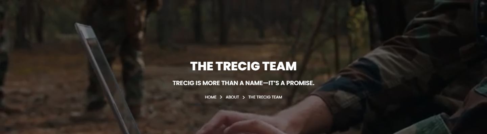
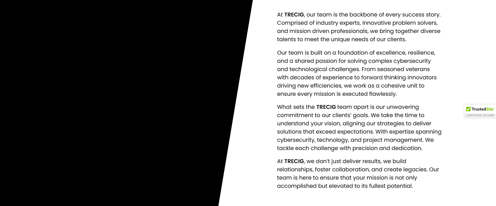
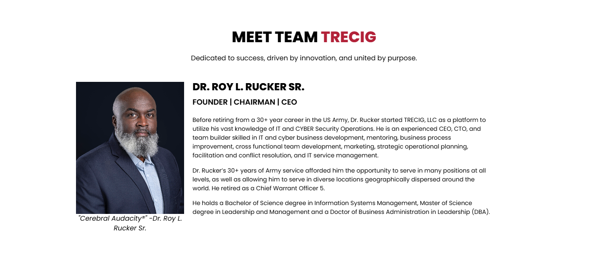
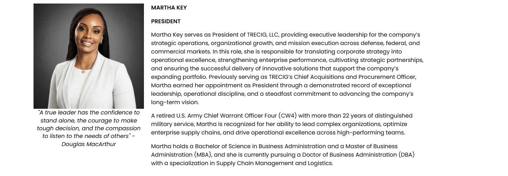

# The Trecig Team – TRECIG

*TRECIG (design reference site)* · URL: https://trecig.com/the-trecig-team/ · captured 2026-11-08 00:35:04 · HTTP 200

- **Meta description:** —
- **Page size (desktop 1440px):** 1440×2870 px · tablet (820px): 3411 px · mobile (390px): 4526 px
- **Screenshots:** [desktop](screenshots/desktop-full.png) · [tablet](screenshots/tablet-full.png) · [mobile](screenshots/mobile-full.png) · [desktop top](screenshots/desktop-viewport-top.png) · [desktop scrolled](screenshots/desktop-viewport-scrolled.png)
- **Files:** [raw.html](raw.html) (server HTML) · [rendered.html](rendered.html) (DOM after JS) · [content.txt](content.txt) (all visible text) · layout-*.json (full element tree with computed styles) · page.json (everything)

## 1. Section map (top → bottom, desktop 1440px)

| # | Role | Y from top | Height | Heading / first text | Mobile height | Screenshot |
|---|---|---|---|---|---|---|
| 0 | header | 0 | 170 | HOME ABOUT AWARDS & RECOGNITION EXPERTISE PRESS & MEDIA CONTACT | 170 | [img](screenshots/desktop-sec00-header.png) |
| 1 | section | 170 | 400 | THE TRECIG TEAM | 220 | [img](screenshots/desktop-sec01-section.png) |
| 2 | section | 570 | 600 | At TRECIG, our team is the backbone of every success story. Comprised of industry experts, | 884 | [img](screenshots/desktop-sec02-section.png) |
| 3 | section | 1170 | 602 | MEET TEAM TRECIG | 1096 | [img](screenshots/desktop-sec03-section.png) |
| 4 | section | 1772 | 500 | "A true leader has the confidence to stand alone, the courage to make tough decision, and  | 1467 | [img](screenshots/desktop-sec04-section.png) |
| 5 | footer | 2272 | 598 | LET'S TALK: | 690 | [img](screenshots/desktop-sec05-footer.png) |
| 6 | floating (fixed, z 1000003) | 875 | 38 |  |  |  |

## 2. Section-by-section layout (desktop)

Legend: each line is an element in DOM order. `@x,y w×h` = position/size in px on the 1440px-wide page. Text lines show *font size/weight, line-height, colour*. Boxes show layout (flex/grid), background, padding, radius, shadow, etc. Pass-through wrappers are collapsed.

### 2.0 HEADER — HOME ABOUT AWARDS & RECOGNITION EXPERTISE PRESS & MEDIA CONTACT

Element: `<header class="elementor elementor-13 elementor-location-header">` at y=0, 1440×170px · 

- section.elementor-section [bg:#FFFFFF · shadow:#000000 @10% 0px 0px 12px 0px · z:9999 · transition:background, border, border-radius, box-shadow 0.3s, 0.3s, 0.3s, 0.3s ease, ease, ease, ease] `@0,0 1440×170`
  - div.elementor-container [flex row · margin:0px 85px 0px 85px · max-w:1270px] `@85,0 1270×170`
    - div.elementor-column [flex row · min-h:1px] `@85,0 1270×170`
      - div.elementor-widget-wrap [flex row wrap] `@85,0 1270×170`
        - div.elementor-container [flex row · max-w:1270px] `@85,0 1270×170`
          - div.elementor-column [flex row · min-h:1px] `@85,0 127×170`
            - div.elementor-widget-wrap [flex row wrap · align:center · pad:10px 10px 10px 10px] `@85,0 127×170`
              - a (link→/) [inline-block · align-text:center] `@95,10 200×150`
                - **IMG** `TRECIG_Logo_Registered.png` alt="" natural 1440×1080 · inline-block · max-w:200px · overflow:clip · align-text:center `@95,10 200×150`
          - div.elementor-column [flex row · min-h:1px] `@212,0 1143×170`
            - div.elementor-widget-wrap [flex row wrap · align:center · pad:10px 10px 10px 10px] `@212,0 1143×170`
              - div.elementor-widget-container [flex column · transition:background, border, border-radius, box-shadow, transform 0.3s, 0.3s, 0.3s, 0.3s, 0.4s ease, ease, ease, ease, ease] `@222,75 1123×20`
                - ul.elementor-nav-menu [flex row wrap · justify:flex-end · margin:0px 0px 0px 411.234px · z:2] · pseudo:::after{{"content": "\" \"", "w": "0px", "h": "0px"}} `@633,75 712×20`
                  - **A→/** "HOME" — Poppins 14px/400 lh 20px · #000000 · textTransform:uppercase ‖ flex row · margin:0px 15px 0px 0px · transition:all 0.4s ease `@633,75 40×20`
                  - **A→/about/** "ABOUT" — Poppins 14px/400 lh 20px · #000000 · textTransform:uppercase ‖ flex row · margin:0px 15px 0px 15px · transition:all 0.4s ease `@703,75 70×20`
                  - **A→/awards-recognition/** "AWARDS & RECOGNITION" — Poppins 14px/400 lh 20px · #000000 · textTransform:uppercase ‖ flex row · margin:0px 15px 0px 15px · transition:all 0.4s ease `@803,75 195×20`
                  - **A→/expertise/** "EXPERTISE" — Poppins 14px/400 lh 20px · #000000 · textTransform:uppercase ‖ flex row · margin:0px 15px 0px 15px · transition:all 0.4s ease `@1028,75 90×20`
                  - **A→/press-media/** "PRESS & MEDIA" — Poppins 14px/400 lh 20px · #000000 · textTransform:uppercase ‖ flex row · margin:0px 15px 0px 15px · transition:all 0.4s ease `@1148,75 100×20`
                  - **A→/contact/** "CONTACT" — Poppins 14px/400 lh 20px · #000000 · textTransform:uppercase ‖ flex row · margin:0px 0px 0px 15px · transition:all 0.4s ease `@1278,75 67×20`

### 2.1 SECTION — THE TRECIG TEAM

Element: `<section class="elementor-section elementor-top-section elementor-element elementor-element-e183934 elementor-section-height-min-height elementor-section-bo">` at y=170, 1440×400px · 

- section.elementor-section [transition:background, border, border-radius, box-shadow 0.3s, 0.3s, 0.3s, 0.3s ease, ease, ease, ease] `@0,170 1440×400`
  - div.elementor-background-video-container [pos:absolute · z:0 · overflow:hidden · transition:opacity 1s ease] `@0,170 1440×400`
    - **IFRAME** https://www.youtube.com/embed/6QbWQdXshd0?controls=0&rel=0&playsinline=1&cc_load_policy=0&enablejsapi=1&origin=https%3A%2F%2Ftrecig.com&widgetid=1&forigin=https%3A%2F%2Ftrecig.com%2Fthe-trecig-team%2F&aoriginsup=1&vf=6 The Team Top Banner Video `@0,-35 1440×810`
  - div.elementor-background-overlay [bg:#000000 · pos:absolute · opacity:0.5 · transition:background, border-radius, opacity 0.3s, 0.3s, 0.3s ease, ease, ease] `@0,170 1440×400` (empty/decorative)
  - div.elementor-container [flex row · align:center · margin:0px 370px 0px 370px · max-w:700px · min-h:400px] `@370,170 700×400`
    - div.elementor-column [flex row · min-h:1px] `@370,260 700×221`
      - div.elementor-widget-wrap [flex row wrap · pad:10px 10px 10px 10px · margin:80px 0px 0px 0px] `@370,340 700×141`
        - div.elementor-widget-heading [margin:0px 0px 20px 0px · align-text:center] `@380,350 680×36`
          - **H2** "THE TRECIG TEAM" — Poppins 36px/800 lh 36px · #FFFFFF · textTransform:uppercase · textAlign:center ‖ inline-block `@562,350 315×36`
        - div.elementor-widget-heading [margin:0px 0px 20px 0px · align-text:center] `@380,406 680×24`
          - **H2** "TRECIG IS MORE THAN A NAME—IT’S A PROMISE." — Poppins 18px/600 lh 18px · #FFFFFF · textTransform:uppercase · textAlign:center ‖ inline-block `@510,409 420×18`
        - ul.elementor-icon-list-items [flex row wrap · justify:center · margin:0px -2.5px 0px -2.5px · align-text:center] `@378,450 685×21`
          - li.elementor-icon-list-item [flex row · justify:center · align:center · margin:0px 2.5px 0px 2.5px · align-text:center] `@606,450 34×21`
            - **A→/** "HOME" — Poppins 12px/400 lh 18px · #CC3366 · textTransform:uppercase · textAlign:center ‖ flex row · highlights: "HOME" #FFFFFF `@606,451 34×18`
          - li.elementor-icon-list-item [flex row · justify:center · align:center · margin:0px 2.5px 0px 2.5px · align-text:center] `@645,450 62×21`
            - **A→/about/** "ABOUT" — Poppins 12px/400 lh 18px · #CC3366 · textTransform:uppercase · textAlign:center ‖ flex row · highlights: "ABOUT" #FFFFFF `@645,450 62×21`
          - li.elementor-icon-list-item [flex row · justify:center · align:center · margin:0px 2.5px 0px 2.5px · align-text:center] `@712,450 122×21`
            - **SPAN** "THE TRECIG TEAM" — Poppins 12px/400 lh 18px · #FFFFFF · textTransform:uppercase · textAlign:center ‖ pad:0px 0px 0px 5px · transition:color 0.3s ease `@729,451 105×18`

### 2.2 SECTION — At TRECIG, our team is the backbone of every success story. Comprised of industr

Element: `<section class="elementor-section elementor-top-section elementor-element elementor-element-b2bc213 elementor-section-full_width tilt-image elementor-sectio">` at y=570, 1440×600px · 

- section.elementor-section [bg:transparent · overflow:hidden · transition:background, border, border-radius, box-shadow 0.3s, 0.3s, 0.3s, 0.3s ease, ease, ease, ease] `@0,570 1440×600`
  - div.elementor-container [flex row] `@0,570 1440×600`
    - div.elementor-column [flex row · min-h:1px] `@0,570 734×600`
      - div.elementor-widget-wrap [flex row wrap · align:center · transition:background, border, border-radius, box-shadow 0.3s, 0.3s, 0.3s, 0.3s ease, ease, ease, ease] `@0,570 734×600`
        - div.elementor-widget-video · pseudo:::after{{"content": "\"\"", "w": "100px", "h": "600px", "position": "absolute"}} `@0,570 734×600`
          - div.elementor-widget-container [overflow:hidden · transform:matrix(1, 0, 0, 1, 0, 0) · transition:background, border, border-radius, box-shadow, transform 0.3s, 0.3s, 0.3s, 0.3s, 0.4s ease, ease, ease, ease, ease] `@0,570 734×600`
            - **IFRAME** https://www.youtube.com/embed/8xg6er2Xl5Q?controls=0&rel=0&playsinline=1&cc_load_policy=0&autoplay=1&enablejsapi=1&origin=https%3A%2F%2Ftrecig.com&widgetid=5&forigin=https%3A%2F%2Ftrecig.com%2Fthe-trecig-team%2F&aoriginsup=1&vf=2 Trecig   The Trecig Team `@0,570 1080×600`
    - div.elementor-column [flex row · min-h:1px] `@734,570 706×600`
      - div.elementor-widget-wrap [flex row wrap · align:center · pad:10px 10px 10px 10px · margin:0px 0px 0px 50px] `@784,570 656×600`
        - div.elementor-container [flex row · margin:0px 135.594px 0px 0px · max-w:500px] `@794,591 500×558`
          - div.elementor-column [flex row · min-h:1px] `@794,591 500×558`
            - div.elementor-widget-wrap [flex row wrap · pad:10px 10px 10px 10px] `@794,591 500×558`
              - div.elementor-widget-container [transition:background, border, border-radius, box-shadow, transform 0.3s, 0.3s, 0.3s, 0.3s, 0.4s ease, ease, ease, ease, ease] `@804,601 480×523`
                - **P** "At TRECIG, our team is the backbone of every success story. Comprised of industry experts, innovative problem solvers, and mission driven professionals, we b…" — Poppins 16px/400 lh 24px · #000000 ‖ margin:0px 0px 14.4px 0px · highlights: "TRECIG"  600 `@804,601 480×96`
                - **P** "Our team is built on a foundation of excellence, resilience, and a shared passion for solving complex cybersecurity and technological challenges. From season…" — Poppins 16px/400 lh 24px · #000000 ‖ margin:0px 0px 14.4px 0px `@804,712 480×144`
                - **P** "What sets the TRECIG team apart is our unwavering commitment to our clients’ goals. We take the time to understand your vision, aligning our strategies to de…" — Poppins 16px/400 lh 24px · #000000 ‖ margin:0px 0px 14.4px 0px · highlights: "TRECIG"  600 `@804,870 480×144`
                - **P** "At TRECIG, we don’t just deliver results, we build relationships, foster collaboration, and create legacies. Our team is here to ensure that your mission is …" — Poppins 16px/400 lh 24px · #000000 ‖ margin:0px 0px 14.4px 0px · highlights: "TRECIG"  600 `@804,1028 480×96`

### 2.3 SECTION — MEET TEAM TRECIG

Element: `<section class="elementor-section elementor-top-section elementor-element elementor-element-21ed2aa elementor-section-content-middle elementor-section-boxed">` at y=1170, 1440×602px · 

- section.elementor-section [pad:50px 0px 30px 0px] `@0,1170 1440×602`
  - div.elementor-container [flex row · margin:0px 85px 0px 85px · max-w:1270px] `@85,1220 1270×522`
    - div.elementor-column [flex row · min-h:1px] `@85,1220 1270×522`
      - div.elementor-widget-wrap [flex row wrap · justify:center · align:center · pad:10px 10px 10px 10px] `@85,1220 1270×522`
        - div.elementor-container [flex row · margin:0px 225px 0px 225px · max-w:800px] `@320,1230 800×114`
          - div.elementor-column [flex row · min-h:1px] `@320,1230 800×114`
            - div.elementor-widget-wrap [flex row wrap · align:center · pad:10px 10px 10px 10px] `@320,1230 800×114`
              - div.elementor-widget-heading [margin:0px 0px 20px 0px · align-text:center] `@330,1240 780×36`
                - **H2** "MEET TEAM TRECIG" — Poppins 36px/800 lh 36px · #000000 · textTransform:uppercase · textAlign:center ‖ inline-block · highlights: "TRECIG" #B22239 `@549,1240 342×36`
              - **P** "Dedicated to success, driven by innovation, and united by purpose." — Poppins 16px/400 lh 24px · #000000 · textAlign:center ‖ margin:0px 0px 14.4px 0px `@330,1296 780×24`
        - section.elementor-section [margin:10px 0px 0px 0px] `@95,1354 1250×378`
          - div.elementor-container [flex row · margin:0px 75px 0px 75px · max-w:1100px] `@170,1354 1100×378`
            - div.elementor-column [flex row · min-h:1px] `@170,1354 276×378`
              - div.elementor-widget-wrap [flex row wrap · pad:10px 10px 10px 10px] `@170,1354 276×378`
                - div.elementor-widget-image [max-w:102.701% · align-text:center] `@180,1364 256×358`
                  - figure.wp-caption [max-w:100% · align-text:center] `@180,1364 256×358`
                    - **IMG** `Headshot-HSV-RR-01-1638x2048.jpg` alt="Founder|President|CEO" natural 1439×1800 · fit:cover · inline-block · max-w:100% · overflow:clip · align-text:center `@180,1364 256×313`
                    - **FIGCAPTION** ""Cerebral Audacity®" -Dr. Roy L. Rucker Sr." — Poppins 16px/400 lh 22.4px · #000000 · textAlign:center · fontStyle:italic `@180,1677 256×45`
            - div.elementor-column [flex row · min-h:1px] `@446,1354 824×378`
              - div.elementor-widget-wrap [flex row wrap · pad:10px 10px 10px 10px] `@446,1354 824×378`
                - div.elementor-widget-heading [margin:0px 0px 20px 0px] `@456,1364 804×26`
                  - **H2** "DR. ROY L. RUCKER SR." — Poppins 24px/800 lh 24px · #000000 · textTransform:uppercase ‖ inline-block `@456,1364 265×24`
                - div.elementor-widget-heading [margin:0px 0px 20px 0px] `@456,1410 804×14`
                  - div.elementor-widget-container [margin:-10px 0px 0px 0px · transition:background, border, border-radius, box-shadow, transform 0.3s, 0.3s, 0.3s, 0.3s, 0.4s ease, ease, ease, ease, ease] `@456,1400 804×24`
                    - **H2** "FOUNDER / CHAIRMAN / CEO" — Poppins 18px/600 lh 18px · #000000 · textTransform:uppercase ‖ inline-block `@456,1403 248×18`
                - div.elementor-widget-text-editor [max-w:88.307%] `@456,1444 710×253`
                  - div.elementor-widget-container [transition:background, border, border-radius, box-shadow, transform 0.3s, 0.3s, 0.3s, 0.3s, 0.4s ease, ease, ease, ease, ease] `@456,1444 710×239`
                    - **P** "Before retiring from a 30+ year career in the US Army, Dr. Rucker started TRECIG, LLC as a platform to utilize his vast knowledge of IT and CYBER Security Op…" — Poppins 14px/400 lh 21px · #000000 ‖ margin:0px 0px 14.4px 0px `@456,1444 710×105`
                    - **P** "Dr. Rucker’s 30+ years of Army service afforded him the opportunity to serve in many positions at all levels, as well as allowing him to serve in diverse loc…" — Poppins 14px/400 lh 21px · #000000 ‖ margin:0px 0px 14.4px 0px `@456,1564 710×63`
                    - **P** "He holds a Bachelor of Science degree in Information Systems Management, Master of Science degree in Leadership and Management and a Doctor of Business Admin…" — Poppins 14px/400 lh 21px · #000000 ‖ margin:0px 0px 14.4px 0px `@456,1641 710×42`

### 2.4 SECTION — "A true leader has the confidence to stand alone, the courage to make tough deci

Element: `<section class="elementor-section elementor-top-section elementor-element elementor-element-142bbfb elementor-section-boxed elementor-section-height-default">` at y=1772, 1440×500px · 

- *(empty block — vertical spacer / gap of 500px)*

### 2.5 FOOTER — LET'S TALK:

Element: `<footer class="elementor elementor-15 elementor-location-footer">` at y=2272, 1440×598px · 

- section.elementor-section [transition:background, border, border-radius, box-shadow 0.3s, 0.3s, 0.3s, 0.3s ease, ease, ease, ease] `@0,2272 1440×598`
  - div.elementor-background-video-container [pos:absolute · z:0 · overflow:hidden · transition:opacity 1s ease] `@0,2272 1440×598`
    - **IFRAME** https://www.youtube.com/embed/OzwCnEEadts?controls=0&rel=0&playsinline=1&cc_load_policy=0&enablejsapi=1&origin=https%3A%2F%2Ftrecig.com&widgetid=3&forigin=https%3A%2F%2Ftrecig.com%2Fthe-trecig-team%2F&aoriginsup=1&vf=1 Triceg   Expertise Slider 1 `@0,2166 1440×810`
  - div.elementor-background-overlay [bg:#FFFFFF · pos:absolute · opacity:0.7 · transition:background, border-radius, opacity 0.3s, 0.3s, 0.3s ease, ease, ease] `@0,2272 1440×598` (empty/decorative)
  - div.elementor-container [flex row · margin:0px 85px 0px 85px · max-w:1270px] `@85,2272 1270×598`
    - div.elementor-column [flex row · min-h:1px] `@85,2272 1270×598`
      - div.elementor-widget-wrap [flex row wrap] `@85,2272 1270×598`
        - section.elementor-section [pad:40px 0px 40px 0px] `@85,2272 1270×467`
          - div.elementor-container [flex row · max-w:1270px] `@85,2312 1270×387`
            - div.elementor-column [flex row · min-h:1px] `@85,2312 324×387`
              - div.elementor-widget-wrap [flex row wrap · pad:10px 10px 10px 10px] `@85,2312 324×387`
                - div.elementor-widget-theme-site-logo [margin:0px 0px 20px 0px] `@95,2322 304×300`
                  - a (link→/) [inline-block] `@95,2322 400×300`
                    - **IMG** `TRECIG_Logo_Registered.png` alt="" natural 1440×1080 · inline-block · max-w:400px · overflow:clip `@95,2322 400×300`
                - div.elementor-button-wrapper [grid cols[134.078px]] `@95,2642 134×47`
                  - **A→/contact/** "LET’S TALK" — Poppins 15px/400 lh 15px · #000000 · textTransform:uppercase · textAlign:center ‖ pad:15px 30px 15px 30px · radius:30px · border:1px 1px 1px 1px solid #000000 · transition:all 0.3s ease `@95,2642 134×47`
            - div.elementor-column [flex row · min-h:1px] `@409,2312 371×387`
              - div.elementor-widget-wrap [flex row wrap · pad:10px 10px 10px 10px · margin:0px 0px 0px 50px] `@459,2312 321×387`
                - div.elementor-widget-heading [margin:0px 0px 20px 0px] `@469,2322 301×24`
                  - **H2** "LET'S TALK:" — Poppins 18px/700 lh 18px · #000000 · textTransform:uppercase ‖ inline-block `@469,2325 98×18`
                - ul.elementor-icon-list-items `@469,2366 301×52`
                  - li.elementor-icon-list-item [flex row · align:center · pad:0px 0px 5px 0px] `@469,2366 301×26`
                    - **A→tel:(254)%20338-6131** "(469)653-9009" — Poppins 14px/600 lh 21px · #CC3366 ‖ flex row · highlights: "(469)653-9009" #000000 `@469,2366 301×21`
                  - li.elementor-icon-list-item [flex row · align:center · margin:5px 0px 0px 0px] `@469,2397 301×21`
                    - **A→mailto:info@trecig.com** "info@trecig.com" — Poppins 14px/600 lh 21px · #CC3366 ‖ flex row · highlights: "info@trecig.com" #000000 `@469,2397 301×21`
            - div.elementor-column [flex row · min-h:1px] `@781,2312 310×387`
              - div.elementor-widget-wrap [flex row wrap · pad:10px 10px 10px 10px · margin:0px 50px 0px 0px] `@781,2312 260×387`
                - div.elementor-widget-heading [margin:0px 0px 20px 0px] `@791,2322 240×24`
                  - **H2** "TRECIG HQ:" — Poppins 18px/700 lh 18px · #000000 · textTransform:uppercase ‖ inline-block `@791,2325 101×18`
                - ul.elementor-icon-list-items `@791,2366 240×42`
                  - li.elementor-icon-list-item [flex row · align:center] `@791,2366 240×42`
                    - **SPAN** "Rockwall, Texas, United States" — Poppins 14px/400 lh 21px · #000000 ‖ transition:color 0.3s ease `@791,2366 110×42`
            - div.elementor-column [flex row · min-h:1px] `@1090,2312 264×387`
              - div.elementor-widget-wrap [flex row wrap · pad:10px 10px 10px 10px] `@1090,2312 264×387`
                - div.elementor-widget-heading [margin:0px 0px 20px 0px] `@1100,2322 244×24`
                  - **H2** "CONNECT WITH US:" — Poppins 18px/700 lh 18px · #000000 · textTransform:uppercase ‖ inline-block `@1100,2325 174×18`
                - **A→/the-trecig-team/** "Linkedin-in" +icon[e-font-icon-svg e-fab-linkedin-in] — -apple-system 16px/400 lh 16px · #69727D · textAlign:center ‖ flex row · bg:#000000 · radius:100% · transition:all 0.3s ease `@1100,2366 32×32`
        - section.elementor-section [pad:15px 0px 15px 0px · border:1px 0px 0px 0px solid #000000 @20%] `@85,2739 1270×131`
          - div.elementor-container [flex row · max-w:1270px] `@85,2755 1270×100`
            - div.elementor-column [flex row · min-h:1px] `@85,2755 1270×100`
              - div.elementor-widget-wrap [flex row wrap · align:center · pad:10px 10px 10px 10px] `@85,2755 1270×100`
                - div.elementor-element [margin:0px 0px 20px 0px · align-text:center] `@95,2765 1250×10`
                  - div.elementor-widget-container [margin:0px 0px -10px 0px · overflow:hidden · align-text:center · transition:background, border, border-radius, box-shadow, transform 0.3s, 0.3s, 0.3s, 0.3s, 0.4s ease, ease, ease, ease, ease] `@95,2765 1250×20`
                    - ul.elementor-icon-list-items [flex row wrap · justify:center · gap:30px · margin:0px -8px 0px -8px · align-text:center] `@87,2765 1266×20`
                      - li.elementor-icon-list-item [flex row · justify:center · align:center · margin:0px 8px 0px 8px · align-text:center] `@589,2765 89×20`
                        - **A→/privacy-policy/** "Privacy Policy" — Poppins 13px/400 lh 19.5px · #CC3366 · textAlign:center ‖ flex row · highlights: "Privacy Policy" #000000 `@589,2765 88×20`
                      - li.elementor-icon-list-item [flex row · justify:center · align:center · margin:0px 8px 0px 8px · align-text:center] `@724,2765 127×20`
                        - **A→/terms-conditions/** "Terms & Conditions" — Poppins 13px/400 lh 19.5px · #CC3366 · textAlign:center ‖ flex row · highlights: "Terms & Conditions" #000000 `@724,2765 127×20`
                - **P** "©2026 TRECIG, LLC" — Poppins 12px/400 lh 18px · #000000 · textTransform:uppercase · textAlign:center ‖ margin:0px 0px 14.4px 0px `@95,2795 1250×36`

### Floating / fixed elements
- `div.` fixed at [1348, 875, 92, 38] z-index 1000003 — ""

## 3. Header, navigation & interaction behaviour

- **atTop** `header.elementor.elementor-13.elementor-location-header` position:static top:0 height:170 bg:transparent shadow:none backdrop:none z:auto
- **afterScroll1400** `header.elementor.elementor-13.elementor-location-header` position:static top:-1400 height:0 bg:transparent shadow:none backdrop:none z:auto
- **afterScroll1400** `section.elementor-section.elementor-top-section.elementor-element.elementor-elem` position:fixed top:0 height:170 bg:#FFFFFF @90% shadow:#000000 @10% 0px 0px 12px 0px backdrop:none z:9999

| Menu item | Link | Dropdown | Style | Hover change |
|---|---|---|---|---|
| HOME | / | — | Poppins 14px/400 #000000 uppercase ls normal | color: #000000 → #B22239 |
| ABOUT (current) | /about/ | The Mission (/the-mission/); The Values (/the-values/); The Legacy (/the-legacy/); The Trecig Team (/the-trecig-team/); Careers (/careers/) | Poppins 14px/400 #000000 uppercase ls normal | color: #000000 → #B22239 |
| AWARDS & RECOGNITION | /awards-recognition/ | Partnerships (/partnerships/) | Poppins 14px/400 #000000 uppercase ls normal | color: #000000 → #B22239 |
| EXPERTISE | /expertise/ | Industries We Serve (/industries-we-serve/) | Poppins 14px/400 #000000 uppercase ls normal | color: #000000 → #B22239 |
| PRESS & MEDIA | /press-media/ | — | Poppins 14px/400 #000000 uppercase ls normal | color: #000000 → #B22239 |
| CONTACT | /contact/ | — | Poppins 14px/400 #000000 uppercase ls normal | color: #000000 → #B22239 |

- **Mobile menu:** toggle `.elementor-menu-toggle` → [screenshot](screenshots/mobile-menu-open.png) · items: HOME, ABOUT, AWARDS & RECOGNITION, EXPERTISE, PRESS & MEDIA, CONTACT

### Hover states (measured by hovering in Chrome)

| Element | Text | Normal | On hover |
|---|---|---|---|
| `a.elementor-item` | HOME | color #000000 · bg transparent · radius 0px · pad 0px · border 0px #000000 · transition 0.4s | color: #000000 → #B22239; borderTopColor: #000000 → #B22239 |
| `a.elementor-item` | ABOUT | color #000000 · bg transparent · radius 0px · pad 0px · border 0px #000000 · transition 0.4s | color: #000000 → #B22239; borderTopColor: #000000 → #B22239 |
| `a.elementor-item` | CONTACT | color #000000 · bg transparent · radius 0px · pad 0px · border 0px #000000 · transition 0.4s | color: #000000 → #B22239; borderTopColor: #000000 → #B22239 |
| `a.` |  | color #CC3366 · bg transparent · radius 0px · pad 0px · border 0px #CC3366 · transition all | color: #CC3366 → #B22239; borderTopColor: #CC3366 → #B22239; childColor: #CC3366 → #B22239 |
| `a.elementor-button` | LET’S TALK | color #000000 · bg transparent · radius 30px · pad 15px 30px · border 1px #000000 · transition 0.3s | color: #000000 → #FFFFFF; borderTopColor: #000000 → #B22239 |
| `a.` | (469)653-9009 | color #CC3366 · bg transparent · radius 0px · pad 0px · border 0px #CC3366 · transition all | color: #CC3366 → #B22239; borderTopColor: #CC3366 → #B22239 |
| `a.elementor-icon` | Linkedin-in | color #69727D · bg #000000 · radius 100% · pad 0px · border 0px #69727D · transition 0.3s | color: #69727D → #B22239; backgroundColor: #000000 → #B22239; borderTopColor: #69727D → #B22239; opacity: 1 → 0.9; childColor: #69727D → #B22239 |
| `a.` | Privacy Policy | color #CC3366 · bg transparent · radius 0px · pad 0px · border 0px #CC3366 · transition all | color: #CC3366 → #B22239; borderTopColor: #CC3366 → #B22239 |

## 4. Typography & colour used on this page (weighted by amount of text / area)

| Font · weight · size / line-height | chars |
|---|---|
| Poppins | 400 | 16px / 24px | 2427 |
| Poppins | 400 | 14px / 21px | 907 |
| Poppins | 400 | 16px / 22.4px | 201 |
| Poppins | 600 | 18px / 18px | 66 |
| Poppins | 400 | 14px / 20px | 58 |
| Poppins | 400 | 12px / 18px | 41 |
| Poppins | 600 | 16px / 24px | 37 |
| Poppins | 700 | 18px / 18px | 37 |
| Poppins | 400 | 13px / 19.5px | 32 |
| Poppins | 800 | 36px / 36px | 30 |
| Poppins | 600 | 14px / 21px | 28 |
| Poppins | 800 | 24px / 24px | 21 |
| -apple-system | 400 | 16px / 24px | 15 |
| -apple-system | 400 | 16px / 16px | 11 |
| Poppins | 400 | 15px / 15px | 10 |

- **Text colours:** #000000 (3808), #FFFFFF (81), #CC3366 (15), #69727D (11), #B22239 (6)
- **Background colours (by area):** #000000 (1225), #FFFFFF (1109), transparent (864)
- **Border radii:** 30px (1), 100% (1), 2px 0px 0px (1)
- **Shadows:** #000000 @10% 0px 0px 12px 0px (1) | #000000 @20% 0px 0px 5px 0px (1)
- **Mobile text styles:** Poppins | 400 | 14px / 21px (2051); Poppins | 400 | 16px / 24px (1283); Poppins | 400 | 16px / 22.4px (201); Poppins | 600 | 16px / 16px (66); Poppins | 400 | 12px / 18px (56); Poppins | 600 | 14px / 21px (46); Poppins | 700 | 16px / 16px (37); Poppins | 800 | 28px / 28px (30); Poppins | 800 | 22px / 22px (21); Poppins | 600 | 16px / 24px (19)

## 6. Images on the page

- `TRECIG_Logo_Registered.png` natural 1440×1080 → shown 200×150 · alt="" · https://trecig.com/wp-content/uploads/2026/10/TRECIG_Logo_Registered.png
- `Headshot-HSV-RR-01-1638x2048.jpg` natural 1439×1800 → shown 256×313 · alt="Founder|President|CEO" · https://trecig.com/wp-content/uploads/2025/09/Headshot-HSV-RR-01-1638x2048.jpg
- `Martha.jpeg` natural 1290×1231 → shown 313×299 · alt="Martha Key" · https://trecig.com/wp-content/uploads/2026/07/Martha.jpeg
- background on `div.`: https://cdn.ywxi.net/meter/trecig.com/205.svg?ts=1784975038086&l=en

## 7. Links on the page

- [body] "Skip to content" → /the-trecig-team/#content
- [header] "(icon/image)" → /
- [header] "HOME" → /
- [header] "ABOUT" → /about/
- [header] "The Mission" → /the-mission/
- [header] "The Values" → /the-values/
- [header] "The Legacy" → /the-legacy/
- [header] "The Trecig Team" → /the-trecig-team/
- [header] "Careers" → /careers/
- [header] "AWARDS & RECOGNITION" → /awards-recognition/
- [header] "Partnerships" → /partnerships/
- [header] "EXPERTISE" → /expertise/
- [header] "Industries We Serve" → /industries-we-serve/
- [header] "PRESS & MEDIA" → /press-media/
- [header] "CONTACT" → /contact/
- [header] "Home" → /
- [header] "About" → /about/
- [header] "Awards & Recognition" → /awards-recognition/
- [header] "Expertise" → /expertise/
- [header] "Press & Media" → /press-media/
- [header] "Contact" → /contact/
- [footer] "LET’S TALK" → /contact/
- [footer] "(469)653-9009" → tel:(254)%20338-6131
- [footer] "info@trecig.com" → mailto:info@trecig.com
- [footer] "Linkedin-in" → /the-trecig-team/ (target _blank)
- [footer] "Privacy Policy" → /privacy-policy/
- [footer] "Terms & Conditions" → /terms-conditions/

## 8. Mobile layout (390px) — condensed outline

### 8.0 header — HOME ABOUT AWARDS & RECOGNITION EXPERTISE PRESS & MEDIA CONTACT (y 0, h 170)
- section.elementor-section [bg:#FFFFFF · shadow:#000000 @10% 0px 0px 12px 0px · z:9999 · transition:background, border, border-radius, box-shadow 0.3s, 0.3s, 0.3s, 0.3s ease, ease, ease, ease] `@0,0 390×170`
  - div.elementor-container [flex row wrap · max-w:767px] `@0,0 390×170`
    - div.elementor-column [flex row · min-h:1px] `@0,0 390×170`
      - div.elementor-widget-wrap [flex row wrap] `@0,0 390×170`
        - div.elementor-container [flex row wrap · max-w:767px] `@0,0 390×170`
          - div.elementor-column [flex row · min-h:1px] `@0,0 234×170`
            - div.elementor-widget-wrap [flex row wrap · align:center · pad:10px 10px 10px 10px] `@0,0 234×170`
              - a (link→/) [inline-block · align-text:center] `@17,10 200×150`
                - **IMG** `TRECIG_Logo_Registered-1024x768.png` alt="" natural 390×292 · inline-block · max-w:200px · overflow:clip · align-text:center `@17,10 200×150`
          - div.elementor-column [flex row · min-h:1px] `@234,0 156×170`
            - div.elementor-widget-wrap [flex row wrap · align:center · pad:10px 10px 10px 10px] `@234,0 156×170`
              - div.elementor-widget-container [flex column · transition:background, border, border-radius, box-shadow, transform 0.3s, 0.3s, 0.3s, 0.3s, 0.4s ease, ease, ease, ease, ease] `@244,70 136×30`
                - nav.elementor-nav-menu--dropdown [bg:#FFFFFF · margin:16px 0px 0px 0px · pos:absolute · z:9997 · overflow:hidden · transform:matrix(1, 0, 0, 0, 0, 0) · transition:max-height, transform 0.3s, 0.3s ease, ease] `@0,116 390×0`
                  - ul.elementor-nav-menu [z:2] · pseudo:::after{{"content": "\" \"", "w": "390px", "h": "0px"}} `@0,116 390×0`
                    - **A→/** "HOME" — Poppins 14px/400 lh 20px · #000000 · textTransform:uppercase ‖ flex row · pad:10px 20px 10px 20px `@0,116 390×0`
                    - **A→/about/** "ABOUT" — Poppins 14px/400 lh 20px · #000000 · textTransform:uppercase ‖ flex row · pad:10px 20px 10px 20px `@0,116 390×0`
                    - **A→/awards-recognition/** "AWARDS & RECOGNITION" — Poppins 14px/400 lh 20px · #000000 · textTransform:uppercase ‖ flex row · pad:10px 20px 10px 20px `@0,116 390×0`
                    - **A→/expertise/** "EXPERTISE" — Poppins 14px/400 lh 20px · #000000 · textTransform:uppercase ‖ flex row · pad:10px 20px 10px 20px `@0,116 390×0`
                    - **A→/press-media/** "PRESS & MEDIA" — Poppins 14px/400 lh 20px · #000000 · textTransform:uppercase ‖ flex row · pad:10px 20px 10px 20px `@0,116 390×0`
                    - **A→/contact/** "CONTACT" — Poppins 14px/400 lh 20px · #000000 · textTransform:uppercase ‖ flex row · pad:10px 20px 10px 20px `@0,116 390×0`

### 8.1 section — THE TRECIG TEAM (y 170, h 220)
- section.elementor-section [transition:background, border, border-radius, box-shadow 0.3s, 0.3s, 0.3s, 0.3s ease, ease, ease, ease] `@0,170 390×220`
  - div.elementor-background-overlay [bg:#000000 · pos:absolute · opacity:0.5 · transition:background, border-radius, opacity 0.3s, 0.3s, 0.3s ease, ease, ease] `@0,170 390×220` (empty/decorative)
  - div.elementor-container [flex row wrap · align:center · max-w:700px · min-h:220px] `@0,170 390×220`
    - div.elementor-column [flex row · min-h:1px] `@0,185 390×190`
      - div.elementor-widget-wrap [flex row wrap · pad:10px 10px 10px 10px · margin:65px 0px 0px 0px] `@0,250 390×125`
        - div.elementor-widget-heading [margin:0px 0px 20px 0px · align-text:center] `@10,260 370×29`
          - **H2** "THE TRECIG TEAM" — Poppins 28px/800 lh 28px · #FFFFFF · textTransform:uppercase · textAlign:center ‖ inline-block `@72,260 245×28`
        - div.elementor-widget-heading [margin:0px 0px 20px 0px · align-text:center] `@10,309 370×15`
          - div.elementor-widget-container [margin:-10px 0px -10px 0px · align-text:center · transition:background, border, border-radius, box-shadow, transform 0.3s, 0.3s, 0.3s, 0.3s, 0.4s ease, ease, ease, ease, ease] `@10,299 370×35`
            - **H2** "TRECIG IS MORE THAN A NAME—IT’S A PROMISE." — Poppins 16px/600 lh 16px · #FFFFFF · textTransform:uppercase · textAlign:center ‖ inline-block `@10,299 370×32`
        - ul.elementor-icon-list-items [flex row wrap · justify:center · margin:0px -2.5px 0px -2.5px · align-text:center] `@8,344 375×21`
          - li.elementor-icon-list-item [flex row · justify:center · align:center · margin:0px 2.5px 0px 2.5px · align-text:center] `@81,344 34×21`
            - **A→/** "HOME" — Poppins 12px/400 lh 18px · #CC3366 · textTransform:uppercase · textAlign:center ‖ flex row · highlights: "HOME" #FFFFFF `@81,346 34×18`
          - li.elementor-icon-list-item [flex row · justify:center · align:center · margin:0px 2.5px 0px 2.5px · align-text:center] `@120,344 62×21`
            - **A→/about/** "ABOUT" — Poppins 12px/400 lh 18px · #CC3366 · textTransform:uppercase · textAlign:center ‖ flex row · highlights: "ABOUT" #FFFFFF `@120,344 62×21`
          - li.elementor-icon-list-item [flex row · justify:center · align:center · margin:0px 2.5px 0px 2.5px · align-text:center] `@187,344 122×21`
            - **SPAN** "THE TRECIG TEAM" — Poppins 12px/400 lh 18px · #FFFFFF · textTransform:uppercase · textAlign:center ‖ pad:0px 0px 0px 5px · transition:color 0.3s ease `@204,346 105×18`

### 8.2 section — At TRECIG, our team is the backbone of every success story. Comprised  (y 390, h 884)
- section.elementor-section [bg:transparent · overflow:hidden · transition:background, border, border-radius, box-shadow 0.3s, 0.3s, 0.3s, 0.3s ease, ease, ease, ease] `@0,390 390×884`
  - div.elementor-container [flex row wrap] `@0,390 390×884`
    - div.elementor-column [flex row · min-h:1px] `@0,390 390×240`
      - div.elementor-widget-wrap [flex row wrap · align:center · transition:background, border, border-radius, box-shadow 0.3s, 0.3s, 0.3s, 0.3s ease, ease, ease, ease] `@0,390 390×240`
        - div.elementor-widget-container [overflow:hidden · transform:matrix(1, 0, 0, 1, 0, 0) · transition:background, border, border-radius, box-shadow, transform 0.3s, 0.3s, 0.3s, 0.3s, 0.4s ease, ease, ease, ease, ease] `@0,390 390×240`
          - **IFRAME** https://www.youtube.com/embed/8xg6er2Xl5Q?controls=0&rel=0&playsinline=1&cc_load_policy=0&autoplay=1&enablejsapi=1&origin=https%3A%2F%2Ftrecig.com&widgetid=1&forigin=https%3A%2F%2Ftrecig.com%2Fthe-trecig-team%2F&aoriginsup=1&vf=6 Trecig   The Trecig Team `@0,390 390×240`
    - div.elementor-column [flex row · min-h:1px] `@0,630 390×644`
      - div.elementor-widget-wrap [flex row wrap · align:center · pad:10px 10px 10px 10px] `@0,630 390×644`
        - div.elementor-container [flex row wrap · max-w:500px] `@10,640 370×624`
          - div.elementor-column [flex row · min-h:1px] `@10,640 370×624`
            - div.elementor-widget-wrap [flex row wrap · pad:10px 10px 10px 10px] `@10,640 370×624`
              - div.elementor-widget-container [transition:background, border, border-radius, box-shadow, transform 0.3s, 0.3s, 0.3s, 0.3s, 0.4s ease, ease, ease, ease, ease] `@20,650 350×589`
                - **P** "At TRECIG, our team is the backbone of every success story. Comprised of industry experts, innovative problem solvers, and mission driven professionals, we b…" — Poppins 14px/400 lh 21px · #000000 ‖ margin:0px 0px 14.4px 0px · highlights: "TRECIG"  600 `@20,650 350×105`
                - **P** "Our team is built on a foundation of excellence, resilience, and a shared passion for solving complex cybersecurity and technological challenges. From season…" — Poppins 14px/400 lh 21px · #000000 ‖ margin:0px 0px 14.4px 0px `@20,769 350×168`
                - **P** "What sets the TRECIG team apart is our unwavering commitment to our clients’ goals. We take the time to understand your vision, aligning our strategies to de…" — Poppins 14px/400 lh 21px · #000000 ‖ margin:0px 0px 14.4px 0px · highlights: "TRECIG"  600 `@20,952 350×168`
                - **P** "At TRECIG, we don’t just deliver results, we build relationships, foster collaboration, and create legacies. Our team is here to ensure that your mission is …" — Poppins 14px/400 lh 21px · #000000 ‖ margin:0px 0px 14.4px 0px · highlights: "TRECIG"  600 `@20,1134 350×105`

### 8.3 section — MEET TEAM TRECIG (y 1274, h 1096)
- div.elementor-container [flex row wrap · max-w:767px] `@0,1274 390×1096`
  - div.elementor-column [flex row · min-h:1px] `@0,1274 390×1096`
    - div.elementor-widget-wrap [flex row wrap · justify:center · align:center · pad:10px 10px 10px 10px] `@0,1274 390×1096`
      - div.elementor-container [flex row wrap · max-w:800px] `@10,1284 370×100`
        - div.elementor-column [flex row · min-h:1px] `@10,1284 370×100`
          - div.elementor-widget-wrap [flex row wrap · align:center · pad:10px 10px 10px 10px] `@10,1284 370×100`
            - div.elementor-widget-heading [margin:0px 0px 20px 0px · align-text:center] `@20,1294 350×4`
              - div.elementor-widget-container [margin:-10px 0px -15px 0px · align-text:center · transition:background, border, border-radius, box-shadow, transform 0.3s, 0.3s, 0.3s, 0.3s, 0.4s ease, ease, ease, ease, ease] `@20,1284 350×29`
                - **H2** "MEET TEAM TRECIG" — Poppins 28px/800 lh 28px · #000000 · textTransform:uppercase · textAlign:center ‖ inline-block · highlights: "TRECIG" #B22239 `@62,1284 266×28`
            - **P** "Dedicated to success, driven by innovation, and united by purpose." — Poppins 14px/400 lh 21px · #000000 · textAlign:center ‖ margin:0px 0px 14.4px 0px `@20,1318 350×42`
      - section.elementor-section [margin:10px 0px 0px 0px] `@10,1394 370×966`
        - div.elementor-container [flex row wrap · max-w:1100px] `@10,1394 370×966`
          - div.elementor-column [flex row · min-h:1px] `@10,1394 370×355`
            - div.elementor-widget-wrap [flex row wrap · pad:10px 10px 10px 10px] `@10,1394 370×355`
              - div.elementor-widget-image [max-w:102.701% · align-text:center] `@20,1404 350×335`
                - figure.wp-caption [max-w:100% · align-text:center] `@20,1404 350×335`
                  - **IMG** `Headshot-HSV-RR-01-819x1024.jpg` alt="Founder|President|CEO" natural 390×487 · fit:cover · inline-block · max-w:100% · overflow:clip · align-text:center `@20,1404 350×313`
                  - **FIGCAPTION** ""Cerebral Audacity®" -Dr. Roy L. Rucker Sr." — Poppins 16px/400 lh 22.4px · #000000 · textAlign:center · fontStyle:italic `@20,1717 350×22`
          - div.elementor-column [flex row · min-h:1px] `@10,1749 370×610`
            - div.elementor-widget-wrap [flex row wrap · pad:10px 10px 10px 10px] `@10,1749 370×610`
              - div.elementor-widget-heading [margin:0px 0px 20px 0px] `@20,1759 350×24`
                - **H2** "DR. ROY L. RUCKER SR." — Poppins 22px/800 lh 22px · #000000 · textTransform:uppercase ‖ inline-block `@20,1759 243×22`
              - div.elementor-widget-heading [margin:0px 0px 20px 0px] `@20,1803 350×0`
                - div.elementor-widget-container [margin:-15px 0px -15px 0px · transition:background, border, border-radius, box-shadow, transform 0.3s, 0.3s, 0.3s, 0.3s, 0.4s ease, ease, ease, ease, ease] `@20,1788 350×24`
                  - **H2** "FOUNDER / CHAIRMAN / CEO" — Poppins 16px/600 lh 16px · #000000 · textTransform:uppercase ‖ inline-block `@20,1793 220×16`
              - div.elementor-widget-text-editor [max-w:88.307%] `@20,1823 309×526`
                - div.elementor-widget-container [transition:background, border, border-radius, box-shadow, transform 0.3s, 0.3s, 0.3s, 0.3s, 0.4s ease, ease, ease, ease, ease] `@20,1823 309×512`
                  - **P** "Before retiring from a 30+ year career in the US Army, Dr. Rucker started TRECIG, LLC as a platform to utilize his vast knowledge of IT and CYBER Security Op…" — Poppins 14px/400 lh 21px · #000000 ‖ margin:0px 0px 14.4px 0px `@20,1823 309×252`
                  - **P** "Dr. Rucker’s 30+ years of Army service afforded him the opportunity to serve in many positions at all levels, as well as allowing him to serve in diverse loc…" — Poppins 14px/400 lh 21px · #000000 ‖ margin:0px 0px 14.4px 0px `@20,2090 309×126`
                  - **P** "He holds a Bachelor of Science degree in Information Systems Management, Master of Science degree in Leadership and Management and a Doctor of Business Admin…" — Poppins 14px/400 lh 21px · #000000 ‖ margin:0px 0px 14.4px 0px `@20,2230 309×105`

### 8.4 section — "A true leader has the confidence to stand alone, the courage to make  (y 2370, h 1467)
- div.elementor-container [flex row wrap · max-w:767px] `@0,2370 390×1467`
  - div.elementor-column [flex row · min-h:1px] `@0,2370 390×463`
    - div.elementor-widget-wrap [flex row wrap · pad:10px 10px 10px 10px] `@0,2370 390×463`
      - div.elementor-widget-image [max-w:113.717% · align-text:center] `@10,2380 370×443`
        - figure.wp-caption [max-w:100% · align-text:center] `@10,2380 370×443`
          - **IMG** `Martha-1024x977.jpeg` alt="Martha Key" natural 390×372 · inline-block · max-w:100% · overflow:clip · align-text:center `@10,2380 370×353`
          - **FIGCAPTION** ""A true leader has the confidence to stand alone, the courage to make tough decision, and the compassion to listen to the needs of others" -Douglas MacArthur" — Poppins 16px/400 lh 22.4px · #000000 · textAlign:center · fontStyle:italic `@10,2733 370×90`
  - div.elementor-column [flex row · min-h:1px] `@0,2832 390×1004`
    - div.elementor-widget-wrap [flex row wrap · pad:10px 10px 10px 10px] `@0,2832 390×1004`
      - div.elementor-widget-text-editor [max-w:85.254%] `@10,2842 315×984`
        - div.elementor-widget-container [transition:background, border, border-radius, box-shadow, transform 0.3s, 0.3s, 0.3s, 0.3s, 0.4s ease, ease, ease, ease, ease] `@10,2842 315×970`
          - **P** "MARTHA KEY" — Poppins 16px/400 lh 24px · #000000 ‖ margin:0px 0px 14.4px 0px · highlights: "MARTHA KEY"  600 `@10,2842 315×24`
          - **P** "PRESIDENT" — Poppins 16px/400 lh 24px · #000000 ‖ margin:0px 0px 14.4px 0px · highlights: "PRESIDENT"  600 `@10,2880 315×24`
          - **P** "Martha Key serves as President of TRECIG, LLC, providing executive leadership for the company’s strategic operations, organizational growth, and mission exec…" — Poppins 16px/400 lh 24px · #000000 ‖ margin:0px 0px 14.4px 0px `@10,2919 315×504`
          - **P** "A retired U.S. Army Chief Warrant Officer Four (CW4) with more than 22 years of distinguished military service, Martha is recognized for her ability to lead …" — Poppins 16px/400 lh 24px · #000000 ‖ margin:0px 0px 14.4px 0px `@10,3437 315×192`
          - **P** "Martha holds a Bachelor of Science in Business Administration and a Master of Business Administration (MBA), and she is currently pursuing a Doctor of Busine…" — Poppins 16px/400 lh 24px · #000000 ‖ margin:0px 0px 14.4px 0px `@10,3644 315×168`

### 8.5 footer — LET'S TALK: (y 3836, h 690)
- section.elementor-section [transition:background, border, border-radius, box-shadow 0.3s, 0.3s, 0.3s, 0.3s ease, ease, ease, ease] `@0,3836 390×690`
  - div.elementor-background-overlay [bg:#FFFFFF · pos:absolute · opacity:0.7 · transition:background, border-radius, opacity 0.3s, 0.3s, 0.3s ease, ease, ease] `@0,3836 390×690` (empty/decorative)
  - div.elementor-container [flex row wrap · max-w:767px] `@0,3836 390×690`
    - div.elementor-column [flex row · min-h:1px] `@0,3836 390×690`
      - div.elementor-widget-wrap [flex row wrap] `@0,3836 390×690`
        - section.elementor-section [pad:20px 0px 0px 0px] `@0,3836 390×612`
          - div.elementor-container [flex row wrap · max-w:767px] `@0,3856 390×592`
            - div.elementor-column [flex row · min-h:1px] `@0,3856 390×380`
              - div.elementor-widget-wrap [flex row wrap · pad:10px 10px 10px 10px] `@0,3856 390×380`
                - div.elementor-widget-theme-site-logo [margin:0px 0px 20px 0px · align-text:center] `@10,3866 370×300`
                  - a (link→/) [inline-block · align-text:center] `@10,3866 400×300`
                    - **IMG** `TRECIG_Logo_Registered-1024x768.png` alt="" natural 390×292 · inline-block · max-w:400px · overflow:clip · align-text:center `@10,3866 400×300`
                - div.elementor-button-wrapper [grid cols[119.281px] · align-text:center] `@135,4186 119×40`
                  - **A→/contact/** "LET’S TALK" — Poppins 14px/400 lh 14px · #000000 · textTransform:uppercase · textAlign:center ‖ pad:12px 25px 12px 25px · radius:30px · border:1px 1px 1px 1px solid #000000 · transition:all 0.3s ease `@135,4186 119×40`
            - div.elementor-column [flex row · min-h:1px] `@0,4236 195×116`
              - div.elementor-widget-wrap [flex row wrap · pad:10px 10px 10px 10px] `@0,4236 195×116`
                - div.elementor-widget-heading [margin:0px 0px 20px 0px] `@10,4246 175×24`
                  - **H2** "LET'S TALK:" — Poppins 16px/700 lh 16px · #000000 · textTransform:uppercase ‖ inline-block `@10,4251 87×16`
                - ul.elementor-icon-list-items `@10,4290 175×52`
                  - li.elementor-icon-list-item [flex row · align:center · pad:0px 0px 5px 0px] `@10,4290 175×26`
                    - **A→tel:(254)%20338-6131** "(469)653-9009" — Poppins 14px/600 lh 21px · #CC3366 ‖ flex row · highlights: "(469)653-9009" #000000 `@10,4290 175×21`
                  - li.elementor-icon-list-item [flex row · align:center · margin:5px 0px 0px 0px] `@10,4321 175×21`
                    - **A→mailto:info@trecig.com** "info@trecig.com" — Poppins 14px/600 lh 21px · #CC3366 ‖ flex row · highlights: "info@trecig.com" #000000 `@10,4321 175×21`
            - div.elementor-column [flex row · min-h:1px] `@195,4236 195×116`
              - div.elementor-widget-wrap [flex row wrap · pad:10px 10px 10px 10px] `@195,4236 195×116`
                - div.elementor-widget-heading [margin:0px 0px 20px 0px] `@205,4246 175×24`
                  - **H2** "TRECIG HQ:" — Poppins 16px/700 lh 16px · #000000 · textTransform:uppercase ‖ inline-block `@205,4251 90×16`
                - ul.elementor-icon-list-items `@205,4290 175×42`
                  - li.elementor-icon-list-item [flex row · align:center] `@205,4290 175×42`
                    - **SPAN** "Rockwall, Texas, United States" — Poppins 14px/400 lh 21px · #000000 ‖ transition:color 0.3s ease `@205,4290 175×42`
            - div.elementor-column [flex row · min-h:1px] `@0,4352 390×96`
              - div.elementor-widget-wrap [flex row wrap · pad:10px 10px 10px 10px] `@0,4352 390×96`
                - div.elementor-widget-heading [margin:0px 0px 20px 0px] `@10,4362 370×24`
                  - **H2** "CONNECT WITH US:" — Poppins 16px/700 lh 16px · #000000 · textTransform:uppercase ‖ inline-block `@10,4367 154×16`
                - **A→/the-trecig-team/** "Linkedin-in" +icon[e-font-icon-svg e-fab-linkedin-in] — -apple-system 16px/400 lh 16px · #69727D · textAlign:center ‖ flex row · bg:#000000 · radius:100% · transition:all 0.3s ease `@10,4406 32×32`
        - section.elementor-section [border:1px 0px 0px 0px solid #000000 @20%] `@0,4448 390×78`
          - div.elementor-container [flex row wrap · max-w:767px] `@0,4449 390×77`
            - div.elementor-column [flex row · min-h:1px] `@0,4449 390×77`
              - div.elementor-widget-wrap [flex row wrap · align:center · pad:10px 10px 10px 10px] `@0,4449 390×77`
                - div.elementor-element [margin:0px 0px 20px 0px · align-text:center] `@10,4459 370×8`
                  - div.elementor-widget-container [margin:0px 0px -10px 0px · overflow:hidden · align-text:center · transition:background, border, border-radius, box-shadow, transform 0.3s, 0.3s, 0.3s, 0.3s, 0.4s ease, ease, ease, ease, ease] `@10,4459 370×18`
                    - ul.elementor-icon-list-items [flex row wrap · justify:center · gap:30px · margin:0px -7.5px 0px -7.5px · align-text:center] `@3,4459 385×18`
                      - li.elementor-icon-list-item [flex row · justify:center · align:center · margin:0px 7.5px 0px 7.5px · align-text:center] `@73,4459 82×18`
                        - **A→/privacy-policy/** "Privacy Policy" — Poppins 12px/400 lh 18px · #CC3366 · textAlign:center ‖ flex row · highlights: "Privacy Policy" #000000 `@73,4459 81×18`
                      - li.elementor-icon-list-item [flex row · justify:center · align:center · margin:0px 7.5px 0px 7.5px · align-text:center] `@200,4459 117×18`
                        - **A→/terms-conditions/** "Terms & Conditions" — Poppins 12px/400 lh 18px · #CC3366 · textAlign:center ‖ flex row · highlights: "Terms & Conditions" #000000 `@200,4459 117×18`
                - **P** "©2026 TRECIG, LLC" — Poppins 10px/400 lh 15px · #000000 · textTransform:uppercase · textAlign:center ‖ margin:0px 0px 14.4px 0px `@10,4487 370×15`
