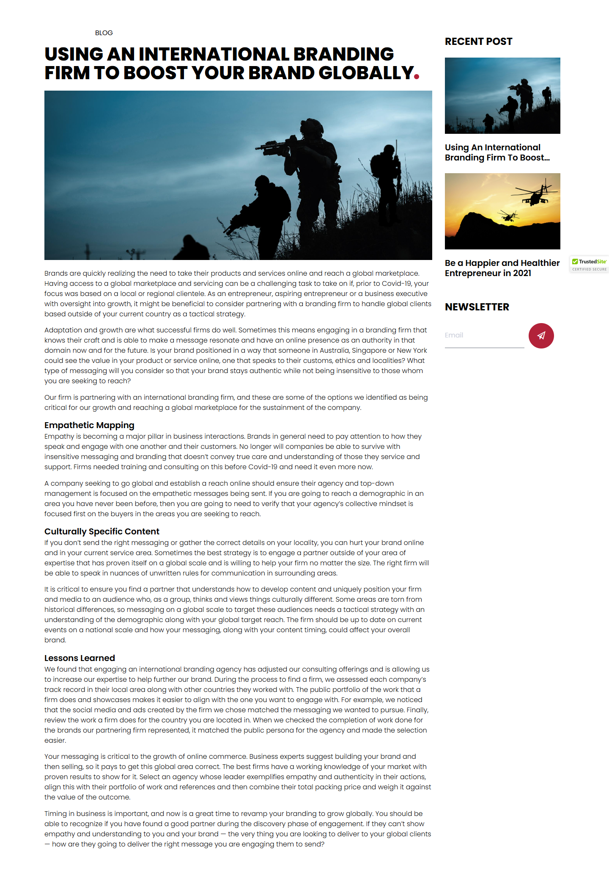
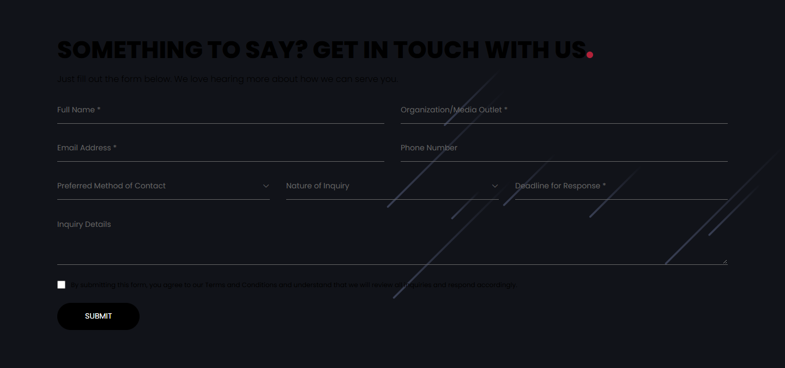
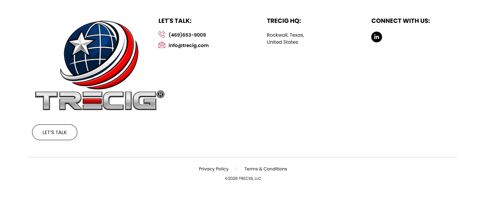

# Using An International Branding Firm To Boost Your Brand Globally – TRECIG

*TRECIG (design reference site)* · URL: https://trecig.com/using-an-international-branding-firm-to-boost-your-brand-globally/ · captured 2026-11-08 00:31:07 · HTTP 200

- **Meta description:** —
- **Page size (desktop 1440px):** 1440×3636 px · tablet (820px): 4399 px · mobile (390px): 5329 px
- **Screenshots:** [desktop](screenshots/desktop-full.png) · [tablet](screenshots/tablet-full.png) · [mobile](screenshots/mobile-full.png) · [desktop top](screenshots/desktop-viewport-top.png) · [desktop scrolled](screenshots/desktop-viewport-scrolled.png)
- **Files:** [raw.html](raw.html) (server HTML) · [rendered.html](rendered.html) (DOM after JS) · [content.txt](content.txt) (all visible text) · layout-*.json (full element tree with computed styles) · page.json (everything)

## 1. Section map (top → bottom, desktop 1440px)

| # | Role | Y from top | Height | Heading / first text | Mobile height | Screenshot |
|---|---|---|---|---|---|---|
| 0 | header | 0 | 170 | HOME ABOUT AWARDS & RECOGNITION EXPERTISE PRESS & MEDIA CONTACT | 170 | [img](screenshots/desktop-sec00-header.png) |
| 1 | section | 270 | 2090 | BLOG | 3578 | [img](screenshots/desktop-sec01-section.png) |
| 2 | section | 2360 | 678 | SOMETHING TO SAY? GET IN TOUCH WITH US | 821 | [img](screenshots/desktop-sec02-section.png) |
| 3 | footer | 3038 | 598 | LET'S TALK: | 690 | [img](screenshots/desktop-sec03-footer.png) |
| 4 | floating (fixed, z 1000003) | 875 | 38 |  |  |  |

## 2. Section-by-section layout (desktop)

Legend: each line is an element in DOM order. `@x,y w×h` = position/size in px on the 1440px-wide page. Text lines show *font size/weight, line-height, colour*. Boxes show layout (flex/grid), background, padding, radius, shadow, etc. Pass-through wrappers are collapsed.

### 2.0 HEADER — HOME ABOUT AWARDS & RECOGNITION EXPERTISE PRESS & MEDIA CONTACT

Element: `<header class="elementor elementor-13 elementor-location-header">` at y=0, 1440×170px · 

- section.elementor-section [bg:#FFFFFF · shadow:#000000 @10% 0px 0px 12px 0px · z:9999 · transition:background, border, border-radius, box-shadow 0.3s, 0.3s, 0.3s, 0.3s ease, ease, ease, ease] `@0,0 1440×170`
  - div.elementor-container [flex row · margin:0px 85px 0px 85px · max-w:1270px] `@85,0 1270×170`
    - div.elementor-column [flex row · min-h:1px] `@85,0 1270×170`
      - div.elementor-widget-wrap [flex row wrap] `@85,0 1270×170`
        - div.elementor-container [flex row · max-w:1270px] `@85,0 1270×170`
          - div.elementor-column [flex row · min-h:1px] `@85,0 127×170`
            - div.elementor-widget-wrap [flex row wrap · align:center · pad:10px 10px 10px 10px] `@85,0 127×170`
              - a (link→/) [inline-block · align-text:center] `@95,10 200×150`
                - **IMG** `TRECIG_Logo_Registered.png` alt="" natural 1440×1080 · inline-block · max-w:200px · overflow:clip · align-text:center `@95,10 200×150`
          - div.elementor-column [flex row · min-h:1px] `@212,0 1143×170`
            - div.elementor-widget-wrap [flex row wrap · align:center · pad:10px 10px 10px 10px] `@212,0 1143×170`
              - div.elementor-widget-container [flex column · transition:background, border, border-radius, box-shadow, transform 0.3s, 0.3s, 0.3s, 0.3s, 0.4s ease, ease, ease, ease, ease] `@222,75 1123×20`
                - ul.elementor-nav-menu [flex row wrap · justify:flex-end · margin:0px 0px 0px 411.234px · z:2] · pseudo:::after{{"content": "\" \"", "w": "0px", "h": "0px"}} `@633,75 712×20`
                  - **A→/** "HOME" — Poppins 14px/400 lh 20px · #000000 · textTransform:uppercase ‖ flex row · margin:0px 15px 0px 0px · transition:all 0.4s ease `@633,75 40×20`
                  - **A→/about/** "ABOUT" — Poppins 14px/400 lh 20px · #000000 · textTransform:uppercase ‖ flex row · margin:0px 15px 0px 15px · transition:all 0.4s ease `@703,75 70×20`
                  - **A→/awards-recognition/** "AWARDS & RECOGNITION" — Poppins 14px/400 lh 20px · #000000 · textTransform:uppercase ‖ flex row · margin:0px 15px 0px 15px · transition:all 0.4s ease `@803,75 195×20`
                  - **A→/expertise/** "EXPERTISE" — Poppins 14px/400 lh 20px · #000000 · textTransform:uppercase ‖ flex row · margin:0px 15px 0px 15px · transition:all 0.4s ease `@1028,75 90×20`
                  - **A→/press-media/** "PRESS & MEDIA" — Poppins 14px/400 lh 20px · #000000 · textTransform:uppercase ‖ flex row · margin:0px 15px 0px 15px · transition:all 0.4s ease `@1148,75 100×20`
                  - **A→/contact/** "CONTACT" — Poppins 14px/400 lh 20px · #000000 · textTransform:uppercase ‖ flex row · margin:0px 0px 0px 15px · transition:all 0.4s ease `@1278,75 67×20`

### 2.1 SECTION — BLOG

Element: `<section class="elementor-section elementor-top-section elementor-element elementor-element-8d220d0 elementor-section-boxed elementor-section-height-default">` at y=270, 1440×2090px · 

- section.elementor-section [pad:50px 0px 50px 0px · margin:100px 0px 0px 0px] `@0,270 1440×2090`
  - div.elementor-container [flex row · max-w:1270px] `@85,320 1270×1990`
    - div.elementor-column [flex row · min-h:1px] `@85,320 1270×1990`
      - div.elementor-widget-wrap [flex row wrap · pad:10px 10px 10px 10px] `@85,320 1270×1990`
        - div.elementor-container [flex row · max-w:1270px] `@95,330 1250×1970`
          - div.elementor-column [flex row · min-h:1px] `@95,330 937×1970`
            - div.elementor-widget-wrap [flex row wrap · pad:10px 10px 10px 10px] `@95,330 937×1970`
              - div.elementor-widget-heading [margin:0px 0px 20px 0px] `@105,340 917×16`
                - **H2** "BLOG" — Poppins 16px/400 lh 16px · #000000 · textTransform:uppercase ‖ flex row `@105,340 917×16`
              - div.elementor-widget-theme-post-title [margin:0px 0px 20px 0px] `@105,376 917×88`
                - **H1** "USING AN INTERNATIONAL BRANDING FIRM TO BOOST YOUR BRAND GLOBALLY" — Poppins 44px/800 lh 44px · #000000 · textTransform:uppercase ‖ inline-block `@105,376 917×88`
              - div.elementor-widget-theme-post-featured-image [margin:0px 0px 20px 0px · align-text:center] `@105,484 917×400`
                - **IMG** `night_mission.jpg` alt="" natural 1440×959 · fit:cover · inline-block · max-w:100% · overflow:clip · align-text:center `@105,484 917×400`
              - div.elementor-widget-container [transition:background, border, border-radius, box-shadow, transform 0.3s, 0.3s, 0.3s, 0.3s, 0.4s ease, ease, ease, ease, ease] `@105,904 917×1372`
                - **P** "Brands are quickly realizing the need to take their products and services online and reach a global marketplace. Having access to a global marketplace and se…" — Poppins 16px/300 lh 24px · #000000 ‖ margin:0px 0px 14.4px 0px `@105,904 917×120`
                - **P** "Adaptation and growth are what successful firms do well. Sometimes this means engaging in a branding firm that knows their craft and is able to make a messag…" — Poppins 16px/300 lh 24px · #000000 ‖ margin:0px 0px 14.4px 0px `@105,1038 917×144`
                - **P** "Our firm is partnering with an international branding firm, and these are some of the options we identified as being critical for our growth and reaching a g…" — Poppins 16px/300 lh 24px · #000000 ‖ margin:0px 0px 14.4px 0px `@105,1197 917×48`
                - **P** "Empathetic Mapping Empathy is becoming a major pillar in business interactions. Brands in general need to pay attention to how they speak and engage with one…" — Poppins 16px/300 lh 24px · #000000 ‖ margin:0px 0px 14.4px 0px · highlights: "Empathetic Mapping"  600 20px `@105,1259 917×126`
                - **P** "A company seeking to go global and establish a reach online should ensure their agency and top-down management is focused on the empathetic messages being se…" — Poppins 16px/300 lh 24px · #000000 ‖ margin:0px 0px 14.4px 0px `@105,1400 917×96`
                - **P** "Culturally Specific Content If you don’t send the right messaging or gather the correct details on your locality, you can hurt your brand online and in your …" — Poppins 16px/300 lh 24px · #000000 ‖ margin:0px 0px 14.4px 0px · highlights: "Culturally Specific Content"  600 20px `@105,1510 917×126`
                - **P** "It is critical to ensure you find a partner that understands how to develop content and uniquely position your firm and media to an audience who, as a group,…" — Poppins 16px/300 lh 24px · #000000 ‖ margin:0px 0px 14.4px 0px `@105,1650 917×144`
                - **P** "Lessons Learned We found that engaging an international branding agency has adjusted our consulting offerings and is allowing us to increase our expertise to…" — Poppins 16px/300 lh 24px · #000000 ‖ margin:0px 0px 14.4px 0px · highlights: "Lessons Learned"  600 20px `@105,1809 917×222`
                - **P** "Your messaging is critical to the growth of online commerce. Business experts suggest building your brand and then selling, so it pays to get this global are…" — Poppins 16px/300 lh 24px · #000000 ‖ margin:0px 0px 14.4px 0px `@105,2045 917×120`
                - **P** "Timing in business is important, and now is a great time to revamp your branding to grow globally. You should be able to recognize if you have found a good p…" — Poppins 16px/300 lh 24px · #000000 ‖ margin:0px 0px 14.4px 0px `@105,2180 917×96`
          - div.elementor-column [flex row · min-h:1px] `@1032,330 313×1970`
            - div.elementor-widget-wrap [flex row wrap · pad:10px 10px 10px 10px] `@1032,330 313×1970`
              - div.elementor-container [flex row · max-w:450px] `@1042,340 293×597`
                - div.elementor-column [flex row · min-h:1px] `@1042,340 293×597`
                  - div.elementor-widget-wrap [flex row wrap · pad:10px 10px 10px 10px] `@1042,340 293×597`
                    - div.elementor-widget-text-editor [margin:0px 0px 20px 0px] `@1052,350 273×36`
                      - **text** "Recent Post" — Poppins 24px/700 lh 36px · #000000 · textTransform:uppercase `@1052,350 273×36`
                    - div.elementor-posts-container [grid cols[272.5px] · gap:25px 20px] `@1052,406 273×521`
                      - article.elementor-post [flex column · overflow:hidden · transition:background, border, box-shadow 0.25s ease] `@1052,406 273×248`
                        - a.elementor-post__thumbnail__link (link→/using-an-international-branding-firm-to-boost-your-brand-globally/) [margin:0px 0px 20px 0px · transition:none 0s ease] `@1052,406 273×180`
                          - div.elementor-post__thumbnail [pad:0px 0px 179.844px 0px · overflow:hidden] `@1052,406 273×180`
                            - **IMG** `night_mission.jpg` alt="" natural 2000×1333 · pos:absolute · overflow:clip · transform:matrix(1.01, 0, 0, 1.01, -137.613, -91.7127) · transition:filter 0.3s ease `@1050,404 275×183`
                        - **A→/using-an-international-branding-firm-to-boost-your-brand-globally/** "Using An International Branding Firm To Boost Your Brand Globally" — Poppins 20px/600 lh 24px · #000000 ‖ flow-root `@1052,606 273×48`
                      - article.elementor-post [flex column · overflow:hidden · transition:background, border, box-shadow 0.25s ease] `@1052,679 273×248`
                        - a.elementor-post__thumbnail__link (link→/be-a-happier-and-healthier-entrepreneur-in-2021/) [margin:0px 0px 20px 0px · transition:none 0s ease] `@1052,679 273×180`
                          - div.elementor-post__thumbnail [pad:0px 0px 179.844px 0px · overflow:hidden] `@1052,679 273×180`
                            - **IMG** `1920X1200_2.jpg` alt="" natural 1920×1200 · pos:absolute · overflow:clip · transform:matrix(1.01, 0, 0, 1.01, -145.314, -90.8211) · transition:filter 0.3s ease `@1042,678 291×182`
                        - **A→/be-a-happier-and-healthier-entrepreneur-in-2021/** "Be a Happier and Healthier Entrepreneur in 2021" — Poppins 20px/600 lh 24px · #000000 ‖ flow-root `@1052,879 273×48`
              - section.elementor-section [margin:30px 0px 0px 0px] `@1042,967 293×136`
                - div.elementor-container [flex row · max-w:450px] `@1042,967 293×136`
                  - div.elementor-column [flex row · min-h:1px] `@1042,967 293×136`
                    - div.elementor-widget-wrap [flex row wrap · pad:10px 10px 10px 10px] `@1042,967 293×136`
                      - div.elementor-widget-text-editor [margin:0px 0px 20px 0px] `@1052,977 273×36`
                        - **text** "Newsletter" — Poppins 24px/700 lh 36px · #000000 · textTransform:uppercase `@1052,977 273×36`
                      - FORM form.elementor-form `@1052,1033 273×70`
                        - div.elementor-form-fields-wrapper [flex row wrap · margin:0px -5px -10px -5px] `@1047,1033 283×70`
                          - div.elementor-column [flex row wrap · align:center · pad:0px 5px 0px 5px · margin:0px 0px 10px 0px · min-h:1px] `@1047,1033 198×60`
                            - **LABEL** "Email" — Poppins 16px/400 lh 16px · #000000 ‖ margin:-1px -1px -1px -1px `@1051,-158968 1×1`
                            - **FIELD** <input type=email name=form_fields[email]> placeholder="Email" required — Poppins 16px/400 lh 22.4px · #A9AFC3 ‖ bg:transparent · max-w:100% · border:0px 0px 1px 0px solid #69727D · transition:all 0.3s ease `@1052,1033 188×59`
                          - div.elementor-column [flex row wrap · align:flex-end · pad:0px 5px 0px 5px · margin:0px 0px 10px 0px · min-h:1px] `@1245,1033 85×60`
                            - **BUTTON** "Submit" — Poppins 18px/500 lh 18px · #FFFFFF · textAlign:center ‖ bg:#B22239 · radius:50% · transition:all 0.3s ease `@1250,1033 60×60`

### 2.2 SECTION — SOMETHING TO SAY? GET IN TOUCH WITH US

Element: `<section class="elementor-section elementor-top-section elementor-element elementor-element-f0c09bc elementor-section-boxed elementor-section-height-default">` at y=2360, 1440×678px · 

- section.elementor-section [bg:#111319 · bg-image:glob-bg-1.png · bg-pos:100% 50% · pad:50px 0px 50px 0px · transition:background, border, border-radius, box-shadow 0.3s, 0.3s, 0.3s, 0.3s ease, ease, ease, ease] `@0,2360 1440×678`
  - div.elementor-container [flex row · margin:0px 85px 0px 85px · max-w:1270px] `@85,2410 1270×578`
    - div.elementor-column [flex row · min-h:1px] `@85,2410 1270×578`
      - div.elementor-widget-wrap [flex row wrap · pad:10px 10px 10px 10px] `@85,2410 1270×578`
        - div.elementor-container [flex row · max-w:1270px] `@95,2420 1250×558`
          - div.elementor-column [flex row · min-h:1px] `@95,2420 1250×558`
            - div.elementor-widget-wrap [flex row wrap · pad:10px 10px 10px 10px] `@95,2420 1250×558`
              - div.elementor-widget-heading [margin:0px 0px 20px 0px] `@105,2430 1230×44`
                - **H2** "SOMETHING TO SAY? GET IN TOUCH WITH US" — Poppins 44px/800 lh 44px · #000000 · textTransform:uppercase ‖ inline-block `@105,2430 983×44`
              - div.elementor-widget-text-editor [margin:0px 0px 20px 0px] `@105,2494 1230×24`
                - **text** "Just fill out the form below. We love hearing more about how we can serve you." — Poppins 16px/300 lh 24px · #000000 `@105,2494 1230×24`
              - FORM form.wpcf7-form `@105,2538 1230×430`
                - p [flex row · gap:15px] `@105,2538 1230×70`
                  - span.wpcf7-form-control-wrap [margin:0px 0px 20px 0px] `@105,2538 600×50`
                    - **FIELD** <input type=text name=fullname> placeholder="Full Name *" — Poppins 14px/400 lh 21px · #000000 ‖ inline-block · border:0px 0px 1px 0px none #000000 · transition:all 0.3s ease `@105,2538 600×50`
                  - span.wpcf7-form-control-wrap [margin:0px 0px 20px 0px] `@735,2538 600×50`
                    - **FIELD** <input type=text name=outlet> placeholder="Organization/Media Outlet *" — Poppins 14px/400 lh 21px · #000000 ‖ inline-block · border:0px 0px 1px 0px none #000000 · transition:all 0.3s ease `@735,2538 600×50`
                - p [flex row · gap:15px] `@105,2608 1230×70`
                  - span.wpcf7-form-control-wrap [margin:0px 0px 20px 0px] `@105,2608 600×50`
                    - **FIELD** <input type=email name=email> placeholder="Email Address *" — Poppins 14px/400 lh 21px · #000000 ‖ inline-block · border:0px 0px 1px 0px none #000000 · transition:all 0.3s ease `@105,2608 600×50`
                  - span.wpcf7-form-control-wrap [margin:0px 0px 20px 0px] `@735,2608 600×50`
                    - **FIELD** <input type=tel name=phone> placeholder="Phone Number" — Poppins 14px/400 lh 21px · #000000 ‖ inline-block · border:0px 0px 1px 0px none #000000 · transition:all 0.3s ease `@735,2608 600×50`
                - p [flex row · gap:15px] `@105,2678 1230×70`
                  - span.wpcf7-form-control-wrap [margin:0px 0px 20px 0px] `@105,2678 390×50`
                    - div.select-styled [flex row · align:center · border:0px 0px 1px 0px none #666666] · pseudo:::after{{"content": "\"\"", "w": "14px", "h": "21px", "position": "absolute"}} `@105,2678 390×50`
                      - **text** "Preferred Method of Contact" — Poppins 14px/400 lh 21px · #666666 `@105,2678 390×50`
                  - span.wpcf7-form-control-wrap [margin:0px 0px 20px 0px] `@525,2678 390×50`
                    - div.select-styled [flex row · align:center · border:0px 0px 1px 0px none #666666] · pseudo:::after{{"content": "\"\"", "w": "14px", "h": "21px", "position": "absolute"}} `@525,2678 390×50`
                      - **text** "Nature of Inquiry" — Poppins 14px/400 lh 21px · #666666 `@525,2678 390×50`
                  - span.wpcf7-form-control-wrap [margin:0px 0px 20px 0px] `@945,2678 390×50`
                    - **FIELD** <input type=text name=date> placeholder="Deadline for Response *" — Poppins 14px/400 lh 21px · #000000 ‖ inline-block · border:0px 0px 1px 0px none #000000 · transition:all 0.3s ease `@945,2678 390×50`
                - p `@105,2748 1230×220`
                  - span.wpcf7-form-control-wrap [inline-block · margin:0px 0px 20px 0px] `@105,2748 1230×106`
                    - **FIELD** <textarea type=textarea name=message> placeholder="Inquiry Details" — Poppins 14px/400 lh 21px · #000000 ‖ inline-block · pad:15px 0px 0px 0px · border:0px 0px 1px 0px none #000000 · transition:all 0.3s ease `@105,2748 1230×100`
                  - **SPAN** "By submitting this form, you agree to our Terms and Conditions and understand that we will review all inquiries and respond accordingly." — -apple-system 16px/400 lh 24px · #333333 ‖ inline-block · margin:0px 0px 20px 0px · highlights: "By submitting this form, you agree to our Terms and Conditio" #000000  12px  Poppins `@105,2874 1230×24`
                  - **FIELD** <input type=submit name=> placeholder="" value='Submit' — Poppins 14px/400 lh 21px · #FFFFFF · textTransform:uppercase · textAlign:center ‖ inline-block · bg:#000000 · pad:0px 50px 0px 50px · radius:30px · border:1px 1px 1px 1px solid #000000 · transition:all 0.3s ease `@105,2918 151×50`

### 2.3 FOOTER — LET'S TALK:

Element: `<footer class="elementor elementor-15 elementor-location-footer">` at y=3038, 1440×598px · 

- section.elementor-section [transition:background, border, border-radius, box-shadow 0.3s, 0.3s, 0.3s, 0.3s ease, ease, ease, ease] `@0,3038 1440×598`
  - div.elementor-background-video-container [pos:absolute · z:0 · overflow:hidden · transition:opacity 1s ease] `@0,3038 1440×598`
    - **IFRAME** https://www.youtube.com/embed/OzwCnEEadts?controls=0&rel=0&playsinline=1&cc_load_policy=0&enablejsapi=1&origin=https%3A%2F%2Ftrecig.com&widgetid=1&forigin=https%3A%2F%2Ftrecig.com%2Fusing-an-international-branding-firm-to-boost-your-brand-globally%2F&aoriginsup=1&vf=1 Triceg   Expertise Slider 1 `@0,2932 1440×810`
  - div.elementor-background-overlay [bg:#FFFFFF · pos:absolute · opacity:0.7 · transition:background, border-radius, opacity 0.3s, 0.3s, 0.3s ease, ease, ease] `@0,3038 1440×598` (empty/decorative)
  - div.elementor-container [flex row · margin:0px 85px 0px 85px · max-w:1270px] `@85,3038 1270×598`
    - div.elementor-column [flex row · min-h:1px] `@85,3038 1270×598`
      - div.elementor-widget-wrap [flex row wrap] `@85,3038 1270×598`
        - section.elementor-section [pad:40px 0px 40px 0px] `@85,3038 1270×467`
          - div.elementor-container [flex row · max-w:1270px] `@85,3078 1270×387`
            - div.elementor-column [flex row · min-h:1px] `@85,3078 324×387`
              - div.elementor-widget-wrap [flex row wrap · pad:10px 10px 10px 10px] `@85,3078 324×387`
                - div.elementor-widget-theme-site-logo [margin:0px 0px 20px 0px] `@95,3088 304×300`
                  - a (link→/) [inline-block] `@95,3088 400×300`
                    - **IMG** `TRECIG_Logo_Registered.png` alt="" natural 1440×1080 · inline-block · max-w:400px · overflow:clip `@95,3088 400×300`
                - div.elementor-button-wrapper [grid cols[134.078px]] `@95,3408 134×47`
                  - **A→/contact/** "LET’S TALK" — Poppins 15px/400 lh 15px · #000000 · textTransform:uppercase · textAlign:center ‖ pad:15px 30px 15px 30px · radius:30px · border:1px 1px 1px 1px solid #000000 · transition:all 0.3s ease `@95,3408 134×47`
            - div.elementor-column [flex row · min-h:1px] `@409,3078 371×387`
              - div.elementor-widget-wrap [flex row wrap · pad:10px 10px 10px 10px · margin:0px 0px 0px 50px] `@459,3078 321×387`
                - div.elementor-widget-heading [margin:0px 0px 20px 0px] `@469,3088 301×24`
                  - **H2** "LET'S TALK:" — Poppins 18px/700 lh 18px · #000000 · textTransform:uppercase ‖ inline-block `@469,3091 98×18`
                - ul.elementor-icon-list-items `@469,3132 301×52`
                  - li.elementor-icon-list-item [flex row · align:center · pad:0px 0px 5px 0px] `@469,3132 301×26`
                    - **A→tel:(254)%20338-6131** "(469)653-9009" — Poppins 14px/600 lh 21px · #CC3366 ‖ flex row · highlights: "(469)653-9009" #000000 `@469,3132 301×21`
                  - li.elementor-icon-list-item [flex row · align:center · margin:5px 0px 0px 0px] `@469,3163 301×21`
                    - **A→mailto:info@trecig.com** "info@trecig.com" — Poppins 14px/600 lh 21px · #CC3366 ‖ flex row · highlights: "info@trecig.com" #000000 `@469,3163 301×21`
            - div.elementor-column [flex row · min-h:1px] `@781,3078 310×387`
              - div.elementor-widget-wrap [flex row wrap · pad:10px 10px 10px 10px · margin:0px 50px 0px 0px] `@781,3078 260×387`
                - div.elementor-widget-heading [margin:0px 0px 20px 0px] `@791,3088 240×24`
                  - **H2** "TRECIG HQ:" — Poppins 18px/700 lh 18px · #000000 · textTransform:uppercase ‖ inline-block `@791,3091 101×18`
                - ul.elementor-icon-list-items `@791,3132 240×42`
                  - li.elementor-icon-list-item [flex row · align:center] `@791,3132 240×42`
                    - **SPAN** "Rockwall, Texas, United States" — Poppins 14px/400 lh 21px · #000000 ‖ transition:color 0.3s ease `@791,3132 110×42`
            - div.elementor-column [flex row · min-h:1px] `@1090,3078 264×387`
              - div.elementor-widget-wrap [flex row wrap · pad:10px 10px 10px 10px] `@1090,3078 264×387`
                - div.elementor-widget-heading [margin:0px 0px 20px 0px] `@1100,3088 244×24`
                  - **H2** "CONNECT WITH US:" — Poppins 18px/700 lh 18px · #000000 · textTransform:uppercase ‖ inline-block `@1100,3091 174×18`
                - **A→/using-an-international-branding-firm-to-boost-your-brand-globally/** "Linkedin-in" +icon[e-font-icon-svg e-fab-linkedin-in] — -apple-system 16px/400 lh 16px · #69727D · textAlign:center ‖ flex row · bg:#000000 · radius:100% · transition:all 0.3s ease `@1100,3132 32×32`
        - section.elementor-section [pad:15px 0px 15px 0px · border:1px 0px 0px 0px solid #000000 @20%] `@85,3505 1270×131`
          - div.elementor-container [flex row · max-w:1270px] `@85,3521 1270×100`
            - div.elementor-column [flex row · min-h:1px] `@85,3521 1270×100`
              - div.elementor-widget-wrap [flex row wrap · align:center · pad:10px 10px 10px 10px] `@85,3521 1270×100`
                - div.elementor-element [margin:0px 0px 20px 0px · align-text:center] `@95,3531 1250×10`
                  - div.elementor-widget-container [margin:0px 0px -10px 0px · overflow:hidden · align-text:center · transition:background, border, border-radius, box-shadow, transform 0.3s, 0.3s, 0.3s, 0.3s, 0.4s ease, ease, ease, ease, ease] `@95,3531 1250×20`
                    - ul.elementor-icon-list-items [flex row wrap · justify:center · gap:30px · margin:0px -8px 0px -8px · align-text:center] `@87,3531 1266×20`
                      - li.elementor-icon-list-item [flex row · justify:center · align:center · margin:0px 8px 0px 8px · align-text:center] `@589,3531 89×20`
                        - **A→/privacy-policy/** "Privacy Policy" — Poppins 13px/400 lh 19.5px · #CC3366 · textAlign:center ‖ flex row · highlights: "Privacy Policy" #000000 `@589,3531 88×20`
                      - li.elementor-icon-list-item [flex row · justify:center · align:center · margin:0px 8px 0px 8px · align-text:center] `@724,3531 127×20`
                        - **A→/terms-conditions/** "Terms & Conditions" — Poppins 13px/400 lh 19.5px · #CC3366 · textAlign:center ‖ flex row · highlights: "Terms & Conditions" #000000 `@724,3531 127×20`
                - **P** "©2026 TRECIG, LLC" — Poppins 12px/400 lh 18px · #000000 · textTransform:uppercase · textAlign:center ‖ margin:0px 0px 14.4px 0px `@95,3560 1250×36`

### Floating / fixed elements
- `div.` fixed at [1348, 875, 92, 38] z-index 1000003 — ""

## 3. Header, navigation & interaction behaviour

- **atTop** `header.elementor.elementor-13.elementor-location-header` position:static top:0 height:170 bg:transparent shadow:none backdrop:none z:auto
- **afterScroll1400** `header.elementor.elementor-13.elementor-location-header` position:static top:-1400 height:0 bg:transparent shadow:none backdrop:none z:auto
- **afterScroll1400** `section.elementor-section.elementor-top-section.elementor-element.elementor-elem` position:fixed top:0 height:170 bg:#FFFFFF @90% shadow:#000000 @10% 0px 0px 12px 0px backdrop:none z:9999

| Menu item | Link | Dropdown | Style | Hover change |
|---|---|---|---|---|
| HOME | / | — | Poppins 14px/400 #000000 uppercase ls normal | color: #000000 → #B22239 |
| ABOUT | /about/ | The Mission (/the-mission/); The Values (/the-values/); The Legacy (/the-legacy/); The Trecig Team (/the-trecig-team/); Careers (/careers/) | Poppins 14px/400 #000000 uppercase ls normal | color: #000000 → #B22239 |
| AWARDS & RECOGNITION | /awards-recognition/ | Partnerships (/partnerships/) | Poppins 14px/400 #000000 uppercase ls normal | color: #000000 → #B22239 |
| EXPERTISE | /expertise/ | Industries We Serve (/industries-we-serve/) | Poppins 14px/400 #000000 uppercase ls normal | color: #000000 → #B22239 |
| PRESS & MEDIA | /press-media/ | — | Poppins 14px/400 #000000 uppercase ls normal | color: #000000 → #B22239 |
| CONTACT | /contact/ | — | Poppins 14px/400 #000000 uppercase ls normal | color: #000000 → #B22239 |

- **Mobile menu:** toggle `.elementor-menu-toggle` → [screenshot](screenshots/mobile-menu-open.png) · items: HOME, ABOUT, AWARDS & RECOGNITION, EXPERTISE, PRESS & MEDIA, CONTACT

### Hover states (measured by hovering in Chrome)

| Element | Text | Normal | On hover |
|---|---|---|---|
| `a.elementor-item` | HOME | color #000000 · bg transparent · radius 0px · pad 0px · border 0px #000000 · transition 0.4s | color: #000000 → #B22239; borderTopColor: #000000 → #B22239 |
| `a.elementor-item` | ABOUT | color #000000 · bg transparent · radius 0px · pad 0px · border 0px #000000 · transition 0.4s | color: #000000 → #B22239; borderTopColor: #000000 → #B22239 |
| `a.elementor-item` | CONTACT | color #000000 · bg transparent · radius 0px · pad 0px · border 0px #000000 · transition 0.4s | color: #000000 → #B22239; borderTopColor: #000000 → #B22239 |
| `article.elementor-post` | Using An International Branding Firm To  | color #333333 · bg transparent · radius 0px · pad 0px · border 0px #333333 · transition background 0.25s, border 0.25s, box-shadow 0.25s | childColor: #CC3366 → #B22239 |
| `article.elementor-post` | Be a Happier and Healthier Entrepreneur  | color #333333 · bg transparent · radius 0px · pad 0px · border 0px #333333 · transition background 0.25s, border 0.25s, box-shadow 0.25s | childColor: #CC3366 → #B22239 |
| `button.elementor-button` | Submit | color #FFFFFF · bg #B22239 · radius 50% · pad 0px · border 0px #FFFFFF · transition 0.3s | no change |
| `input.wpcf7-form-control` | Submit | color #FFFFFF · bg #000000 · radius 30px · pad 0px 50px · border 1px #000000 · transition 0.3s | backgroundColor: #000000 → #B22239; borderTopColor: #000000 → #B22239 |
| `a.` |  | color #CC3366 · bg transparent · radius 0px · pad 0px · border 0px #CC3366 · transition all | color: #CC3366 → #B22239; borderTopColor: #CC3366 → #B22239; childColor: #CC3366 → #B22239 |
| `a.elementor-button` | LET’S TALK | color #000000 · bg transparent · radius 30px · pad 15px 30px · border 1px #000000 · transition 0.3s | color: #000000 → #FFFFFF; borderTopColor: #000000 → #B22239 |
| `a.` | (469)653-9009 | color #CC3366 · bg transparent · radius 0px · pad 0px · border 0px #CC3366 · transition all | color: #CC3366 → #B22239; borderTopColor: #CC3366 → #B22239 |
| `a.elementor-icon` | Linkedin-in | color #69727D · bg #000000 · radius 100% · pad 0px · border 0px #69727D · transition 0.3s | color: #69727D → #B22239; backgroundColor: #000000 → #B22239; borderTopColor: #69727D → #B22239; opacity: 1 → 0.9; childColor: #69727D → #B22239 |
| `a.` | Privacy Policy | color #CC3366 · bg transparent · radius 0px · pad 0px · border 0px #CC3366 · transition all | color: #CC3366 → #B22239; borderTopColor: #CC3366 → #B22239 |

## 4. Typography & colour used on this page (weighted by amount of text / area)

| Font · weight · size / line-height | chars |
|---|---|
| Poppins | 300 | 16px / 24px | 4923 |
| Poppins | 400 | 12px / 16px | 136 |
| Poppins | 600 | 20px / 24px | 112 |
| Poppins | 800 | 44px / 44px | 103 |
| Poppins | 400 | 14px / 21px | 73 |
| Poppins | 600 | 20px / 30px | 60 |
| Poppins | 400 | 14px / 20px | 58 |
| Poppins | 700 | 18px / 18px | 37 |
| Poppins | 400 | 13px / 19.5px | 32 |
| Poppins | 600 | 14px / 21px | 28 |
| Poppins | 700 | 24px / 36px | 21 |
| Poppins | 400 | 12px / 18px | 17 |
| -apple-system | 400 | 16px / 24px | 15 |
| -apple-system | 400 | 16px / 16px | 11 |
| Poppins | 400 | 15px / 15px | 10 |
| Poppins | 400 | 16px / 16px | 9 |
| Poppins | 500 | 18px / 18px | 6 |

- **Text colours:** #000000 (5575), #666666 (44), #CC3366 (15), #69727D (11), #FFFFFF (6)
- **Background colours (by area):** #FFFFFF (1109), #111319 (976), transparent (11), #000000 (9), #B22239 (4)
- **Border radii:** 50% (3), 30px (2), 100% (1), 2px 0px 0px (1)
- **Shadows:** #000000 @10% 0px 0px 12px 0px (1) | #000000 @20% 0px 0px 5px 0px (1)
- **Mobile text styles:** Poppins | 300 | 14px / 21px (4923); Poppins | 400 | 12px / 16px (136); Poppins | 600 | 16px / 19.2px (112); Poppins | 800 | 28px / 28px (103); Poppins | 400 | 14px / 21px (73); Poppins | 600 | 20px / 30px (60); Poppins | 700 | 16px / 16px (37); Poppins | 400 | 12px / 18px (32); Poppins | 600 | 14px / 21px (28); Poppins | 700 | 16px / 24px (21)

## 5. Forms
- **Form** `elementor-form` → https://trecig.com/using-an-international-branding-firm-to-boost-your-brand-globally/ (post)
  - input[email] name=`form_fields[email]` label="Email" placeholder="Email" *required*
  - button[submit] name=`` label="" placeholder="" value="Submit"
- **Form** `wpcf7-form init` → https://trecig.com/using-an-international-branding-firm-to-boost-your-brand-globally/#wpcf7-f291-p735-o1 (post)
  - fieldset[fieldset] name=`` label="" placeholder=""
  - input[text] name=`fullname` label="" placeholder="Full Name *"
  - input[text] name=`outlet` label="" placeholder="Organization/Media Outlet *"
  - input[email] name=`email` label="" placeholder="Email Address *"
  - input[tel] name=`phone` label="" placeholder="Phone Number"
  - select[select-one] name=`preferredmethod` label="" placeholder="" options: ['Preferred Method of Contact', 'Email', 'Phone']
  - select[select-one] name=`natureinquiry` label="" placeholder="" options: ['Nature of Inquiry', 'Interview Request', 'Feature Story', 'Collaboration', 'Podcast', 'Speaking Engagement', 'Other']
  - input[text] name=`date` label="" placeholder="Deadline for Response *"
  - textarea[textarea] name=`message` label="" placeholder="Inquiry Details"
  - input[checkbox] name=`acceptance` label="By submitting this form, you agree to our Terms and Conditions and understand that we will review all inquiries and respond accordingly." placeholder=""
  - input[submit] name=`` label="" placeholder="" value="Submit"

## 6. Images on the page

- `TRECIG_Logo_Registered.png` natural 1440×1080 → shown 200×150 · alt="" · https://trecig.com/wp-content/uploads/2026/10/TRECIG_Logo_Registered.png
- `night_mission.jpg` natural 1440×959 → shown 917×400 · alt="" · https://trecig.com/wp-content/uploads/2024/08/night_mission.jpg
- `1920X1200_2.jpg` natural 1920×1200 → shown 291×182 · alt="" · https://trecig.com/wp-content/uploads/2024/08/1920X1200_2.jpg
- background on `section.elementor-section`: https://trecig.com/wp-content/uploads/2024/08/glob-bg-1.png
- background on `button.xdsoft_prev`: data:image/png;base64,iVBORw0KGgoAAAANSUhEUgAAAGQAAAAeCAYAAADaW7vzAAAAGXRFWHRTb2Z0d2FyZQBBZG9iZSBJbWFnZVJlYWR5ccllPAAAAyJpVFh0WE1MOmNvbS5hZG9iZS54bXAAAAAAADw/eHBhY2tldCBiZWdpbj0i77u/IiBpZD0iVzVNME1wQ2VoaUh6cmVTek5UY3prYzlkIj8+IDx4OnhtcG1ldGEgeG1sbnM6eD0iYWRvYmU6bnM6bWV0YS8iIHg6eG1wdGs9IkFkb2JlI
- background on `button.xdsoft_today_button`: data:image/png;base64,iVBORw0KGgoAAAANSUhEUgAAAGQAAAAeCAYAAADaW7vzAAAAGXRFWHRTb2Z0d2FyZQBBZG9iZSBJbWFnZVJlYWR5ccllPAAAAyJpVFh0WE1MOmNvbS5hZG9iZS54bXAAAAAAADw/eHBhY2tldCBiZWdpbj0i77u/IiBpZD0iVzVNME1wQ2VoaUh6cmVTek5UY3prYzlkIj8+IDx4OnhtcG1ldGEgeG1sbnM6eD0iYWRvYmU6bnM6bWV0YS8iIHg6eG1wdGs9IkFkb2JlI
- background on `i.`: data:image/png;base64,iVBORw0KGgoAAAANSUhEUgAAAGQAAAAeCAYAAADaW7vzAAAAGXRFWHRTb2Z0d2FyZQBBZG9iZSBJbWFnZVJlYWR5ccllPAAAAyJpVFh0WE1MOmNvbS5hZG9iZS54bXAAAAAAADw/eHBhY2tldCBiZWdpbj0i77u/IiBpZD0iVzVNME1wQ2VoaUh6cmVTek5UY3prYzlkIj8+IDx4OnhtcG1ldGEgeG1sbnM6eD0iYWRvYmU6bnM6bWV0YS8iIHg6eG1wdGs9IkFkb2JlI
- background on `i.`: data:image/png;base64,iVBORw0KGgoAAAANSUhEUgAAAGQAAAAeCAYAAADaW7vzAAAAGXRFWHRTb2Z0d2FyZQBBZG9iZSBJbWFnZVJlYWR5ccllPAAAAyJpVFh0WE1MOmNvbS5hZG9iZS54bXAAAAAAADw/eHBhY2tldCBiZWdpbj0i77u/IiBpZD0iVzVNME1wQ2VoaUh6cmVTek5UY3prYzlkIj8+IDx4OnhtcG1ldGEgeG1sbnM6eD0iYWRvYmU6bnM6bWV0YS8iIHg6eG1wdGs9IkFkb2JlI
- background on `button.xdsoft_next`: data:image/png;base64,iVBORw0KGgoAAAANSUhEUgAAAGQAAAAeCAYAAADaW7vzAAAAGXRFWHRTb2Z0d2FyZQBBZG9iZSBJbWFnZVJlYWR5ccllPAAAAyJpVFh0WE1MOmNvbS5hZG9iZS54bXAAAAAAADw/eHBhY2tldCBiZWdpbj0i77u/IiBpZD0iVzVNME1wQ2VoaUh6cmVTek5UY3prYzlkIj8+IDx4OnhtcG1ldGEgeG1sbnM6eD0iYWRvYmU6bnM6bWV0YS8iIHg6eG1wdGs9IkFkb2JlI
- background on `button.xdsoft_prev`: data:image/png;base64,iVBORw0KGgoAAAANSUhEUgAAAGQAAAAeCAYAAADaW7vzAAAAGXRFWHRTb2Z0d2FyZQBBZG9iZSBJbWFnZVJlYWR5ccllPAAAAyJpVFh0WE1MOmNvbS5hZG9iZS54bXAAAAAAADw/eHBhY2tldCBiZWdpbj0i77u/IiBpZD0iVzVNME1wQ2VoaUh6cmVTek5UY3prYzlkIj8+IDx4OnhtcG1ldGEgeG1sbnM6eD0iYWRvYmU6bnM6bWV0YS8iIHg6eG1wdGs9IkFkb2JlI
- background on `button.xdsoft_next`: data:image/png;base64,iVBORw0KGgoAAAANSUhEUgAAAGQAAAAeCAYAAADaW7vzAAAAGXRFWHRTb2Z0d2FyZQBBZG9iZSBJbWFnZVJlYWR5ccllPAAAAyJpVFh0WE1MOmNvbS5hZG9iZS54bXAAAAAAADw/eHBhY2tldCBiZWdpbj0i77u/IiBpZD0iVzVNME1wQ2VoaUh6cmVTek5UY3prYzlkIj8+IDx4OnhtcG1ldGEgeG1sbnM6eD0iYWRvYmU6bnM6bWV0YS8iIHg6eG1wdGs9IkFkb2JlI
- background on `div.`: https://cdn.ywxi.net/meter/trecig.com/205.svg?ts=1784975038086&l=en

## 7. Links on the page

- [body] "Skip to content" → /using-an-international-branding-firm-to-boost-your-brand-globally/#content
- [header] "(icon/image)" → /
- [header] "HOME" → /
- [header] "ABOUT" → /about/
- [header] "The Mission" → /the-mission/
- [header] "The Values" → /the-values/
- [header] "The Legacy" → /the-legacy/
- [header] "The Trecig Team" → /the-trecig-team/
- [header] "Careers" → /careers/
- [header] "AWARDS & RECOGNITION" → /awards-recognition/
- [header] "Partnerships" → /partnerships/
- [header] "EXPERTISE" → /expertise/
- [header] "Industries We Serve" → /industries-we-serve/
- [header] "PRESS & MEDIA" → /press-media/
- [header] "CONTACT" → /contact/
- [header] "Home" → /
- [header] "About" → /about/
- [header] "Awards & Recognition" → /awards-recognition/
- [header] "Expertise" → /expertise/
- [header] "Press & Media" → /press-media/
- [header] "Contact" → /contact/
- [body] "(icon/image)" → /using-an-international-branding-firm-to-boost-your-brand-globally/
- [body] "Using An International Branding Firm To Boost Your Brand Globally" → /using-an-international-branding-firm-to-boost-your-brand-globally/
- [body] "(icon/image)" → /be-a-happier-and-healthier-entrepreneur-in-2021/
- [body] "Be a Happier and Healthier Entrepreneur in 2021" → /be-a-happier-and-healthier-entrepreneur-in-2021/
- [footer] "LET’S TALK" → /contact/
- [footer] "(469)653-9009" → tel:(254)%20338-6131
- [footer] "info@trecig.com" → mailto:info@trecig.com
- [footer] "Linkedin-in" → /using-an-international-branding-firm-to-boost-your-brand-globally/ (target _blank)
- [footer] "Privacy Policy" → /privacy-policy/
- [footer] "Terms & Conditions" → /terms-conditions/

## 8. Mobile layout (390px) — condensed outline

### 8.0 header — HOME ABOUT AWARDS & RECOGNITION EXPERTISE PRESS & MEDIA CONTACT (y 0, h 170)
- section.elementor-section [bg:#FFFFFF · shadow:#000000 @10% 0px 0px 12px 0px · z:9999 · transition:background, border, border-radius, box-shadow 0.3s, 0.3s, 0.3s, 0.3s ease, ease, ease, ease] `@0,0 390×170`
  - div.elementor-container [flex row wrap · max-w:767px] `@0,0 390×170`
    - div.elementor-column [flex row · min-h:1px] `@0,0 390×170`
      - div.elementor-widget-wrap [flex row wrap] `@0,0 390×170`
        - div.elementor-container [flex row wrap · max-w:767px] `@0,0 390×170`
          - div.elementor-column [flex row · min-h:1px] `@0,0 234×170`
            - div.elementor-widget-wrap [flex row wrap · align:center · pad:10px 10px 10px 10px] `@0,0 234×170`
              - a (link→/) [inline-block · align-text:center] `@17,10 200×150`
                - **IMG** `TRECIG_Logo_Registered-1024x768.png` alt="" natural 390×292 · inline-block · max-w:200px · overflow:clip · align-text:center `@17,10 200×150`
          - div.elementor-column [flex row · min-h:1px] `@234,0 156×170`
            - div.elementor-widget-wrap [flex row wrap · align:center · pad:10px 10px 10px 10px] `@234,0 156×170`
              - div.elementor-widget-container [flex column · transition:background, border, border-radius, box-shadow, transform 0.3s, 0.3s, 0.3s, 0.3s, 0.4s ease, ease, ease, ease, ease] `@244,70 136×30`
                - nav.elementor-nav-menu--dropdown [bg:#FFFFFF · margin:16px 0px 0px 0px · pos:absolute · z:9997 · overflow:hidden · transform:matrix(1, 0, 0, 0, 0, 0) · transition:max-height, transform 0.3s, 0.3s ease, ease] `@0,116 390×0`
                  - ul.elementor-nav-menu [z:2] · pseudo:::after{{"content": "\" \"", "w": "390px", "h": "0px"}} `@0,116 390×0`
                    - **A→/** "HOME" — Poppins 14px/400 lh 20px · #000000 · textTransform:uppercase ‖ flex row · pad:10px 20px 10px 20px `@0,116 390×0`
                    - **A→/about/** "ABOUT" — Poppins 14px/400 lh 20px · #000000 · textTransform:uppercase ‖ flex row · pad:10px 20px 10px 20px `@0,116 390×0`
                    - **A→/awards-recognition/** "AWARDS & RECOGNITION" — Poppins 14px/400 lh 20px · #000000 · textTransform:uppercase ‖ flex row · pad:10px 20px 10px 20px `@0,116 390×0`
                    - **A→/expertise/** "EXPERTISE" — Poppins 14px/400 lh 20px · #000000 · textTransform:uppercase ‖ flex row · pad:10px 20px 10px 20px `@0,116 390×0`
                    - **A→/press-media/** "PRESS & MEDIA" — Poppins 14px/400 lh 20px · #000000 · textTransform:uppercase ‖ flex row · pad:10px 20px 10px 20px `@0,116 390×0`
                    - **A→/contact/** "CONTACT" — Poppins 14px/400 lh 20px · #000000 · textTransform:uppercase ‖ flex row · pad:10px 20px 10px 20px `@0,116 390×0`

### 8.1 section — BLOG (y 240, h 3578)
- section.elementor-section [margin:70px 0px 0px 0px] `@0,240 390×3578`
  - div.elementor-container [flex row wrap · max-w:767px] `@0,240 390×3578`
    - div.elementor-column [flex row · min-h:1px] `@0,240 390×3578`
      - div.elementor-widget-wrap [flex row wrap · pad:10px 10px 10px 10px] `@0,240 390×3578`
        - div.elementor-container [flex row wrap · max-w:767px] `@10,250 370×3558`
          - div.elementor-column [flex row · min-h:1px] `@10,250 370×2893`
            - div.elementor-widget-wrap [flex row wrap · pad:10px 10px 10px 10px] `@10,250 370×2893`
              - div.elementor-widget-heading [margin:0px 0px 20px 0px] `@20,260 350×12`
                - **H2** "BLOG" — Poppins 12px/400 lh 12px · #000000 · textTransform:uppercase ‖ flex row `@20,260 350×12`
              - div.elementor-widget-theme-post-title [margin:0px 0px 20px 0px] `@20,292 350×141`
                - **H1** "USING AN INTERNATIONAL BRANDING FIRM TO BOOST YOUR BRAND GLOBALLY" — Poppins 28px/800 lh 28px · #000000 · textTransform:uppercase ‖ inline-block `@20,292 350×140`
              - div.elementor-widget-theme-post-featured-image [margin:0px 0px 20px 0px · align-text:center] `@20,453 350×200`
                - **IMG** `night_mission.jpg` alt="" natural 390×259 · fit:cover · inline-block · max-w:100% · overflow:clip · align-text:center `@20,453 350×200`
              - div.elementor-widget-container [transition:background, border, border-radius, box-shadow, transform 0.3s, 0.3s, 0.3s, 0.3s, 0.4s ease, ease, ease, ease, ease] `@20,673 350×2446`
                - **P** "Brands are quickly realizing the need to take their products and services online and reach a global marketplace. Having access to a global marketplace and se…" — Poppins 14px/300 lh 21px · #000000 ‖ margin:0px 0px 14.4px 0px `@20,673 350×231`
                - **P** "Adaptation and growth are what successful firms do well. Sometimes this means engaging in a branding firm that knows their craft and is able to make a messag…" — Poppins 14px/300 lh 21px · #000000 ‖ margin:0px 0px 14.4px 0px `@20,918 350×273`
                - **P** "Our firm is partnering with an international branding firm, and these are some of the options we identified as being critical for our growth and reaching a g…" — Poppins 14px/300 lh 21px · #000000 ‖ margin:0px 0px 14.4px 0px `@20,1206 350×105`
                - **P** "Empathetic Mapping Empathy is becoming a major pillar in business interactions. Brands in general need to pay attention to how they speak and engage with one…" — Poppins 14px/300 lh 21px · #000000 ‖ margin:0px 0px 14.4px 0px · highlights: "Empathetic Mapping"  600 20px `@20,1325 350×219`
                - **P** "A company seeking to go global and establish a reach online should ensure their agency and top-down management is focused on the empathetic messages being se…" — Poppins 14px/300 lh 21px · #000000 ‖ margin:0px 0px 14.4px 0px `@20,1559 350×189`
                - **P** "Culturally Specific Content If you don’t send the right messaging or gather the correct details on your locality, you can hurt your brand online and in your …" — Poppins 14px/300 lh 21px · #000000 ‖ margin:0px 0px 14.4px 0px · highlights: "Culturally Specific Content"  600 20px `@20,1762 350×219`
                - **P** "It is critical to ensure you find a partner that understands how to develop content and uniquely position your firm and media to an audience who, as a group,…" — Poppins 14px/300 lh 21px · #000000 ‖ margin:0px 0px 14.4px 0px `@20,1995 350×273`
                - **P** "Lessons Learned We found that engaging an international branding agency has adjusted our consulting offerings and is allowing us to increase our expertise to…" — Poppins 14px/300 lh 21px · #000000 ‖ margin:0px 0px 14.4px 0px · highlights: "Lessons Learned"  600 20px `@20,2283 350×387`
                - **P** "Your messaging is critical to the growth of online commerce. Business experts suggest building your brand and then selling, so it pays to get this global are…" — Poppins 14px/300 lh 21px · #000000 ‖ margin:0px 0px 14.4px 0px `@20,2684 350×231`
                - **P** "Timing in business is important, and now is a great time to revamp your branding to grow globally. You should be able to recognize if you have found a good p…" — Poppins 14px/300 lh 21px · #000000 ‖ margin:0px 0px 14.4px 0px `@20,2930 350×189`
          - div.elementor-column [flex row · min-h:1px] `@10,3143 370×665`
            - div.elementor-widget-wrap [flex row wrap] `@10,3143 370×665`
              - div.elementor-container [flex row wrap · max-w:450px] `@10,3143 370×541`
                - div.elementor-column [flex row · min-h:1px] `@10,3143 370×541`
                  - div.elementor-widget-wrap [flex row wrap · pad:10px 10px 10px 10px] `@10,3143 370×541`
                    - div.elementor-widget-text-editor [margin:0px 0px 20px 0px] `@20,3153 350×24`
                      - **text** "Recent Post" — Poppins 16px/700 lh 24px · #000000 · textTransform:uppercase `@20,3153 350×24`
                    - div.elementor-posts-container [grid cols[350px] · gap:20px] `@20,3197 350×477`
                      - article.elementor-post [flex column · overflow:hidden · transition:background, border, box-shadow 0.25s ease] `@20,3197 350×228`
                        - a.elementor-post__thumbnail__link (link→/using-an-international-branding-firm-to-boost-your-brand-globally/) [margin:0px 0px 15px 0px · transition:none 0s ease] `@20,3197 350×175`
                          - div.elementor-post__thumbnail [pad:0px 0px 175px 0px · overflow:hidden] `@20,3197 350×175`
                            - **IMG** `night_mission.jpg` alt="" natural 2000×1333 · pos:absolute · overflow:clip · transform:matrix(1.01, 0, 0, 1.01, -176.75, -117.799) · transition:filter 0.3s ease `@18,3166 354×236`
                        - **A→/using-an-international-branding-firm-to-boost-your-brand-globally/** "Using An International Branding Firm To Boost Your Brand Globally" — Poppins 16px/600 lh 19.2px · #000000 ‖ flow-root `@20,3387 350×38`
                      - article.elementor-post [flex column · overflow:hidden · transition:background, border, box-shadow 0.25s ease] `@20,3445 350×228`
                        - a.elementor-post__thumbnail__link (link→/be-a-happier-and-healthier-entrepreneur-in-2021/) [margin:0px 0px 15px 0px · transition:none 0s ease] `@20,3445 350×175`
                          - div.elementor-post__thumbnail [pad:0px 0px 175px 0px · overflow:hidden] `@20,3445 350×175`
                            - **IMG** `1920X1200_2.jpg` alt="" natural 1920×1200 · pos:absolute · overflow:clip · transform:matrix(1.01, 0, 0, 1.01, -176.75, -110.469) · transition:filter 0.3s ease `@18,3422 354×221`
                        - **A→/be-a-happier-and-healthier-entrepreneur-in-2021/** "Be a Happier and Healthier Entrepreneur in 2021" — Poppins 16px/600 lh 19.2px · #000000 ‖ flow-root `@20,3635 350×38`
              - div.elementor-container [flex row wrap · max-w:450px] `@10,3684 370×124`
                - div.elementor-column [flex row · min-h:1px] `@10,3684 370×124`
                  - div.elementor-widget-wrap [flex row wrap · pad:10px 10px 10px 10px] `@10,3684 370×124`
                    - div.elementor-widget-text-editor [margin:0px 0px 20px 0px] `@20,3694 350×24`
                      - **text** "Newsletter" — Poppins 16px/700 lh 24px · #000000 · textTransform:uppercase `@20,3694 350×24`
                    - FORM form.elementor-form `@20,3738 350×70`
                      - div.elementor-form-fields-wrapper [flex row wrap · margin:0px -5px -10px -5px] `@15,3738 360×70`
                        - div.elementor-column [flex row wrap · align:center · pad:0px 5px 0px 5px · margin:0px 0px 10px 0px · min-h:1px] `@15,3738 270×60`
                          - **LABEL** "Email" — Poppins 16px/400 lh 16px · #000000 ‖ margin:-1px -1px -1px -1px `@19,-156263 1×1`
                          - **FIELD** <input type=email name=form_fields[email]> placeholder="Email" required — Poppins 14px/400 lh 19.6px · #A9AFC3 ‖ bg:transparent · max-w:100% · border:0px 0px 1px 0px solid #69727D · transition:all 0.3s ease `@20,3738 260×59`
                        - div.elementor-column [flex row wrap · align:flex-end · pad:0px 5px 0px 5px · margin:0px 0px 10px 0px · min-h:1px] `@285,3738 90×60`
                          - **BUTTON** "Submit" — Poppins 18px/500 lh 18px · #FFFFFF · textAlign:center ‖ bg:#B22239 · radius:50% · transition:all 0.3s ease `@290,3738 60×60`

### 8.2 section — SOMETHING TO SAY? GET IN TOUCH WITH US (y 3818, h 821)
- section.elementor-section [bg:#111319 · bg-image:glob-bg-1.png · bg-pos:100% 50% · transition:background, border, border-radius, box-shadow 0.3s, 0.3s, 0.3s, 0.3s ease, ease, ease, ease] `@0,3818 390×821`
  - div.elementor-container [flex row wrap · max-w:767px] `@0,3818 390×821`
    - div.elementor-column [flex row · min-h:1px] `@0,3818 390×821`
      - div.elementor-widget-wrap [flex row wrap · pad:10px 10px 10px 10px] `@0,3818 390×821`
        - div.elementor-container [flex row wrap · max-w:767px] `@10,3828 370×801`
          - div.elementor-column [flex row · min-h:1px] `@10,3828 370×801`
            - div.elementor-widget-wrap [flex row wrap · pad:10px 10px 10px 10px] `@10,3828 370×801`
              - div.elementor-widget-heading [margin:0px 0px 20px 0px] `@20,3838 350×57`
                - **H2** "SOMETHING TO SAY? GET IN TOUCH WITH US" — Poppins 28px/800 lh 28px · #000000 · textTransform:uppercase ‖ inline-block `@20,3838 350×56`
              - div.elementor-widget-text-editor [margin:0px 0px 20px 0px] `@20,3915 350×42`
                - **text** "Just fill out the form below. We love hearing more about how we can serve you." — Poppins 14px/300 lh 21px · #000000 `@20,3915 350×42`
              - FORM form.wpcf7-form `@20,3977 350×642`
                - p [flex row wrap] `@20,3977 350×120`
                  - span.wpcf7-form-control-wrap [margin:0px 0px 15px 0px] `@20,3977 350×45`
                    - **FIELD** <input type=text name=fullname> placeholder="Full Name *" — Poppins 14px/400 lh 21px · #000000 ‖ inline-block · border:0px 0px 1px 0px none #000000 · transition:all 0.3s ease `@20,3977 350×45`
                  - span.wpcf7-form-control-wrap [margin:0px 0px 15px 0px] `@20,4037 350×45`
                    - **FIELD** <input type=text name=outlet> placeholder="Organization/Media Outlet *" — Poppins 14px/400 lh 21px · #000000 ‖ inline-block · border:0px 0px 1px 0px none #000000 · transition:all 0.3s ease `@20,4037 350×45`
                - p [flex row wrap] `@20,4097 350×120`
                  - span.wpcf7-form-control-wrap [margin:0px 0px 15px 0px] `@20,4097 350×45`
                    - **FIELD** <input type=email name=email> placeholder="Email Address *" — Poppins 14px/400 lh 21px · #000000 ‖ inline-block · border:0px 0px 1px 0px none #000000 · transition:all 0.3s ease `@20,4097 350×45`
                  - span.wpcf7-form-control-wrap [margin:0px 0px 15px 0px] `@20,4157 350×45`
                    - **FIELD** <input type=tel name=phone> placeholder="Phone Number" — Poppins 14px/400 lh 21px · #000000 ‖ inline-block · border:0px 0px 1px 0px none #000000 · transition:all 0.3s ease `@20,4157 350×45`
                - p [flex row wrap] `@20,4217 350×190`
                  - span.wpcf7-form-control-wrap [margin:0px 0px 15px 0px] `@20,4217 350×50`
                    - div.select-styled [flex row · align:center · border:0px 0px 1px 0px none #666666] · pseudo:::after{{"content": "\"\"", "w": "14px", "h": "21px", "position": "absolute"}} `@20,4217 350×50`
                      - **text** "Preferred Method of Contact" — Poppins 14px/400 lh 21px · #666666 `@20,4217 350×50`
                  - span.wpcf7-form-control-wrap [margin:0px 0px 15px 0px] `@20,4282 350×50`
                    - div.select-styled [flex row · align:center · border:0px 0px 1px 0px none #666666] · pseudo:::after{{"content": "\"\"", "w": "14px", "h": "21px", "position": "absolute"}} `@20,4282 350×50`
                      - **text** "Nature of Inquiry" — Poppins 14px/400 lh 21px · #666666 `@20,4282 350×50`
                  - span.wpcf7-form-control-wrap [margin:0px 0px 15px 0px] `@20,4347 350×45`
                    - **FIELD** <input type=text name=date> placeholder="Deadline for Response *" — Poppins 14px/400 lh 21px · #000000 ‖ inline-block · border:0px 0px 1px 0px none #000000 · transition:all 0.3s ease `@20,4347 350×45`
                - p `@20,4407 350×212`
                  - span.wpcf7-form-control-wrap [inline-block · margin:0px 0px 15px 0px] `@20,4407 350×86`
                    - **FIELD** <textarea type=textarea name=message> placeholder="Inquiry Details" — Poppins 14px/400 lh 21px · #000000 ‖ inline-block · pad:15px 0px 0px 0px · border:0px 0px 1px 0px none #000000 · transition:all 0.3s ease `@20,4407 350×80`
                  - **SPAN** "By submitting this form, you agree to our Terms and Conditions and understand that we will review all inquiries and respond accordingly." — -apple-system 16px/400 lh 24px · #333333 ‖ inline-block · margin:0px 0px 15px 0px · highlights: "By submitting this form, you agree to our Terms and Conditio" #000000  12px  Poppins `@20,4508 350×51`
                  - **FIELD** <input type=submit name=> placeholder="" value='Submit' — Poppins 14px/400 lh 21px · #FFFFFF · textTransform:uppercase · textAlign:center ‖ inline-block · bg:#000000 · pad:0px 30px 0px 30px · radius:30px · border:1px 1px 1px 1px solid #000000 · transition:all 0.3s ease `@20,4574 111×45`

### 8.3 footer — LET'S TALK: (y 4639, h 690)
- section.elementor-section [transition:background, border, border-radius, box-shadow 0.3s, 0.3s, 0.3s, 0.3s ease, ease, ease, ease] `@0,4639 390×690`
  - div.elementor-background-overlay [bg:#FFFFFF · pos:absolute · opacity:0.7 · transition:background, border-radius, opacity 0.3s, 0.3s, 0.3s ease, ease, ease] `@0,4639 390×690` (empty/decorative)
  - div.elementor-container [flex row wrap · max-w:767px] `@0,4639 390×690`
    - div.elementor-column [flex row · min-h:1px] `@0,4639 390×690`
      - div.elementor-widget-wrap [flex row wrap] `@0,4639 390×690`
        - section.elementor-section [pad:20px 0px 0px 0px] `@0,4639 390×612`
          - div.elementor-container [flex row wrap · max-w:767px] `@0,4659 390×592`
            - div.elementor-column [flex row · min-h:1px] `@0,4659 390×380`
              - div.elementor-widget-wrap [flex row wrap · pad:10px 10px 10px 10px] `@0,4659 390×380`
                - div.elementor-widget-theme-site-logo [margin:0px 0px 20px 0px · align-text:center] `@10,4669 370×300`
                  - a (link→/) [inline-block · align-text:center] `@10,4669 400×300`
                    - **IMG** `TRECIG_Logo_Registered-1024x768.png` alt="" natural 390×292 · inline-block · max-w:400px · overflow:clip · align-text:center `@10,4669 400×300`
                - div.elementor-button-wrapper [grid cols[119.281px] · align-text:center] `@135,4989 119×40`
                  - **A→/contact/** "LET’S TALK" — Poppins 14px/400 lh 14px · #000000 · textTransform:uppercase · textAlign:center ‖ pad:12px 25px 12px 25px · radius:30px · border:1px 1px 1px 1px solid #000000 · transition:all 0.3s ease `@135,4989 119×40`
            - div.elementor-column [flex row · min-h:1px] `@0,5039 195×116`
              - div.elementor-widget-wrap [flex row wrap · pad:10px 10px 10px 10px] `@0,5039 195×116`
                - div.elementor-widget-heading [margin:0px 0px 20px 0px] `@10,5049 175×24`
                  - **H2** "LET'S TALK:" — Poppins 16px/700 lh 16px · #000000 · textTransform:uppercase ‖ inline-block `@10,5054 87×16`
                - ul.elementor-icon-list-items `@10,5093 175×52`
                  - li.elementor-icon-list-item [flex row · align:center · pad:0px 0px 5px 0px] `@10,5093 175×26`
                    - **A→tel:(254)%20338-6131** "(469)653-9009" — Poppins 14px/600 lh 21px · #CC3366 ‖ flex row · highlights: "(469)653-9009" #000000 `@10,5093 175×21`
                  - li.elementor-icon-list-item [flex row · align:center · margin:5px 0px 0px 0px] `@10,5124 175×21`
                    - **A→mailto:info@trecig.com** "info@trecig.com" — Poppins 14px/600 lh 21px · #CC3366 ‖ flex row · highlights: "info@trecig.com" #000000 `@10,5124 175×21`
            - div.elementor-column [flex row · min-h:1px] `@195,5039 195×116`
              - div.elementor-widget-wrap [flex row wrap · pad:10px 10px 10px 10px] `@195,5039 195×116`
                - div.elementor-widget-heading [margin:0px 0px 20px 0px] `@205,5049 175×24`
                  - **H2** "TRECIG HQ:" — Poppins 16px/700 lh 16px · #000000 · textTransform:uppercase ‖ inline-block `@205,5054 90×16`
                - ul.elementor-icon-list-items `@205,5093 175×42`
                  - li.elementor-icon-list-item [flex row · align:center] `@205,5093 175×42`
                    - **SPAN** "Rockwall, Texas, United States" — Poppins 14px/400 lh 21px · #000000 ‖ transition:color 0.3s ease `@205,5093 175×42`
            - div.elementor-column [flex row · min-h:1px] `@0,5155 390×96`
              - div.elementor-widget-wrap [flex row wrap · pad:10px 10px 10px 10px] `@0,5155 390×96`
                - div.elementor-widget-heading [margin:0px 0px 20px 0px] `@10,5165 370×24`
                  - **H2** "CONNECT WITH US:" — Poppins 16px/700 lh 16px · #000000 · textTransform:uppercase ‖ inline-block `@10,5170 154×16`
                - **A→/using-an-international-branding-firm-to-boost-your-brand-globally/** "Linkedin-in" +icon[e-font-icon-svg e-fab-linkedin-in] — -apple-system 16px/400 lh 16px · #69727D · textAlign:center ‖ flex row · bg:#000000 · radius:100% · transition:all 0.3s ease `@10,5209 32×32`
        - section.elementor-section [border:1px 0px 0px 0px solid #000000 @20%] `@0,5251 390×78`
          - div.elementor-container [flex row wrap · max-w:767px] `@0,5252 390×77`
            - div.elementor-column [flex row · min-h:1px] `@0,5252 390×77`
              - div.elementor-widget-wrap [flex row wrap · align:center · pad:10px 10px 10px 10px] `@0,5252 390×77`
                - div.elementor-element [margin:0px 0px 20px 0px · align-text:center] `@10,5262 370×8`
                  - div.elementor-widget-container [margin:0px 0px -10px 0px · overflow:hidden · align-text:center · transition:background, border, border-radius, box-shadow, transform 0.3s, 0.3s, 0.3s, 0.3s, 0.4s ease, ease, ease, ease, ease] `@10,5262 370×18`
                    - ul.elementor-icon-list-items [flex row wrap · justify:center · gap:30px · margin:0px -7.5px 0px -7.5px · align-text:center] `@3,5262 385×18`
                      - li.elementor-icon-list-item [flex row · justify:center · align:center · margin:0px 7.5px 0px 7.5px · align-text:center] `@73,5262 82×18`
                        - **A→/privacy-policy/** "Privacy Policy" — Poppins 12px/400 lh 18px · #CC3366 · textAlign:center ‖ flex row · highlights: "Privacy Policy" #000000 `@73,5262 81×18`
                      - li.elementor-icon-list-item [flex row · justify:center · align:center · margin:0px 7.5px 0px 7.5px · align-text:center] `@200,5262 117×18`
                        - **A→/terms-conditions/** "Terms & Conditions" — Poppins 12px/400 lh 18px · #CC3366 · textAlign:center ‖ flex row · highlights: "Terms & Conditions" #000000 `@200,5262 117×18`
                - **P** "©2026 TRECIG, LLC" — Poppins 10px/400 lh 15px · #000000 · textTransform:uppercase · textAlign:center ‖ margin:0px 0px 14.4px 0px `@10,5290 370×15`
