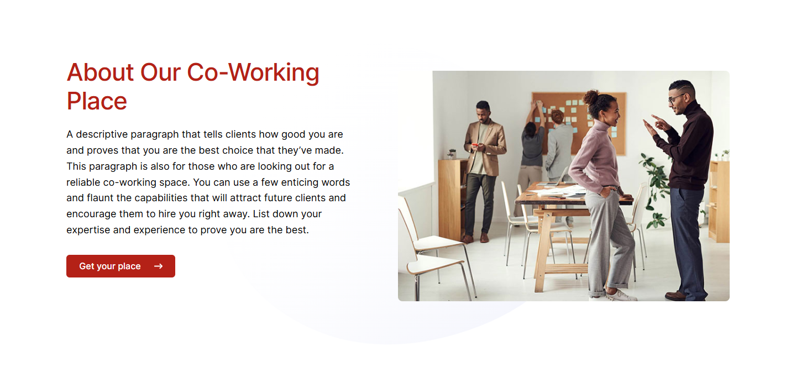
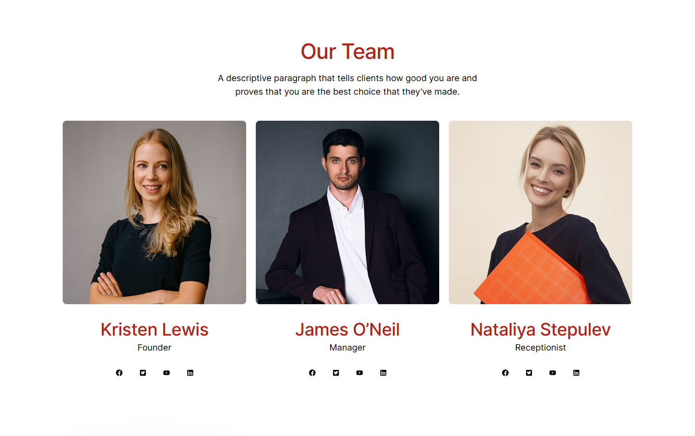
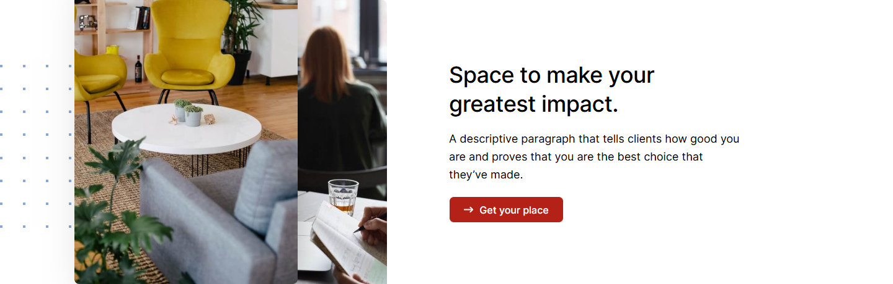
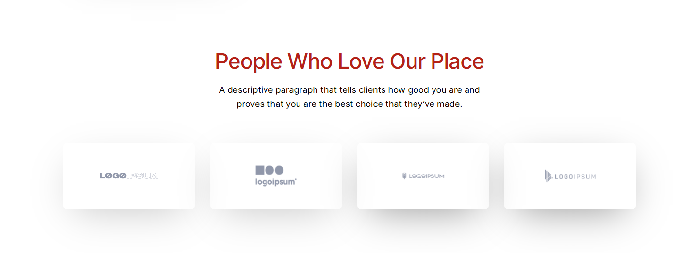

# About Us – XcelCareers Staffing Solutions

*XcelCareers (client's current site)* · URL: https://xcelcareers.com/about-us/ · captured 2026-11-08 00:28:25 · HTTP 200

- **Meta description:** —
- **Page size (desktop 1440px):** 1440×3825 px · tablet (820px): 3663 px · mobile (390px): 5498 px
- **Screenshots:** [desktop](screenshots/desktop-full.png) · [tablet](screenshots/tablet-full.png) · [mobile](screenshots/mobile-full.png) · [desktop top](screenshots/desktop-viewport-top.png) · [desktop scrolled](screenshots/desktop-viewport-scrolled.png)
- **Files:** [raw.html](raw.html) (server HTML) · [rendered.html](rendered.html) (DOM after JS) · [content.txt](content.txt) (all visible text) · layout-*.json (full element tree with computed styles) · page.json (everything)

## 1. Section map (top → bottom, desktop 1440px)

| # | Role | Y from top | Height | Heading / first text | Mobile height | Screenshot |
|---|---|---|---|---|---|---|
| 0 | header | 0 | 153 | Home Transition Into Tech Jobs Contact 410.865.9558 | 153 | [img](screenshots/desktop-sec00-header.png) |
| 1 | section | 153 | 549 | About Us | 400 | [img](screenshots/desktop-sec01-section.png) |
| 2 | section | 702 | 673 | About Our Co-Working Place | 794 | [img](screenshots/desktop-sec02-section.png) |
| 3 | section | 1375 | 903 | Our Team | 1801 | [img](screenshots/desktop-sec03-section.png) |
| 4 | section | 2358 | 460 | Space to make your greatest impact. | 783 | [img](screenshots/desktop-sec04-section.png) |
| 5 | section | 2898 | 523 | People Who Love Our Place | 896 | [img](screenshots/desktop-sec05-section.png) |
| 6 | footer | 3421 | 404 | XcelCareers Staffing Solutions | 591 | [img](screenshots/desktop-sec06-footer.png) |

## 2. Section-by-section layout (desktop)

Legend: each line is an element in DOM order. `@x,y w×h` = position/size in px on the 1440px-wide page. Text lines show *font size/weight, line-height, colour*. Boxes show layout (flex/grid), background, padding, radius, shadow, etc. Pass-through wrappers are collapsed.

### 2.0 HEADER — Home Transition Into Tech Jobs Contact 410.865.9558

Element: `<header class="wp-block-template-part">` at y=0, 1440×153px · 

- div.wp-block-columns [flex row · gap:18px] `@0,0 1440×153`
  - div.wp-block-group [bg:#000000 · pad:0px 18px 0px 18px] `@0,0 1440×153`
    - div.wp-block-group [flex row · justify:space-between · align:center · gap:18px · margin:0px 120px 0px 120px · max-w:1164px] `@138,0 1164×153`
      - a (link→/) [inline-block] `@138,0 153×153`
        - **IMG** `MediumSquareLogo.png` alt="" natural 400×400 · inline · max-w:100% · overflow:clip `@138,0 153×153`
      - div.wp-block-group [flex row · justify:flex-end · align:center · gap:54px] `@688,56 614×41`
        - nav.wp-block-navigation [flex row wrap · justify:flex-end · align:center · gap:36px] `@688,64 407×26`
          - div.wp-block-navigation__responsive-container-content [flex row wrap · justify:flex-end · align:center · gap:36px] `@688,64 407×26`
            - ul.wp-block-navigation__container [flex row wrap · justify:flex-end · align:center · gap:36px] `@688,64 407×26`
              - li.wp-block-navigation-item [flex row · align:center] `@688,64 46×26`
                - **A→/** "Home" — Inter 16px/400 lh 25.6px · #FFFFFF · letterSpacing:0.25px `@688,64 46×26`
              - li.wp-block-navigation-item [flex row · align:center] `@770,64 154×26`
                - **A→/transition-into-tech/** "Transition Into Tech" — Inter 16px/400 lh 25.6px · #FFFFFF · letterSpacing:0.25px `@770,64 154×26`
              - li.wp-block-navigation-item [flex row · align:center] `@960,64 38×26`
                - **A→/jobs-2/** "Jobs" — Inter 16px/400 lh 25.6px · #FFFFFF · letterSpacing:0.25px `@960,64 38×26`
              - li.wp-block-navigation-item [flex row · align:center] `@1033,64 62×26`
                - **A→/contact/** "Contact" — Inter 16px/400 lh 25.6px · #FFFFFF · letterSpacing:0.25px `@1033,64 62×26`
        - div.wp-block-buttons [flex row wrap · align:center · gap:18px] `@1149,56 153×41`
          - **A→** "410.865.9558" — Inter 16px/500 lh 16px · #FFFFFF · textAlign:center ‖ inline-block · bg:#B42117 · pad:12.672px 23.328px 12.672px 23.328px · radius:6px `@1149,56 153×41`

### 2.1 SECTION — About Us

Element: `
` at y=153, 1440×549px · 

- div.wp-block-uagb-container [flex row · gap:20px · bg-image:about-bg.jpg · bg-size:cover · bg-pos:50% 50% · pad:200px 0px 160px 0px · radius:0px 0px 120px · shadow:#000000 @44% 0px 0px 0px 0px · transition:box-shadow 0.2s ease] `@0,153 1440×549`
  - div.uagb-container-inner-blocks-wrap [flex column · justify:center · align:center · gap:20px · margin:0px 120px 0px 120px · max-w:min(100%, 1200px)] `@120,353 1200×189`
    - div.wp-block-uagb-advanced-heading [pad:0px 720px 0px 0px] `@120,353 1200×189`
      - **H1** "About Us" — Inter 56px/500 lh 67.2px · #000000 · letterSpacing:-2px ‖ margin:0px 0px 20px 0px `@120,353 480×67`
      - **P** "A descriptive paragraph that tells clients how good you are and proves that you are the best choice that they’ve made." — Inter 18px/400 lh 28.8px · #DEE1F8 ‖ margin:0px 0px 15px 0px `@120,440 480×86`

### 2.2 SECTION — About Our Co-Working Place

Element: `
` at y=702, 1440×673px · 

- div.wp-block-uagb-container [grid cols[1440px] · bg-image:blob-grad.svg · bg-pos:50% 50% · pad:104px 0px 104px 0px · shadow:#000000 @44% 0px 0px 0px 0px · transition:box-shadow 0.2s ease] `@0,702 1440×673`
  - div.uagb-container-inner-blocks-wrap [grid cols[600px 600px] · gap:20px 0px · max-w:min(100%, 1200px)] `@120,806 1200×465`
    - div.wp-block-uagb-info-box [pad:0px 80px 0px 0px · z:1] `@120,806 600×465`
      - div.uagb-ifb-content [inline-block · z:1] `@120,806 520×399`
        - div.uagb-ifb-title-wrap [z:1] `@120,806 520×106`
          - **H2** "About Our Co-Working Place" — Inter 44px/500 lh 52.8px · #B42117 · letterSpacing:-1px ‖ margin:0px 0px 20px 0px `@120,806 520×106`
        - **P** "A descriptive paragraph that tells clients how good you are and proves that you are the best choice that they’ve made. This paragraph is also for those who a…" — Inter 18px/400 lh 28.8px · #000000 ‖ margin:18px 0px 30px 0px `@120,931 520×202`
        - **A→/about-us/** "Get your place" +icon[svg] — Inter 16px/500 lh 16px · #FFFFFF · textAlign:center ‖ flex row · bg:#B42117 · pad:12.672px 23.328px 12.672px 23.328px · radius:6px `@120,1163 197×41`
    - div.wp-block-uagb-image [flex row · justify:center · margin:24px 0px 24px 0px] `@720,830 600×417`
      - figure.wp-block-uagb-image__figure [flex column · max-w:100%] `@720,830 600×417`
        - **IMG** `about-1.jpg` alt="" natural 640×445 · flex row · max-w:100% · radius:8px · shadow:#000000 @44% 0px 0px 0px 0px · overflow:clip · transition:box-shadow 0.2s ease `@720,830 600×417`

### 2.3 SECTION — Our Team

Element: `
` at y=1375, 1440×903px · 

- div.wp-block-uagb-container [flex row · gap:20px · pad:80px 0px 104px 0px · shadow:#000000 @44% 0px 0px 0px 0px · transition:box-shadow 0.2s ease] `@0,1375 1440×903`
  - div.uagb-container-inner-blocks-wrap [flex column · justify:center · align:center · gap:20px · margin:0px 120px 0px 120px · max-w:min(100%, 1200px)] `@120,1455 1200×719`
    - div.wp-block-uagb-advanced-heading [pad:0px 312px 0px 312px · align-text:center] `@120,1455 1200×140`
      - **H2** "Our Team" — Inter 44px/500 lh 52.8px · #B42117 · letterSpacing:-1px · textAlign:center ‖ margin:0px 0px 15px 0px `@432,1455 576×53`
      - **P** "A descriptive paragraph that tells clients how good you are and proves that you are the best choice that they’ve made." — Inter 18px/400 lh 28.8px · #000000 · textAlign:center ‖ margin:0px 0px 15px 0px `@432,1523 576×58`
    - div.wp-block-uagb-container [flex row · justify:center · align:center · gap:20px 0px · max-w:100% · shadow:#000000 @44% 0px 0px 0px 0px · transition:box-shadow 0.2s ease] `@120,1615 1200×558`
      - div.wp-block-uagb-container [flex column · justify:center · align:center · gap:20px · pad:10px 10px 10px 10px · max-w:100% · shadow:#000000 @44% 0px 0px 0px 0px · transition:box-shadow 0.2s ease] `@120,1615 400×558`
        - div.wp-block-uagb-info-box [z:1 · align-text:center] `@130,1625 380×484`
          - div.uagb-ifb-content [inline-block · z:1 · align-text:center] `@130,1625 380×484`
            - **IMG** `founder.jpg` alt="" natural 500×500 · inline-block · max-w:100% · radius:8px · overflow:clip · align-text:center `@130,1625 380×380`
            - div.uagb-ifb-title-wrap [z:1 · align-text:center] `@130,2034 380×47`
              - **H3** "Kristen Lewis" — Inter 36px/500 lh 46.8px · #B42117 · letterSpacing:-0.5px · textAlign:center ‖ margin:20px 0px 0px 0px `@130,2034 380×47`
            - **P** "Founder" — Inter 18px/400 lh 28.8px · #000000 · textAlign:center `@130,2081 380×29`
        - div.wp-block-uagb-social-share [flex row · justify:center · align:center] `@130,2130 380×34`
          - div.wp-block-uagb-social-share-child [flex row · margin:0px 7.5px 0px 0px · radius:100px · align-text:center · transition:all 0.2s ease] `@230,2130 34×34`
            - **SPAN** "" +icon[svg] — Inter 18px/400 lh 0px · #000000 · textAlign:center ‖ table · pad:10px 10px 10px 10px `@230,2130 34×34`
          - div.wp-block-uagb-social-share-child [flex row · margin:0px 7.5px 0px 7.5px · radius:100px · align-text:center · transition:all 0.2s ease] `@279,2130 34×34`
            - **SPAN** "" +icon[svg] — Inter 18px/400 lh 0px · #000000 · textAlign:center ‖ table · pad:10px 10px 10px 10px `@279,2130 34×34`
          - div.wp-block-uagb-social-share-child [flex row · margin:0px 7.5px 0px 7.5px · radius:100px · align-text:center · transition:all 0.2s ease] `@328,2130 34×34`
            - **SPAN** "" +icon[svg] — Inter 18px/400 lh 0px · #000000 · textAlign:center ‖ table · pad:10px 10px 10px 10px `@328,2130 34×34`
          - div.wp-block-uagb-social-share-child [flex row · margin:0px 0px 0px 7.5px · radius:100px · align-text:center · transition:all 0.2s ease] `@377,2130 34×34`
            - **SPAN** "" +icon[svg] — Inter 18px/400 lh 0px · #000000 · textAlign:center ‖ table · pad:10px 10px 10px 10px `@377,2130 34×34`
      - div.wp-block-uagb-container [flex column · justify:center · align:center · gap:20px · pad:10px 10px 10px 10px · max-w:100% · shadow:#000000 @44% 0px 0px 0px 0px · transition:box-shadow 0.2s ease] `@520,1615 400×558`
        - div.wp-block-uagb-info-box [z:1 · align-text:center] `@530,1625 380×484`
          - div.uagb-ifb-content [inline-block · z:1 · align-text:center] `@530,1625 380×484`
            - **IMG** `manager.jpg` alt="" natural 500×500 · inline-block · max-w:100% · radius:8px · overflow:clip · align-text:center `@530,1625 380×380`
            - div.uagb-ifb-title-wrap [z:1 · align-text:center] `@530,2034 380×47`
              - **H3** "James O’Neil" — Inter 36px/500 lh 46.8px · #B42117 · letterSpacing:-0.5px · textAlign:center ‖ margin:20px 0px 0px 0px `@530,2034 380×47`
            - **P** "Manager" — Inter 18px/400 lh 28.8px · #000000 · textAlign:center `@530,2081 380×29`
        - div.wp-block-uagb-social-share [flex row · justify:center · align:center] `@530,2130 380×34`
          - div.wp-block-uagb-social-share-child [flex row · margin:0px 7.5px 0px 0px · radius:100px · align-text:center · transition:all 0.2s ease] `@630,2130 34×34`
            - **SPAN** "" +icon[svg] — Inter 18px/400 lh 0px · #000000 · textAlign:center ‖ table · pad:10px 10px 10px 10px `@630,2130 34×34`
          - div.wp-block-uagb-social-share-child [flex row · margin:0px 7.5px 0px 7.5px · radius:100px · align-text:center · transition:all 0.2s ease] `@679,2130 34×34`
            - **SPAN** "" +icon[svg] — Inter 18px/400 lh 0px · #000000 · textAlign:center ‖ table · pad:10px 10px 10px 10px `@679,2130 34×34`
          - div.wp-block-uagb-social-share-child [flex row · margin:0px 7.5px 0px 7.5px · radius:100px · align-text:center · transition:all 0.2s ease] `@728,2130 34×34`
            - **SPAN** "" +icon[svg] — Inter 18px/400 lh 0px · #000000 · textAlign:center ‖ table · pad:10px 10px 10px 10px `@728,2130 34×34`
          - div.wp-block-uagb-social-share-child [flex row · margin:0px 0px 0px 7.5px · radius:100px · align-text:center · transition:all 0.2s ease] `@777,2130 34×34`
            - **SPAN** "" +icon[svg] — Inter 18px/400 lh 0px · #000000 · textAlign:center ‖ table · pad:10px 10px 10px 10px `@777,2130 34×34`
      - div.wp-block-uagb-container [flex column · justify:center · align:center · gap:20px · pad:10px 10px 10px 10px · max-w:100% · shadow:#000000 @44% 0px 0px 0px 0px · transition:box-shadow 0.2s ease] `@920,1615 400×558`
        - div.wp-block-uagb-info-box [z:1 · align-text:center] `@930,1625 380×484`
          - div.uagb-ifb-content [inline-block · z:1 · align-text:center] `@930,1625 380×484`
            - **IMG** `receptionist.jpg` alt="" natural 500×500 · inline-block · max-w:100% · radius:8px · overflow:clip · align-text:center `@930,1625 380×380`
            - div.uagb-ifb-title-wrap [z:1 · align-text:center] `@930,2034 380×47`
              - **H3** "Nataliya Stepulev" — Inter 36px/500 lh 46.8px · #B42117 · letterSpacing:-0.5px · textAlign:center ‖ margin:20px 0px 0px 0px `@930,2034 380×47`
            - **P** "Receptionist" — Inter 18px/400 lh 28.8px · #000000 · textAlign:center `@930,2081 380×29`
        - div.wp-block-uagb-social-share [flex row · justify:center · align:center] `@930,2130 380×34`
          - div.wp-block-uagb-social-share-child [flex row · margin:0px 7.5px 0px 0px · radius:100px · align-text:center · transition:all 0.2s ease] `@1030,2130 34×34`
            - **SPAN** "" +icon[svg] — Inter 18px/400 lh 0px · #000000 · textAlign:center ‖ table · pad:10px 10px 10px 10px `@1030,2130 34×34`
          - div.wp-block-uagb-social-share-child [flex row · margin:0px 7.5px 0px 7.5px · radius:100px · align-text:center · transition:all 0.2s ease] `@1079,2130 34×34`
            - **SPAN** "" +icon[svg] — Inter 18px/400 lh 0px · #000000 · textAlign:center ‖ table · pad:10px 10px 10px 10px `@1079,2130 34×34`
          - div.wp-block-uagb-social-share-child [flex row · margin:0px 7.5px 0px 7.5px · radius:100px · align-text:center · transition:all 0.2s ease] `@1128,2130 34×34`
            - **SPAN** "" +icon[svg] — Inter 18px/400 lh 0px · #000000 · textAlign:center ‖ table · pad:10px 10px 10px 10px `@1128,2130 34×34`
          - div.wp-block-uagb-social-share-child [flex row · margin:0px 0px 0px 7.5px · radius:100px · align-text:center · transition:all 0.2s ease] `@1177,2130 34×34`
            - **SPAN** "" +icon[svg] — Inter 18px/400 lh 0px · #000000 · textAlign:center ‖ table · pad:10px 10px 10px 10px `@1177,2130 34×34`

### 2.4 SECTION — Space to make your greatest impact.

Element: `
` at y=2358, 1440×460px · 

- div.wp-block-uagb-container [flex row · gap:20px · margin:80px 0px 80px 0px · shadow:#000000 @44% 0px 0px 0px 0px · transition:box-shadow 0.2s ease] · pseudo:::before{{"content": "\"\"", "w": "1440px", "h": "460px", "bgImage": "url(\"https://xcelcareers.com/wp-content/uploads/2020/06/dots.png\")", "position": "absolute"}} `@0,2358 1440×460`
  - div.uagb-container-inner-blocks-wrap [flex row · justify:center · align:center · gap:20px · margin:0px 120px 0px 120px · max-w:min(100%, 1200px)] `@120,2358 1200×460`
    - div.wp-block-uagb-container [flex column · justify:center · align:center · gap:20px · bg-image:writing-notepad.jpg · bg-size:cover · bg-pos:50% 49% · margin:0px 0px -80px 120px · max-w:32% · radius:8px · shadow:#000000 @44% 0px 0px 0px 0px · z:1 · transition:box-shadow 0.2s ease] `@240,2358 384×540`
      - div.wp-block-uagb-image [flex row · margin:-80px 120px 80px -120px] `@120,2278 384×540`
        - figure.wp-block-uagb-image__figure [flex column · align:flex-start · max-w:100%] `@120,2278 360×540`
          - **IMG** `furniture.jpg` alt="" natural 640×960 · fit:cover · flex row · max-w:100% · radius:8px · shadow:#000000 @50% 16px 40px 80px -32px · overflow:clip · transition:box-shadow 0.2s ease `@120,2278 360×540`
    - div.wp-block-uagb-container [flex column · justify:center · align:center · gap:132px 20px · pad:0px 0px 0px 80px · margin:0px 120px 0px 0px · max-w:68% · shadow:#000000 @44% 0px 0px 0px 0px · transition:box-shadow 0.2s ease] `@644,2456 556×263`
      - div.wp-block-uagb-info-box [z:1] `@724,2456 476×263`
        - div.uagb-ifb-content [z:1] `@724,2456 476×263`
          - div.uagb-ifb-title-wrap [z:1] `@724,2456 476×94`
            - **H3** "Space to make your greatest impact." — Inter 36px/500 lh 46.8px · #000000 · letterSpacing:-0.5px ‖ margin:0px 0px 20px 0px `@724,2456 476×94`
          - **P** "A descriptive paragraph that tells clients how good you are and proves that you are the best choice that they’ve made." — Inter 18px/400 lh 28.8px · #000000 ‖ margin:18px 0px 20px 0px `@724,2569 476×86`
          - **A→/about-us/** "Get your place" +icon[svg] — Inter 16px/500 lh 16px · #FFFFFF · textAlign:center ‖ flex row · bg:#B42117 · pad:12.672px 23.328px 12.672px 23.328px · radius:8px · border:1px 1px 1px 1px solid #FFFFFF `@724,2676 185×43`

### 2.5 SECTION — People Who Love Our Place

Element: `
` at y=2898, 1440×523px · 

- div.wp-block-uagb-container [flex row · gap:40px 20px · pad:100px 0px 80px 0px · shadow:#000000 @44% 0px 0px 0px 0px · transition:box-shadow 0.2s ease] `@0,2898 1440×523`
  - div.uagb-container-inner-blocks-wrap [flex column · justify:center · align:center · gap:40px 20px · margin:0px 120px 0px 120px · max-w:min(100%, 1200px)] `@120,2998 1200×343`
    - div.wp-block-uagb-advanced-heading [pad:0px 312px 0px 312px · align-text:center] `@120,2998 1200×145`
      - **H2** "People Who Love Our Place" — Inter 44px/500 lh 52.8px · #B42117 · letterSpacing:-1px · textAlign:center ‖ margin:0px 0px 20px 0px `@432,2998 576×53`
      - **P** "A descriptive paragraph that tells clients how good you are and proves that you are the best choice that they’ve made." — Inter 18px/400 lh 28.8px · #000000 · textAlign:center ‖ margin:0px 0px 15px 0px `@432,3070 576×58`
    - div.wp-block-uagb-container [flex row · justify:center · pad:10px 10px 10px 10px · max-w:100% · shadow:#000000 @44% 0px 0px 0px 0px · transition:box-shadow 0.2s ease] `@120,3183 1200×158`
      - div.wp-block-uagb-container [flex column · justify:center · align:center · pad:24px 32px 24px 32px · margin:0px 16px 0px 0px · max-w:25% · radius:8px · shadow:#000000 @24% 0px 24px 80px -24px · transition:box-shadow 0.2s ease] `@130,3193 271×138`
        - div.wp-block-uagb-image [flex row · justify:center] `@162,3222 207×80`
          - figure.wp-block-uagb-image__figure [flex column · max-w:100%] `@194,3222 143×80`
            - **IMG** `logo-4.png` alt="" natural 143×80 · flex row · max-w:100% · shadow:#000000 @44% 0px 0px 0px 0px · overflow:clip · transition:box-shadow 0.2s ease `@194,3222 143×80`
      - div.wp-block-uagb-container [flex column · justify:center · align:center · pad:24px 32px 24px 32px · margin:0px 16px 0px 16px · max-w:25% · radius:8px · shadow:#000000 @24% 0px 24px 80px -24px · transition:box-shadow 0.2s ease] `@433,3193 271×138`
        - div.wp-block-uagb-image [flex row · justify:center · align-text:center] `@465,3217 207×90`
          - figure.wp-block-uagb-image__figure [flex column · align:center · max-w:100% · align-text:center] `@494,3217 150×90`
            - **IMG** `logo-2.png` alt="" natural 143×80 · flex row · max-w:100% · shadow:#000000 @44% 0px 0px 0px 0px · overflow:clip · align-text:center · transition:box-shadow 0.2s ease `@494,3217 150×90`
      - div.wp-block-uagb-container [flex column · justify:center · align:center · pad:24px 32px 24px 32px · margin:0px 16px 0px 16px · max-w:25% · radius:8px · shadow:#000000 @44% 0px 24px 80px -24px · transition:box-shadow 0.2s ease] `@736,3193 271×138`
        - div.wp-block-uagb-image [flex row · justify:center · align-text:center] `@768,3241 207×42`
          - figure.wp-block-uagb-image__figure [flex column · align:center · max-w:100% · align-text:center] `@812,3241 120×42`
            - **IMG** `logo-3.png` alt="" natural 143×80 · flex row · max-w:100% · shadow:#000000 @44% 0px 0px 0px 0px · overflow:clip · align-text:center · transition:box-shadow 0.2s ease `@812,3241 120×42`
      - div.wp-block-uagb-container [flex column · justify:center · align:center · pad:24px 32px 24px 32px · margin:0px 0px 0px 16px · max-w:25% · radius:8px · shadow:#000000 @44% 0px 24px 80px -24px · transition:box-shadow 0.2s ease] `@1039,3193 271×138`
        - div.wp-block-uagb-image [flex row · justify:center · align-text:center] `@1071,3217 207×90`
          - figure.wp-block-uagb-image__figure [flex column · align:center · max-w:100% · align-text:center] `@1100,3217 150×90`
            - **IMG** `logo-1-1.png` alt="" natural 143×80 · flex row · max-w:100% · shadow:#000000 @44% 0px 0px 0px 0px · overflow:clip · align-text:center · transition:box-shadow 0.2s ease `@1100,3217 150×90`

### 2.6 FOOTER — XcelCareers Staffing Solutions

Element: `<footer class="wp-block-template-part">` at y=3421, 1440×404px · 

- div.wp-block-group [bg:#B42117 · pad:72px 18px 36px 18px] `@0,3421 1440×404`
  - div.wp-block-columns [flex row · gap:36px · margin:0px 120px 0px 120px · max-w:1164px] `@138,3493 1164×220`
    - div.wp-block-column [pad:0px 0px 9px 0px] `@138,3493 564×220`
      - a (link→/) [inline-block] `@138,3493 110×47`
        - **IMG** `MediumSquareLogo-e1736976275746.png` alt="" natural 400×170 · inline · max-w:100% · overflow:clip · filter:url("#wp-duotone-secondary") `@138,3493 110×47`
      - **P** "XcelCareers empowers professionals to thrive in the booming tech industry. With over 20 years of expertise in recruitment and staffing, we provide the tools …" — Inter 16px/400 lh 25.6px · #FFFFFF ‖ pad:0px 36px 0px 0px · margin:18px 0px 0px 0px `@138,3558 564×128`
    - div.wp-block-column [pad:0px 0px 9px 0px] `@738,3493 564×220`
      - div.wp-block-columns [flex row · gap:32px] `@738,3493 564×136`
        - div.wp-block-column `@738,3493 266×136`
          - **H5** "Address:" — Inter 22px/600 lh 31.9px · #FFFFFF `@738,3493 266×32`
          - **P** "10155 Baltimore National Pike Ste 105 Ellicott City, MD 21042 United States" — Inter 18px/400 lh 28.8px · #FFFFFF ‖ margin:18px 0px 0px 0px `@738,3543 266×86`
        - div.wp-block-column `@1036,3493 266×136`
          - **H5** "Contact:" — Inter 22px/600 lh 31.9px · #FFFFFF `@1036,3493 266×32`
          - p.wp-block-paragraph [margin:18px 0px 0px 0px] `@1036,3543 266×29`
            - **A→mailto:HRservices@xcelcareers.com** "HRservices@xcelcareers.com" — Inter 18px/400 lh 28.8px · #FFFFFF ‖ inline `@1036,3546 252×21`
  - div.wp-block-group [flex row · justify:center · align:center · gap:9px · pad:0px 18px 0px 18px · margin:54px 120px 0px 120px · max-w:1164px] `@138,3767 1164×22`
    - **P** "© 2025 ·" — Inter 14px/400 lh 22.4px · #FFFFFF · textAlign:center `@517,3767 59×22`
    - **A→/** "XcelCareers Staffing Solutions" — Inter 14px/400 lh 22.4px · #FFFFFF ‖ inline `@585,3769 201×17`
    - **P** "· All rights reserved" — Inter 14px/400 lh 22.4px · #FFFFFF · textAlign:center `@795,3767 128×22`

## 3. Header, navigation & interaction behaviour

- **atTop** `header.wp-block-template-part` position:static top:0 height:153 bg:transparent shadow:none backdrop:none z:auto
- **afterScroll1400** `header.wp-block-template-part` position:static top:-1400 height:153 bg:transparent shadow:none backdrop:none z:auto

| Menu item | Link | Dropdown | Style | Hover change |
|---|---|---|---|---|
| Home | / | — | Inter 16px/400 #FFFFFF  ls 0.25px | none |
| Transition Into Tech | /transition-into-tech/ | — | Inter 16px/400 #FFFFFF  ls 0.25px | none |
| Jobs | /jobs-2/ | — | Inter 16px/400 #FFFFFF  ls 0.25px | none |
| Contact | /contact/ | — | Inter 16px/400 #FFFFFF  ls 0.25px | none |

- **Mobile menu:** toggle `.wp-block-navigation__responsive-container-open` → [screenshot](screenshots/mobile-menu-open.png) · items: Home, Transition Into Tech, Jobs, Contact

### Hover states (measured by hovering in Chrome)

| Element | Text | Normal | On hover |
|---|---|---|---|
| `a.wp-block-navigation-item__content` | Home | color #FFFFFF · bg transparent · radius 0px · pad 0px · border 0px #FFFFFF · transition all | no change |
| `a.wp-block-button__link` | 410.865.9558 | color #FFFFFF · bg #B42117 · radius 6px · pad 12.672px 23.328px · border 0px #B42217 · transition all | no change |
| `div.wp-block-uagb-info-box` | About Our Co-Working Place A descriptive | color #000000 · bg transparent · radius 0px · pad 0px 80px 0px 0px · border 0px #000000 · transition all | no change |
| `div.uagb-ifb-content` | About Our Co-Working Place A descriptive | color #000000 · bg transparent · radius 0px · pad 0px · border 0px #000000 · transition all | no change |
| `a.uagb-infobox-cta-link` | Get your place | color #FFFFFF · bg #B42117 · radius 6px · pad 12.672px 23.328px · border 0px #B42217 · transition all | backgroundColor: #B42117 → #FFFFFF |
| `div.wp-block-uagb-info-box` | Kristen Lewis Founder | color #000000 · bg transparent · radius 0px · pad 0px · border 0px #000000 · transition all | no change |
| `div.wp-block-uagb-info-box` | James O’Neil Manager | color #000000 · bg transparent · radius 0px · pad 0px · border 0px #000000 · transition all | no change |
| `div.wp-block-uagb-info-box` | Nataliya Stepulev Receptionist | color #000000 · bg transparent · radius 0px · pad 0px · border 0px #000000 · transition all | no change |
| `div.wp-block-uagb-info-box` | Space to make your greatest impact. A de | color #000000 · bg transparent · radius 0px · pad 0px · border 0px #000000 · transition all | no change |
| `a.` |  | color #000000 · bg transparent · radius 0px · pad 0px · border 0px #000000 · transition all | color: #000000 → #B42117; borderTopColor: #000000 → #B42117; childColor: #000000 → #B42117 |
| `a.` | HRservices@xcelcareers.com | color #FFFFFF · bg transparent · radius 0px · pad 0px · border 0px #FFFFFF · transition all | no change |
| `a.` | XcelCareers Staffing Solutions | color #FFFFFF · bg transparent · radius 0px · pad 0px · border 0px #FFFFFF · transition all | no change |

## 4. Typography & colour used on this page (weighted by amount of text / area)

| Font · weight · size / line-height | chars |
|---|---|
| Inter | 400 | 18px / 28.8px | 1007 |
| Inter | 400 | 16px / 25.6px | 306 |
| Inter | 500 | 36px / 46.8px | 77 |
| Inter | 500 | 44px / 52.8px | 59 |
| Inter | 400 | 14px / 22.4px | 59 |
| Inter | 500 | 16px / 16px | 40 |
| Inter | 600 | 22px / 31.9px | 16 |
| Inter | 500 | 56px / 67.2px | 8 |

- **Text colours:** #000000 (831), #FFFFFF (522), #DEE1F8 (118), #B42117 (101)
- **Background colours (by area):** #B42117 (604), #000000 (220)
- **Border radii:** 100px (12), 8px (11), 6px (2), 0px 0px 120px (1)
- **Shadows:** #000000 @44% 0px 0px 0px 0px (17) | #000000 @24% 0px 24px 80px -24px (2) | #000000 @44% 0px 24px 80px -24px (2) | #000000 @50% 16px 40px 80px -32px (1)
- **Mobile text styles:** Inter | 400 | 16px / 25.6px (1007); Inter | 400 | 14px / 22.4px (271); Inter | 500 | 28px / 36.4px (77); Inter | 500 | 32px / 38.4px (59); Inter | 400 | 12px / 19.2px (59); Inter | 500 | 14px / 14px (28); Inter | 600 | 20px / 29px (16); Inter | 500 | 40px / 48px (8)

## 6. Images on the page

- `MediumSquareLogo.png` natural 400×400 → shown 153×153 · alt="" · https://xcelcareers.com/wp-content/uploads/2018/12/MediumSquareLogo.png
- `about-1.jpg` natural 640×445 → shown 600×417 · alt="" · https://xcelcareers.com/wp-content/uploads/2020/07/about-1.jpg
- `founder.jpg` natural 500×500 → shown 380×380 · alt="" · https://xcelcareers.com/wp-content/uploads/2020/08/founder.jpg
- `manager.jpg` natural 500×500 → shown 380×380 · alt="" · https://xcelcareers.com/wp-content/uploads/2020/08/manager.jpg
- `receptionist.jpg` natural 500×500 → shown 380×380 · alt="" · https://xcelcareers.com/wp-content/uploads/2020/08/receptionist.jpg
- `furniture.jpg` natural 640×960 → shown 360×540 · alt="" · https://xcelcareers.com/wp-content/uploads/2020/07/furniture.jpg
- `logo-4.png` natural 143×80 → shown 143×80 · alt="" · https://xcelcareers.com/wp-content/uploads/2024/06/logo-4.png
- `logo-2.png` natural 143×80 → shown 150×90 · alt="" · https://xcelcareers.com/wp-content/uploads/2024/06/logo-2.png
- `logo-3.png` natural 143×80 → shown 120×42 · alt="" · https://xcelcareers.com/wp-content/uploads/2024/06/logo-3.png
- `logo-1-1.png` natural 143×80 → shown 150×90 · alt="" · https://xcelcareers.com/wp-content/uploads/2024/06/logo-1-1.png
- `MediumSquareLogo-e1736976275746.png` natural 400×170 → shown 110×47 · alt="" · https://xcelcareers.com/wp-content/uploads/2018/12/MediumSquareLogo-e1736976275746.png
- background on `div.wp-block-uagb-container`: https://xcelcareers.com/wp-content/uploads/2020/08/about-bg.jpg
- background on `div.wp-block-uagb-container`: https://xcelcareers.com/wp-content/uploads/2020/06/blob-grad.svg
- background on `div.wp-block-uagb-container`: https://xcelcareers.com/wp-content/uploads/2020/07/writing-notepad.jpg

## 7. Links on the page

- [header] "(icon/image)" → /
- [header] "Home" → /
- [header] "Transition Into Tech" → /transition-into-tech/
- [header] "Jobs" → /jobs-2/
- [header] "Contact" → /contact/
- [body] "Get your place" → /about-us/ (target _self)
- [footer] "Facebook" → /about-us/ (target _blank)
- [footer] "Twitter" → /about-us/ (target _blank)
- [footer] "YouTube" → /about-us/ (target _blank)
- [footer] "LinkedIn" → /about-us/ (target _blank)
- [footer] "HRservices@xcelcareers.com" → mailto:HRservices@xcelcareers.com
- [footer] "XcelCareers Staffing Solutions" → / (target _self)

## 8. Mobile layout (390px) — condensed outline

### 8.0 header —  (y 0, h 153)
- div.wp-block-columns [flex row wrap · gap:16px] `@0,0 390×153`
  - div.wp-block-group [bg:#000000 · pad:0px 16px 0px 16px] `@0,0 390×153`
    - div.wp-block-group [flex row · justify:space-between · align:center · gap:16px · max-w:1164px] `@16,0 358×153`
      - a (link→/) [inline-block] `@16,0 153×153`
        - **IMG** `MediumSquareLogo.png` alt="" natural 400×400 · inline · max-w:100% · overflow:clip `@16,0 153×153`
      - div.wp-block-group [flex row · justify:flex-end · align:center · gap:48px] `@350,65 24×24`
        - nav.wp-block-navigation [flex row wrap · justify:flex-end · align:center · gap:32px] `@350,65 24×24`
          - **BUTTON** "" +icon[svg] — Inter 14px/400 lh normal · #FFFFFF · textAlign:center ‖ flex row `@350,65 24×24`

### 8.1 section — About Us (y 153, h 400)
- div.wp-block-uagb-container [flex row · gap:20px · bg-image:about-bg.jpg · bg-size:cover · bg-pos:50% 50% · pad:160px 24px 80px 24px · radius:0px 0px 40px · shadow:#000000 @44% 0px 0px 0px 0px · transition:box-shadow 0.2s ease] `@0,153 390×400`
  - div.uagb-container-inner-blocks-wrap [flex column wrap · justify:center · align:center · gap:20px · max-w:min(100%, 426px)] `@24,313 342×160`
    - div.wp-block-uagb-advanced-heading `@24,313 342×160`
      - **H1** "About Us" — Inter 40px/500 lh 48px · #000000 · letterSpacing:-2px ‖ margin:0px 0px 20px 0px `@24,313 342×48`
      - **P** "A descriptive paragraph that tells clients how good you are and proves that you are the best choice that they’ve made." — Inter 16px/400 lh 25.6px · #DEE1F8 ‖ margin:0px 0px 15px 0px `@24,381 342×77`

### 8.2 section — About Our Co-Working Place (y 553, h 794)
- div.wp-block-uagb-container [grid cols[342px] · gap:40px normal · bg-image:blob-grad.svg · bg-size:cover · bg-pos:50% 50% · pad:64px 24px 32px 24px · shadow:#000000 @44% 0px 0px 0px 0px · transition:box-shadow 0.2s ease] `@0,553 390×794`
  - div.uagb-container-inner-blocks-wrap [grid cols[342px] · gap:40px 0px · max-w:min(100%, 426px)] `@24,617 342×698`
    - div.wp-block-uagb-info-box [z:1] `@24,617 342×420`
      - div.uagb-ifb-content [inline-block · z:1] `@24,617 342×420`
        - div.uagb-ifb-title-wrap [z:1] `@24,617 342×77`
          - **H2** "About Our Co-Working Place" — Inter 32px/500 lh 38.4px · #B42117 · letterSpacing:-1px ‖ margin:0px 0px 20px 0px `@24,617 342×77`
        - **P** "A descriptive paragraph that tells clients how good you are and proves that you are the best choice that they’ve made. This paragraph is also for those who a…" — Inter 16px/400 lh 25.6px · #000000 ‖ margin:16px 0px 30px 0px `@24,714 342×256`
        - **A→/about-us/** "Get your place" +icon[svg] — Inter 14px/500 lh 14px · #FFFFFF · textAlign:center ‖ flex row · bg:#B42117 · pad:11.338px 20.662px 11.338px 20.662px · radius:5.25px `@24,1000 178×38`
    - div.wp-block-uagb-image [flex row · justify:center] `@24,1077 342×238`
      - figure.wp-block-uagb-image__figure [flex column · max-w:100%] `@24,1077 342×238`
        - **IMG** `about-1.jpg` alt="" natural 280×195 · fit:cover · flex row · max-w:100% · radius:8px · shadow:#000000 @44% 0px 0px 0px 0px · overflow:clip · transition:box-shadow 0.2s ease `@24,1077 342×238`

### 8.3 section — Our Team (y 1347, h 1801)
- div.wp-block-uagb-container [flex row · gap:20px · pad:32px 24px 64px 24px · shadow:#000000 @44% 0px 0px 0px 0px · transition:box-shadow 0.2s ease] `@0,1347 390×1801`
  - div.uagb-container-inner-blocks-wrap [flex column wrap · justify:center · align:center · gap:20px · max-w:min(100%, 426px)] `@24,1379 342×1705`
    - div.wp-block-uagb-advanced-heading [align-text:center] `@24,1379 342×145`
      - **H2** "Our Team" — Inter 32px/500 lh 38.4px · #B42117 · letterSpacing:-1px · textAlign:center ‖ margin:0px 0px 15px 0px `@24,1379 342×38`
      - **P** "A descriptive paragraph that tells clients how good you are and proves that you are the best choice that they’ve made." — Inter 16px/400 lh 25.6px · #000000 · textAlign:center ‖ margin:0px 0px 15px 0px `@24,1432 342×77`
    - div.wp-block-uagb-container [flex row wrap · justify:center · align:flex-start · gap:40px 0px · max-w:100% · shadow:#000000 @44% 0px 0px 0px 0px · transition:box-shadow 0.2s ease] `@24,1544 342×1540`
      - div.wp-block-uagb-container [flex column wrap · justify:center · align:center · gap:20px · max-w:100% · shadow:#000000 @44% 0px 0px 0px 0px · transition:box-shadow 0.2s ease] `@24,1544 342×487`
        - div.wp-block-uagb-info-box [z:1 · align-text:center] `@24,1544 342×432`
          - div.uagb-ifb-content [inline-block · z:1 · align-text:center] `@24,1544 342×432`
            - **IMG** `founder.jpg` alt="" natural 500×500 · inline-block · max-w:100% · radius:8px · overflow:clip · align-text:center `@24,1544 342×342`
            - div.uagb-ifb-title-wrap [z:1 · align-text:center] `@24,1914 342×36`
              - **H3** "Kristen Lewis" — Inter 28px/500 lh 36.4px · #B42117 · letterSpacing:-0.5px · textAlign:center ‖ margin:20px 0px 0px 0px `@24,1914 342×36`
            - **P** "Founder" — Inter 16px/400 lh 25.6px · #000000 · textAlign:center `@24,1950 342×26`
        - div.wp-block-uagb-social-share [flex row · justify:center · align:center] `@24,1996 342×35`
          - div.wp-block-uagb-social-share-child [flex row · margin:0px 7.5px 0px 0px · radius:100px · align-text:center · transition:all 0.2s ease] `@103,1996 35×35`
            - **SPAN** "" +icon[svg] — Inter 16px/400 lh 0px · #000000 · textAlign:center ‖ table · pad:10px 10px 10px 10px `@103,1996 35×35`
          - div.wp-block-uagb-social-share-child [flex row · margin:0px 7.5px 0px 7.5px · radius:100px · align-text:center · transition:all 0.2s ease] `@153,1996 35×35`
            - **SPAN** "" +icon[svg] — Inter 16px/400 lh 0px · #000000 · textAlign:center ‖ table · pad:10px 10px 10px 10px `@153,1996 35×35`
          - div.wp-block-uagb-social-share-child [flex row · margin:0px 7.5px 0px 7.5px · radius:100px · align-text:center · transition:all 0.2s ease] `@203,1996 35×35`
            - **SPAN** "" +icon[svg] — Inter 16px/400 lh 0px · #000000 · textAlign:center ‖ table · pad:10px 10px 10px 10px `@203,1996 35×35`
          - div.wp-block-uagb-social-share-child [flex row · margin:0px 0px 0px 7.5px · radius:100px · align-text:center · transition:all 0.2s ease] `@253,1996 35×35`
            - **SPAN** "" +icon[svg] — Inter 16px/400 lh 0px · #000000 · textAlign:center ‖ table · pad:10px 10px 10px 10px `@253,1996 35×35`
      - div.wp-block-uagb-container [flex column wrap · justify:center · align:center · gap:20px · max-w:100% · shadow:#000000 @44% 0px 0px 0px 0px · transition:box-shadow 0.2s ease] `@24,2071 342×487`
        - div.wp-block-uagb-info-box [z:1 · align-text:center] `@24,2071 342×432`
          - div.uagb-ifb-content [inline-block · z:1 · align-text:center] `@24,2071 342×432`
            - **IMG** `manager.jpg` alt="" natural 500×500 · inline-block · max-w:100% · radius:8px · overflow:clip · align-text:center `@24,2071 342×342`
            - div.uagb-ifb-title-wrap [z:1 · align-text:center] `@24,2440 342×36`
              - **H3** "James O’Neil" — Inter 28px/500 lh 36.4px · #B42117 · letterSpacing:-0.5px · textAlign:center ‖ margin:20px 0px 0px 0px `@24,2440 342×36`
            - **P** "Manager" — Inter 16px/400 lh 25.6px · #000000 · textAlign:center `@24,2477 342×26`
        - div.wp-block-uagb-social-share [flex row · justify:center · align:center] `@24,2522 342×35`
          - div.wp-block-uagb-social-share-child [flex row · margin:0px 7.5px 0px 0px · radius:100px · align-text:center · transition:all 0.2s ease] `@103,2522 35×35`
            - **SPAN** "" +icon[svg] — Inter 16px/400 lh 0px · #000000 · textAlign:center ‖ table · pad:10px 10px 10px 10px `@103,2522 35×35`
          - div.wp-block-uagb-social-share-child [flex row · margin:0px 7.5px 0px 7.5px · radius:100px · align-text:center · transition:all 0.2s ease] `@153,2522 35×35`
            - **SPAN** "" +icon[svg] — Inter 16px/400 lh 0px · #000000 · textAlign:center ‖ table · pad:10px 10px 10px 10px `@153,2522 35×35`
          - div.wp-block-uagb-social-share-child [flex row · margin:0px 7.5px 0px 7.5px · radius:100px · align-text:center · transition:all 0.2s ease] `@203,2522 35×35`
            - **SPAN** "" +icon[svg] — Inter 16px/400 lh 0px · #000000 · textAlign:center ‖ table · pad:10px 10px 10px 10px `@203,2522 35×35`
          - div.wp-block-uagb-social-share-child [flex row · margin:0px 0px 0px 7.5px · radius:100px · align-text:center · transition:all 0.2s ease] `@253,2522 35×35`
            - **SPAN** "" +icon[svg] — Inter 16px/400 lh 0px · #000000 · textAlign:center ‖ table · pad:10px 10px 10px 10px `@253,2522 35×35`
      - div.wp-block-uagb-container [flex column wrap · justify:center · align:center · gap:20px · max-w:100% · shadow:#000000 @44% 0px 0px 0px 0px · transition:box-shadow 0.2s ease] `@24,2597 342×487`
        - div.wp-block-uagb-info-box [z:1 · align-text:center] `@24,2597 342×432`
          - div.uagb-ifb-content [inline-block · z:1 · align-text:center] `@24,2597 342×432`
            - **IMG** `receptionist.jpg` alt="" natural 500×500 · inline-block · max-w:100% · radius:8px · overflow:clip · align-text:center `@24,2597 342×342`
            - div.uagb-ifb-title-wrap [z:1 · align-text:center] `@24,2967 342×36`
              - **H3** "Nataliya Stepulev" — Inter 28px/500 lh 36.4px · #B42117 · letterSpacing:-0.5px · textAlign:center ‖ margin:20px 0px 0px 0px `@24,2967 342×36`
            - **P** "Receptionist" — Inter 16px/400 lh 25.6px · #000000 · textAlign:center `@24,3003 342×26`
        - div.wp-block-uagb-social-share [flex row · justify:center · align:center] `@24,3049 342×35`
          - div.wp-block-uagb-social-share-child [flex row · margin:0px 7.5px 0px 0px · radius:100px · align-text:center · transition:all 0.2s ease] `@103,3049 35×35`
            - **SPAN** "" +icon[svg] — Inter 16px/400 lh 0px · #000000 · textAlign:center ‖ table · pad:10px 10px 10px 10px `@103,3049 35×35`
          - div.wp-block-uagb-social-share-child [flex row · margin:0px 7.5px 0px 7.5px · radius:100px · align-text:center · transition:all 0.2s ease] `@153,3049 35×35`
            - **SPAN** "" +icon[svg] — Inter 16px/400 lh 0px · #000000 · textAlign:center ‖ table · pad:10px 10px 10px 10px `@153,3049 35×35`
          - div.wp-block-uagb-social-share-child [flex row · margin:0px 7.5px 0px 7.5px · radius:100px · align-text:center · transition:all 0.2s ease] `@203,3049 35×35`
            - **SPAN** "" +icon[svg] — Inter 16px/400 lh 0px · #000000 · textAlign:center ‖ table · pad:10px 10px 10px 10px `@203,3049 35×35`
          - div.wp-block-uagb-social-share-child [flex row · margin:0px 0px 0px 7.5px · radius:100px · align-text:center · transition:all 0.2s ease] `@253,3049 35×35`
            - **SPAN** "" +icon[svg] — Inter 16px/400 lh 0px · #000000 · textAlign:center ‖ table · pad:10px 10px 10px 10px `@253,3049 35×35`

### 8.4 section — Space to make your greatest impact. (y 3228, h 783)
- div.wp-block-uagb-container [flex row · gap:20px 0px · margin:80px 0px 0px 0px · shadow:#000000 @44% 0px 0px 0px 0px · transition:box-shadow 0.2s ease] · pseudo:::before{{"content": "\"\"", "w": "390px", "h": "783.219px", "bgImage": "url(\"https://xcelcareers.com/wp-content/uploads/2020/06/dots.png\")", "position": "absolute"}} `@0,3228 390×783`
  - div.uagb-container-inner-blocks-wrap [flex row wrap · justify:center · align:center · gap:20px 0px · max-w:min(100%, 426px)] `@0,3228 390×783`
    - div.wp-block-uagb-container [flex column wrap · justify:center · align:center · gap:20px · bg-image:writing-notepad.jpg · bg-size:cover · bg-pos:50% 49% · margin:0px 0px -65px 120px · max-w:100% · radius:8px · shadow:#000000 @44% 0px 0px 0px 0px · z:1 · transition:box-shadow 0.2s ease] `@120,3228 270×415`
      - div.wp-block-uagb-image [flex row · margin:-70px 120px 80px -120px] `@0,3158 270×405`
        - figure.wp-block-uagb-image__figure [flex column · align:flex-start · max-w:100%] `@0,3158 270×405`
          - **IMG** `furniture.jpg` alt="" natural 221×332 · fit:cover · flex row · max-w:100% · radius:8px · shadow:#000000 @50% 16px 40px 80px -32px · overflow:clip · transition:box-shadow 0.2s ease `@0,3158 270×405`
    - div.wp-block-uagb-container [flex column wrap · justify:center · align:center · gap:132px 20px · pad:120px 40px 64px 24px · max-w:100% · shadow:#000000 @44% 0px 0px 0px 0px · transition:box-shadow 0.2s ease] `@0,3598 390×413`
      - div.wp-block-uagb-info-box [z:1] `@24,3718 326×229`
        - div.uagb-ifb-content [inline-block · z:1] `@24,3718 326×229`
          - div.uagb-ifb-title-wrap [z:1] `@24,3718 326×73`
            - **H3** "Space to make your greatest impact." — Inter 28px/500 lh 36.4px · #000000 · letterSpacing:-0.5px ‖ margin:0px 0px 20px 0px `@24,3718 326×73`
          - **P** "A descriptive paragraph that tells clients how good you are and proves that you are the best choice that they’ve made." — Inter 16px/400 lh 25.6px · #000000 ‖ margin:16px 0px 20px 0px `@24,3811 326×77`
          - **A→/about-us/** "Get your place" +icon[svg] — Inter 14px/500 lh 14px · #FFFFFF · textAlign:center ‖ flex row · bg:#B42117 · pad:11.338px 20.662px 11.338px 20.662px · radius:8px · border:1px 1px 1px 1px solid #FFFFFF `@24,3907 166×40`

### 8.5 section — People Who Love Our Place (y 4011, h 896)
- div.wp-block-uagb-container [flex row · gap:0px 20px · pad:64px 24px 64px 24px · shadow:#000000 @44% 0px 0px 0px 0px · transition:box-shadow 0.2s ease] `@0,4011 390×896`
  - div.uagb-container-inner-blocks-wrap [flex column wrap · justify:center · align:center · gap:0px 20px · max-w:min(100%, 426px)] `@24,4075 342×768`
    - div.wp-block-uagb-advanced-heading [pad:0px 0px 13.6719px 0px · align-text:center] `@24,4075 342×202`
      - **H2** "People Who Love Our Place" — Inter 32px/500 lh 38.4px · #B42117 · letterSpacing:-1px · textAlign:center ‖ margin:0px 0px 20px 0px `@24,4075 342×77`
      - **P** "A descriptive paragraph that tells clients how good you are and proves that you are the best choice that they’ve made." — Inter 16px/400 lh 25.6px · #000000 · textAlign:center ‖ margin:0px 0px 15px 0px `@24,4172 342×77`
    - div.wp-block-uagb-container [flex row wrap · justify:center · max-w:100% · shadow:#000000 @44% 0px 0px 0px 0px · transition:box-shadow 0.2s ease] `@24,4277 342×566`
      - div.wp-block-uagb-container [flex column wrap · justify:center · align:center · pad:24px 24px 24px 24px · margin:0px 0px 24px 0px · max-w:100% · radius:8px · shadow:#000000 @24% 0px 24px 80px -24px · transition:box-shadow 0.2s ease] `@24,4277 342×128`
        - div.wp-block-uagb-image [flex row · justify:center] `@48,4301 294×80`
          - figure.wp-block-uagb-image__figure [flex column · max-w:100%] `@124,4301 143×80`
            - **IMG** `logo-4.png` alt="" natural 26×14 · flex row · max-w:100% · shadow:#000000 @44% 0px 0px 0px 0px · overflow:clip · transition:box-shadow 0.2s ease `@124,4301 143×80`
      - div.wp-block-uagb-container [flex column wrap · justify:center · align:center · pad:24px 24px 24px 24px · margin:0px 0px 24px 0px · max-w:100% · radius:8px · shadow:#000000 @24% 0px 24px 80px -24px · transition:box-shadow 0.2s ease] `@24,4429 342×138`
        - div.wp-block-uagb-image [flex row · justify:center · align-text:center] `@48,4453 294×90`
          - figure.wp-block-uagb-image__figure [flex column · align:center · max-w:100% · align-text:center] `@120,4453 150×90`
            - **IMG** `logo-2.png` alt="" natural 27×15 · flex row · max-w:100% · shadow:#000000 @44% 0px 0px 0px 0px · overflow:clip · align-text:center · transition:box-shadow 0.2s ease `@120,4453 150×90`
      - div.wp-block-uagb-container [flex column wrap · justify:center · align:center · pad:24px 24px 24px 24px · margin:0px 0px 24px 0px · max-w:100% · radius:8px · shadow:#000000 @44% 0px 24px 80px -24px · transition:box-shadow 0.2s ease] `@24,4591 342×90`
        - div.wp-block-uagb-image [flex row · justify:center · align-text:center] `@48,4615 294×42`
          - figure.wp-block-uagb-image__figure [flex column · align:center · max-w:100% · align-text:center] `@135,4615 120×42`
            - **IMG** `logo-3.png` alt="" natural 22×12 · flex row · max-w:100% · shadow:#000000 @44% 0px 0px 0px 0px · overflow:clip · align-text:center · transition:box-shadow 0.2s ease `@135,4615 120×42`
      - div.wp-block-uagb-container [flex column wrap · justify:center · align:center · pad:24px 24px 24px 24px · max-w:100% · radius:8px · shadow:#000000 @44% 0px 24px 80px -24px · transition:box-shadow 0.2s ease] `@24,4705 342×138`
        - div.wp-block-uagb-image [flex row · justify:center · align-text:center] `@48,4729 294×90`
          - figure.wp-block-uagb-image__figure [flex column · align:center · max-w:100% · align-text:center] `@120,4729 150×90`
            - **IMG** `logo-1-1.png` alt="" natural 27×15 · flex row · max-w:100% · shadow:#000000 @44% 0px 0px 0px 0px · overflow:clip · align-text:center · transition:box-shadow 0.2s ease `@120,4729 150×90`

### 8.6 footer — XcelCareers Staffing Solutions (y 4907, h 591)
- div.wp-block-group [bg:#B42117 · pad:64px 16px 32px 16px] `@0,4907 390×591`
  - div.wp-block-columns [flex row wrap · gap:32px · max-w:1164px] `@16,4971 358×408`
    - div.wp-block-column [pad:0px 0px 8px 0px] `@16,4971 358×221`
      - a (link→/) [inline-block] `@16,4971 110×47`
        - **IMG** `MediumSquareLogo-e1736976275746.png` alt="" natural 390×165 · inline · max-w:100% · overflow:clip · filter:url("#wp-duotone-secondary") `@16,4971 110×47`
      - **P** "XcelCareers empowers professionals to thrive in the booming tech industry. With over 20 years of expertise in recruitment and staffing, we provide the tools …" — Inter 14px/400 lh 22.4px · #FFFFFF ‖ pad:0px 32px 0px 0px · margin:16px 0px 0px 0px `@16,5034 358×134`
    - div.wp-block-column [pad:0px 0px 8px 0px] `@16,5224 358×155`
      - div.wp-block-columns [flex row · gap:32px] `@16,5224 358×147`
        - div.wp-block-column `@16,5224 163×147`
          - **H5** "Address:" — Inter 20px/600 lh 29px · #FFFFFF `@16,5224 163×29`
          - **P** "10155 Baltimore National Pike Ste 105 Ellicott City, MD 21042 United States" — Inter 16px/400 lh 25.6px · #FFFFFF ‖ margin:16px 0px 0px 0px `@16,5269 163×102`
        - div.wp-block-column `@211,5224 163×147`
          - **H5** "Contact:" — Inter 20px/600 lh 29px · #FFFFFF `@211,5224 163×29`
          - p.wp-block-paragraph [margin:16px 0px 0px 0px] `@211,5269 163×51`
            - **A→mailto:HRservices@xcelcareers.com** "HRservices@xcelcareers.com" — Inter 16px/400 lh 25.6px · #FFFFFF ‖ inline `@211,5271 155×46`
  - div.wp-block-group [flex row · justify:center · align:center · gap:8px · pad:0px 16px 0px 16px · margin:48px 0px 0px 0px · max-w:1164px] `@16,5428 358×38`
    - **P** "© 2025 ·" — Inter 12px/400 lh 19.2px · #FFFFFF · textAlign:center `@32,5428 47×38`
    - **A→/** "XcelCareers Staffing Solutions" — Inter 12px/400 lh 19.2px · #FFFFFF ‖ inline `@87,5430 116×34`
    - **P** "· All rights reserved" — Inter 12px/400 lh 19.2px · #FFFFFF · textAlign:center `@256,5428 102×38`
