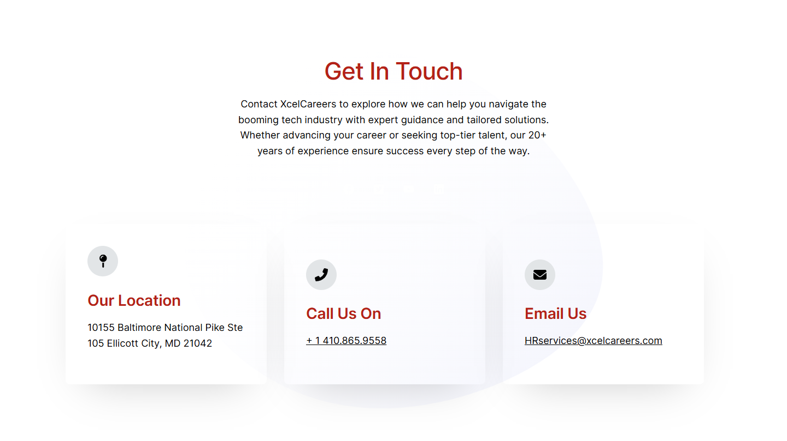
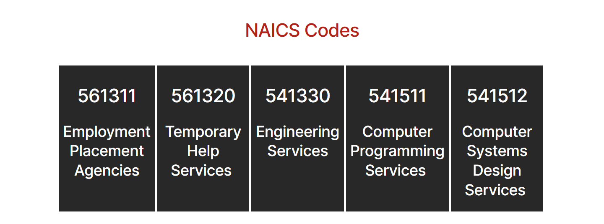

# Contact – XcelCareers Staffing Solutions

*XcelCareers (client's current site)* · URL: https://xcelcareers.com/contact/ · captured 2026-11-08 00:29:27 · HTTP 200

- **Meta description:** —
- **Page size (desktop 1440px):** 1440×1921 px · tablet (820px): 1722 px · mobile (390px): 3092 px
- **Screenshots:** [desktop](screenshots/desktop-full.png) · [tablet](screenshots/tablet-full.png) · [mobile](screenshots/mobile-full.png) · [desktop top](screenshots/desktop-viewport-top.png) · [desktop scrolled](screenshots/desktop-viewport-scrolled.png)
- **Files:** [raw.html](raw.html) (server HTML) · [rendered.html](rendered.html) (DOM after JS) · [content.txt](content.txt) (all visible text) · layout-*.json (full element tree with computed styles) · page.json (everything)

## 1. Section map (top → bottom, desktop 1440px)

| # | Role | Y from top | Height | Heading / first text | Mobile height | Screenshot |
|---|---|---|---|---|---|---|
| 0 | header | 0 | 153 | Home Transition Into Tech Jobs Contact 410.865.9558 | 153 | [img](screenshots/desktop-sec00-header.png) |
| 1 | section | 153 | 809 | Get In Touch | 1146 | [img](screenshots/desktop-sec01-section.png) |
| 2 | section | 962 | 537 | NAICS Codes | 1186 | [img](screenshots/desktop-sec02-section.png) |
| 3 | footer | 1517 | 404 | XcelCareers Staffing Solutions | 591 | [img](screenshots/desktop-sec03-footer.png) |

## 2. Section-by-section layout (desktop)

Legend: each line is an element in DOM order. `@x,y w×h` = position/size in px on the 1440px-wide page. Text lines show *font size/weight, line-height, colour*. Boxes show layout (flex/grid), background, padding, radius, shadow, etc. Pass-through wrappers are collapsed.

### 2.0 HEADER — Home Transition Into Tech Jobs Contact 410.865.9558

Element: `<header class="wp-block-template-part">` at y=0, 1440×153px · 

- div.wp-block-columns [flex row · gap:18px] `@0,0 1440×153`
  - div.wp-block-group [bg:#000000 · pad:0px 18px 0px 18px] `@0,0 1440×153`
    - div.wp-block-group [flex row · justify:space-between · align:center · gap:18px · margin:0px 120px 0px 120px · max-w:1164px] `@138,0 1164×153`
      - a (link→/) [inline-block] `@138,0 153×153`
        - **IMG** `MediumSquareLogo.png` alt="" natural 400×400 · inline · max-w:100% · overflow:clip `@138,0 153×153`
      - div.wp-block-group [flex row · justify:flex-end · align:center · gap:54px] `@688,56 614×41`
        - nav.wp-block-navigation [flex row wrap · justify:flex-end · align:center · gap:36px] `@688,64 407×26`
          - div.wp-block-navigation__responsive-container-content [flex row wrap · justify:flex-end · align:center · gap:36px] `@688,64 407×26`
            - ul.wp-block-navigation__container [flex row wrap · justify:flex-end · align:center · gap:36px] `@688,64 407×26`
              - li.wp-block-navigation-item [flex row · align:center] `@688,64 46×26`
                - **A→/** "Home" — Inter 16px/400 lh 25.6px · #FFFFFF · letterSpacing:0.25px `@688,64 46×26`
              - li.wp-block-navigation-item [flex row · align:center] `@770,64 154×26`
                - **A→/transition-into-tech/** "Transition Into Tech" — Inter 16px/400 lh 25.6px · #FFFFFF · letterSpacing:0.25px `@770,64 154×26`
              - li.wp-block-navigation-item [flex row · align:center] `@960,64 38×26`
                - **A→/jobs-2/** "Jobs" — Inter 16px/400 lh 25.6px · #FFFFFF · letterSpacing:0.25px `@960,64 38×26`
              - li.wp-block-navigation-item [flex row · align:center] `@1033,64 62×26`
                - **A→/contact/** "Contact" — Inter 16px/400 lh 25.6px · #FFFFFF · letterSpacing:0.25px `@1033,64 62×26`
        - div.wp-block-buttons [flex row wrap · align:center · gap:18px] `@1149,56 153×41`
          - **A→** "410.865.9558" — Inter 16px/500 lh 16px · #FFFFFF · textAlign:center ‖ inline-block · bg:#B42117 · pad:12.672px 23.328px 12.672px 23.328px · radius:6px `@1149,56 153×41`

### 2.1 SECTION — Get In Touch

Element: `
` at y=153, 1440×809px · 

- div.wp-block-uagb-container [flex row · gap:20px · bg-image:blob-grad.svg · bg-pos:50% 50% · pad:104px 0px 104px 0px · shadow:#000000 @44% 0px 0px 0px 0px · transition:box-shadow 0.2s ease] `@0,153 1440×809`
  - div.uagb-container-inner-blocks-wrap [flex column · justify:center · align:center · gap:20px · margin:0px 120px 0px 120px · max-w:min(100%, 1200px)] `@120,257 1200×601`
    - div.wp-block-uagb-advanced-heading [pad:0px 300px 0px 300px · align-text:center] `@120,257 1200×203`
      - **H2** "Get In Touch" — Inter 44px/500 lh 52.8px · #B42117 · letterSpacing:-1px · textAlign:center ‖ margin:0px 0px 20px 0px `@420,257 600×53`
      - **P** "Contact XcelCareers to explore how we can help you navigate the booming tech industry with expert guidance and tailored solutions. Whether advancing your car…" — Inter 18px/400 lh 28.8px · #000000 · textAlign:center ‖ margin:0px 0px 15px 0px `@420,330 600×115`
    - div.wp-block-uagb-social-share [flex row · justify:center · align:center] `@120,480 1200×40`
      - div.wp-block-uagb-social-share-child [flex row · margin:0px 7.5px 0px 0px · radius:100px · align-text:center · transition:all 0.2s ease] `@618,480 40×40`
        - **SPAN** "" +icon[svg] — Inter 18px/400 lh 0px · #FFFFFF · textAlign:center ‖ table · pad:10px 10px 10px 10px `@618,480 40×40`
      - div.wp-block-uagb-social-share-child [flex row · margin:0px 7.5px 0px 7.5px · radius:100px · align-text:center · transition:all 0.2s ease] `@673,480 40×40`
        - **SPAN** "" +icon[svg] — Inter 18px/400 lh 0px · #FFFFFF · textAlign:center ‖ table · pad:10px 10px 10px 10px `@673,480 40×40`
      - div.wp-block-uagb-social-share-child [flex row · margin:0px 7.5px 0px 7.5px · radius:100px · align-text:center · transition:all 0.2s ease] `@728,480 40×40`
        - **SPAN** "" +icon[svg] — Inter 18px/400 lh 0px · #FFFFFF · textAlign:center ‖ table · pad:10px 10px 10px 10px `@728,480 40×40`
      - div.wp-block-uagb-social-share-child [flex row · margin:0px 0px 0px 7.5px · radius:100px · align-text:center · transition:all 0.2s ease] `@783,480 40×40`
        - **SPAN** "" +icon[svg] — Inter 18px/400 lh 0px · #FFFFFF · textAlign:center ‖ table · pad:10px 10px 10px 10px `@783,480 40×40`
    - div.wp-block-uagb-container [flex row · justify:center · pad:24px 0px 0px 0px · max-w:100% · shadow:#000000 @44% 0px 0px 0px 0px · transition:box-shadow 0.2s ease] `@120,540 1200×318`
      - div.wp-block-uagb-container [flex column · justify:center · align:flex-start · pad:40px 40px 40px 40px · margin:0px 32px 0px 0px · max-w:33% · radius:8px · shadow:#000000 @24% 0px 31px 80px -40px · transition:box-shadow 0.2s ease] `@120,564 368×294`
        - div.wp-block-uagb-info-box [z:1] `@160,604 288×214`
          - div.uagb-ifb-content [inline-block · z:1] `@160,604 288×214`
            - div.uagb-iconbox-icon-wrap [flex row · justify:center · align:center · bg:#E2E5E7 · pad:16px 16px 16px 16px · radius:50%] `@160,604 56×56`
              - **SVG icon** 24×24 fill:#000000 color:#000000  `@176,620 24×24`
            - div.uagb-ifb-title-wrap [z:1] `@160,686 288×36`
              - **H4** "Our Location​" — Inter 28px/600 lh 36.4px · #B42117 · letterSpacing:-0.25px ‖ margin:26px 0px 8px 0px `@160,686 288×36`
            - **P** "10155 Baltimore National Pike Ste 105 Ellicott City, MD 21042" — Inter 18px/400 lh 28.8px · #000000 ‖ margin:18px 0px 20px 0px `@160,740 288×58`
      - div.wp-block-uagb-container [flex column · justify:center · align:flex-start · pad:40px 40px 40px 40px · margin:0px 32px 0px 0px · max-w:33% · radius:8px · shadow:#000000 @24% 0px 31px 80px -40px · transition:box-shadow 0.2s ease] `@520,564 368×294`
        - div.wp-block-uagb-info-box [z:1] `@560,629 288×164`
          - div.uagb-ifb-content [inline-block · z:1] `@560,629 288×164`
            - div.uagb-iconbox-icon-wrap [flex row · justify:center · align:center · bg:#E2E5E7 · pad:16px 16px 16px 16px · radius:50%] `@560,629 56×56`
              - **SVG icon** 24×24 fill:#000000 color:#000000  `@576,645 24×24`
            - div.uagb-ifb-title-wrap [z:1] `@560,710 288×36`
              - **H4** "Call Us On" — Inter 28px/600 lh 36.4px · #B42117 · letterSpacing:-0.25px ‖ margin:25px 0px 8px 0px `@560,710 288×36`
            - p.uagb-ifb-desc [margin:18px 0px 0px 0px] `@560,764 288×29`
              - **A→tel:14108659558** "+ 1 410.865.9558" — Inter 18px/400 lh 28.8px · #000000 ‖ inline `@560,767 147×21`
      - div.wp-block-uagb-container [flex column · justify:center · align:flex-start · pad:40px 40px 40px 40px · margin:0px 32px 0px 0px · max-w:33% · radius:8px · shadow:#000000 @24% 0px 31px 80px -40px · transition:box-shadow 0.2s ease] `@920,564 368×294`
        - div.wp-block-uagb-info-box [z:1] `@960,629 288×164`
          - div.uagb-ifb-content [inline-block · z:1] `@960,629 288×164`
            - div.uagb-iconbox-icon-wrap [flex row · justify:center · align:center · bg:#E2E5E7 · pad:16px 16px 16px 16px · radius:50%] `@960,629 56×56`
              - **SVG icon** 24×24 fill:#000000 color:#000000  `@976,645 24×24`
            - div.uagb-ifb-title-wrap [z:1] `@960,710 288×36`
              - **H4** "Email Us" — Inter 28px/600 lh 36.4px · #B42117 · letterSpacing:-0.25px ‖ margin:25px 0px 8px 0px `@960,710 288×36`
            - p.uagb-ifb-desc [margin:18px 0px 0px 0px] `@960,764 288×29`
              - **A→mailto:HRservices@xcelcareers.com** "HRservices@xcelcareers.com" — Inter 18px/400 lh 28.8px · #000000 ‖ inline `@960,767 252×21`

### 2.2 SECTION — NAICS Codes

Element: `
` at y=962, 1440×537px · 

- div.wp-block-uagb-container [flex row · gap:20px · pad:10px 10px 10px 10px · shadow:#000000 @44% 0px 0px 0px 0px · transition:box-shadow 0.2s ease] `@0,962 1440×537`
  - div.uagb-container-inner-blocks-wrap [flex column · justify:center · align:center · gap:20px · margin:0px 110px 0px 110px · max-w:min(100%, 1200px)] `@120,972 1200×517`
    - **H2** "NAICS Codes" — Inter 44px/500 lh 52.8px · #B42117 · letterSpacing:-1px · textAlign:center ‖ margin:36px 0px 18px 0px `@120,1008 1200×53`
    - section.wp-block-uagb-columns [flex row · pad:20px 20px 20px 20px · shadow:#000000 0px 0px 0px 0px · z:2] `@120,1099 1200×390`
      - div.uagb-columns__inner-wrap [flex row · z:2] `@140,1119 1160×350`
        - div.wp-block-uagb-column [pad:10px 10px 10px 10px · margin:0px 5px 0px 0px · z:2] `@140,1119 229×350`
          - div.uagb-column__overlay [bg:#282828 · pos:absolute · z:1] `@140,1119 229×350` (empty/decorative)
          - **H2** "561311" — Inter 44px/500 lh 52.8px · #FFFFFF · letterSpacing:-1px · textAlign:center ‖ margin:36px 0px 18px 0px `@150,1165 209×53`
          - **H3** "Employment Placement Agencies" — Inter 36px/500 lh 46.8px · #FFFFFF · letterSpacing:-0.5px · textAlign:center ‖ margin:36px 0px 18px 0px `@150,1254 209×140`
        - div.wp-block-uagb-column [pad:10px 10px 10px 10px · margin:0px 5px 0px 0px · z:2] `@374,1119 220×350`
          - div.uagb-column__overlay [bg:#282828 · pos:absolute · z:1] `@374,1119 220×350` (empty/decorative)
          - **H2** "561320" — Inter 44px/500 lh 52.8px · #FFFFFF · letterSpacing:-1px · textAlign:center ‖ margin:36px 0px 18px 0px `@384,1165 200×53`
          - **H3** "Temporary Help Services" — Inter 36px/500 lh 46.8px · #FFFFFF · letterSpacing:-0.5px · textAlign:center ‖ margin:36px 0px 18px 0px `@384,1254 200×140`
        - div.wp-block-uagb-column [pad:10px 10px 10px 10px · margin:0px 5px 0px 0px · z:2] `@599,1119 220×350`
          - div.uagb-column__overlay [bg:#282828 · pos:absolute · z:1] `@599,1119 220×350` (empty/decorative)
          - **H2** "541330" — Inter 44px/500 lh 52.8px · #FFFFFF · letterSpacing:-1px · textAlign:center ‖ margin:36px 0px 18px 0px `@609,1165 200×53`
          - **H3** "Engineering Services" — Inter 36px/500 lh 46.8px · #FFFFFF · letterSpacing:-0.5px · textAlign:center ‖ margin:36px 0px 18px 0px `@609,1254 200×94`
        - div.wp-block-uagb-column [pad:10px 10px 10px 10px · margin:0px 5px 0px 0px · z:2] `@825,1119 245×350`
          - div.uagb-column__overlay [bg:#282828 · pos:absolute · z:1] `@825,1119 245×350` (empty/decorative)
          - **H2** "541511" — Inter 44px/500 lh 52.8px · #FFFFFF · letterSpacing:-1px · textAlign:center ‖ margin:36px 0px 18px 0px `@835,1165 225×53`
          - **H3** "Computer Programming Services" — Inter 36px/500 lh 46.8px · #FFFFFF · letterSpacing:-0.5px · textAlign:center ‖ margin:36px 0px 18px 0px `@835,1254 225×140`
        - div.wp-block-uagb-column [pad:10px 10px 10px 10px · margin:0px 5px 0px 0px · z:2] `@1075,1119 220×350`
          - div.uagb-column__overlay [bg:#282828 · pos:absolute · z:1] `@1075,1119 220×350` (empty/decorative)
          - **H2** "541512" — Inter 44px/500 lh 52.8px · #FFFFFF · letterSpacing:-1px · textAlign:center ‖ margin:36px 0px 18px 0px `@1085,1165 200×53`
          - **H3** "Computer Systems Design Services" — Inter 36px/500 lh 46.8px · #FFFFFF · letterSpacing:-0.5px · textAlign:center ‖ margin:36px 0px 18px 0px `@1085,1254 200×187`

### 2.3 FOOTER — XcelCareers Staffing Solutions

Element: `<footer class="wp-block-template-part">` at y=1517, 1440×404px · 

- div.wp-block-group [bg:#B42117 · pad:72px 18px 36px 18px] `@0,1517 1440×404`
  - div.wp-block-columns [flex row · gap:36px · margin:0px 120px 0px 120px · max-w:1164px] `@138,1589 1164×220`
    - div.wp-block-column [pad:0px 0px 9px 0px] `@138,1589 564×220`
      - a (link→/) [inline-block] `@138,1589 110×47`
        - **IMG** `MediumSquareLogo-e1736976275746.png` alt="" natural 400×170 · inline · max-w:100% · overflow:clip · filter:url("#wp-duotone-secondary") `@138,1589 110×47`
      - **P** "XcelCareers empowers professionals to thrive in the booming tech industry. With over 20 years of expertise in recruitment and staffing, we provide the tools …" — Inter 16px/400 lh 25.6px · #FFFFFF ‖ pad:0px 36px 0px 0px · margin:18px 0px 0px 0px `@138,1654 564×128`
    - div.wp-block-column [pad:0px 0px 9px 0px] `@738,1589 564×220`
      - div.wp-block-columns [flex row · gap:32px] `@738,1589 564×136`
        - div.wp-block-column `@738,1589 266×136`
          - **H5** "Address:" — Inter 22px/600 lh 31.9px · #FFFFFF `@738,1589 266×32`
          - **P** "10155 Baltimore National Pike Ste 105 Ellicott City, MD 21042 United States" — Inter 18px/400 lh 28.8px · #FFFFFF ‖ margin:18px 0px 0px 0px `@738,1639 266×86`
        - div.wp-block-column `@1036,1589 266×136`
          - **H5** "Contact:" — Inter 22px/600 lh 31.9px · #FFFFFF `@1036,1589 266×32`
          - p.wp-block-paragraph [margin:18px 0px 0px 0px] `@1036,1639 266×29`
            - **A→mailto:HRservices@xcelcareers.com** "HRservices@xcelcareers.com" — Inter 18px/400 lh 28.8px · #FFFFFF ‖ inline `@1036,1642 252×21`
  - div.wp-block-group [flex row · justify:center · align:center · gap:9px · pad:0px 18px 0px 18px · margin:54px 120px 0px 120px · max-w:1164px] `@138,1862 1164×22`
    - **P** "© 2025 ·" — Inter 14px/400 lh 22.4px · #FFFFFF · textAlign:center `@517,1862 59×22`
    - **A→/** "XcelCareers Staffing Solutions" — Inter 14px/400 lh 22.4px · #FFFFFF ‖ inline `@585,1864 201×17`
    - **P** "· All rights reserved" — Inter 14px/400 lh 22.4px · #FFFFFF · textAlign:center `@795,1862 128×22`

## 3. Header, navigation & interaction behaviour

- **atTop** `header.wp-block-template-part` position:static top:0 height:153 bg:transparent shadow:none backdrop:none z:auto
- **afterScroll1400** `header.wp-block-template-part` position:static top:-1021 height:153 bg:transparent shadow:none backdrop:none z:auto

| Menu item | Link | Dropdown | Style | Hover change |
|---|---|---|---|---|
| Home | / | — | Inter 16px/400 #FFFFFF  ls 0.25px | none |
| Transition Into Tech | /transition-into-tech/ | — | Inter 16px/400 #FFFFFF  ls 0.25px | none |
| Jobs | /jobs-2/ | — | Inter 16px/400 #FFFFFF  ls 0.25px | none |
| Contact | /contact/ | — | Inter 16px/400 #FFFFFF  ls 0.25px | none |

- **Mobile menu:** toggle `.wp-block-navigation__responsive-container-open` → [screenshot](screenshots/mobile-menu-open.png) · items: Home, Transition Into Tech, Jobs, Contact

### Hover states (measured by hovering in Chrome)

| Element | Text | Normal | On hover |
|---|---|---|---|
| `a.wp-block-navigation-item__content` | Home | color #FFFFFF · bg transparent · radius 0px · pad 0px · border 0px #FFFFFF · transition all | no change |
| `a.wp-block-button__link` | 410.865.9558 | color #FFFFFF · bg #B42117 · radius 6px · pad 12.672px 23.328px · border 0px #B42217 · transition all | no change |
| `div.wp-block-uagb-info-box` | Our Location​ 10155 Baltimore National P | color #000000 · bg transparent · radius 0px · pad 0px · border 0px #000000 · transition all | no change |
| `div.uagb-ifb-content` | Our Location​ 10155 Baltimore National P | color #000000 · bg transparent · radius 0px · pad 0px · border 0px #000000 · transition all | no change |
| `div.wp-block-uagb-info-box` | Call Us On + 1 410.865.9558 | color #000000 · bg transparent · radius 0px · pad 0px · border 0px #000000 · transition all | no change |
| `a.` | + 1 410.865.9558 | color #000000 · bg transparent · radius 0px · pad 0px · border 0px #000000 · transition all | color: #000000 → #B42117; borderTopColor: #000000 → #B42117 |
| `div.wp-block-uagb-info-box` | Email Us HRservices@xcelcareers.com | color #000000 · bg transparent · radius 0px · pad 0px · border 0px #000000 · transition all | no change |
| `a.` | HRservices@xcelcareers.com | color #FFFFFF · bg transparent · radius 0px · pad 0px · border 0px #FFFFFF · transition all | no change |
| `a.` | XcelCareers Staffing Solutions | color #FFFFFF · bg transparent · radius 0px · pad 0px · border 0px #FFFFFF · transition all | no change |

## 4. Typography & colour used on this page (weighted by amount of text / area)

| Font · weight · size / line-height | chars |
|---|---|
| Inter | 400 | 18px / 28.8px | 458 |
| Inter | 400 | 16px / 25.6px | 306 |
| Inter | 500 | 36px / 46.8px | 132 |
| Inter | 400 | 14px / 22.4px | 59 |
| Inter | 500 | 44px / 52.8px | 53 |
| Inter | 600 | 28px / 36.4px | 31 |
| Inter | 600 | 22px / 31.9px | 16 |
| Inter | 500 | 16px / 16px | 12 |

- **Text colours:** #FFFFFF (656), #000000 (357), #B42117 (54)
- **Background colours (by area):** #B42117 (588), #282828 (397), #000000 (220), #E2E5E7 (9)
- **Border radii:** 100px (4), 8px (3), 50% (3), 6px (1)
- **Shadows:** #000000 @44% 0px 0px 0px 0px (3) | #000000 @24% 0px 31px 80px -40px (3) | #000000 0px 0px 0px 0px (1)
- **Mobile text styles:** Inter | 400 | 16px / 25.6px (458); Inter | 400 | 14px / 22.4px (271); Inter | 500 | 28px / 36.4px (132); Inter | 400 | 12px / 19.2px (59); Inter | 500 | 32px / 38.4px (53); Inter | 600 | 24px / 31.2px (31); Inter | 600 | 20px / 29px (16)

## 6. Images on the page

- `MediumSquareLogo.png` natural 400×400 → shown 153×153 · alt="" · https://xcelcareers.com/wp-content/uploads/2018/12/MediumSquareLogo.png
- `MediumSquareLogo-e1736976275746.png` natural 400×170 → shown 110×47 · alt="" · https://xcelcareers.com/wp-content/uploads/2018/12/MediumSquareLogo-e1736976275746.png
- background on `div.wp-block-uagb-container`: https://xcelcareers.com/wp-content/uploads/2020/06/blob-grad.svg

## 7. Links on the page

- [header] "(icon/image)" → /
- [header] "Home" → /
- [header] "Transition Into Tech" → /transition-into-tech/
- [header] "Jobs" → /jobs-2/
- [header] "Contact" → /contact/
- [body] "+ 1 410.865.9558" → tel:14108659558
- [body] "HRservices@xcelcareers.com" → mailto:HRservices@xcelcareers.com
- [footer] "Facebook" → /contact/ (target _blank)
- [footer] "Twitter" → /contact/ (target _blank)
- [footer] "YouTube" → /contact/ (target _blank)
- [footer] "LinkedIn" → /contact/ (target _blank)
- [footer] "XcelCareers Staffing Solutions" → / (target _self)

## 8. Mobile layout (390px) — condensed outline

### 8.0 header —  (y 0, h 153)
- div.wp-block-columns [flex row wrap · gap:16px] `@0,0 390×153`
  - div.wp-block-group [bg:#000000 · pad:0px 16px 0px 16px] `@0,0 390×153`
    - div.wp-block-group [flex row · justify:space-between · align:center · gap:16px · max-w:1164px] `@16,0 358×153`
      - a (link→/) [inline-block] `@16,0 153×153`
        - **IMG** `MediumSquareLogo.png` alt="" natural 400×400 · inline · max-w:100% · overflow:clip `@16,0 153×153`
      - div.wp-block-group [flex row · justify:flex-end · align:center · gap:48px] `@350,65 24×24`
        - nav.wp-block-navigation [flex row wrap · justify:flex-end · align:center · gap:32px] `@350,65 24×24`
          - **BUTTON** "" +icon[svg] — Inter 14px/400 lh normal · #FFFFFF · textAlign:center ‖ flex row `@350,65 24×24`

### 8.1 section — Get In Touch (y 153, h 1146)
- div.wp-block-uagb-container [flex row · gap:20px · bg-image:blob-grad.svg · bg-size:cover · bg-pos:50% 50% · pad:64px 24px 32px 24px · shadow:#000000 @44% 0px 0px 0px 0px · transition:box-shadow 0.2s ease] `@0,153 390×1146`
  - div.uagb-container-inner-blocks-wrap [flex column wrap · justify:center · align:center · gap:20px · max-w:min(100%, 426px)] `@24,217 342×1050`
    - div.wp-block-uagb-advanced-heading [align-text:center] `@24,217 342×227`
      - **H2** "Get In Touch" — Inter 32px/500 lh 38.4px · #B42117 · letterSpacing:-1px · textAlign:center ‖ margin:0px 0px 20px 0px `@24,217 342×38`
      - **P** "Contact XcelCareers to explore how we can help you navigate the booming tech industry with expert guidance and tailored solutions. Whether advancing your car…" — Inter 16px/400 lh 25.6px · #000000 · textAlign:center ‖ margin:0px 0px 15px 0px `@24,275 342×154`
    - div.wp-block-uagb-social-share [flex row · justify:center · align:center] `@24,464 342×35`
      - div.wp-block-uagb-social-share-child [flex row · margin:0px 7.5px 0px 0px · radius:100px · align-text:center · transition:all 0.2s ease] `@103,464 35×35`
        - **SPAN** "" +icon[svg] — Inter 16px/400 lh 0px · #FFFFFF · textAlign:center ‖ table · pad:10px 10px 10px 10px `@103,464 35×35`
      - div.wp-block-uagb-social-share-child [flex row · margin:0px 7.5px 0px 7.5px · radius:100px · align-text:center · transition:all 0.2s ease] `@153,464 35×35`
        - **SPAN** "" +icon[svg] — Inter 16px/400 lh 0px · #FFFFFF · textAlign:center ‖ table · pad:10px 10px 10px 10px `@153,464 35×35`
      - div.wp-block-uagb-social-share-child [flex row · margin:0px 7.5px 0px 7.5px · radius:100px · align-text:center · transition:all 0.2s ease] `@203,464 35×35`
        - **SPAN** "" +icon[svg] — Inter 16px/400 lh 0px · #FFFFFF · textAlign:center ‖ table · pad:10px 10px 10px 10px `@203,464 35×35`
      - div.wp-block-uagb-social-share-child [flex row · margin:0px 0px 0px 7.5px · radius:100px · align-text:center · transition:all 0.2s ease] `@253,464 35×35`
        - **SPAN** "" +icon[svg] — Inter 16px/400 lh 0px · #FFFFFF · textAlign:center ‖ table · pad:10px 10px 10px 10px `@253,464 35×35`
    - div.wp-block-uagb-container [flex row wrap · justify:center · pad:24px 0px 0px 0px · max-w:100% · shadow:#000000 @44% 0px 0px 0px 0px · transition:box-shadow 0.2s ease] `@24,519 342×748`
      - div.wp-block-uagb-container [flex column wrap · justify:center · align:flex-start · pad:24px 24px 24px 24px · margin:0px 0px 24px 0px · max-w:100% · radius:8px · shadow:#000000 @24% 0px 31px 80px -40px · transition:box-shadow 0.2s ease] `@24,543 342×248`
        - div.wp-block-uagb-info-box [z:1] `@48,567 294×200`
          - div.uagb-ifb-content [inline-block · z:1] `@48,567 294×200`
            - div.uagb-iconbox-icon-wrap [flex row · justify:center · align:center · bg:#E2E5E7 · pad:16px 16px 16px 16px · radius:50%] `@48,567 56×56`
              - **SVG icon** 24×24 fill:#000000 color:#000000  `@64,583 24×24`
            - div.uagb-ifb-title-wrap [z:1] `@48,649 294×31`
              - **H4** "Our Location​" — Inter 24px/600 lh 31.2px · #B42117 · letterSpacing:-0.25px ‖ margin:26px 0px 8px 0px `@48,649 294×31`
            - **P** "10155 Baltimore National Pike Ste 105 Ellicott City, MD 21042" — Inter 16px/400 lh 25.6px · #000000 ‖ margin:16px 0px 20px 0px `@48,696 294×51`
      - div.wp-block-uagb-container [flex column wrap · align:flex-start · pad:24px 24px 24px 24px · margin:0px 0px 24px 0px · max-w:100% · radius:8px · shadow:#000000 @24% 0px 31px 80px -40px · transition:box-shadow 0.2s ease] `@24,815 342×202`
        - div.wp-block-uagb-info-box [z:1] `@48,839 294×154`
          - div.uagb-ifb-content [inline-block · z:1] `@48,839 294×154`
            - div.uagb-iconbox-icon-wrap [flex row · justify:center · align:center · bg:#E2E5E7 · pad:16px 16px 16px 16px · radius:50%] `@48,839 56×56`
              - **SVG icon** 24×24 fill:#000000 color:#000000  `@64,855 24×24`
            - div.uagb-ifb-title-wrap [z:1] `@48,920 294×31`
              - **H4** "Call Us On" — Inter 24px/600 lh 31.2px · #B42117 · letterSpacing:-0.25px ‖ margin:25px 0px 8px 0px `@48,920 294×31`
            - p.uagb-ifb-desc [margin:16px 0px 0px 0px] `@48,968 294×26`
              - **A→tel:14108659558** "+ 1 410.865.9558" — Inter 16px/400 lh 25.6px · #000000 ‖ inline `@48,970 131×20`
      - div.wp-block-uagb-container [flex column wrap · align:flex-start · pad:24px 24px 24px 24px · margin:0px 0px 24px 0px · max-w:100% · radius:8px · shadow:#000000 @24% 0px 31px 80px -40px · transition:box-shadow 0.2s ease] `@24,1041 342×202`
        - div.wp-block-uagb-info-box [z:1] `@48,1065 294×154`
          - div.uagb-ifb-content [inline-block · z:1] `@48,1065 294×154`
            - div.uagb-iconbox-icon-wrap [flex row · justify:center · align:center · bg:#E2E5E7 · pad:16px 16px 16px 16px · radius:50%] `@48,1065 56×56`
              - **SVG icon** 24×24 fill:#000000 color:#000000  `@64,1081 24×24`
            - div.uagb-ifb-title-wrap [z:1] `@48,1146 294×31`
              - **H4** "Email Us" — Inter 24px/600 lh 31.2px · #B42117 · letterSpacing:-0.25px ‖ margin:25px 0px 8px 0px `@48,1146 294×31`
            - p.uagb-ifb-desc [margin:16px 0px 0px 0px] `@48,1193 294×26`
              - **A→mailto:HRservices@xcelcareers.com** "HRservices@xcelcareers.com" — Inter 16px/400 lh 25.6px · #000000 ‖ inline `@48,1195 224×20`

### 8.2 section — NAICS Codes (y 1299, h 1186)
- div.wp-block-uagb-container [flex row · gap:20px · pad:10px 10px 10px 10px · shadow:#000000 @44% 0px 0px 0px 0px · transition:box-shadow 0.2s ease] `@0,1299 390×1186`
  - div.uagb-container-inner-blocks-wrap [flex column wrap · justify:center · align:center · gap:20px · max-w:min(100%, 767px)] `@10,1309 370×1166`
    - **H2** "NAICS Codes" — Inter 32px/500 lh 38.4px · #B42117 · letterSpacing:-1px · textAlign:center ‖ margin:32px 0px 16px 0px `@10,1341 370×38`
    - section.wp-block-uagb-columns [pad:20px 20px 20px 20px · shadow:#000000 0px 0px 0px 0px · z:2] `@10,1415 370×1059`
      - div.uagb-columns__inner-wrap [z:2] `@30,1435 330×1019`
        - div.wp-block-uagb-column [pad:10px 10px 10px 10px · margin:0px 5px 0px 0px · z:2] `@30,1435 330×211`
          - div.uagb-column__overlay [bg:#282828 · pos:absolute · z:1] `@30,1435 330×211` (empty/decorative)
          - **H2** "561311" — Inter 32px/500 lh 38.4px · #FFFFFF · letterSpacing:-1px · textAlign:center ‖ margin:32px 0px 16px 0px `@40,1477 310×38`
          - **H3** "Employment Placement Agencies" — Inter 28px/500 lh 36.4px · #FFFFFF · letterSpacing:-0.5px · textAlign:center ‖ margin:32px 0px 16px 0px `@40,1548 310×73`
        - div.wp-block-uagb-column [pad:10px 10px 10px 10px · margin:0px 5px 0px 0px · z:2] `@30,1646 330×211`
          - div.uagb-column__overlay [bg:#282828 · pos:absolute · z:1] `@30,1646 330×211` (empty/decorative)
          - **H2** "561320" — Inter 32px/500 lh 38.4px · #FFFFFF · letterSpacing:-1px · textAlign:center ‖ margin:32px 0px 16px 0px `@40,1688 310×38`
          - **H3** "Temporary Help Services" — Inter 28px/500 lh 36.4px · #FFFFFF · letterSpacing:-0.5px · textAlign:center ‖ margin:32px 0px 16px 0px `@40,1759 310×73`
        - div.wp-block-uagb-column [pad:10px 10px 10px 10px · margin:0px 5px 0px 0px · z:2] `@30,1858 330×175`
          - div.uagb-column__overlay [bg:#282828 · pos:absolute · z:1] `@30,1858 330×175` (empty/decorative)
          - **H2** "541330" — Inter 32px/500 lh 38.4px · #FFFFFF · letterSpacing:-1px · textAlign:center ‖ margin:32px 0px 16px 0px `@40,1900 310×38`
          - **H3** "Engineering Services" — Inter 28px/500 lh 36.4px · #FFFFFF · letterSpacing:-0.5px · textAlign:center ‖ margin:32px 0px 16px 0px `@40,1970 310×36`
        - div.wp-block-uagb-column [pad:10px 10px 10px 10px · margin:0px 5px 0px 0px · z:2] `@30,2032 330×211`
          - div.uagb-column__overlay [bg:#282828 · pos:absolute · z:1] `@30,2032 330×211` (empty/decorative)
          - **H2** "541511" — Inter 32px/500 lh 38.4px · #FFFFFF · letterSpacing:-1px · textAlign:center ‖ margin:32px 0px 16px 0px `@40,2074 310×38`
          - **H3** "Computer Programming Services" — Inter 28px/500 lh 36.4px · #FFFFFF · letterSpacing:-0.5px · textAlign:center ‖ margin:32px 0px 16px 0px `@40,2145 310×73`
        - div.wp-block-uagb-column [pad:10px 10px 10px 10px · margin:0px 5px 0px 0px · z:2] `@30,2244 330×211`
          - div.uagb-column__overlay [bg:#282828 · pos:absolute · z:1] `@30,2244 330×211` (empty/decorative)
          - **H2** "541512" — Inter 32px/500 lh 38.4px · #FFFFFF · letterSpacing:-1px · textAlign:center ‖ margin:32px 0px 16px 0px `@40,2286 310×38`
          - **H3** "Computer Systems Design Services" — Inter 28px/500 lh 36.4px · #FFFFFF · letterSpacing:-0.5px · textAlign:center ‖ margin:32px 0px 16px 0px `@40,2356 310×73`

### 8.3 footer — XcelCareers Staffing Solutions (y 2501, h 591)
- div.wp-block-group [bg:#B42117 · pad:64px 16px 32px 16px] `@0,2501 390×591`
  - div.wp-block-columns [flex row wrap · gap:32px · max-w:1164px] `@16,2565 358×408`
    - div.wp-block-column [pad:0px 0px 8px 0px] `@16,2565 358×221`
      - a (link→/) [inline-block] `@16,2565 110×47`
        - **IMG** `MediumSquareLogo-e1736976275746.png` alt="" natural 390×165 · inline · max-w:100% · overflow:clip · filter:url("#wp-duotone-secondary") `@16,2565 110×47`
      - **P** "XcelCareers empowers professionals to thrive in the booming tech industry. With over 20 years of expertise in recruitment and staffing, we provide the tools …" — Inter 14px/400 lh 22.4px · #FFFFFF ‖ pad:0px 32px 0px 0px · margin:16px 0px 0px 0px `@16,2628 358×134`
    - div.wp-block-column [pad:0px 0px 8px 0px] `@16,2818 358×155`
      - div.wp-block-columns [flex row · gap:32px] `@16,2818 358×147`
        - div.wp-block-column `@16,2818 163×147`
          - **H5** "Address:" — Inter 20px/600 lh 29px · #FFFFFF `@16,2818 163×29`
          - **P** "10155 Baltimore National Pike Ste 105 Ellicott City, MD 21042 United States" — Inter 16px/400 lh 25.6px · #FFFFFF ‖ margin:16px 0px 0px 0px `@16,2863 163×102`
        - div.wp-block-column `@211,2818 163×147`
          - **H5** "Contact:" — Inter 20px/600 lh 29px · #FFFFFF `@211,2818 163×29`
          - p.wp-block-paragraph [margin:16px 0px 0px 0px] `@211,2863 163×51`
            - **A→mailto:HRservices@xcelcareers.com** "HRservices@xcelcareers.com" — Inter 16px/400 lh 25.6px · #FFFFFF ‖ inline `@211,2865 155×46`
  - div.wp-block-group [flex row · justify:center · align:center · gap:8px · pad:0px 16px 0px 16px · margin:48px 0px 0px 0px · max-w:1164px] `@16,3021 358×38`
    - **P** "© 2025 ·" — Inter 12px/400 lh 19.2px · #FFFFFF · textAlign:center `@32,3021 47×38`
    - **A→/** "XcelCareers Staffing Solutions" — Inter 12px/400 lh 19.2px · #FFFFFF ‖ inline `@87,3023 116×34`
    - **P** "· All rights reserved" — Inter 12px/400 lh 19.2px · #FFFFFF · textAlign:center `@256,3021 102×38`
