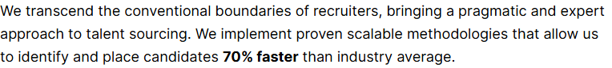
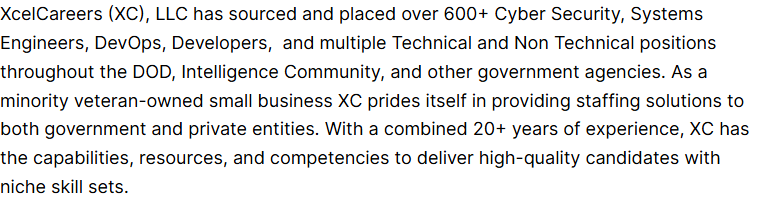
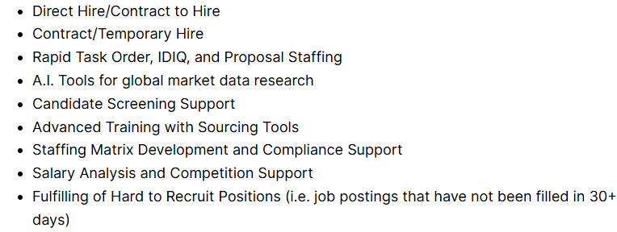
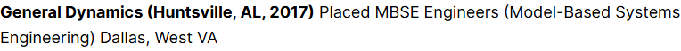
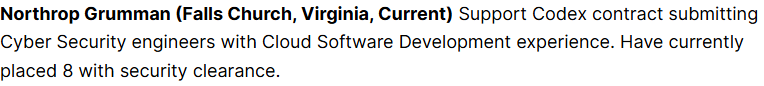
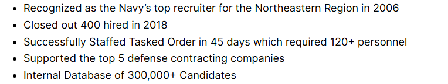

# Home-Elementor – XcelCareers Staffing Solutions

*XcelCareers (client's current site)* · URL: https://xcelcareers.com/elementor-2611/ · captured 2026-11-08 00:31:42 · HTTP 200

- **Meta description:** —
- **Page size (desktop 1440px):** 1440×4279 px · tablet (820px): 3918 px · mobile (390px): 4610 px
- **Screenshots:** [desktop](screenshots/desktop-full.png) · [tablet](screenshots/tablet-full.png) · [mobile](screenshots/mobile-full.png) · [desktop top](screenshots/desktop-viewport-top.png) · [desktop scrolled](screenshots/desktop-viewport-scrolled.png)
- **Files:** [raw.html](raw.html) (server HTML) · [rendered.html](rendered.html) (DOM after JS) · [content.txt](content.txt) (all visible text) · layout-*.json (full element tree with computed styles) · page.json (everything)

## 1. Section map (top → bottom, desktop 1440px)

| # | Role | Y from top | Height | Heading / first text | Mobile height | Screenshot |
|---|---|---|---|---|---|---|
| 0 | header | 0 | 153 | Home Transition Into Tech Jobs Contact 410.865.9558 | 153 | [img](screenshots/desktop-sec00-header.png) |
| 1 | section | 153 | 67 | Capability Statement | 48 | [img](screenshots/desktop-sec01-section.png) |
| 2 | section | 238 | 86 | We transcend the conventional boundaries of recruiters, bringing a pragmatic and expert ap | 154 | [img](screenshots/desktop-sec02-section.png) |
| 3 | section | 343 | 692 |  | 691 | [img](screenshots/desktop-sec03-section.png) |
| 4 | section | 1052 | 53 | About Us | 38 | [img](screenshots/desktop-sec04-section.png) |
| 5 | section | 1123 | 202 | XcelCareers (XC), LLC has sourced and placed over 600+ Cyber Security, Systems Engineers,  | 282 | [img](screenshots/desktop-sec05-section.png) |
| 6 | section | 1343 | 53 | Core Competencies | 38 | [img](screenshots/desktop-sec06-section.png) |
| 7 | section | 1414 | 288 | Direct Hire/Contract to Hire Contract/Temporary Hire Rapid Task Order, IDIQ, and Proposal  | 307 | [img](screenshots/desktop-sec07-section.png) |
| 8 | section | 1720 | 53 | Past Performances | 38 | [img](screenshots/desktop-sec08-section.png) |
| 9 | section | 1790 | 58 | General Dynamics (Huntsville, AL, 2017) Placed MBSE Engineers (Model-Based Systems Enginee | 77 | [img](screenshots/desktop-sec09-section.png) |
| 10 | section | 1866 | 58 | Indeed (2022) Provided market data research for 2 A.I. Ethics Data Scientists in San Franc | 102 | [img](screenshots/desktop-sec10-section.png) |
| 11 | section | 1942 | 86 | Northrop Grumman (Falls Church, Virginia, Current) Support Codex contract submitting Cyber | 128 | [img](screenshots/desktop-sec11-section.png) |
| 12 | section | 2046 | 777 |  | 776 | [img](screenshots/desktop-sec12-section.png) |
| 13 | section | 2841 | 53 | And Many More… | 38 | [img](screenshots/desktop-sec13-section.png) |
| 14 | section | 2911 | 29 |  | 26 | [img](screenshots/desktop-sec14-section.png) |
| 15 | section | 2958 | 29 |  | 26 | [img](screenshots/desktop-sec15-section.png) |
| 16 | section | 3005 | 29 |  | 26 | [img](screenshots/desktop-sec16-section.png) |
| 17 | section | 3052 | 29 |  | 26 | [img](screenshots/desktop-sec17-section.png) |
| 18 | section | 3099 | 29 |  | 26 | [img](screenshots/desktop-sec18-section.png) |
| 19 | section | 3145 | 29 |  | 26 | [img](screenshots/desktop-sec19-section.png) |
| 20 | section | 3192 | 29 |  | 26 | [img](screenshots/desktop-sec20-section.png) |
| 21 | section | 3239 | 29 |  | 26 | [img](screenshots/desktop-sec21-section.png) |
| 22 | section | 3286 | 29 |  | 26 | [img](screenshots/desktop-sec22-section.png) |
| 23 | section | 3333 | 29 |  | 26 | [img](screenshots/desktop-sec23-section.png) |
| 24 | section | 3379 | 29 |  | 26 | [img](screenshots/desktop-sec24-section.png) |
| 25 | section | 3426 | 29 |  | 26 | [img](screenshots/desktop-sec25-section.png) |
| 26 | section | 3473 | 29 |  | 26 | [img](screenshots/desktop-sec26-section.png) |
| 27 | section | 3520 | 29 |  | 42 | [img](screenshots/desktop-sec27-section.png) |
| 28 | section | 3567 | 29 |  | 26 | [img](screenshots/desktop-sec28-section.png) |
| 29 | section | 3613 | 29 |  | 26 | [img](screenshots/desktop-sec29-section.png) |
| 30 | section | 3660 | 53 | Differentiators | 38 | [img](screenshots/desktop-sec30-section.png) |
| 31 | section | 3731 | 144 | Recognized as the Navy’s top recruiter for the Northeastern Region in 2006 Closed out 400  | 205 | [img](screenshots/desktop-sec31-section.png) |
| 32 | footer | 3875 | 404 | XcelCareers Staffing Solutions | 591 | [img](screenshots/desktop-sec32-footer.png) |

## 2. Section-by-section layout (desktop)

Legend: each line is an element in DOM order. `@x,y w×h` = position/size in px on the 1440px-wide page. Text lines show *font size/weight, line-height, colour*. Boxes show layout (flex/grid), background, padding, radius, shadow, etc. Pass-through wrappers are collapsed.

### 2.0 HEADER — Home Transition Into Tech Jobs Contact 410.865.9558

Element: `<header class="wp-block-template-part">` at y=0, 1440×153px · 

- div.wp-block-columns [flex row · gap:18px] `@0,0 1440×153`
  - div.wp-block-group [bg:#000000 · pad:0px 18px 0px 18px] `@0,0 1440×153`
    - div.wp-block-group [flex row · justify:space-between · align:center · gap:18px · margin:0px 120px 0px 120px · max-w:1164px] `@138,0 1164×153`
      - a (link→/) [inline-block] `@138,0 153×153`
        - **IMG** `MediumSquareLogo.png` alt="" natural 400×400 · inline · max-w:100% · overflow:clip `@138,0 153×153`
      - div.wp-block-group [flex row · justify:flex-end · align:center · gap:54px] `@688,56 614×41`
        - nav.wp-block-navigation [flex row wrap · justify:flex-end · align:center · gap:36px] `@688,64 407×26`
          - div.wp-block-navigation__responsive-container-content [flex row wrap · justify:flex-end · align:center · gap:36px] `@688,64 407×26`
            - ul.wp-block-navigation__container [flex row wrap · justify:flex-end · align:center · gap:36px] `@688,64 407×26`
              - li.wp-block-navigation-item [flex row · align:center] `@688,64 46×26`
                - **A→/** "Home" — Inter 16px/400 lh 25.6px · #FFFFFF · letterSpacing:0.25px `@688,64 46×26`
              - li.wp-block-navigation-item [flex row · align:center] `@770,64 154×26`
                - **A→/transition-into-tech/** "Transition Into Tech" — Inter 16px/400 lh 25.6px · #FFFFFF · letterSpacing:0.25px `@770,64 154×26`
              - li.wp-block-navigation-item [flex row · align:center] `@960,64 38×26`
                - **A→/jobs-2/** "Jobs" — Inter 16px/400 lh 25.6px · #FFFFFF · letterSpacing:0.25px `@960,64 38×26`
              - li.wp-block-navigation-item [flex row · align:center] `@1033,64 62×26`
                - **A→/contact/** "Contact" — Inter 16px/400 lh 25.6px · #FFFFFF · letterSpacing:0.25px `@1033,64 62×26`
        - div.wp-block-buttons [flex row wrap · align:center · gap:18px] `@1149,56 153×41`
          - **A→** "410.865.9558" — Inter 16px/500 lh 16px · #FFFFFF · textAlign:center ‖ inline-block · bg:#B42117 · pad:12.672px 23.328px 12.672px 23.328px · radius:6px `@1149,56 153×41`

### 2.1 SECTION — Capability Statement

Element: `<h1 class="">` at y=153, 764×67px · 

- **H1** "Capability Statement" — Inter 56px/500 lh 67.2px · #B42117 · letterSpacing:-2px ‖ margin:0px 338px 0px 338px · max-w:764px `@338,153 764×67`

### 2.2 SECTION — We transcend the conventional boundaries of recruiters, bringing a pragmatic and

Element: `
` at y=238, 764×86px · 

- **P** "We transcend the conventional boundaries of recruiters, bringing a pragmatic and expert approach to talent sourcing. We implement proven scalable methodologi…" — Inter 18px/400 lh 28.8px · #000000 ‖ margin:18px 338px 0px 338px · max-w:764px · highlights: "70% faster"  700 `@338,238 764×86`

### 2.3 SECTION — 

Element: `
` at y=343, 764×692px · 

- p [margin:18px 338px 0px 338px · max-w:764px] `@338,343 764×692`
  - **IMG** `3fpxt37x6uq-1024x683.jpg` alt="people standing inside city building" natural 1024×683 · inline · overflow:clip `@338,343 1024×683`

### 2.4 SECTION — About Us

Element: `<h2 class="">` at y=1052, 764×53px · 

- **H2** "About Us" — Inter 44px/500 lh 52.8px · #B42117 · letterSpacing:-1px ‖ margin:18px 338px 0px 338px · max-w:764px `@338,1052 764×53`

### 2.5 SECTION — XcelCareers (XC), LLC has sourced and placed over 600+ Cyber Security, Systems E

Element: `
` at y=1123, 764×202px · 

- **P** "XcelCareers (XC), LLC has sourced and placed over 600+ Cyber Security, Systems Engineers, DevOps, Developers, and multiple Technical and Non Technical positi…" — Inter 18px/400 lh 28.8px · #000000 ‖ margin:18px 338px 0px 338px · max-w:764px `@338,1123 764×202`

### 2.6 SECTION — Core Competencies

Element: `<h2 class="">` at y=1343, 764×53px · 

- **H2** "Core Competencies" — Inter 44px/500 lh 52.8px · #B42117 · letterSpacing:-1px ‖ margin:18px 338px 0px 338px · max-w:764px `@338,1343 764×53`

### 2.7 SECTION — Direct Hire/Contract to Hire Contract/Temporary Hire Rapid Task Order, IDIQ, and

Element: `<ul class="">` at y=1414, 764×288px · 

- ul [pad:0px 0px 0px 40px · margin:18px 338px 0px 338px · max-w:764px] `@338,1414 764×288`
  - **LI** "Direct Hire/Contract to Hire" — Inter 18px/400 lh 28.8px · #000000 ‖ list-item `@378,1414 724×29`
  - **LI** "Contract/Temporary Hire" — Inter 18px/400 lh 28.8px · #000000 ‖ list-item `@378,1442 724×29`
  - **LI** "Rapid Task Order, IDIQ, and Proposal Staffing" — Inter 18px/400 lh 28.8px · #000000 ‖ list-item `@378,1471 724×29`
  - **LI** "A.I. Tools for global market data research" — Inter 18px/400 lh 28.8px · #000000 ‖ list-item `@378,1500 724×29`
  - **LI** "Candidate Screening Support" — Inter 18px/400 lh 28.8px · #000000 ‖ list-item `@378,1529 724×29`
  - **LI** "Advanced Training with Sourcing Tools" — Inter 18px/400 lh 28.8px · #000000 ‖ list-item `@378,1558 724×29`
  - **LI** "Staffing Matrix Development and Compliance Support" — Inter 18px/400 lh 28.8px · #000000 ‖ list-item `@378,1586 724×29`
  - **LI** "Salary Analysis and Competition Support" — Inter 18px/400 lh 28.8px · #000000 ‖ list-item `@378,1615 724×29`
  - **LI** "Fulfilling of Hard to Recruit Positions (i.e. job postings that have not been filled in 30+ days)" — Inter 18px/400 lh 28.8px · #000000 ‖ list-item `@378,1644 724×58`

### 2.8 SECTION — Past Performances

Element: `<h2 class="">` at y=1720, 764×53px · 

- **H2** "Past Performances" — Inter 44px/500 lh 52.8px · #B42117 · letterSpacing:-1px ‖ margin:18px 338px 0px 338px · max-w:764px `@338,1720 764×53`

### 2.9 SECTION — General Dynamics (Huntsville, AL, 2017) Placed MBSE Engineers (Model-Based Syste

Element: `
` at y=1790, 764×58px · 

- **P** "General Dynamics (Huntsville, AL, 2017) Placed MBSE Engineers (Model-Based Systems Engineering) Dallas, West VA" — Inter 18px/400 lh 28.8px · #000000 ‖ margin:18px 338px 0px 338px · max-w:764px · highlights: "General Dynamics (Huntsville, AL, 2017)"  700 `@338,1790 764×58`

### 2.10 SECTION — Indeed (2022) Provided market data research for 2 A.I. Ethics Data Scientists in

Element: `
` at y=1866, 764×58px · 

- **P** "Indeed (2022) Provided market data research for 2 A.I. Ethics Data Scientists in San Francisco, 3 Machine Learning Engineers for New York, NY, and 4 Austin, TX" — Inter 18px/400 lh 28.8px · #000000 ‖ margin:18px 338px 0px 338px · max-w:764px · highlights: "Indeed (2022)"  700 `@338,1866 764×58`

### 2.11 SECTION — Northrop Grumman (Falls Church, Virginia, Current) Support Codex contract submit

Element: `
` at y=1942, 764×86px · 

- **P** "Northrop Grumman (Falls Church, Virginia, Current) Support Codex contract submitting Cyber Security engineers with Cloud Software Development experience. Hav…" — Inter 18px/400 lh 28.8px · #000000 ‖ margin:18px 338px 0px 338px · max-w:764px · highlights: "Northrop Grumman ("  700; "Falls Church, Virginia"  700; ", Current)"  700 `@338,1942 764×86`

### 2.12 SECTION — 

Element: `
` at y=2046, 764×777px · 

- p [margin:18px 338px 0px 338px · max-w:764px] `@338,2046 764×777`
  - **IMG** `opbmvst07gy-1024x768.jpg` alt="brown wooden blocks on white surface" natural 1024×768 · inline · overflow:clip `@338,2046 1024×768`

### 2.13 SECTION — And Many More…

Element: `<h2 class="">` at y=2841, 764×53px · 

- **H2** "And Many More…" — Inter 44px/500 lh 52.8px · #B42117 · letterSpacing:-1px ‖ margin:18px 338px 0px 338px · max-w:764px `@338,2841 764×53`

### 2.14 SECTION — 

Element: `<figure class="">` at y=2911, 764×29px · 

- figure [margin:18px 338px 0px 338px · max-w:764px] `@338,2911 764×29`
  - **IMG** `` alt="th (4)" natural 0×0 · inline · overflow:clip `@338,2911 63×29`

### 2.15 SECTION — 

Element: `<figure class="">` at y=2958, 764×29px · 

- figure [margin:18px 338px 0px 338px · max-w:764px] `@338,2958 764×29`
  - **IMG** `` alt="th (3)" natural 0×0 · inline · overflow:clip `@338,2958 63×29`

### 2.16 SECTION — 

Element: `<figure class="">` at y=3005, 764×29px · 

- figure [margin:18px 338px 0px 338px · max-w:764px] `@338,3005 764×29`
  - **IMG** `` alt="th-1-e1544475635932" natural 0×0 · inline · overflow:clip `@338,3005 211×29`

### 2.17 SECTION — 

Element: `<figure class="">` at y=3052, 764×29px · 

- figure [margin:18px 338px 0px 338px · max-w:764px] `@338,3052 764×29`
  - **IMG** `` alt="parsons-logo" natural 0×0 · inline · overflow:clip `@338,3052 129×29`

### 2.18 SECTION — 

Element: `<figure class="">` at y=3099, 764×29px · 

- figure [margin:18px 338px 0px 338px · max-w:764px] `@338,3099 764×29`
  - **IMG** `` alt="gdit-inverse-logo (1)" natural 0×0 · inline · overflow:clip `@338,3099 190×29`

### 2.19 SECTION — 

Element: `<figure class="">` at y=3145, 764×29px · 

- figure [margin:18px 338px 0px 338px · max-w:764px] `@338,3145 764×29`
  - **IMG** `` alt="alionlogo" natural 0×0 · inline · overflow:clip `@338,3145 93×29`

### 2.20 SECTION — 

Element: `<figure class="">` at y=3192, 764×29px · 

- figure [margin:18px 338px 0px 338px · max-w:764px] `@338,3192 764×29`
  - **IMG** `` alt="United_States_Navy_logo" natural 0×0 · inline · overflow:clip `@338,3192 230×29`

### 2.21 SECTION — 

Element: `<figure class="">` at y=3239, 764×29px · 

- figure [margin:18px 338px 0px 338px · max-w:764px] `@338,3239 764×29`
  - **IMG** `` alt="GeorgiaTech_RGB" natural 0×0 · inline · overflow:clip `@338,3239 168×29`

### 2.22 SECTION — 

Element: `<figure class="">` at y=3286, 764×29px · 

- figure [margin:18px 338px 0px 338px · max-w:764px] `@338,3286 764×29`
  - **IMG** `` alt="Amazon_logo.svg" natural 0×0 · inline · overflow:clip `@338,3286 165×29`

### 2.23 SECTION — 

Element: `<figure class="">` at y=3333, 764×29px · 

- figure [margin:18px 338px 0px 338px · max-w:764px] `@338,3333 764×29`
  - **IMG** `` alt="Logo-Boeing" natural 0×0 · inline · overflow:clip `@338,3333 126×29`

### 2.24 SECTION — 

Element: `<figure class="">` at y=3379, 764×29px · 

- figure [margin:18px 338px 0px 338px · max-w:764px] `@338,3379 764×29`
  - **IMG** `` alt="Logo_of_the_United_States_Army.svg (1)" natural 0×0 · inline · overflow:clip `@338,3379 360×29`

### 2.25 SECTION — 

Element: `<figure class="">` at y=3426, 764×29px · 

- figure [margin:18px 338px 0px 338px · max-w:764px] `@338,3426 764×29`
  - **IMG** `` alt="microsoft-logo-8EE94BD68A-seeklogo.com" natural 0×0 · inline · overflow:clip `@338,3426 390×29`

### 2.26 SECTION — 

Element: `<figure class="">` at y=3473, 764×29px · 

- figure [margin:18px 338px 0px 338px · max-w:764px] `@338,3473 764×29`
  - **IMG** `` alt="US_Air_Force_Logo_Solid_Colour.svg" natural 0×0 · inline · overflow:clip `@338,3473 327×29`

### 2.27 SECTION — 

Element: `<figure class="">` at y=3520, 764×29px · 

- figure [margin:18px 338px 0px 338px · max-w:764px] `@338,3520 764×29`
  - **IMG** `` alt="Seal_of_the_United_States_House_of_Representatives.svg" natural 0×0 · inline · overflow:clip `@338,3520 509×29`

### 2.28 SECTION — 

Element: `<figure class="">` at y=3567, 764×29px · 

- figure [margin:18px 338px 0px 338px · max-w:764px] `@338,3567 764×29`
  - **IMG** `` alt="6227175c74a10c92f2ae07a6 (1)" natural 0×0 · inline · overflow:clip `@338,3567 287×29`

### 2.29 SECTION — 

Element: `<figure class="">` at y=3613, 764×29px · 

- figure [margin:18px 338px 0px 338px · max-w:764px] `@338,3613 764×29`
  - **IMG** `` alt="General-Dynamics-Logo" natural 0×0 · inline · overflow:clip `@338,3613 224×29`

### 2.30 SECTION — Differentiators

Element: `<h2 class="">` at y=3660, 764×53px · 

- **H2** "Differentiators" — Inter 44px/500 lh 52.8px · #B42117 · letterSpacing:-1px ‖ margin:18px 338px 0px 338px · max-w:764px `@338,3660 764×53`

### 2.31 SECTION — Recognized as the Navy’s top recruiter for the Northeastern Region in 2006 Close

Element: `<ul class="">` at y=3731, 764×144px · 

- ul [pad:0px 0px 0px 40px · margin:18px 338px 0px 338px · max-w:764px] `@338,3731 764×144`
  - **LI** "Recognized as the Navy’s top recruiter for the Northeastern Region in 2006" — Inter 18px/400 lh 28.8px · #000000 ‖ list-item `@378,3731 724×29`
  - **LI** "Closed out 400 hired in 2018" — Inter 18px/400 lh 28.8px · #000000 ‖ list-item `@378,3760 724×29`
  - **LI** "Successfully Staffed Tasked Order in 45 days which required 120+ personnel" — Inter 18px/400 lh 28.8px · #000000 ‖ list-item `@378,3789 724×29`
  - **LI** "Supported the top 5 defense contracting companies" — Inter 18px/400 lh 28.8px · #000000 ‖ list-item `@378,3817 724×29`
  - **LI** "Internal Database of 300,000+ Candidates" — Inter 18px/400 lh 28.8px · #000000 ‖ list-item `@378,3846 724×29`

### 2.32 FOOTER — XcelCareers Staffing Solutions

Element: `<footer class="wp-block-template-part">` at y=3875, 1440×404px · 

- div.wp-block-group [bg:#B42117 · pad:72px 18px 36px 18px] `@0,3875 1440×404`
  - div.wp-block-columns [flex row · gap:36px · margin:0px 120px 0px 120px · max-w:1164px] `@138,3947 1164×220`
    - div.wp-block-column [pad:0px 0px 9px 0px] `@138,3947 564×220`
      - a (link→/) [inline-block] `@138,3947 110×47`
        - **IMG** `MediumSquareLogo-e1736976275746.png` alt="" natural 400×170 · inline · max-w:100% · overflow:clip · filter:url("#wp-duotone-secondary") `@138,3947 110×47`
      - **P** "XcelCareers empowers professionals to thrive in the booming tech industry. With over 20 years of expertise in recruitment and staffing, we provide the tools …" — Inter 16px/400 lh 25.6px · #FFFFFF ‖ pad:0px 36px 0px 0px · margin:18px 0px 0px 0px `@138,4012 564×128`
    - div.wp-block-column [pad:0px 0px 9px 0px] `@738,3947 564×220`
      - div.wp-block-columns [flex row · gap:32px] `@738,3947 564×136`
        - div.wp-block-column `@738,3947 266×136`
          - **H5** "Address:" — Inter 22px/600 lh 31.9px · #FFFFFF `@738,3947 266×32`
          - **P** "10155 Baltimore National Pike Ste 105 Ellicott City, MD 21042 United States" — Inter 18px/400 lh 28.8px · #FFFFFF ‖ margin:18px 0px 0px 0px `@738,3997 266×86`
        - div.wp-block-column `@1036,3947 266×136`
          - **H5** "Contact:" — Inter 22px/600 lh 31.9px · #FFFFFF `@1036,3947 266×32`
          - p.wp-block-paragraph [margin:18px 0px 0px 0px] `@1036,3997 266×29`
            - **A→mailto:HRservices@xcelcareers.com** "HRservices@xcelcareers.com" — Inter 18px/400 lh 28.8px · #FFFFFF ‖ inline `@1036,4000 252×21`
  - div.wp-block-group [flex row · justify:center · align:center · gap:9px · pad:0px 18px 0px 18px · margin:54px 120px 0px 120px · max-w:1164px] `@138,4221 1164×22`
    - **P** "© 2025 ·" — Inter 14px/400 lh 22.4px · #FFFFFF · textAlign:center `@517,4221 59×22`
    - **A→/** "XcelCareers Staffing Solutions" — Inter 14px/400 lh 22.4px · #FFFFFF ‖ inline `@585,4223 201×17`
    - **P** "· All rights reserved" — Inter 14px/400 lh 22.4px · #FFFFFF · textAlign:center `@795,4221 128×22`

## 3. Header, navigation & interaction behaviour

- **atTop** `header.wp-block-template-part` position:static top:0 height:153 bg:transparent shadow:none backdrop:none z:auto
- **afterScroll1400** `header.wp-block-template-part` position:static top:-1400 height:153 bg:transparent shadow:none backdrop:none z:auto

| Menu item | Link | Dropdown | Style | Hover change |
|---|---|---|---|---|
| Home | / | — | Inter 16px/400 #FFFFFF  ls 0.25px | none |
| Transition Into Tech | /transition-into-tech/ | — | Inter 16px/400 #FFFFFF  ls 0.25px | none |
| Jobs | /jobs-2/ | — | Inter 16px/400 #FFFFFF  ls 0.25px | none |
| Contact | /contact/ | — | Inter 16px/400 #FFFFFF  ls 0.25px | none |

- **Mobile menu:** toggle `.wp-block-navigation__responsive-container-open` → [screenshot](screenshots/mobile-menu-open.png) · items: Home, Transition Into Tech, Jobs, Contact

### Hover states (measured by hovering in Chrome)

| Element | Text | Normal | On hover |
|---|---|---|---|
| `a.wp-block-navigation-item__content` | Home | color #FFFFFF · bg transparent · radius 0px · pad 0px · border 0px #FFFFFF · transition all | no change |
| `a.wp-block-button__link` | 410.865.9558 | color #FFFFFF · bg #B42117 · radius 6px · pad 12.672px 23.328px · border 0px #B42217 · transition all | no change |
| `a.` |  | color #000000 · bg transparent · radius 0px · pad 0px · border 0px #000000 · transition all | color: #000000 → #B42117; borderTopColor: #000000 → #B42117; childColor: #000000 → #B42117 |
| `a.` | HRservices@xcelcareers.com | color #FFFFFF · bg transparent · radius 0px · pad 0px · border 0px #FFFFFF · transition all | no change |
| `a.` | XcelCareers Staffing Solutions | color #FFFFFF · bg transparent · radius 0px · pad 0px · border 0px #FFFFFF · transition all | no change |

## 4. Typography & colour used on this page (weighted by amount of text / area)

| Font · weight · size / line-height | chars |
|---|---|
| Inter | 400 | 18px / 28.8px | 1870 |
| Inter | 400 | 16px / 25.6px | 306 |
| Inter | 700 | 18px / 28.8px | 112 |
| Inter | 500 | 44px / 52.8px | 71 |
| Inter | 400 | 14px / 22.4px | 59 |
| Inter | 500 | 56px / 67.2px | 20 |
| Inter | 600 | 22px / 31.9px | 16 |
| Inter | 500 | 16px / 16px | 12 |

- **Text colours:** #000000 (1881), #FFFFFF (494), #B42117 (91)
- **Background colours (by area):** #B42117 (588), #000000 (220)
- **Border radii:** 6px (1)
- **Shadows:** 
- **Mobile text styles:** Inter | 400 | 16px / 25.6px (1870); Inter | 400 | 14px / 22.4px (271); Inter | 700 | 16px / 25.6px (112); Inter | 500 | 32px / 38.4px (71); Inter | 400 | 12px / 19.2px (59); Inter | 500 | 40px / 48px (20); Inter | 600 | 20px / 29px (16)

## 6. Images on the page

- `MediumSquareLogo.png` natural 400×400 → shown 153×153 · alt="" · https://xcelcareers.com/wp-content/uploads/2018/12/MediumSquareLogo.png
- `3fpxt37x6uq-1024x683.jpg` natural 1024×683 → shown 1024×683 · alt="people standing inside city building" · https://xcelcareers.com/wp-content/uploads/2023/08/3fpxt37x6uq-1024x683.jpg
- `opbmvst07gy-1024x768.jpg` natural 1024×768 → shown 1024×768 · alt="brown wooden blocks on white surface" · https://xcelcareers.com/wp-content/uploads/2023/08/opbmvst07gy-1024x768.jpg
- `` natural 0×0 → shown 63×29 · alt="th (4)" · 
- `MediumSquareLogo-e1736976275746.png` natural 400×170 → shown 110×47 · alt="" · https://xcelcareers.com/wp-content/uploads/2018/12/MediumSquareLogo-e1736976275746.png

## 7. Links on the page

- [header] "(icon/image)" → /
- [header] "Home" → /
- [header] "Transition Into Tech" → /transition-into-tech/
- [header] "Jobs" → /jobs-2/
- [header] "Contact" → /contact/
- [footer] "Facebook" → /elementor-2611/ (target _blank)
- [footer] "Twitter" → /elementor-2611/ (target _blank)
- [footer] "YouTube" → /elementor-2611/ (target _blank)
- [footer] "LinkedIn" → /elementor-2611/ (target _blank)
- [footer] "HRservices@xcelcareers.com" → mailto:HRservices@xcelcareers.com
- [footer] "XcelCareers Staffing Solutions" → / (target _self)

## 8. Mobile layout (390px) — condensed outline

### 8.0 header —  (y 0, h 153)
- div.wp-block-columns [flex row wrap · gap:16px] `@0,0 390×153`
  - div.wp-block-group [bg:#000000 · pad:0px 16px 0px 16px] `@0,0 390×153`
    - div.wp-block-group [flex row · justify:space-between · align:center · gap:16px · max-w:1164px] `@16,0 358×153`
      - a (link→/) [inline-block] `@16,0 153×153`
        - **IMG** `MediumSquareLogo.png` alt="" natural 400×400 · inline · max-w:100% · overflow:clip `@16,0 153×153`
      - div.wp-block-group [flex row · justify:flex-end · align:center · gap:48px] `@350,65 24×24`
        - nav.wp-block-navigation [flex row wrap · justify:flex-end · align:center · gap:32px] `@350,65 24×24`
          - **BUTTON** "" +icon[svg] — Inter 14px/400 lh normal · #FFFFFF · textAlign:center ‖ flex row `@350,65 24×24`

### 8.1 section — Capability Statement (y 153, h 48)
- **H1** "Capability Statement" — Inter 40px/500 lh 48px · #B42117 · letterSpacing:-2px ‖ max-w:764px `@0,153 390×48`

### 8.2 section — We transcend the conventional boundaries of recruiters, bringing a pra (y 217, h 154)
- **P** "We transcend the conventional boundaries of recruiters, bringing a pragmatic and expert approach to talent sourcing. We implement proven scalable methodologi…" — Inter 16px/400 lh 25.6px · #000000 ‖ margin:16px 0px 0px 0px · max-w:764px · highlights: "70% faster"  700 `@0,217 390×154`

### 8.3 section —  (y 387, h 691)
- p [margin:16px 0px 0px 0px · max-w:764px] `@0,387 390×691`
  - **IMG** `3fpxt37x6uq.jpg` alt="people standing inside city building" natural 1024×682 · inline · overflow:clip `@0,387 1024×683`

### 8.4 section — About Us (y 1093, h 38)
- **H2** "About Us" — Inter 32px/500 lh 38.4px · #B42117 · letterSpacing:-1px ‖ margin:16px 0px 0px 0px · max-w:764px `@0,1093 390×38`

### 8.5 section — XcelCareers (XC), LLC has sourced and placed over 600+ Cyber Security, (y 1148, h 282)
- **P** "XcelCareers (XC), LLC has sourced and placed over 600+ Cyber Security, Systems Engineers, DevOps, Developers, and multiple Technical and Non Technical positi…" — Inter 16px/400 lh 25.6px · #000000 ‖ margin:16px 0px 0px 0px · max-w:764px `@0,1148 390×282`

### 8.6 section — Core Competencies (y 1445, h 38)
- **H2** "Core Competencies" — Inter 32px/500 lh 38.4px · #B42117 · letterSpacing:-1px ‖ margin:16px 0px 0px 0px · max-w:764px `@0,1445 390×38`

### 8.7 section — Direct Hire/Contract to Hire Contract/Temporary Hire Rapid Task Order, (y 1499, h 307)
- ul [pad:0px 0px 0px 40px · margin:16px 0px 0px 0px · max-w:764px] `@0,1499 390×307`
  - **LI** "Direct Hire/Contract to Hire" — Inter 16px/400 lh 25.6px · #000000 ‖ list-item `@40,1499 350×26`
  - **LI** "Contract/Temporary Hire" — Inter 16px/400 lh 25.6px · #000000 ‖ list-item `@40,1525 350×26`
  - **LI** "Rapid Task Order, IDIQ, and Proposal Staffing" — Inter 16px/400 lh 25.6px · #000000 ‖ list-item `@40,1551 350×26`
  - **LI** "A.I. Tools for global market data research" — Inter 16px/400 lh 25.6px · #000000 ‖ list-item `@40,1576 350×26`
  - **LI** "Candidate Screening Support" — Inter 16px/400 lh 25.6px · #000000 ‖ list-item `@40,1602 350×26`
  - **LI** "Advanced Training with Sourcing Tools" — Inter 16px/400 lh 25.6px · #000000 ‖ list-item `@40,1627 350×26`
  - **LI** "Staffing Matrix Development and Compliance Support" — Inter 16px/400 lh 25.6px · #000000 ‖ list-item `@40,1653 350×51`
  - **LI** "Salary Analysis and Competition Support" — Inter 16px/400 lh 25.6px · #000000 ‖ list-item `@40,1704 350×26`
  - **LI** "Fulfilling of Hard to Recruit Positions (i.e. job postings that have not been filled in 30+ days)" — Inter 16px/400 lh 25.6px · #000000 ‖ list-item `@40,1730 350×77`

### 8.8 section — Past Performances (y 1823, h 38)
- **H2** "Past Performances" — Inter 32px/500 lh 38.4px · #B42117 · letterSpacing:-1px ‖ margin:16px 0px 0px 0px · max-w:764px `@0,1823 390×38`

### 8.9 section — General Dynamics (Huntsville, AL, 2017) Placed MBSE Engineers (Model-B (y 1877, h 77)
- **P** "General Dynamics (Huntsville, AL, 2017) Placed MBSE Engineers (Model-Based Systems Engineering) Dallas, West VA" — Inter 16px/400 lh 25.6px · #000000 ‖ margin:16px 0px 0px 0px · max-w:764px · highlights: "General Dynamics (Huntsville, AL, 2017)"  700 `@0,1877 390×77`

### 8.10 section — Indeed (2022) Provided market data research for 2 A.I. Ethics Data Sci (y 1970, h 102)
- **P** "Indeed (2022) Provided market data research for 2 A.I. Ethics Data Scientists in San Francisco, 3 Machine Learning Engineers for New York, NY, and 4 Austin, TX" — Inter 16px/400 lh 25.6px · #000000 ‖ margin:16px 0px 0px 0px · max-w:764px · highlights: "Indeed (2022)"  700 `@0,1970 390×102`

### 8.11 section — Northrop Grumman (Falls Church, Virginia, Current) Support Codex contr (y 2088, h 128)
- **P** "Northrop Grumman (Falls Church, Virginia, Current) Support Codex contract submitting Cyber Security engineers with Cloud Software Development experience. Hav…" — Inter 16px/400 lh 25.6px · #000000 ‖ margin:16px 0px 0px 0px · max-w:764px · highlights: "Northrop Grumman ("  700; "Falls Church, Virginia"  700; ", Current)"  700 `@0,2088 390×128`

### 8.12 section —  (y 2232, h 776)
- p [margin:16px 0px 0px 0px · max-w:764px] `@0,2232 390×776`
  - **IMG** `opbmvst07gy.jpg` alt="brown wooden blocks on white surface" natural 1024×768 · inline · overflow:clip `@0,2232 1024×768`

### 8.13 section — And Many More… (y 3024, h 38)
- **H2** "And Many More…" — Inter 32px/500 lh 38.4px · #B42117 · letterSpacing:-1px ‖ margin:16px 0px 0px 0px · max-w:764px `@0,3024 390×38`

### 8.14 section —  (y 3078, h 26)
- figure [margin:16px 0px 0px 0px · max-w:764px] `@0,3078 390×26`
  - **IMG** `` alt="th (4)" natural 0×0 · inline · overflow:clip `@0,3078 58×26`

### 8.15 section —  (y 3120, h 26)
- figure [margin:16px 0px 0px 0px · max-w:764px] `@0,3120 390×26`
  - **IMG** `` alt="th (3)" natural 0×0 · inline · overflow:clip `@0,3120 58×26`

### 8.16 section —  (y 3161, h 26)
- figure [margin:16px 0px 0px 0px · max-w:764px] `@0,3161 390×26`
  - **IMG** `` alt="th-1-e1544475635932" natural 0×0 · inline · overflow:clip `@0,3161 189×26`

### 8.17 section —  (y 3203, h 26)
- figure [margin:16px 0px 0px 0px · max-w:764px] `@0,3203 390×26`
  - **IMG** `` alt="parsons-logo" natural 0×0 · inline · overflow:clip `@0,3203 116×26`

### 8.18 section —  (y 3244, h 26)
- figure [margin:16px 0px 0px 0px · max-w:764px] `@0,3244 390×26`
  - **IMG** `` alt="gdit-inverse-logo (1)" natural 0×0 · inline · overflow:clip `@0,3244 170×26`

### 8.19 section —  (y 3286, h 26)
- figure [margin:16px 0px 0px 0px · max-w:764px] `@0,3286 390×26`
  - **IMG** `` alt="alionlogo" natural 0×0 · inline · overflow:clip `@0,3286 84×26`

### 8.20 section —  (y 3328, h 26)
- figure [margin:16px 0px 0px 0px · max-w:764px] `@0,3328 390×26`
  - **IMG** `` alt="United_States_Navy_logo" natural 0×0 · inline · overflow:clip `@0,3328 207×26`

### 8.21 section —  (y 3369, h 26)
- figure [margin:16px 0px 0px 0px · max-w:764px] `@0,3369 390×26`
  - **IMG** `` alt="GeorgiaTech_RGB" natural 0×0 · inline · overflow:clip `@0,3369 151×26`

### 8.22 section —  (y 3411, h 26)
- figure [margin:16px 0px 0px 0px · max-w:764px] `@0,3411 390×26`
  - **IMG** `` alt="Amazon_logo.svg" natural 0×0 · inline · overflow:clip `@0,3411 148×26`

### 8.23 section —  (y 3452, h 26)
- figure [margin:16px 0px 0px 0px · max-w:764px] `@0,3452 390×26`
  - **IMG** `` alt="Logo-Boeing" natural 0×0 · inline · overflow:clip `@0,3452 113×26`

### 8.24 section —  (y 3494, h 26)
- figure [margin:16px 0px 0px 0px · max-w:764px] `@0,3494 390×26`
  - **IMG** `` alt="Logo_of_the_United_States_Army.svg (1)" natural 0×0 · inline · overflow:clip `@0,3494 322×26`

### 8.25 section —  (y 3536, h 26)
- figure [margin:16px 0px 0px 0px · max-w:764px] `@0,3536 390×26`
  - **IMG** `` alt="microsoft-logo-8EE94BD68A-seeklogo.com" natural 0×0 · inline · overflow:clip `@0,3536 349×26`

### 8.26 section —  (y 3577, h 26)
- figure [margin:16px 0px 0px 0px · max-w:764px] `@0,3577 390×26`
  - **IMG** `` alt="US_Air_Force_Logo_Solid_Colour.svg" natural 0×0 · inline · overflow:clip `@0,3577 292×26`

### 8.27 section —  (y 3619, h 42)
- figure [margin:16px 0px 0px 0px · max-w:764px] `@0,3619 390×42`
  - **IMG** `` alt="Seal_of_the_United_States_House_of_Representatives.svg" natural 0×0 · inline · overflow:clip `@0,3619 438×42`

### 8.28 section —  (y 3676, h 26)
- figure [margin:16px 0px 0px 0px · max-w:764px] `@0,3676 390×26`
  - **IMG** `` alt="6227175c74a10c92f2ae07a6 (1)" natural 0×0 · inline · overflow:clip `@0,3676 257×26`

### 8.29 section —  (y 3718, h 26)
- figure [margin:16px 0px 0px 0px · max-w:764px] `@0,3718 390×26`
  - **IMG** `` alt="General-Dynamics-Logo" natural 0×0 · inline · overflow:clip `@0,3718 201×26`

### 8.30 section — Differentiators (y 3760, h 38)
- **H2** "Differentiators" — Inter 32px/500 lh 38.4px · #B42117 · letterSpacing:-1px ‖ margin:16px 0px 0px 0px · max-w:764px `@0,3760 390×38`

### 8.31 section — Recognized as the Navy’s top recruiter for the Northeastern Region in  (y 3814, h 205)
- ul [pad:0px 0px 0px 40px · margin:16px 0px 0px 0px · max-w:764px] `@0,3814 390×205`
  - **LI** "Recognized as the Navy’s top recruiter for the Northeastern Region in 2006" — Inter 16px/400 lh 25.6px · #000000 ‖ list-item `@40,3814 350×51`
  - **LI** "Closed out 400 hired in 2018" — Inter 16px/400 lh 25.6px · #000000 ‖ list-item `@40,3865 350×26`
  - **LI** "Successfully Staffed Tasked Order in 45 days which required 120+ personnel" — Inter 16px/400 lh 25.6px · #000000 ‖ list-item `@40,3891 350×51`
  - **LI** "Supported the top 5 defense contracting companies" — Inter 16px/400 lh 25.6px · #000000 ‖ list-item `@40,3942 350×51`
  - **LI** "Internal Database of 300,000+ Candidates" — Inter 16px/400 lh 25.6px · #000000 ‖ list-item `@40,3993 350×26`

### 8.32 footer — XcelCareers Staffing Solutions (y 4019, h 591)
- div.wp-block-group [bg:#B42117 · pad:64px 16px 32px 16px] `@0,4019 390×591`
  - div.wp-block-columns [flex row wrap · gap:32px · max-w:1164px] `@16,4083 358×408`
    - div.wp-block-column [pad:0px 0px 8px 0px] `@16,4083 358×221`
      - a (link→/) [inline-block] `@16,4083 110×47`
        - **IMG** `MediumSquareLogo-e1736976275746.png` alt="" natural 390×165 · inline · max-w:100% · overflow:clip · filter:url("#wp-duotone-secondary") `@16,4083 110×47`
      - **P** "XcelCareers empowers professionals to thrive in the booming tech industry. With over 20 years of expertise in recruitment and staffing, we provide the tools …" — Inter 14px/400 lh 22.4px · #FFFFFF ‖ pad:0px 32px 0px 0px · margin:16px 0px 0px 0px `@16,4145 358×134`
    - div.wp-block-column [pad:0px 0px 8px 0px] `@16,4336 358×155`
      - div.wp-block-columns [flex row · gap:32px] `@16,4336 358×147`
        - div.wp-block-column `@16,4336 163×147`
          - **H5** "Address:" — Inter 20px/600 lh 29px · #FFFFFF `@16,4336 163×29`
          - **P** "10155 Baltimore National Pike Ste 105 Ellicott City, MD 21042 United States" — Inter 16px/400 lh 25.6px · #FFFFFF ‖ margin:16px 0px 0px 0px `@16,4381 163×102`
        - div.wp-block-column `@211,4336 163×147`
          - **H5** "Contact:" — Inter 20px/600 lh 29px · #FFFFFF `@211,4336 163×29`
          - p.wp-block-paragraph [margin:16px 0px 0px 0px] `@211,4381 163×51`
            - **A→mailto:HRservices@xcelcareers.com** "HRservices@xcelcareers.com" — Inter 16px/400 lh 25.6px · #FFFFFF ‖ inline `@211,4383 155×46`
  - div.wp-block-group [flex row · justify:center · align:center · gap:8px · pad:0px 16px 0px 16px · margin:48px 0px 0px 0px · max-w:1164px] `@16,4539 358×38`
    - **P** "© 2025 ·" — Inter 12px/400 lh 19.2px · #FFFFFF · textAlign:center `@32,4539 47×38`
    - **A→/** "XcelCareers Staffing Solutions" — Inter 12px/400 lh 19.2px · #FFFFFF ‖ inline `@87,4541 116×34`
    - **P** "· All rights reserved" — Inter 12px/400 lh 19.2px · #FFFFFF · textAlign:center `@256,4539 102×38`
