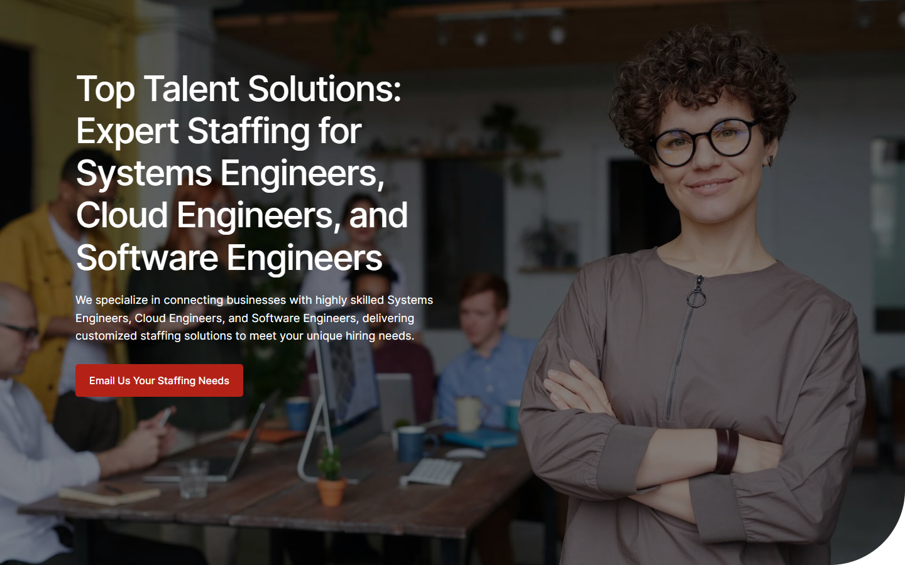
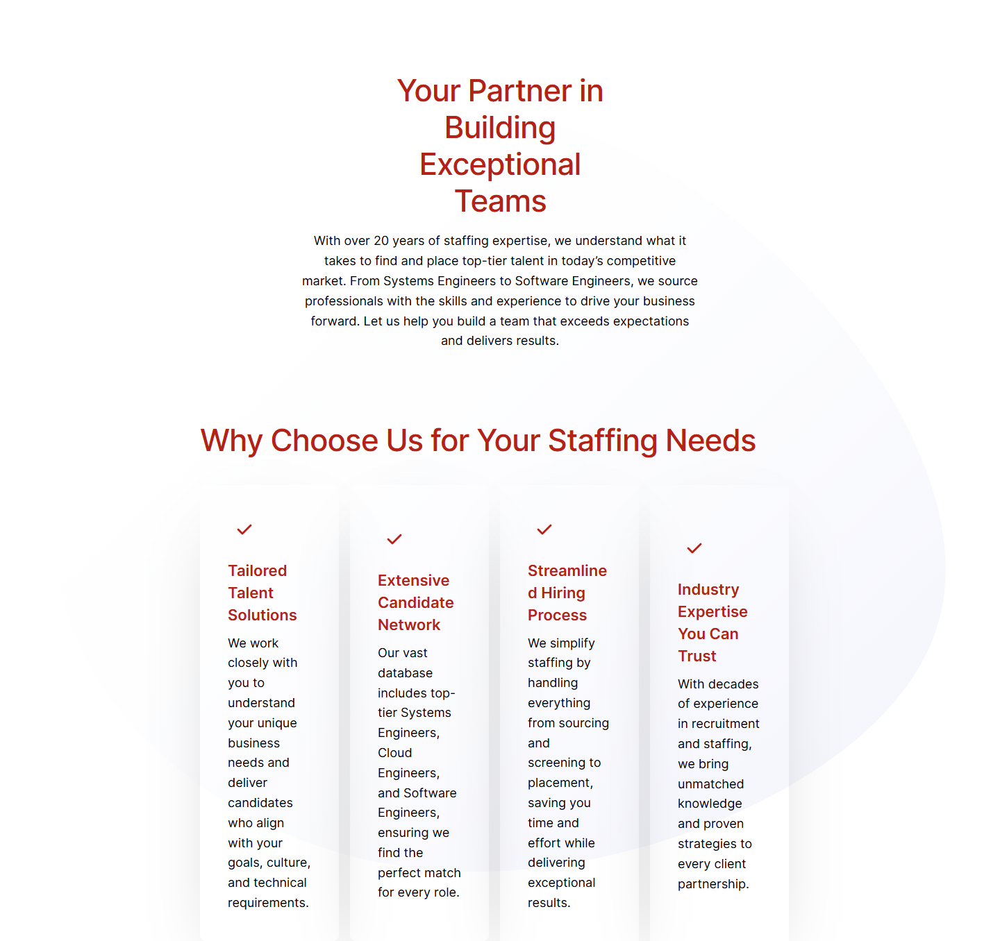
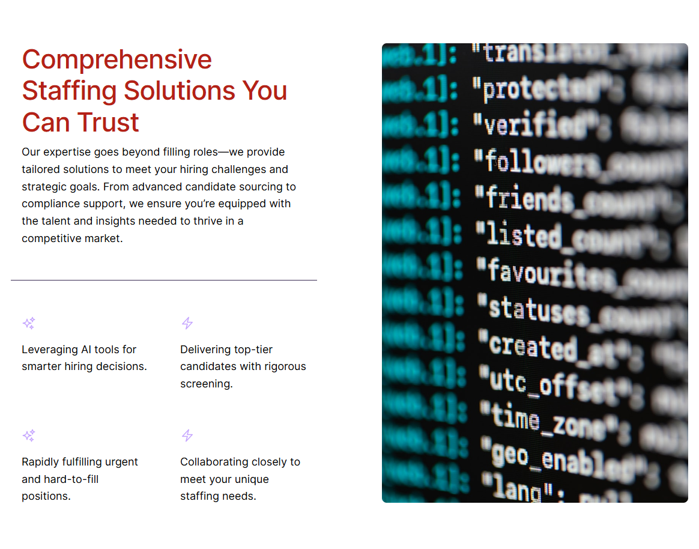

# XcelCareers Staffing Solutions – Top Talent Solutions: Expert Staffing for Systems Engineers, Cloud Engineers, and Software Engineers

*XcelCareers (client's current site)* · URL: https://xcelcareers.com/ · captured 2026-11-08 00:23:44 · HTTP 200

- **Meta description:** —
- **Page size (desktop 1440px):** 1440×4903 px · tablet (820px): 4485 px · mobile (390px): 6028 px
- **Screenshots:** [desktop](screenshots/desktop-full.png) · [tablet](screenshots/tablet-full.png) · [mobile](screenshots/mobile-full.png) · [desktop top](screenshots/desktop-viewport-top.png) · [desktop scrolled](screenshots/desktop-viewport-scrolled.png)
- **Files:** [raw.html](raw.html) (server HTML) · [rendered.html](rendered.html) (DOM after JS) · [content.txt](content.txt) (all visible text) · layout-*.json (full element tree with computed styles) · page.json (everything)

## 1. Section map (top → bottom, desktop 1440px)

| # | Role | Y from top | Height | Heading / first text | Mobile height | Screenshot |
|---|---|---|---|---|---|---|
| 0 | header | 0 | 153 | Home Transition Into Tech Jobs Contact 410.865.9558 | 153 | [img](screenshots/desktop-sec00-header.png) |
| 1 | section | 153 | 900 | Top Talent Solutions: Expert Staffing for Systems Engineers, Cloud Engineers, and Software | 772 | [img](screenshots/desktop-sec01-section.png) |
| 2 | section | 1053 | 358 | Ready to find your next opportunity? | 396 | [img](screenshots/desktop-sec02-section.png) |
| 3 | section | 1411 | 1356 | Your Partner in Building Exceptional Teams | 1833 | [img](screenshots/desktop-sec03-section.png) |
| 4 | section | 2785 | 100 |  | 100 | [img](screenshots/desktop-sec04-section.png) |
| 5 | section | 2903 | 914 | Comprehensive Staffing Solutions You Can Trust | 1573 | [img](screenshots/desktop-sec05-section.png) |
| 6 | section | 3834 | 100 |  | 100 | [img](screenshots/desktop-sec06-section.png) |
| 7 | section | 3952 | 53 | Companies We Work With | 38 | [img](screenshots/desktop-sec07-section.png) |
| 8 | section | 4005 | 364 | 1 2 3 4 5 6 7 8 9 10 11 12 13 14 15 16 17 | 278 | [img](screenshots/desktop-sec08-section.png) |
| 9 | section | 4399 | 100 |  | 100 | [img](screenshots/desktop-sec09-section.png) |
| 10 | footer | 4499 | 404 | XcelCareers Staffing Solutions | 591 | [img](screenshots/desktop-sec10-footer.png) |

## 2. Section-by-section layout (desktop)

Legend: each line is an element in DOM order. `@x,y w×h` = position/size in px on the 1440px-wide page. Text lines show *font size/weight, line-height, colour*. Boxes show layout (flex/grid), background, padding, radius, shadow, etc. Pass-through wrappers are collapsed.

### 2.0 HEADER — Home Transition Into Tech Jobs Contact 410.865.9558

Element: `<header class="wp-block-template-part">` at y=0, 1440×153px · 

- div.wp-block-columns [flex row · gap:18px] `@0,0 1440×153`
  - div.wp-block-group [bg:#000000 · pad:0px 18px 0px 18px] `@0,0 1440×153`
    - div.wp-block-group [flex row · justify:space-between · align:center · gap:18px · margin:0px 120px 0px 120px · max-w:1164px] `@138,0 1164×153`
      - a (link→/) [inline-block] `@138,0 153×153`
        - **IMG** `MediumSquareLogo.png` alt="" natural 400×400 · inline · max-w:100% · overflow:clip `@138,0 153×153`
      - div.wp-block-group [flex row · justify:flex-end · align:center · gap:54px] `@688,56 614×41`
        - nav.wp-block-navigation [flex row wrap · justify:flex-end · align:center · gap:36px] `@688,64 407×26`
          - div.wp-block-navigation__responsive-container-content [flex row wrap · justify:flex-end · align:center · gap:36px] `@688,64 407×26`
            - ul.wp-block-navigation__container [flex row wrap · justify:flex-end · align:center · gap:36px] `@688,64 407×26`
              - li.wp-block-navigation-item [flex row · align:center] `@688,64 46×26`
                - **A→/** "Home" — Inter 16px/400 lh 25.6px · #FFFFFF · letterSpacing:0.25px `@688,64 46×26`
              - li.wp-block-navigation-item [flex row · align:center] `@770,64 154×26`
                - **A→/transition-into-tech/** "Transition Into Tech" — Inter 16px/400 lh 25.6px · #FFFFFF · letterSpacing:0.25px `@770,64 154×26`
              - li.wp-block-navigation-item [flex row · align:center] `@960,64 38×26`
                - **A→/jobs-2/** "Jobs" — Inter 16px/400 lh 25.6px · #FFFFFF · letterSpacing:0.25px `@960,64 38×26`
              - li.wp-block-navigation-item [flex row · align:center] `@1033,64 62×26`
                - **A→/contact/** "Contact" — Inter 16px/400 lh 25.6px · #FFFFFF · letterSpacing:0.25px `@1033,64 62×26`
        - div.wp-block-buttons [flex row wrap · align:center · gap:18px] `@1149,56 153×41`
          - **A→** "410.865.9558" — Inter 16px/500 lh 16px · #FFFFFF · textAlign:center ‖ inline-block · bg:#B42117 · pad:12.672px 23.328px 12.672px 23.328px · radius:6px `@1149,56 153×41`

### 2.1 SECTION — Top Talent Solutions: Expert Staffing for Systems Engineers, Cloud Engineers, an

Element: `
` at y=153, 1440×900px · 

- div.wp-block-uagb-container [flex row · gap:20px · bg-image:hero-bg-01.jpg · bg-size:cover · bg-pos:50% 50% · pad:0px 0px 160px 0px · min-h:900px · radius:0px 0px 120px · shadow:#000000 @44% 0px 0px 0px 0px · transition:box-shadow 0.2s ease] · pseudo:::before{{"content": "\"\"", "w": "1440px", "h": "900px", "bg": "#000000", "position": "absolute", "opacity": "0.48"}} `@0,153 1440×900`
  - div.uagb-container-inner-blocks-wrap [flex column · justify:center · align:center · gap:20px · margin:0px 120px 0px 120px · max-w:min(100%, 1200px)] `@120,153 1200×740`
    - div.wp-block-uagb-info-box [pad:0px 600px 0px 0px · z:1] `@120,261 1200×524`
      - div.uagb-ifb-content [inline-block · z:1] `@120,261 600×524`
        - div.uagb-ifb-title-wrap [z:1] `@120,261 600×336`
          - **H1** "Top Talent Solutions: Expert Staffing for Systems Engineers, Cloud Engineers, and Software Engineers" — Inter 56px/500 lh 67.2px · #FFFFFF · letterSpacing:-2px ‖ margin:0px 60px 20px 0px `@120,261 540×336`
        - div.uagb-ifb-desc [margin:0px 0px 30px 0px] `@120,617 600×86`
          - **P** "We specialize in connecting businesses with highly skilled Systems Engineers, Cloud Engineers, and Software Engineers, delivering customized staffing solutio…" — Inter 18px/400 lh 28.8px · #FFFFFF ‖ margin:18px 0px 0px 0px `@120,617 600×86`
        - **A→mailto:HRservices@xcelcareers.com** "Email Us Your Staffing Needs" — Inter 16px/500 lh 16px · #FFFFFF · textAlign:center ‖ flex row · bg:#B42217 · pad:18px 22px 18px 22px · radius:5px `@120,733 267×52`

### 2.2 SECTION — Ready to find your next opportunity?

Element: `
` at y=1053, 1440×358px · 

- div.wp-block-uagb-container [flex row · gap:20px · pad:10px 10px 10px 10px · shadow:#000000 @44% 0px 0px 0px 0px · transition:box-shadow 0.2s ease] `@0,1053 1440×358`
  - div.uagb-container-inner-blocks-wrap [flex column · justify:center · align:center · gap:20px · margin:0px 110px 0px 110px · max-w:min(100%, 1200px)] `@120,1063 1200×338`
    - div.wp-block-group [bg:#000000 · pad:54px 54px 54px 54px] `@120,1133 1200×268`
      - div.wp-block-columns [flex row · gap:18px · max-w:1164px] `@174,1187 1092×160`
        - div.wp-block-column `@174,1187 537×160`
          - **H3** "Ready to find your next opportunity?" — Inter 36px/500 lh 46.8px · #FFFFFF · letterSpacing:-1px `@174,1187 537×94`
          - **P** "Explore our job listings and submit your resume today to take the first step toward your dream career." — Inter 18px/400 lh 28.8px · #FFFFFF ‖ margin:9px 0px 0px 0px `@174,1290 537×58`
        - div.wp-block-buttons [flex row wrap · justify:flex-end · align:center · gap:18px] `@729,1246 537×41`
          - **A→/jobs-2/** "Explore Job Listings" — Inter 16px/500 lh 16px · #FFFFFF · textAlign:center ‖ inline-block · bg:#B42217 · pad:12.672px 23.328px 12.672px 23.328px · radius:6px `@1066,1246 200×41`

### 2.3 SECTION — Your Partner in Building Exceptional Teams

Element: `
` at y=1411, 1440×1356px · 

- div.wp-block-uagb-container [flex row · gap:20px · bg-image:blob-grad.svg · bg-size:contain · bg-pos:50% 50% · pad:104px 0px 0px 0px · shadow:#000000 @44% 0px 0px 0px 0px · transition:box-shadow 0.2s ease] `@0,1411 1440×1356`
  - div.uagb-container-inner-blocks-wrap [flex column · justify:center · align:center · gap:20px · margin:0px 288px 0px 288px · max-w:60%] `@288,1515 864×1252`
    - div.wp-block-uagb-info-box [pad:0px 0px 20px 0px · z:1 · align-text:center] `@288,1515 864×448`
      - div.uagb-ifb-content [inline-block · z:1 · align-text:center] `@288,1515 864×428`
        - div.uagb-ifb-title-wrap [z:1 · align-text:center] `@288,1515 864×211`
          - **H2** "Your Partner in Building Exceptional Teams" — Inter 44px/500 lh 52.8px · #B42117 · letterSpacing:-1px · textAlign:center ‖ margin:0px 259.188px 17.2656px 259.188px `@547,1515 346×211`
        - div.uagb-ifb-desc [margin:0px 146.875px 25.9062px 146.875px · align-text:center] `@435,1744 570×173`
          - **P** "With over 20 years of staffing expertise, we understand what it takes to find and place top-tier talent in today’s competitive market. From Systems Engineers…" — Inter 18px/400 lh 28.8px · #000000 · textAlign:center ‖ margin:18px 0px 0px 0px `@435,1744 570×173`
    - **H2** "Why Choose Us for Your Staffing Needs" — Inter 44px/500 lh 52.8px · #B42117 · letterSpacing:-1px ‖ margin:36px 0px 18px 0px `@288,2019 864×53`
    - div.wp-block-uagb-container [flex row · justify:center · gap:20px 0px · max-w:100% · shadow:#000000 @44% 0px 0px 0px 0px · transition:box-shadow 0.2s ease] `@288,2110 864×657`
      - div.wp-block-uagb-container [flex column · justify:center · align:center · pad:40px 40px 40px 40px · margin:0px 16px 0px 0px · max-w:33% · radius:8px · shadow:#000000 @24% 0px 40px 100px -40px · transition:box-shadow 0.2s ease] `@288,2110 200×657`
        - div.wp-block-uagb-info-box [z:1] `@328,2150 120×577`
          - div.uagb-ifb-content [inline-block · z:1] `@328,2150 120×577`
            - div.uagb-iconbox-icon-wrap [flex row · justify:center · align:center · pad:12px 12px 12px 12px · radius:50%] `@328,2150 48×48`
              - **SVG icon** 24×24 fill:#B42117 color:#B42117  `@340,2162 24×24`
            - div.uagb-ifb-title-wrap [z:1] `@328,2218 120×96`
              - **H5** "Tailored Talent Solutions" — Inter 22px/600 lh 31.9px · #B42117 ‖ margin:20px 0px 10px 0px `@328,2218 120×96`
            - **P** "We work closely with you to understand your unique business needs and deliver candidates who align with your goals, culture, and technical requirements." — Inter 18px/400 lh 28.8px · #000000 `@328,2324 120×403`
      - div.wp-block-uagb-container [flex column · justify:center · align:center · pad:40px 40px 40px 40px · margin:0px 16px 0px 0px · max-w:33% · radius:8px · shadow:#000000 @24% 0px 40px 100px -40px · transition:box-shadow 0.2s ease] `@504,2110 200×657`
        - div.wp-block-uagb-info-box [z:1] `@544,2164 120×548`
          - div.uagb-ifb-content [inline-block · z:1] `@544,2164 120×548`
            - div.uagb-iconbox-icon-wrap [flex row · justify:center · align:center · pad:12px 12px 12px 12px · radius:50%] `@544,2164 48×48`
              - **SVG icon** 24×24 fill:#B42117 color:#B42117  `@556,2176 24×24`
            - div.uagb-ifb-title-wrap [z:1] `@544,2232 120×96`
              - **H5** "Extensive Candidate Network" — Inter 22px/600 lh 31.9px · #B42117 ‖ margin:20px 0px 10px 0px `@544,2232 120×96`
            - **P** "Our vast database includes top-tier Systems Engineers, Cloud Engineers, and Software Engineers, ensuring we find the perfect match for every role." — Inter 18px/400 lh 28.8px · #000000 `@544,2338 120×374`
      - div.wp-block-uagb-container [flex column · justify:center · align:center · pad:40px 40px 40px 40px · margin:0px 16px 0px 0px · max-w:33% · shadow:#000000 @24% 0px 40px 100px -40px · transition:box-shadow 0.2s ease] `@720,2110 200×657`
        - div.wp-block-uagb-info-box [z:1] `@760,2150 120×577`
          - div.uagb-ifb-content [inline-block · z:1] `@760,2150 120×577`
            - div.uagb-iconbox-icon-wrap [flex row · justify:center · align:center · pad:12px 12px 12px 12px · radius:50%] `@760,2150 48×48`
              - **SVG icon** 24×24 fill:#B42117 color:#B42117  `@772,2162 24×24`
            - div.uagb-ifb-title-wrap [z:1] `@760,2218 120×96`
              - **H5** "Streamlined Hiring Process" — Inter 22px/600 lh 31.9px · #B42117 ‖ margin:20px 0px 10px 0px `@760,2218 120×96`
            - **P** "We simplify staffing by handling everything from sourcing and screening to placement, saving you time and effort while delivering exceptional results." — Inter 18px/400 lh 28.8px · #000000 `@760,2324 120×403`
      - div.wp-block-uagb-container [flex column · justify:center · align:center · pad:40px 40px 40px 40px · margin:0px 16px 0px 0px · max-w:33% · shadow:#000000 @24% 0px 40px 100px -40px · transition:box-shadow 0.2s ease] `@936,2110 200×657`
        - div.wp-block-uagb-info-box [z:1] `@976,2177 120×522`
          - div.uagb-ifb-content [inline-block · z:1] `@976,2177 120×522`
            - div.uagb-iconbox-icon-wrap [flex row · justify:center · align:center · pad:12px 12px 12px 12px · radius:50%] `@976,2177 48×48`
              - **SVG icon** 24×24 fill:#B42117 color:#B42117  `@988,2189 24×24`
            - div.uagb-ifb-title-wrap [z:1] `@976,2245 120×128`
              - **H5** "Industry Expertise You Can Trust" — Inter 22px/600 lh 31.9px · #B42117 ‖ margin:20px 0px 10px 0px `@976,2245 120×128`
            - **P** "With decades of experience in recruitment and staffing, we bring unmatched knowledge and proven strategies to every client partnership." — Inter 18px/400 lh 28.8px · #000000 `@976,2383 120×317`

### 2.4 SECTION — 

Element: `
` at y=2785, 764×100px · 

- *(empty block — vertical spacer / gap of 100px)*

### 2.5 SECTION — Comprehensive Staffing Solutions You Can Trust

Element: `
` at y=2903, 1164×914px · 

- div.wp-block-group [pad:72px 18px 72px 18px · margin:18px 138px 0px 138px · max-w:1164px] `@138,2903 1164×914`
  - div.wp-block-columns [flex row · gap:108px · max-w:1164px] `@156,2975 1128×770`
    - div.wp-block-column `@156,2975 510×770`
      - div.wp-block-group [pad:0px 18px 0px 18px] `@156,2975 510×340`
        - **H2** "Comprehensive Staffing Solutions You Can Trust" — Inter 44px/500 lh 52.8px · #B42117 · letterSpacing:-1px ‖ max-w:764px `@174,2975 474×158`
        - **P** "Our expertise goes beyond filling roles—we provide tailored solutions to meet your hiring challenges and strategic goals. From advanced candidate sourcing to…" — Inter 18px/400 lh 28.8px · #000000 ‖ margin:9px 0px 0px 0px · max-w:764px `@174,3142 474×173`
      - hr.wp-block-separator [bg:#382A51 · margin:54px 0px 0px 0px · max-w:764px · border:0px 0px 1px 0px none #382A51 · overflow:hidden] `@156,3369 510×1` (empty/decorative)
      - div.wp-block-columns [flex row · gap:18px · pad:27px 0px 0px 0px · margin:27px 0px 0px 0px] `@156,3397 510×160`
        - div.wp-block-group [pad:0px 18px 0px 18px] `@156,3424 246×104`
          - figure.wp-block-image [max-w:764px] `@174,3424 210×29`
            - **IMG** `featured-1.svg` alt="" natural 32×32 · inline · max-w:100% · overflow:clip · filter:url("#wp-duotone-primary") `@174,3429 24×24`
          - **P** "Leveraging AI tools for smarter hiring decisions." — Inter 18px/400 lh 28.8px · #000000 ‖ margin:18px 0px 0px 0px · max-w:764px `@174,3471 210×58`
        - div.wp-block-group [pad:0px 18px 0px 18px] `@420,3424 246×133`
          - figure.wp-block-image [max-w:764px] `@438,3424 210×29`
            - **IMG** `featured-2.svg` alt="" natural 32×32 · inline · max-w:100% · overflow:clip · filter:url("#wp-duotone-primary") `@438,3429 24×24`
          - **P** "Delivering top-tier candidates with rigorous screening." — Inter 18px/400 lh 28.8px · #000000 ‖ margin:18px 0px 0px 0px · max-w:764px `@438,3471 210×86`
      - div.wp-block-columns [flex row · gap:18px · pad:27px 0px 0px 0px · margin:27px 0px 0px 0px] `@156,3584 510×160`
        - div.wp-block-group [pad:0px 18px 0px 18px] `@156,3611 246×133`
          - figure.wp-block-image [max-w:764px] `@174,3611 210×29`
            - **IMG** `featured-1.svg` alt="" natural 32×32 · inline · max-w:100% · overflow:clip · filter:url("#wp-duotone-primary") `@174,3616 24×24`
          - **P** "Rapidly fulfilling urgent and hard-to-fill positions." — Inter 18px/400 lh 28.8px · #000000 ‖ margin:18px 0px 0px 0px · max-w:764px `@174,3658 210×86`
        - div.wp-block-group [pad:0px 18px 0px 18px] `@420,3611 246×133`
          - figure.wp-block-image [max-w:764px] `@438,3611 210×29`
            - **IMG** `featured-2.svg` alt="" natural 32×32 · inline · max-w:100% · overflow:clip · filter:url("#wp-duotone-primary") `@438,3616 24×24`
          - **P** "Collaborating closely to meet your unique staffing needs." — Inter 18px/400 lh 28.8px · #000000 ‖ margin:18px 0px 0px 0px · max-w:764px `@438,3658 210×86`
    - **IMG** `zdbou0fayk4.jpg` alt="white and red text on black background" natural 800×1200 · inline · max-w:100% · radius:8px · overflow:clip `@774,2975 510×765`

### 2.6 SECTION — 

Element: `
` at y=3834, 764×100px · 

- *(empty block — vertical spacer / gap of 100px)*

### 2.7 SECTION — Companies We Work With

Element: `<h2 class="wp-block-heading has-text-align-center">` at y=3952, 764×53px · 

- **H2** "Companies We Work With" — Inter 44px/500 lh 52.8px · #B42117 · letterSpacing:-1px · textAlign:center ‖ margin:18px 338px 0px 338px · max-w:764px `@338,3952 764×53`

### 2.8 SECTION — 1 2 3 4 5 6 7 8 9 10 11 12 13 14 15 16 17

Element: `
` at y=4005, 764×364px · 

- div.wp-block-uagb-image-gallery [margin:0px 338px 0px 338px · max-w:764px] `@338,4005 764×364`
  - div.spectra-image-gallery [margin:0px 0px 8px 0px] `@338,4005 764×364`
    - div.uagb-block-9fb2ddec `@338,4005 764×364`
      - div.slick-list [margin:0px -4px 0px -4px · overflow:hidden · transform:matrix(1, 0, 0, 1, 0, 0)] `@334,4005 772×334`
        - div.slick-track [flex row · align:center · transform:matrix(1, 0, 0, 1, -1548, 0)] `@-1214,4005 9546×334`
          - div.slick-slide [min-h:1px] `@-1214,4135 258×74`
            - div.spectra-image-gallery__media-wrapper [pad:0px 4px 0px 4px] `@-1214,4135 258×74`
              - div.spectra-image-gallery__media [shadow:#000000 0px 0px 0px 0px · overflow:hidden · transition:box-shadow 0.25s ease] `@-1210,4135 250×74`
                - **PICTURE** https://xcelcareers.com/wp-content/uploads/2022/03/th-1-e1544475635932.jpg  `@-1210,4135 250×74`
          - div.slick-slide [min-h:1px] `@-956,4103 258×138`
            - div.spectra-image-gallery__media-wrapper [pad:0px 4px 0px 4px] `@-956,4103 258×138`
              - div.spectra-image-gallery__media [shadow:#000000 0px 0px 0px 0px · overflow:hidden · transition:box-shadow 0.25s ease] `@-952,4103 250×138`
                - **PICTURE** https://xcelcareers.com/wp-content/uploads/2022/03/th-4-e1544476905311.jpg  `@-952,4103 250×138`
          - div.slick-slide [min-h:1px] `@-440,4102 258×141`
            - div.spectra-image-gallery__media-wrapper [pad:0px 4px 0px 4px] `@-440,4102 258×141`
              - div.spectra-image-gallery__media [shadow:#000000 0px 0px 0px 0px · overflow:hidden · transition:box-shadow 0.25s ease] `@-436,4102 250×141`
                - **PICTURE** https://xcelcareers.com/wp-content/uploads/2023/08/General-Dynamics-Logo.png  `@-436,4102 250×141`
          - div.slick-slide [min-h:1px] `@-182,4138 258×68`
            - div.spectra-image-gallery__media-wrapper [pad:0px 4px 0px 4px] `@-182,4138 258×68`
              - div.spectra-image-gallery__media [shadow:#000000 0px 0px 0px 0px · overflow:hidden · transition:box-shadow 0.25s ease] `@-178,4138 250×68`
                - **PICTURE** https://xcelcareers.com/wp-content/uploads/2023/08/6227175c74a10c92f2ae07a6-1.png  `@-178,4138 250×68`
          - div.slick-slide [min-h:1px] `@76,4047 258×250`
            - div.spectra-image-gallery__media-wrapper [pad:0px 4px 0px 4px] `@76,4047 258×250`
              - div.spectra-image-gallery__media [shadow:#000000 0px 0px 0px 0px · overflow:hidden · transition:box-shadow 0.25s ease] `@80,4047 250×250`
                - **PICTURE** https://xcelcareers.com/wp-content/uploads/2023/08/Seal_of_the_United_States_House_of_Representatives.svg.png  `@80,4047 250×250`
          - div.slick-slide [min-h:1px] `@850,4005 258×334`
            - div.spectra-image-gallery__media-wrapper [pad:0px 4px 0px 4px] `@850,4005 258×334`
              - div.spectra-image-gallery__media [shadow:#000000 0px 0px 0px 0px · overflow:hidden · transition:box-shadow 0.25s ease] `@854,4005 250×334`
                - **PICTURE** https://xcelcareers.com/wp-content/uploads/2023/08/Logo_of_the_United_States_Army.svg-1.png  `@854,4005 250×334`
          - … 14 more siblings of the same type (carousel slides / repeated items — see layout-desktop.json)
      - ul.slick-dots [margin:0px 0px 30px 0px · transform:matrix(1, 0, 0, 1, 0, 30) · align-text:center] `@338,4377 764×30`
        - **BUTTON** "1" — Arial 0px/400 lh 0px · transparent · textAlign:center ‖ pad:5px 5px 5px 5px `@550,4387 20×20`
        - **BUTTON** "2" — Arial 0px/400 lh 0px · transparent · textAlign:center ‖ pad:5px 5px 5px 5px `@570,4387 20×20`
        - **BUTTON** "3" — Arial 0px/400 lh 0px · transparent · textAlign:center ‖ pad:5px 5px 5px 5px `@590,4387 20×20`
        - **BUTTON** "4" — Arial 0px/400 lh 0px · transparent · textAlign:center ‖ pad:5px 5px 5px 5px `@610,4387 20×20`
        - **BUTTON** "5" — Arial 0px/400 lh 0px · transparent · textAlign:center ‖ pad:5px 5px 5px 5px `@630,4387 20×20`
        - **BUTTON** "6" — Arial 0px/400 lh 0px · transparent · textAlign:center ‖ pad:5px 5px 5px 5px `@650,4387 20×20`
        - … 11 more siblings of the same type (carousel slides / repeated items — see layout-desktop.json)

### 2.9 SECTION — 

Element: `
` at y=4399, 764×100px · 

- *(empty block — vertical spacer / gap of 100px)*

### 2.10 FOOTER — XcelCareers Staffing Solutions

Element: `<footer class="wp-block-template-part">` at y=4499, 1440×404px · 

- div.wp-block-group [bg:#B42117 · pad:72px 18px 36px 18px] `@0,4499 1440×404`
  - div.wp-block-columns [flex row · gap:36px · margin:0px 120px 0px 120px · max-w:1164px] `@138,4571 1164×220`
    - div.wp-block-column [pad:0px 0px 9px 0px] `@138,4571 564×220`
      - a (link→/) [inline-block] `@138,4571 110×47`
        - **IMG** `MediumSquareLogo-e1736976275746.png` alt="" natural 400×170 · inline · max-w:100% · overflow:clip · filter:url("#wp-duotone-secondary") `@138,4571 110×47`
      - **P** "XcelCareers empowers professionals to thrive in the booming tech industry. With over 20 years of expertise in recruitment and staffing, we provide the tools …" — Inter 16px/400 lh 25.6px · #FFFFFF ‖ pad:0px 36px 0px 0px · margin:18px 0px 0px 0px `@138,4636 564×128`
    - div.wp-block-column [pad:0px 0px 9px 0px] `@738,4571 564×220`
      - div.wp-block-columns [flex row · gap:32px] `@738,4571 564×136`
        - div.wp-block-column `@738,4571 266×136`
          - **H5** "Address:" — Inter 22px/600 lh 31.9px · #FFFFFF `@738,4571 266×32`
          - **P** "10155 Baltimore National Pike Ste 105 Ellicott City, MD 21042 United States" — Inter 18px/400 lh 28.8px · #FFFFFF ‖ margin:18px 0px 0px 0px `@738,4621 266×86`
        - div.wp-block-column `@1036,4571 266×136`
          - **H5** "Contact:" — Inter 22px/600 lh 31.9px · #FFFFFF `@1036,4571 266×32`
          - p.wp-block-paragraph [margin:18px 0px 0px 0px] `@1036,4621 266×29`
            - **A→mailto:HRservices@xcelcareers.com** "HRservices@xcelcareers.com" — Inter 18px/400 lh 28.8px · #FFFFFF ‖ inline `@1036,4624 252×21`
  - div.wp-block-group [flex row · justify:center · align:center · gap:9px · pad:0px 18px 0px 18px · margin:54px 120px 0px 120px · max-w:1164px] `@138,4845 1164×22`
    - **P** "© 2025 ·" — Inter 14px/400 lh 22.4px · #FFFFFF · textAlign:center `@517,4845 59×22`
    - **A→/** "XcelCareers Staffing Solutions" — Inter 14px/400 lh 22.4px · #FFFFFF ‖ inline `@585,4847 201×17`
    - **P** "· All rights reserved" — Inter 14px/400 lh 22.4px · #FFFFFF · textAlign:center `@795,4845 128×22`

## 3. Header, navigation & interaction behaviour

- **atTop** `header.wp-block-template-part` position:static top:0 height:153 bg:transparent shadow:none backdrop:none z:auto
- **afterScroll1400** `header.wp-block-template-part` position:static top:-1400 height:153 bg:transparent shadow:none backdrop:none z:auto

| Menu item | Link | Dropdown | Style | Hover change |
|---|---|---|---|---|
| Home | / | — | Inter 16px/400 #FFFFFF  ls 0.25px | none |
| Transition Into Tech | /transition-into-tech/ | — | Inter 16px/400 #FFFFFF  ls 0.25px | none |
| Jobs | /jobs-2/ | — | Inter 16px/400 #FFFFFF  ls 0.25px | none |
| Contact | /contact/ | — | Inter 16px/400 #FFFFFF  ls 0.25px | none |

- **Mobile menu:** toggle `.wp-block-navigation__responsive-container-open` → [screenshot](screenshots/mobile-menu-open.png) · items: Home, Transition Into Tech, Jobs, Contact

### Hover states (measured by hovering in Chrome)

| Element | Text | Normal | On hover |
|---|---|---|---|
| `a.wp-block-navigation-item__content` | Home | color #FFFFFF · bg transparent · radius 0px · pad 0px · border 0px #FFFFFF · transition all | no change |
| `a.wp-block-button__link` | 410.865.9558 | color #FFFFFF · bg #B42117 · radius 6px · pad 12.672px 23.328px · border 0px #B42217 · transition all | no change |
| `div.wp-block-uagb-info-box` | Top Talent Solutions: Expert Staffing fo | color #000000 · bg transparent · radius 0px · pad 0px 600px 0px 0px · border 0px #000000 · transition all | no change |
| `div.uagb-ifb-content` | Top Talent Solutions: Expert Staffing fo | color #000000 · bg transparent · radius 0px · pad 0px · border 0px #000000 · transition all | no change |
| `a.uagb-infobox-cta-link` | Email Us Your Staffing Needs | color #FFFFFF · bg #B42217 · radius 5px · pad 18px 22px · border 0px #333333 · transition all | no change |
| `a.wp-block-button__link` | Explore Job Listings | color #FFFFFF · bg #B42217 · radius 6px · pad 12.672px 23.328px · border 0px #B42217 · transition all | no change |
| `div.wp-block-uagb-info-box` | Your Partner in Building Exceptional Tea | color #000000 · bg transparent · radius 0px · pad 0px 0px 20px · border 0px #000000 · transition all | no change |
| `div.wp-block-uagb-info-box` | Tailored Talent Solutions We work closel | color #000000 · bg transparent · radius 0px · pad 0px · border 0px #000000 · transition all | no change |
| `div.wp-block-uagb-info-box` | Extensive Candidate Network Our vast dat | color #000000 · bg transparent · radius 0px · pad 0px · border 0px #000000 · transition all | no change |
| `div.wp-block-uagb-info-box` | Streamlined Hiring Process We simplify s | color #000000 · bg transparent · radius 0px · pad 0px · border 0px #000000 · transition all | no change |
| `div.wp-block-uagb-info-box` | Industry Expertise You Can Trust With de | color #000000 · bg transparent · radius 0px · pad 0px · border 0px #000000 · transition all | no change |
| `button.` | 1 | color transparent · bg transparent · radius 0px · pad 5px · border 0px transparent · transition all | no change |
| `a.` |  | color #000000 · bg transparent · radius 0px · pad 0px · border 0px #000000 · transition all | color: #000000 → #B42117; borderTopColor: #000000 → #B42117; childColor: #000000 → #B42117 |
| `a.` | HRservices@xcelcareers.com | color #FFFFFF · bg transparent · radius 0px · pad 0px · border 0px #FFFFFF · transition all | no change |
| `a.` | XcelCareers Staffing Solutions | color #FFFFFF · bg transparent · radius 0px · pad 0px · border 0px #FFFFFF · transition all | no change |

## 4. Typography & colour used on this page (weighted by amount of text / area)

| Font · weight · size / line-height | chars |
|---|---|
| Inter | 400 | 18px / 28.8px | 1811 |
| Inter | 400 | 16px / 25.6px | 306 |
| Inter | 500 | 44px / 52.8px | 147 |
| Inter | 600 | 22px / 31.9px | 126 |
| Inter | 500 | 56px / 67.2px | 100 |
| Inter | 500 | 16px / 16px | 60 |
| Inter | 400 | 14px / 22.4px | 59 |
| Inter | 500 | 36px / 46.8px | 36 |
| Arial | 400 | 0px / 0px | 25 |

- **Text colours:** #000000 (1415), #FFFFFF (973), #B42117 (257), transparent (25)
- **Background colours (by area):** #B42117 (588), #000000 (542), #B42217 (22), #382A51 (1)
- **Border radii:** 50% (4), 8px (3), 6px (2), 0px 0px 120px (1), 5px (1)
- **Shadows:** #000000 0px 0px 0px 0px (20) | transparent 0px 0px 0px 0px (20) | #000000 @44% 0px 0px 0px 0px (4) | #000000 @24% 0px 40px 100px -40px (4)
- **Mobile text styles:** Inter | 400 | 16px / 25.6px (1811); Inter | 400 | 14px / 22.4px (271); Inter | 500 | 32px / 38.4px (147); Inter | 600 | 20px / 29px (126); Inter | 500 | 40px / 48px (100); Inter | 400 | 12px / 19.2px (59); Inter | 500 | 14px / 14px (48); Inter | 500 | 28px / 36.4px (36); Arial | 400 | 0px / 0px (25)

## 6. Images on the page

- `MediumSquareLogo.png` natural 400×400 → shown 153×153 · alt="" · https://xcelcareers.com/wp-content/uploads/2018/12/MediumSquareLogo.png
- `featured-1.svg` natural 32×32 → shown 24×24 · alt="" · https://xcelcareers.com/wp-content/themes/spectra-one/assets/image/featured-1.svg
- `featured-2.svg` natural 32×32 → shown 24×24 · alt="" · https://xcelcareers.com/wp-content/themes/spectra-one/assets/image/featured-2.svg
- `zdbou0fayk4.jpg` natural 800×1200 → shown 510×765 · alt="white and red text on black background" · https://xcelcareers.com/wp-content/uploads/2025/01/zdbou0fayk4.jpg
- `th-1-e1544475635932.jpg` natural 200×59 → shown 250×74 · alt="" · https://xcelcareers.com/wp-content/uploads/2022/03/th-1-e1544475635932.jpg
- `th-4-e1544476905311.jpg` natural 100×55 → shown 250×138 · alt="" · https://xcelcareers.com/wp-content/uploads/2022/03/th-4-e1544476905311.jpg
- `th-3-e1544476370247-300x60.jpg` natural 0×0 → shown 250×0 · alt="" · https://xcelcareers.com/wp-content/uploads/2022/03/th-3-e1544476370247-300x60.jpg
- `General-Dynamics-Logo.png` natural 3840×2160 → shown 250×141 · alt="" · https://xcelcareers.com/wp-content/uploads/2023/08/General-Dynamics-Logo.png
- `6227175c74a10c92f2ae07a6-1.png` natural 2000×544 → shown 250×68 · alt="" · https://xcelcareers.com/wp-content/uploads/2023/08/6227175c74a10c92f2ae07a6-1.png
- `Seal_of_the_United_States_House_of_Representatives.svg.png` natural 600×600 → shown 250×250 · alt="" · https://xcelcareers.com/wp-content/uploads/2023/08/Seal_of_the_United_States_House_of_Representatives.svg.png
- `US_Air_Force_Logo_Solid_Colour.svg-300x234.png` natural 0×0 → shown 250×0 · alt="" · https://xcelcareers.com/wp-content/uploads/2023/08/US_Air_Force_Logo_Solid_Colour.svg-300x234.png
- `png-transparent-microsoft-logo-organization-san-francisco-cloud-computing-partner-company-text-rectangle-300x163.png` natural 0×0 → shown 250×0 · alt="" · https://xcelcareers.com/wp-content/uploads/2023/08/png-transparent-microsoft-logo-organization-san-francisco-cloud-computing-partner-company-text-rectangle-300x163.png
- `Logo_of_the_United_States_Army.svg-1.png` natural 200×267 → shown 250×334 · alt="" · https://xcelcareers.com/wp-content/uploads/2023/08/Logo_of_the_United_States_Army.svg-1.png
- `Logo-Boeing-300x188.png` natural 0×0 → shown 250×0 · alt="" · https://xcelcareers.com/wp-content/uploads/2023/08/Logo-Boeing-300x188.png
- `Amazon_logo.svg-300x90.png` natural 0×0 → shown 250×0 · alt="" · https://xcelcareers.com/wp-content/uploads/2023/08/Amazon_logo.svg-300x90.png
- `GeorgiaTech_RGB-300x106.png` natural 0×0 → shown 250×0 · alt="" · https://xcelcareers.com/wp-content/uploads/2023/08/GeorgiaTech_RGB-300x106.png
- `Raytheon_Technologies_logo-300x90.png` natural 0×0 → shown 250×0 · alt="" · https://xcelcareers.com/wp-content/uploads/2023/08/Raytheon_Technologies_logo-300x90.png
- `parsons-logo.png` natural 196×40 → shown 250×51 · alt="" · https://xcelcareers.com/wp-content/uploads/2023/08/parsons-logo.png
- `United_States_Navy_logo-1-300x125.jpg` natural 0×0 → shown 250×0 · alt="" · https://xcelcareers.com/wp-content/uploads/2023/08/United_States_Navy_logo-1-300x125.jpg
- `alionlogo.png` natural 210×116 → shown 250×138 · alt="" · https://xcelcareers.com/wp-content/uploads/2023/08/alionlogo.png
- `th-2-e1544475958653.jpg` natural 194×54 → shown 250×70 · alt="" · https://xcelcareers.com/wp-content/uploads/2022/03/th-2-e1544475958653.jpg
- `MediumSquareLogo-e1736976275746.png` natural 400×170 → shown 110×47 · alt="" · https://xcelcareers.com/wp-content/uploads/2018/12/MediumSquareLogo-e1736976275746.png
- background on `div.wp-block-uagb-container`: https://xcelcareers.com/wp-content/uploads/2020/07/hero-bg-01.jpg
- background on `div.wp-block-uagb-container`: https://xcelcareers.com/wp-content/uploads/2020/06/blob-grad.svg

## 7. Links on the page

- [header] "(icon/image)" → /
- [header] "Home" → /
- [header] "Transition Into Tech" → /transition-into-tech/
- [header] "Jobs" → /jobs-2/
- [header] "Contact" → /contact/
- [body] "Email Us Your Staffing Needs" → mailto:HRservices@xcelcareers.com (target _self)
- [body] "Explore Job Listings" → /jobs-2/
- [footer] "Facebook" → / (target _blank)
- [footer] "Twitter" → / (target _blank)
- [footer] "YouTube" → / (target _blank)
- [footer] "LinkedIn" → / (target _blank)
- [footer] "HRservices@xcelcareers.com" → mailto:HRservices@xcelcareers.com
- [footer] "XcelCareers Staffing Solutions" → / (target _self)

## 8. Mobile layout (390px) — condensed outline

### 8.0 header —  (y 0, h 153)
- div.wp-block-columns [flex row wrap · gap:16px] `@0,0 390×153`
  - div.wp-block-group [bg:#000000 · pad:0px 16px 0px 16px] `@0,0 390×153`
    - div.wp-block-group [flex row · justify:space-between · align:center · gap:16px · max-w:1164px] `@16,0 358×153`
      - a (link→/) [inline-block] `@16,0 153×153`
        - **IMG** `MediumSquareLogo.png` alt="" natural 400×400 · inline · max-w:100% · overflow:clip `@16,0 153×153`
      - div.wp-block-group [flex row · justify:flex-end · align:center · gap:48px] `@350,65 24×24`
        - nav.wp-block-navigation [flex row wrap · justify:flex-end · align:center · gap:32px] `@350,65 24×24`
          - **BUTTON** "" +icon[svg] — Inter 14px/400 lh normal · #FFFFFF · textAlign:center ‖ flex row `@350,65 24×24`

### 8.1 section — Top Talent Solutions: Expert Staffing for Systems Engineers, Cloud Eng (y 153, h 772)
- div.wp-block-uagb-container [flex row · gap:20px · bg-image:hero-bg-01.jpg · bg-size:cover · bg-pos:100% 49% · pad:80px 24px 80px 24px · radius:0px 0px 40px · shadow:#000000 @44% 0px 0px 0px 0px · transition:box-shadow 0.2s ease] · pseudo:::before{{"content": "\"\"", "w": "390px", "h": "771.969px", "bg": "#000000", "position": "absolute", "opacity": "0.48"}} `@0,153 390×772`
  - div.uagb-container-inner-blocks-wrap [flex column wrap · justify:center · align:center · gap:20px · max-w:min(100%, 426px)] `@24,233 342×612`
    - div.wp-block-uagb-info-box [z:1 · align-text:center] `@24,233 342×612`
      - div.uagb-ifb-content [inline-block · z:1 · align-text:center] `@24,233 342×612`
        - div.uagb-ifb-title-wrap [z:1 · align-text:center] `@24,233 342×384`
          - **H1** "Top Talent Solutions: Expert Staffing for Systems Engineers, Cloud Engineers, and Software Engineers" — Inter 40px/500 lh 48px · #FFFFFF · letterSpacing:-2px · textAlign:center ‖ margin:0px 30px 20px 30px `@54,233 282×384`
        - div.uagb-ifb-desc [margin:0px 0px 30px 0px · align-text:center] `@24,637 342×128`
          - **P** "We specialize in connecting businesses with highly skilled Systems Engineers, Cloud Engineers, and Software Engineers, delivering customized staffing solutio…" — Inter 16px/400 lh 25.6px · #FFFFFF · textAlign:center ‖ margin:16px 0px 0px 0px `@24,637 342×128`
        - **A→mailto:HRservices@xcelcareers.com** "Email Us Your Staffing Needs" — Inter 14px/500 lh 14px · #FFFFFF · textAlign:center ‖ flex row · bg:#B42217 · pad:18px 22px 18px 22px · radius:5px `@81,795 227×50`

### 8.2 section — Ready to find your next opportunity? (y 925, h 396)
- div.wp-block-uagb-container [flex row · gap:20px · pad:10px 10px 10px 10px · shadow:#000000 @44% 0px 0px 0px 0px · transition:box-shadow 0.2s ease] `@0,925 390×396`
  - div.uagb-container-inner-blocks-wrap [flex column wrap · justify:center · align:center · gap:20px · max-w:min(100%, 767px)] `@10,935 370×376`
    - div.wp-block-group [bg:#000000 · pad:48px 48px 48px 48px] `@10,1005 370×306`
      - div.wp-block-columns [flex row wrap · gap:16px · max-w:1164px] `@58,1053 274×210`
        - div.wp-block-column `@58,1053 274×158`
          - **H3** "Ready to find your next opportunity?" — Inter 28px/500 lh 36.4px · #FFFFFF · letterSpacing:-1px `@58,1053 274×73`
          - **P** "Explore our job listings and submit your resume today to take the first step toward your dream career." — Inter 16px/400 lh 25.6px · #FFFFFF ‖ margin:8px 0px 0px 0px `@58,1134 274×77`
        - div.wp-block-buttons [flex row wrap · justify:left · align:center · gap:16px] `@58,1227 274×37`
          - **A→/jobs-2/** "Explore Job Listings" — Inter 14px/500 lh 14px · #FFFFFF · textAlign:center ‖ inline-block · bg:#B42217 · pad:11.338px 20.662px 11.338px 20.662px · radius:5.25px `@58,1227 167×37`

### 8.3 section — Your Partner in Building Exceptional Teams (y 1321, h 1833)
- div.wp-block-uagb-container [flex row · gap:0px 20px · bg-image:blob-grad.svg · bg-size:cover · bg-pos:50% 50% · pad:64px 24px 64px 24px · shadow:#000000 @44% 0px 0px 0px 0px · transition:box-shadow 0.2s ease] `@0,1321 390×1833`
  - div.uagb-container-inner-blocks-wrap [flex column wrap · justify:center · align:center · gap:0px 20px · max-w:min(100%, 426px)] `@24,1385 342×1705`
    - div.wp-block-uagb-info-box [pad:0px 0px 20px 0px · z:1] `@24,1385 342×338`
      - div.uagb-ifb-content [inline-block · z:1] `@24,1385 342×318`
        - div.uagb-ifb-title-wrap [z:1] `@24,1385 342×77`
          - **H2** "Your Partner in Building Exceptional Teams" — Inter 32px/500 lh 38.4px · #B42117 · letterSpacing:-1px ‖ margin:0px 0px 6.82812px 0px `@24,1385 342×77`
        - div.uagb-ifb-desc [margin:0px 0px 20px 0px] `@24,1478 342×205`
          - **P** "With over 20 years of staffing expertise, we understand what it takes to find and place top-tier talent in today’s competitive market. From Systems Engineers…" — Inter 16px/400 lh 25.6px · #000000 ‖ margin:16px 0px 0px 0px `@24,1478 342×205`
    - **H2** "Why Choose Us for Your Staffing Needs" — Inter 32px/500 lh 38.4px · #B42117 · letterSpacing:-1px ‖ margin:32px 0px 16px 0px `@24,1755 342×77`
    - div.wp-block-uagb-container [flex row wrap · justify:center · max-w:100% · shadow:#000000 @44% 0px 0px 0px 0px · transition:box-shadow 0.2s ease] `@24,1848 342×1243`
      - div.wp-block-uagb-container [flex column wrap · justify:center · align:center · pad:32px 24px 32px 24px · margin:0px 0px 24px 0px · max-w:100% · radius:8px · shadow:#000000 @24% 0px 40px 100px -40px · transition:box-shadow 0.2s ease] `@24,1848 342×273`
        - div.wp-block-uagb-info-box [z:1] `@48,1880 294×209`
          - div.uagb-ifb-content [inline-block · z:1] `@48,1880 294×209`
            - div.uagb-iconbox-icon-wrap [flex row · justify:center · align:center · pad:12px 12px 12px 12px · radius:50%] `@48,1880 48×48`
              - **SVG icon** 24×24 fill:#B42117 color:#B42117  `@60,1892 24×24`
            - div.uagb-ifb-title-wrap [z:1] `@48,1948 294×29`
              - **H5** "Tailored Talent Solutions" — Inter 20px/600 lh 29px · #B42117 ‖ margin:20px 0px 10px 0px `@48,1948 294×29`
            - **P** "We work closely with you to understand your unique business needs and deliver candidates who align with your goals, culture, and technical requirements." — Inter 16px/400 lh 25.6px · #000000 `@48,1987 294×102`
      - div.wp-block-uagb-container [flex column wrap · justify:center · align:center · pad:32px 24px 32px 24px · margin:0px 0px 32px 0px · max-w:100% · radius:8px · shadow:#000000 @24% 0px 40px 100px -40px · transition:box-shadow 0.2s ease] `@24,2145 342×273`
        - div.wp-block-uagb-info-box [z:1] `@48,2177 294×209`
          - div.uagb-ifb-content [inline-block · z:1] `@48,2177 294×209`
            - div.uagb-iconbox-icon-wrap [flex row · justify:center · align:center · pad:12px 12px 12px 12px · radius:50%] `@48,2177 48×48`
              - **SVG icon** 24×24 fill:#B42117 color:#B42117  `@60,2189 24×24`
            - div.uagb-ifb-title-wrap [z:1] `@48,2245 294×29`
              - **H5** "Extensive Candidate Network" — Inter 20px/600 lh 29px · #B42117 ‖ margin:20px 0px 10px 0px `@48,2245 294×29`
            - **P** "Our vast database includes top-tier Systems Engineers, Cloud Engineers, and Software Engineers, ensuring we find the perfect match for every role." — Inter 16px/400 lh 25.6px · #000000 `@48,2284 294×102`
      - div.wp-block-uagb-container [flex column wrap · justify:center · align:center · pad:32px 24px 32px 24px · margin:0px 0px 32px 0px · max-w:100% · shadow:#000000 @24% 0px 40px 100px -40px · transition:box-shadow 0.2s ease] `@24,2450 342×273`
        - div.wp-block-uagb-info-box [z:1] `@48,2482 294×209`
          - div.uagb-ifb-content [inline-block · z:1] `@48,2482 294×209`
            - div.uagb-iconbox-icon-wrap [flex row · justify:center · align:center · pad:12px 12px 12px 12px · radius:50%] `@48,2482 48×48`
              - **SVG icon** 24×24 fill:#B42117 color:#B42117  `@60,2494 24×24`
            - div.uagb-ifb-title-wrap [z:1] `@48,2550 294×29`
              - **H5** "Streamlined Hiring Process" — Inter 20px/600 lh 29px · #B42117 ‖ margin:20px 0px 10px 0px `@48,2550 294×29`
            - **P** "We simplify staffing by handling everything from sourcing and screening to placement, saving you time and effort while delivering exceptional results." — Inter 16px/400 lh 25.6px · #000000 `@48,2589 294×102`
      - div.wp-block-uagb-container [flex column wrap · justify:center · align:center · pad:32px 24px 32px 24px · margin:0px 0px 32px 0px · max-w:100% · shadow:#000000 @24% 0px 40px 100px -40px · transition:box-shadow 0.2s ease] `@24,2756 342×302`
        - div.wp-block-uagb-info-box [z:1] `@48,2788 294×238`
          - div.uagb-ifb-content [inline-block · z:1] `@48,2788 294×238`
            - div.uagb-iconbox-icon-wrap [flex row · justify:center · align:center · pad:12px 12px 12px 12px · radius:50%] `@48,2788 48×48`
              - **SVG icon** 24×24 fill:#B42117 color:#B42117  `@60,2800 24×24`
            - div.uagb-ifb-title-wrap [z:1] `@48,2856 294×58`
              - **H5** "Industry Expertise You Can Trust" — Inter 20px/600 lh 29px · #B42117 ‖ margin:20px 0px 10px 0px `@48,2856 294×58`
            - **P** "With decades of experience in recruitment and staffing, we bring unmatched knowledge and proven strategies to every client partnership." — Inter 16px/400 lh 25.6px · #000000 `@48,2924 294×102`

### 8.4 section —  (y 3170, h 100)
- *(empty block — spacer of 100px)*

### 8.5 section — Comprehensive Staffing Solutions You Can Trust (y 3286, h 1573)
- div.wp-block-group [pad:64px 16px 64px 16px · margin:16px 0px 0px 0px · max-w:1164px] `@0,3286 390×1573`
  - div.wp-block-columns [flex row wrap · gap:96px · max-w:1164px] `@16,3350 358×1445`
    - div.wp-block-column `@16,3350 358×812`
      - div.wp-block-group [pad:0px 16px 0px 16px] `@16,3350 358×264`
        - **H2** "Comprehensive Staffing Solutions You Can Trust" — Inter 32px/500 lh 38.4px · #B42117 · letterSpacing:-1px ‖ max-w:764px `@32,3350 326×77`
        - **P** "Our expertise goes beyond filling roles—we provide tailored solutions to meet your hiring challenges and strategic goals. From advanced candidate sourcing to…" — Inter 16px/400 lh 25.6px · #000000 ‖ margin:8px 0px 0px 0px · max-w:764px `@32,3435 326×179`
      - hr.wp-block-separator [bg:#382A51 · margin:48px 0px 0px 0px · max-w:764px · border:0px 0px 1px 0px none #382A51 · overflow:hidden] `@16,3662 358×1` (empty/decorative)
      - div.wp-block-columns [flex row wrap · gap:16px · pad:24px 0px 0px 0px · margin:24px 0px 0px 0px] `@16,3687 358×226`
        - div.wp-block-group [pad:0px 16px 0px 16px] `@16,3711 358×93`
          - figure.wp-block-image [max-w:764px] `@32,3711 326×26`
            - **IMG** `featured-1.svg` alt="" natural 32×32 · inline · max-w:100% · overflow:clip · filter:url("#wp-duotone-primary") `@32,3713 24×24`
          - **P** "Leveraging AI tools for smarter hiring decisions." — Inter 16px/400 lh 25.6px · #000000 ‖ margin:16px 0px 0px 0px · max-w:764px `@32,3753 326×51`
        - div.wp-block-group [pad:0px 16px 0px 16px] `@16,3820 358×93`
          - figure.wp-block-image [max-w:764px] `@32,3820 326×26`
            - **IMG** `featured-2.svg` alt="" natural 32×32 · inline · max-w:100% · overflow:clip · filter:url("#wp-duotone-primary") `@32,3821 24×24`
          - **P** "Delivering top-tier candidates with rigorous screening." — Inter 16px/400 lh 25.6px · #000000 ‖ margin:16px 0px 0px 0px · max-w:764px `@32,3861 326×51`
      - div.wp-block-columns [flex row wrap · gap:16px · pad:24px 0px 0px 0px · margin:24px 0px 0px 0px] `@16,3937 358×226`
        - div.wp-block-group [pad:0px 16px 0px 16px] `@16,3961 358×93`
          - figure.wp-block-image [max-w:764px] `@32,3961 326×26`
            - **IMG** `featured-1.svg` alt="" natural 32×32 · inline · max-w:100% · overflow:clip · filter:url("#wp-duotone-primary") `@32,3962 24×24`
          - **P** "Rapidly fulfilling urgent and hard-to-fill positions." — Inter 16px/400 lh 25.6px · #000000 ‖ margin:16px 0px 0px 0px · max-w:764px `@32,4002 326×51`
        - div.wp-block-group [pad:0px 16px 0px 16px] `@16,4069 358×93`
          - figure.wp-block-image [max-w:764px] `@32,4069 326×26`
            - **IMG** `featured-2.svg` alt="" natural 32×32 · inline · max-w:100% · overflow:clip · filter:url("#wp-duotone-primary") `@32,4071 24×24`
          - **P** "Collaborating closely to meet your unique staffing needs." — Inter 16px/400 lh 25.6px · #000000 ‖ margin:16px 0px 0px 0px · max-w:764px `@32,4111 326×51`
    - **IMG** `zdbou0fayk4.jpg` alt="white and red text on black background" natural 390×585 · inline · max-w:100% · radius:8px · overflow:clip `@16,4258 358×537`

### 8.6 section —  (y 4875, h 100)
- *(empty block — spacer of 100px)*

### 8.7 section — Companies We Work With (y 4991, h 38)
- **H2** "Companies We Work With" — Inter 32px/500 lh 38.4px · #B42117 · letterSpacing:-1px · textAlign:center ‖ margin:16px 0px 0px 0px · max-w:764px `@0,4991 390×38`

### 8.8 section — 1 2 3 4 5 6 7 8 9 10 11 12 13 14 15 16 17 (y 5029, h 278)
- div.wp-block-uagb-image-gallery [max-w:764px] `@0,5029 390×278`
  - div.spectra-image-gallery [margin:0px 0px 8px 0px] `@0,5029 390×278`
    - div.uagb-block-9fb2ddec `@0,5029 390×278`
      - div.slick-list [margin:0px -8px 0px -8px · overflow:hidden · transform:matrix(1, 0, 0, 1, 0, 0)] `@-8,5029 406×250`
        - div.slick-track [flex row · align:center · transform:matrix(1, 0, 0, 1, -1015, 0)] `@-1023,5029 7308×250`
          - div.slick-slide [min-h:1px] `@-1023,5103 203×103`
            - div.spectra-image-gallery__media-wrapper [pad:0px 8px 0px 8px] `@-1023,5103 203×103`
              - div.spectra-image-gallery__media [shadow:#000000 0px 0px 0px 0px · overflow:hidden · transition:box-shadow 0.25s ease] `@-1015,5103 187×103`
                - **PICTURE** https://xcelcareers.com/wp-content/uploads/2022/03/th-4-e1544476905311.jpg  `@-1015,5103 187×103`
          - div.slick-slide [min-h:1px] `@-820,5136 203×37`
            - div.spectra-image-gallery__media-wrapper [pad:0px 8px 0px 8px] `@-820,5136 203×37`
              - div.spectra-image-gallery__media [shadow:#000000 0px 0px 0px 0px · overflow:hidden · transition:box-shadow 0.25s ease] `@-812,5136 187×37`
                - **PICTURE** https://xcelcareers.com/wp-content/uploads/2022/03/th-3-e1544476370247-300x60.jpg  `@-812,5136 187×37`
          - div.slick-slide [min-h:1px] `@-617,5102 203×105`
            - div.spectra-image-gallery__media-wrapper [pad:0px 8px 0px 8px] `@-617,5102 203×105`
              - div.spectra-image-gallery__media [shadow:#000000 0px 0px 0px 0px · overflow:hidden · transition:box-shadow 0.25s ease] `@-609,5102 187×105`
                - **PICTURE** https://xcelcareers.com/wp-content/uploads/2023/08/General-Dynamics-Logo-300x169.png  `@-609,5102 187×105`
          - div.slick-slide [min-h:1px] `@-414,5129 203×51`
            - div.spectra-image-gallery__media-wrapper [pad:0px 8px 0px 8px] `@-414,5129 203×51`
              - div.spectra-image-gallery__media [shadow:#000000 0px 0px 0px 0px · overflow:hidden · transition:box-shadow 0.25s ease] `@-406,5129 187×51`
                - **PICTURE** https://xcelcareers.com/wp-content/uploads/2023/08/6227175c74a10c92f2ae07a6-1-300x82.png  `@-406,5129 187×51`
          - div.slick-slide [min-h:1px] `@-211,5061 203×187`
            - div.spectra-image-gallery__media-wrapper [pad:0px 8px 0px 8px] `@-211,5061 203×187`
              - div.spectra-image-gallery__media [shadow:#000000 0px 0px 0px 0px · overflow:hidden · transition:box-shadow 0.25s ease] `@-203,5061 187×187`
                - **PICTURE** https://xcelcareers.com/wp-content/uploads/2023/08/Seal_of_the_United_States_House_of_Representatives.svg-300x300.png  `@-203,5061 187×187`
          - div.slick-slide [min-h:1px] `@-8,5081 203×146`
            - div.spectra-image-gallery__media-wrapper [pad:0px 8px 0px 8px] `@-8,5081 203×146`
              - div.spectra-image-gallery__media [shadow:#000000 0px 0px 0px 0px · overflow:hidden · transition:box-shadow 0.25s ease] `@0,5081 187×146`
                - **PICTURE** https://xcelcareers.com/wp-content/uploads/2023/08/US_Air_Force_Logo_Solid_Colour.svg-300x234.png  `@0,5081 187×146`
          - … 30 more siblings of the same type (carousel slides / repeated items — see layout-desktop.json)
      - ul.slick-dots [margin:0px 0px 30px 0px · transform:matrix(1, 0, 0, 1, 0, 28) · align-text:center] `@0,5315 390×28`
        - **BUTTON** "1" — Arial 0px/400 lh 0px · transparent · textAlign:center ‖ pad:5px 5px 5px 5px `@25,5323 20×20`
        - **BUTTON** "2" — Arial 0px/400 lh 0px · transparent · textAlign:center ‖ pad:5px 5px 5px 5px `@45,5323 20×20`
        - **BUTTON** "3" — Arial 0px/400 lh 0px · transparent · textAlign:center ‖ pad:5px 5px 5px 5px `@65,5323 20×20`
        - **BUTTON** "4" — Arial 0px/400 lh 0px · transparent · textAlign:center ‖ pad:5px 5px 5px 5px `@85,5323 20×20`
        - **BUTTON** "5" — Arial 0px/400 lh 0px · transparent · textAlign:center ‖ pad:5px 5px 5px 5px `@105,5323 20×20`
        - **BUTTON** "6" — Arial 0px/400 lh 0px · transparent · textAlign:center ‖ pad:5px 5px 5px 5px `@125,5323 20×20`
        - … 11 more siblings of the same type (carousel slides / repeated items — see layout-desktop.json)

### 8.9 section —  (y 5337, h 100)
- *(empty block — spacer of 100px)*

### 8.10 footer — XcelCareers Staffing Solutions (y 5437, h 591)
- div.wp-block-group [bg:#B42117 · pad:64px 16px 32px 16px] `@0,5437 390×591`
  - div.wp-block-columns [flex row wrap · gap:32px · max-w:1164px] `@16,5501 358×408`
    - div.wp-block-column [pad:0px 0px 8px 0px] `@16,5501 358×221`
      - a (link→/) [inline-block] `@16,5501 110×47`
        - **IMG** `MediumSquareLogo-e1736976275746.png` alt="" natural 390×165 · inline · max-w:100% · overflow:clip · filter:url("#wp-duotone-secondary") `@16,5501 110×47`
      - **P** "XcelCareers empowers professionals to thrive in the booming tech industry. With over 20 years of expertise in recruitment and staffing, we provide the tools …" — Inter 14px/400 lh 22.4px · #FFFFFF ‖ pad:0px 32px 0px 0px · margin:16px 0px 0px 0px `@16,5564 358×134`
    - div.wp-block-column [pad:0px 0px 8px 0px] `@16,5754 358×155`
      - div.wp-block-columns [flex row · gap:32px] `@16,5754 358×147`
        - div.wp-block-column `@16,5754 163×147`
          - **H5** "Address:" — Inter 20px/600 lh 29px · #FFFFFF `@16,5754 163×29`
          - **P** "10155 Baltimore National Pike Ste 105 Ellicott City, MD 21042 United States" — Inter 16px/400 lh 25.6px · #FFFFFF ‖ margin:16px 0px 0px 0px `@16,5799 163×102`
        - div.wp-block-column `@211,5754 163×147`
          - **H5** "Contact:" — Inter 20px/600 lh 29px · #FFFFFF `@211,5754 163×29`
          - p.wp-block-paragraph [margin:16px 0px 0px 0px] `@211,5799 163×51`
            - **A→mailto:HRservices@xcelcareers.com** "HRservices@xcelcareers.com" — Inter 16px/400 lh 25.6px · #FFFFFF ‖ inline `@211,5803 158×43`
  - div.wp-block-group [flex row · justify:center · align:center · gap:8px · pad:0px 16px 0px 16px · margin:48px 0px 0px 0px · max-w:1164px] `@16,5958 358×38`
    - **P** "© 2025 ·" — Inter 12px/400 lh 19.2px · #FFFFFF · textAlign:center `@32,5958 46×38`
    - **A→/** "XcelCareers Staffing Solutions" — Inter 12px/400 lh 19.2px · #FFFFFF ‖ inline `@86,5960 110×33`
    - **P** "· All rights reserved" — Inter 12px/400 lh 19.2px · #FFFFFF · textAlign:center `@256,5958 102×38`
