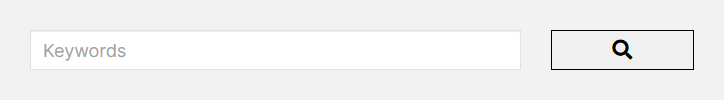
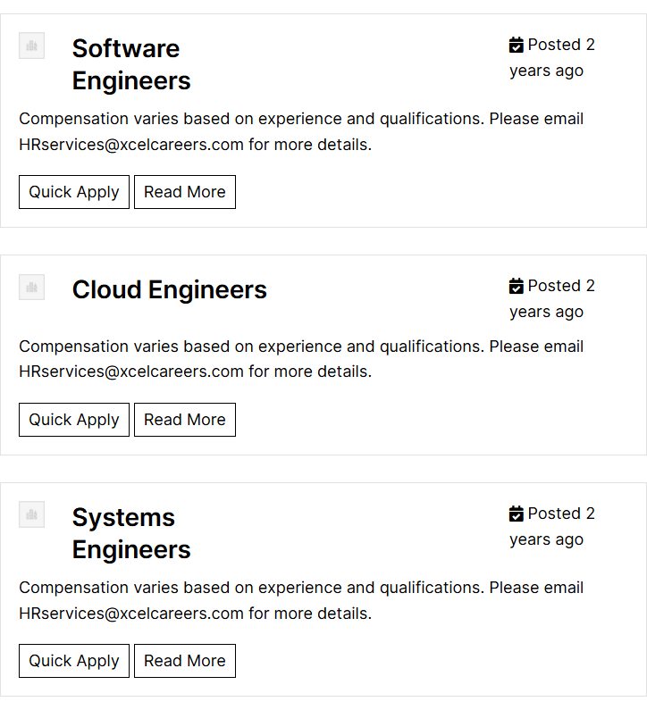

# Job Postings – XcelCareers Staffing Solutions

*XcelCareers (client's current site)* · URL: https://xcelcareers.com/jobs-2/ · captured 2026-11-08 00:33:15 · HTTP 200

- **Meta description:** —
- **Page size (desktop 1440px):** 1440×1537 px · tablet (820px): 1841 px · mobile (390px): 1905 px
- **Screenshots:** [desktop](screenshots/desktop-full.png) · [tablet](screenshots/tablet-full.png) · [mobile](screenshots/mobile-full.png) · [desktop top](screenshots/desktop-viewport-top.png) · [desktop scrolled](screenshots/desktop-viewport-scrolled.png)
- **Files:** [raw.html](raw.html) (server HTML) · [rendered.html](rendered.html) (DOM after JS) · [content.txt](content.txt) (all visible text) · layout-*.json (full element tree with computed styles) · page.json (everything)

## 1. Section map (top → bottom, desktop 1440px)

| # | Role | Y from top | Height | Heading / first text | Mobile height | Screenshot |
|---|---|---|---|---|---|---|
| 0 | header | 0 | 153 | Home Transition Into Tech Jobs Contact 410.865.9558 | 153 | [img](screenshots/desktop-sec00-header.png) |
| 1 | section | 203 | 100 | Keywords | 140 | [img](screenshots/desktop-sec01-section.png) |
| 2 | section | 318 | 795 | Software Engineers | 936 | [img](screenshots/desktop-sec02-section.png) |
| 3 | footer | 1133 | 404 | XcelCareers Staffing Solutions | 591 | [img](screenshots/desktop-sec03-footer.png) |

## 2. Section-by-section layout (desktop)

Legend: each line is an element in DOM order. `@x,y w×h` = position/size in px on the 1440px-wide page. Text lines show *font size/weight, line-height, colour*. Boxes show layout (flex/grid), background, padding, radius, shadow, etc. Pass-through wrappers are collapsed.

### 2.0 HEADER — Home Transition Into Tech Jobs Contact 410.865.9558

Element: `<header class="wp-block-template-part">` at y=0, 1440×153px · 

- div.wp-block-columns [flex row · gap:18px] `@0,0 1440×153`
  - div.wp-block-group [bg:#000000 · pad:0px 18px 0px 18px] `@0,0 1440×153`
    - div.wp-block-group [flex row · justify:space-between · align:center · gap:18px · margin:0px 120px 0px 120px · max-w:1164px] `@138,0 1164×153`
      - a (link→/) [inline-block] `@138,0 153×153`
        - **IMG** `MediumSquareLogo.png` alt="" natural 400×400 · inline · max-w:100% · overflow:clip `@138,0 153×153`
      - div.wp-block-group [flex row · justify:flex-end · align:center · gap:54px] `@688,56 614×41`
        - nav.wp-block-navigation [flex row wrap · justify:flex-end · align:center · gap:36px] `@688,64 407×26`
          - div.wp-block-navigation__responsive-container-content [flex row wrap · justify:flex-end · align:center · gap:36px] `@688,64 407×26`
            - ul.wp-block-navigation__container [flex row wrap · justify:flex-end · align:center · gap:36px] `@688,64 407×26`
              - li.wp-block-navigation-item [flex row · align:center] `@688,64 46×26`
                - **A→/** "Home" — Inter 16px/400 lh 25.6px · #FFFFFF · letterSpacing:0.25px `@688,64 46×26`
              - li.wp-block-navigation-item [flex row · align:center] `@770,64 154×26`
                - **A→/transition-into-tech/** "Transition Into Tech" — Inter 16px/400 lh 25.6px · #FFFFFF · letterSpacing:0.25px `@770,64 154×26`
              - li.wp-block-navigation-item [flex row · align:center] `@960,64 38×26`
                - **A→/jobs-2/** "Jobs" — Inter 16px/400 lh 25.6px · #FFFFFF · letterSpacing:0.25px `@960,64 38×26`
              - li.wp-block-navigation-item [flex row · align:center] `@1033,64 62×26`
                - **A→/contact/** "Contact" — Inter 16px/400 lh 25.6px · #FFFFFF · letterSpacing:0.25px `@1033,64 62×26`
        - div.wp-block-buttons [flex row wrap · align:center · gap:18px] `@1149,56 153×41`
          - **A→** "410.865.9558" — Inter 16px/500 lh 16px · #FFFFFF · textAlign:center ‖ inline-block · bg:#B42117 · pad:12.672px 23.328px 12.672px 23.328px · radius:6px `@1149,56 153×41`

### 2.1 SECTION — Keywords

Element: `
` at y=203, 724×100px · 

- div.sjb-filters [bg:#F2F2F2 · pad:30px 30px 15px 30px · margin:30px 0px 15px 0px · overflow:hidden] `@358,203 724×100`
  - FORM form.filters-form `@388,233 664×55`
    - div.row [margin:0px -15px 0px -15px] · pseudo:::after{{"content": "\" \"", "w": "694px", "h": "0px"}} `@373,233 694×55`
      - div.sjb-search-keywords [pad:0px 15px 0px 15px · min-h:1px] `@373,233 521×55`
        - div.form-group [margin:0px 0px 15px 0px] `@388,233 491×40`
          - **LABEL** "Keywords" — Inter 18px/700 lh 28.8px · #000000 ‖ margin:-1px -1px -1px -1px · max-w:100% `@387,232 1×1`
          - **FIELD** <input type=text name=search_keywords> placeholder="Keywords" — Inter 18px/400 lh 25.7143px · #666666 ‖ bg:#FFFFFF · pad:6px 12px 6px 12px · border:1px 1px 1px 1px solid #E1E1E1 · shadow:#000000 @8% 0px 1px 1px 0px inset · transition:border-color, box-shadow 0.15s, 0.15s ease-in-out, ease-in-out `@388,233 491×40`
      - div.sjb-search-button [pad:0px 15px 0px 15px · min-h:1px] `@894,233 174×40`
        - **FIELD** <input type=submit name=> placeholder="" value='\uf002' — Font Awesome 5 Free 20px/600 lh 28.5714px · #000000 · textAlign:center ‖ inline-block · bg:#F0F0F0 · border:1px 1px 1px 1px solid #000000 · transition:all 0.2s ease-in-out `@909,233 144×40`

### 2.2 SECTION — Software Engineers

Element: `
` at y=318, 724×795px · 

- div.list-view `@358,318 724×795`
  - div.v1 [bg:#FFFFFF · pad:20px 20px 10px 20px · margin:15px 0px 15px 0px · border:1px 1px 1px 1px solid #E1E1E1] `@358,333 724×240`
    - div.row [flex row wrap · margin:0px -15px 0px -15px] · pseudo:::after{{"content": "\" \"", "w": "0px", "h": "82.7812px"}} `@364,354 712×83`
      - div.col-md-1 [pad:0px 15px 0px 15px · min-h:1px] `@364,354 59×83`
        - div.company-logo [margin:0px 0px 15px 0px] `@379,354 29×30`
          - a (link→/jobs-3/software-engineers/) [inline · w:auto · transition:all 0.2s ease-in-out] `@379,357 29×21`
            - **IMG** `company.png` alt="" natural 512×512 · inline · max-w:100% · border:1px 1px 1px 1px solid #E1E1E1 · overflow:clip `@379,354 29×29`
      - div.col-md-11 [pad:0px 15px 0px 15px · min-h:1px] `@423,354 653×83`
        - div.row [flex row wrap · margin:0px -15px 0px -15px] · pseudo:::after{{"content": "\" \"", "w": "0px", "h": "82.7812px"}} `@423,354 653×83`
          - div.col-md-5 [pad:0px 15px 0px 15px · min-h:1px] `@423,354 272×83`
            - div.job-info [margin:0px 0px 10px 0px] `@438,354 242×73`
              - **A→/jobs-3/software-engineers/** "Software Engineers" — Inter 28px/600 lh 36.4px · #000000 · letterSpacing:-0.25px ‖ inline · transition:all 0.2s ease-in-out `@438,355 133×70`
          - div.col-md-3 [pad:0px 15px 0px 15px · min-h:1px] `@913,354 163×83`
            - div.job-date [margin:0px 0px 10px 0px] `@928,354 133×58`
              - **text** "Posted 2 years ago" — Inter 18px/400 lh 28.8px · #000000 `@928,354 133×58`
    - div.job-description `@379,437 682×125`
      - **P** "Compensation varies based on experience and qualifications. Please email HRservices@xcelcareers.com for more details." — Inter 18px/400 lh 28.8px · #000000 ‖ margin:0px 0px 10px 0px `@379,437 682×58`
      - p [inline-block · margin:0px 0px 10px 0px] `@379,504 248×48`
        - **A→javascript:void(0)** "Quick Apply" — Inter 18px/400 lh 25.7143px · #000000 · textAlign:center ‖ inline-block · pad:5px 10px 5px 10px · margin:10px 5px 0px 0px · border:1px 1px 1px 1px solid #000000 · transition:all 0.2s ease-in-out `@379,514 124×38`
        - **A→/jobs-3/software-engineers/** "Read More" — Inter 18px/400 lh 25.7143px · #000000 · textAlign:center ‖ inline-block · pad:5px 10px 5px 10px · margin:10px 5px 0px 0px · border:1px 1px 1px 1px solid #000000 · transition:all 0.2s ease-in-out `@508,514 114×38`
  - div.clearfix · pseudo:::before{{"content": "\" \"", "w": "0px", "h": "0px"}}; ::after{{"content": "\" \"", "w": "0px", "h": "0px"}} `@358,318 724×270` (empty/decorative)
  - div.v1 [bg:#FFFFFF · pad:20px 20px 10px 20px · margin:15px 0px 15px 0px · border:1px 1px 1px 1px solid #E1E1E1] `@358,603 724×225`
    - div.row [flex row wrap · margin:0px -15px 0px -15px] · pseudo:::after{{"content": "\" \"", "w": "0px", "h": "67.5938px"}} `@364,624 712×68`
      - div.col-md-1 [pad:0px 15px 0px 15px · min-h:1px] `@364,624 59×68`
        - div.company-logo [margin:0px 0px 15px 0px] `@379,624 29×30`
          - a (link→/jobs-3/cloud-engineers/) [inline · w:auto · transition:all 0.2s ease-in-out] `@379,627 29×21`
            - **IMG** `company.png` alt="" natural 512×512 · inline · max-w:100% · border:1px 1px 1px 1px solid #E1E1E1 · overflow:clip `@379,625 29×29`
      - div.col-md-11 [pad:0px 15px 0px 15px · min-h:1px] `@423,624 653×68`
        - div.row [flex row wrap · margin:0px -15px 0px -15px] · pseudo:::after{{"content": "\" \"", "w": "0px", "h": "67.5938px"}} `@423,624 653×68`
          - div.col-md-5 [pad:0px 15px 0px 15px · min-h:1px] `@423,624 272×68`
            - div.job-info [margin:0px 0px 10px 0px] `@438,624 242×36`
              - **A→/jobs-3/cloud-engineers/** "Cloud Engineers" — Inter 28px/600 lh 36.4px · #000000 · letterSpacing:-0.25px ‖ inline · transition:all 0.2s ease-in-out `@438,625 219×34`
          - div.col-md-3 [pad:0px 15px 0px 15px · min-h:1px] `@913,624 163×68`
            - div.job-date [margin:0px 0px 10px 0px] `@928,624 133×58`
              - **text** "Posted 2 years ago" — Inter 18px/400 lh 28.8px · #000000 `@928,624 133×58`
    - div.job-description `@379,692 682×125`
      - **P** "Compensation varies based on experience and qualifications. Please email HRservices@xcelcareers.com for more details." — Inter 18px/400 lh 28.8px · #000000 ‖ margin:0px 0px 10px 0px `@379,692 682×58`
      - p [inline-block · margin:0px 0px 10px 0px] `@379,759 248×48`
        - **A→javascript:void(0)** "Quick Apply" — Inter 18px/400 lh 25.7143px · #000000 · textAlign:center ‖ inline-block · pad:5px 10px 5px 10px · margin:10px 5px 0px 0px · border:1px 1px 1px 1px solid #000000 · transition:all 0.2s ease-in-out `@379,769 124×38`
        - **A→/jobs-3/cloud-engineers/** "Read More" — Inter 18px/400 lh 25.7143px · #000000 · textAlign:center ‖ inline-block · pad:5px 10px 5px 10px · margin:10px 5px 0px 0px · border:1px 1px 1px 1px solid #000000 · transition:all 0.2s ease-in-out `@508,769 114×38`
  - div.clearfix · pseudo:::before{{"content": "\" \"", "w": "0px", "h": "0px"}}; ::after{{"content": "\" \"", "w": "0px", "h": "0px"}} `@358,588 724×255` (empty/decorative)
  - div.v1 [bg:#FFFFFF · pad:20px 20px 10px 20px · margin:15px 0px 15px 0px · border:1px 1px 1px 1px solid #E1E1E1] `@358,858 724×240`
    - div.row [flex row wrap · margin:0px -15px 0px -15px] · pseudo:::after{{"content": "\" \"", "w": "0px", "h": "82.7812px"}} `@364,879 712×83`
      - div.col-md-1 [pad:0px 15px 0px 15px · min-h:1px] `@364,879 59×83`
        - div.company-logo [margin:0px 0px 15px 0px] `@379,879 29×30`
          - a (link→/jobs-3/systems-engineers/) [inline · w:auto · transition:all 0.2s ease-in-out] `@379,882 29×21`
            - **IMG** `company.png` alt="" natural 512×512 · inline · max-w:100% · border:1px 1px 1px 1px solid #E1E1E1 · overflow:clip `@379,879 29×29`
      - div.col-md-11 [pad:0px 15px 0px 15px · min-h:1px] `@423,879 653×83`
        - div.row [flex row wrap · margin:0px -15px 0px -15px] · pseudo:::after{{"content": "\" \"", "w": "0px", "h": "82.7812px"}} `@423,879 653×83`
          - div.col-md-5 [pad:0px 15px 0px 15px · min-h:1px] `@423,879 272×83`
            - div.job-info [margin:0px 0px 10px 0px] `@438,879 242×73`
              - **A→/jobs-3/systems-engineers/** "Systems Engineers" — Inter 28px/600 lh 36.4px · #000000 · letterSpacing:-0.25px ‖ inline · transition:all 0.2s ease-in-out `@438,880 133×70`
          - div.col-md-3 [pad:0px 15px 0px 15px · min-h:1px] `@913,879 163×83`
            - div.job-date [margin:0px 0px 10px 0px] `@928,879 133×58`
              - **text** "Posted 2 years ago" — Inter 18px/400 lh 28.8px · #000000 `@928,879 133×58`
    - div.job-description `@379,962 682×125`
      - **P** "Compensation varies based on experience and qualifications. Please email HRservices@xcelcareers.com for more details." — Inter 18px/400 lh 28.8px · #000000 ‖ margin:0px 0px 10px 0px `@379,962 682×58`
      - p [inline-block · margin:0px 0px 10px 0px] `@379,1029 248×48`
        - **A→javascript:void(0)** "Quick Apply" — Inter 18px/400 lh 25.7143px · #000000 · textAlign:center ‖ inline-block · pad:5px 10px 5px 10px · margin:10px 5px 0px 0px · border:1px 1px 1px 1px solid #000000 · transition:all 0.2s ease-in-out `@379,1039 124×38`
        - **A→/jobs-3/systems-engineers/** "Read More" — Inter 18px/400 lh 25.7143px · #000000 · textAlign:center ‖ inline-block · pad:5px 10px 5px 10px · margin:10px 5px 0px 0px · border:1px 1px 1px 1px solid #000000 · transition:all 0.2s ease-in-out `@508,1039 114×38`
  - div.clearfix · pseudo:::before{{"content": "\" \"", "w": "0px", "h": "0px"}}; ::after{{"content": "\" \"", "w": "0px", "h": "0px"}} `@358,843 724×270` (empty/decorative)

### 2.3 FOOTER — XcelCareers Staffing Solutions

Element: `<footer class="wp-block-template-part">` at y=1133, 1440×404px · 

- div.wp-block-group [bg:#B42117 · pad:72px 18px 36px 18px] `@0,1133 1440×404`
  - div.wp-block-columns [flex row · gap:36px · margin:0px 120px 0px 120px · max-w:1164px] `@138,1205 1164×220`
    - div.wp-block-column [pad:0px 0px 9px 0px] `@138,1205 564×220`
      - a (link→/) [inline-block] `@138,1205 110×47`
        - **IMG** `MediumSquareLogo-e1736976275746.png` alt="" natural 400×170 · inline · max-w:100% · overflow:clip · filter:url("#wp-duotone-secondary") `@138,1205 110×47`
      - **P** "XcelCareers empowers professionals to thrive in the booming tech industry. With over 20 years of expertise in recruitment and staffing, we provide the tools …" — Inter 16px/400 lh 25.6px · #FFFFFF ‖ pad:0px 36px 0px 0px · margin:18px 0px 0px 0px `@138,1270 564×128`
    - div.wp-block-column [pad:0px 0px 9px 0px] `@738,1205 564×220`
      - div.wp-block-columns [flex row · gap:32px] `@738,1205 564×136`
        - div.wp-block-column `@738,1205 266×136`
          - **H5** "Address:" — Inter 22px/600 lh 31.9px · #FFFFFF `@738,1205 266×32`
          - **P** "10155 Baltimore National Pike Ste 105 Ellicott City, MD 21042 United States" — Inter 18px/400 lh 28.8px · #FFFFFF ‖ margin:18px 0px 0px 0px `@738,1255 266×86`
        - div.wp-block-column `@1036,1205 266×136`
          - **H5** "Contact:" — Inter 22px/600 lh 31.9px · #FFFFFF `@1036,1205 266×32`
          - p.wp-block-paragraph [margin:18px 0px 0px 0px] `@1036,1255 266×29`
            - **A→mailto:HRservices@xcelcareers.com** "HRservices@xcelcareers.com" — Inter 18px/400 lh 28.8px · #FFFFFF ‖ inline `@1036,1258 252×21`
  - div.wp-block-group [flex row · justify:center · align:center · gap:9px · pad:0px 18px 0px 18px · margin:54px 120px 0px 120px · max-w:1164px] `@138,1479 1164×22`
    - **P** "© 2025 ·" — Inter 14px/400 lh 22.4px · #FFFFFF · textAlign:center `@517,1479 59×22`
    - **A→/** "XcelCareers Staffing Solutions" — Inter 14px/400 lh 22.4px · #FFFFFF ‖ inline `@585,1481 201×17`
    - **P** "· All rights reserved" — Inter 14px/400 lh 22.4px · #FFFFFF · textAlign:center `@795,1479 128×22`

## 3. Header, navigation & interaction behaviour

- **atTop** `header.wp-block-template-part` position:static top:0 height:153 bg:transparent shadow:none backdrop:none z:auto
- **afterScroll1400** `header.wp-block-template-part` position:static top:-637 height:153 bg:transparent shadow:none backdrop:none z:auto

| Menu item | Link | Dropdown | Style | Hover change |
|---|---|---|---|---|
| Home | / | — | Inter 16px/400 #FFFFFF  ls 0.25px | none |
| Transition Into Tech | /transition-into-tech/ | — | Inter 16px/400 #FFFFFF  ls 0.25px | none |
| Jobs (current) | /jobs-2/ | — | Inter 16px/400 #FFFFFF  ls 0.25px | none |
| Contact | /contact/ | — | Inter 16px/400 #FFFFFF  ls 0.25px | none |

- **Mobile menu:** toggle `.wp-block-navigation__responsive-container-open` → [screenshot](screenshots/mobile-menu-open.png) · items: Home, Transition Into Tech, Jobs, Contact

### Hover states (measured by hovering in Chrome)

| Element | Text | Normal | On hover |
|---|---|---|---|
| `a.wp-block-navigation-item__content` | Home | color #FFFFFF · bg transparent · radius 0px · pad 0px · border 0px #FFFFFF · transition all | no change |
| `a.wp-block-button__link` | 410.865.9558 | color #FFFFFF · bg #B42117 · radius 6px · pad 12.672px 23.328px · border 0px #B42217 · transition all | no change |
| `input.btn-search` |  | color #000000 · bg #F0F0F0 · radius 0px · pad 0px · border 1px #000000 · transition 0.2s ease-in-out | no change |
| `a.` |  | color #000000 · bg transparent · radius 0px · pad 0px · border 0px #000000 · transition all | color: #000000 → #B42117; borderTopColor: #000000 → #B42117; childColor: #000000 → #B42117 |
| `a.` | HRservices@xcelcareers.com | color #FFFFFF · bg transparent · radius 0px · pad 0px · border 0px #FFFFFF · transition all | no change |
| `a.` | XcelCareers Staffing Solutions | color #FFFFFF · bg transparent · radius 0px · pad 0px · border 0px #FFFFFF · transition all | no change |

## 4. Typography & colour used on this page (weighted by amount of text / area)

| Font · weight · size / line-height | chars |
|---|---|
| Inter | 400 | 18px / 28.8px | 506 |
| Inter | 400 | 16px / 25.6px | 306 |
| Inter | 400 | 18px / 25.7143px | 60 |
| Inter | 400 | 14px / 22.4px | 59 |
| Inter | 600 | 28px / 36.4px | 50 |
| Inter | 600 | 22px / 31.9px | 16 |
| Inter | 500 | 16px / 16px | 12 |
| Inter | 700 | 18px / 28.8px | 8 |

- **Text colours:** #000000 (523), #FFFFFF (494)
- **Background colours (by area):** #B42117 (588), #FFFFFF (531), #000000 (220), #F2F2F2 (72), #F0F0F0 (6)
- **Border radii:** 6px (1)
- **Shadows:** #000000 @8% 0px 1px 1px 0px inset (1)
- **Mobile text styles:** Inter | 400 | 16px / 25.6px (506); Inter | 400 | 14px / 22.4px (271); Inter | 400 | 16px / 22.8571px (60); Inter | 400 | 12px / 19.2px (59); Inter | 600 | 24px / 31.2px (50); Inter | 600 | 20px / 29px (16); Inter | 700 | 16px / 25.6px (8)

## 5. Forms
- **Form** `filters-form` → https://xcelcareers.com/jobs-2/ (get)
  - input[text] name=`search_keywords` label="Keywords" placeholder="Keywords"
  - input[submit] name=`` label="" placeholder="" value=""

## 6. Images on the page

- `MediumSquareLogo.png` natural 400×400 → shown 153×153 · alt="" · https://xcelcareers.com/wp-content/uploads/2018/12/MediumSquareLogo.png
- `company.png` natural 512×512 → shown 29×29 · alt="" · https://xcelcareers.com/wp-content/plugins/simple-job-board/public/images/company.png
- `MediumSquareLogo-e1736976275746.png` natural 400×170 → shown 110×47 · alt="" · https://xcelcareers.com/wp-content/uploads/2018/12/MediumSquareLogo-e1736976275746.png

## 7. Links on the page

- [header] "(icon/image)" → /
- [header] "Home" → /
- [header] "Transition Into Tech" → /transition-into-tech/
- [header] "Jobs" → /jobs-2/
- [header] "Contact" → /contact/
- [header] "(icon/image)" → /jobs-3/software-engineers/
- [header] "Software Engineers" → /jobs-3/software-engineers/
- [body] "HRservices@xcelcareers.com" → mailto:HRservices@xcelcareers.com
- [body] "Quick Apply" → javascript:void(0)
- [body] "Read More" → /jobs-3/software-engineers/
- [header] "(icon/image)" → /jobs-3/cloud-engineers/
- [header] "Cloud Engineers" → /jobs-3/cloud-engineers/
- [body] "Read More" → /jobs-3/cloud-engineers/
- [header] "(icon/image)" → /jobs-3/systems-engineers/
- [header] "Systems Engineers" → /jobs-3/systems-engineers/
- [body] "Read More" → /jobs-3/systems-engineers/
- [footer] "Facebook" → /jobs-2/ (target _blank)
- [footer] "Twitter" → /jobs-2/ (target _blank)
- [footer] "YouTube" → /jobs-2/ (target _blank)
- [footer] "LinkedIn" → /jobs-2/ (target _blank)
- [footer] "XcelCareers Staffing Solutions" → / (target _self)

## 8. Mobile layout (390px) — condensed outline

### 8.0 header —  (y 0, h 153)
- div.wp-block-columns [flex row wrap · gap:16px] `@0,0 390×153`
  - div.wp-block-group [bg:#000000 · pad:0px 16px 0px 16px] `@0,0 390×153`
    - div.wp-block-group [flex row · justify:space-between · align:center · gap:16px · max-w:1164px] `@16,0 358×153`
      - a (link→/) [inline-block] `@16,0 153×153`
        - **IMG** `MediumSquareLogo.png` alt="" natural 400×400 · inline · max-w:100% · overflow:clip `@16,0 153×153`
      - div.wp-block-group [flex row · justify:flex-end · align:center · gap:48px] `@350,65 24×24`
        - nav.wp-block-navigation [flex row wrap · justify:flex-end · align:center · gap:32px] `@350,65 24×24`
          - **BUTTON** "" +icon[svg] — Inter 14px/400 lh normal · #FFFFFF · textAlign:center ‖ flex row `@350,65 24×24`

### 8.1 section — Keywords (y 203, h 140)
- div.sjb-filters [bg:#F2F2F2 · pad:30px 30px 15px 30px · margin:30px 0px 15px 0px · overflow:hidden] `@20,203 350×140`
  - FORM form.filters-form `@50,233 290×95`
    - div.row [margin:0px -15px 0px -15px] · pseudo:::after{{"content": "\" \"", "w": "320px", "h": "0px"}} `@35,233 320×95`
      - div.sjb-search-keywords [pad:0px 15px 0px 15px · min-h:1px] `@35,233 320×55`
        - div.form-group [margin:0px 0px 15px 0px] `@50,233 290×40`
          - **LABEL** "Keywords" — Inter 16px/700 lh 25.6px · #000000 ‖ margin:-1px -1px -1px -1px · max-w:100% `@49,232 1×1`
          - **FIELD** <input type=text name=search_keywords> placeholder="Keywords" — Inter 16px/400 lh 22.8571px · #666666 ‖ bg:#FFFFFF · pad:6px 12px 6px 12px · border:1px 1px 1px 1px solid #E1E1E1 · shadow:#000000 @8% 0px 1px 1px 0px inset · transition:border-color, box-shadow 0.15s, 0.15s ease-in-out, ease-in-out `@50,233 290×40`
      - div.sjb-search-button [pad:0px 15px 0px 15px · min-h:1px] `@35,288 320×40`
        - **FIELD** <input type=submit name=> placeholder="" value='\uf002' — Font Awesome 5 Free 20px/600 lh 28.5714px · #000000 · textAlign:center ‖ inline-block · bg:#F0F0F0 · border:1px 1px 1px 1px solid #000000 · transition:all 0.2s ease-in-out `@50,288 290×40`

### 8.2 section — Software Engineers (y 358, h 936)
- div.list-view `@20,358 350×936`
  - div.v1 [bg:#FFFFFF · pad:20px 20px 10px 20px · margin:15px 0px 15px 0px · border:1px 1px 1px 1px solid #E1E1E1] `@20,373 350×282`
    - div.row [flex row wrap · margin:0px -15px 0px -15px] · pseudo:::after{{"content": "\" \"", "w": "0px", "h": "0px"}} `@26,394 338×83`
      - div.col-md-11 [pad:0px 15px 0px 15px · min-h:1px] `@26,394 338×83`
        - div.row [flex row wrap · margin:0px -15px 0px -15px] · pseudo:::after{{"content": "\" \"", "w": "0px", "h": "39.5938px"}} `@26,394 338×83`
          - div.col-md-5 [pad:0px 15px 0px 15px · min-h:1px] `@26,394 253×41`
            - div.job-info [margin:0px 0px 10px 0px] `@41,394 223×31`
              - **A→/jobs-3/software-engineers/** "Software Engineers" — Inter 24px/600 lh 31.2px · #000000 · letterSpacing:-0.25px ‖ inline · transition:all 0.2s ease-in-out `@41,395 223×29`
          - div.col-md-3 [pad:0px 15px 0px 15px · min-h:1px] `@26,437 338×40`
            - div.job-date [margin:4px 0px 10px 0px] `@41,441 308×26`
              - **text** "Posted 2 years ago" — Inter 16px/400 lh 25.6px · #000000 `@41,441 308×26`
    - div.job-description `@41,477 308×167`
      - **P** "Compensation varies based on experience and qualifications. Please email HRservices@xcelcareers.com for more details." — Inter 16px/400 lh 25.6px · #000000 ‖ margin:0px 0px 10px 0px `@41,477 308×102`
      - p [inline-block · margin:0px 0px 10px 0px] `@41,589 226×45`
        - **A→javascript:void(0)** "Quick Apply" — Inter 16px/400 lh 22.8571px · #000000 · textAlign:center ‖ inline-block · pad:5px 10px 5px 10px · margin:10px 5px 0px 0px · border:1px 1px 1px 1px solid #000000 · transition:all 0.2s ease-in-out `@41,599 112×35`
        - **A→/jobs-3/software-engineers/** "Read More" — Inter 16px/400 lh 22.8571px · #000000 · textAlign:center ‖ inline-block · pad:5px 10px 5px 10px · margin:10px 5px 0px 0px · border:1px 1px 1px 1px solid #000000 · transition:all 0.2s ease-in-out `@158,599 104×35`
  - div.clearfix · pseudo:::before{{"content": "\" \"", "w": "0px", "h": "0px"}}; ::after{{"content": "\" \"", "w": "0px", "h": "0px"}} `@20,358 350×312` (empty/decorative)
  - div.v1 [bg:#FFFFFF · pad:20px 20px 10px 20px · margin:15px 0px 15px 0px · border:1px 1px 1px 1px solid #E1E1E1] `@20,685 350×282`
    - div.row [flex row wrap · margin:0px -15px 0px -15px] · pseudo:::after{{"content": "\" \"", "w": "0px", "h": "0px"}} `@26,706 338×83`
      - div.col-md-11 [pad:0px 15px 0px 15px · min-h:1px] `@26,706 338×83`
        - div.row [flex row wrap · margin:0px -15px 0px -15px] · pseudo:::after{{"content": "\" \"", "w": "0px", "h": "39.5938px"}} `@26,706 338×83`
          - div.col-md-5 [pad:0px 15px 0px 15px · min-h:1px] `@26,706 217×41`
            - div.job-info [margin:0px 0px 10px 0px] `@41,706 187×31`
              - **A→/jobs-3/cloud-engineers/** "Cloud Engineers" — Inter 24px/600 lh 31.2px · #000000 · letterSpacing:-0.25px ‖ inline · transition:all 0.2s ease-in-out `@41,707 187×29`
          - div.col-md-3 [pad:0px 15px 0px 15px · min-h:1px] `@26,749 338×40`
            - div.job-date [margin:4px 0px 10px 0px] `@41,753 308×26`
              - **text** "Posted 2 years ago" — Inter 16px/400 lh 25.6px · #000000 `@41,753 308×26`
    - div.job-description `@41,789 308×167`
      - **P** "Compensation varies based on experience and qualifications. Please email HRservices@xcelcareers.com for more details." — Inter 16px/400 lh 25.6px · #000000 ‖ margin:0px 0px 10px 0px `@41,789 308×102`
      - p [inline-block · margin:0px 0px 10px 0px] `@41,901 226×45`
        - **A→javascript:void(0)** "Quick Apply" — Inter 16px/400 lh 22.8571px · #000000 · textAlign:center ‖ inline-block · pad:5px 10px 5px 10px · margin:10px 5px 0px 0px · border:1px 1px 1px 1px solid #000000 · transition:all 0.2s ease-in-out `@41,911 112×35`
        - **A→/jobs-3/cloud-engineers/** "Read More" — Inter 16px/400 lh 22.8571px · #000000 · textAlign:center ‖ inline-block · pad:5px 10px 5px 10px · margin:10px 5px 0px 0px · border:1px 1px 1px 1px solid #000000 · transition:all 0.2s ease-in-out `@158,911 104×35`
  - div.clearfix · pseudo:::before{{"content": "\" \"", "w": "0px", "h": "0px"}}; ::after{{"content": "\" \"", "w": "0px", "h": "0px"}} `@20,670 350×312` (empty/decorative)
  - div.v1 [bg:#FFFFFF · pad:20px 20px 10px 20px · margin:15px 0px 15px 0px · border:1px 1px 1px 1px solid #E1E1E1] `@20,997 350×282`
    - div.row [flex row wrap · margin:0px -15px 0px -15px] · pseudo:::after{{"content": "\" \"", "w": "0px", "h": "0px"}} `@26,1018 338×83`
      - div.col-md-11 [pad:0px 15px 0px 15px · min-h:1px] `@26,1018 338×83`
        - div.row [flex row wrap · margin:0px -15px 0px -15px] · pseudo:::after{{"content": "\" \"", "w": "0px", "h": "39.5938px"}} `@26,1018 338×83`
          - div.col-md-5 [pad:0px 15px 0px 15px · min-h:1px] `@26,1018 248×41`
            - div.job-info [margin:0px 0px 10px 0px] `@41,1018 218×31`
              - **A→/jobs-3/systems-engineers/** "Systems Engineers" — Inter 24px/600 lh 31.2px · #000000 · letterSpacing:-0.25px ‖ inline · transition:all 0.2s ease-in-out `@41,1019 218×29`
          - div.col-md-3 [pad:0px 15px 0px 15px · min-h:1px] `@26,1061 338×40`
            - div.job-date [margin:4px 0px 10px 0px] `@41,1065 308×26`
              - **text** "Posted 2 years ago" — Inter 16px/400 lh 25.6px · #000000 `@41,1065 308×26`
    - div.job-description `@41,1101 308×167`
      - **P** "Compensation varies based on experience and qualifications. Please email HRservices@xcelcareers.com for more details." — Inter 16px/400 lh 25.6px · #000000 ‖ margin:0px 0px 10px 0px `@41,1101 308×102`
      - p [inline-block · margin:0px 0px 10px 0px] `@41,1213 226×45`
        - **A→javascript:void(0)** "Quick Apply" — Inter 16px/400 lh 22.8571px · #000000 · textAlign:center ‖ inline-block · pad:5px 10px 5px 10px · margin:10px 5px 0px 0px · border:1px 1px 1px 1px solid #000000 · transition:all 0.2s ease-in-out `@41,1223 112×35`
        - **A→/jobs-3/systems-engineers/** "Read More" — Inter 16px/400 lh 22.8571px · #000000 · textAlign:center ‖ inline-block · pad:5px 10px 5px 10px · margin:10px 5px 0px 0px · border:1px 1px 1px 1px solid #000000 · transition:all 0.2s ease-in-out `@158,1223 104×35`
  - div.clearfix · pseudo:::before{{"content": "\" \"", "w": "0px", "h": "0px"}}; ::after{{"content": "\" \"", "w": "0px", "h": "0px"}} `@20,982 350×312` (empty/decorative)

### 8.3 footer — XcelCareers Staffing Solutions (y 1314, h 591)
- div.wp-block-group [bg:#B42117 · pad:64px 16px 32px 16px] `@0,1314 390×591`
  - div.wp-block-columns [flex row wrap · gap:32px · max-w:1164px] `@16,1378 358×408`
    - div.wp-block-column [pad:0px 0px 8px 0px] `@16,1378 358×221`
      - a (link→/) [inline-block] `@16,1378 110×47`
        - **IMG** `MediumSquareLogo-e1736976275746.png` alt="" natural 390×165 · inline · max-w:100% · overflow:clip · filter:url("#wp-duotone-secondary") `@16,1378 110×47`
      - **P** "XcelCareers empowers professionals to thrive in the booming tech industry. With over 20 years of expertise in recruitment and staffing, we provide the tools …" — Inter 14px/400 lh 22.4px · #FFFFFF ‖ pad:0px 32px 0px 0px · margin:16px 0px 0px 0px `@16,1441 358×134`
    - div.wp-block-column [pad:0px 0px 8px 0px] `@16,1631 358×155`
      - div.wp-block-columns [flex row · gap:32px] `@16,1631 358×147`
        - div.wp-block-column `@16,1631 163×147`
          - **H5** "Address:" — Inter 20px/600 lh 29px · #FFFFFF `@16,1631 163×29`
          - **P** "10155 Baltimore National Pike Ste 105 Ellicott City, MD 21042 United States" — Inter 16px/400 lh 25.6px · #FFFFFF ‖ margin:16px 0px 0px 0px `@16,1676 163×102`
        - div.wp-block-column `@211,1631 163×147`
          - **H5** "Contact:" — Inter 20px/600 lh 29px · #FFFFFF `@211,1631 163×29`
          - p.wp-block-paragraph [margin:16px 0px 0px 0px] `@211,1676 163×51`
            - **A→mailto:HRservices@xcelcareers.com** "HRservices@xcelcareers.com" — Inter 16px/400 lh 25.6px · #FFFFFF ‖ inline `@211,1678 155×46`
  - div.wp-block-group [flex row · justify:center · align:center · gap:8px · pad:0px 16px 0px 16px · margin:48px 0px 0px 0px · max-w:1164px] `@16,1834 358×38`
    - **P** "© 2025 ·" — Inter 12px/400 lh 19.2px · #FFFFFF · textAlign:center `@32,1834 47×38`
    - **A→/** "XcelCareers Staffing Solutions" — Inter 12px/400 lh 19.2px · #FFFFFF ‖ inline `@87,1836 116×34`
    - **P** "· All rights reserved" — Inter 12px/400 lh 19.2px · #FFFFFF · textAlign:center `@256,1834 102×38`
