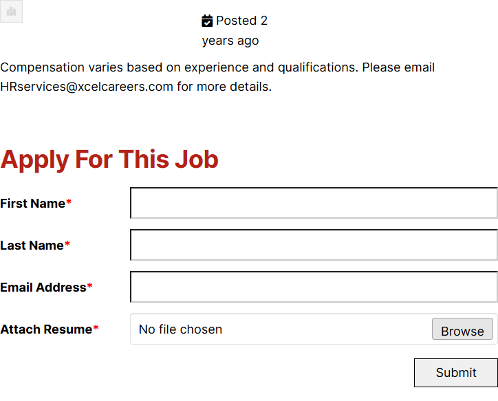

# Cloud Engineers – XcelCareers Staffing Solutions

*XcelCareers (client's current site)* · URL: https://xcelcareers.com/jobs-3/cloud-engineers/ · captured 2026-11-08 00:35:14 · HTTP 200

- **Meta description:** —
- **Page size (desktop 1440px):** 1440×1258 px · tablet (820px): 1408 px · mobile (390px): 1704 px
- **Screenshots:** [desktop](screenshots/desktop-full.png) · [tablet](screenshots/tablet-full.png) · [mobile](screenshots/mobile-full.png) · [desktop top](screenshots/desktop-viewport-top.png) · [desktop scrolled](screenshots/desktop-viewport-scrolled.png)
- **Files:** [raw.html](raw.html) (server HTML) · [rendered.html](rendered.html) (DOM after JS) · [content.txt](content.txt) (all visible text) · layout-*.json (full element tree with computed styles) · page.json (everything)

## 1. Section map (top → bottom, desktop 1440px)

| # | Role | Y from top | Height | Heading / first text | Mobile height | Screenshot |
|---|---|---|---|---|---|---|
| 0 | header | 0 | 153 | Home Transition Into Tech Jobs Contact 410.865.9558 | 153 | [img](screenshots/desktop-sec00-header.png) |
| 1 | section | 221 | 583 | Apply For This Job | 845 | [img](screenshots/desktop-sec01-section.png) |
| 2 | section | 221 | 583 |  | 845 | [img](screenshots/desktop-sec02-section.png) |
| 3 | footer | 854 | 404 | XcelCareers Staffing Solutions | 591 | [img](screenshots/desktop-sec03-footer.png) |

## 2. Section-by-section layout (desktop)

Legend: each line is an element in DOM order. `@x,y w×h` = position/size in px on the 1440px-wide page. Text lines show *font size/weight, line-height, colour*. Boxes show layout (flex/grid), background, padding, radius, shadow, etc. Pass-through wrappers are collapsed.

### 2.0 HEADER — Home Transition Into Tech Jobs Contact 410.865.9558

Element: `<header class="wp-block-template-part">` at y=0, 1440×153px · 

- div.wp-block-columns [flex row · gap:18px] `@0,0 1440×153`
  - div.wp-block-group [bg:#000000 · pad:0px 18px 0px 18px] `@0,0 1440×153`
    - div.wp-block-group [flex row · justify:space-between · align:center · gap:18px · margin:0px 120px 0px 120px · max-w:1164px] `@138,0 1164×153`
      - a (link→/) [inline-block] `@138,0 153×153`
        - **IMG** `MediumSquareLogo.png` alt="" natural 400×400 · inline · max-w:100% · overflow:clip `@138,0 153×153`
      - div.wp-block-group [flex row · justify:flex-end · align:center · gap:54px] `@688,56 614×41`
        - nav.wp-block-navigation [flex row wrap · justify:flex-end · align:center · gap:36px] `@688,64 407×26`
          - div.wp-block-navigation__responsive-container-content [flex row wrap · justify:flex-end · align:center · gap:36px] `@688,64 407×26`
            - ul.wp-block-navigation__container [flex row wrap · justify:flex-end · align:center · gap:36px] `@688,64 407×26`
              - li.wp-block-navigation-item [flex row · align:center] `@688,64 46×26`
                - **A→/** "Home" — Inter 16px/400 lh 25.6px · #FFFFFF · letterSpacing:0.25px `@688,64 46×26`
              - li.wp-block-navigation-item [flex row · align:center] `@770,64 154×26`
                - **A→/transition-into-tech/** "Transition Into Tech" — Inter 16px/400 lh 25.6px · #FFFFFF · letterSpacing:0.25px `@770,64 154×26`
              - li.wp-block-navigation-item [flex row · align:center] `@960,64 38×26`
                - **A→/jobs-2/** "Jobs" — Inter 16px/400 lh 25.6px · #FFFFFF · letterSpacing:0.25px `@960,64 38×26`
              - li.wp-block-navigation-item [flex row · align:center] `@1033,64 62×26`
                - **A→/contact/** "Contact" — Inter 16px/400 lh 25.6px · #FFFFFF · letterSpacing:0.25px `@1033,64 62×26`
        - div.wp-block-buttons [flex row wrap · align:center · gap:18px] `@1149,56 153×41`
          - **A→** "410.865.9558" — Inter 16px/500 lh 16px · #FFFFFF · textAlign:center ‖ inline-block · bg:#B42117 · pad:12.672px 23.328px 12.672px 23.328px · radius:6px `@1149,56 153×41`

### 2.1 SECTION — Apply For This Job

Element: `
` at y=221, 724×583px · 

- div.sjb-detail [margin:30px 0px 30px 0px] `@358,221 724×583`
  - div.list-data `@358,221 724×583`
    - div.v1 [bg:#FFFFFF] `@358,221 724×583`
      - div.row [margin:0px -15px 0px -15px] · pseudo:::after{{"content": "\" \"", "w": "754px", "h": "0px"}} `@343,221 754×84`
        - div.col-md-1 [pad:0px 15px 0px 15px · min-h:1px] `@343,221 63×48`
          - div.company-logo [margin:0px 0px 15px 0px] `@358,221 33×33`
            - **IMG** `company.png` alt="" natural 512×512 · inline · max-w:100% · border:1px 1px 1px 1px solid #E1E1E1 · overflow:clip `@358,221 33×33`
        - div.col-md-11 [pad:0px 15px 0px 15px · margin:16px 0px 0px 0px · min-h:1px] `@406,237 691×68`
          - div.row [margin:0px -15px 0px -15px] · pseudo:::after{{"content": "\" \"", "w": "691.156px", "h": "0px"}} `@406,237 691×68`
            - div.col-md-3 [pad:0px 15px 0px 15px · min-h:1px] `@636,237 173×68`
              - div.job-date [margin:0px 0px 10px 0px] `@651,237 143×58`
                - **text** "Posted 2 years ago" — Inter 18px/400 lh 28.8px · #000000 `@651,237 143×58`
      - p.wp-block-paragraph [margin:0px 0px 10px 0px] `@358,305 724×58`
        - **text** "Compensation varies based on experience and qualifications. Please email for more details." — Inter 18px/400 lh 28.8px · #000000 `@358,305 724×58`
        - **A→mailto:HRservices@xcelcareers.com** "HRservices@xcelcareers.com" — Inter 18px/400 lh 28.8px · #000000 ‖ inline · transition:all 0.2s ease-in-out `@358,336 252×21`
      - div.clearfix · pseudo:::before{{"content": "\" \"", "w": "0px", "h": "0px"}}; ::after{{"content": "\" \"", "w": "0px", "h": "0px"}} `@358,305 724×68` (empty/decorative)
      - div.clearfix · pseudo:::before{{"content": "\" \"", "w": "0px", "h": "0px"}}; ::after{{"content": "\" \"", "w": "0px", "h": "0px"}} `@358,372 724×40` (empty/decorative)
      - FORM form.jobpost-form `@358,412 724×392`
        - **H3** "Apply For This Job" — Inter 36px/700 lh 46.8px · #B42117 · letterSpacing:-0.5px ‖ margin:17px 0px 17px 0px `@358,429 724×47`
        - div.row [margin:0px -15px 0px -15px] · pseudo:::after{{"content": "\" \"", "w": "754px", "h": "0px"}} `@343,493 754×311`
          - div.col-md-3 [pad:0px 15px 0px 15px · min-h:1px] `@343,493 189×44`
            - **LABEL** "First Name*" — Inter 18px/700 lh 28.8px · #000000 ‖ inline-block · margin:10px 0px 5px 0px · max-w:100% · highlights: "*" #FF0000 `@358,503 105×29`
          - div.col-md-9 [pad:0px 15px 0px 15px · min-h:1px] `@532,493 566×61`
            - div.form-group [margin:0px 0px 15px 0px] `@547,493 536×46`
              - **FIELD** <input type=text name=jobapp_first_name> placeholder="" — Inter 18px/400 lh 25.7143px · #000000 ‖ bg:#FFFFFF · pad:6px 12px 6px 12px · border:2px 2px 2px 2px inset #767676 · shadow:#000000 @8% 0px 1px 1px 0px inset · transition:all 0.2s ease-in-out `@547,493 536×46`
          - div.clearfix · pseudo:::before{{"content": "\" \"", "w": "0px", "h": "0px"}}; ::after{{"content": "\" \"", "w": "0px", "h": "0px"}} `@343,493 754×61` (empty/decorative)
          - div.col-md-3 [pad:0px 15px 0px 15px · min-h:1px] `@343,554 189×44`
            - **LABEL** "Last Name*" — Inter 18px/700 lh 28.8px · #000000 ‖ inline-block · margin:10px 0px 5px 0px · max-w:100% · highlights: "*" #FF0000 `@358,564 103×29`
          - div.col-md-9 [pad:0px 15px 0px 15px · min-h:1px] `@532,554 566×61`
            - div.form-group [margin:0px 0px 15px 0px] `@547,554 536×46`
              - **FIELD** <input type=text name=jobapp_last_name> placeholder="" — Inter 18px/400 lh 25.7143px · #000000 ‖ bg:#FFFFFF · pad:6px 12px 6px 12px · border:2px 2px 2px 2px inset #767676 · shadow:#000000 @8% 0px 1px 1px 0px inset · transition:all 0.2s ease-in-out `@547,554 536×46`
          - div.clearfix · pseudo:::before{{"content": "\" \"", "w": "0px", "h": "0px"}}; ::after{{"content": "\" \"", "w": "0px", "h": "0px"}} `@343,554 754×61` (empty/decorative)
          - div.col-md-3 [pad:0px 15px 0px 15px · min-h:1px] `@343,615 189×44`
            - **LABEL** "Email Address*" — Inter 18px/700 lh 28.8px · #000000 ‖ inline-block · margin:10px 0px 5px 0px · max-w:100% · highlights: "*" #FF0000 `@358,625 136×29`
          - div.col-md-9 [pad:0px 15px 0px 15px · min-h:1px] `@532,615 566×61`
            - div.form-group [margin:0px 0px 15px 0px] `@547,615 536×46`
              - **FIELD** <input type=email name=jobapp_email_address> placeholder="" — Inter 18px/400 lh 25.7143px · #000000 ‖ bg:#FFFFFF · pad:6px 12px 6px 12px · border:2px 2px 2px 2px inset #767676 · shadow:#000000 @8% 0px 1px 1px 0px inset · transition:all 0.2s ease-in-out `@547,615 536×46`
          - div.clearfix · pseudo:::before{{"content": "\" \"", "w": "0px", "h": "0px"}}; ::after{{"content": "\" \"", "w": "0px", "h": "0px"}} `@343,615 754×61` (empty/decorative)
          - div.col-md-3 [pad:0px 15px 0px 15px · min-h:1px] `@343,676 189×44`
            - **LABEL** "Attach Resume*" — Inter 18px/700 lh 28.8px · #000000 ‖ inline-block · margin:10px 0px 5px 0px · max-w:100% · highlights: "*" #FF0000 `@358,686 144×29`
          - div.col-md-9 [pad:0px 15px 0px 15px · min-h:1px] `@532,676 566×61`
            - div.form-group [margin:0px 0px 15px 0px] `@547,676 536×46`
              - div.file [bg:#FFFFFF · pad:10px 12px 10px 12px · radius:4px · border:1px 1px 1px 1px solid #E1E1E1 · shadow:#000000 @8% 0px 1px 1px 0px inset · transition:all 0.2s ease-in-out] `@547,676 536×46`
                - **SPAN** "No file chosen" — Inter 18px/400 lh 25.7143px · #000000 ‖ inline `@560,689 122×21`
                - div [bg:#E6E6E6 · pad:6px 12px 6px 12px · radius:4px · border:1px 1px 1px 1px solid #A2A2A2 · pos:absolute · align-text:center · transition:all 0.2s ease-in-out] `@986,683 89×32`
                  - **text** "Browse" — Inter 18px/400 lh 25.7143px · #000000 · textAlign:center `@986,683 89×32`
          - div.clearfix · pseudo:::before{{"content": "\" \"", "w": "0px", "h": "0px"}}; ::after{{"content": "\" \"", "w": "0px", "h": "0px"}} `@343,676 754×61` (empty/decorative)
          - div.clearfix · pseudo:::before{{"content": "\" \"", "w": "0px", "h": "0px"}}; ::after{{"content": "\" \"", "w": "0px", "h": "0px"}} `@343,737 754×0` (empty/decorative)
          - div.col-md-12 [pad:0px 15px 0px 15px · min-h:1px] `@343,737 754×67`
            - div.form-group [margin:0px 0px 15px 0px] `@358,737 724×0`
              - **BUTTON** "Submit" — Inter 18px/400 lh 25.7143px · #000000 · textAlign:center ‖ bg:#F0F0F0 · pad:7px 30px 7px 30px · margin:5px 0px 20px 0px · border:1px 1px 1px 1px solid #000000 · transition:all 0.2s ease-in-out `@960,742 122×42`
          - div.clearfix · pseudo:::before{{"content": "\" \"", "w": "0px", "h": "0px"}}; ::after{{"content": "\" \"", "w": "0px", "h": "0px"}} `@343,737 754×67` (empty/decorative)
      - div.clearfix · pseudo:::before{{"content": "\" \"", "w": "0px", "h": "0px"}}; ::after{{"content": "\" \"", "w": "0px", "h": "0px"}} `@358,412 724×392` (empty/decorative)
    - div.clearfix · pseudo:::before{{"content": "\" \"", "w": "0px", "h": "0px"}}; ::after{{"content": "\" \"", "w": "0px", "h": "0px"}} `@358,221 724×583` (empty/decorative)

### 2.2 SECTION — 

Element: `
` at y=221, 724×583px · 

- div.sjb-detail [margin:30px 0px 30px 0px] `@358,221 724×583`
  - div.list-data `@358,221 724×583`
    - div.v1 [bg:#FFFFFF] `@358,221 724×583`
      - div.row [margin:0px -15px 0px -15px] · pseudo:::after{{"content": "\" \"", "w": "754px", "h": "0px"}} `@343,221 754×84`
        - div.col-md-1 [pad:0px 15px 0px 15px · min-h:1px] `@343,221 63×48`
          - div.company-logo [margin:0px 0px 15px 0px] `@358,221 33×33`
            - **IMG** `company.png` alt="" natural 512×512 · inline · max-w:100% · border:1px 1px 1px 1px solid #E1E1E1 · overflow:clip `@358,221 33×33`
        - div.col-md-11 [pad:0px 15px 0px 15px · margin:16px 0px 0px 0px · min-h:1px] `@406,237 691×68`
          - div.row [margin:0px -15px 0px -15px] · pseudo:::after{{"content": "\" \"", "w": "691.156px", "h": "0px"}} `@406,237 691×68`
            - div.col-md-3 [pad:0px 15px 0px 15px · min-h:1px] `@636,237 173×68`
              - div.job-date [margin:0px 0px 10px 0px] `@651,237 143×58`
                - **text** "Posted 2 years ago" — Inter 18px/400 lh 28.8px · #000000 `@651,237 143×58`
      - p.wp-block-paragraph [margin:0px 0px 10px 0px] `@358,305 724×58`
        - **text** "Compensation varies based on experience and qualifications. Please email for more details." — Inter 18px/400 lh 28.8px · #000000 `@358,305 724×58`
        - **A→mailto:HRservices@xcelcareers.com** "HRservices@xcelcareers.com" — Inter 18px/400 lh 28.8px · #000000 ‖ inline · transition:all 0.2s ease-in-out `@358,336 252×21`
      - div.clearfix · pseudo:::before{{"content": "\" \"", "w": "0px", "h": "0px"}}; ::after{{"content": "\" \"", "w": "0px", "h": "0px"}} `@358,305 724×68` (empty/decorative)
      - div.clearfix · pseudo:::before{{"content": "\" \"", "w": "0px", "h": "0px"}}; ::after{{"content": "\" \"", "w": "0px", "h": "0px"}} `@358,372 724×40` (empty/decorative)
      - FORM form.jobpost-form `@358,412 724×392`
        - **H3** "Apply For This Job" — Inter 36px/700 lh 46.8px · #B42117 · letterSpacing:-0.5px ‖ margin:17px 0px 17px 0px `@358,429 724×47`
        - div.row [margin:0px -15px 0px -15px] · pseudo:::after{{"content": "\" \"", "w": "754px", "h": "0px"}} `@343,493 754×311`
          - div.col-md-3 [pad:0px 15px 0px 15px · min-h:1px] `@343,493 189×44`
            - **LABEL** "First Name*" — Inter 18px/700 lh 28.8px · #000000 ‖ inline-block · margin:10px 0px 5px 0px · max-w:100% · highlights: "*" #FF0000 `@358,503 105×29`
          - div.col-md-9 [pad:0px 15px 0px 15px · min-h:1px] `@532,493 566×61`
            - div.form-group [margin:0px 0px 15px 0px] `@547,493 536×46`
              - **FIELD** <input type=text name=jobapp_first_name> placeholder="" — Inter 18px/400 lh 25.7143px · #000000 ‖ bg:#FFFFFF · pad:6px 12px 6px 12px · border:2px 2px 2px 2px inset #767676 · shadow:#000000 @8% 0px 1px 1px 0px inset · transition:all 0.2s ease-in-out `@547,493 536×46`
          - div.clearfix · pseudo:::before{{"content": "\" \"", "w": "0px", "h": "0px"}}; ::after{{"content": "\" \"", "w": "0px", "h": "0px"}} `@343,493 754×61` (empty/decorative)
          - div.col-md-3 [pad:0px 15px 0px 15px · min-h:1px] `@343,554 189×44`
            - **LABEL** "Last Name*" — Inter 18px/700 lh 28.8px · #000000 ‖ inline-block · margin:10px 0px 5px 0px · max-w:100% · highlights: "*" #FF0000 `@358,564 103×29`
          - div.col-md-9 [pad:0px 15px 0px 15px · min-h:1px] `@532,554 566×61`
            - div.form-group [margin:0px 0px 15px 0px] `@547,554 536×46`
              - **FIELD** <input type=text name=jobapp_last_name> placeholder="" — Inter 18px/400 lh 25.7143px · #000000 ‖ bg:#FFFFFF · pad:6px 12px 6px 12px · border:2px 2px 2px 2px inset #767676 · shadow:#000000 @8% 0px 1px 1px 0px inset · transition:all 0.2s ease-in-out `@547,554 536×46`
          - div.clearfix · pseudo:::before{{"content": "\" \"", "w": "0px", "h": "0px"}}; ::after{{"content": "\" \"", "w": "0px", "h": "0px"}} `@343,554 754×61` (empty/decorative)
          - div.col-md-3 [pad:0px 15px 0px 15px · min-h:1px] `@343,615 189×44`
            - **LABEL** "Email Address*" — Inter 18px/700 lh 28.8px · #000000 ‖ inline-block · margin:10px 0px 5px 0px · max-w:100% · highlights: "*" #FF0000 `@358,625 136×29`
          - div.col-md-9 [pad:0px 15px 0px 15px · min-h:1px] `@532,615 566×61`
            - div.form-group [margin:0px 0px 15px 0px] `@547,615 536×46`
              - **FIELD** <input type=email name=jobapp_email_address> placeholder="" — Inter 18px/400 lh 25.7143px · #000000 ‖ bg:#FFFFFF · pad:6px 12px 6px 12px · border:2px 2px 2px 2px inset #767676 · shadow:#000000 @8% 0px 1px 1px 0px inset · transition:all 0.2s ease-in-out `@547,615 536×46`
          - div.clearfix · pseudo:::before{{"content": "\" \"", "w": "0px", "h": "0px"}}; ::after{{"content": "\" \"", "w": "0px", "h": "0px"}} `@343,615 754×61` (empty/decorative)
          - div.col-md-3 [pad:0px 15px 0px 15px · min-h:1px] `@343,676 189×44`
            - **LABEL** "Attach Resume*" — Inter 18px/700 lh 28.8px · #000000 ‖ inline-block · margin:10px 0px 5px 0px · max-w:100% · highlights: "*" #FF0000 `@358,686 144×29`
          - div.col-md-9 [pad:0px 15px 0px 15px · min-h:1px] `@532,676 566×61`
            - div.form-group [margin:0px 0px 15px 0px] `@547,676 536×46`
              - div.file [bg:#FFFFFF · pad:10px 12px 10px 12px · radius:4px · border:1px 1px 1px 1px solid #E1E1E1 · shadow:#000000 @8% 0px 1px 1px 0px inset · transition:all 0.2s ease-in-out] `@547,676 536×46`
                - **SPAN** "No file chosen" — Inter 18px/400 lh 25.7143px · #000000 ‖ inline `@560,689 122×21`
                - div [bg:#E6E6E6 · pad:6px 12px 6px 12px · radius:4px · border:1px 1px 1px 1px solid #A2A2A2 · pos:absolute · align-text:center · transition:all 0.2s ease-in-out] `@986,683 89×32`
                  - **text** "Browse" — Inter 18px/400 lh 25.7143px · #000000 · textAlign:center `@986,683 89×32`
          - div.clearfix · pseudo:::before{{"content": "\" \"", "w": "0px", "h": "0px"}}; ::after{{"content": "\" \"", "w": "0px", "h": "0px"}} `@343,676 754×61` (empty/decorative)
          - div.clearfix · pseudo:::before{{"content": "\" \"", "w": "0px", "h": "0px"}}; ::after{{"content": "\" \"", "w": "0px", "h": "0px"}} `@343,737 754×0` (empty/decorative)
          - div.col-md-12 [pad:0px 15px 0px 15px · min-h:1px] `@343,737 754×67`
            - div.form-group [margin:0px 0px 15px 0px] `@358,737 724×0`
              - **BUTTON** "Submit" — Inter 18px/400 lh 25.7143px · #000000 · textAlign:center ‖ bg:#F0F0F0 · pad:7px 30px 7px 30px · margin:5px 0px 20px 0px · border:1px 1px 1px 1px solid #000000 · transition:all 0.2s ease-in-out `@960,742 122×42`
          - div.clearfix · pseudo:::before{{"content": "\" \"", "w": "0px", "h": "0px"}}; ::after{{"content": "\" \"", "w": "0px", "h": "0px"}} `@343,737 754×67` (empty/decorative)
      - div.clearfix · pseudo:::before{{"content": "\" \"", "w": "0px", "h": "0px"}}; ::after{{"content": "\" \"", "w": "0px", "h": "0px"}} `@358,412 724×392` (empty/decorative)
    - div.clearfix · pseudo:::before{{"content": "\" \"", "w": "0px", "h": "0px"}}; ::after{{"content": "\" \"", "w": "0px", "h": "0px"}} `@358,221 724×583` (empty/decorative)

### 2.3 FOOTER — XcelCareers Staffing Solutions

Element: `<footer class="wp-block-template-part">` at y=854, 1440×404px · 

- div.wp-block-group [bg:#B42117 · pad:72px 18px 36px 18px] `@0,854 1440×404`
  - div.wp-block-columns [flex row · gap:36px · margin:0px 120px 0px 120px · max-w:1164px] `@138,926 1164×220`
    - div.wp-block-column [pad:0px 0px 9px 0px] `@138,926 564×220`
      - a (link→/) [inline-block] `@138,926 110×47`
        - **IMG** `MediumSquareLogo-e1736976275746.png` alt="" natural 400×170 · inline · max-w:100% · overflow:clip · filter:url("#wp-duotone-secondary") `@138,926 110×47`
      - **P** "XcelCareers empowers professionals to thrive in the booming tech industry. With over 20 years of expertise in recruitment and staffing, we provide the tools …" — Inter 16px/400 lh 25.6px · #FFFFFF ‖ pad:0px 36px 0px 0px · margin:18px 0px 0px 0px `@138,990 564×128`
    - div.wp-block-column [pad:0px 0px 9px 0px] `@738,926 564×220`
      - div.wp-block-columns [flex row · gap:32px] `@738,926 564×136`
        - div.wp-block-column `@738,926 266×136`
          - **H5** "Address:" — Inter 22px/600 lh 31.9px · #FFFFFF `@738,926 266×32`
          - **P** "10155 Baltimore National Pike Ste 105 Ellicott City, MD 21042 United States" — Inter 18px/400 lh 28.8px · #FFFFFF ‖ margin:18px 0px 0px 0px `@738,976 266×86`
        - div.wp-block-column `@1036,926 266×136`
          - **H5** "Contact:" — Inter 22px/600 lh 31.9px · #FFFFFF `@1036,926 266×32`
          - p.wp-block-paragraph [margin:18px 0px 0px 0px] `@1036,976 266×29`
            - **A→mailto:HRservices@xcelcareers.com** "HRservices@xcelcareers.com" — Inter 18px/400 lh 28.8px · #FFFFFF ‖ inline `@1036,979 252×21`
  - div.wp-block-group [flex row · justify:center · align:center · gap:9px · pad:0px 18px 0px 18px · margin:54px 120px 0px 120px · max-w:1164px] `@138,1199 1164×22`
    - **P** "© 2025 ·" — Inter 14px/400 lh 22.4px · #FFFFFF · textAlign:center `@517,1199 59×22`
    - **A→/** "XcelCareers Staffing Solutions" — Inter 14px/400 lh 22.4px · #FFFFFF ‖ inline `@585,1201 201×17`
    - **P** "· All rights reserved" — Inter 14px/400 lh 22.4px · #FFFFFF · textAlign:center `@795,1199 128×22`

## 3. Header, navigation & interaction behaviour

- **atTop** `header.wp-block-template-part` position:static top:0 height:153 bg:transparent shadow:none backdrop:none z:auto
- **afterScroll1400** `header.wp-block-template-part` position:static top:-358 height:153 bg:transparent shadow:none backdrop:none z:auto

| Menu item | Link | Dropdown | Style | Hover change |
|---|---|---|---|---|
| Home | / | — | Inter 16px/400 #FFFFFF  ls 0.25px | none |
| Transition Into Tech | /transition-into-tech/ | — | Inter 16px/400 #FFFFFF  ls 0.25px | none |
| Jobs | /jobs-2/ | — | Inter 16px/400 #FFFFFF  ls 0.25px | none |
| Contact | /contact/ | — | Inter 16px/400 #FFFFFF  ls 0.25px | none |

- **Mobile menu:** toggle `.wp-block-navigation__responsive-container-open` → [screenshot](screenshots/mobile-menu-open.png) · items: Home, Transition Into Tech, Jobs, Contact

### Hover states (measured by hovering in Chrome)

| Element | Text | Normal | On hover |
|---|---|---|---|
| `a.wp-block-navigation-item__content` | Home | color #FFFFFF · bg transparent · radius 0px · pad 0px · border 0px #FFFFFF · transition all | no change |
| `a.wp-block-button__link` | 410.865.9558 | color #FFFFFF · bg #B42117 · radius 6px · pad 12.672px 23.328px · border 0px #B42217 · transition all | no change |
| `button.btn` | Submit | color #000000 · bg #F0F0F0 · radius 0px · pad 7px 30px · border 1px #000000 · transition 0.2s ease-in-out | no change |
| `a.` |  | color #000000 · bg transparent · radius 0px · pad 0px · border 0px #000000 · transition all | color: #000000 → #B42117; borderTopColor: #000000 → #B42117; childColor: #000000 → #B42117 |
| `a.` | HRservices@xcelcareers.com | color #FFFFFF · bg transparent · radius 0px · pad 0px · border 0px #FFFFFF · transition all | no change |
| `a.` | XcelCareers Staffing Solutions | color #FFFFFF · bg transparent · radius 0px · pad 0px · border 0px #FFFFFF · transition all | no change |

## 4. Typography & colour used on this page (weighted by amount of text / area)

| Font · weight · size / line-height | chars |
|---|---|
| Inter | 400 | 16px / 25.6px | 306 |
| Inter | 400 | 18px / 28.8px | 249 |
| Inter | 400 | 14px / 22.4px | 59 |
| Inter | 700 | 18px / 28.8px | 49 |
| Inter | 400 | 18px / 25.7143px | 26 |
| Inter | 700 | 36px / 46.8px | 18 |
| Inter | 600 | 22px / 31.9px | 16 |
| Inter | 500 | 16px / 16px | 12 |

- **Text colours:** #FFFFFF (494), #000000 (219), #B42117 (18), #FF0000 (4)
- **Background colours (by area):** #B42117 (588), #FFFFFF (522), #000000 (220), #F0F0F0 (5), #E6E6E6 (3)
- **Border radii:** 4px (2), 6px (1)
- **Shadows:** #000000 @8% 0px 1px 1px 0px inset (5)
- **Mobile text styles:** Inter | 400 | 14px / 22.4px (271); Inter | 400 | 16px / 25.6px (249); Inter | 400 | 12px / 19.2px (59); Inter | 700 | 16px / 25.6px (49); Inter | 400 | 16px / 22.8571px (26); Inter | 700 | 28px / 36.4px (18); Inter | 600 | 20px / 29px (16)

## 5. Forms
- **Form** `sjb-application-form` → ref: <Node> (get)
  - input[text] name=`jobapp_first_name` label="First Name*" placeholder=""
  - input[text] name=`jobapp_last_name` label="Last Name*" placeholder=""
  - input[email] name=`jobapp_email_address` label="Email Address*" placeholder=""
  - input[file] name=`applicant_resume` label="Attach Resume*" placeholder=""
  - button[submit] name=`` label="" placeholder="" value="Submit"
  - button[submit] name=`` label="" placeholder="" value="Close"

## 6. Images on the page

- `MediumSquareLogo.png` natural 400×400 → shown 153×153 · alt="" · https://xcelcareers.com/wp-content/uploads/2018/12/MediumSquareLogo.png
- `company.png` natural 512×512 → shown 33×33 · alt="" · https://xcelcareers.com/wp-content/plugins/simple-job-board/public/images/company.png
- `loader.gif` natural 200×200 → shown 0×0 · alt="" · https://xcelcareers.com/wp-content/plugins/simple-job-board/public/images/loader.gif
- `MediumSquareLogo-e1736976275746.png` natural 400×170 → shown 110×47 · alt="" · https://xcelcareers.com/wp-content/uploads/2018/12/MediumSquareLogo-e1736976275746.png

## 7. Links on the page

- [body] "Skip to content" → /jobs-3/cloud-engineers/#wp--skip-link--target
- [header] "(icon/image)" → /
- [header] "Home" → /
- [header] "Transition Into Tech" → /transition-into-tech/
- [header] "Jobs" → /jobs-2/
- [header] "Contact" → /contact/
- [body] "HRservices@xcelcareers.com" → mailto:HRservices@xcelcareers.com
- [footer] "Facebook" → /jobs-3/cloud-engineers/ (target _blank)
- [footer] "Twitter" → /jobs-3/cloud-engineers/ (target _blank)
- [footer] "YouTube" → /jobs-3/cloud-engineers/ (target _blank)
- [footer] "LinkedIn" → /jobs-3/cloud-engineers/ (target _blank)
- [footer] "XcelCareers Staffing Solutions" → / (target _self)

## 8. Mobile layout (390px) — condensed outline

### 8.0 header —  (y 0, h 153)
- div.wp-block-columns [flex row wrap · gap:16px] `@0,0 390×153`
  - div.wp-block-group [bg:#000000 · pad:0px 16px 0px 16px] `@0,0 390×153`
    - div.wp-block-group [flex row · justify:space-between · align:center · gap:16px · max-w:1164px] `@16,0 358×153`
      - a (link→/) [inline-block] `@16,0 153×153`
        - **IMG** `MediumSquareLogo.png` alt="" natural 400×400 · inline · max-w:100% · overflow:clip `@16,0 153×153`
      - div.wp-block-group [flex row · justify:flex-end · align:center · gap:48px] `@350,65 24×24`
        - nav.wp-block-navigation [flex row wrap · justify:flex-end · align:center · gap:32px] `@350,65 24×24`
          - **BUTTON** "" +icon[svg] — Inter 14px/400 lh normal · #FFFFFF · textAlign:center ‖ flex row `@350,65 24×24`

### 8.1 section — Apply For This Job (y 219, h 845)
- div.sjb-detail [margin:30px 0px 30px 0px] `@20,219 350×845`
  - div.list-data `@20,219 350×845`
    - div.v1 [bg:#FFFFFF] `@20,219 350×845`
      - div.row [margin:0px -15px 0px -15px] · pseudo:::after{{"content": "\" \"", "w": "380px", "h": "0px"}} `@5,219 380×152`
        - div.col-md-1 [pad:0px 15px 0px 15px · min-h:1px] `@5,219 380×95`
          - div.company-logo [margin:0px 0px 15px 0px] `@20,219 350×95`
            - **IMG** `company.png` alt="" natural 512×512 · inline · max-w:100% · border:1px 1px 1px 1px solid #E1E1E1 · overflow:clip `@20,219 95×95`
        - div.col-md-11 [pad:0px 15px 0px 15px · min-h:1px] `@5,329 380×42`
          - div.row [margin:0px -15px 0px -15px] · pseudo:::after{{"content": "\" \"", "w": "380px", "h": "0px"}} `@5,329 380×42`
            - div.col-md-3 [pad:0px 15px 0px 15px · min-h:1px] `@5,335 380×26`
              - div.job-date [margin:4px 0px 10px 0px] `@20,335 350×26`
                - **text** "Posted 2 years ago" — Inter 16px/400 lh 25.6px · #000000 `@20,335 350×26`
      - p.wp-block-paragraph [margin:0px 0px 10px 0px] `@20,371 350×102`
        - **text** "Compensation varies based on experience and qualifications. Please email for more details." — Inter 16px/400 lh 25.6px · #000000 `@20,371 350×102`
        - **A→mailto:HRservices@xcelcareers.com** "HRservices@xcelcareers.com" — Inter 16px/400 lh 25.6px · #000000 ‖ inline · transition:all 0.2s ease-in-out `@20,424 224×20`
      - div.clearfix · pseudo:::before{{"content": "\" \"", "w": "0px", "h": "0px"}}; ::after{{"content": "\" \"", "w": "0px", "h": "0px"}} `@20,371 350×112` (empty/decorative)
      - div.clearfix · pseudo:::before{{"content": "\" \"", "w": "0px", "h": "0px"}}; ::after{{"content": "\" \"", "w": "0px", "h": "0px"}} `@20,483 350×40` (empty/decorative)
      - FORM form.jobpost-form `@20,523 350×541`
        - **H3** "Apply For This Job" — Inter 28px/700 lh 36.4px · #B42117 · letterSpacing:-0.5px ‖ margin:17px 0px 17px 0px `@20,540 350×36`
        - div.row [margin:0px -15px 0px -15px] · pseudo:::after{{"content": "\" \"", "w": "380px", "h": "0px"}} `@5,593 380×470`
          - div.col-md-3 [pad:0px 15px 0px 15px · min-h:1px] `@5,593 380×41`
            - **LABEL** "First Name*" — Inter 16px/700 lh 25.6px · #000000 ‖ inline-block · margin:10px 0px 5px 0px · max-w:100% · highlights: "*" #FF0000 `@20,603 93×26`
          - div.col-md-9 [pad:0px 15px 0px 15px · min-h:1px] `@5,634 380×61`
            - div.form-group [margin:0px 0px 15px 0px] `@20,634 350×46`
              - **FIELD** <input type=text name=jobapp_first_name> placeholder="" — Inter 16px/400 lh 22.8571px · #000000 ‖ bg:#FFFFFF · pad:6px 12px 6px 12px · border:2px 2px 2px 2px inset #767676 · shadow:#000000 @8% 0px 1px 1px 0px inset · transition:all 0.2s ease-in-out `@20,634 350×46`
          - div.clearfix · pseudo:::before{{"content": "\" \"", "w": "0px", "h": "0px"}}; ::after{{"content": "\" \"", "w": "0px", "h": "0px"}} `@5,593 380×102` (empty/decorative)
          - div.col-md-3 [pad:0px 15px 0px 15px · min-h:1px] `@5,695 380×41`
            - **LABEL** "Last Name*" — Inter 16px/700 lh 25.6px · #000000 ‖ inline-block · margin:10px 0px 5px 0px · max-w:100% · highlights: "*" #FF0000 `@20,705 92×26`
          - div.col-md-9 [pad:0px 15px 0px 15px · min-h:1px] `@5,736 380×61`
            - div.form-group [margin:0px 0px 15px 0px] `@20,736 350×46`
              - **FIELD** <input type=text name=jobapp_last_name> placeholder="" — Inter 16px/400 lh 22.8571px · #000000 ‖ bg:#FFFFFF · pad:6px 12px 6px 12px · border:2px 2px 2px 2px inset #767676 · shadow:#000000 @8% 0px 1px 1px 0px inset · transition:all 0.2s ease-in-out `@20,736 350×46`
          - div.clearfix · pseudo:::before{{"content": "\" \"", "w": "0px", "h": "0px"}}; ::after{{"content": "\" \"", "w": "0px", "h": "0px"}} `@5,695 380×102` (empty/decorative)
          - div.col-md-3 [pad:0px 15px 0px 15px · min-h:1px] `@5,797 380×41`
            - **LABEL** "Email Address*" — Inter 16px/700 lh 25.6px · #000000 ‖ inline-block · margin:10px 0px 5px 0px · max-w:100% · highlights: "*" #FF0000 `@20,807 121×26`
          - div.col-md-9 [pad:0px 15px 0px 15px · min-h:1px] `@5,837 380×61`
            - div.form-group [margin:0px 0px 15px 0px] `@20,837 350×46`
              - **FIELD** <input type=email name=jobapp_email_address> placeholder="" — Inter 16px/400 lh 22.8571px · #000000 ‖ bg:#FFFFFF · pad:6px 12px 6px 12px · border:2px 2px 2px 2px inset #767676 · shadow:#000000 @8% 0px 1px 1px 0px inset · transition:all 0.2s ease-in-out `@20,837 350×46`
          - div.clearfix · pseudo:::before{{"content": "\" \"", "w": "0px", "h": "0px"}}; ::after{{"content": "\" \"", "w": "0px", "h": "0px"}} `@5,797 380×102` (empty/decorative)
          - div.col-md-3 [pad:0px 15px 0px 15px · min-h:1px] `@5,898 380×41`
            - **LABEL** "Attach Resume*" — Inter 16px/700 lh 25.6px · #000000 ‖ inline-block · margin:10px 0px 5px 0px · max-w:100% · highlights: "*" #FF0000 `@20,908 128×26`
          - div.col-md-9 [pad:0px 15px 0px 15px · min-h:1px] `@5,939 380×61`
            - div.form-group [margin:0px 0px 15px 0px] `@20,939 350×46`
              - div.file [bg:#FFFFFF · pad:10px 12px 10px 12px · radius:4px · border:1px 1px 1px 1px solid #E1E1E1 · shadow:#000000 @8% 0px 1px 1px 0px inset · transition:all 0.2s ease-in-out] `@20,939 350×46`
                - **SPAN** "No file chosen" — Inter 16px/400 lh 22.8571px · #000000 ‖ inline `@33,951 108×20`
                - div [bg:#E6E6E6 · pad:6px 12px 6px 12px · radius:4px · border:1px 1px 1px 1px solid #A2A2A2 · pos:absolute · align-text:center · transition:all 0.2s ease-in-out] `@281,946 82×32`
                  - **text** "Browse" — Inter 16px/400 lh 22.8571px · #000000 · textAlign:center `@281,946 82×32`
          - div.clearfix · pseudo:::before{{"content": "\" \"", "w": "0px", "h": "0px"}}; ::after{{"content": "\" \"", "w": "0px", "h": "0px"}} `@5,898 380×102` (empty/decorative)
          - div.clearfix · pseudo:::before{{"content": "\" \"", "w": "0px", "h": "0px"}}; ::after{{"content": "\" \"", "w": "0px", "h": "0px"}} `@5,1000 380×0` (empty/decorative)
          - div.col-md-12 [pad:0px 15px 0px 15px · min-h:1px] `@5,1000 380×64`
            - div.form-group [margin:0px 0px 15px 0px] `@20,1000 350×0`
              - **BUTTON** "Submit" — Inter 16px/400 lh 22.8571px · #000000 · textAlign:center ‖ bg:#F0F0F0 · pad:7px 30px 7px 30px · margin:5px 0px 20px 0px · border:1px 1px 1px 1px solid #000000 · transition:all 0.2s ease-in-out `@255,1005 115×39`
          - div.clearfix · pseudo:::before{{"content": "\" \"", "w": "0px", "h": "0px"}}; ::after{{"content": "\" \"", "w": "0px", "h": "0px"}} `@5,1000 380×64` (empty/decorative)
      - div.clearfix · pseudo:::before{{"content": "\" \"", "w": "0px", "h": "0px"}}; ::after{{"content": "\" \"", "w": "0px", "h": "0px"}} `@20,523 350×541` (empty/decorative)
    - div.clearfix · pseudo:::before{{"content": "\" \"", "w": "0px", "h": "0px"}}; ::after{{"content": "\" \"", "w": "0px", "h": "0px"}} `@20,219 350×845` (empty/decorative)

### 8.2 section —  (y 219, h 845)
- div.sjb-detail [margin:30px 0px 30px 0px] `@20,219 350×845`
  - div.list-data `@20,219 350×845`
    - div.v1 [bg:#FFFFFF] `@20,219 350×845`
      - div.row [margin:0px -15px 0px -15px] · pseudo:::after{{"content": "\" \"", "w": "380px", "h": "0px"}} `@5,219 380×152`
        - div.col-md-1 [pad:0px 15px 0px 15px · min-h:1px] `@5,219 380×95`
          - div.company-logo [margin:0px 0px 15px 0px] `@20,219 350×95`
            - **IMG** `company.png` alt="" natural 512×512 · inline · max-w:100% · border:1px 1px 1px 1px solid #E1E1E1 · overflow:clip `@20,219 95×95`
        - div.col-md-11 [pad:0px 15px 0px 15px · min-h:1px] `@5,329 380×42`
          - div.row [margin:0px -15px 0px -15px] · pseudo:::after{{"content": "\" \"", "w": "380px", "h": "0px"}} `@5,329 380×42`
            - div.col-md-3 [pad:0px 15px 0px 15px · min-h:1px] `@5,335 380×26`
              - div.job-date [margin:4px 0px 10px 0px] `@20,335 350×26`
                - **text** "Posted 2 years ago" — Inter 16px/400 lh 25.6px · #000000 `@20,335 350×26`
      - p.wp-block-paragraph [margin:0px 0px 10px 0px] `@20,371 350×102`
        - **text** "Compensation varies based on experience and qualifications. Please email for more details." — Inter 16px/400 lh 25.6px · #000000 `@20,371 350×102`
        - **A→mailto:HRservices@xcelcareers.com** "HRservices@xcelcareers.com" — Inter 16px/400 lh 25.6px · #000000 ‖ inline · transition:all 0.2s ease-in-out `@20,424 224×20`
      - div.clearfix · pseudo:::before{{"content": "\" \"", "w": "0px", "h": "0px"}}; ::after{{"content": "\" \"", "w": "0px", "h": "0px"}} `@20,371 350×112` (empty/decorative)
      - div.clearfix · pseudo:::before{{"content": "\" \"", "w": "0px", "h": "0px"}}; ::after{{"content": "\" \"", "w": "0px", "h": "0px"}} `@20,483 350×40` (empty/decorative)
      - FORM form.jobpost-form `@20,523 350×541`
        - **H3** "Apply For This Job" — Inter 28px/700 lh 36.4px · #B42117 · letterSpacing:-0.5px ‖ margin:17px 0px 17px 0px `@20,540 350×36`
        - div.row [margin:0px -15px 0px -15px] · pseudo:::after{{"content": "\" \"", "w": "380px", "h": "0px"}} `@5,593 380×470`
          - div.col-md-3 [pad:0px 15px 0px 15px · min-h:1px] `@5,593 380×41`
            - **LABEL** "First Name*" — Inter 16px/700 lh 25.6px · #000000 ‖ inline-block · margin:10px 0px 5px 0px · max-w:100% · highlights: "*" #FF0000 `@20,603 93×26`
          - div.col-md-9 [pad:0px 15px 0px 15px · min-h:1px] `@5,634 380×61`
            - div.form-group [margin:0px 0px 15px 0px] `@20,634 350×46`
              - **FIELD** <input type=text name=jobapp_first_name> placeholder="" — Inter 16px/400 lh 22.8571px · #000000 ‖ bg:#FFFFFF · pad:6px 12px 6px 12px · border:2px 2px 2px 2px inset #767676 · shadow:#000000 @8% 0px 1px 1px 0px inset · transition:all 0.2s ease-in-out `@20,634 350×46`
          - div.clearfix · pseudo:::before{{"content": "\" \"", "w": "0px", "h": "0px"}}; ::after{{"content": "\" \"", "w": "0px", "h": "0px"}} `@5,593 380×102` (empty/decorative)
          - div.col-md-3 [pad:0px 15px 0px 15px · min-h:1px] `@5,695 380×41`
            - **LABEL** "Last Name*" — Inter 16px/700 lh 25.6px · #000000 ‖ inline-block · margin:10px 0px 5px 0px · max-w:100% · highlights: "*" #FF0000 `@20,705 92×26`
          - div.col-md-9 [pad:0px 15px 0px 15px · min-h:1px] `@5,736 380×61`
            - div.form-group [margin:0px 0px 15px 0px] `@20,736 350×46`
              - **FIELD** <input type=text name=jobapp_last_name> placeholder="" — Inter 16px/400 lh 22.8571px · #000000 ‖ bg:#FFFFFF · pad:6px 12px 6px 12px · border:2px 2px 2px 2px inset #767676 · shadow:#000000 @8% 0px 1px 1px 0px inset · transition:all 0.2s ease-in-out `@20,736 350×46`
          - div.clearfix · pseudo:::before{{"content": "\" \"", "w": "0px", "h": "0px"}}; ::after{{"content": "\" \"", "w": "0px", "h": "0px"}} `@5,695 380×102` (empty/decorative)
          - div.col-md-3 [pad:0px 15px 0px 15px · min-h:1px] `@5,797 380×41`
            - **LABEL** "Email Address*" — Inter 16px/700 lh 25.6px · #000000 ‖ inline-block · margin:10px 0px 5px 0px · max-w:100% · highlights: "*" #FF0000 `@20,807 121×26`
          - div.col-md-9 [pad:0px 15px 0px 15px · min-h:1px] `@5,837 380×61`
            - div.form-group [margin:0px 0px 15px 0px] `@20,837 350×46`
              - **FIELD** <input type=email name=jobapp_email_address> placeholder="" — Inter 16px/400 lh 22.8571px · #000000 ‖ bg:#FFFFFF · pad:6px 12px 6px 12px · border:2px 2px 2px 2px inset #767676 · shadow:#000000 @8% 0px 1px 1px 0px inset · transition:all 0.2s ease-in-out `@20,837 350×46`
          - div.clearfix · pseudo:::before{{"content": "\" \"", "w": "0px", "h": "0px"}}; ::after{{"content": "\" \"", "w": "0px", "h": "0px"}} `@5,797 380×102` (empty/decorative)
          - div.col-md-3 [pad:0px 15px 0px 15px · min-h:1px] `@5,898 380×41`
            - **LABEL** "Attach Resume*" — Inter 16px/700 lh 25.6px · #000000 ‖ inline-block · margin:10px 0px 5px 0px · max-w:100% · highlights: "*" #FF0000 `@20,908 128×26`
          - div.col-md-9 [pad:0px 15px 0px 15px · min-h:1px] `@5,939 380×61`
            - div.form-group [margin:0px 0px 15px 0px] `@20,939 350×46`
              - div.file [bg:#FFFFFF · pad:10px 12px 10px 12px · radius:4px · border:1px 1px 1px 1px solid #E1E1E1 · shadow:#000000 @8% 0px 1px 1px 0px inset · transition:all 0.2s ease-in-out] `@20,939 350×46`
                - **SPAN** "No file chosen" — Inter 16px/400 lh 22.8571px · #000000 ‖ inline `@33,951 108×20`
                - div [bg:#E6E6E6 · pad:6px 12px 6px 12px · radius:4px · border:1px 1px 1px 1px solid #A2A2A2 · pos:absolute · align-text:center · transition:all 0.2s ease-in-out] `@281,946 82×32`
                  - **text** "Browse" — Inter 16px/400 lh 22.8571px · #000000 · textAlign:center `@281,946 82×32`
          - div.clearfix · pseudo:::before{{"content": "\" \"", "w": "0px", "h": "0px"}}; ::after{{"content": "\" \"", "w": "0px", "h": "0px"}} `@5,898 380×102` (empty/decorative)
          - div.clearfix · pseudo:::before{{"content": "\" \"", "w": "0px", "h": "0px"}}; ::after{{"content": "\" \"", "w": "0px", "h": "0px"}} `@5,1000 380×0` (empty/decorative)
          - div.col-md-12 [pad:0px 15px 0px 15px · min-h:1px] `@5,1000 380×64`
            - div.form-group [margin:0px 0px 15px 0px] `@20,1000 350×0`
              - **BUTTON** "Submit" — Inter 16px/400 lh 22.8571px · #000000 · textAlign:center ‖ bg:#F0F0F0 · pad:7px 30px 7px 30px · margin:5px 0px 20px 0px · border:1px 1px 1px 1px solid #000000 · transition:all 0.2s ease-in-out `@255,1005 115×39`
          - div.clearfix · pseudo:::before{{"content": "\" \"", "w": "0px", "h": "0px"}}; ::after{{"content": "\" \"", "w": "0px", "h": "0px"}} `@5,1000 380×64` (empty/decorative)
      - div.clearfix · pseudo:::before{{"content": "\" \"", "w": "0px", "h": "0px"}}; ::after{{"content": "\" \"", "w": "0px", "h": "0px"}} `@20,523 350×541` (empty/decorative)
    - div.clearfix · pseudo:::before{{"content": "\" \"", "w": "0px", "h": "0px"}}; ::after{{"content": "\" \"", "w": "0px", "h": "0px"}} `@20,219 350×845` (empty/decorative)

### 8.3 footer — XcelCareers Staffing Solutions (y 1114, h 591)
- div.wp-block-group [bg:#B42117 · pad:64px 16px 32px 16px] `@0,1114 390×591`
  - div.wp-block-columns [flex row wrap · gap:32px · max-w:1164px] `@16,1178 358×408`
    - div.wp-block-column [pad:0px 0px 8px 0px] `@16,1178 358×221`
      - a (link→/) [inline-block] `@16,1178 110×47`
        - **IMG** `MediumSquareLogo-e1736976275746.png` alt="" natural 390×165 · inline · max-w:100% · overflow:clip · filter:url("#wp-duotone-secondary") `@16,1178 110×47`
      - **P** "XcelCareers empowers professionals to thrive in the booming tech industry. With over 20 years of expertise in recruitment and staffing, we provide the tools …" — Inter 14px/400 lh 22.4px · #FFFFFF ‖ pad:0px 32px 0px 0px · margin:16px 0px 0px 0px `@16,1240 358×134`
    - div.wp-block-column [pad:0px 0px 8px 0px] `@16,1431 358×155`
      - div.wp-block-columns [flex row · gap:32px] `@16,1431 358×147`
        - div.wp-block-column `@16,1431 163×147`
          - **H5** "Address:" — Inter 20px/600 lh 29px · #FFFFFF `@16,1431 163×29`
          - **P** "10155 Baltimore National Pike Ste 105 Ellicott City, MD 21042 United States" — Inter 16px/400 lh 25.6px · #FFFFFF ‖ margin:16px 0px 0px 0px `@16,1476 163×102`
        - div.wp-block-column `@211,1431 163×147`
          - **H5** "Contact:" — Inter 20px/600 lh 29px · #FFFFFF `@211,1431 163×29`
          - p.wp-block-paragraph [margin:16px 0px 0px 0px] `@211,1476 163×51`
            - **A→mailto:HRservices@xcelcareers.com** "HRservices@xcelcareers.com" — Inter 16px/400 lh 25.6px · #FFFFFF ‖ inline `@211,1478 155×46`
  - div.wp-block-group [flex row · justify:center · align:center · gap:8px · pad:0px 16px 0px 16px · margin:48px 0px 0px 0px · max-w:1164px] `@16,1634 358×38`
    - **P** "© 2025 ·" — Inter 12px/400 lh 19.2px · #FFFFFF · textAlign:center `@32,1634 47×38`
    - **A→/** "XcelCareers Staffing Solutions" — Inter 12px/400 lh 19.2px · #FFFFFF ‖ inline `@87,1636 116×34`
    - **P** "· All rights reserved" — Inter 12px/400 lh 19.2px · #FFFFFF · textAlign:center `@256,1634 102×38`
