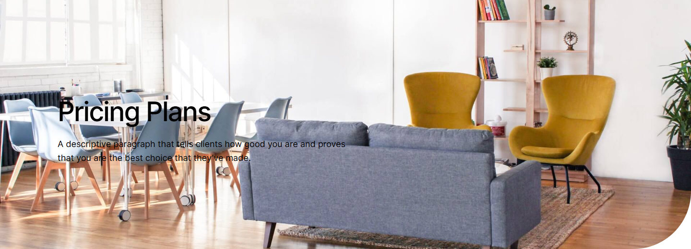
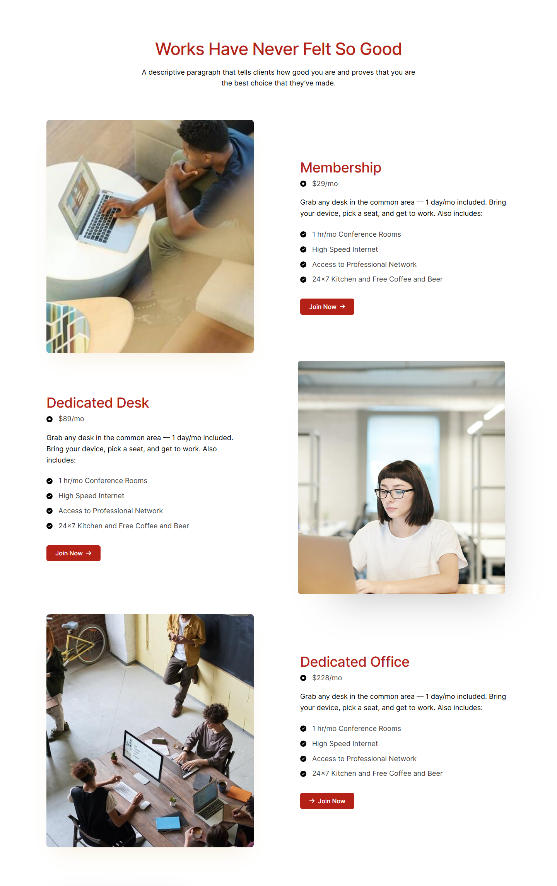
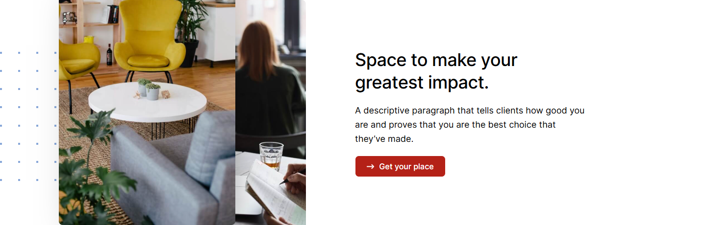
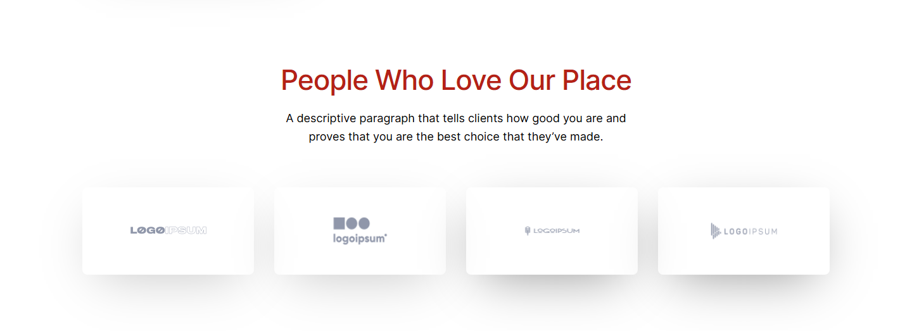
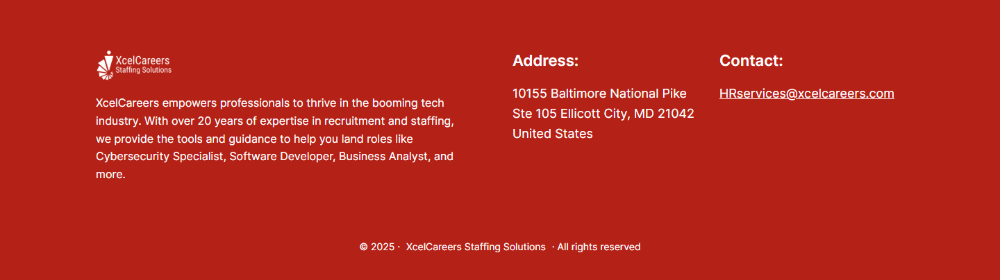

# Pricing – XcelCareers Staffing Solutions

*XcelCareers (client's current site)* · URL: https://xcelcareers.com/pricing/ · captured 2026-11-08 00:30:16 · HTTP 200

- **Meta description:** —
- **Page size (desktop 1440px):** 1440×4512 px · tablet (820px): 3867 px · mobile (390px): 6057 px
- **Screenshots:** [desktop](screenshots/desktop-full.png) · [tablet](screenshots/tablet-full.png) · [mobile](screenshots/mobile-full.png) · [desktop top](screenshots/desktop-viewport-top.png) · [desktop scrolled](screenshots/desktop-viewport-scrolled.png)
- **Files:** [raw.html](raw.html) (server HTML) · [rendered.html](rendered.html) (DOM after JS) · [content.txt](content.txt) (all visible text) · layout-*.json (full element tree with computed styles) · page.json (everything)

## 1. Section map (top → bottom, desktop 1440px)

| # | Role | Y from top | Height | Heading / first text | Mobile height | Screenshot |
|---|---|---|---|---|---|---|
| 0 | header | 0 | 153 | Home Transition Into Tech Jobs Contact 410.865.9558 | 153 | [img](screenshots/desktop-sec00-header.png) |
| 1 | section | 153 | 520 | Pricing Plans | 400 | [img](screenshots/desktop-sec01-section.png) |
| 2 | section | 673 | 2291 | Works Have Never Felt So Good | 3154 | [img](screenshots/desktop-sec02-section.png) |
| 3 | section | 3044 | 460 | Space to make your greatest impact. | 783 | [img](screenshots/desktop-sec03-section.png) |
| 4 | section | 3584 | 523 | People Who Love Our Place | 896 | [img](screenshots/desktop-sec04-section.png) |
| 5 | footer | 4108 | 404 | XcelCareers Staffing Solutions | 591 | [img](screenshots/desktop-sec05-footer.png) |

## 2. Section-by-section layout (desktop)

Legend: each line is an element in DOM order. `@x,y w×h` = position/size in px on the 1440px-wide page. Text lines show *font size/weight, line-height, colour*. Boxes show layout (flex/grid), background, padding, radius, shadow, etc. Pass-through wrappers are collapsed.

### 2.0 HEADER — Home Transition Into Tech Jobs Contact 410.865.9558

Element: `<header class="wp-block-template-part">` at y=0, 1440×153px · 

- div.wp-block-columns [flex row · gap:18px] `@0,0 1440×153`
  - div.wp-block-group [bg:#000000 · pad:0px 18px 0px 18px] `@0,0 1440×153`
    - div.wp-block-group [flex row · justify:space-between · align:center · gap:18px · margin:0px 120px 0px 120px · max-w:1164px] `@138,0 1164×153`
      - a (link→/) [inline-block] `@138,0 153×153`
        - **IMG** `MediumSquareLogo.png` alt="" natural 400×400 · inline · max-w:100% · overflow:clip `@138,0 153×153`
      - div.wp-block-group [flex row · justify:flex-end · align:center · gap:54px] `@688,56 614×41`
        - nav.wp-block-navigation [flex row wrap · justify:flex-end · align:center · gap:36px] `@688,64 407×26`
          - div.wp-block-navigation__responsive-container-content [flex row wrap · justify:flex-end · align:center · gap:36px] `@688,64 407×26`
            - ul.wp-block-navigation__container [flex row wrap · justify:flex-end · align:center · gap:36px] `@688,64 407×26`
              - li.wp-block-navigation-item [flex row · align:center] `@688,64 46×26`
                - **A→/** "Home" — Inter 16px/400 lh 25.6px · #FFFFFF · letterSpacing:0.25px `@688,64 46×26`
              - li.wp-block-navigation-item [flex row · align:center] `@770,64 154×26`
                - **A→/transition-into-tech/** "Transition Into Tech" — Inter 16px/400 lh 25.6px · #FFFFFF · letterSpacing:0.25px `@770,64 154×26`
              - li.wp-block-navigation-item [flex row · align:center] `@960,64 38×26`
                - **A→/jobs-2/** "Jobs" — Inter 16px/400 lh 25.6px · #FFFFFF · letterSpacing:0.25px `@960,64 38×26`
              - li.wp-block-navigation-item [flex row · align:center] `@1033,64 62×26`
                - **A→/contact/** "Contact" — Inter 16px/400 lh 25.6px · #FFFFFF · letterSpacing:0.25px `@1033,64 62×26`
        - div.wp-block-buttons [flex row wrap · align:center · gap:18px] `@1149,56 153×41`
          - **A→** "410.865.9558" — Inter 16px/500 lh 16px · #FFFFFF · textAlign:center ‖ inline-block · bg:#B42117 · pad:12.672px 23.328px 12.672px 23.328px · radius:6px `@1149,56 153×41`

### 2.1 SECTION — Pricing Plans

Element: `
` at y=153, 1440×520px · 

- div.wp-block-uagb-container [flex row · gap:20px · bg-image:aminities-bg.jpg · bg-size:cover · bg-pos:50% 50% · pad:200px 0px 160px 0px · radius:0px 0px 120px · shadow:#000000 @44% 0px 0px 0px 0px · transition:box-shadow 0.2s ease] `@0,153 1440×520`
  - div.uagb-container-inner-blocks-wrap [flex column · justify:center · align:center · gap:20px · margin:0px 120px 0px 120px · max-w:min(100%, 1200px)] `@120,353 1200×160`
    - div.wp-block-uagb-advanced-heading [pad:0px 600px 0px 0px] `@120,353 1200×160`
      - **H1** "Pricing Plans" — Inter 56px/500 lh 67.2px · #000000 · letterSpacing:-2px ‖ margin:0px 0px 20px 0px `@120,353 600×67`
      - **P** "A descriptive paragraph that tells clients how good you are and proves that you are the best choice that they’ve made." — Inter 18px/400 lh 28.8px · #000000 ‖ margin:0px 0px 15px 0px `@120,440 600×58`

### 2.2 SECTION — Works Have Never Felt So Good

Element: `
` at y=673, 1440×2291px · 

- div.wp-block-uagb-container [flex row · gap:20px · pad:100px 10px 100px 10px · shadow:#000000 @44% 0px 0px 0px 0px · transition:box-shadow 0.2s ease] `@0,673 1440×2291`
  - div.uagb-container-inner-blocks-wrap [flex column · justify:center · align:center · gap:20px · margin:0px 110px 0px 110px · max-w:min(100%, 1200px)] `@120,773 1200×2091`
    - div.wp-block-uagb-info-box [z:1 · align-text:center] `@120,773 1200×158`
      - div.uagb-ifb-content [inline-block · z:1 · align-text:center] `@120,773 1200×158`
        - div.uagb-ifb-title-wrap [z:1 · align-text:center] `@120,773 1200×53`
          - **H2** "Works Have Never Felt So Good" — Inter 44px/500 lh 52.8px · #B42117 · letterSpacing:-1px · textAlign:center ‖ margin:0px 0px 20px 0px `@120,773 1200×53`
        - **P** "A descriptive paragraph that tells clients how good you are and proves that you are the best choice that they’ve made." — Inter 18px/400 lh 28.8px · #000000 · textAlign:center ‖ margin:0px 240px 28px 240px `@360,846 720×58`
    - div.wp-block-uagb-container [grid cols[600px 600px] · gap:20px 0px · margin:32px 0px 0px 0px · max-w:100% · shadow:#000000 @44% 0px 0px 0px 0px · transition:box-shadow 0.2s ease] `@120,983 1200×603`
      - figure.wp-block-uagb-image__figure [flex column · align:flex-start · max-w:100%] `@120,983 536×603`
        - **IMG** `facilites-edited.jpg` alt="" natural 640×400 · fit:cover · flex row · max-w:100% · radius:8px · shadow:#DFB573 @24% 0px 32px 56px -24px · overflow:clip · transition:box-shadow 0.2s ease `@120,983 536×603`
      - div.wp-block-uagb-container [flex column · justify:center · align:flex-start · gap:0px 20px · pad:0px 0px 0px 56px · shadow:#000000 @44% 0px 0px 0px 0px · transition:box-shadow 0.2s ease] `@720,983 600×603`
        - div.wp-block-uagb-advanced-heading [pad:0px 0px 4px 0px] `@776,1083 544×51`
          - **H3** "Membership" — Inter 36px/500 lh 46.8px · #B42117 · letterSpacing:-0.5px `@776,1083 544×47`
        - div.uagb-icon-list__wrap [flex column · justify:center · align:flex-start · pad:0px 0px 10px 0px] `@776,1134 544×49`
          - div.wp-block-uagb-icon-list-child [flex row · align:center · margin:0px 0px 10px 0px · transition:all 0.2s ease] `@776,1134 97×29`
            - span.uagb-icon-list__source-wrap [margin:0px 15px 0px 0px] `@776,1140 16×16`
              - **SVG icon** 16×16 fill:#000000 color:#3A3A3A  `@776,1140 16×16`
            - **SPAN** "$29/mo" — Inter 18px/400 lh 28.8px · #3A3A3A `@807,1134 66×29`
        - div.wp-block-uagb-advanced-heading [pad:0px 0px 10px 0px] `@776,1182 544×83`
          - **P** "Grab any desk in the common area — 1 day/mo included. Bring your device, pick a seat, and get to work. Also includes:" — Inter 18px/400 lh 28.8px · #000000 ‖ margin:0px 0px 15px 0px `@776,1182 544×58`
        - div.uagb-icon-list__wrap [flex column · justify:center · align:flex-start · pad:0px 0px 25px 0px] `@776,1265 544×180`
          - div.wp-block-uagb-icon-list-child [flex row · align:center · margin:0px 0px 10px 0px · transition:all 0.2s ease] `@776,1265 261×29`
            - span.uagb-icon-list__source-wrap [margin:0px 15px 0px 0px] `@776,1271 16×16`
              - **SVG icon** 16×16 fill:#000000 color:#3A3A3A  `@776,1271 16×16`
            - **SPAN** "1 hr/mo Conference Rooms" — Inter 18px/400 lh 28.8px · #3A3A3A `@807,1265 230×29`
          - div.wp-block-uagb-icon-list-child [flex row · align:center · margin:0px 0px 10px 0px · transition:all 0.2s ease] `@776,1304 201×29`
            - span.uagb-icon-list__source-wrap [margin:0px 15px 0px 0px] `@776,1310 16×16`
              - **SVG icon** 16×16 fill:#000000 color:#3A3A3A  `@776,1310 16×16`
            - **SPAN** "High Speed Internet" — Inter 18px/400 lh 28.8px · #3A3A3A `@807,1304 170×29`
          - div.wp-block-uagb-icon-list-child [flex row · align:center · margin:0px 0px 10px 0px · transition:all 0.2s ease] `@776,1343 301×29`
            - span.uagb-icon-list__source-wrap [margin:0px 15px 0px 0px] `@776,1349 16×16`
              - **SVG icon** 16×16 fill:#000000 color:#3A3A3A  `@776,1349 16×16`
            - **SPAN** "Access to Professional Network" — Inter 18px/400 lh 28.8px · #3A3A3A `@807,1343 270×29`
          - div.wp-block-uagb-icon-list-child [flex row · align:center · margin:0px 0px 10px 0px · transition:all 0.2s ease] `@776,1381 369×29`
            - span.uagb-icon-list__source-wrap [margin:0px 15px 0px 0px] `@776,1388 16×16`
              - **SVG icon** 16×16 fill:#000000 color:#3A3A3A  `@776,1388 16×16`
            - **SPAN** "24×7 Kitchen and Free Coffee and Beer" — Inter 18px/400 lh 28.8px · #3A3A3A `@807,1381 338×29`
        - div.uagb-buttons__wrap [flex row · justify:left · align:center · gap:10px] `@776,1445 544×41`
          - **A→/pricing/** "Join Now" +icon[svg] — Inter 16px/500 lh 16px · #FFFFFF · textAlign:center ‖ flex row · bg:#B42117 · pad:12.672px 23.328px 12.672px 23.328px · radius:6px · shadow:#000000 @15% 0px 0px 0px 0px · transition:box-shadow 0.2s ease `@776,1445 140×41`
    - div.wp-block-uagb-container [flex row · justify:center · align:center · gap:20px 0px · max-w:100% · shadow:#000000 @44% 0px 0px 0px 0px · transition:box-shadow 0.2s ease] `@120,1606 1200×603`
      - div.wp-block-uagb-container [flex column · justify:center · align:flex-start · gap:0px 20px · pad:0px 80px 0px 0px · max-w:50% · shadow:#000000 @44% 0px 0px 0px 0px · transition:box-shadow 0.2s ease] `@120,1691 594×433`
        - div.wp-block-uagb-advanced-heading [pad:0px 0px 4px 0px] `@120,1691 514×51`
          - **H3** "Dedicated Desk" — Inter 36px/500 lh 46.8px · #B42117 · letterSpacing:-0.5px `@120,1691 514×47`
        - div.uagb-icon-list__wrap [flex column · justify:center · align:flex-start · pad:0px 0px 10px 0px] `@120,1742 514×49`
          - div.wp-block-uagb-icon-list-child [flex row · align:center · margin:0px 0px 10px 0px · transition:all 0.2s ease] `@120,1742 98×29`
            - span.uagb-icon-list__source-wrap [margin:0px 15px 0px 0px] `@120,1749 16×16`
              - **SVG icon** 16×16 fill:#000000 color:#3A3A3A  `@120,1749 16×16`
            - **SPAN** "$89/mo" — Inter 18px/400 lh 28.8px · #3A3A3A `@151,1742 67×29`
        - div.wp-block-uagb-advanced-heading [pad:0px 0px 10px 0px] `@120,1791 514×111`
          - **P** "Grab any desk in the common area — 1 day/mo included. Bring your device, pick a seat, and get to work. Also includes:" — Inter 18px/400 lh 28.8px · #000000 ‖ margin:0px 0px 15px 0px `@120,1791 514×86`
        - div.uagb-icon-list__wrap [flex column · justify:center · align:flex-start · pad:0px 0px 25px 0px] `@120,1902 514×180`
          - div.wp-block-uagb-icon-list-child [flex row · align:center · margin:0px 0px 10px 0px · transition:all 0.2s ease] `@120,1902 261×29`
            - span.uagb-icon-list__source-wrap [margin:0px 15px 0px 0px] `@120,1909 16×16`
              - **SVG icon** 16×16 fill:#000000 color:#3A3A3A  `@120,1909 16×16`
            - **SPAN** "1 hr/mo Conference Rooms" — Inter 18px/400 lh 28.8px · #3A3A3A `@151,1902 230×29`
          - div.wp-block-uagb-icon-list-child [flex row · align:center · margin:0px 0px 10px 0px · transition:all 0.2s ease] `@120,1941 201×29`
            - span.uagb-icon-list__source-wrap [margin:0px 15px 0px 0px] `@120,1948 16×16`
              - **SVG icon** 16×16 fill:#000000 color:#3A3A3A  `@120,1948 16×16`
            - **SPAN** "High Speed Internet" — Inter 18px/400 lh 28.8px · #3A3A3A `@151,1941 170×29`
          - div.wp-block-uagb-icon-list-child [flex row · align:center · margin:0px 0px 10px 0px · transition:all 0.2s ease] `@120,1980 301×29`
            - span.uagb-icon-list__source-wrap [margin:0px 15px 0px 0px] `@120,1986 16×16`
              - **SVG icon** 16×16 fill:#000000 color:#3A3A3A  `@120,1986 16×16`
            - **SPAN** "Access to Professional Network" — Inter 18px/400 lh 28.8px · #3A3A3A `@151,1980 270×29`
          - div.wp-block-uagb-icon-list-child [flex row · align:center · margin:0px 0px 10px 0px · transition:all 0.2s ease] `@120,2019 369×29`
            - span.uagb-icon-list__source-wrap [margin:0px 15px 0px 0px] `@120,2025 16×16`
              - **SVG icon** 16×16 fill:#000000 color:#3A3A3A  `@120,2025 16×16`
            - **SPAN** "24×7 Kitchen and Free Coffee and Beer" — Inter 18px/400 lh 28.8px · #3A3A3A `@151,2019 338×29`
        - div.uagb-buttons__wrap [flex row · justify:left · align:center · gap:10px] `@120,2083 514×41`
          - **A→/pricing/** "Join Now" +icon[svg] — Inter 16px/500 lh 16px · #FFFFFF · textAlign:center ‖ flex row · bg:#B42117 · pad:12.672px 23.328px 12.672px 23.328px · radius:6px · shadow:#000000 @15% 0px 0px 0px 0px · transition:box-shadow 0.2s ease `@120,2083 140×41`
      - div.wp-block-uagb-image [flex row · margin:0px 0px 0px 56px] `@770,1606 550×603`
        - figure.wp-block-uagb-image__figure [flex column · align:flex-start · max-w:100%] `@770,1606 536×603`
          - **IMG** `affordable-pricing.jpg` alt="" natural 640×960 · fit:cover · flex row · max-w:100% · radius:8px · shadow:#000000 @24% 40px 64px 100px -56px · overflow:clip · transition:box-shadow 0.2s ease `@770,1606 536×603`
    - div.wp-block-uagb-container [grid cols[600px 600px] · gap:20px 0px · margin:32px 0px 0px 0px · max-w:100% · shadow:#000000 @44% 0px 0px 0px 0px · transition:box-shadow 0.2s ease] `@120,2261 1200×603`
      - div.wp-block-uagb-image [flex row · margin:0px 64px 0px 0px] `@120,2261 600×603`
        - figure.wp-block-uagb-image__figure [flex column · align:flex-start · max-w:100%] `@120,2261 536×603`
          - **IMG** `people-inside-room.jpg` alt="" natural 640×959 · fit:cover · flex row · max-w:100% · radius:8px · shadow:#DFB573 @24% 0px 32px 56px -24px · overflow:clip · transition:box-shadow 0.2s ease `@120,2261 536×603`
      - div.wp-block-uagb-container [flex column · justify:center · align:flex-start · gap:0px 20px · pad:0px 0px 0px 56px · shadow:#000000 @44% 0px 0px 0px 0px · transition:box-shadow 0.2s ease] `@720,2261 600×603`
        - div.wp-block-uagb-advanced-heading [pad:0px 0px 4px 0px] `@776,2361 544×51`
          - **H3** "Dedicated Office" — Inter 36px/500 lh 46.8px · #B42117 · letterSpacing:-0.5px `@776,2361 544×47`
        - div.uagb-icon-list__wrap [flex column · justify:center · align:flex-start · pad:0px 0px 10px 0px] `@776,2412 544×49`
          - div.wp-block-uagb-icon-list-child [flex row · align:center · margin:0px 0px 10px 0px · transition:all 0.2s ease] `@776,2412 108×29`
            - span.uagb-icon-list__source-wrap [margin:0px 15px 0px 0px] `@776,2418 16×16`
              - **SVG icon** 16×16 fill:#000000 color:#3A3A3A  `@776,2418 16×16`
            - **SPAN** "$228/mo" — Inter 18px/400 lh 28.8px · #3A3A3A `@807,2412 77×29`
        - div.wp-block-uagb-advanced-heading [pad:0px 0px 10px 0px] `@776,2460 544×83`
          - **P** "Grab any desk in the common area — 1 day/mo included. Bring your device, pick a seat, and get to work. Also includes:" — Inter 18px/400 lh 28.8px · #000000 ‖ margin:0px 0px 15px 0px `@776,2460 544×58`
        - div.uagb-icon-list__wrap [flex column · justify:center · align:flex-start · pad:0px 0px 25px 0px] `@776,2543 544×180`
          - div.wp-block-uagb-icon-list-child [flex row · align:center · margin:0px 0px 10px 0px · transition:all 0.2s ease] `@776,2543 261×29`
            - span.uagb-icon-list__source-wrap [margin:0px 15px 0px 0px] `@776,2549 16×16`
              - **SVG icon** 16×16 fill:#000000 color:#3A3A3A  `@776,2549 16×16`
            - **SPAN** "1 hr/mo Conference Rooms" — Inter 18px/400 lh 28.8px · #3A3A3A `@807,2543 230×29`
          - div.wp-block-uagb-icon-list-child [flex row · align:center · margin:0px 0px 10px 0px · transition:all 0.2s ease] `@776,2582 201×29`
            - span.uagb-icon-list__source-wrap [margin:0px 15px 0px 0px] `@776,2588 16×16`
              - **SVG icon** 16×16 fill:#000000 color:#3A3A3A  `@776,2588 16×16`
            - **SPAN** "High Speed Internet" — Inter 18px/400 lh 28.8px · #3A3A3A `@807,2582 170×29`
          - div.wp-block-uagb-icon-list-child [flex row · align:center · margin:0px 0px 10px 0px · transition:all 0.2s ease] `@776,2621 301×29`
            - span.uagb-icon-list__source-wrap [margin:0px 15px 0px 0px] `@776,2627 16×16`
              - **SVG icon** 16×16 fill:#000000 color:#3A3A3A  `@776,2627 16×16`
            - **SPAN** "Access to Professional Network" — Inter 18px/400 lh 28.8px · #3A3A3A `@807,2621 270×29`
          - div.wp-block-uagb-icon-list-child [flex row · align:center · margin:0px 0px 10px 0px · transition:all 0.2s ease] `@776,2659 369×29`
            - span.uagb-icon-list__source-wrap [margin:0px 15px 0px 0px] `@776,2666 16×16`
              - **SVG icon** 16×16 fill:#000000 color:#3A3A3A  `@776,2666 16×16`
            - **SPAN** "24×7 Kitchen and Free Coffee and Beer" — Inter 18px/400 lh 28.8px · #3A3A3A `@807,2659 338×29`
        - div.uagb-buttons__wrap [flex row · justify:left · align:center · gap:10px] `@776,2723 544×41`
          - **A→/pricing/** "Join Now" +icon[svg] — Inter 16px/500 lh 16px · #FFFFFF · textAlign:center ‖ flex row · bg:#B42117 · pad:12.672px 23.328px 12.672px 23.328px · radius:6px · shadow:#000000 @15% 0px 0px 0px 0px · transition:box-shadow 0.2s ease `@776,2723 140×41`

### 2.3 SECTION — Space to make your greatest impact.

Element: `
` at y=3044, 1440×460px · 

- div.wp-block-uagb-container [flex row · gap:20px · margin:80px 0px 80px 0px · shadow:#000000 @44% 0px 0px 0px 0px · transition:box-shadow 0.2s ease] · pseudo:::before{{"content": "\"\"", "w": "1440px", "h": "460px", "bgImage": "url(\"https://xcelcareers.com/wp-content/uploads/2020/06/dots.png\")", "position": "absolute"}} `@0,3044 1440×460`
  - div.uagb-container-inner-blocks-wrap [flex row · justify:center · align:center · gap:20px · margin:0px 120px 0px 120px · max-w:min(100%, 1200px)] `@120,3044 1200×460`
    - div.wp-block-uagb-container [flex column · justify:center · align:center · gap:20px · bg-image:writing-notepad.jpg · bg-size:cover · bg-pos:50% 49% · margin:0px 0px -80px 120px · max-w:32% · radius:8px · shadow:#000000 @44% 0px 0px 0px 0px · z:1 · transition:box-shadow 0.2s ease] `@240,3044 384×540`
      - div.wp-block-uagb-image [flex row · margin:-80px 120px 80px -120px] `@120,2964 384×540`
        - figure.wp-block-uagb-image__figure [flex column · align:flex-start · max-w:100%] `@120,2964 360×540`
          - **IMG** `furniture.jpg` alt="" natural 640×960 · fit:cover · flex row · max-w:100% · radius:8px · shadow:#000000 @50% 16px 40px 80px -32px · overflow:clip · transition:box-shadow 0.2s ease `@120,2964 360×540`
    - div.wp-block-uagb-container [flex column · justify:center · align:center · gap:132px 20px · pad:0px 0px 0px 80px · margin:0px 120px 0px 0px · max-w:68% · shadow:#000000 @44% 0px 0px 0px 0px · transition:box-shadow 0.2s ease] `@644,3143 556×263`
      - div.wp-block-uagb-info-box [z:1] `@724,3143 476×263`
        - div.uagb-ifb-content [z:1] `@724,3143 476×263`
          - div.uagb-ifb-title-wrap [z:1] `@724,3143 476×94`
            - **H3** "Space to make your greatest impact." — Inter 36px/500 lh 46.8px · #000000 · letterSpacing:-0.5px ‖ margin:0px 0px 20px 0px `@724,3143 476×94`
          - **P** "A descriptive paragraph that tells clients how good you are and proves that you are the best choice that they’ve made." — Inter 18px/400 lh 28.8px · #000000 ‖ margin:18px 0px 20px 0px `@724,3256 476×86`
          - **A→/pricing/** "Get your place" +icon[svg] — Inter 16px/500 lh 16px · #FFFFFF · textAlign:center ‖ flex row · bg:#B42117 · pad:12.672px 23.328px 12.672px 23.328px · radius:8px · border:1px 1px 1px 1px solid #FFFFFF `@724,3362 185×43`

### 2.4 SECTION — People Who Love Our Place

Element: `
` at y=3584, 1440×523px · 

- div.wp-block-uagb-container [flex row · gap:40px 20px · pad:100px 0px 80px 0px · shadow:#000000 @44% 0px 0px 0px 0px · transition:box-shadow 0.2s ease] `@0,3584 1440×523`
  - div.uagb-container-inner-blocks-wrap [flex column · justify:center · align:center · gap:40px 20px · margin:0px 120px 0px 120px · max-w:min(100%, 1200px)] `@120,3684 1200×343`
    - div.wp-block-uagb-advanced-heading [pad:0px 312px 0px 312px · align-text:center] `@120,3684 1200×145`
      - **H2** "People Who Love Our Place" — Inter 44px/500 lh 52.8px · #B42117 · letterSpacing:-1px · textAlign:center ‖ margin:0px 0px 20px 0px `@432,3684 576×53`
      - **P** "A descriptive paragraph that tells clients how good you are and proves that you are the best choice that they’ve made." — Inter 18px/400 lh 28.8px · #000000 · textAlign:center ‖ margin:0px 0px 15px 0px `@432,3757 576×58`
    - div.wp-block-uagb-container [flex row · justify:center · pad:10px 10px 10px 10px · max-w:100% · shadow:#000000 @44% 0px 0px 0px 0px · transition:box-shadow 0.2s ease] `@120,3870 1200×158`
      - div.wp-block-uagb-container [flex column · justify:center · align:center · pad:24px 32px 24px 32px · margin:0px 16px 0px 0px · max-w:25% · radius:8px · shadow:#000000 @24% 0px 24px 80px -24px · transition:box-shadow 0.2s ease] `@130,3880 271×138`
        - div.wp-block-uagb-image [flex row · justify:center] `@162,3909 207×80`
          - figure.wp-block-uagb-image__figure [flex column · max-w:100%] `@194,3909 143×80`
            - **IMG** `logo-4.png` alt="" natural 143×80 · flex row · max-w:100% · shadow:#000000 @44% 0px 0px 0px 0px · overflow:clip · transition:box-shadow 0.2s ease `@194,3909 143×80`
      - div.wp-block-uagb-container [flex column · justify:center · align:center · pad:24px 32px 24px 32px · margin:0px 16px 0px 16px · max-w:25% · radius:8px · shadow:#000000 @24% 0px 24px 80px -24px · transition:box-shadow 0.2s ease] `@433,3880 271×138`
        - div.wp-block-uagb-image [flex row · justify:center · align-text:center] `@465,3904 207×90`
          - figure.wp-block-uagb-image__figure [flex column · align:center · max-w:100% · align-text:center] `@494,3904 150×90`
            - **IMG** `logo-2.png` alt="" natural 143×80 · flex row · max-w:100% · shadow:#000000 @44% 0px 0px 0px 0px · overflow:clip · align-text:center · transition:box-shadow 0.2s ease `@494,3904 150×90`
      - div.wp-block-uagb-container [flex column · justify:center · align:center · pad:24px 32px 24px 32px · margin:0px 16px 0px 16px · max-w:25% · radius:8px · shadow:#000000 @44% 0px 24px 80px -24px · transition:box-shadow 0.2s ease] `@736,3880 271×138`
        - div.wp-block-uagb-image [flex row · justify:center · align-text:center] `@768,3928 207×42`
          - figure.wp-block-uagb-image__figure [flex column · align:center · max-w:100% · align-text:center] `@812,3928 120×42`
            - **IMG** `logo-3.png` alt="" natural 143×80 · flex row · max-w:100% · shadow:#000000 @44% 0px 0px 0px 0px · overflow:clip · align-text:center · transition:box-shadow 0.2s ease `@812,3928 120×42`
      - div.wp-block-uagb-container [flex column · justify:center · align:center · pad:24px 32px 24px 32px · margin:0px 0px 0px 16px · max-w:25% · radius:8px · shadow:#000000 @44% 0px 24px 80px -24px · transition:box-shadow 0.2s ease] `@1039,3880 271×138`
        - div.wp-block-uagb-image [flex row · justify:center · align-text:center] `@1071,3904 207×90`
          - figure.wp-block-uagb-image__figure [flex column · align:center · max-w:100% · align-text:center] `@1100,3904 150×90`
            - **IMG** `logo-1-1.png` alt="" natural 143×80 · flex row · max-w:100% · shadow:#000000 @44% 0px 0px 0px 0px · overflow:clip · align-text:center · transition:box-shadow 0.2s ease `@1100,3904 150×90`

### 2.5 FOOTER — XcelCareers Staffing Solutions

Element: `<footer class="wp-block-template-part">` at y=4108, 1440×404px · 

- div.wp-block-group [bg:#B42117 · pad:72px 18px 36px 18px] `@0,4108 1440×404`
  - div.wp-block-columns [flex row · gap:36px · margin:0px 120px 0px 120px · max-w:1164px] `@138,4180 1164×220`
    - div.wp-block-column [pad:0px 0px 9px 0px] `@138,4180 564×220`
      - a (link→/) [inline-block] `@138,4180 110×47`
        - **IMG** `MediumSquareLogo-e1736976275746.png` alt="" natural 400×170 · inline · max-w:100% · overflow:clip · filter:url("#wp-duotone-secondary") `@138,4180 110×47`
      - **P** "XcelCareers empowers professionals to thrive in the booming tech industry. With over 20 years of expertise in recruitment and staffing, we provide the tools …" — Inter 16px/400 lh 25.6px · #FFFFFF ‖ pad:0px 36px 0px 0px · margin:18px 0px 0px 0px `@138,4244 564×128`
    - div.wp-block-column [pad:0px 0px 9px 0px] `@738,4180 564×220`
      - div.wp-block-columns [flex row · gap:32px] `@738,4180 564×136`
        - div.wp-block-column `@738,4180 266×136`
          - **H5** "Address:" — Inter 22px/600 lh 31.9px · #FFFFFF `@738,4180 266×32`
          - **P** "10155 Baltimore National Pike Ste 105 Ellicott City, MD 21042 United States" — Inter 18px/400 lh 28.8px · #FFFFFF ‖ margin:18px 0px 0px 0px `@738,4229 266×86`
        - div.wp-block-column `@1036,4180 266×136`
          - **H5** "Contact:" — Inter 22px/600 lh 31.9px · #FFFFFF `@1036,4180 266×32`
          - p.wp-block-paragraph [margin:18px 0px 0px 0px] `@1036,4229 266×29`
            - **A→mailto:HRservices@xcelcareers.com** "HRservices@xcelcareers.com" — Inter 18px/400 lh 28.8px · #FFFFFF ‖ inline `@1036,4232 252×21`
  - div.wp-block-group [flex row · justify:center · align:center · gap:9px · pad:0px 18px 0px 18px · margin:54px 120px 0px 120px · max-w:1164px] `@138,4453 1164×22`
    - **P** "© 2025 ·" — Inter 14px/400 lh 22.4px · #FFFFFF · textAlign:center `@517,4453 59×22`
    - **A→/** "XcelCareers Staffing Solutions" — Inter 14px/400 lh 22.4px · #FFFFFF ‖ inline `@585,4455 201×17`
    - **P** "· All rights reserved" — Inter 14px/400 lh 22.4px · #FFFFFF · textAlign:center `@795,4453 128×22`

## 3. Header, navigation & interaction behaviour

- **atTop** `header.wp-block-template-part` position:static top:0 height:153 bg:transparent shadow:none backdrop:none z:auto
- **afterScroll1400** `header.wp-block-template-part` position:static top:-1400 height:153 bg:transparent shadow:none backdrop:none z:auto

| Menu item | Link | Dropdown | Style | Hover change |
|---|---|---|---|---|
| Home | / | — | Inter 16px/400 #FFFFFF  ls 0.25px | none |
| Transition Into Tech | /transition-into-tech/ | — | Inter 16px/400 #FFFFFF  ls 0.25px | none |
| Jobs | /jobs-2/ | — | Inter 16px/400 #FFFFFF  ls 0.25px | none |
| Contact | /contact/ | — | Inter 16px/400 #FFFFFF  ls 0.25px | none |

- **Mobile menu:** toggle `.wp-block-navigation__responsive-container-open` → [screenshot](screenshots/mobile-menu-open.png) · items: Home, Transition Into Tech, Jobs, Contact

### Hover states (measured by hovering in Chrome)

| Element | Text | Normal | On hover |
|---|---|---|---|
| `a.wp-block-navigation-item__content` | Home | color #FFFFFF · bg transparent · radius 0px · pad 0px · border 0px #FFFFFF · transition all | no change |
| `a.wp-block-button__link` | 410.865.9558 | color #FFFFFF · bg #B42117 · radius 6px · pad 12.672px 23.328px · border 0px #B42217 · transition all | no change |
| `div.wp-block-uagb-info-box` | Works Have Never Felt So Good A descript | color #000000 · bg transparent · radius 0px · pad 0px · border 0px #000000 · transition all | no change |
| `div.uagb-ifb-content` | Works Have Never Felt So Good A descript | color #000000 · bg transparent · radius 0px · pad 0px · border 0px #000000 · transition all | no change |
| `a.uagb-buttons-repeater` | Join Now | color #FFFFFF · bg #B42117 · radius 6px · pad 12.672px 23.328px · border 0px #B42217 · transition box-shadow 0.2s | backgroundColor: #B42117 → #FFFFFF |
| `div.wp-block-uagb-info-box` | Space to make your greatest impact. A de | color #000000 · bg transparent · radius 0px · pad 0px · border 0px #000000 · transition all | no change |
| `a.uagb-infobox-cta-link` | Get your place | color #FFFFFF · bg #B42117 · radius 8px · pad 12.672px 23.328px · border 1px #FFFFFF · transition all | color: #FFFFFF → #000000; backgroundColor: #B42117 → transparent; borderTopColor: #FFFFFF → #000000; childFill: #FFFFFF → #000000; childColor: #FFFFFF → #000000 |
| `a.` |  | color #000000 · bg transparent · radius 0px · pad 0px · border 0px #000000 · transition all | color: #000000 → #B42117; borderTopColor: #000000 → #B42117; childColor: #000000 → #B42117 |
| `a.` | HRservices@xcelcareers.com | color #FFFFFF · bg transparent · radius 0px · pad 0px · border 0px #FFFFFF · transition all | no change |
| `a.` | XcelCareers Staffing Solutions | color #FFFFFF · bg transparent · radius 0px · pad 0px · border 0px #FFFFFF · transition all | no change |

## 4. Typography & colour used on this page (weighted by amount of text / area)

| Font · weight · size / line-height | chars |
|---|---|
| Inter | 400 | 18px / 28.8px | 1273 |
| Inter | 400 | 16px / 25.6px | 306 |
| Inter | 500 | 36px / 46.8px | 75 |
| Inter | 400 | 14px / 22.4px | 59 |
| Inter | 500 | 44px / 52.8px | 54 |
| Inter | 500 | 16px / 16px | 50 |
| Inter | 600 | 22px / 31.9px | 16 |
| Inter | 500 | 56px / 67.2px | 13 |

- **Text colours:** #000000 (871), #FFFFFF (532), #3A3A3A (349), #B42117 (94)
- **Background colours (by area):** #B42117 (614), #000000 (220)
- **Border radii:** 8px (10), 6px (4), 0px 0px 120px (1)
- **Shadows:** #000000 @44% 0px 0px 0px 0px (17) | #000000 @15% 0px 0px 0px 0px (3) | #DFB573 @24% 0px 32px 56px -24px (2) | #000000 @24% 0px 24px 80px -24px (2) | #000000 @44% 0px 24px 80px -24px (2) | #000000 @24% 40px 64px 100px -56px (1)
- **Mobile text styles:** Inter | 400 | 16px / 25.6px (1273); Inter | 400 | 14px / 22.4px (271); Inter | 500 | 28px / 36.4px (75); Inter | 400 | 12px / 19.2px (59); Inter | 500 | 32px / 38.4px (54); Inter | 500 | 14px / 14px (38); Inter | 600 | 20px / 29px (16); Inter | 500 | 40px / 48px (13)

## 6. Images on the page

- `MediumSquareLogo.png` natural 400×400 → shown 153×153 · alt="" · https://xcelcareers.com/wp-content/uploads/2018/12/MediumSquareLogo.png
- `facilites-edited.jpg` natural 640×400 → shown 536×603 · alt="" · https://xcelcareers.com/wp-content/uploads/2022/06/facilites-edited.jpg
- `affordable-pricing.jpg` natural 640×960 → shown 536×603 · alt="" · https://xcelcareers.com/wp-content/uploads/2020/07/affordable-pricing.jpg
- `people-inside-room.jpg` natural 640×959 → shown 536×603 · alt="" · https://xcelcareers.com/wp-content/uploads/2020/06/people-inside-room.jpg
- `furniture.jpg` natural 640×960 → shown 360×540 · alt="" · https://xcelcareers.com/wp-content/uploads/2020/07/furniture.jpg
- `logo-4.png` natural 143×80 → shown 143×80 · alt="" · https://xcelcareers.com/wp-content/uploads/2024/06/logo-4.png
- `logo-2.png` natural 143×80 → shown 150×90 · alt="" · https://xcelcareers.com/wp-content/uploads/2024/06/logo-2.png
- `logo-3.png` natural 143×80 → shown 120×42 · alt="" · https://xcelcareers.com/wp-content/uploads/2024/06/logo-3.png
- `logo-1-1.png` natural 143×80 → shown 150×90 · alt="" · https://xcelcareers.com/wp-content/uploads/2024/06/logo-1-1.png
- `MediumSquareLogo-e1736976275746.png` natural 400×170 → shown 110×47 · alt="" · https://xcelcareers.com/wp-content/uploads/2018/12/MediumSquareLogo-e1736976275746.png
- background on `div.wp-block-uagb-container`: https://xcelcareers.com/wp-content/uploads/2020/07/aminities-bg.jpg
- background on `div.wp-block-uagb-container`: https://xcelcareers.com/wp-content/uploads/2020/07/writing-notepad.jpg

## 7. Links on the page

- [header] "(icon/image)" → /
- [header] "Home" → /
- [header] "Transition Into Tech" → /transition-into-tech/
- [header] "Jobs" → /jobs-2/
- [header] "Contact" → /contact/
- [body] "Join Now" → /pricing/ (target _self)
- [body] "Get your place" → /pricing/ (target _self)
- [footer] "Facebook" → /pricing/ (target _blank)
- [footer] "Twitter" → /pricing/ (target _blank)
- [footer] "YouTube" → /pricing/ (target _blank)
- [footer] "LinkedIn" → /pricing/ (target _blank)
- [footer] "HRservices@xcelcareers.com" → mailto:HRservices@xcelcareers.com
- [footer] "XcelCareers Staffing Solutions" → / (target _self)

## 8. Mobile layout (390px) — condensed outline

### 8.0 header —  (y 0, h 153)
- div.wp-block-columns [flex row wrap · gap:16px] `@0,0 390×153`
  - div.wp-block-group [bg:#000000 · pad:0px 16px 0px 16px] `@0,0 390×153`
    - div.wp-block-group [flex row · justify:space-between · align:center · gap:16px · max-w:1164px] `@16,0 358×153`
      - a (link→/) [inline-block] `@16,0 153×153`
        - **IMG** `MediumSquareLogo.png` alt="" natural 400×400 · inline · max-w:100% · overflow:clip `@16,0 153×153`
      - div.wp-block-group [flex row · justify:flex-end · align:center · gap:48px] `@350,65 24×24`
        - nav.wp-block-navigation [flex row wrap · justify:flex-end · align:center · gap:32px] `@350,65 24×24`
          - **BUTTON** "" +icon[svg] — Inter 14px/400 lh normal · #FFFFFF · textAlign:center ‖ flex row `@350,65 24×24`

### 8.1 section — Pricing Plans (y 153, h 400)
- div.wp-block-uagb-container [flex row · gap:20px · bg-image:aminities-bg.jpg · bg-size:cover · bg-pos:50% 50% · pad:160px 24px 80px 24px · radius:0px 0px 40px · shadow:#000000 @44% 0px 0px 0px 0px · transition:box-shadow 0.2s ease] `@0,153 390×400`
  - div.uagb-container-inner-blocks-wrap [flex column wrap · justify:center · align:center · gap:20px · max-w:min(100%, 426px)] `@24,313 342×160`
    - div.wp-block-uagb-advanced-heading `@24,313 342×160`
      - **H1** "Pricing Plans" — Inter 40px/500 lh 48px · #000000 · letterSpacing:-2px ‖ margin:0px 0px 20px 0px `@24,313 342×48`
      - **P** "A descriptive paragraph that tells clients how good you are and proves that you are the best choice that they’ve made." — Inter 16px/400 lh 25.6px · #000000 ‖ margin:0px 0px 15px 0px `@24,381 342×77`

### 8.2 section — Works Have Never Felt So Good (y 553, h 3154)
- div.wp-block-uagb-container [flex row · gap:0px 20px · pad:64px 22px 64px 22px · shadow:#000000 @44% 0px 0px 0px 0px · transition:box-shadow 0.2s ease] `@0,553 390×3154`
  - div.uagb-container-inner-blocks-wrap [flex column wrap · justify:center · align:center · gap:0px 20px · max-w:min(100%, 426px)] `@22,617 346×3026`
    - div.wp-block-uagb-info-box [pad:0px 0px 26px 0px · z:1 · align-text:center] `@22,617 346×200`
      - div.uagb-ifb-content [inline-block · z:1 · align-text:center] `@22,617 346×174`
        - div.uagb-ifb-title-wrap [z:1 · align-text:center] `@22,617 346×77`
          - **H2** "Works Have Never Felt So Good" — Inter 32px/500 lh 38.4px · #B42117 · letterSpacing:-1px · textAlign:center ‖ margin:0px 0px 20px 0px `@22,617 346×77`
        - **P** "A descriptive paragraph that tells clients how good you are and proves that you are the best choice that they’ve made." — Inter 16px/400 lh 25.6px · #000000 · textAlign:center `@22,714 346×77`
    - div.wp-block-uagb-container [grid cols[346px] · pad:0px 0px 40px 0px · max-w:100% · shadow:#000000 @44% 0px 0px 0px 0px · transition:box-shadow 0.2s ease] `@22,816 346×931`
      - figure.wp-block-uagb-image__figure [flex column · align:flex-start · max-w:100%] `@22,816 346×425`
        - **IMG** `facilites-edited.jpg` alt="" natural 283×177 · fit:cover · flex row · max-w:100% · radius:8px · shadow:#DFB573 @24% 0px 32px 56px -24px · overflow:clip · transition:box-shadow 0.2s ease `@22,816 346×425`
      - div.wp-block-uagb-container [flex column wrap · justify:center · align:flex-start · gap:0px 20px · pad:48px 0px 0px 0px · margin:0px 16px 0px 0px · shadow:#000000 @44% 0px 0px 0px 0px · transition:box-shadow 0.2s ease] `@22,1241 330×466`
        - div.wp-block-uagb-advanced-heading [pad:0px 0px 4px 0px] `@22,1289 330×40`
          - **H3** "Membership" — Inter 28px/500 lh 36.4px · #B42117 · letterSpacing:-0.5px `@22,1289 330×36`
        - div.uagb-icon-list__wrap [flex column · justify:center · align:flex-start · pad:0px 0px 10px 0px] `@22,1330 330×46`
          - div.wp-block-uagb-icon-list-child [flex row · align:center · margin:0px 0px 10px 0px · transition:all 0.2s ease] `@22,1330 90×26`
            - span.uagb-icon-list__source-wrap [margin:0px 15px 0px 0px] `@22,1335 16×16`
              - **SVG icon** 16×16 fill:#000000 color:#3A3A3A  `@22,1335 16×16`
            - **SPAN** "$29/mo" — Inter 16px/400 lh 25.6px · #3A3A3A `@53,1330 59×26`
        - div.wp-block-uagb-advanced-heading [pad:0px 0px 10px 0px] `@22,1375 330×102`
          - **P** "Grab any desk in the common area — 1 day/mo included. Bring your device, pick a seat, and get to work. Also includes:" — Inter 16px/400 lh 25.6px · #000000 ‖ margin:0px 0px 15px 0px `@22,1375 330×77`
        - div.uagb-icon-list__wrap [flex column · justify:center · align:flex-start · pad:0px 0px 25px 0px] `@22,1477 330×193`
          - div.wp-block-uagb-icon-list-child [flex row · align:center · margin:0px 0px 10px 0px · transition:all 0.2s ease] `@22,1477 235×26`
            - span.uagb-icon-list__source-wrap [margin:0px 15px 0px 0px] `@22,1482 16×16`
              - **SVG icon** 16×16 fill:#000000 color:#3A3A3A  `@22,1482 16×16`
            - **SPAN** "1 hr/mo Conference Rooms" — Inter 16px/400 lh 25.6px · #3A3A3A `@53,1477 204×26`
          - div.wp-block-uagb-icon-list-child [flex row · align:center · margin:0px 0px 10px 0px · transition:all 0.2s ease] `@22,1513 182×26`
            - span.uagb-icon-list__source-wrap [margin:0px 15px 0px 0px] `@22,1518 16×16`
              - **SVG icon** 16×16 fill:#000000 color:#3A3A3A  `@22,1518 16×16`
            - **SPAN** "High Speed Internet" — Inter 16px/400 lh 25.6px · #3A3A3A `@53,1513 151×26`
          - div.wp-block-uagb-icon-list-child [flex row · align:center · margin:0px 0px 10px 0px · transition:all 0.2s ease] `@22,1548 271×26`
            - span.uagb-icon-list__source-wrap [margin:0px 15px 0px 0px] `@22,1553 16×16`
              - **SVG icon** 16×16 fill:#000000 color:#3A3A3A  `@22,1553 16×16`
            - **SPAN** "Access to Professional Network" — Inter 16px/400 lh 25.6px · #3A3A3A `@53,1548 240×26`
          - div.wp-block-uagb-icon-list-child [flex row · align:center · margin:0px 0px 10px 0px · transition:all 0.2s ease] `@22,1584 330×51`
            - span.uagb-icon-list__source-wrap [margin:0px 15px 0px 0px] `@22,1601 16×16`
              - **SVG icon** 16×16 fill:#000000 color:#3A3A3A  `@22,1601 16×16`
            - **SPAN** "24×7 Kitchen and Free Coffee and Beer" — Inter 16px/400 lh 25.6px · #3A3A3A `@53,1584 299×51`
        - div.uagb-buttons__wrap [flex row · justify:left · align:center · gap:10px] `@22,1670 330×38`
          - **A→/pricing/** "Join Now" +icon[svg] — Inter 14px/500 lh 14px · #FFFFFF · textAlign:center ‖ flex row · bg:#B42117 · pad:11.338px 20.662px 11.338px 20.662px · radius:5.25px · shadow:#000000 @15% 0px 0px 0px 0px · transition:box-shadow 0.2s ease `@22,1670 126×38`
    - div.wp-block-uagb-container [flex row wrap · justify:center · align:center · margin:40px 0px 40px 0px · max-w:100% · shadow:#000000 @44% 0px 0px 0px 0px · transition:box-shadow 0.2s ease] `@22,1788 346×891`
      - div.wp-block-uagb-container [flex column wrap · justify:center · align:flex-start · gap:0px 20px · pad:48px 0px 0px 0px · margin:0px 16px 0px 0px · max-w:100% · shadow:#000000 @44% 0px 0px 0px 0px · transition:box-shadow 0.2s ease] `@22,2213 330×466`
        - div.wp-block-uagb-advanced-heading [pad:0px 0px 4px 0px] `@22,2261 330×40`
          - **H3** "Dedicated Desk" — Inter 28px/500 lh 36.4px · #B42117 · letterSpacing:-0.5px `@22,2261 330×36`
        - div.uagb-icon-list__wrap [flex column · justify:center · align:flex-start · pad:0px 0px 10px 0px] `@22,2301 330×46`
          - div.wp-block-uagb-icon-list-child [flex row · align:center · margin:0px 0px 10px 0px · transition:all 0.2s ease] `@22,2301 90×26`
            - span.uagb-icon-list__source-wrap [margin:0px 15px 0px 0px] `@22,2306 16×16`
              - **SVG icon** 16×16 fill:#000000 color:#3A3A3A  `@22,2306 16×16`
            - **SPAN** "$89/mo" — Inter 16px/400 lh 25.6px · #3A3A3A `@53,2301 59×26`
        - div.wp-block-uagb-advanced-heading [pad:0px 0px 10px 0px] `@22,2347 330×102`
          - **P** "Grab any desk in the common area — 1 day/mo included. Bring your device, pick a seat, and get to work. Also includes:" — Inter 16px/400 lh 25.6px · #000000 ‖ margin:0px 0px 15px 0px `@22,2347 330×77`
        - div.uagb-icon-list__wrap [flex column · justify:center · align:flex-start · pad:0px 0px 25px 0px] `@22,2449 330×193`
          - div.wp-block-uagb-icon-list-child [flex row · align:center · margin:0px 0px 10px 0px · transition:all 0.2s ease] `@22,2449 235×26`
            - span.uagb-icon-list__source-wrap [margin:0px 15px 0px 0px] `@22,2453 16×16`
              - **SVG icon** 16×16 fill:#000000 color:#3A3A3A  `@22,2453 16×16`
            - **SPAN** "1 hr/mo Conference Rooms" — Inter 16px/400 lh 25.6px · #3A3A3A `@53,2449 204×26`
          - div.wp-block-uagb-icon-list-child [flex row · align:center · margin:0px 0px 10px 0px · transition:all 0.2s ease] `@22,2484 182×26`
            - span.uagb-icon-list__source-wrap [margin:0px 15px 0px 0px] `@22,2489 16×16`
              - **SVG icon** 16×16 fill:#000000 color:#3A3A3A  `@22,2489 16×16`
            - **SPAN** "High Speed Internet" — Inter 16px/400 lh 25.6px · #3A3A3A `@53,2484 151×26`
          - div.wp-block-uagb-icon-list-child [flex row · align:center · margin:0px 0px 10px 0px · transition:all 0.2s ease] `@22,2520 271×26`
            - span.uagb-icon-list__source-wrap [margin:0px 15px 0px 0px] `@22,2524 16×16`
              - **SVG icon** 16×16 fill:#000000 color:#3A3A3A  `@22,2524 16×16`
            - **SPAN** "Access to Professional Network" — Inter 16px/400 lh 25.6px · #3A3A3A `@53,2520 240×26`
          - div.wp-block-uagb-icon-list-child [flex row · align:center · margin:0px 0px 10px 0px · transition:all 0.2s ease] `@22,2555 330×51`
            - span.uagb-icon-list__source-wrap [margin:0px 15px 0px 0px] `@22,2573 16×16`
              - **SVG icon** 16×16 fill:#000000 color:#3A3A3A  `@22,2573 16×16`
            - **SPAN** "24×7 Kitchen and Free Coffee and Beer" — Inter 16px/400 lh 25.6px · #3A3A3A `@53,2555 299×51`
        - div.uagb-buttons__wrap [flex row · justify:left · align:center · gap:10px] `@22,2641 330×38`
          - **A→/pricing/** "Join Now" +icon[svg] — Inter 14px/500 lh 14px · #FFFFFF · textAlign:center ‖ flex row · bg:#B42117 · pad:11.338px 20.662px 11.338px 20.662px · radius:5.25px · shadow:#000000 @15% 0px 0px 0px 0px · transition:box-shadow 0.2s ease `@22,2641 126×38`
      - figure.wp-block-uagb-image__figure [flex column · align:flex-start · max-w:100%] `@22,1788 346×425`
        - **IMG** `affordable-pricing.jpg` alt="" natural 615×922 · fit:cover · flex row · max-w:100% · radius:8px · shadow:#000000 @24% 40px 64px 100px -56px · overflow:clip · transition:box-shadow 0.2s ease `@22,1788 346×425`
    - div.wp-block-uagb-container [grid cols[346px] · margin:32px 0px 0px 0px · max-w:100% · shadow:#000000 @44% 0px 0px 0px 0px · transition:box-shadow 0.2s ease] `@22,2751 346×891`
      - figure.wp-block-uagb-image__figure [flex column · align:flex-start · max-w:100%] `@22,2751 346×425`
        - **IMG** `people-inside-room.jpg` alt="" natural 283×425 · fit:cover · flex row · max-w:100% · radius:8px · shadow:#DFB573 @24% 0px 32px 56px -24px · overflow:clip · transition:box-shadow 0.2s ease `@22,2751 346×425`
      - div.wp-block-uagb-container [flex column wrap · justify:center · align:flex-start · gap:0px 20px · pad:48px 0px 0px 0px · margin:0px 16px 0px 0px · shadow:#000000 @44% 0px 0px 0px 0px · transition:box-shadow 0.2s ease] `@22,3176 330×466`
        - div.wp-block-uagb-advanced-heading [pad:0px 0px 4px 0px] `@22,3224 330×40`
          - **H3** "Dedicated Office" — Inter 28px/500 lh 36.4px · #B42117 · letterSpacing:-0.5px `@22,3224 330×36`
        - div.uagb-icon-list__wrap [flex column · justify:center · align:flex-start · pad:0px 0px 10px 0px] `@22,3265 330×46`
          - div.wp-block-uagb-icon-list-child [flex row · align:center · margin:0px 0px 10px 0px · transition:all 0.2s ease] `@22,3265 100×26`
            - span.uagb-icon-list__source-wrap [margin:0px 15px 0px 0px] `@22,3269 16×16`

### 8.3 section — Space to make your greatest impact. (y 3787, h 783)
- div.wp-block-uagb-container [flex row · gap:20px 0px · margin:80px 0px 0px 0px · shadow:#000000 @44% 0px 0px 0px 0px · transition:box-shadow 0.2s ease] · pseudo:::before{{"content": "\"\"", "w": "390px", "h": "783.219px", "bgImage": "url(\"https://xcelcareers.com/wp-content/uploads/2020/06/dots.png\")", "position": "absolute"}} `@0,3787 390×783`
  - div.uagb-container-inner-blocks-wrap [flex row wrap · justify:center · align:center · gap:20px 0px · max-w:min(100%, 426px)] `@0,3787 390×783`
    - div.wp-block-uagb-container [flex column wrap · justify:center · align:center · gap:20px · bg-image:writing-notepad.jpg · bg-size:cover · bg-pos:50% 49% · margin:0px 0px -65px 120px · max-w:100% · radius:8px · shadow:#000000 @44% 0px 0px 0px 0px · z:1 · transition:box-shadow 0.2s ease] `@120,3787 270×415`
      - div.wp-block-uagb-image [flex row · margin:-70px 120px 80px -120px] `@0,3717 270×405`
        - figure.wp-block-uagb-image__figure [flex column · align:flex-start · max-w:100%] `@0,3717 270×405`
          - **IMG** `furniture.jpg` alt="" natural 221×332 · fit:cover · flex row · max-w:100% · radius:8px · shadow:#000000 @50% 16px 40px 80px -32px · overflow:clip · transition:box-shadow 0.2s ease `@0,3717 270×405`
    - div.wp-block-uagb-container [flex column wrap · justify:center · align:center · gap:132px 20px · pad:120px 40px 64px 24px · max-w:100% · shadow:#000000 @44% 0px 0px 0px 0px · transition:box-shadow 0.2s ease] `@0,4157 390×413`
      - div.wp-block-uagb-info-box [z:1] `@24,4277 326×229`
        - div.uagb-ifb-content [inline-block · z:1] `@24,4277 326×229`
          - div.uagb-ifb-title-wrap [z:1] `@24,4277 326×73`
            - **H3** "Space to make your greatest impact." — Inter 28px/500 lh 36.4px · #000000 · letterSpacing:-0.5px ‖ margin:0px 0px 20px 0px `@24,4277 326×73`
          - **P** "A descriptive paragraph that tells clients how good you are and proves that you are the best choice that they’ve made." — Inter 16px/400 lh 25.6px · #000000 ‖ margin:16px 0px 20px 0px `@24,4369 326×77`
          - **A→/pricing/** "Get your place" +icon[svg] — Inter 14px/500 lh 14px · #FFFFFF · textAlign:center ‖ flex row · bg:#B42117 · pad:11.338px 20.662px 11.338px 20.662px · radius:8px · border:1px 1px 1px 1px solid #FFFFFF `@24,4466 166×40`

### 8.4 section — People Who Love Our Place (y 4570, h 896)
- div.wp-block-uagb-container [flex row · gap:0px 20px · pad:64px 24px 64px 24px · shadow:#000000 @44% 0px 0px 0px 0px · transition:box-shadow 0.2s ease] `@0,4570 390×896`
  - div.uagb-container-inner-blocks-wrap [flex column wrap · justify:center · align:center · gap:0px 20px · max-w:min(100%, 426px)] `@24,4634 342×768`
    - div.wp-block-uagb-advanced-heading [pad:0px 0px 13.6719px 0px · align-text:center] `@24,4634 342×202`
      - **H2** "People Who Love Our Place" — Inter 32px/500 lh 38.4px · #B42117 · letterSpacing:-1px · textAlign:center ‖ margin:0px 0px 20px 0px `@24,4634 342×77`
      - **P** "A descriptive paragraph that tells clients how good you are and proves that you are the best choice that they’ve made." — Inter 16px/400 lh 25.6px · #000000 · textAlign:center ‖ margin:0px 0px 15px 0px `@24,4731 342×77`
    - div.wp-block-uagb-container [flex row wrap · justify:center · pad:0px 40px 0px 40px · max-w:100% · shadow:#000000 @44% 0px 0px 0px 0px · transition:box-shadow 0.2s ease] `@24,4836 342×566`
      - div.wp-block-uagb-container [flex column wrap · justify:center · align:center · pad:24px 24px 24px 24px · margin:0px 0px 24px 0px · max-w:100% · radius:8px · shadow:#000000 @24% 0px 24px 80px -24px · transition:box-shadow 0.2s ease] `@64,4836 262×128`
        - div.wp-block-uagb-image [flex row · justify:center] `@88,4860 214×80`
          - figure.wp-block-uagb-image__figure [flex column · max-w:100%] `@124,4860 143×80`
            - **IMG** `logo-4.png` alt="" natural 26×14 · flex row · max-w:100% · shadow:#000000 @44% 0px 0px 0px 0px · overflow:clip · transition:box-shadow 0.2s ease `@124,4860 143×80`
      - div.wp-block-uagb-container [flex column wrap · justify:center · align:center · pad:24px 24px 24px 24px · margin:0px 0px 24px 0px · max-w:100% · radius:8px · shadow:#000000 @24% 0px 24px 80px -24px · transition:box-shadow 0.2s ease] `@64,4988 262×138`
        - div.wp-block-uagb-image [flex row · justify:center · align-text:center] `@88,5012 214×90`
          - figure.wp-block-uagb-image__figure [flex column · align:center · max-w:100% · align-text:center] `@120,5012 150×90`
            - **IMG** `logo-2.png` alt="" natural 27×15 · flex row · max-w:100% · shadow:#000000 @44% 0px 0px 0px 0px · overflow:clip · align-text:center · transition:box-shadow 0.2s ease `@120,5012 150×90`
      - div.wp-block-uagb-container [flex column wrap · justify:center · align:center · pad:24px 24px 24px 24px · margin:0px 0px 24px 0px · max-w:100% · radius:8px · shadow:#000000 @44% 0px 24px 80px -24px · transition:box-shadow 0.2s ease] `@64,5150 262×90`
        - div.wp-block-uagb-image [flex row · justify:center · align-text:center] `@88,5174 214×42`
          - figure.wp-block-uagb-image__figure [flex column · align:center · max-w:100% · align-text:center] `@135,5174 120×42`
            - **IMG** `logo-3.png` alt="" natural 22×12 · flex row · max-w:100% · shadow:#000000 @44% 0px 0px 0px 0px · overflow:clip · align-text:center · transition:box-shadow 0.2s ease `@135,5174 120×42`
      - div.wp-block-uagb-container [flex column wrap · justify:center · align:center · pad:24px 24px 24px 24px · max-w:100% · radius:8px · shadow:#000000 @44% 0px 24px 80px -24px · transition:box-shadow 0.2s ease] `@64,5264 262×138`
        - div.wp-block-uagb-image [flex row · justify:center · align-text:center] `@88,5288 214×90`
          - figure.wp-block-uagb-image__figure [flex column · align:center · max-w:100% · align-text:center] `@120,5288 150×90`
            - **IMG** `logo-1-1.png` alt="" natural 27×15 · flex row · max-w:100% · shadow:#000000 @44% 0px 0px 0px 0px · overflow:clip · align-text:center · transition:box-shadow 0.2s ease `@120,5288 150×90`

### 8.5 footer — XcelCareers Staffing Solutions (y 5466, h 591)
- div.wp-block-group [bg:#B42117 · pad:64px 16px 32px 16px] `@0,5466 390×591`
  - div.wp-block-columns [flex row wrap · gap:32px · max-w:1164px] `@16,5530 358×408`
    - div.wp-block-column [pad:0px 0px 8px 0px] `@16,5530 358×221`
      - a (link→/) [inline-block] `@16,5530 110×47`
        - **IMG** `MediumSquareLogo-e1736976275746.png` alt="" natural 390×165 · inline · max-w:100% · overflow:clip · filter:url("#wp-duotone-secondary") `@16,5530 110×47`
      - **P** "XcelCareers empowers professionals to thrive in the booming tech industry. With over 20 years of expertise in recruitment and staffing, we provide the tools …" — Inter 14px/400 lh 22.4px · #FFFFFF ‖ pad:0px 32px 0px 0px · margin:16px 0px 0px 0px `@16,5593 358×134`
    - div.wp-block-column [pad:0px 0px 8px 0px] `@16,5783 358×155`
      - div.wp-block-columns [flex row · gap:32px] `@16,5783 358×147`
        - div.wp-block-column `@16,5783 163×147`
          - **H5** "Address:" — Inter 20px/600 lh 29px · #FFFFFF `@16,5783 163×29`
          - **P** "10155 Baltimore National Pike Ste 105 Ellicott City, MD 21042 United States" — Inter 16px/400 lh 25.6px · #FFFFFF ‖ margin:16px 0px 0px 0px `@16,5828 163×102`
        - div.wp-block-column `@211,5783 163×147`
          - **H5** "Contact:" — Inter 20px/600 lh 29px · #FFFFFF `@211,5783 163×29`
          - p.wp-block-paragraph [margin:16px 0px 0px 0px] `@211,5828 163×51`
            - **A→mailto:HRservices@xcelcareers.com** "HRservices@xcelcareers.com" — Inter 16px/400 lh 25.6px · #FFFFFF ‖ inline `@211,5830 155×46`
  - div.wp-block-group [flex row · justify:center · align:center · gap:8px · pad:0px 16px 0px 16px · margin:48px 0px 0px 0px · max-w:1164px] `@16,5986 358×38`
    - **P** "© 2025 ·" — Inter 12px/400 lh 19.2px · #FFFFFF · textAlign:center `@32,5986 47×38`
    - **A→/** "XcelCareers Staffing Solutions" — Inter 12px/400 lh 19.2px · #FFFFFF ‖ inline `@87,5988 116×34`
    - **P** "· All rights reserved" — Inter 12px/400 lh 19.2px · #FFFFFF · textAlign:center `@256,5986 102×38`
