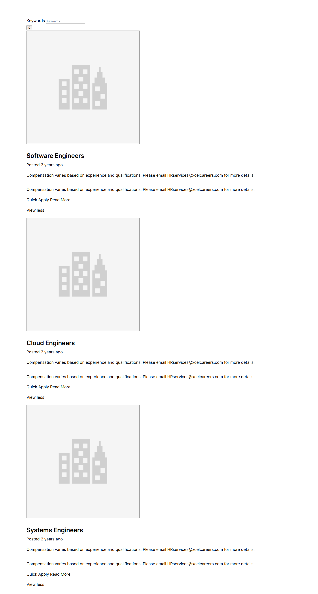
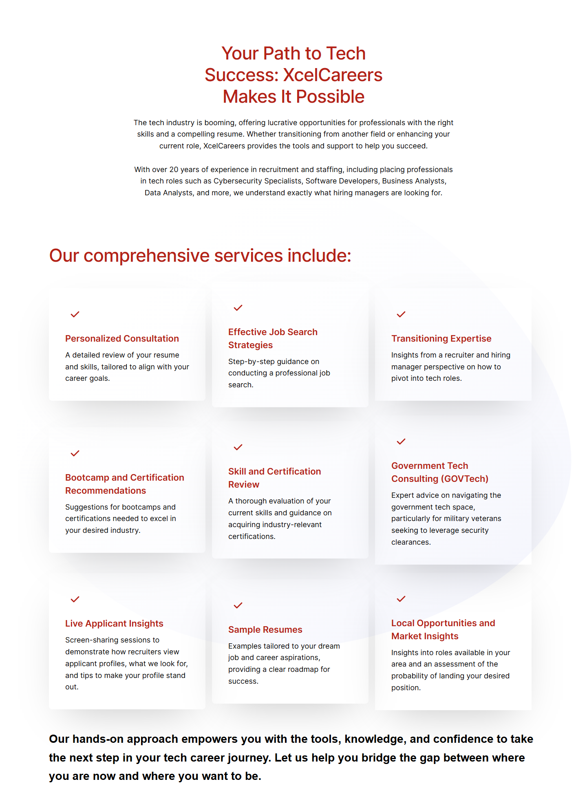
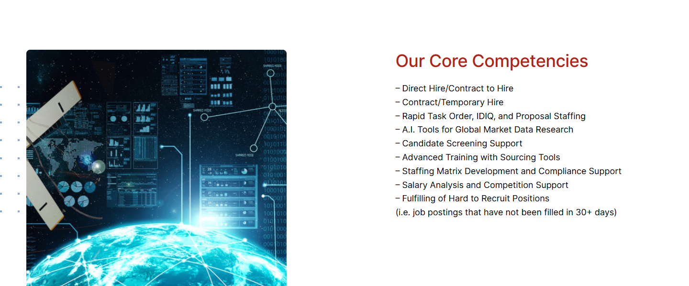

# Transition Into Tech – XcelCareers Staffing Solutions

*XcelCareers (client's current site)* · URL: https://xcelcareers.com/transition-into-tech/ · captured 2026-11-08 00:26:14 · HTTP 200

- **Meta description:** —
- **Page size (desktop 1440px):** 1440×7508 px · tablet (820px): 7481 px · mobile (390px): 9859 px
- **Screenshots:** [desktop](screenshots/desktop-full.png) · [tablet](screenshots/tablet-full.png) · [mobile](screenshots/mobile-full.png) · [desktop top](screenshots/desktop-viewport-top.png) · [desktop scrolled](screenshots/desktop-viewport-scrolled.png)
- **Files:** [raw.html](raw.html) (server HTML) · [rendered.html](rendered.html) (DOM after JS) · [content.txt](content.txt) (all visible text) · layout-*.json (full element tree with computed styles) · page.json (everything)

## 1. Section map (top → bottom, desktop 1440px)

| # | Role | Y from top | Height | Heading / first text | Mobile height | Screenshot |
|---|---|---|---|---|---|---|
| 0 | header | 0 | 153 | Home Transition Into Tech Jobs Contact 410.865.9558 | 153 | [img](screenshots/desktop-sec00-header.png) |
| 1 | section | 153 | 900 | Transition into Tech with Confidence | 675 | [img](screenshots/desktop-sec01-section.png) |
| 2 | section | 1053 | 2683 | Software Engineers | 2869 | [img](screenshots/desktop-sec02-section.png) |
| 3 | section | 3736 | 1955 | Your Path to Tech Success: XcelCareers Makes It Possible | 3888 | [img](screenshots/desktop-sec03-section.png) |
| 4 | section | 5691 | 598 | Our Core Competencies | 971 | [img](screenshots/desktop-sec04-section.png) |
| 5 | section | 6439 | 100 |  | 100 | [img](screenshots/desktop-sec05-section.png) |
| 6 | section | 6557 | 53 | Companies We Work With | 38 | [img](screenshots/desktop-sec06-section.png) |
| 7 | section | 6610 | 364 | 1 2 3 4 5 6 7 8 9 10 11 12 13 14 15 16 17 | 278 | [img](screenshots/desktop-sec07-section.png) |
| 8 | section | 7003 | 100 |  | 100 | [img](screenshots/desktop-sec08-section.png) |
| 9 | footer | 7103 | 404 | XcelCareers Staffing Solutions | 591 | [img](screenshots/desktop-sec09-footer.png) |

## 2. Section-by-section layout (desktop)

Legend: each line is an element in DOM order. `@x,y w×h` = position/size in px on the 1440px-wide page. Text lines show *font size/weight, line-height, colour*. Boxes show layout (flex/grid), background, padding, radius, shadow, etc. Pass-through wrappers are collapsed.

### 2.0 HEADER — Home Transition Into Tech Jobs Contact 410.865.9558

Element: `<header class="wp-block-template-part">` at y=0, 1440×153px · 

- div.wp-block-columns [flex row · gap:18px] `@0,0 1440×153`
  - div.wp-block-group [bg:#000000 · pad:0px 18px 0px 18px] `@0,0 1440×153`
    - div.wp-block-group [flex row · justify:space-between · align:center · gap:18px · margin:0px 120px 0px 120px · max-w:1164px] `@138,0 1164×153`
      - a (link→/) [inline-block] `@138,0 153×153`
        - **IMG** `MediumSquareLogo.png` alt="" natural 400×400 · inline · max-w:100% · overflow:clip `@138,0 153×153`
      - div.wp-block-group [flex row · justify:flex-end · align:center · gap:54px] `@688,56 614×41`
        - nav.wp-block-navigation [flex row wrap · justify:flex-end · align:center · gap:36px] `@688,64 407×26`
          - div.wp-block-navigation__responsive-container-content [flex row wrap · justify:flex-end · align:center · gap:36px] `@688,64 407×26`
            - ul.wp-block-navigation__container [flex row wrap · justify:flex-end · align:center · gap:36px] `@688,64 407×26`
              - li.wp-block-navigation-item [flex row · align:center] `@688,64 46×26`
                - **A→/** "Home" — Inter 16px/400 lh 25.6px · #FFFFFF · letterSpacing:0.25px `@688,64 46×26`
              - li.wp-block-navigation-item [flex row · align:center] `@770,64 154×26`
                - **A→/transition-into-tech/** "Transition Into Tech" — Inter 16px/400 lh 25.6px · #FFFFFF · letterSpacing:0.25px `@770,64 154×26`
              - li.wp-block-navigation-item [flex row · align:center] `@960,64 38×26`
                - **A→/jobs-2/** "Jobs" — Inter 16px/400 lh 25.6px · #FFFFFF · letterSpacing:0.25px `@960,64 38×26`
              - li.wp-block-navigation-item [flex row · align:center] `@1033,64 62×26`
                - **A→/contact/** "Contact" — Inter 16px/400 lh 25.6px · #FFFFFF · letterSpacing:0.25px `@1033,64 62×26`
        - div.wp-block-buttons [flex row wrap · align:center · gap:18px] `@1149,56 153×41`
          - **A→** "410.865.9558" — Inter 16px/500 lh 16px · #FFFFFF · textAlign:center ‖ inline-block · bg:#B42117 · pad:12.672px 23.328px 12.672px 23.328px · radius:6px `@1149,56 153×41`

### 2.1 SECTION — Transition into Tech with Confidence

Element: `
` at y=153, 1440×900px · 

- div.wp-block-uagb-container [flex row · gap:20px · bg-image:3fpxt37x6uq.jpg · bg-size:cover · bg-pos:50% 50% · pad:0px 0px 160px 0px · min-h:900px · radius:0px 0px 120px · shadow:#000000 @44% 0px 0px 0px 0px · transition:box-shadow 0.2s ease] · pseudo:::before{{"content": "\"\"", "w": "1440px", "h": "900px", "bg": "#000000", "position": "absolute", "opacity": "0.48"}} `@0,153 1440×900`
  - div.uagb-container-inner-blocks-wrap [flex column · justify:center · align:center · gap:20px · margin:0px 120px 0px 120px · max-w:min(100%, 1200px)] `@120,153 1200×740`
    - div.wp-block-uagb-info-box [pad:0px 600px 0px 0px · z:1] `@120,376 1200×294`
      - div.uagb-ifb-content [inline-block · z:1] `@120,376 600×294`
        - div.uagb-ifb-title-wrap [z:1] `@120,376 600×134`
          - **H1** "Transition into Tech with Confidence" — Inter 56px/500 lh 67.2px · #FFFFFF · letterSpacing:-2px ‖ margin:0px 60px 20px 0px `@120,376 540×134`
        - div.uagb-ifb-desc [margin:0px 0px 30px 0px] `@120,530 600×58`
          - **P** "Expert guidance, industry insights, and professional resumes to jumpstart your tech career." — Inter 18px/400 lh 28.8px · #FFFFFF ‖ margin:18px 0px 0px 0px `@120,530 600×58`
        - **A→tel:4108659558** "Start Your Tech Journey Today – Schedule a Free Consultation!" — Inter 16px/500 lh 16px · #FFFFFF · textAlign:center ‖ flex row · bg:#B42217 · pad:18px 22px 18px 22px · radius:5px `@120,618 525×52`

### 2.2 SECTION — Software Engineers

Element: `
` at y=1053, 1440×2683px · 

- div.wp-block-uagb-container [flex row · gap:20px · pad:10px 10px 10px 10px · shadow:#000000 @44% 0px 0px 0px 0px · transition:box-shadow 0.2s ease] `@0,1053 1440×2683`
  - div.uagb-container-inner-blocks-wrap [flex column · justify:center · align:center · gap:20px · margin:0px 110px 0px 110px · max-w:min(100%, 1200px)] `@120,1063 1200×2663`
    - div.sjb-page `@120,1133 1200×2593`
      - FORM form.filters-form `@120,1133 1200×58`
        - div.row `@120,1133 1200×58`
          - div.form-group `@120,1133 1200×29`
            - **LABEL** "Keywords" — Inter 18px/400 lh 28.8px · #000000 ‖ inline `@120,1136 83×21`
            - **FIELD** <input type=text name=search_keywords> placeholder="Keywords" — Arial 13.3333px/400 lh normal · #000000 ‖ inline-block · bg:#FFFFFF · pad:1px 2px 1px 2px · border:2px 2px 2px 2px inset #767676 `@208,1138 177×21`
          - **FIELD** <input type=submit name=> placeholder="" value='\uf002' — Arial 13.3333px/400 lh normal · #000000 · textAlign:center ‖ inline-block · bg:#F0F0F0 · pad:1px 6px 1px 6px · border:2px 2px 2px 2px outset #000000 `@120,1167 26×21`
      - div.list-view `@120,1191 1200×2518`
        - div.v1 `@120,1191 1200×827`
          - div.row `@120,1191 1200×622`
            - a (link→/jobs-3/software-engineers/) [inline · w:auto] `@120,1686 512×21`
              - **IMG** `company.png` alt="" natural 512×512 · inline · overflow:clip `@120,1191 512×512`
            - div.row `@120,1738 1200×74`
              - h4 [margin:27px 0px 9px 0px] `@120,1738 1200×36`
                - **A→/jobs-3/software-engineers/** "Software Engineers" — Inter 28px/600 lh 36.4px · #000000 · letterSpacing:-0.25px ‖ inline `@120,1739 261×34`
              - **text** "Posted 2 years ago" — Inter 18px/400 lh 28.8px · #000000 `@120,1784 1200×29`
          - p [margin:18px 0px 18px 0px] `@120,1831 1200×29`
            - **text** "Compensation varies based on experience and qualifications. Please email for more details." — Inter 18px/400 lh 28.8px · #000000 `@120,1831 1200×29`
            - **A→mailto:HRservices@xcelcareers.com** "HRservices@xcelcareers.com" — Inter 18px/400 lh 28.8px · #000000 ‖ inline `@757,1834 252×21`
          - div.job-description `@120,1895 1200×122`
            - **P** "Compensation varies based on experience and qualifications. Please email HRservices@xcelcareers.com for more details." — Inter 18px/400 lh 28.8px · #000000 ‖ margin:18px 0px 18px 0px `@120,1895 1200×29`
            - div.sjb-apply-now-btn `@120,1942 1200×76`
              - p [margin:18px 0px 18px 0px] `@120,1942 1200×29`
                - **A→javascript:void(0)** "Quick Apply" — Inter 18px/400 lh 28.8px · #000000 ‖ inline `@120,1945 107×21`
                - **A→/jobs-3/software-engineers/** "Read More" — Inter 18px/400 lh 28.8px · #000000 ‖ inline `@227,1945 92×21`
              - **A→** "View less" — Inter 18px/400 lh 28.8px · #000000 ‖ inline `@120,1992 80×21`
        - div.v1 `@120,2036 1200×827`
          - div.row `@120,2036 1200×622`
            - a (link→/jobs-3/cloud-engineers/) [inline · w:auto] `@120,2531 512×21`
              - **IMG** `company.png` alt="" natural 512×512 · inline · overflow:clip `@120,2036 512×512`
            - div.row `@120,2584 1200×74`
              - h4 [margin:27px 0px 9px 0px] `@120,2584 1200×36`
                - **A→/jobs-3/cloud-engineers/** "Cloud Engineers" — Inter 28px/600 lh 36.4px · #000000 · letterSpacing:-0.25px ‖ inline `@120,2585 219×34`
              - **text** "Posted 2 years ago" — Inter 18px/400 lh 28.8px · #000000 `@120,2629 1200×29`
          - p [margin:18px 0px 18px 0px] `@120,2676 1200×29`
            - **text** "Compensation varies based on experience and qualifications. Please email for more details." — Inter 18px/400 lh 28.8px · #000000 `@120,2676 1200×29`
            - **A→mailto:HRservices@xcelcareers.com** "HRservices@xcelcareers.com" — Inter 18px/400 lh 28.8px · #000000 ‖ inline `@757,2679 252×21`
          - div.job-description `@120,2741 1200×122`
            - **P** "Compensation varies based on experience and qualifications. Please email HRservices@xcelcareers.com for more details." — Inter 18px/400 lh 28.8px · #000000 ‖ margin:18px 0px 18px 0px `@120,2741 1200×29`
            - div.sjb-apply-now-btn `@120,2787 1200×76`
              - p [margin:18px 0px 18px 0px] `@120,2787 1200×29`
                - **A→javascript:void(0)** "Quick Apply" — Inter 18px/400 lh 28.8px · #000000 ‖ inline `@120,2790 107×21`
                - **A→/jobs-3/cloud-engineers/** "Read More" — Inter 18px/400 lh 28.8px · #000000 ‖ inline `@227,2790 92×21`
              - **A→** "View less" — Inter 18px/400 lh 28.8px · #000000 ‖ inline `@120,2837 80×21`
        - div.v1 `@120,2881 1200×827`
          - div.row `@120,2881 1200×622`
            - a (link→/jobs-3/systems-engineers/) [inline · w:auto] `@120,3376 512×21`
              - **IMG** `company.png` alt="" natural 512×512 · inline · overflow:clip `@120,2881 512×512`
            - div.row `@120,3429 1200×74`
              - h4 [margin:27px 0px 9px 0px] `@120,3429 1200×36`
                - **A→/jobs-3/systems-engineers/** "Systems Engineers" — Inter 28px/600 lh 36.4px · #000000 · letterSpacing:-0.25px ‖ inline `@120,3430 256×34`
              - **text** "Posted 2 years ago" — Inter 18px/400 lh 28.8px · #000000 `@120,3474 1200×29`
          - p [margin:18px 0px 18px 0px] `@120,3521 1200×29`
            - **text** "Compensation varies based on experience and qualifications. Please email for more details." — Inter 18px/400 lh 28.8px · #000000 `@120,3521 1200×29`
            - **A→mailto:HRservices@xcelcareers.com** "HRservices@xcelcareers.com" — Inter 18px/400 lh 28.8px · #000000 ‖ inline `@757,3524 252×21`
          - div.job-description `@120,3586 1200×122`
            - **P** "Compensation varies based on experience and qualifications. Please email HRservices@xcelcareers.com for more details." — Inter 18px/400 lh 28.8px · #000000 ‖ margin:18px 0px 18px 0px `@120,3586 1200×29`
            - div.sjb-apply-now-btn `@120,3633 1200×76`
              - p [margin:18px 0px 18px 0px] `@120,3633 1200×29`
                - **A→javascript:void(0)** "Quick Apply" — Inter 18px/400 lh 28.8px · #000000 ‖ inline `@120,3636 107×21`
                - **A→/jobs-3/systems-engineers/** "Read More" — Inter 18px/400 lh 28.8px · #000000 ‖ inline `@227,3636 92×21`
              - **A→** "View less" — Inter 18px/400 lh 28.8px · #000000 ‖ inline `@120,3682 80×21`

### 2.3 SECTION — Your Path to Tech Success: XcelCareers Makes It Possible

Element: `
` at y=3736, 1440×1955px · 

- div.wp-block-uagb-container [flex row · gap:20px · bg-image:blob-grad.svg · bg-size:contain · bg-pos:50% 50% · pad:104px 0px 0px 0px · shadow:#000000 @44% 0px 0px 0px 0px · transition:box-shadow 0.2s ease] `@0,3736 1440×1955`
  - div.uagb-container-inner-blocks-wrap [flex column · justify:center · align:center · gap:20px · margin:0px 120px 0px 120px · max-w:min(100%, 1200px)] `@120,3840 1200×1851`
    - div.wp-block-uagb-info-box [pad:0px 0px 20px 0px · z:1 · align-text:center] `@120,3840 1200×440`
      - div.uagb-ifb-content [inline-block · z:1 · align-text:center] `@120,3840 1200×420`
        - div.uagb-ifb-title-wrap [z:1 · align-text:center] `@120,3840 1200×158`
          - **H2** "Your Path to Tech Success: XcelCareers Makes It Possible" — Inter 44px/500 lh 52.8px · #B42117 · letterSpacing:-1px · textAlign:center ‖ margin:0px 360px 24px 360px `@480,3840 480×158`
        - div.uagb-ifb-desc [margin:0px 204px 36px 204px · align-text:center] `@324,4023 792×202`
          - **P** "The tech industry is booming, offering lucrative opportunities for professionals with the right skills and a compelling resume. Whether transitioning from an…" — Inter 18px/400 lh 28.8px · #000000 · textAlign:center ‖ margin:18px 0px 0px 0px `@324,4023 792×202`
    - **H2** "Our comprehensive services include:" — Inter 44px/500 lh 52.8px · #B42117 · letterSpacing:-1px ‖ margin:36px 0px 18px 0px `@120,4336 1200×53`
    - div.wp-block-uagb-container [flex row · justify:center · align:center · gap:20px 0px · max-w:100% · shadow:#000000 @44% 0px 0px 0px 0px · transition:box-shadow 0.2s ease] `@120,4427 1200×308`
      - div.wp-block-uagb-container [flex column · justify:center · align:center · pad:40px 40px 40px 40px · margin:0px 16px 0px 0px · max-w:33% · radius:8px · shadow:#000000 @24% 0px 40px 100px -40px · transition:box-shadow 0.2s ease] `@120,4443 384×276`
        - div.wp-block-uagb-info-box [z:1] `@160,4483 304×196`
          - div.uagb-ifb-content [inline-block · z:1] `@160,4483 304×196`
            - div.uagb-iconbox-icon-wrap [flex row · justify:center · align:center · pad:12px 12px 12px 12px · radius:50%] `@160,4483 48×48`
              - **SVG icon** 24×24 fill:#B42117 color:#B42117  `@172,4495 24×24`
            - div.uagb-ifb-title-wrap [z:1] `@160,4551 304×32`
              - **H5** "Personalized Consultation" — Inter 22px/600 lh 31.9px · #B42117 ‖ margin:20px 0px 10px 0px `@160,4551 304×32`
            - **P** "A detailed review of your resume and skills, tailored to align with your career goals." — Inter 18px/400 lh 28.8px · #000000 `@160,4593 304×86`
      - div.wp-block-uagb-container [flex column · justify:center · align:center · pad:40px 40px 40px 40px · margin:0px 16px 0px 0px · max-w:33% · radius:8px · shadow:#000000 @24% 0px 40px 100px -40px · transition:box-shadow 0.2s ease] `@520,4427 384×308`
        - div.wp-block-uagb-info-box [z:1] `@560,4467 304×228`
          - div.uagb-ifb-content [inline-block · z:1] `@560,4467 304×228`
            - div.uagb-iconbox-icon-wrap [flex row · justify:center · align:center · pad:12px 12px 12px 12px · radius:50%] `@560,4467 48×48`
              - **SVG icon** 24×24 fill:#B42117 color:#B42117  `@572,4479 24×24`
            - div.uagb-ifb-title-wrap [z:1] `@560,4535 304×64`
              - **H5** "Effective Job Search Strategies" — Inter 22px/600 lh 31.9px · #B42117 ‖ margin:20px 0px 10px 0px `@560,4535 304×64`
            - **P** "Step-by-step guidance on conducting a professional job search." — Inter 18px/400 lh 28.8px · #000000 `@560,4609 304×86`
      - div.wp-block-uagb-container [flex column · justify:center · align:center · pad:40px 40px 40px 40px · margin:0px 16px 0px 0px · max-w:33% · shadow:#000000 @24% 0px 40px 100px -40px · transition:box-shadow 0.2s ease] `@920,4443 384×276`
        - div.wp-block-uagb-info-box [z:1] `@960,4483 304×196`
          - div.uagb-ifb-content [inline-block · z:1] `@960,4483 304×196`
            - div.uagb-iconbox-icon-wrap [flex row · justify:center · align:center · pad:12px 12px 12px 12px · radius:50%] `@960,4483 48×48`
              - **SVG icon** 24×24 fill:#B42117 color:#B42117  `@972,4495 24×24`
            - div.uagb-ifb-title-wrap [z:1] `@960,4551 304×32`
              - **H5** "Transitioning Expertise" — Inter 22px/600 lh 31.9px · #B42117 ‖ margin:20px 0px 10px 0px `@960,4551 304×32`
            - **P** "Insights from a recruiter and hiring manager perspective on how to pivot into tech roles." — Inter 18px/400 lh 28.8px · #000000 `@960,4593 304×86`
    - div.wp-block-uagb-container [flex row · justify:center · align:center · gap:20px 0px · max-w:100% · shadow:#000000 @44% 0px 0px 0px 0px · transition:box-shadow 0.2s ease] `@120,4755 1200×366`
      - div.wp-block-uagb-container [flex column · justify:center · align:center · pad:40px 40px 40px 40px · margin:0px 16px 0px 0px · max-w:33% · radius:8px · shadow:#000000 @24% 0px 40px 100px -40px · transition:box-shadow 0.2s ease] `@120,4784 384×308`
        - div.wp-block-uagb-info-box [z:1] `@160,4824 304×228`
          - div.uagb-ifb-content [inline-block · z:1] `@160,4824 304×228`
            - div.uagb-iconbox-icon-wrap [flex row · justify:center · align:center · pad:12px 12px 12px 12px · radius:50%] `@160,4824 48×48`
              - **SVG icon** 24×24 fill:#B42117 color:#B42117  `@172,4836 24×24`
            - div.uagb-ifb-title-wrap [z:1] `@160,4892 304×64`
              - **H5** "Bootcamp and Certification Recommendations" — Inter 22px/600 lh 31.9px · #B42117 ‖ margin:20px 0px 10px 0px `@160,4892 304×64`
            - **P** "Suggestions for bootcamps and certifications needed to excel in your desired industry." — Inter 18px/400 lh 28.8px · #000000 `@160,4966 304×86`
      - div.wp-block-uagb-container [flex column · justify:center · align:center · pad:40px 40px 40px 40px · margin:0px 16px 0px 0px · max-w:33% · radius:8px · shadow:#000000 @24% 0px 40px 100px -40px · transition:box-shadow 0.2s ease] `@520,4769 384×337`
        - div.wp-block-uagb-info-box [z:1] `@560,4809 304×257`
          - div.uagb-ifb-content [inline-block · z:1] `@560,4809 304×257`
            - div.uagb-iconbox-icon-wrap [flex row · justify:center · align:center · pad:12px 12px 12px 12px · radius:50%] `@560,4809 48×48`
              - **SVG icon** 24×24 fill:#B42117 color:#B42117  `@572,4821 24×24`
            - div.uagb-ifb-title-wrap [z:1] `@560,4877 304×64`
              - **H5** "Skill and Certification Review" — Inter 22px/600 lh 31.9px · #B42117 ‖ margin:20px 0px 10px 0px `@560,4877 304×64`
            - **P** "A thorough evaluation of your current skills and guidance on acquiring industry-relevant certifications." — Inter 18px/400 lh 28.8px · #000000 `@560,4951 304×115`
      - div.wp-block-uagb-container [flex column · justify:center · align:center · pad:40px 40px 40px 40px · margin:0px 16px 0px 0px · max-w:33% · shadow:#000000 @24% 0px 40px 100px -40px · transition:box-shadow 0.2s ease] `@920,4755 384×366`
        - div.wp-block-uagb-info-box [z:1] `@960,4795 304×286`
          - div.uagb-ifb-content [inline-block · z:1] `@960,4795 304×286`
            - div.uagb-iconbox-icon-wrap [flex row · justify:center · align:center · pad:12px 12px 12px 12px · radius:50%] `@960,4795 48×48`
              - **SVG icon** 24×24 fill:#B42117 color:#B42117  `@972,4807 24×24`
            - div.uagb-ifb-title-wrap [z:1] `@960,4863 304×64`
              - **H5** "Government Tech Consulting (GOVTech)" — Inter 22px/600 lh 31.9px · #B42117 ‖ margin:20px 0px 10px 0px `@960,4863 304×64`
            - **P** "Expert advice on navigating the government tech space, particularly for military veterans seeking to leverage security clearances." — Inter 18px/400 lh 28.8px · #000000 `@960,4937 304×144`
    - div.wp-block-uagb-container [flex row · justify:center · align:center · gap:20px 0px · max-w:100% · shadow:#000000 @44% 0px 0px 0px 0px · transition:box-shadow 0.2s ease] `@120,5141 1200×337`
      - div.wp-block-uagb-container [flex column · justify:center · align:center · pad:40px 40px 40px 40px · margin:0px 16px 0px 0px · max-w:33% · radius:8px · shadow:#000000 @24% 0px 40px 100px -40px · transition:box-shadow 0.2s ease] `@120,5142 384×334`
        - div.wp-block-uagb-info-box [z:1] `@160,5182 304×254`
          - div.uagb-ifb-content [inline-block · z:1] `@160,5182 304×254`
            - div.uagb-iconbox-icon-wrap [flex row · justify:center · align:center · pad:12px 12px 12px 12px · radius:50%] `@160,5182 48×48`
              - **SVG icon** 24×24 fill:#B42117 color:#B42117  `@172,5194 24×24`
            - div.uagb-ifb-title-wrap [z:1] `@160,5250 304×32`
              - **H5** "Live Applicant Insights" — Inter 22px/600 lh 31.9px · #B42117 ‖ margin:20px 0px 10px 0px `@160,5250 304×32`
            - **P** "Screen-sharing sessions to demonstrate how recruiters view applicant profiles, what we look for, and tips to make your profile stand out." — Inter 18px/400 lh 28.8px · #000000 `@160,5292 304×144`
      - div.wp-block-uagb-container [flex column · justify:center · align:center · pad:40px 40px 40px 40px · margin:0px 16px 0px 0px · max-w:33% · radius:8px · shadow:#000000 @24% 0px 40px 100px -40px · transition:box-shadow 0.2s ease] `@520,5157 384×305`
        - div.wp-block-uagb-info-box [z:1] `@560,5197 304×225`
          - div.uagb-ifb-content [inline-block · z:1] `@560,5197 304×225`
            - div.uagb-iconbox-icon-wrap [flex row · justify:center · align:center · pad:12px 12px 12px 12px · radius:50%] `@560,5197 48×48`
              - **SVG icon** 24×24 fill:#B42117 color:#B42117  `@572,5209 24×24`
            - div.uagb-ifb-title-wrap [z:1] `@560,5265 304×32`
              - **H5** "Sample Resumes" — Inter 22px/600 lh 31.9px · #B42117 ‖ margin:20px 0px 10px 0px `@560,5265 304×32`
            - **P** "Examples tailored to your dream job and career aspirations, providing a clear roadmap for success." — Inter 18px/400 lh 28.8px · #000000 `@560,5307 304×115`
      - div.wp-block-uagb-container [flex column · justify:center · align:center · pad:40px 40px 40px 40px · margin:0px 16px 0px 0px · max-w:33% · shadow:#000000 @24% 0px 40px 100px -40px · transition:box-shadow 0.2s ease] `@920,5141 384×337`
        - div.wp-block-uagb-info-box [z:1] `@960,5181 304×257`
          - div.uagb-ifb-content [inline-block · z:1] `@960,5181 304×257`
            - div.uagb-iconbox-icon-wrap [flex row · justify:center · align:center · pad:12px 12px 12px 12px · radius:50%] `@960,5181 48×48`
              - **SVG icon** 24×24 fill:#B42117 color:#B42117  `@972,5193 24×24`
            - div.uagb-ifb-title-wrap [z:1] `@960,5249 304×64`
              - **H5** "Local Opportunities and Market Insights" — Inter 22px/600 lh 31.9px · #B42117 ‖ margin:20px 0px 10px 0px `@960,5249 304×64`
            - **P** "Insights into roles available in your area and an assessment of the probability of landing your desired position." — Inter 18px/400 lh 28.8px · #000000 `@960,5323 304×115`
    - **P** "Our hands-on approach empowers you with the tools, knowledge, and confidence to take the next step in your tech career journey. Let us help you bridge the ga…" — Inter 28px/400 lh 44.8px · #000000 ‖ margin:28px 0px 28px 0px · highlights: "Our hands-on approach empowers you with the tools, knowledge"  700 `@120,5526 1200×137`

### 2.4 SECTION — Our Core Competencies

Element: `
` at y=5691, 1440×598px · 

- div.wp-block-uagb-container [flex row · gap:20px 97px · pad:104px 0px 104px 0px · margin:0px 0px 150px 0px · shadow:#000000 @44% 0px 0px 0px 0px · transition:box-shadow 0.2s ease] · pseudo:::before{{"content": "\"\"", "w": "1440px", "h": "597.766px", "bgImage": "url(\"https://xcelcareers.com/wp-content/uploads/2020/06/dots.png\")", "position": "absolute"}} `@0,5691 1440×598`
  - div.uagb-container-inner-blocks-wrap [flex row · justify:center · gap:20px 97px · margin:0px 55px 0px 55px · max-w:min(100%, 1330px)] `@55,5795 1330×390`
    - div.wp-block-uagb-container [flex column · align:center · gap:20px · pad:0px 0px 16px 0px · max-w:50% · shadow:#000000 @44% 0px 0px 0px 0px · transition:box-shadow 0.2s ease] `@55,5795 594×390`
      - div.wp-block-uagb-image [flex row · margin:0px 64px 20px 0px] `@55,5795 594×612`
        - figure.wp-block-uagb-image__figure [flex column · align:flex-start · max-w:100%] `@55,5795 544×612`
          - **IMG** `sat-1024x563.jpg` alt="" natural 1024×563 · fit:cover · flex row · max-w:100% · radius:8px · shadow:#000000 @44% 0px 0px 0px 0px · overflow:clip · transition:box-shadow 0.2s ease `@55,5795 544×612`
    - div.wp-block-uagb-container [flex column · justify:flex-end · align:center · pad:0px 0px 0px 80px · max-w:50% · shadow:#000000 @44% 0px 0px 0px 0px · transition:box-shadow 0.2s ease] `@746,5795 639×390`
      - div.wp-block-uagb-info-box [pad:0px 0px 35px 0px · z:1] `@826,5795 559×390`
        - div.uagb-ifb-content [inline-block · z:1] `@826,5795 559×355`
          - div.uagb-ifb-title-wrap [z:1] `@826,5795 559×47`
            - **H3** "Our Core Competencies" — Inter 36px/500 lh 46.8px · #B42117 · letterSpacing:-0.5px ‖ margin:0px 0px 20px 0px `@826,5795 559×47`
          - **P** "– Direct Hire/Contract to Hire – Contract/Temporary Hire – Rapid Task Order, IDIQ, and Proposal Staffing – A.I. Tools for Global Market Data Research – Candi…" — Inter 18px/400 lh 28.8px · #000000 ‖ margin:18px 0px 0px 0px `@826,5862 559×288`

### 2.5 SECTION — 

Element: `
` at y=6439, 764×100px · 

- *(empty block — vertical spacer / gap of 100px)*

### 2.6 SECTION — Companies We Work With

Element: `<h2 class="wp-block-heading has-text-align-center">` at y=6557, 764×53px · 

- **H2** "Companies We Work With" — Inter 44px/500 lh 52.8px · #B42117 · letterSpacing:-1px · textAlign:center ‖ margin:18px 338px 0px 338px · max-w:764px `@338,6557 764×53`

### 2.7 SECTION — 1 2 3 4 5 6 7 8 9 10 11 12 13 14 15 16 17

Element: `
` at y=6610, 764×364px · 

- div.wp-block-uagb-image-gallery [margin:0px 338px 0px 338px · max-w:764px] `@338,6610 764×364`
  - div.spectra-image-gallery [margin:0px 0px 8px 0px] `@338,6610 764×364`
    - div.uagb-block-9fb2ddec `@338,6610 764×364`
      - div.slick-list [margin:0px -4px 0px -4px · overflow:hidden · transform:matrix(1, 0, 0, 1, 0, 0)] `@334,6610 772×334`
        - div.slick-track [flex row · align:center · transform:matrix(1, 0, 0, 1, -2064, 0)] `@-1730,6610 9546×334`
          - div.slick-slide [min-h:1px] `@-1730,6740 258×74`
            - div.spectra-image-gallery__media-wrapper [pad:0px 4px 0px 4px] `@-1730,6740 258×74`
              - div.spectra-image-gallery__media [shadow:#000000 0px 0px 0px 0px · overflow:hidden · transition:box-shadow 0.25s ease] `@-1726,6740 250×74`
                - **PICTURE** https://xcelcareers.com/wp-content/uploads/2022/03/th-1-e1544475635932.jpg  `@-1726,6740 250×74`
          - div.slick-slide [min-h:1px] `@-1472,6708 258×138`
            - div.spectra-image-gallery__media-wrapper [pad:0px 4px 0px 4px] `@-1472,6708 258×138`
              - div.spectra-image-gallery__media [shadow:#000000 0px 0px 0px 0px · overflow:hidden · transition:box-shadow 0.25s ease] `@-1468,6708 250×138`
                - **PICTURE** https://xcelcareers.com/wp-content/uploads/2022/03/th-4-e1544476905311.jpg  `@-1468,6708 250×138`
          - div.slick-slide [min-h:1px] `@-1214,6752 258×50`
            - div.spectra-image-gallery__media-wrapper [pad:0px 4px 0px 4px] `@-1214,6752 258×50`
              - div.spectra-image-gallery__media [shadow:#000000 0px 0px 0px 0px · overflow:hidden · transition:box-shadow 0.25s ease] `@-1210,6752 250×50`
                - **PICTURE** https://xcelcareers.com/wp-content/uploads/2022/03/th-3-e1544476370247.jpg  `@-1210,6752 250×50`
          - div.slick-slide [min-h:1px] `@-956,6706 258×141`
            - div.spectra-image-gallery__media-wrapper [pad:0px 4px 0px 4px] `@-956,6706 258×141`
              - div.spectra-image-gallery__media [shadow:#000000 0px 0px 0px 0px · overflow:hidden · transition:box-shadow 0.25s ease] `@-952,6706 250×141`
                - **PICTURE** https://xcelcareers.com/wp-content/uploads/2023/08/General-Dynamics-Logo.png  `@-952,6706 250×141`
          - div.slick-slide [min-h:1px] `@-698,6743 258×68`
            - div.spectra-image-gallery__media-wrapper [pad:0px 4px 0px 4px] `@-698,6743 258×68`
              - div.spectra-image-gallery__media [shadow:#000000 0px 0px 0px 0px · overflow:hidden · transition:box-shadow 0.25s ease] `@-694,6743 250×68`
                - **PICTURE** https://xcelcareers.com/wp-content/uploads/2023/08/6227175c74a10c92f2ae07a6-1.png  `@-694,6743 250×68`
          - div.slick-slide [min-h:1px] `@-440,6652 258×250`
            - div.spectra-image-gallery__media-wrapper [pad:0px 4px 0px 4px] `@-440,6652 258×250`
              - div.spectra-image-gallery__media [shadow:#000000 0px 0px 0px 0px · overflow:hidden · transition:box-shadow 0.25s ease] `@-436,6652 250×250`
                - **PICTURE** https://xcelcareers.com/wp-content/uploads/2023/08/Seal_of_the_United_States_House_of_Representatives.svg.png  `@-436,6652 250×250`
          - … 31 more siblings of the same type (carousel slides / repeated items — see layout-desktop.json)
      - ul.slick-dots [margin:0px 0px 30px 0px · transform:matrix(1, 0, 0, 1, 0, 30) · align-text:center] `@338,6981 764×30`
        - **BUTTON** "1" — Arial 0px/400 lh 0px · transparent · textAlign:center ‖ pad:5px 5px 5px 5px `@550,6991 20×20`
        - **BUTTON** "2" — Arial 0px/400 lh 0px · transparent · textAlign:center ‖ pad:5px 5px 5px 5px `@570,6991 20×20`
        - **BUTTON** "3" — Arial 0px/400 lh 0px · transparent · textAlign:center ‖ pad:5px 5px 5px 5px `@590,6991 20×20`
        - **BUTTON** "4" — Arial 0px/400 lh 0px · transparent · textAlign:center ‖ pad:5px 5px 5px 5px `@610,6991 20×20`
        - **BUTTON** "5" — Arial 0px/400 lh 0px · transparent · textAlign:center ‖ pad:5px 5px 5px 5px `@630,6991 20×20`
        - **BUTTON** "6" — Arial 0px/400 lh 0px · transparent · textAlign:center ‖ pad:5px 5px 5px 5px `@650,6991 20×20`
        - … 11 more siblings of the same type (carousel slides / repeated items — see layout-desktop.json)

### 2.8 SECTION — 

Element: `
` at y=7003, 764×100px · 

- *(empty block — vertical spacer / gap of 100px)*

### 2.9 FOOTER — XcelCareers Staffing Solutions

Element: `<footer class="wp-block-template-part">` at y=7103, 1440×404px · 

- div.wp-block-group [bg:#B42117 · pad:72px 18px 36px 18px] `@0,7103 1440×404`
  - div.wp-block-columns [flex row · gap:36px · margin:0px 120px 0px 120px · max-w:1164px] `@138,7175 1164×220`
    - div.wp-block-column [pad:0px 0px 9px 0px] `@138,7175 564×220`
      - a (link→/) [inline-block] `@138,7175 110×47`
        - **IMG** `MediumSquareLogo-e1736976275746.png` alt="" natural 400×170 · inline · max-w:100% · overflow:clip · filter:url("#wp-duotone-secondary") `@138,7175 110×47`
      - **P** "XcelCareers empowers professionals to thrive in the booming tech industry. With over 20 years of expertise in recruitment and staffing, we provide the tools …" — Inter 16px/400 lh 25.6px · #FFFFFF ‖ pad:0px 36px 0px 0px · margin:18px 0px 0px 0px `@138,7240 564×128`
    - div.wp-block-column [pad:0px 0px 9px 0px] `@738,7175 564×220`
      - div.wp-block-columns [flex row · gap:32px] `@738,7175 564×136`
        - div.wp-block-column `@738,7175 266×136`
          - **H5** "Address:" — Inter 22px/600 lh 31.9px · #FFFFFF `@738,7175 266×32`
          - **P** "10155 Baltimore National Pike Ste 105 Ellicott City, MD 21042 United States" — Inter 18px/400 lh 28.8px · #FFFFFF ‖ margin:18px 0px 0px 0px `@738,7225 266×86`
        - div.wp-block-column `@1036,7175 266×136`
          - **H5** "Contact:" — Inter 22px/600 lh 31.9px · #FFFFFF `@1036,7175 266×32`
          - p.wp-block-paragraph [margin:18px 0px 0px 0px] `@1036,7225 266×29`
            - **A→mailto:HRservices@xcelcareers.com** "HRservices@xcelcareers.com" — Inter 18px/400 lh 28.8px · #FFFFFF ‖ inline `@1036,7228 252×21`
  - div.wp-block-group [flex row · justify:center · align:center · gap:9px · pad:0px 18px 0px 18px · margin:54px 120px 0px 120px · max-w:1164px] `@138,7449 1164×22`
    - **P** "© 2025 ·" — Inter 14px/400 lh 22.4px · #FFFFFF · textAlign:center `@517,7449 59×22`
    - **A→/** "XcelCareers Staffing Solutions" — Inter 14px/400 lh 22.4px · #FFFFFF ‖ inline `@585,7451 201×17`
    - **P** "· All rights reserved" — Inter 14px/400 lh 22.4px · #FFFFFF · textAlign:center `@795,7449 128×22`

## 3. Header, navigation & interaction behaviour

- **atTop** `header.wp-block-template-part` position:static top:0 height:153 bg:transparent shadow:none backdrop:none z:auto
- **afterScroll1400** `header.wp-block-template-part` position:static top:-1400 height:153 bg:transparent shadow:none backdrop:none z:auto

| Menu item | Link | Dropdown | Style | Hover change |
|---|---|---|---|---|
| Home (current) | / | — | Inter 16px/400 #FFFFFF  ls 0.25px | none |
| Transition Into Tech (current) | /transition-into-tech/ | — | Inter 16px/400 #FFFFFF  ls 0.25px | none |
| Jobs | /jobs-2/ | — | Inter 16px/400 #FFFFFF  ls 0.25px | none |
| Contact | /contact/ | — | Inter 16px/400 #FFFFFF  ls 0.25px | none |

- **Mobile menu:** toggle `.wp-block-navigation__responsive-container-open` → [screenshot](screenshots/mobile-menu-open.png) · items: Home, Transition Into Tech, Jobs, Contact

### Hover states (measured by hovering in Chrome)

| Element | Text | Normal | On hover |
|---|---|---|---|
| `a.wp-block-navigation-item__content` | Home | color #FFFFFF · bg transparent · radius 0px · pad 0px · border 0px #FFFFFF · transition all | no change |
| `a.wp-block-button__link` | 410.865.9558 | color #FFFFFF · bg #B42117 · radius 6px · pad 12.672px 23.328px · border 0px #B42217 · transition all | no change |
| `div.wp-block-uagb-info-box` | Transition into Tech with Confidence Exp | color #000000 · bg transparent · radius 0px · pad 0px 600px 0px 0px · border 0px #000000 · transition all | no change |
| `div.uagb-ifb-content` | Transition into Tech with Confidence Exp | color #000000 · bg transparent · radius 0px · pad 0px · border 0px #000000 · transition all | no change |
| `a.uagb-infobox-cta-link` | Start Your Tech Journey Today – Schedule | color #FFFFFF · bg #B42217 · radius 5px · pad 18px 22px · border 0px #333333 · transition all | no change |
| `input.btn-search` |  | color #000000 · bg #F0F0F0 · radius 0px · pad 1px 6px · border 2px #000000 · transition all | no change |
| `a.` |  | color #000000 · bg transparent · radius 0px · pad 0px · border 0px #000000 · transition all | color: #000000 → #B42117; borderTopColor: #000000 → #B42117; childColor: #000000 → #B42117 |
| `a.` | Software Engineers | color #000000 · bg transparent · radius 0px · pad 0px · border 0px #000000 · transition all | color: #000000 → #B42117; borderTopColor: #000000 → #B42117 |
| `a.btn` | Quick Apply | color #000000 · bg transparent · radius 0px · pad 0px · border 0px #000000 · transition all | color: #000000 → #B42117; borderTopColor: #000000 → #B42117 |
| `a.sjb_view_less_btn` | View less | color #000000 · bg transparent · radius 0px · pad 0px · border 0px #000000 · transition all | color: #000000 → #B42117; borderTopColor: #000000 → #B42117 |
| `div.wp-block-uagb-info-box` | Your Path to Tech Success: XcelCareers M | color #000000 · bg transparent · radius 0px · pad 0px 0px 20px · border 0px #000000 · transition all | no change |
| `div.wp-block-uagb-info-box` | Personalized Consultation A detailed rev | color #000000 · bg transparent · radius 0px · pad 0px · border 0px #000000 · transition all | no change |
| `div.wp-block-uagb-info-box` | Effective Job Search Strategies Step-by- | color #000000 · bg transparent · radius 0px · pad 0px · border 0px #000000 · transition all | no change |
| `div.wp-block-uagb-info-box` | Transitioning Expertise Insights from a  | color #000000 · bg transparent · radius 0px · pad 0px · border 0px #000000 · transition all | no change |
| `div.wp-block-uagb-info-box` | Bootcamp and Certification Recommendatio | color #000000 · bg transparent · radius 0px · pad 0px · border 0px #000000 · transition all | no change |
| `div.wp-block-uagb-info-box` | Skill and Certification Review A thoroug | color #000000 · bg transparent · radius 0px · pad 0px · border 0px #000000 · transition all | no change |
| `div.wp-block-uagb-info-box` | Government Tech Consulting (GOVTech) Exp | color #000000 · bg transparent · radius 0px · pad 0px · border 0px #000000 · transition all | no change |
| `div.wp-block-uagb-info-box` | Live Applicant Insights Screen-sharing s | color #000000 · bg transparent · radius 0px · pad 0px · border 0px #000000 · transition all | no change |

## 4. Typography & colour used on this page (weighted by amount of text / area)

| Font · weight · size / line-height | chars |
|---|---|
| Inter | 400 | 18px / 28.8px | 2878 |
| Inter | 400 | 16px / 25.6px | 306 |
| Inter | 600 | 22px / 31.9px | 279 |
| Inter | 700 | 28px / 44.8px | 210 |
| Inter | 500 | 44px / 52.8px | 113 |
| Inter | 500 | 16px / 16px | 73 |
| Inter | 400 | 14px / 22.4px | 59 |
| Inter | 600 | 28px / 36.4px | 50 |
| Inter | 500 | 56px / 67.2px | 36 |
| Arial | 400 | 0px / 0px | 25 |
| Inter | 500 | 36px / 46.8px | 21 |

- **Text colours:** #000000 (2946), #FFFFFF (682), #B42117 (397), transparent (25)
- **Background colours (by area):** #B42117 (588), #000000 (220), #B42217 (27), #FFFFFF (4), #F0F0F0 (1)
- **Border radii:** 50% (9), 8px (8), 6px (1), 0px 0px 120px (1), 5px (1)
- **Shadows:** #000000 0px 0px 0px 0px (37) | transparent 0px 0px 0px 0px (37) | #000000 @44% 0px 0px 0px 0px (11) | #000000 @24% 0px 40px 100px -40px (9)
- **Mobile text styles:** Inter | 400 | 16px / 25.6px (2878); Inter | 600 | 20px / 29px (279); Inter | 400 | 14px / 22.4px (271); Inter | 700 | 24px / 38.4px (210); Inter | 500 | 32px / 38.4px (113); Inter | 500 | 14px / 14px (61); Inter | 400 | 12px / 19.2px (59); Inter | 600 | 24px / 31.2px (50); Inter | 500 | 40px / 48px (36); Arial | 400 | 0px / 0px (25)

## 5. Forms
- **Form** `filters-form` → https://xcelcareers.com/transition-into-tech/ (get)
  - input[text] name=`search_keywords` label="Keywords" placeholder="Keywords"
  - input[submit] name=`` label="" placeholder="" value=""

## 6. Images on the page

- `MediumSquareLogo.png` natural 400×400 → shown 153×153 · alt="" · https://xcelcareers.com/wp-content/uploads/2018/12/MediumSquareLogo.png
- `company.png` natural 512×512 → shown 512×512 · alt="" · https://xcelcareers.com/wp-content/plugins/simple-job-board/public/images/company.png
- `sat-1024x563.jpg` natural 1024×563 → shown 544×612 · alt="" · https://xcelcareers.com/wp-content/uploads/2018/12/sat-1024x563.jpg
- `th-1-e1544475635932.jpg` natural 200×59 → shown 250×74 · alt="" · https://xcelcareers.com/wp-content/uploads/2022/03/th-1-e1544475635932.jpg
- `th-4-e1544476905311.jpg` natural 100×55 → shown 250×138 · alt="" · https://xcelcareers.com/wp-content/uploads/2022/03/th-4-e1544476905311.jpg
- `th-3-e1544476370247.jpg` natural 438×87 → shown 250×50 · alt="" · https://xcelcareers.com/wp-content/uploads/2022/03/th-3-e1544476370247.jpg
- `General-Dynamics-Logo.png` natural 3840×2160 → shown 250×141 · alt="" · https://xcelcareers.com/wp-content/uploads/2023/08/General-Dynamics-Logo.png
- `6227175c74a10c92f2ae07a6-1.png` natural 2000×544 → shown 250×68 · alt="" · https://xcelcareers.com/wp-content/uploads/2023/08/6227175c74a10c92f2ae07a6-1.png
- `Seal_of_the_United_States_House_of_Representatives.svg.png` natural 600×600 → shown 250×250 · alt="" · https://xcelcareers.com/wp-content/uploads/2023/08/Seal_of_the_United_States_House_of_Representatives.svg.png
- `US_Air_Force_Logo_Solid_Colour.svg.png` natural 769×600 → shown 250×195 · alt="" · https://xcelcareers.com/wp-content/uploads/2023/08/US_Air_Force_Logo_Solid_Colour.svg.png
- `png-transparent-microsoft-logo-organization-san-francisco-cloud-computing-partner-company-text-rectangle.png` natural 920×500 → shown 250×136 · alt="" · https://xcelcareers.com/wp-content/uploads/2023/08/png-transparent-microsoft-logo-organization-san-francisco-cloud-computing-partner-company-text-rectangle.png
- `Logo_of_the_United_States_Army.svg-1.png` natural 200×267 → shown 250×334 · alt="" · https://xcelcareers.com/wp-content/uploads/2023/08/Logo_of_the_United_States_Army.svg-1.png
- `Logo-Boeing.png` natural 5000×3125 → shown 250×156 · alt="" · https://xcelcareers.com/wp-content/uploads/2023/08/Logo-Boeing.png
- `Amazon_logo.svg.png` natural 640×193 → shown 250×75 · alt="" · https://xcelcareers.com/wp-content/uploads/2023/08/Amazon_logo.svg.png
- `GeorgiaTech_RGB.png` natural 1440×510 → shown 250×89 · alt="" · https://xcelcareers.com/wp-content/uploads/2023/08/GeorgiaTech_RGB.png
- `Raytheon_Technologies_logo.png` natural 331×99 → shown 250×75 · alt="" · https://xcelcareers.com/wp-content/uploads/2023/08/Raytheon_Technologies_logo.png
- `parsons-logo.png` natural 196×40 → shown 250×51 · alt="" · https://xcelcareers.com/wp-content/uploads/2023/08/parsons-logo.png
- `United_States_Navy_logo-1-scaled.jpg` natural 2560×1068 → shown 250×104 · alt="" · https://xcelcareers.com/wp-content/uploads/2023/08/United_States_Navy_logo-1-scaled.jpg
- `alionlogo.png` natural 210×116 → shown 250×138 · alt="" · https://xcelcareers.com/wp-content/uploads/2023/08/alionlogo.png
- `th-2-e1544475958653.jpg` natural 194×54 → shown 250×70 · alt="" · https://xcelcareers.com/wp-content/uploads/2022/03/th-2-e1544475958653.jpg
- `MediumSquareLogo-e1736976275746.png` natural 400×170 → shown 110×47 · alt="" · https://xcelcareers.com/wp-content/uploads/2018/12/MediumSquareLogo-e1736976275746.png
- background on `div.wp-block-uagb-container`: https://xcelcareers.com/wp-content/uploads/2023/08/3fpxt37x6uq.jpg
- background on `div.wp-block-uagb-container`: https://xcelcareers.com/wp-content/uploads/2020/06/blob-grad.svg

## 7. Links on the page

- [header] "(icon/image)" → /
- [header] "Home" → /
- [header] "Transition Into Tech" → /transition-into-tech/
- [header] "Jobs" → /jobs-2/
- [header] "Contact" → /contact/
- [body] "Start Your Tech Journey Today – Schedule a Free Consultation!" → tel:4108659558 (target _self)
- [header] "(icon/image)" → /jobs-3/software-engineers/
- [header] "Software Engineers" → /jobs-3/software-engineers/
- [body] "HRservices@xcelcareers.com" → mailto:HRservices@xcelcareers.com
- [body] "Quick Apply" → javascript:void(0)
- [body] "Read More" → /jobs-3/software-engineers/
- [header] "(icon/image)" → /jobs-3/cloud-engineers/
- [header] "Cloud Engineers" → /jobs-3/cloud-engineers/
- [body] "Read More" → /jobs-3/cloud-engineers/
- [header] "(icon/image)" → /jobs-3/systems-engineers/
- [header] "Systems Engineers" → /jobs-3/systems-engineers/
- [body] "Read More" → /jobs-3/systems-engineers/
- [footer] "Facebook" → /transition-into-tech/ (target _blank)
- [footer] "Twitter" → /transition-into-tech/ (target _blank)
- [footer] "YouTube" → /transition-into-tech/ (target _blank)
- [footer] "LinkedIn" → /transition-into-tech/ (target _blank)
- [footer] "XcelCareers Staffing Solutions" → / (target _self)

## 8. Mobile layout (390px) — condensed outline

### 8.0 header —  (y 0, h 153)
- div.wp-block-columns [flex row wrap · gap:16px] `@0,0 390×153`
  - div.wp-block-group [bg:#000000 · pad:0px 16px 0px 16px] `@0,0 390×153`
    - div.wp-block-group [flex row · justify:space-between · align:center · gap:16px · max-w:1164px] `@16,0 358×153`
      - a (link→/) [inline-block] `@16,0 153×153`
        - **IMG** `MediumSquareLogo.png` alt="" natural 400×400 · inline · max-w:100% · overflow:clip `@16,0 153×153`
      - div.wp-block-group [flex row · justify:flex-end · align:center · gap:48px] `@350,65 24×24`
        - nav.wp-block-navigation [flex row wrap · justify:flex-end · align:center · gap:32px] `@350,65 24×24`
          - **BUTTON** "" +icon[svg] — Inter 14px/400 lh normal · #FFFFFF · textAlign:center ‖ flex row `@350,65 24×24`

### 8.1 section — Transition into Tech with Confidence (y 153, h 675)
- div.wp-block-uagb-container [flex row · gap:20px · bg-image:3fpxt37x6uq.jpg · bg-size:cover · bg-pos:100% 49% · pad:260px 24px 80px 24px · radius:0px 0px 40px · shadow:#000000 @44% 0px 0px 0px 0px · transition:box-shadow 0.2s ease] · pseudo:::before{{"content": "\"\"", "w": "390px", "h": "674.781px", "bg": "#000000", "position": "absolute", "opacity": "0.48"}} `@0,153 390×675`
  - div.uagb-container-inner-blocks-wrap [flex column wrap · justify:center · align:center · gap:20px · max-w:min(100%, 426px)] `@24,413 342×335`
    - div.wp-block-uagb-info-box [z:1 · align-text:center] `@24,413 342×335`
      - div.uagb-ifb-content [inline-block · z:1 · align-text:center] `@24,413 342×335`
        - div.uagb-ifb-title-wrap [z:1 · align-text:center] `@24,413 342×144`
          - **H1** "Transition into Tech with Confidence" — Inter 40px/500 lh 48px · #FFFFFF · letterSpacing:-2px · textAlign:center ‖ margin:0px 30px 20px 30px `@54,413 282×144`
        - div.uagb-ifb-desc [margin:0px 0px 30px 0px · align-text:center] `@24,577 342×77`
          - **P** "Expert guidance, industry insights, and professional resumes to jumpstart your tech career." — Inter 16px/400 lh 25.6px · #FFFFFF · textAlign:center ‖ margin:16px 0px 0px 0px `@24,577 342×77`
        - **A→tel:4108659558** "Start Your Tech Journey Today – Schedule a Free Consultation!" — Inter 14px/500 lh 14px · #FFFFFF · textAlign:center ‖ flex row · bg:#B42217 · pad:18px 22px 18px 22px · radius:5px `@24,684 342×64`

### 8.2 section — Software Engineers (y 828, h 2869)
- div.wp-block-uagb-container [flex row · gap:20px · pad:10px 10px 10px 10px · shadow:#000000 @44% 0px 0px 0px 0px · transition:box-shadow 0.2s ease] `@0,828 390×2869`
  - div.uagb-container-inner-blocks-wrap [flex column wrap · justify:center · align:center · gap:20px · max-w:min(100%, 767px)] `@10,838 370×2849`
    - div.sjb-page `@10,908 370×2779`
      - FORM form.filters-form `@10,908 370×51`
        - div.row `@10,908 370×51`
          - div.form-group `@10,908 370×26`
            - **LABEL** "Keywords" — Inter 16px/400 lh 25.6px · #000000 ‖ inline `@10,910 74×20`
            - **FIELD** <input type=text name=search_keywords> placeholder="Keywords" — Arial 13.3333px/400 lh normal · #000000 ‖ inline-block · bg:#FFFFFF · pad:1px 2px 1px 2px · border:2px 2px 2px 2px inset #767676 `@88,911 177×21`
          - **FIELD** <input type=submit name=> placeholder="" value='\uf002' — Arial 13.3333px/400 lh normal · #000000 · textAlign:center ‖ inline-block · bg:#F0F0F0 · pad:1px 6px 1px 6px · border:2px 2px 2px 2px outset #000000 `@10,936 26×21`
      - div.list-view `@10,959 370×2711`
        - div.v1 `@10,959 370×893`
          - div.row `@10,959 370×608`
            - a (link→/jobs-3/software-engineers/) [inline · w:auto] `@10,1455 512×20`
              - **IMG** `company.png` alt="" natural 512×512 · inline · overflow:clip `@10,959 512×512`
            - div.row `@10,1503 370×65`
              - h4 [margin:24px 0px 8px 0px] `@10,1503 370×31`
                - **A→/jobs-3/software-engineers/** "Software Engineers" — Inter 24px/600 lh 31.2px · #000000 · letterSpacing:-0.25px ‖ inline `@10,1504 223×29`
              - **text** "Posted 2 years ago" — Inter 16px/400 lh 25.6px · #000000 `@10,1542 370×26`
          - p [margin:16px 0px 16px 0px] `@10,1583 370×77`
            - **text** "Compensation varies based on experience and qualifications. Please email for more details." — Inter 16px/400 lh 25.6px · #000000 `@10,1583 370×77`
            - **A→mailto:HRservices@xcelcareers.com** "HRservices@xcelcareers.com" — Inter 16px/400 lh 25.6px · #000000 ‖ inline `@10,1637 224×20`
          - div.job-description `@10,1692 370×160`
            - **P** "Compensation varies based on experience and qualifications. Please email HRservices@xcelcareers.com for more details." — Inter 16px/400 lh 25.6px · #000000 ‖ margin:16px 0px 16px 0px `@10,1692 370×77`
            - div.sjb-apply-now-btn `@10,1785 370×67`
              - p [margin:16px 0px 16px 0px] `@10,1785 370×26`
                - **A→javascript:void(0)** "Quick Apply" — Inter 16px/400 lh 25.6px · #000000 ‖ inline `@10,1787 95×20`
                - **A→/jobs-3/software-engineers/** "Read More" — Inter 16px/400 lh 25.6px · #000000 ‖ inline `@105,1787 82×20`
              - **A→** "View less" — Inter 16px/400 lh 25.6px · #000000 ‖ inline `@10,1829 71×20`
        - div.v1 `@10,1868 370×893`
          - div.row `@10,1868 370×608`
            - a (link→/jobs-3/cloud-engineers/) [inline · w:auto] `@10,2364 512×20`
              - **IMG** `company.png` alt="" natural 512×512 · inline · overflow:clip `@10,1868 512×512`
            - div.row `@10,2412 370×65`
              - h4 [margin:24px 0px 8px 0px] `@10,2412 370×31`
                - **A→/jobs-3/cloud-engineers/** "Cloud Engineers" — Inter 24px/600 lh 31.2px · #000000 · letterSpacing:-0.25px ‖ inline `@10,2413 187×29`
              - **text** "Posted 2 years ago" — Inter 16px/400 lh 25.6px · #000000 `@10,2451 370×26`
          - p [margin:16px 0px 16px 0px] `@10,2492 370×77`
            - **text** "Compensation varies based on experience and qualifications. Please email for more details." — Inter 16px/400 lh 25.6px · #000000 `@10,2492 370×77`
            - **A→mailto:HRservices@xcelcareers.com** "HRservices@xcelcareers.com" — Inter 16px/400 lh 25.6px · #000000 ‖ inline `@10,2546 224×20`
          - div.job-description `@10,2601 370×160`
            - **P** "Compensation varies based on experience and qualifications. Please email HRservices@xcelcareers.com for more details." — Inter 16px/400 lh 25.6px · #000000 ‖ margin:16px 0px 16px 0px `@10,2601 370×77`
            - div.sjb-apply-now-btn `@10,2694 370×67`
              - p [margin:16px 0px 16px 0px] `@10,2694 370×26`
                - **A→javascript:void(0)** "Quick Apply" — Inter 16px/400 lh 25.6px · #000000 ‖ inline `@10,2696 95×20`
                - **A→/jobs-3/cloud-engineers/** "Read More" — Inter 16px/400 lh 25.6px · #000000 ‖ inline `@105,2696 82×20`
              - **A→** "View less" — Inter 16px/400 lh 25.6px · #000000 ‖ inline `@10,2738 71×20`
        - div.v1 `@10,2777 370×893`
          - div.row `@10,2777 370×608`
            - a (link→/jobs-3/systems-engineers/) [inline · w:auto] `@10,3273 512×20`
              - **IMG** `company.png` alt="" natural 512×512 · inline · overflow:clip `@10,2777 512×512`
            - div.row `@10,3321 370×65`
              - h4 [margin:24px 0px 8px 0px] `@10,3321 370×31`
                - **A→/jobs-3/systems-engineers/** "Systems Engineers" — Inter 24px/600 lh 31.2px · #000000 · letterSpacing:-0.25px ‖ inline `@10,3322 218×29`
              - **text** "Posted 2 years ago" — Inter 16px/400 lh 25.6px · #000000 `@10,3360 370×26`
          - p [margin:16px 0px 16px 0px] `@10,3402 370×77`
            - **text** "Compensation varies based on experience and qualifications. Please email for more details." — Inter 16px/400 lh 25.6px · #000000 `@10,3402 370×77`
            - **A→mailto:HRservices@xcelcareers.com** "HRservices@xcelcareers.com" — Inter 16px/400 lh 25.6px · #000000 ‖ inline `@10,3455 224×20`
          - div.job-description `@10,3510 370×160`
            - **P** "Compensation varies based on experience and qualifications. Please email HRservices@xcelcareers.com for more details." — Inter 16px/400 lh 25.6px · #000000 ‖ margin:16px 0px 16px 0px `@10,3510 370×77`
            - div.sjb-apply-now-btn `@10,3603 370×67`
              - p [margin:16px 0px 16px 0px] `@10,3603 370×26`
                - **A→javascript:void(0)** "Quick Apply" — Inter 16px/400 lh 25.6px · #000000 ‖ inline `@10,3605 95×20`
                - **A→/jobs-3/systems-engineers/** "Read More" — Inter 16px/400 lh 25.6px · #000000 ‖ inline `@105,3605 82×20`
              - **A→** "View less" — Inter 16px/400 lh 25.6px · #000000 ‖ inline `@10,3647 71×20`

### 8.3 section — Your Path to Tech Success: XcelCareers Makes It Possible (y 3696, h 3888)
- div.wp-block-uagb-container [flex row · gap:0px 20px · bg-image:blob-grad.svg · bg-size:cover · bg-pos:50% 50% · pad:64px 24px 64px 24px · shadow:#000000 @44% 0px 0px 0px 0px · transition:box-shadow 0.2s ease] `@0,3696 390×3888`
  - div.uagb-container-inner-blocks-wrap [flex column wrap · justify:center · align:center · gap:0px 20px · max-w:min(100%, 426px)] `@24,3760 342×3760`
    - div.wp-block-uagb-info-box [pad:0px 0px 20px 0px · z:1] `@24,3760 342×555`
      - div.uagb-ifb-content [inline-block · z:1] `@24,3760 342×535`
        - div.uagb-ifb-title-wrap [z:1] `@24,3760 342×115`
          - **H2** "Your Path to Tech Success: XcelCareers Makes It Possible" — Inter 32px/500 lh 38.4px · #B42117 · letterSpacing:-1px ‖ margin:0px 0px 6.82812px 0px `@24,3760 342×115`
        - div.uagb-ifb-desc [margin:0px 0px 20px 0px] `@24,3892 342×384`
          - **P** "The tech industry is booming, offering lucrative opportunities for professionals with the right skills and a compelling resume. Whether transitioning from an…" — Inter 16px/400 lh 25.6px · #000000 ‖ margin:16px 0px 0px 0px `@24,3892 342×384`
    - **H2** "Our comprehensive services include:" — Inter 32px/500 lh 38.4px · #B42117 · letterSpacing:-1px ‖ margin:32px 0px 16px 0px `@24,4347 342×77`
    - div.wp-block-uagb-container [flex row wrap · justify:center · max-w:100% · shadow:#000000 @44% 0px 0px 0px 0px · transition:box-shadow 0.2s ease] `@24,4440 342×835`
      - div.wp-block-uagb-container [flex column wrap · justify:center · align:center · pad:32px 24px 32px 24px · margin:0px 0px 24px 0px · max-w:100% · radius:8px · shadow:#000000 @24% 0px 40px 100px -40px · transition:box-shadow 0.2s ease] `@24,4440 342×248`
        - div.wp-block-uagb-info-box [z:1] `@48,4472 294×184`
          - div.uagb-ifb-content [inline-block · z:1] `@48,4472 294×184`
            - div.uagb-iconbox-icon-wrap [flex row · justify:center · align:center · pad:12px 12px 12px 12px · radius:50%] `@48,4472 48×48`
              - **SVG icon** 24×24 fill:#B42117 color:#B42117  `@60,4484 24×24`
            - div.uagb-ifb-title-wrap [z:1] `@48,4540 294×29`
              - **H5** "Personalized Consultation" — Inter 20px/600 lh 29px · #B42117 ‖ margin:20px 0px 10px 0px `@48,4540 294×29`
            - **P** "A detailed review of your resume and skills, tailored to align with your career goals." — Inter 16px/400 lh 25.6px · #000000 `@48,4579 294×77`
      - div.wp-block-uagb-container [flex column wrap · justify:center · align:center · pad:32px 24px 32px 24px · margin:0px 0px 32px 0px · max-w:100% · radius:8px · shadow:#000000 @24% 0px 40px 100px -40px · transition:box-shadow 0.2s ease] `@24,4712 342×251`
        - div.wp-block-uagb-info-box [z:1] `@48,4744 294×187`
          - div.uagb-ifb-content [inline-block · z:1] `@48,4744 294×187`
            - div.uagb-iconbox-icon-wrap [flex row · justify:center · align:center · pad:12px 12px 12px 12px · radius:50%] `@48,4744 48×48`
              - **SVG icon** 24×24 fill:#B42117 color:#B42117  `@60,4756 24×24`
            - div.uagb-ifb-title-wrap [z:1] `@48,4812 294×58`
              - **H5** "Effective Job Search Strategies" — Inter 20px/600 lh 29px · #B42117 ‖ margin:20px 0px 10px 0px `@48,4812 294×58`
            - **P** "Step-by-step guidance on conducting a professional job search." — Inter 16px/400 lh 25.6px · #000000 `@48,4880 294×51`
      - div.wp-block-uagb-container [flex column wrap · justify:center · align:center · pad:32px 24px 32px 24px · margin:0px 0px 32px 0px · max-w:100% · shadow:#000000 @24% 0px 40px 100px -40px · transition:box-shadow 0.2s ease] `@24,4995 342×248`
        - div.wp-block-uagb-info-box [z:1] `@48,5027 294×184`
          - div.uagb-ifb-content [inline-block · z:1] `@48,5027 294×184`
            - div.uagb-iconbox-icon-wrap [flex row · justify:center · align:center · pad:12px 12px 12px 12px · radius:50%] `@48,5027 48×48`
              - **SVG icon** 24×24 fill:#B42117 color:#B42117  `@60,5039 24×24`
            - div.uagb-ifb-title-wrap [z:1] `@48,5095 294×29`
              - **H5** "Transitioning Expertise" — Inter 20px/600 lh 29px · #B42117 ‖ margin:20px 0px 10px 0px `@48,5095 294×29`
            - **P** "Insights from a recruiter and hiring manager perspective on how to pivot into tech roles." — Inter 16px/400 lh 25.6px · #000000 `@48,5134 294×77`
    - div.wp-block-uagb-container [flex row wrap · justify:center · max-w:100% · shadow:#000000 @44% 0px 0px 0px 0px · transition:box-shadow 0.2s ease] `@24,5275 342×915`
      - div.wp-block-uagb-container [flex column wrap · justify:center · align:center · pad:32px 24px 32px 24px · margin:0px 0px 24px 0px · max-w:100% · radius:8px · shadow:#000000 @24% 0px 40px 100px -40px · transition:box-shadow 0.2s ease] `@24,5275 342×277`
        - div.wp-block-uagb-info-box [z:1] `@48,5307 294×213`
          - div.uagb-ifb-content [inline-block · z:1] `@48,5307 294×213`
            - div.uagb-iconbox-icon-wrap [flex row · justify:center · align:center · pad:12px 12px 12px 12px · radius:50%] `@48,5307 48×48`
              - **SVG icon** 24×24 fill:#B42117 color:#B42117  `@60,5319 24×24`
            - div.uagb-ifb-title-wrap [z:1] `@48,5375 294×58`
              - **H5** "Bootcamp and Certification Recommendations" — Inter 20px/600 lh 29px · #B42117 ‖ margin:20px 0px 10px 0px `@48,5375 294×58`
            - **P** "Suggestions for bootcamps and certifications needed to excel in your desired industry." — Inter 16px/400 lh 25.6px · #000000 `@48,5443 294×77`
      - div.wp-block-uagb-container [flex column wrap · justify:center · align:center · pad:32px 24px 32px 24px · margin:0px 0px 32px 0px · max-w:100% · radius:8px · shadow:#000000 @24% 0px 40px 100px -40px · transition:box-shadow 0.2s ease] `@24,5576 342×248`
        - div.wp-block-uagb-info-box [z:1] `@48,5608 294×184`
          - div.uagb-ifb-content [inline-block · z:1] `@48,5608 294×184`
            - div.uagb-iconbox-icon-wrap [flex row · justify:center · align:center · pad:12px 12px 12px 12px · radius:50%] `@48,5608 48×48`
              - **SVG icon** 24×24 fill:#B42117 color:#B42117  `@60,5620 24×24`
            - div.uagb-ifb-title-wrap [z:1] `@48,5676 294×29`
              - **H5** "Skill and Certification Review" — Inter 20px/600 lh 29px · #B42117 ‖ margin:20px 0px 10px 0px `@48,5676 294×29`
            - **P** "A thorough evaluation of your current skills and guidance on acquiring industry-relevant certifications." — Inter 16px/400 lh 25.6px · #000000 `@48,5715 294×77`
      - div.wp-block-uagb-container [flex column wrap · justify:center · align:center · pad:32px 24px 32px 24px · margin:0px 0px 32px 0px · max-w:100% · shadow:#000000 @24% 0px 40px 100px -40px · transition:box-shadow 0.2s ease] `@24,5856 342×302`
        - div.wp-block-uagb-info-box [z:1] `@48,5888 294×238`
          - div.uagb-ifb-content [inline-block · z:1] `@48,5888 294×238`
            - div.uagb-iconbox-icon-wrap [flex row · justify:center · align:center · pad:12px 12px 12px 12px · radius:50%] `@48,5888 48×48`
              - **SVG icon** 24×24 fill:#B42117 color:#B42117  `@60,5900 24×24`
            - div.uagb-ifb-title-wrap [z:1] `@48,5956 294×58`
              - **H5** "Government Tech Consulting (GOVTech)" — Inter 20px/600 lh 29px · #B42117 ‖ margin:20px 0px 10px 0px `@48,5956 294×58`
            - **P** "Expert advice on navigating the government tech space, particularly for military veterans seeking to leverage security clearances." — Inter 16px/400 lh 25.6px · #000000 `@48,6024 294×102`
    - div.wp-block-uagb-container [flex row wrap · justify:center · max-w:100% · shadow:#000000 @44% 0px 0px 0px 0px · transition:box-shadow 0.2s ease] `@24,6190 342×937`
      - div.wp-block-uagb-container [flex column wrap · justify:center · align:center · pad:32px 24px 32px 24px · margin:0px 0px 24px 0px · max-w:100% · radius:8px · shadow:#000000 @24% 0px 40px 100px -40px · transition:box-shadow 0.2s ease] `@24,6190 342×299`
        - div.wp-block-uagb-info-box [z:1] `@48,6222 294×235`
          - div.uagb-ifb-content [inline-block · z:1] `@48,6222 294×235`
            - div.uagb-iconbox-icon-wrap [flex row · justify:center · align:center · pad:12px 12px 12px 12px · radius:50%] `@48,6222 48×48`
              - **SVG icon** 24×24 fill:#B42117 color:#B42117  `@60,6234 24×24`
            - div.uagb-ifb-title-wrap [z:1] `@48,6290 294×29`
              - **H5** "Live Applicant Insights" — Inter 20px/600 lh 29px · #B42117 ‖ margin:20px 0px 10px 0px `@48,6290 294×29`
            - **P** "Screen-sharing sessions to demonstrate how recruiters view applicant profiles, what we look for, and tips to make your profile stand out." — Inter 16px/400 lh 25.6px · #000000 `@48,6329 294×128`
      - div.wp-block-uagb-container [flex column wrap · justify:center · align:center · pad:32px 24px 32px 24px · margin:0px 0px 32px 0px · max-w:100% · radius:8px · shadow:#000000 @24% 0px 40px 100px -40px · transition:box-shadow 0.2s ease] `@24,6513 342×248`
        - div.wp-block-uagb-info-box [z:1] `@48,6545 294×184`
          - div.uagb-ifb-content [inline-block · z:1] `@48,6545 294×184`
            - div.uagb-iconbox-icon-wrap [flex row · justify:center · align:center · pad:12px 12px 12px 12px · radius:50%] `@48,6545 48×48`
              - **SVG icon** 24×24 fill:#B42117 color:#B42117  `@60,6557 24×24`
            - div.uagb-ifb-title-wrap [z:1] `@48,6613 294×29`
              - **H5** "Sample Resumes" — Inter 20px/600 lh 29px · #B42117 ‖ margin:20px 0px 10px 0px `@48,6613 294×29`
            - **P** "Examples tailored to your dream job and career aspirations, providing a clear roadmap for success." — Inter 16px/400 lh 25.6px · #000000 `@48,6652 294×77`
      - div.wp-block-uagb-container [flex column wrap · justify:center · align:center · pad:32px 24px 32px 24px · margin:0px 0px 32px 0px · max-w:100% · shadow:#000000 @24% 0px 40px 100px -40px · transition:box-shadow 0.2s ease] `@24,6793 342×302`
        - div.wp-block-uagb-info-box [z:1] `@48,6825 294×238`
          - div.uagb-ifb-content [inline-block · z:1] `@48,6825 294×238`
            - div.uagb-iconbox-icon-wrap [flex row · justify:center · align:center · pad:12px 12px 12px 12px · radius:50%] `@48,6825 48×48`

### 8.4 section — Our Core Competencies (y 7585, h 971)
- div.wp-block-uagb-container [flex row · gap:30px 97px · pad:32px 24px 24px 24px · margin:0px 0px 150px 0px · shadow:#000000 @44% 0px 0px 0px 0px · transition:box-shadow 0.2s ease] · pseudo:::before{{"content": "\"\"", "w": "390px", "h": "971.109px", "bgImage": "url(\"https://xcelcareers.com/wp-content/uploads/2020/06/dots.png\")", "position": "absolute"}} `@0,7585 390×971`
  - div.uagb-container-inner-blocks-wrap [flex row wrap · justify:center · gap:30px 97px · max-w:min(100%, 426px)] `@24,7617 342×915`
    - div.wp-block-uagb-container [flex column wrap · align:flex-start · gap:20px · pad:0px 0px 16px 0px · max-w:100% · shadow:#000000 @44% 0px 0px 0px 0px · transition:box-shadow 0.2s ease] `@24,7617 342×461`
      - figure.wp-block-uagb-image__figure [flex column · align:flex-start · max-w:100%] `@24,7617 342×425`
        - **IMG** `sat.jpg` alt="" natural 876×482 · fit:cover · flex row · max-w:100% · radius:8px · shadow:#000000 @44% 0px 0px 0px 0px · overflow:clip · transition:box-shadow 0.2s ease `@24,7617 342×425`
    - div.wp-block-uagb-container [flex column wrap · justify:flex-end · align:flex-start · max-w:100% · shadow:#000000 @44% 0px 0px 0px 0px · transition:box-shadow 0.2s ease] `@24,8108 342×424`
      - div.wp-block-uagb-info-box [pad:0px 0px 35px 0px · z:1] `@24,8108 342×424`
        - div.uagb-ifb-content [inline-block · z:1] `@24,8108 342×389`
          - div.uagb-ifb-title-wrap [z:1] `@24,8108 342×36`
            - **H3** "Our Core Competencies" — Inter 28px/500 lh 36.4px · #B42117 · letterSpacing:-0.5px ‖ margin:0px 0px 20px 0px `@24,8108 342×36`
          - **P** "– Direct Hire/Contract to Hire – Contract/Temporary Hire – Rapid Task Order, IDIQ, and Proposal Staffing – A.I. Tools for Global Market Data Research – Candi…" — Inter 16px/400 lh 25.6px · #000000 ‖ margin:16px 0px 0px 0px `@24,8164 342×333`

### 8.5 section —  (y 8706, h 100)
- *(empty block — spacer of 100px)*

### 8.6 section — Companies We Work With (y 8822, h 38)
- **H2** "Companies We Work With" — Inter 32px/500 lh 38.4px · #B42117 · letterSpacing:-1px · textAlign:center ‖ margin:16px 0px 0px 0px · max-w:764px `@0,8822 390×38`

### 8.7 section — 1 2 3 4 5 6 7 8 9 10 11 12 13 14 15 16 17 (y 8860, h 278)
- div.wp-block-uagb-image-gallery [max-w:764px] `@0,8860 390×278`
  - div.spectra-image-gallery [margin:0px 0px 8px 0px] `@0,8860 390×278`
    - div.uagb-block-9fb2ddec `@0,8860 390×278`
      - div.slick-list [margin:0px -8px 0px -8px · overflow:hidden · transform:matrix(1, 0, 0, 1, 0, 0)] `@-8,8860 406×250`
        - div.slick-track [flex row · align:center · transform:matrix(1, 0, 0, 1, -1015, 0)] `@-1023,8860 7308×250`
          - div.slick-slide [min-h:1px] `@-1023,8933 203×103`
            - div.spectra-image-gallery__media-wrapper [pad:0px 8px 0px 8px] `@-1023,8933 203×103`
              - div.spectra-image-gallery__media [shadow:#000000 0px 0px 0px 0px · overflow:hidden · transition:box-shadow 0.25s ease] `@-1015,8933 187×103`
                - **PICTURE** https://xcelcareers.com/wp-content/uploads/2022/03/th-4-e1544476905311.jpg  `@-1015,8933 187×103`
          - div.slick-slide [min-h:1px] `@-820,8966 203×37`
            - div.spectra-image-gallery__media-wrapper [pad:0px 8px 0px 8px] `@-820,8966 203×37`
              - div.spectra-image-gallery__media [shadow:#000000 0px 0px 0px 0px · overflow:hidden · transition:box-shadow 0.25s ease] `@-812,8966 187×37`
                - **PICTURE** https://xcelcareers.com/wp-content/uploads/2022/03/th-3-e1544476370247-300x60.jpg  `@-812,8966 187×37`
          - div.slick-slide [min-h:1px] `@-617,8932 203×105`
            - div.spectra-image-gallery__media-wrapper [pad:0px 8px 0px 8px] `@-617,8932 203×105`
              - div.spectra-image-gallery__media [shadow:#000000 0px 0px 0px 0px · overflow:hidden · transition:box-shadow 0.25s ease] `@-609,8932 187×105`
                - **PICTURE** https://xcelcareers.com/wp-content/uploads/2023/08/General-Dynamics-Logo-300x169.png  `@-609,8932 187×105`
          - div.slick-slide [min-h:1px] `@-414,8959 203×51`
            - div.spectra-image-gallery__media-wrapper [pad:0px 8px 0px 8px] `@-414,8959 203×51`
              - div.spectra-image-gallery__media [shadow:#000000 0px 0px 0px 0px · overflow:hidden · transition:box-shadow 0.25s ease] `@-406,8959 187×51`
                - **PICTURE** https://xcelcareers.com/wp-content/uploads/2023/08/6227175c74a10c92f2ae07a6-1-300x82.png  `@-406,8959 187×51`
          - div.slick-slide [min-h:1px] `@-211,8891 203×187`
            - div.spectra-image-gallery__media-wrapper [pad:0px 8px 0px 8px] `@-211,8891 203×187`
              - div.spectra-image-gallery__media [shadow:#000000 0px 0px 0px 0px · overflow:hidden · transition:box-shadow 0.25s ease] `@-203,8891 187×187`
                - **PICTURE** https://xcelcareers.com/wp-content/uploads/2023/08/Seal_of_the_United_States_House_of_Representatives.svg-300x300.png  `@-203,8891 187×187`
          - div.slick-slide [min-h:1px] `@-8,8912 203×146`
            - div.spectra-image-gallery__media-wrapper [pad:0px 8px 0px 8px] `@-8,8912 203×146`
              - div.spectra-image-gallery__media [shadow:#000000 0px 0px 0px 0px · overflow:hidden · transition:box-shadow 0.25s ease] `@0,8912 187×146`
                - **PICTURE** https://xcelcareers.com/wp-content/uploads/2023/08/US_Air_Force_Logo_Solid_Colour.svg-300x234.png  `@0,8912 187×146`
          - … 30 more siblings of the same type (carousel slides / repeated items — see layout-desktop.json)
      - ul.slick-dots [margin:0px 0px 30px 0px · transform:matrix(1, 0, 0, 1, 0, 28) · align-text:center] `@0,9146 390×28`
        - **BUTTON** "1" — Arial 0px/400 lh 0px · transparent · textAlign:center ‖ pad:5px 5px 5px 5px `@25,9154 20×20`
        - **BUTTON** "2" — Arial 0px/400 lh 0px · transparent · textAlign:center ‖ pad:5px 5px 5px 5px `@45,9154 20×20`
        - **BUTTON** "3" — Arial 0px/400 lh 0px · transparent · textAlign:center ‖ pad:5px 5px 5px 5px `@65,9154 20×20`
        - **BUTTON** "4" — Arial 0px/400 lh 0px · transparent · textAlign:center ‖ pad:5px 5px 5px 5px `@85,9154 20×20`
        - **BUTTON** "5" — Arial 0px/400 lh 0px · transparent · textAlign:center ‖ pad:5px 5px 5px 5px `@105,9154 20×20`
        - **BUTTON** "6" — Arial 0px/400 lh 0px · transparent · textAlign:center ‖ pad:5px 5px 5px 5px `@125,9154 20×20`
        - … 11 more siblings of the same type (carousel slides / repeated items — see layout-desktop.json)

### 8.8 section —  (y 9168, h 100)
- *(empty block — spacer of 100px)*

### 8.9 footer — XcelCareers Staffing Solutions (y 9268, h 591)
- div.wp-block-group [bg:#B42117 · pad:64px 16px 32px 16px] `@0,9268 390×591`
  - div.wp-block-columns [flex row wrap · gap:32px · max-w:1164px] `@16,9332 358×408`
    - div.wp-block-column [pad:0px 0px 8px 0px] `@16,9332 358×221`
      - a (link→/) [inline-block] `@16,9332 110×47`
        - **IMG** `MediumSquareLogo-e1736976275746.png` alt="" natural 390×165 · inline · max-w:100% · overflow:clip · filter:url("#wp-duotone-secondary") `@16,9332 110×47`
      - **P** "XcelCareers empowers professionals to thrive in the booming tech industry. With over 20 years of expertise in recruitment and staffing, we provide the tools …" — Inter 14px/400 lh 22.4px · #FFFFFF ‖ pad:0px 32px 0px 0px · margin:16px 0px 0px 0px `@16,9394 358×134`
    - div.wp-block-column [pad:0px 0px 8px 0px] `@16,9585 358×155`
      - div.wp-block-columns [flex row · gap:32px] `@16,9585 358×147`
        - div.wp-block-column `@16,9585 163×147`
          - **H5** "Address:" — Inter 20px/600 lh 29px · #FFFFFF `@16,9585 163×29`
          - **P** "10155 Baltimore National Pike Ste 105 Ellicott City, MD 21042 United States" — Inter 16px/400 lh 25.6px · #FFFFFF ‖ margin:16px 0px 0px 0px `@16,9630 163×102`
        - div.wp-block-column `@211,9585 163×147`
          - **H5** "Contact:" — Inter 20px/600 lh 29px · #FFFFFF `@211,9585 163×29`
          - p.wp-block-paragraph [margin:16px 0px 0px 0px] `@211,9630 163×51`
            - **A→mailto:HRservices@xcelcareers.com** "HRservices@xcelcareers.com" — Inter 16px/400 lh 25.6px · #FFFFFF ‖ inline `@211,9632 155×46`
  - div.wp-block-group [flex row · justify:center · align:center · gap:8px · pad:0px 16px 0px 16px · margin:48px 0px 0px 0px · max-w:1164px] `@16,9788 358×38`
    - **P** "© 2025 ·" — Inter 12px/400 lh 19.2px · #FFFFFF · textAlign:center `@32,9788 47×38`
    - **A→/** "XcelCareers Staffing Solutions" — Inter 12px/400 lh 19.2px · #FFFFFF ‖ inline `@87,9790 116×34`
    - **P** "· All rights reserved" — Inter 12px/400 lh 19.2px · #FFFFFF · textAlign:center `@256,9788 102×38`
